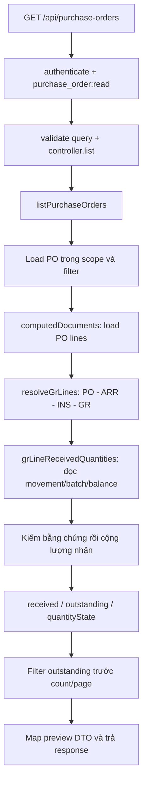
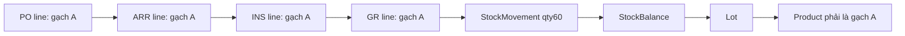
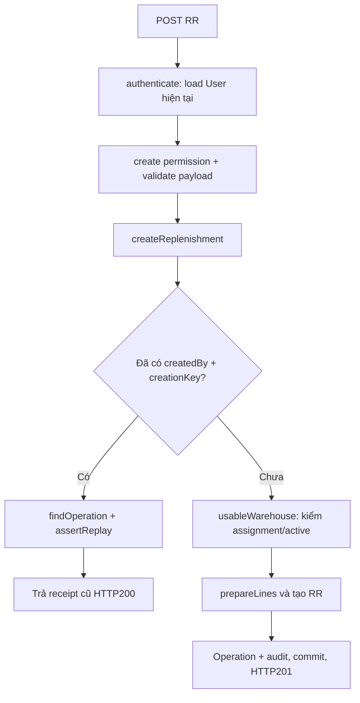
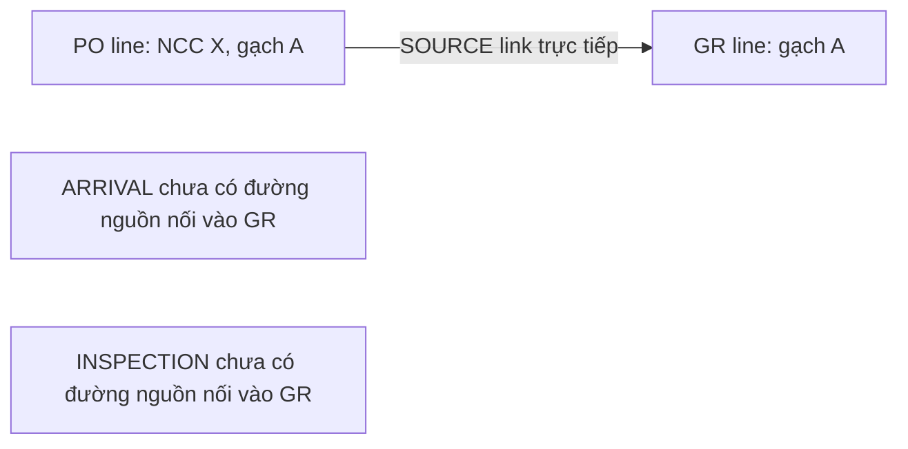

# Giải thích chi tiết các vấn đề trong BE Iteration 1

> Cập nhật 02/11/2026: các finding dưới đây đã được sửa trong [gói PO_INSPECTION/custody/GR](../po-receiving-proposal/IMPLEMENTATION.md), có regression tests. Báo cáo này giữ cách giải thích code trước sửa để truy vết nguyên nhân.

## 1. Báo cáo này giúp bạn hiểu điều gì?

Bốn vấn đề trong bản review trước vẫn còn ở source hiện tại. Chúng tập trung vào **ba phần**: tính lượng đã nhận của PO, kiểm quyền kho khi retry tạo RR và tìm nguồn GR trong lịch sử nhà cung cấp.

Mỗi phần bên dưới trình bày nghiệp vụ đúng, dữ liệu đi qua model nào, request gọi các function theo thứ tự nào, điểm code đưa ra quyết định sai, ví dụ tính từng bước và điều kiện để sửa đúng. Các đoạn ghi “mã rút gọn” là cách diễn giải để dễ đọc; liên kết source chỉ tới code thực tế.

| Mã | Câu hỏi nghiệp vụ cần trả lời | Code hiện trả lời sai ở đâu? | Mục đọc |
|---|---|---|---|
| RV-01 | Movement này làm STORE nhận thêm hay mất đi hàng? | Đếm endpoint STORE nhưng bỏ qua chiều movement khi công nhận receipt. | Mục 4 |
| RV-02 | Hàng nhận có đúng SKU và đúng lần post của GR đang xét không? | Kiểm kho nhưng thiếu Lot→Product và Batch→Document. | Mục 5 |
| RV-03 | Người gửi lại request hôm nay còn được truy cập kho của RR không? | Nhánh replay trả receipt trước bước kiểm scope kho. | Mục 6 |
| RV-04 | GR này có chuỗi nguồn nhận hàng hợp lệ của NCC không? | Chấp nhận một đường link tới PO mà chưa kiểm đủ thứ tự chứng từ. | Mục 7 |

**Phạm vi tác động đã chứng minh:** RV-01/02 làm sai kết quả đọc PO; RV-04 làm sai danh sách GR liên quan NCC; RV-03 trả receipt thao tác ngoài scope kho hiện tại. Những lần GET/replay đã kiểm không post tồn, không nhân RR và không tự đặt mua hàng.

Không suy ra rằng DB dùng chung đang chứa dữ liệu hỏng. Với RV-01/02/04, phép thử cố ý dựng dữ liệu không nhất quán để kiểm reader có nhận biết được hay không. Với RV-03, chỉ cần thay assignment của user sau một lần tạo RR hợp lệ, không cần làm hỏng ledger.

Source đối chiếu ngày **01/11/2026, Asia/Saigon**: nhánh `codex/uc-01-32-iteration-1`, HEAD `2e31d79`, các file ứng dụng liên quan chưa thay đổi so với lượt review trước. Tài liệu này giải thích các finding, chưa triển khai bản sửa.

## 2. Hiểu dữ liệu trước khi đọc lỗi

### 2.1. Ba loại số lượng thường bị nhầm

Giả sử cửa hàng đặt NCC 100 viên gạch A. Nhận sở hữu 60 viên, sau đó đã xuất bán 20 viên:

| Khái niệm | Số minh họa | Lấy từ đâu? |
|---|---:|---|
| Ordered quantity | 100 | DocumentLine của PO. |
| Received quantity của PO | 60 | Receipt đã post và ledger hợp lệ, tính ròng các lần đảo. |
| Outstanding quantity | 40 | Ordered trừ nhận ròng và lượng hủy có căn cứ. |
| On-hand hiện tại của phần hàng đó | 40 nếu không có phát sinh khác | StockBalance sau các giao dịch. |
| Available quantity | Có thể thấp hơn 40 | Balance eligible trừ reservation, loại hold/freeze và các điều kiện khác. |

PO đã nhận60 không trở thành mới nhận40 chỉ vì cửa hàng bán20. Ngược lại, có một balance trong kho không chứng minh balance đó là hàng nhận cho PO đang xem. Reader phải theo đúng nguồn chứng từ và ledger.

Các số trong báo cáo là ví dụ minh họa, không phải quy cách hoặc số tồn thực tế của cửa hàng.

### 2.2. Các model tham gia ba nhóm vấn đề

| Model | Vai trò trong luồng | Các field cần chú ý |
|---|---|---|
| BusinessDocument | Header chứng từ nhiều loại trong cùng collection | documentKind, workflowStatus, header.warehouseId, PO header.supplierId. |
| DocumentLine | Một dòng hàng của chứng từ | documentId, productId, lotId khi có, qtyBase. |
| LineLink | Nối hai dòng chứng từ | sourceLineId, targetLineId, relationCode. |
| StockMovement | Một sự kiện thay đổi tồn | lineId, documentId, batchId, fromBalanceId, toBalanceId, qtyBase, before/after. |
| PostingBatch | Một lần post hoặc đảo đã ghi nhận | documentId, operation, reversalOf. |
| StockBalance | Một chiều tồn hiện tại | lotId, accountId, ownerPartyId, qualityCode, qtyBase. |
| Lot | Nhận dạng lô và SKU thực tế của balance | productId, manufacturerLot, tone, calibre. |
| StockAccount, Location | Xác định vị trí/kho của balance vật lý | account.locationId → location.warehouseId. |
| Party | NCC hoặc chủ sở hữu hàng | kind=SUPPLIER hoặc STORE. |
| User | Quyền và phạm vi hiện tại | isActive, roleId, warehouseIds. |
| BusinessOperation | Receipt của command đã commit để chống retry trùng | documentId, performedBy, operation, idempotencyKey, payloadHash, result. |

“STORE” ở đây là Party chủ sở hữu cửa hàng, không phải role và cũng không phải tên kho. Hàng đang giữ hộ cho NCC có thể nằm trong kho vật lý nhưng owner vẫn là NCC; chưa được tính là cửa hàng đã nhận sở hữu.

### 2.3. Schema đúng chưa đủ để quan hệ nghiệp vụ đúng

`ref("Lot")` nói field chứa ID của model Lot; nó không tự chứng minh Lot.productId bằng DocumentLine.productId. Tương tự, một movement có batchId tồn tại không chứng minh batch thuộc đúng GR của movement.

Schema movement kiểm phép tính: phía from là before−qty=after, phía to là before+qty=after. Vì thế một movement **xuất60** có fromBefore60/fromAfter0 vẫn là movement hợp lệ về số học. Service nhận hàng còn phải kiểm nó có phù hợp với GR_PURCHASE/root POST hay không.

Nguồn: [balance/batch/movement schemas](D:/Ky_9/SEP490/src/be/src/models/inventory.model.js:48), [LineLink schema](D:/Ky_9/SEP490/src/be/src/models/document-link.model.js:30).

## 3. Luồng đọc PO đi qua code như thế nào?

API bị ảnh hưởng: **GET `/api/purchase-orders` — UC-07**. Request chỉ đọc, không có tác dụng xác nhận nhận hàng.



| Bước | Function/source | Logic hiện có |
|---|---|---|
| 1 | [purchase-order.routes.js:10](D:/Ky_9/SEP490/src/be/src/modules/purchase-orders/purchase-order.routes.js:10) | Authenticate, role OWNER/ACCOUNTANT/WAREHOUSE và permission read. |
| 2 | [controller.list:5](D:/Ky_9/SEP490/src/be/src/modules/purchase-orders/purchase-order.controller.js:5) | Truyền req.user và req.validated.query sang service. |
| 3 | [listPurchaseOrders:461](D:/Ky_9/SEP490/src/be/src/modules/purchase-orders/purchase-order.service.js:461) | Scope kho, search/date/status/supplier filter; lấy candidate PO. |
| 4 | [computedDocuments:344](D:/Ky_9/SEP490/src/be/src/modules/purchase-orders/purchase-order.service.js:344) | Load lines và khởi tạo trạng thái nhận từng dòng. |
| 5 | [resolveGrLines:86](D:/Ky_9/SEP490/src/be/src/modules/purchase-orders/purchase-order.service.js:86) | Duyệt LineLink tới ARRIVAL, INSPECTION, GR_PURCHASE, kiểm product/kho và inspectedSourceLineId. |
| 6 | [grLineReceivedQuantities:193](D:/Ky_9/SEP490/src/be/src/modules/purchase-orders/purchase-order.service.js:193) | Resolve ledger/batch/account/location; đây là vùng RV-01/02. |
| 7 | [computedDocuments:377](D:/Ky_9/SEP490/src/be/src/modules/purchase-orders/purchase-order.service.js:377) | Nếu receipt.incomplete thì đánh dấu PO line broken; nếu không thì cộng vào received. |
| 8 | [quantityStatus:333](D:/Ky_9/SEP490/src/be/src/modules/purchase-orders/purchase-order.service.js:333) | Có line thiếu căn cứ → UNKNOWN; có còn thiếu dương → YES; đủ → NO. |

Khi reader phát hiện dữ liệu không đáng tin, đã có đường trả an toàn: `emptyComputedLine()` giữ ordered quantity nhưng trả received/outstanding=null và quantityState=INCOMPLETE. Vấn đề là những ca bên dưới **không được đánh dấu incomplete**, nên code đi tiếp như dữ liệu đã chắc chắn.

`null` ở đây là chưa xác định được. Nó khác `"0"`, nghĩa là đã xác định số lượng bằng không. HTTP200 vẫn phù hợp nếu request đọc hợp lệ và item được đánh dấu chưa đủ dữ liệu; không cần biến mọi lỗi dữ liệu nghiệp vụ thành lỗi toàn request.

## 4. RV-01 — Tại sao movement xuất lại được tính là đã nhập?

### 4.1. Nghiệp vụ đúng

Để PO được công nhận nhận thêm60, phải có bằng chứng sở hữu STORE tăng60 theo GR tương ứng. Có STORE xuất hiện trong movement mới chỉ nói “cửa hàng tham gia sự kiện”, chưa nói “cửa hàng nhận thêm”.

Ví dụ hướng movement:

| Movement | Tác động sở hữu STORE | Cách hiểu |
|---|---:|---|
| Ngoài hệ thống → STORE | +60 | Có thể là receipt nếu đúng nguồn GR/posting. |
| NCC custody → STORE | +60 | Chuyển sang sở hữu cửa hàng nếu đúng nghiệp vụ/nguồn. |
| STORE → ngoài hệ thống | −60 | Xuất hoặc đảo nhận; không tự là một receipt dương. |
| STORE vị trí A → STORE vị trí B | 0 | Di chuyển nội bộ, không nhận sở hữu lần hai. |
| Ngoài hệ thống → custody NCC | 0 với STORE | Hàng đến kho nhưng chưa thuộc sở hữu STORE. |

### 4.2. Đoạn code có vấn đề

Vị trí: [purchase-order.service.js:275](D:/Ky_9/SEP490/src/be/src/modules/purchase-orders/purchase-order.service.js:275).

Mã rút gọn từ implementation:

```js
let storeEndpoints = 0;
for (const balanceId of [movement.fromBalanceId, movement.toBalanceId]) {
  if (!balanceId) continue;
  const balance = balanceById.get(idString(balanceId));
  // Các bước resolve account/location và kiểm kho được lược đi ở đây.
  if (idString(balance.ownerPartyId) === idString(storePartyId)) {
    storeEndpoints += 1;
  }
}
if (storeEndpoints === 1) {
  result.qty = result.qty.plus(
    new ExactDecimal(movement.qtyBase.toString()).mul(sign),
  );
}
```

Hai phía from/to được đưa vào cùng một mảng rồi đếm. Đến lệnh cộng, thông tin STORE ở **phía nào** không còn được dùng. Root batch không có reversalOf làm `batchSign()` trả+1. Do đó movement xuất60 từ STORE cũng bị cộng+60.

### 4.3. Chạy từng bước bằng ví dụ

Fixture: PO gạch A đặt100, GR POSTED, chain product/kho đầy đủ; root batch POST. Movement từ balance STORE ra ngoài, qty60, fromBefore60/fromAfter0.

| Bước trong function | Giá trị / quyết định |
|---|---|
| GR workflowStatus | POSTED → tiếp tục. |
| Batch tồn tại | Có → tiếp tục. |
| batchSign | +1 vì không có reversalOf. |
| movement.documentId | Đúng GR → tiếp tục. |
| Location warehouse | Đúng kho GR → tiếp tục. |
| STORE ở fromBalanceId | storeEndpoints tăng từ0 lên1. |
| Không có toBalanceId | Tổng vẫn1. |
| Nhánh cộng quantity | 0 +60×1 =60. |
| computedDocuments | received60 không vượt ordered100 → công nhận KNOWN. |
| Outstanding | 100−60=40. |

Kết quả HTTP thực tế đã tái hiện:

```json
{
  "orderedQtyBase": "100",
  "receivedQtyBase": "60",
  "outstandingQtyBase": "40",
  "quantityState": "KNOWN"
}
```

Trong fixture này không có bằng chứng receipt dương60. Không nên “sửa” bằng cách coi đã nhận0 một cách chắc chắn; đây là mâu thuẫn giữa root GR posting và movement, nên cần đi đường INCOMPLETE/UNKNOWN.

### 4.4. Vì sao reversal cần xử lý cẩn thận khi sửa?

Hiện code dùng ancestry của PostingBatch để lấy dấu: root+1, đảo root−1, đảo của đảo+1. Với dữ liệu hợp lệ root nhập60 và reversal xuất20, code tính60−20=40; ca này đang có test pass.

Nếu sửa bằng cách lấy chiều xuất là−20 rồi **nhân thêm batchSign−1**, kết quả của reversal lại thành+20. Cần tránh cộng/trừ hai lần cho cùng một sự kiện.

Có hai hướng thiết kế, phải chọn nhất quán khi implement:

1. Dùng delta có dấu theo chiều STORE làm giá trị số học; reversal graph dùng để kiểm tính hợp lệ/nguồn, không nhân dấu ancestry lần nữa.
2. Giữ cách tính bằng ancestry như hiện tại nhưng bắt buộc xác thực chiều/owner của movement tương thích với root hoặc reversal, trước khi cộng.

Báo cáo không chọn lại protocol posting toàn hệ thống. Cả hai cách đều phải chứng minh được root nhập, partial reversal, reversal-of-reversal và custody bằng test; không dùng một thay đổi dấu đơn lẻ để vá tất cả.

### 4.5. Tác động và vùng sửa

RV-01 làm lượng còn phải nhận có thể thấp hơn thực tế, đồng thời ảnh hưởng filter outstanding. Nó không tự tạo movement xuất60; movement đó do fixture/dữ liệu nguồn cung cấp. Reader sai khi công nhận dữ liệu đó là receipt chắc chắn.

Vùng sửa chính: `grLineReceivedQuantities()`, phối hợp `batchSign()`/batch graph và regression tests PO. Không cần sửa controller hay thêm field tồn vào Product để xử lý lỗi này.

## 5. RV-02 — Đúng kho nhưng sai gạch hoặc sai batch vẫn bị tính nhận

Đây là hai điều kiện còn thiếu trong cùng bước xác thực ledger. Chúng được gom thành RV-02 vì cùng liên quan tính nhất quán giữa các model của bằng chứng receipt.

### 5.1. Nhánh A: balance thuộc một sản phẩm khác

Chuỗi nhận hàng và chuỗi ledger phải gặp nhau ở đúng product:



`resolveGrLines()` đã kiểm product giữa PO/ARR/INS/GR. Tuy nhiên, sang `grLineReceivedQuantities()`, truy vấn chỉ load StockBalance, StockAccount, Location và documents/batches; **không load Lot để đối chiếu product thực tế của balance**.

Nguồn để kiểm product của một balance là `balance.lotId → Lot.productId`. StockBalance không có field productId trực tiếp. Không thể chỉ nhìn DocumentLine.productId rồi kết luận movement đang đưa đúng loại hàng vào balance.

Fixture:

| Bản ghi | Dữ liệu |
|---|---|
| PO/ARR/INS/GR lines | Gạch A, cùng kho WH01. |
| Movement | Trỏ đúng GR line, qty60. |
| To balance | Owner STORE, location thuộc WH01. |
| Lot của balance | productId là **gạch B**. |

Reader hiện thấy đúng kho + STORE + một endpoint nên cộng60 cho PO A. API trả nhận60/còn40/KNOWN. Về nghiệp vụ, receipt của gạch B không thể hoàn thành nghĩa vụ mua gạch A, dù số lượng và kho giống nhau.

**Điều kiện cần bổ sung:** batch load Lot cho các balance, kiểm Lot.productId khớp GR line và product của chuỗi PO. Nếu dòng GR có lotId cụ thể thì còn phải kiểm consistency với lot đó theo contract nhận hàng; không tự ép mọi dòng PO phải có lot vì PO có thể chưa biết lô lúc đặt mua.

### 5.2. Nhánh B: movement và batch thuộc hai chứng từ khác nhau

Một movement đang nói “tôi là ledger của GR-01” nhưng batch mà nó trỏ lại nói “tôi là lần post của PO-01”. Có ID batch tồn tại không đủ chứng minh batch ấy post GR-01.

Các quan hệ cần xác minh trong đường root receipt đang xét:

```text
Movement.lineId       → GR line
GR line.documentId    → GR document
Movement.documentId   → GR document
Movement.batchId      → PostingBatch
PostingBatch.documentId phải khớp nguồn posting GR theo protocol
```

Source hiện tại tại [purchase-order.service.js:264](D:/Ky_9/SEP490/src/be/src/modules/purchase-orders/purchase-order.service.js:264): load batch, kiểm batch tồn tại và tính sign; sau đó kiểm `movement.documentId` là GR_PURCHASE đúng ID. Không có phép so sánh `batch.documentId` với GR đang xét.

Fixture đổi riêng batch.documentId sang PO, các field còn lại để đúng. Kết quả vẫn received60/outstanding40/KNOWN. Reader dùng một batch không chứng minh post receipt đó làm căn cứ nhận hàng.

Với reversal/correction hợp lệ dùng chứng từ riêng trong tương lai, việc resolve phải theo protocol và liên kết nguồn được cho phép; không nên áp một phép so ID tùy ý làm hỏng lịch sử correction hợp lệ. Riêng root batch của fixture đã không cùng GR nên đủ xác nhận thiếu guard.

### 5.3. Lỗi nằm ở bước đọc nào?

| Việc reader đã làm | Việc còn thiếu |
|---|---|
| Load movement theo GR line IDs | Xác nhận đầy đủ lineage movement/line/document/batch. |
| Đảm bảo movement document là GR đang xét | Đảm bảo batch và ancestry thuộc posting nguồn hợp lệ đó. |
| Resolve account→location và kiểm kho | Resolve balance→lot→product và kiểm đúng mặt hàng. |
| Đếm owner STORE | Kết hợp chiều, product và nguồn trước khi công nhận receipt. |

**Vùng sửa:** [grLineReceivedQuantities:193](D:/Ky_9/SEP490/src/be/src/modules/purchase-orders/purchase-order.service.js:193). Hiện `resolveGrLines()` chỉ trả map GR line ID→GR document nên bước sau cũng cần có thêm thông tin GR line/product đáng tin để đối chiếu. Có thể mở rộng dữ liệu truyền giữa helper, thay vì thực hiện query riêng cho từng movement.

Không cần thay cấu trúc identity của StockBalance để vá bằng cách chép productId dư thừa vào balance. Quan hệ Lot→Product đã có; service cần đọc và kiểm đúng.

## 6. RV-03 — Vì sao retry tạo RR vẫn thành công sau khi mất quyền kho?

API: **POST `/api/replenishments` — UC-03 hoặc đường tạo-gửi trực tiếp UC-05**.

### 6.1. Hai việc riêng: chống trùng và quyền truy cập

Giả sử Sales Lan được giao kho WH01. Lan bấm lưu nháp RR, server đã commit nhưng mạng chập chờn làm trình duyệt chưa nhận response. Trình duyệt gửi lại cùng creationKey. Server cần trả receipt cũ, không tạo phiếu thứ hai. Đó là idempotency.

Nếu trước lúc retry Lan bị thu hồi WH01, server còn phải hỏi thêm: “Lan **hiện tại** có được biết kết quả thao tác đối với phiếu của kho này không?”. CreationKey nhận dạng thao tác, không cấp một quyền truy cập vĩnh viễn.

| Kiểm tra | Giải quyết câu hỏi nào? |
|---|---|
| Authenticate/User active | Ai đang gửi request? |
| Role+permission create | Người này có operation tạo RR không? |
| Warehouse assignment | Người này được thao tác/xem record trong kho nào? |
| creationKey+payloadHash | Có đúng request đã xử lý trước đó không? |

### 6.2. Luồng hiện tại của request



Điểm sai dễ thấy trên sơ đồ: bước kiểm kho chỉ nằm ở nhánh **chưa tạo**. Nhánh **đã tạo** đi thẳng tới response.

Nguồn: [createReplenishment:450](D:/Ky_9/SEP490/src/be/src/modules/replenishments/replenishment.commands.js:450), nhánh existing tại dòng465; `usableWarehouse()` ở dòng482 chỉ chạy sau nhánh đó.

Mã rút gọn:

```js
const existing = await findByCreatorAndCreationKey();
if (existing) {
  const operation = await findOperation(key);
  return assertReplay(operation, { user, operationName, documentId, hash });
}
const warehouse = await usableWarehouse(input.warehouseId, user, session);
// Tạo RR mới...
```

### 6.3. assertReplay kiểm gì và không kiểm gì?

Tại [replenishment.commands.js:133](D:/Ky_9/SEP490/src/be/src/modules/replenishments/replenishment.commands.js:133), hàm kiểm:

- Operation phải tồn tại.
- performedBy phải là user hiện tại.
- Action/operation phải đúng.
- documentId phải đúng target.
- payloadHash phải khớp.

Các điều kiện này đều có ích, nhưng không có warehouseIds hoặc header.warehouseId. Khi khớp, `commandResult()` trả ID, version, workflowStatus, operationId, approvalId và replayed=true.

`authenticate()` thực tế **đã load lại User từ DB**. Lỗi không phải JWT còn giữ warehouse assignment cũ; assignment mới có trong req.user nhưng nhánh replay không dùng nó để kiểm record.

### 6.4. Diễn biến thử nghiệm

| Thời điểm | Quyền của Sales | Request | Kết quả |
|---|---|---|---|
| T1 | Được giao WH01 | POST SAVE_DRAFT, key K | HTTP201, tạo RR v1. |
| T2 | warehouseIds bị đổi thành [] | — | Người đó không còn kho được giao. |
| T3 | Vẫn active, vẫn role Sales và permission create | POST đúng payload/key K | HTTP200, replayed=true, trả receipt v1. |
| T4 | Không có scope WH01 | GET detail RR vừa tạo | HTTP404, record ngoài scope. |

Không cần đổi payload hoặc giả user. Đây là sự khác nhau giữa hai đường API đối với cùng record: detail đã chặn theo scope, creation replay chưa chặn.

### 6.5. Fallback cũng cần được sửa cùng

`createReplenishment()` catch duplicate key/UnknownTransactionCommitResult rồi gọi [replayCreated:410](D:/Ky_9/SEP490/src/be/src/modules/replenishments/replenishment.commands.js:410). Helper này tìm theo creator+creationKey, lấy operation rồi assertReplay, cũng chưa kiểm kho.

Nếu chỉ thêm guard ở nhánh existing trong transaction thì còn một đường phục hồi sau lỗi trả receipt chưa qua guard. Chưa ép điều kiện unknown commit trong probe; thiếu guard của fallback được xác nhận bằng đọc code, không được diễn giải thành một ca unknown-commit đã tái hiện.

### 6.6. Cách sửa vẫn giữ retry đúng

Thứ tự đề xuất cho cả nhánh thường và fallback:

1. Authenticate + operation permission hiện tại.
2. Resolve đúng RR thuộc creator và kiểm **kho hiện tại của record** theo assignment hiện tại.
3. So key/action/target/hash với operation đã commit.
4. Trả nguyên receipt operation trước đó, không tạo lại chứng từ.

Không chỉ kiểm kho trong payload retry: RR có thể đã được chỉnh sang kho khác sau lần tạo. Record hiện tại là căn cứ scope; payload cũ là căn cứ nhận diện request cũ.

Cũng không đưa toàn bộ kiểm state/version/ngày cần/conversion live lên trước replay. Một phiếu đã gửi/đã duyệt hoặc một ngày cần đã qua không nên khiến retry hợp lệ tạo thêm side effect hoặc mất receipt đã commit. Cần tách **quyền hiện tại đối với record** khỏi **điều kiện thực hiện lại command mới**.

Vùng sửa: `createReplenishment()` và `replayCreated()`/helper scope dùng chung. Test phải bao gồm còn quyền→replay, mất kho→bị chặn, cùng key khác payload→409 và không tăng số RR/operation.

### 6.7. Mức tác động đã biết

Probe chỉ thấy lộ receipt gồm ID/status/version/operationId. Nó không trả nội dung100 dòng hay chứng từ nguồn. Không có record RR thứ hai và không có ledger mới. Vấn đề vẫn cần sửa vì quy tắc scope hiện tại phải áp dụng nhất quán, kể cả response retry.

## 7. RV-04 — Vì sao lịch sử NCC nhận một GR chưa đủ chuỗi nguồn?

API: **GET `/api/suppliers/:id/documents?kind=GR_PURCHASE` — phần lịch sử chứng từ của UC-29**.

### 7.1. Nghiệp vụ cần giữ trong Iteration 1

Theo plan đang review, nguồn lượng nhận mua được truy vết:

```text
PO của NCC
  → ARRIVAL: ghi hàng/chuyến thực đến
  → INSPECTION: kiểm đúng dòng arrival, chất lượng/ownership
  → GR_PURCHASE: nhận theo kết quả hợp lệ
  → ledger posting
```

PO chỉ là đặt mua, ARRIVAL chỉ là hàng đến, INSPECTION là kiểm nhận, GR/ledger ghi nhận sở hữu. Các bước khác nhau không thể được chứng minh chỉ bằng một link tùy ý nối đầu với cuối.

GR header hiện không phải chỗ có supplierId bắt buộc như PO header, nên supplier reader cần lần ngược từ các dòng GR về PO để biết NCC. Trong phạm vi plan này, phải kiểm chuỗi được chấp thuận; nếu tương lai hỗ trợ nguồn nhập trực tiếp khác thì cần đặc tả riêng, không suy từ một LineLink bất kỳ.

### 7.2. Flow code hiện tại

```text
Supplier routes → controller.documents
→ getSupplierDocuments(user, supplierId, query)
→ kiểm supplier:read + permission đọc GR + scope kho
→ supplierDocumentIdsForGr(supplierId, scope)
→ lấy các GR trong scope và các dòng của chúng
→ grSupplierIds(grLine, grWarehouseId)
→ linkedSourceLines(frontier)
→ nếu gặp PO cùng product/kho: lấy header.supplierId
→ nếu tập NCC có đúng1 ID khớp: đưa GR vào danh sách
```

Các function/điểm mở code:

- [getSupplierDocuments:430](D:/Ky_9/SEP490/src/be/src/modules/suppliers/supplier.service.js:430): quyền, scope và chọn nhánh query.kind.
- [supplierDocumentIdsForGr:394](D:/Ky_9/SEP490/src/be/src/modules/suppliers/supplier.service.js:394): tập hợp kết quả từng line về GR document.
- [grSupplierIds:347](D:/Ky_9/SEP490/src/be/src/modules/suppliers/supplier.service.js:347): duyệt ngược graph.
- [linkedSourceLines:330](D:/Ky_9/SEP490/src/be/src/modules/suppliers/supplier.service.js:330): query LineLink theo targetLineId.

### 7.3. Điểm quyết định thiếu điều kiện

`grSupplierIds()` khởi đầu frontier là GR line. Ở mỗi vòng, hàm lấy source lines trỏ vào frontier. Nếu một sourceDocument là PO, có supplierId và cùng warehouse, hàm thêm supplierId vào Set ngay.

Điều chưa được giữ trong state của vòng lặp là: “từ GR thì source **phải là INSPECTION**, từ INSPECTION phải là ARRIVAL, từ ARRIVAL mới đến PO”. Frontier chỉ giữ ID dòng, không giữ loại bước đang chờ và lineage cần xác minh.

Ngoài ra `linkedSourceLines()` hiện query tất cả relationCode; nó không chứng minh cạnh vừa đi là cạnh nguồn nhận hàng được phép. Kiểm product/kho ở mỗi node có ích nhưng không thay thế kiểm ý nghĩa và thứ tự của các cạnh.

### 7.4. Ví dụ đường tắt làm sai kết quả

Fixture tạo PO-A của NCC X, GR-A cùng gạch/kho và chỉ nối:



Khi chạy ngược:

| Bước | Code thấy gì? | Quyết định hiện tại |
|---|---|---|
| Frontier đầu | GR line | Tìm link có target=GR line. |
| Link tìm được | source=PO line, target=GR line | Load PO line/document. |
| Product | PO và GR cùng product | Qua guard. |
| Warehouse | PO và GR cùng kho | Qua guard. |
| documentKind nguồn | PO | Thêm NCC X, không yêu cầu đã đi qua INS/ARR. |
| Tập supplier IDs | Chỉ X | Đưa GR-A vào lịch sử NCC X. |

HTTP200 và GR-A có trong items. Code không tự tạo ARR/INS còn thiếu; nó đơn giản đã chấp nhận một nguồn chưa đủ điều kiện.

### 7.5. Hai module đang hiểu khác một graph

PO reader có `expectedNextKind={PO:ARRIVAL, ARRIVAL:INSPECTION, INSPECTION:GR_PURCHASE}` và kiểm inspectedSourceLineId. Với link PO→GR trực tiếp, nó nhận ra target kind sai và trả UNKNOWN.

Supplier reader chỉ cần đi tới PO nên lại đưa GR vào items. Người dùng có thể thấy GR trong lịch sử NCC, nhưng PO tương ứng không xác nhận được lượng nhận. Đó là bất nhất giữa hai cách giải thích cùng nguồn dữ liệu.

### 7.6. Sửa ở đâu và cần bảo toàn gì?

Sửa traversal ở `grSupplierIds()`/`linkedSourceLines()` hoặc chia sẻ một resolver đủ rõ với PO reader:

1. Từ GR chỉ nhận nguồn INSPECTION đúng loại và relation nhận hàng được cho phép.
2. Từ INSPECTION kiểm lineKind và details.inspectedSourceLineId trỏ đúng ARRIVAL line.
3. Từ ARRIVAL mới resolve về PO cùng product/kho.
4. PO phải có supplierId hợp lệ; xử lý nhiều nguồn không rõ ràng một cách tường minh.
5. Thiếu/broken chain thì không gán GR cho supplier chỉ vì có thể đi tới PO.
6. Giữ permission và scope trước hydrate, giữ count/page theo tập GR đã xác thực.

Không cần thêm supplierId từ client vào GET, cũng không nên copy supplierId vào GR để che lỗi chain. Nếu dùng denormalization cho hiệu năng sau này thì source lineage vẫn phải được xác thực lúc ghi và có cách kiểm lại.

## 8. Vì sao test pass mà vẫn có bốn vấn đề?

Test pass chỉ xác nhận các tình huống có assertion đã chạy. Nó không tự kiểm mọi tổ hợp dữ liệu mô tả trong plan.

| Vùng | Test hiện có đã kiểm | Tình huống còn thiếu dẫn đến finding |
|---|---|---|
| PO receipt | Nhập hợp lệ, draft không tính, custody, partial reversal, over receipt, closed/broken chain | Root POST có chiều xuất, balance lot sai product, batch sai document. |
| RR | Replay đúng payload, khác payload conflict, scope command, submit/review race | Tạo xong rồi bị thu hồi assignment, sau đó retry endpoint create. |
| Supplier GR | Chuỗi demo hợp lệ và scope kho | SOURCE link trực tiếp PO→GR thiếu ARR/INS. |

Nguồn test: [PO integration](D:/Ky_9/SEP490/src/be/test/iteration1-purchase-order.integration.test.js:306), [RR integration](D:/Ky_9/SEP490/src/be/test/iteration1-replenishment.integration.test.js:196), [supplier documents integration](D:/Ky_9/SEP490/src/be/test/iteration1-master.integration.test.js:407).

Kết quả toàn bộ suite **ở lượt review trước**: mặc định75 pass/15 skip; có local replica set157 pass/1 skip Cloudinary, không fail. Ngày01/11 đã chạy lại script probe sáu ca trên checkout hiện tại và nhận lại cùng kết quả. Không gắn số157 pass cho một lần full-suite mới chưa chạy trong lượt viết giải thích này.

Probe có1 ca control receipt đúng và5 ca bất thường tương ứng4 finding. Source script: [review-probes-2026-10-31.mjs](D:/Ky_9/SEP490/src/be/docs/iteration-1/review-probes-2026-10-31.mjs). Kết quả mô tả từng ca: [review-evidence-2026-10-31.json](D:/Ky_9/SEP490/src/be/docs/iteration-1/review-evidence-2026-10-31.json). Hai file giữ ngày của lần tạo; việc chạy lại hôm nay không thay đổi kết quả lưu lịch sử hay sửa ứng dụng.

Các probe tạo DB localhost riêng tên ngẫu nhiên, khởi động HTTP app cổng ngẫu nhiên, dựng fixtures rồi dọn đúng DB test. Không dùng DB chia sẻ và không chạy migration apply.

## 9. Những gì chưa được chứng minh, cần hiểu đúng

| Nhận xét | Cách hiểu chính xác |
|---|---|
| “PO reader có thể báo nhận sai” | Đã tái hiện với ledger/quan hệ nguồn bất thường. Chưa kết luận PO thật của cửa hàng đang sai. |
| “RR replay bỏ scope” | Đã tái hiện với mất assignment; lộ receipt, không tự mở quyền ghi mọi kho. |
| “Supplier GR thiếu chain vẫn xuất hiện” | Có bằng chứng ở list related-documents; không có nghĩa GET đã post GR hoặc sửa ledger. |
| “Còn thiếu test race lot” | Là khoảng trống nghiệm thu, chưa đủ kết luận lockLotIdentity có bug concurrency. |
| “PO filter tính trước page” | Đúng để bảo toàn kết quả outstanding; có rủi ro chi phí lớn nhưng chưa benchmark nên chưa kết luận chậm đến mức nào. |

Khi sửa các reader, không sửa thẳng StockBalance để làm số hiển thị khớp. Nếu DB thật có lịch sử post sai, đó còn là bài toán correction/reversal có thẩm quyền, khác với sửa logic GET. Reader cần trung thực về phần thiếu căn cứ và giữ nguyên lịch sử.

## 10. Bảng hành động cụ thể khi thực hiện bản sửa sau này

| Finding | Nơi cần thay đổi chính | Hành vi bắt buộc sau sửa | Test chống tái phát |
|---|---|---|---|
| RV-01 | purchase-order.service.js: grLineReceivedQuantities/batch validation | Root receipt sai chiều không được báo nhận dương; reversal hợp lệ vẫn tính ròng đúng. | Nhập60; đảo20→ròng40; root xuất; custody; đảo của đảo. |
| RV-02 | purchase-order.service.js: GR line metadata và ledger joins | Kiểm Lot→Product, movement/line/document/batch; mâu thuẫn → INCOMPLETE/null. | Sai SKU balance; sai batch doc; missing refs; dữ liệu hợp lệ vẫn KNOWN. |
| RV-03 | replenishment.commands.js: createReplenishment/replayCreated | Quyền record/kho hiện tại áp trước response replay, vẫn giữ receipt idempotent khi còn quyền. | Thu hồi warehouseIds sau create; direct SUBMIT retry; cùng key khác payload; không thêm RR/operation. |
| RV-04 | supplier.service.js: grSupplierIds/linkedSourceLines | Chỉ gán NCC khi chuỗi được phép hợp lệ, không nhận đường tắt hoặc relation tùy ý. | PO→GR trực tiếp; sai inspectedSourceLineId; chain chuẩn; nhiều nguồn; kho ngoài scope. |

Thứ tự triển khai hợp lý: sửa và kiểm RV-01/02 cùng nhau vì dùng chung quantity reader; sửa RV-03 riêng vì thuộc quyền/retry; sau đó thống nhất source traversal RV-04 và chạy lại regression toàn gói. Đây là đề xuất thứ tự, không phải các bước đã được thực hiện.

## 11. Cách tự lần code để đối chiếu báo cáo

1. Với PO, mở `listPurchaseOrders()` để thấy API lấy tập PO; đi vào `computedDocuments()` rồi `resolveGrLines()` để thấy nguồn; cuối cùng dừng ở `grLineReceivedQuantities()` để xem điều kiện trước cộng received.
2. Đặt hai câu hỏi ở lệnh cộng: **“đây là lượng của mặt hàng nào?”** và **“sở hữu STORE tăng hay giảm?”**. Chúng dẫn trực tiếp tới RV-01/02.
3. Với RR, so hai nhánh `if(existing)` và `usableWarehouse()`. Thấy return nằm trước guard kho là hiểu được RV-03. Đọc thêm `assertReplay()` để phân biệt kiểm cùng request với kiểm quyền record.
4. Với supplier, quan sát frontier của `grSupplierIds()`: code chỉ đang giữ ID hay còn giữ “loại nguồn phải gặp ở bước kế tiếp”? Đây là khác biệt giữa đi được tới PO và chứng minh được chuỗi nhận hàng.

Bản review tổng thể và giải thích các module không có finding nằm tại [REVIEW_2026-10-31.md](D:/Ky_9/SEP490/src/be/docs/iteration-1/REVIEW_2026-10-31.md). Tài liệu API hiện tại nằm tại [API Iteration 1](D:/Ky_9/SEP490/src/be/docs/api/iteration-1/README.md). Báo cáo này bổ sung cách đọc và lý do các kết luận review, không biến hành vi lỗi thành nghiệp vụ chuẩn.
