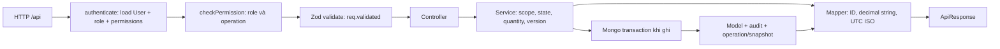
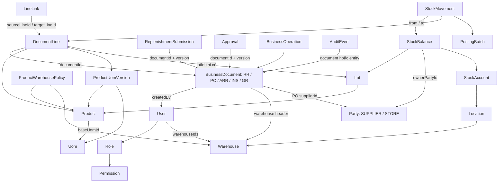
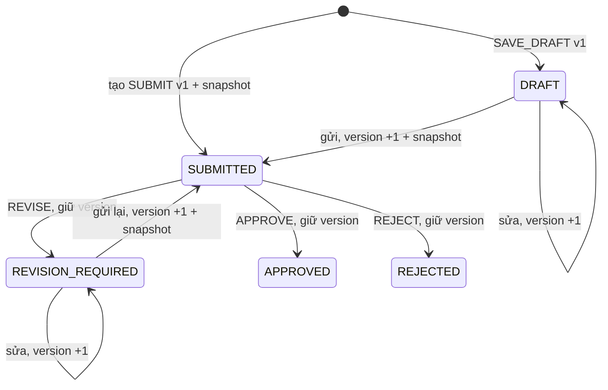

# Review BE Iteration 1 — 31/10/2026

> Cập nhật 02/11/2026: RV-01–04 đã có bản sửa và regression tests trong [gói PO receiving](../po-receiving-proposal/IMPLEMENTATION.md). Nội dung và bằng chứng bên dưới giữ nguyên snapshot lịch sử của lượt review.

## 1. Kết luận và phạm vi kiểm tra

**BE đã triển khai endpoint và service cho đủ 23 UC trong plan: UC-01–07 và UC-17–32. Luồng chính và nhiều nhánh lỗi đã có integration test chạy với MongoDB thật. Tuy nhiên, chưa nên kết luận toàn bộ Definition of Done của plan đã đạt: review bổ sung xác nhận bốn vấn đề cần sửa và còn một số kịch bản nghiệm thu chưa có test trực tiếp.**

Đánh giá theo module:

| Module | Kết luận |
|---|---|
| Replenishments | Có đầy đủ read/create/update/submit/review, snapshot và retry; còn lỗi kiểm scope khi replay tạo phiếu — RV-03. |
| Purchase orders | Có danh sách và tính nhận/còn thiếu từ ledger; kiểm tính hợp lệ của ledger chưa đủ — RV-01, RV-02. |
| Products | Đã có UC-17–23: master, trạng thái, conversion version, policy; chưa thấy lỗi bắt buộc sửa qua phạm vi kiểm tra này. |
| Lots | Đã có UC-24–27 và helper khóa identity; chưa có test cạnh tranh trực tiếp giữa khóa lô và sửa identity như plan yêu cầu. |
| Suppliers | Đã có UC-28–32, phân quyền contact/status và lịch sử; truy vết GR về NCC chưa kiểm đủ chuỗi loại chứng từ — RV-04. |

Nguồn yêu cầu là **bản đặc tả chi tiết cuối cùng** trong [chat Plan iteration 1 use cases](thread://01a18c8f-8d7c-7032-965b-95a746e96ae6?hostId=local). Đã đọc trực tiếp chat tham chiếu trước khi đối chiếu. Bản này thay thế kế hoạch trước trong cùng chat; không coi mô tả “đã có” tại thời điểm lập plan là trạng thái hiện tại.

Snapshot source được review:

- Repository: `D:/Ky_9/SEP490/src/be`.
- Nhánh: `codex/uc-01-32-iteration-1`; HEAD: `2e31d79`.
- Working tree BE sạch trước khi tạo tài liệu review.
- Đã đọc `AGENTS.md`, `context.md`, model và code/test liên quan. Context chứa cả thiết kế và phần đã triển khai; kết luận runtime dựa trên source và kết quả chạy kiểm tra.
- Chỉ bổ sung tài liệu và script bằng chứng; không sửa service/model ứng dụng, không apply migration vào DB dùng chung, không commit/push.

### 1.1. Quyết định của plan được giữ đúng

RR mới chỉ là manual, từng dòng `MANUAL_OTHER` và có lý do riêng. Có thể lưu nháp hoặc gửi ngay; không bắt buộc tồn dưới minimum. Owner duyệt lượng từng dòng và không tự duyệt phiếu của chính mình. Owner xem RR/PO và cấu hình policy ở mọi kho. NCC có ba trạng thái, Accountant tạo `ACTIVE`, Owner thay trạng thái và được khôi phục hợp tác. Lô là danh mục dùng chung, còn tồn/lịch sử phụ thuộc kho. Bằng chứng xác minh lô là tham chiếu văn bản. PO chưa có quantity xác nhận có cấu trúc nên trả `confirmedQtyBase=null`.

Tạo RR từ SO/kiểm kê/cảnh báo, evaluate shortage, notification, PO commands, receiving/posting và FE nằm ngoài gói này. Việc chưa triển khai các phần đó **không phải lỗi thiếu scope của Iteration 1 này**.

## 2. Các vấn đề đã xác nhận

Các mã RV dưới đây là mã phát hiện của báo cáo, không thay mã UC/BR. P2 là vấn đề cần sửa trong vòng phát triển thông thường. Những ca ledger không nhất quán bên dưới được dựng trong DB test riêng; chúng chứng minh reader chưa bảo vệ đủ dữ liệu đầu vào, không chứng minh DB dùng chung hiện đang có dữ liệu sai.

### RV-01 — [P2] PO cộng dương một movement xuất khỏi STORE như một lần nhận hàng

**Vị trí:** [purchase-order.service.js:275](D:/Ky_9/SEP490/src/be/src/modules/purchase-orders/purchase-order.service.js:275), đặc biệt nhánh cộng quantity tại dòng 302.

`grLineReceivedQuantities()` chỉ đếm có bao nhiêu endpoint thuộc STORE. Khi có đúng một endpoint STORE, hàm cộng `qtyBase × batchSign`, bất kể STORE nằm phía `fromBalanceId` hay `toBalanceId`.

Tái hiện qua HTTP:

1. PO đặt 100, chuỗi PO → ARRIVAL → INSPECTION → GR đầy đủ, cùng product/kho.
2. GR POSTED có root batch `POST`, không phải reversal.
3. Movement **đi ra** từ STORE 60, `fromBefore=60`, `fromAfter=0`, không có phía nhận STORE.
4. GET `/api/purchase-orders` vẫn trả `receivedQtyBase="60"`, `outstandingQtyBase="40"`, `quantityState="KNOWN"`.

Movement này không chứng minh nhận thêm 60 vào sở hữu cửa hàng. Theo yêu cầu reader của plan, dữ liệu nhận không nhất quán phải trả `INCOMPLETE`, thay vì xác nhận đã nhận dương. Hậu quả là số còn phải nhận có thể bị giảm sai và bộ lọc outstanding trả kết quả sai.

**Hướng sửa:** xác định net delta STORE từ chiều thực tế của endpoint; kiểm chiều/loại movement tương thích root/reversal trước khi công nhận receipt. Tránh vừa đổi dấu theo chiều, vừa nhân thêm dấu reversal làm đảo hai lần. Thêm test root nhập, root xuất sai, custody→STORE, reversal và reversal-of-reversal.

### RV-02 — [P2] PO thiếu kiểm product của balance và quan hệ batch–document

**Vị trí:** [purchase-order.service.js:193](D:/Ky_9/SEP490/src/be/src/modules/purchase-orders/purchase-order.service.js:193), [purchase-order.service.js:264](D:/Ky_9/SEP490/src/be/src/modules/purchase-orders/purchase-order.service.js:264).

Reader kiểm product trên các DocumentLine và kho trên Location, nhưng không load Lot để kiểm `StockBalance.lotId → Lot.productId`. Hàm cũng không đối chiếu `PostingBatch.documentId` với receipt/movement document đang cộng.

Hai phép thử độc lập đều trả sai trạng thái chắc chắn:

| Dữ liệu test | Kết quả thực tế |
|---|---|
| PO/ARR/INS/GR đều product A, movement nhận 60 vào balance có lot thuộc product B | PO A báo nhận 60, còn 40, KNOWN. |
| Movement trỏ GR đúng, nhưng batch của movement có documentId trỏ PO | Vẫn báo nhận 60, còn 40, KNOWN. |

Đây là hai điều kiện thiếu trong cùng bước xác thực ledger. Unique index và `ref()` Mongoose không chứng minh các quan hệ xuyên collection này đúng.

**Hướng sửa:** batch load Lot, đối chiếu product/lot với dòng GR và PO; kiểm movement, batch, line và document cùng chain hợp lệ. Kiểm cả ancestry reversal, không chỉ có batch tồn tại. Thiếu hoặc mâu thuẫn căn cứ phải trả `INCOMPLETE` và quantity không xác định bằng null. Bổ sung test riêng cho từng trường hợp.

### RV-03 — [P2] Retry tạo RR bỏ qua quyền kho hiện tại

**Vị trí:** [replenishment.commands.js:465](D:/Ky_9/SEP490/src/be/src/modules/replenishments/replenishment.commands.js:465), fallback [replenishment.commands.js:410](D:/Ky_9/SEP490/src/be/src/modules/replenishments/replenishment.commands.js:410).

Trong `createReplenishment()`, nhánh tìm thấy `(createdBy, creationKey)` trả `assertReplay()` trước khi gọi `usableWarehouse()`. `assertReplay()` kiểm actor/action/target/hash nhưng không kiểm scope kho. `replayCreated()` ở nhánh phục hồi sau duplicate/unknown commit cũng thiếu bước này.

Tái hiện:

1. Sales được giao WH01 tạo draft thành công, HTTP 201.
2. Thu hồi toàn bộ `warehouseIds` của Sales; role và permission create vẫn giữ.
3. Gửi lại đúng payload và creationKey: HTTP 200, `replayed=true`, trả ID/version/status/operationId.
4. GET detail cùng ID trả 404 do người đó không còn scope kho.

Phạm vi lộ dữ liệu ở phép thử là **receipt thao tác**, không phải toàn bộ dòng RR; không có RR mới hoặc stock mutation được tạo. Tuy vậy, hành vi trái protocol plan: kiểm scope hiện tại trước khi trả kết quả replay.

**Hướng sửa:** áp predicate creator + scope kho hiện tại trước trả receipt ở cả nhánh replay bình thường và fallback. Retry vẫn phải giữ nguyên kết quả operation cũ khi người gọi còn quyền. Bổ sung test mất assignment sau create/direct-submit rồi retry.

### RV-04 — [P2] Supplier documents chấp nhận GR thiếu chuỗi ARRIVAL/INSPECTION

**Vị trí:** [supplier.service.js:347](D:/Ky_9/SEP490/src/be/src/modules/suppliers/supplier.service.js:347), nhánh gặp PO tại dòng 374.

`grSupplierIds()` duyệt ngược các LineLink và chấp nhận PO gặp được, không giữ trạng thái “hop này phải là INSPECTION, rồi ARRIVAL, rồi PO”. `linkedSourceLines()` cũng không giới hạn relationCode. Vì vậy một link trực tiếp PO → GR đủ làm GR xuất hiện trong danh sách NCC.

Tái hiện: GR cùng product/kho chỉ có SOURCE link trực tiếp từ PO, không có đường nối ARRIVAL/INSPECTION. GET `/api/suppliers/:id/documents?kind=GR_PURCHASE` vẫn chứa GR đó. Trong khi đó PO reader yêu cầu thứ tự loại chứng từ và coi đường tắt này là chain lỗi.

**Tác động:** cùng một nguồn dữ liệu được hai module diễn giải khác nhau; danh sách NCC có thể trình bày GR như đã có căn cứ nguồn trong khi chuỗi kiểm nhận chưa được xác lập.

**Hướng sửa:** dùng typed traversal cho từng hop, relation SOURCE hợp lệ, kiểm `INSPECTION.details.inspectedSourceLineId`, product/kho và nguồn NCC không mơ hồ. GR không đủ chain phải bị loại khỏi lịch sử NCC; không suy nguồn chỉ từ khả năng đi tới PO.

### 2.1. Rủi ro và khoảng trống chưa kết luận là bug

- PO list tải toàn bộ PO sau filter thông thường rồi tính graph/ledger trước phân trang. Việc lọc outstanding trước count/page là đúng, nhưng chi phí tăng theo toàn bộ tập ứng viên, kể cả khi `limit=10`. Supplier GR history và lot movements cũng có phần lọc/paginate trong bộ nhớ. Chưa benchmark tải lớn, chưa có kết luận SLA.
- Test lot hiện kiểm khóa khi đã có reference, chưa có ca chạy cạnh tranh thực sự `lockLotIdentity()` với `updateLot()` như plan yêu cầu.
- PO integration hiện có reversal một cấp, chưa có ca đảo của đảo, graph trùng đường và một GR map về nhiều PO line. Code có nhánh xử lý một số trường hợp này; có nhánh code không đồng nghĩa đã được nghiệm thu.
- Chưa có bằng chứng trong lượt review về một lỗi giữa transaction làm rollback toàn bộ RR sau khi đã bắt đầu ghi. Test input lỗi và test trạng thái tồn không đổi là hữu ích nhưng không thay thế hoàn toàn ca fault-injection giữa transaction.
- DB cũ cần migration để có version và metadata phù hợp; không nên coi default trong schema là bằng chứng dữ liệu lưu đã được nâng cấp. Lượt review không kiểm hay apply migration trên DB dùng chung.

## 3. Bằng chứng kiểm thử

Đã chạy lại trong lượt review, không chỉ dùng báo cáo verification cũ:

| Lần chạy | Tổng | Pass | Fail | Skip | Ý nghĩa |
|---|---:|---:|---:|---:|---|
| `npm test`, không MONGODB_TEST_URI | 90 | 75 | 0 | 15 | Unit/schema và test không cần DB. |
| `MONGODB_TEST_URI` trỏ localhost rs0, `npm test` | 158 | 157 | 0 | 1 | HTTP + Mongo transactions trên DB test random của từng suite. |
| Script probe bổ sung | 6 ca | 1 control đúng, 5 ca xác nhận lỗ hổng | Không phải suite assertion | — | Năm ca bất thường quy về bốn finding RV-01–04. |

Skip còn lại là live Cloudinary provider test. Bộ test hiện tại pass **không phủ định các finding**, vì các input bổ sung chưa được các assertion hiện tại kiểm tra.

Các suite chính:

- [iteration1-foundation.test.js](D:/Ky_9/SEP490/src/be/test/iteration1-foundation.test.js): schema, strict payload, quantity, model và migration planning.
- [iteration1-replenishment.integration.test.js](D:/Ky_9/SEP490/src/be/test/iteration1-replenishment.integration.test.js): RR qua HTTP, revisions, snapshots, concurrency submit/review, self-approval, stock neutrality.
- [iteration1-master.integration.test.js](D:/Ky_9/SEP490/src/be/test/iteration1-master.integration.test.js): products, conversions, policy, lots, supplier rights/history và race mã trùng.
- [iteration1-purchase-order.integration.test.js](D:/Ky_9/SEP490/src/be/test/iteration1-purchase-order.integration.test.js): quantity receipt/reversal, draft/custody/over/broken/closed, filter/scope.
- [iteration1-migration.integration.test.js](D:/Ky_9/SEP490/src/be/test/iteration1-migration.integration.test.js): dry-run/apply, backup, chạy lại.

Bằng chứng bổ sung: [JSON kết quả](D:/Ky_9/SEP490/src/be/docs/iteration-1/review-evidence-2026-10-31.json) và [script tái hiện](D:/Ky_9/SEP490/src/be/docs/iteration-1/review-probes-2026-10-31.mjs).

Chạy script từ thư mục BE bằng `node docs/iteration-1/review-probes-2026-10-31.mjs`. Script kết nối cố định localhost rs0, ghi demo vào DB `sep490_review_it1_<ObjectId ngẫu nhiên>`, gọi HTTP server cổng ngẫu nhiên rồi xóa đúng DB test trong finally. Script in actual behavior để đối chiếu, không phải bộ regression test với expected assertion. Các fixtures cố ý không nhất quán được tạo bằng model API trong DB test; không phải dữ liệu thật của cửa hàng.

## 4. Ma trận đối chiếu đủ 23 UC

Ký hiệu test: **RR** = iteration1-replenishment; **MD** = iteration1-master; **PO** = iteration1-purchase-order, đều là integration. “Có” nghĩa endpoint/service và test chính đã tồn tại, không phải chứng nhận mọi điều kiện của plan đều pass.

| UC | API chính, sau prefix /api | Service chịu trách nhiệm | Kiểm chứng / nhận xét |
|---|---|---|---|
| UC-01 | GET /replenishments | listReplenishments | Có; read integration + pipeline filter/scope. |
| UC-02 | GET /replenishments/:id, /submissions, /submissions/:version | getReplenishment, listReplenishmentSubmissions, getReplenishmentSubmission | Có; RR kiểm snapshot/lịch sử từng lần gửi. |
| UC-03 | POST /replenishments, SAVE_DRAFT | createReplenishment | Có; RV-03 ở nhánh replay. |
| UC-04 | PUT /replenishments/:id | updateReplenishment | Có; giữ ID dòng, soft-delete, version và creator. |
| UC-05 | POST /replenishments, SUBMIT; POST /:id/submit | createReplenishment, submitReplenishment | Có; snapshot và concurrent submit; direct-create replay chịu RV-03. |
| UC-06 | POST /replenishments/:id/review | reviewReplenishment | Có; partial/zero/revise/reject/self/race review. |
| UC-07 | GET /purchase-orders | listPurchaseOrders | Có; RV-01/02 và thiếu một số ca graph/reversal phức tạp. |
| UC-17 | GET /products | listProducts | Có; MD. |
| UC-18 | GET /products/:id, /:id/conversions | getProduct, listConversions | Có; current conversion và lịch sử tách riêng. |
| UC-19 | POST /products | createProduct | Có; Product + base conversion + audit nguyên tử. |
| UC-20 | PUT /products/:id | updateProduct | Có; expectedVersion và giữ document snapshot. |
| UC-21 | PATCH /products/:id/status | changeProductStatus | Có; no-op và trạng thái inactive vẫn đọc. |
| UC-22 | POST /products/:id/conversions | createConversion | Có; version bất biến và race dùng Product guard. |
| UC-23 | GET /products/:id/warehouse-policies; PUT /:id/warehouse-policies/:warehouseId | listPolicies, configurePolicy | Có; Owner-only, default target, CAS. |
| UC-24 | GET /lots | listLots | Có; catalog chung và hasScopedStock. |
| UC-25 | GET /lots/:id, /:id/movements | getLot, getLotMovements | Có; endpoint history cần thêm stock_movement:read. |
| UC-26 | POST /lots | createLot | Có; Warehouse tạo được, validation VERIFIED/UNKNOWN. |
| UC-27 | PUT /lots/:id | updateLot | Có; khóa identity khi đã tham chiếu; thiếu test race lock/update. |
| UC-28 | GET /suppliers | listSuppliers | Có; chỉ Party SUPPLIER. |
| UC-29 | GET /suppliers/:id, /:id/history, /:id/documents | getSupplier, getSupplierHistory, getSupplierDocuments | Có; RV-04 ở nguồn GR. |
| UC-30 | POST /suppliers | createSupplier | Có; Accountant tạo ACTIVE và race code. |
| UC-31 | PUT /suppliers/:id | updateSupplier | Có; Accountant contact, không đổi status. |
| UC-32 | PATCH /suppliers/:id/status | changeSupplierStatus | Có; Owner, restore TERMINATED và no-op. |

## 5. Request chạy qua BE như thế nào?

Điểm mount thật: [routes.js](D:/Ky_9/SEP490/src/be/src/routes.js), [app.js](D:/Ky_9/SEP490/src/be/src/app.js).



1. `authenticate()` xác thực Bearer/cookie rồi **load lại User từ MongoDB và populate roleId.permissionIds**. Quyền không chỉ lấy từ JWT cũ; tài khoản inactive hoặc mất role hợp lệ bị chặn.
2. `checkPermission()` kiểm đồng thời role được phép và permission key. ADMIN không được tự vượt quyền nghiệp vụ. Service command mới còn gọi `requirePermission()` để bảo vệ ở tầng nghiệp vụ.
3. `validate()` parse body/query/params; kết quả có default/transform nằm trong `req.validated`. Đây là điểm cần nhớ vì Express 5 có req.query dạng getter. Controller mới dùng dữ liệu đã parse.
4. Controller chỉ lấy input/user, gọi service, trả envelope. RR create mới trả 201; replay trả 200.
5. Service quyết định ai được xem/sửa record, trạng thái cho phép và số lượng hợp lệ; model chỉ bảo vệ cấu trúc/index và một phần local validation.
6. Error handler trả `{success:false,message,code?,fieldErrors?,details?}`; parser 1 MiB trả 413 có mã riêng. Success dùng `{success:true,message,data}`.

### 5.1. Bốn lớp kiểm quyền cần phân biệt

| Lớp | Ví dụ |
|---|---|
| Danh tính hiện tại | User active; đúng một role hiện tại. |
| Operation | Sales có replenishment_request:create; Owner có approve. |
| Record/kho | Sales chỉ đọc RR do mình tạo trong kho được giao. |
| Điều kiện thực hiện | Chỉ DRAFT/REVISION_REQUIRED sửa được; đúng version; Owner khác creator/submitter. |

Có permission read không cho phép đổi trạng thái hay xem mọi source document. RR read scope: Owner mọi kho; Accountant kho được giao; Sales/Warehouse thêm điều kiện createdBy. Khi filter createdBy, pipeline intersect với scope, không ghi đè scope. Detail ngoài scope trả 404. Explicit filter kho ngoài assignment trả 403.

Product master không lọc theo kho. Lot metadata dùng chung Owner/Warehouse nhưng stock và movements phải theo kho. Supplier master là Owner/Accountant; documents của supplier còn cần permission loại chứng từ và scope kho riêng.

### 5.2. Decimal, ngày và hai loại version

Quantity/factor nhận và trả dạng chuỗi, ví dụ `"3"`, `"0.36"`. `decimalStringSchema()` không nhận JSON number; chuẩn hóa bằng ExactDecimal. `multiplyBaseQuantity()` tính `enteredQty × basePerUnit`, kiểm precision/scale và `wholeBaseUnits` ở service. DB lưu Decimal128; mapper chuyển về string, không trả object `$numberDecimal`.

`neededOn` là ngày lịch Việt Nam. Input `2026-11-05` được lưu mốc `00:00 +07:00` tương ứng UTC ISO; khi FE hiển thị cần hiểu đây là date-only theo Asia/Saigon. Draft được giữ ngày cũ, submit phải kiểm không trước hôm nay. Review không tính lại điều kiện ngày cần.

`Product.version` bảo vệ record master; `ProductUomVersion.version` là phiên bản hệ số của cặp product/UOM, hai số này không phải một. RR document version là phiên bản nội dung/lần gửi; review **không tăng version**. `expectedVersion` không phải operationKey: version phát hiện dữ liệu cũ, key nhận dạng một lần thao tác khi retry.

## 6. Model được liên kết và sử dụng ra sao?

### 6.1. Bản đồ quan hệ trong phạm vi review



Sơ đồ chỉ tập trung các quan hệ dùng trong Iteration 1; AuditEvent còn trỏ master qua entityType/entityId. Mongoose ref không tự kiểm foreign key hay cùng product/kho. Các thiếu sót RV-01/02 chính là lý do service phải kiểm các quan hệ này.

### 6.2. Vai trò từng nhóm model

| Model / collection | Ý nghĩa và cách dùng |
|---|---|
| Product / products | Một SKU và thuộc tính danh mục; không chứa tồn thực tế. Base UOM/wholeBaseUnits/SKU không đổi qua UC-20. |
| Uom / uoms | Danh mục đơn vị như PIECE/BOX/M2; module này đọc catalogue, không có UC quản trị UOM mới. |
| ProductUomVersion / product_uom_versions | Hệ số theo product/UOM/version/validFrom; append-only. Dòng chứng từ giữ factor snapshot để lịch sử không đổi. |
| ProductWarehousePolicy / product_warehouse_policies | Minimum/target theo SKU và kho; unique product+warehouse, version độc lập; không tự tạo RR. |
| Lot / lots | Nhận dạng product + manufacturerLot + tone + calibre và căn cứ VERIFIED; không phải stock quantity/quality. |
| Party / parties | Dùng chung các loại đối tác/chủ sở hữu. Supplier module ép kind=SUPPLIER; STORE là chủ sở hữu dùng xác định receipt/available. Không có collection suppliers riêng. |
| BusinessDocument / business_documents | Header/status/version của nhiều loại chứng từ dùng discriminator documentKind. RR và PO nằm cùng collection nhưng schema header khác nhau. |
| DocumentLine / document_lines | Dòng độc lập, có ID ổn định để link/approval/ledger tham chiếu. RR dùng lineKind REPLENISHMENT và details.removedAt. |
| ReplenishmentSubmission / replenishment_submissions | Ảnh chụp bất biến từng lần gửi: header kho/ngày/lý do và tối đa 100 dòng có tên/UOM/conversion/qty tại lúc gửi. |
| Approval / approvals | Quyết định gắn documentId + documentVersion + decisionKind. RR lưu lượng duyệt từng lineId; không ghi đè requested qty. |
| BusinessOperation / business_operations | Receipt của thao tác RR: actor/action/key/hash/version/result để replay đúng kết quả đã commit. Master commands không dùng model này. |
| AuditEvent / audit_events | Lịch sử ai làm gì, thời điểm, entity/document và field trước/sau. Master dùng entityType/entityId thay vì gán master ID vào documentId. |
| DocumentLink / document_links | Quan hệ giữa header như RR→PO hoặc nguồn→RR đã lưu. Read không tự tạo link mới. |
| LineLink / line_links | Quan hệ từng dòng: nguồn nhận hàng, RR→PO... Reader phải kiểm relation và chain, không chỉ có ID nối nhau. |
| StockAccount / stock_accounts | Tài khoản tồn tại location hoặc transit dispatch line; xác định nơi hàng nằm. |
| StockBalance / stock_balances | Quantity hiện tại theo account+lot+quality+owner. Quantity của một SKU có thể phân tán thành nhiều balance. |
| PostingBatch / posting_batches | Một lần post/đảo có idempotency và reversalOf; là bằng chứng thực thi tồn. |
| StockMovement / stock_movements | Dòng ledger, from/to balance và before/after; một movement không được cộng hai lần vì có hai endpoint. |
| Reservation, DefectHold, LocationLock | Dùng khi tính available: giữ hàng, chặn lỗi, freeze kiểm kê. |
| DemandSupplyAllocation | Liên kết nhu cầu–nguồn cung đã lưu; RR read có thể hiển thị dữ liệu này, manual commands không sinh allocation. |

BusinessDocument/DocumentLine constructor đã chọn typed schema; không cần tạo thêm collection RR/PO hoặc discriminator riêng ở service. Hiện registry có 40 collections; số lượng collection không chứng minh có đủ API nghiệp vụ cho toàn hệ thống.

### 6.3. Tồn thực tế, khả dụng và lượng đã nhận là ba câu hỏi khác nhau

- **Lot detail stock:** hàng hiện nằm ở account/location nào, owner/quality nào, quantity bao nhiêu trong scope người xem.
- **RR currentStock.availableQtyBase:** lượng STORE/GOOD có thể dùng tại kho hiện tại, sau các điều kiện eligible và trừ reservation.
- **PO receivedQtyBase:** lượng đã nhận sở hữu theo lịch sử ledger hợp lệ, kể cả sau đó đã bán/chuyển khỏi receiving. Không dùng qty hiện tại của balance để thay lượng đã nhận PO.

Vì vậy GR có thể nhận 100 nhưng available vẫn 0 khi hàng ở receiving, bị hold hoặc kho freeze. Lot có balance cũng không đồng nghĩa được cấp hàng. Một request RR hoặc một approval không làm số tồn tăng.

## 7. Module Replenishments — logic và flow UC-01–06

Điểm đọc chính: [replenishment.service.js](D:/Ky_9/SEP490/src/be/src/modules/replenishments/replenishment.service.js). Điểm ghi: [replenishment.commands.js](D:/Ky_9/SEP490/src/be/src/modules/replenishments/replenishment.commands.js). Việc tách hai file giúp phân biệt truy vấn dữ liệu với chuyển trạng thái có transaction.

### 7.1. UC-01: danh sách RR

`listReplenishments()` gọi `buildListPipeline()`:

1. `replenishmentScope()` tạo điều kiện documentKind REPLENISHMENT, kho được giao và creator theo role.
2. Filter user được ghép bằng `$and`: search số phiếu literal, warehouse, creator, status, ngày tạo.
3. Nếu lọc approvalDecision, `$lookup` latest approval rồi lọc **trước** count/page. Latest lấy theo documentVersion, decidedAt, ID giảm dần.
4. `$facet` trả items và total trên cùng pipeline. Mỗi item lookup tối đa ba dòng và lineCount; cả hai loại `details.removedAt` khác null.
5. `loadMasters()` batch load User/Warehouse/Product/Conversion/Uom để map DTO, giảm query theo từng dòng.

`latestDecision` có thể thuộc version trước khi người tạo đang sửa lại phiếu; `isForCurrentVersion` cho biết có áp dụng cho version hiện tại không. Không được coi quyết định cũ là đã duyệt nội dung vừa sửa.

### 7.2. UC-02: chi tiết và lịch sử submission

`getReplenishment()` load scoped RR trước; sau đó đọc active lines, approvals và submissionCount. Nó lấy ba nhóm thông tin độc lập: master để hiển thị, current availability, và relations đã lưu.

`currentApproval` phải có `documentVersion === document.version`; chỉ decision APPROVE mới điền lượng duyệt từng dòng. `approvedQtyBase="0"` là kết quả duyệt bằng không, khác `null` khi không có quyết định áp dụng.

`loadRelations()` đọc DocumentLink/LineLink, dòng SO/WIR, PO, Reservation/Allocation đã có. Với nguồn SO, hàm chỉ nhận WIR cùng SO/product rồi quy về canonical SO line. `canReadRelated()`/`mapRelatedReference()` kiểm quyền nguồn riêng; không đủ quyền chỉ trả ID/kind và `access=UNAVAILABLE`, không hydrate số phiếu/trạng thái của nguồn.

`listReplenishmentSubmissions()` trả danh sách lần gửi theo version giảm dần; `getReplenishmentSubmission()` trả snapshot và approval đúng version. Không có snapshot lịch sử thì trả `available=false`, `snapshot=null`, `approval=null`; không dựng snapshot từ lines hiện tại.

**Ví dụ:** lần gửi v3 là 100 viên với lý do A, Owner trả sửa. Người tạo đổi còn 70 với lý do B rồi gửi v5. Xem v3 vẫn thấy 100/A; xem v5 thấy 70/B. Xem RR detail là nội dung hiện tại, không phải cách thay thế lịch sử submission.

### 7.3. Cách tính current availability

Hai function chính nằm tại [replenishment.availability.js](D:/Ky_9/SEP490/src/be/src/modules/replenishments/replenishment.availability.js):

- `getCurrentAvailability()` chọn product/kho active, location STORAGE active+allocatable, lot VERIFIED, balance STORE/GOOD; lấy reservation ACTIVE, hold ACTIVE và location lock.
- `sumAvailableBalances()` loại toàn bộ balance có hold ACTIVE hoặc account bị lock, rồi trừ tổng reservation ACTIVE đúng một lần cho mỗi balance còn eligible. Nếu reservation vượt balance thì báo dữ liệu không nhất quán; không âm thầm ép về 0.

Ví dụ balance eligible 100, reservation 20 → available 80. Nếu chính balance ấy có DefectHold ACTIVE thì code hiện tại loại cả balance, không tính 100−20−holdQty. Đây là lựa chọn chặn bảo thủ trong context. Dữ liệu trả có computedAt để nhận biết đây là số live, không phải cam kết đã reserve cho RR.

### 7.4. Function chuẩn bị dòng trước create/update/submit

`prepareLines()` là trung tâm quantity validation:

1. Batch load Product, conversion được chọn, các conversion đã có hiệu lực và UOM.
2. Product phải active; conversion phải thuộc product, đã có hiệu lực và là current của đúng product/UOM.
3. Tính `qtyBase = enteredQty × basePerUnit` bằng ExactDecimal.
4. Kiểm dương, giới hạn precision/scale và số nguyên nếu wholeBaseUnits.
5. Chặn dòng trùng product+UOM+reason. Payload qua Zod đã trim lý do và chuẩn hóa quantity.
6. Trả dữ liệu đã chuẩn bị gồm master và snapshot; server tự gán `triggerType=MANUAL_OTHER` khi tạo line.

Hàm không yêu cầu below-minimum và không evaluate shortage/coverage. RR manual không cần Lot, không chọn một balance cụ thể và không giữ hàng.

### 7.5. UC-03 và đường tạo-gửi trực tiếp của UC-05

`createReplenishment()`:

1. Kiểm Sales/Warehouse + create permission.
2. Canonical payload → SHA-256; creation operation key được namespace theo actor+creationKey.
3. Trong transaction tìm phiếu đã tạo bởi actor với cùng creationKey. Nếu có, so operation/hash để replay; nhánh này có RV-03 cần bổ sung kiểm scope.
4. Nếu chưa có: kiểm kho active và assignment; action SUBMIT còn kiểm neededOn không quá khứ.
5. `prepareLines()` kiểm tất cả dòng trước khi ghi.
6. Tạo BusinessDocument với documentNo `RR-<ObjectId viết hoa>`, version 1; lần lượt tạo DocumentLine.
7. SAVE_DRAFT: status DRAFT, chưa có submitted facts/snapshot. SUBMIT: status SUBMITTED, gán submittedBy/submittedAt thật và gọi `writeSubmission()`.
8. Ghi BusinessOperation/result và AuditEvent; commit cùng transaction.

Một dòng lỗi không được tạo một phiếu bán phần. Operation và audit cùng transaction bảo đảm retry không chỉ tìm thấy phiếu mà thiếu receipt do tách giao dịch. Không có sequence collection chỉ để sinh số phiếu.

### 7.6. UC-04: sửa phiếu đã lưu

`updateReplenishment()`:

1. `ownedDocument()` load đúng creator và kiểm kho hiện tại; tìm operation cũ trước kiểm version để replay operation đã commit.
2. Chỉ DRAFT hoặc REVISION_REQUIRED, đúng expectedVersion; kiểm cả kho cũ và kho mới active/được giao.
3. Đọc toàn bộ dòng kể cả removed; chỉ dòng hiện hành được sửa. Có dòng nguồn khác MANUAL_OTHER thì từ chối manual command.
4. ID dòng gửi lên phải thuộc phiếu, chưa removed, không lặp; không đổi product trên một ID cũ.
5. Kiểm dòng mới qua prepareLines; CAS header theo ID+creator+editable status+version và tăng version.
6. Dòng còn trong payload giữ ID; dòng vắng mặt đặt removedAt. Dòng mới dùng ID mới và lineNo lớn hơn max của cả lịch sử, không tái dùng số dòng đã bỏ.
7. Ghi operation/audit rồi commit.

PUT ở đây là toàn bộ nội dung hiện hành muốn giữ: bỏ một dòng khỏi payload nghĩa là bỏ dòng đó khỏi phiếu, không phải giữ nguyên vì không gửi. REVISION_REQUIRED sau save vẫn REVISION_REQUIRED; save chưa phải gửi lại. submittedBy/submittedAt lần trước không bị giả thành lần gửi mới.

### 7.7. UC-05: gửi phiếu đã lưu

`submitReplenishment()` chỉ nhận expectedVersion/operationKey, không nhận sửa header/lines cùng request:

1. Kiểm creator/scope và replay.
2. Kiểm editable state/version, kho active, neededOn hợp lệ.
3. Load 1–100 active lines, tất cả manual và lý do không trống.
4. `prepareLines()` kiểm lại product/conversion hiện hành. Conversion đổi sau khi lưu draft → conflict, không tự lấy hệ số mới.
5. CAS chuyển SUBMITTED, tăng version, gán submittedBy/submittedAt.
6. `writeSubmission()` tạo snapshot đúng version đó; ghi operation/audit rồi commit.

`writeSubmission()` lưu tên/SKU product, mã/tên kho, mã UOM, conversion ID/version/factor, enteredQty, qtyBase và lý do. Sau này đổi master không thay nội dung đã gửi.

### 7.8. UC-06: Owner approve/reject/revise

`reviewReplenishment()` đọc RR SUBMITTED đúng version và snapshot của version đó. `appendApproval()` kiểm actor khác cả creator lẫn submitter; đổi role từ Sales sang Owner không làm mất dấu danh tính người tạo.

Với APPROVE:

1. Payload phải bao phủ đúng toàn bộ lineId trong snapshot, không thiếu/thừa/trùng.
2. `0 <= approvedQtyBase <= snapshot.qtyBase`, đúng độ hạt sản phẩm.
3. Bị giảm hoặc bằng 0 phải có lý do riêng; phải có ít nhất một dòng dương.
4. Lưu Approval.lines với requested lineId, lượng duyệt và outcome; requested quantity trong RR/snapshot vẫn giữ nguyên.

Với REJECT/REVISE: bắt buộc reason chung, không có lượng duyệt; Approval.lines rỗng. Trạng thái lần lượt REJECTED/REVISION_REQUIRED. Review dùng conversion đã gửi, không yêu cầu conversion còn current, không chặn chỉ vì neededOn đã qua.

Approval append + CAS workflowStatus + BusinessOperation + audit cùng transaction; document.version giữ nguyên. Unique `(documentId,documentVersion,decisionKind)` phối hợp CAS chặn hai quyết định trên cùng version. Concurrent review test hiện có xác nhận chỉ một approval thành công.



Ví dụ xuyên suốt: draft v1 → sửa v2 → gửi v3 → trả sửa v3 → sửa v4 → gửi v5 → duyệt v5. Submission chỉ có v3 và v5. Approval v3 không áp cho v5. APPROVED/REJECTED không được sửa/gửi lại trong gói command này.

### 7.9. Retry hoạt động thế nào?

`creationPayload()/updatePayload()/submitPayload()/reviewPayload()` tạo dữ liệu hash đã chuẩn hóa: actor/action/target/version và nội dung nghiệp vụ. Thứ tự lines được giữ nguyên; object keys được sắp để hash ổn định. IDs lowercase, quantity chuẩn và text trim qua validation.

`findOperation()` tìm BusinessOperation; `assertReplay()` so actor/action/target/hash rồi `commandResult()` trả receipt cũ với replayed=true. Cùng key đổi payload/action/target → 409. Không dùng BusinessOperation.result như trạng thái live hiện tại của phiếu: replay của create có thể vẫn trả DRAFT v1 dù phiếu đã đi tiếp; muốn trạng thái mới phải GET detail.

Mongo `withTransaction()` dùng snapshot readConcern và majority writeConcern, ghi tuần tự trong session. Catch duplicate key hoặc unknown commit tra lại operation trước trả lỗi; các replay fallback cũng phải kiểm scope hiện tại, như RV-03 nêu.

### 7.10. Danh mục function RR để lần code

| Function | Vai trò |
|---|---|
| replenishmentScope, canReadRelated | Scope RR và quyền hydrate nguồn. |
| buildListPipeline, latestApprovalLookup | Filter, latest decision, count/page và preview active lines. |
| loadMasters, loadRelations, sourceReferences, mapRelations | Đọc master/source/link đã lưu và ánh xạ nguồn được phép xem. |
| getReplenishment, list/getReplenishmentSubmission | Nội dung hiện tại và snapshot version độc lập. |
| usableWarehouse, ownedDocument | Kiểm kho và creator cho command. |
| prepareLines, lineDocument | Kiểm conversion/quantity và tạo dữ liệu dòng manual. |
| writeSubmission | Ghi snapshot lần gửi, không ghi đè lịch sử. |
| appendApproval | Quy tắc người duyệt, lượng từng dòng và loại quyết định. |
| creationOperationKey, operationKeyHash | Namespace và hash raw client key. |
| findOperation, assertReplay, replayCreated, replayCommand | Nhận diện thao tác đã commit và kiểm payload retry. |
| getReplenishmentOptions | CREATE chỉ kho active được giao; FILTER theo read scope, gồm kho inactive lịch sử. |

## 8. Module Products — UC-17–23

Source: [product.service.js](D:/Ky_9/SEP490/src/be/src/modules/products/product.service.js), [product.validation.js](D:/Ky_9/SEP490/src/be/src/modules/products/product.validation.js), [product.mapper.js](D:/Ky_9/SEP490/src/be/src/modules/products/product.mapper.js).

### 8.1. Đọc sản phẩm — UC-17/18

`listProducts()` kiểm product:read cho bốn role kinh doanh, tìm SKU/name literal, filter nominalSize/isActive, whitelist sort và phân trang MongoDB. Nó chỉ join Uom để hiển thị base unit, không join stock hoặc tạo lượng tồn demo.

`getProduct()` load Product và gọi `detailWithMasters()`. `currentConversionsByProduct()` lấy conversion validFrom <= now, sort theo product/UOM/validFrom/version rồi chọn một bản đầu mỗi cặp. Conversion tương lai vẫn nằm trong history nhưng chưa current. `listConversions()` trả history phân trang, không thay current bằng bản có version lớn nhất bất kể ngày hiệu lực.

### 8.2. Tạo/sửa/trạng thái — UC-19/20/21

`createProduct()` chỉ Owner có product:create:

1. SKU trim+uppercase; validate name, UOM và thuộc tính gạch. Length/width phải cùng có hoặc cùng không.
2. Trong transaction kiểm Uom tồn tại, pre-check duplicate SKU.
3. Tạo Product active v1; tạo base conversion factor 1, conversion v1 cùng UOM gốc, actor thật.
4. Append audit rồi commit. Unique index xử lý thêm race duplicate sau pre-check.

Không tự tạo lot, stock balance hay policy khi tạo SKU. nominalSize chỉ là nhãn danh nghĩa; không suy calibre hay hệ số diện tích từ trường đó.

`updateProduct()` chỉ Owner có product:update, CAS theo expectedVersion. Whitelist metadata như name/brand/material/surface/kích thước; không nhận SKU/baseUomId/wholeBaseUnits/isActive/conversion/policy. Optional field bị bỏ trong PUT được `$unset`, không giữ ngầm. Product.version tăng 1 và audit lưu field thay đổi trước/sau; các DocumentLine snapshot không bị cập nhật.

`changeProductStatus()` là command riêng có expectedVersion, isActive và reason. Đúng version mà trạng thái không đổi thì trả record hiện tại, không tạo audit/transition mới. Inactive vẫn đọc được và không xóa lịch sử. Command không di chuyển/xóa tồn đang có; các writer cấp hàng phải kiểm active ở flow của mình.

### 8.3. Thêm conversion version — UC-22

`createConversion()`:

1. Kiểm product active + expectedProductVersion, UOM tồn tại và không phải UOM gốc.
2. basePerUnit dương, precision 24/scale 12, reference văn bản không rỗng.
3. Nếu UOM BOX và product nguyên viên, factor phải nguyên. M2 không bị ép factor nguyên nhưng lượng quy đổi khi dùng phải ra base quantity hợp lệ.
4. validFrom không ở quá khứ tại lúc service xử lý. Client nên chọn mốc tương lai đủ xa để request không tới server sau mốc hiệu lực vừa chọn.
5. CAS tăng Product.version như guard chung, tìm max conversion.version cho product/UOM rồi append max+1.
6. Audit cùng transaction. Response trả cả productVersion mới và conversion mới.

Không có API update/delete conversion. Ví dụ BOX v1=4 viên, sau đó BOX v2=6 viên: chứng từ cũ 3 BOX vẫn giữ factor4/qty12; chứng từ mới chọn current v2 thì 3 BOX thành18. Draft RR dùng v1 không tự biến thành18; submit yêu cầu người dùng chọn lại conversion nếu v1 không còn current.

### 8.4. Cấu hình policy — UC-23

`configurePolicy()` chỉ Owner; product và warehouse phải active, Owner không bị giới hạn assigned warehouses cho operation này. Input dùng minimumQtyBase/targetQtyBase, DB field là minimumQty/targetQty.

- Chưa có policy: expectedVersion=0 → insert version1. Đã tồn tại mà gửi 0 → conflict.
- Đã có: expectedVersion phải đúng record policy → CAS tăng1; không dùng Product.version làm policy version.
- Bỏ target thì target=minimum, kể cả khi đang update; target >= minimum >=0. Product nguyên viên yêu cầu cả hai số nguyên.
- Gán updatedBy và audit; không phát notification, không tạo RR, không thay tồn.

`listPolicies()` cũng yêu cầu product:update của Owner, không suy quyền xem policy từ product:read. `getProductOptions()` trả UOM catalogue cho business reader; thêm warehouse catalogue active khi Owner có product:update. `loadUoms()`/mapUom/mapConversion/mapPolicy chỉ hydrate và serialize DTO.

## 9. Module Lots — UC-24–27

Source: [lot.service.js](D:/Ky_9/SEP490/src/be/src/modules/lots/lot.service.js), [lotIdentity.js](D:/Ky_9/SEP490/src/be/src/shared/utils/lotIdentity.js).

### 9.1. Lô là nhận dạng, không phải một dòng tồn

Một lô được xác định bởi `(productId, manufacturerLot, tone, calibre)`. Cùng lô có thể nằm ở nhiều kho/location/owner/quality. Số lượng thuộc StockBalance, không thuộc Lot. Sửa notes của Lot không thay quality GOOD/DAMAGED; thay quality phải qua nghiệp vụ tồn tương ứng.

`listLots()` lọc danh mục theo product/identity/status rồi phân trang; `scopedStockRows()` join Balance→Account→Location→Warehouse/Party, chỉ map kho được phép. warehouseId query giới hạn **phần stock presence được kiểm**, không biến catalog chung thành danh sách chỉ có lot trong kho đó. Lô chưa có balance vẫn xem được.

Lưu ý sát implementation: `hasScopedStock` hiện là có balance row tìm được trong scope; code không kiểm qtyBase>0. Một balance quantity0 vẫn có thể làm cờ này true. FE không nên diễn giải cờ đó là “còn số lượng để xuất”.

`getLot()` trả metadata chung và các stock dimensions được phép; không dựng supplier, firstImportDate hay initial quantity nếu không có nguồn.

### 9.2. Tạo lô — UC-26

`createLot()` cho Owner/Warehouse có product_lot:create:

1. Product phải active; identity trim nhưng không tự uppercase tone/calibre.
2. Nếu VERIFIED: đủ identity thực, không thành phần UNKNOWN và có verificationReference; server điền verifiedBy/verifiedAt.
3. Nếu UNKNOWN: thông tin chưa biết ghi rõ UNKNOWN, không bịa mã ngẫu nhiên để né unique identity; chưa đủ điều kiện tính available.
4. Ngày sản xuất không tương lai theo lịch Việt Nam.
5. Tạo Lot v1, createdBy thật, identityLocked=false và audit trong transaction.

Warehouse có thể tạo nhưng không được sửa chính lô vừa tạo qua UC-27. Đó là phân quyền operation, không phải quyền sở hữu creator.

### 9.3. Sửa lô và khóa identity — UC-27

`updateLot()` chỉ Owner:

1. Load Lot và expectedVersion.
2. `lotHasReferences()` tìm DocumentLine hoặc StockBalance dùng lot, kể cả balance bằng0. Nếu có thì khóa identity trong transaction.
3. ManufacturerLot/tone/calibre chỉ được thay khi chưa lock/chưa có reference. ProductId không có trong payload update.
4. Thay identity phải gửi identificationStatus; VERIFIED cần căn cứ xác minh mới. VERIFIED→UNKNOWN bị chặn trong UC này.
5. CAS theo version; khi đổi identity thêm điều kiện identityLocked=false, tăng version và ghi audit.

`lockLotIdentity(lotId, session)` cập nhật cùng Lot trước khi writer ghi reference. Writer relocation hiện có gọi helper trong transaction tại [location-movement.service.js:214](D:/Ky_9/SEP490/src/be/src/modules/location-movements/location-movement.service.js:214). Nhờ cùng ghi vào Lot, writer và update identity cạnh tranh trên cùng record thay vì chỉ kiểm “chưa dùng” bằng một query đọc.

Nếu update cố đổi identity đã có reference, toàn transaction bị abort; việc vừa đặt cờ lock trong chính transaction đó cũng rollback, nhưng yêu cầu đổi identity vẫn bị chặn nhờ kiểm reference. Chỉ nhìn cờ false trong DB cũ không đủ kết luận lô chưa dùng.

### 9.4. Lịch sử movement — UC-25

`getLotMovements()` cần cả product_lot:read và stock_movement:read. Hàm tìm movements liên quan các balance của lot, resolve **cả hai đầu** và chỉ đưa vào kết quả nếu các endpoint có scope hợp lệ. Sau đó mới tính total/page.

`movementDocumentReference()` hydrate documentNo/status/version khi có permission chứng từ riêng; thiếu quyền thì access=UNAVAILABLE. Before/after trả từ ledger movement, không lấy current balance thay lịch sử. Batch trả operation, postedAt, reversalOf để hiểu đây có phải đảo không.

Reader hiện resolve endpoint qua physical Location; endpoint transit không có location sẽ không hydrate được và movement tương ứng bị loại theo nguyên tắc scope bảo thủ. Không nên mô tả API hiện tại là đã hỗ trợ đầy đủ mọi lịch sử transit của lô.

## 10. Module Suppliers — UC-28–32

Source: [supplier.service.js](D:/Ky_9/SEP490/src/be/src/modules/suppliers/supplier.service.js), [supplier.mapper.js](D:/Ky_9/SEP490/src/be/src/modules/suppliers/supplier.mapper.js).

### 10.1. Đọc danh mục, hồ sơ và lịch sử — UC-28/29

`listSuppliers()` ép kind=SUPPLIER, literal search code/name, filter cooperationStatus, phân trang MongoDB. `findSupplier()` cũng ép kind ở detail; không thể dùng một Customer ID để lấy như Supplier.

`supplierStatus()` có fallback cho dữ liệu cũ thiếu cooperationStatus: isActive=false → SUSPENDED, còn lại ACTIVE. Nó không suy TERMINATED từ một boolean inactive. `getSupplier()` chỉ trả master contact/status; không tự trả toàn bộ chứng từ hoặc số dư công nợ.

`getSupplierHistory()` đọc AuditEvent với entityType SUPPLIER/entityId, sort eventAt/ID giảm dần; trả actor/time/changes/details. History global của master không đồng nghĩa quyền xem tất cả chứng từ kho của supplier.

`getSupplierDocuments()` nhận kind PO/GR_PURCHASE/SUPPLIER_RETURN, kiểm permission tương ứng và scope kho. PO/SR lấy supplierId trực tiếp từ header. GR cần truy về PO qua `supplierDocumentIdsForGr()`/`grSupplierIds()`; phần này có RV-04. Response chỉ reference header, không cấp API detail đích mới hay URL evidence.

### 10.2. Tạo/sửa contact — UC-30/31

`createSupplier()` chỉ Accountant có supplier:create: code trim+uppercase, kiểm trùng trên **toàn Party**, không chỉ suppliers; server gán kind SUPPLIER, ACTIVE/isActive=true, v1. Insert+audit cùng transaction; duplicate key được map conflict khi hai request cùng mã.

`updateSupplier()` chỉ Accountant có supplier:update: expectedVersion, name/contact fields whitelist; optional field bỏ trong PUT bị unset. Code/kind/status/isActive không được nhận. Sửa contact của supplier TERMINATED không khôi phục hợp tác; ID không đổi nên các PO/GR/SR liên quan vẫn trỏ record cũ.

### 10.3. Thay cooperation status — UC-32

`changeSupplierStatus()` chỉ Owner có supplier:activate, có expectedVersion và reason. Cho chuyển mọi cặp ACTIVE/SUSPENDED/TERMINATED, kể cả TERMINATED→ACTIVE.

Thay đổi thực thì CAS tăng version, cập nhật statusReason và `isActive = cooperationStatus === ACTIVE`, audit from/to/reason. Đúng version nhưng status giống hiện tại thì no-op, không audit mới. Stale version vẫn conflict ngay cả khi trạng thái gửi lên tình cờ bằng hiện tại.

Owner không được dùng quyền status để sửa contact; Accountant không kích hoạt qua PUT. Supplier inactive vẫn xem history/documents được. Không tự hủy PO hay đảo receipt khi ngừng hợp tác. Việc chặn chọn NCC inactive cho **PO mới** phải nằm trong UC-09 sau này vì Iteration 1 không có create-PO command.

## 11. Module Purchase Orders — UC-07

Source: [purchase-order.service.js](D:/Ky_9/SEP490/src/be/src/modules/purchase-orders/purchase-order.service.js). Chỉ có list GET trong gói này, không có create/update/cancel/close PO.

### 11.1. Chuỗi xử lý và chức năng từng hàm

| Function | Công việc |
|---|---|
| scopedWarehouseFilter | Owner toàn kho, Accountant/Warehouse assigned; explicit warehouse ngoài scope bị chặn. |
| listPurchaseOrders | Lấy PO theo filter, gọi tính quantity, lọc outstanding, count/page, hydrate supplier/kho/preview. |
| computedDocuments | Nhóm PO lines theo document; map một GR về nhiều PO line thì đánh dấu broken; hợp thành quantity từng PO. |
| resolveGrLines | Duyệt LineLink PO→ARRIVAL→INSPECTION→GR_PURCHASE, kiểm product/kho và inspectedSourceLineId; Set GR IDs chống cộng lặp. |
| grLineReceivedQuantities | Đọc ledger GR, resolve batch/balance/account/location, tính quantity STORE; còn RV-01/02. |
| loadBatchGraph | Load các batch của movements và lần ngược reversalOf để có ancestry. |
| batchSign | Tính dấu theo số bậc reversal, phát hiện cycle/missing ancestor. |
| emptyComputedLine | Giữ ordered quantity, trả receipt/outstanding null và INCOMPLETE khi thiếu căn cứ. |
| quantityStatus | Một line INCOMPLETE hoặc không có line → UNKNOWN; còn outstanding dương → YES; mọi line known và không thiếu → NO. |
| mapPreviewLines | Hydrate Product/UOM cho tối đa ba dòng, serialize decimal string. |

Lọc outstanding **sau** tính quantity nhưng **trước** count/page là điểm đúng; nếu paginate trước thì tổng và số trang sai khi nhiều PO không khớp filter.

### 11.2. Công thức và ví dụ

Khi đủ căn cứ, implementation hiện tại dùng:

```text
received = tổng effective STORE receipt của các GR line hợp lệ
cancelled = 0 cho PO chưa có dấu hiệu đóng/hủy và chưa có cancellation fact
outstanding = ordered - received
```

PO CLOSED/CANCELLED không có căn cứ lượng hủy/đóng → INCOMPLETE; không tự biến còn thiếu thành0. Nhận vượt ordered, chain broken hoặc receipt không có ledger hợp lệ cũng phải trả không xác định.

| Tình huống | Kết quả đúng đã có test hiện tại |
|---|---|
| Đặt100, posted nhận60 | Nhận60, còn40. |
| Thêm draft GR30 | Vẫn nhận60, còn40. |
| Nhận60, reversal20 hợp lệ | Nhận ròng40, còn60. |
| Custody NCC80, chưa chuyển sở hữu STORE | Nhận sở hữu0, còn100. |
| Nhận110 cho PO100 | INCOMPLETE, quantity không xác định null. |
| CLOSED nhưng thiếu căn cứ remainder | UNKNOWN, không suy còn0. |

`confirmedQtyBase` luôn null vì supplierConfirmation hiện là text. Không cộng tổng header giữa SKU/UOM khác nhau. Warehouse nhận DTO phục vụ nhận hàng, không có ghi chú xác nhận NCC hay flow tài chính; mọi GET giữ nguyên dữ liệu nguồn.

### 11.3. Diễn giải reversal cho đúng

Code hiện cộng từng movement một lần, dùng dấu ancestry batch. Root60 + reversal20 →60−20=40; không vừa loại root60 rồi tiếp tục trừ reversal20 lần nữa. batchSign có thể tính dấu cho đảo của đảo nhưng bộ test PO hiện chưa trực tiếp chứng minh ca đó.

Giới hạn nằm ở bước xác thực: dấu ancestry tự nó không chứng minh movement đang đi đúng chiều hoặc đúng product. Sau sửa RV-01/02 phải kiểm cả tính hợp lệ của chiều/dimension rồi mới áp công thức, giữ test nhập/đảo để tránh sửa một ca làm hỏng ca khác.

## 12. Transaction, audit, migration và thứ tự xử lý tiếp

### 12.1. Mỗi command thực sự ghi những gì?

| Command | Ghi trong transaction | Tác động tồn |
|---|---|---|
| RR create/save | BusinessDocument, DocumentLine, BusinessOperation, AuditEvent | Không post. |
| RR submit | Status/version/submitted facts, ReplenishmentSubmission, BusinessOperation, AuditEvent | Không post. |
| RR review | Approval, workflowStatus, BusinessOperation, AuditEvent | Không post. |
| Product create | Product + base ProductUomVersion + AuditEvent | Không post. |
| Product update/status | Product + AuditEvent, trừ no-op status | Không post. |
| Conversion create | Product.version guard + ProductUomVersion mới + AuditEvent | Không post. |
| Policy configure | ProductWarehousePolicy + AuditEvent | Không post. |
| Lot create/update | Lot + AuditEvent; khóa identity khi phù hợp | Không post. |
| Supplier create/update/status | Party + AuditEvent, trừ no-op status | Không post. |

Các command không ghi PostingBatch/StockMovement/Reservation/Allocation/StockBalance. Lot identity locking thay metadata Lot, không đổi quantity. RR manual được phép khi kho freeze vì không evaluate coverage và không post.

Các master update dùng CAS: filter `_id + version`, `$inc:version`. Conversion còn CAS Product để hai người cùng thêm không tự lấy chung version. Status no-op không tăng version. Master không có operation key/replay receipt như RR; retry master stale version có thể trả409, đúng khác biệt contract của plan.

`changedFields()` tạo danh sách field trước/sau; `appendAudit()` ghi AuditEvent với details tối đa4000 và changes tách riêng. RR audit lưu tóm tắt action/version/count; chi tiết nội dung đã gửi ở Submission, không nhét toàn bộ100 dòng vào details.

### 12.2. Migration hiện có và giới hạn xác nhận

Source: [iteration-1.js](D:/Ky_9/SEP490/src/be/src/migrations/iteration-1.js), runner [run-iteration-1.js](D:/Ky_9/SEP490/src/be/src/migrations/run-iteration-1.js).

`planIteration1Upgrade()` chỉ đọc và lập danh sách thay đổi:

1. Phát hiện SKU/Party code trùng sau trim+uppercase; yêu cầu xử lý thủ công, không chọn record thắng.
2. Bổ sung version1 còn thiếu cho Product/Party/Lot.
3. Supplier thiếu cooperationStatus map inactive→SUSPENDED, còn lại ACTIVE.
4. Lot có DocumentLine/StockBalance reference được identityLocked=true.
5. Không bịa verifiedBy/At, conversion creator hoặc submission snapshot lịch sử.

`applyIteration1Upgrade()` yêu cầu replica set/sharded và backup callback; build indexes ngoài data transaction, không drop/syncIndexes hàng loạt; data changes và bước kiểm “không còn gì để đổi” chạy trong transaction. Index đã build không được coi là rollback cùng data nếu bước sau lỗi.

Runner mặc định dry-run. Apply backup EJSON và manifest ra ngoài Git, sau đó mới ghi. Integration test chạy lại an toàn đã pass trên DB riêng; việc đó không có nghĩa DB dev/shared đã được migrate. Lượt review không chạy migration apply vào DB dùng chung.

### 12.3. Các việc nên thực hiện để chốt nghiệm thu

1. Sửa RV-01/02 tại reader PO và thêm regression test cho đúng chiều, đúng product/lot, batch-document, các cấp reversal và nguồn mơ hồ.
2. Sửa RV-03 cho cả đường replay create bình thường và fallback; chứng minh sau thu hồi kho không trả receipt ngoài scope.
3. Sửa RV-04 bằng typed source traversal thống nhất với PO reader; test shortcut, sai inspectedSourceLineId và nhiều nguồn.
4. Bổ sung test race khóa lot/update identity và rollback giữa transaction RR; giữ assertion chỉ một transition và snapshot/audit/operation nguyên tử.
5. Chạy lại focused suites sau sửa, rồi npm test với replica set. Cập nhật kết quả review sau khi có bằng chứng mới.
6. Khi bắt đầu tích hợp FE/deploy, kiểm trạng thái migration trên đúng DB được dùng và nối đúng contract API. Đây là bước triển khai tiếp, chưa được thực hiện trong lượt review.

### 12.4. Thứ tự đọc code để hiểu hệ thống

Đọc routes + validation để biết API cho phép gửi gì; đọc service exported function để hiểu UC; lần vào helper quantity/scope/replay; cuối cùng đọc schema/index và integration test của UC. Với RR nên đi create → update → submit → review → read history; với PO nên đi listPurchaseOrders → computedDocuments → resolveGrLines → grLineReceivedQuantities.

Tài liệu API để tích hợp: [API reference](D:/Ky_9/SEP490/src/be/docs/api/iteration-1/README.md). Các thẻ UC có sẵn: [use-cases.md](D:/Ky_9/SEP490/src/be/docs/iteration-1/use-cases.md). Báo cáo này bổ sung đánh giá độc lập, bằng chứng mới và giải thích flow; không thay các đặc tả đã chốt bằng hành vi lỗi của code.
