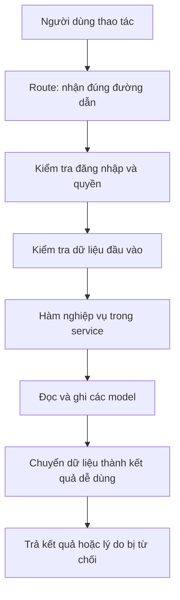
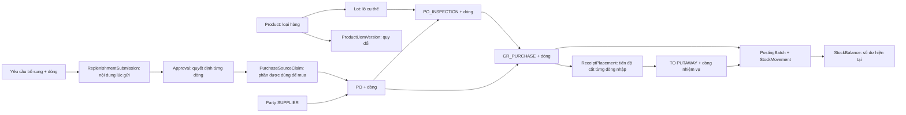
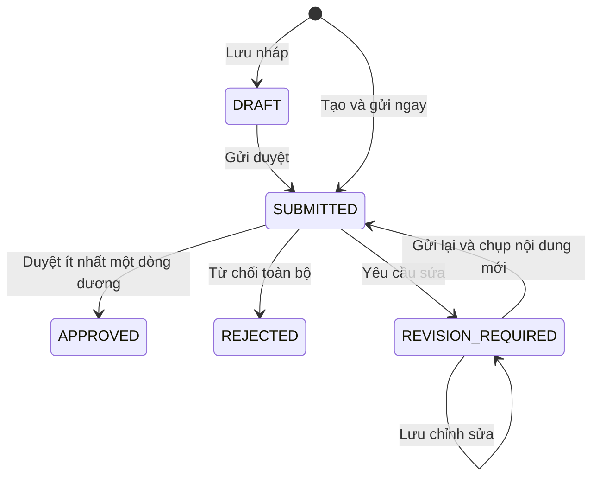

# Review và giải thích code backend hiện tại — 03/11/2026

Bản này được viết bằng cách đọc lại code đang có trong thư mục `be`, gồm cả thay đổi chưa commit. Đối tượng đọc là người muốn hiểu **nghiệp vụ diễn ra thế nào, hàm nào làm việc gì, dữ liệu đi qua model nào và những chỗ cần chú ý**. Các ví dụ là tình huống minh họa, không phải số liệu vận hành của cửa hàng.

Phạm vi chính là 23 chức năng trong kế hoạch Iteration 1 của minhtd: **UC-01–07 và UC-17–32**. Phần mua và nhận hàng đã được mở rộng sau kế hoạch ban đầu cũng được giải thích: xem chi tiết đơn mua, lập đơn từ yêu cầu đã duyệt, bổ sung đơn, lịch giao, chốt thiếu, kiểm nhận, ghi sổ nhập, cất hàng, chứng cứ và sửa sai. Các phân hệ bán hàng, điều chuyển, tài khoản, kiểm kê chỉ được nhắc khi có liên quan; báo cáo này không kết luận toàn bộ những phân hệ đó đã hoàn thành.

**Kết quả kiểm chứng trong lượt này:** chạy lại toàn bộ kiểm thử backend với MongoDB hỗ trợ giao dịch: 189 bài, 187 đạt, 0 lỗi, 2 bài lưu tệp trên dịch vụ bên ngoài được bỏ qua. Kiểm tra bổ sung về quyền xem tên nhà cung cấp và lô chưa xác minh đã chạy qua đường dẫn gọi backend thật trên cơ sở dữ liệu thử riêng. Không sửa logic ứng dụng, không tạo lại cơ sở dữ liệu demo, không commit hoặc push.

## Cách đọc

1. Đọc phần 1–3 để hiểu sự thay đổi và dữ liệu chung.
2. Đọc phần 4–8 để hiểu từng chức năng trong 23 chức năng gốc.
3. Đọc phần 9–14 để hiểu chuỗi mua, nhận, cất hàng và sửa sai hiện tại.
4. Đọc phần 15–17 để thấy ví dụ xuyên suốt, các vấn đề còn lại và bằng chứng kiểm chứng.

Trong mỗi nghiệp vụ, “đầu vào” là dữ liệu bên gọi gửi lên; “hàm xử lý” là hàm thực tế trong code; “đọc/ghi model” cho biết dữ liệu lấy từ đâu và lưu vào đâu. Model là khuôn mô tả một nhóm dữ liệu được lưu, ví dụ hồ sơ sản phẩm hoặc số dư. Tên tiếng Anh được giữ cho những phần cần tra cứu trong code và giải nghĩa tại nơi sử dụng.

## 1. Những thay đổi khiến báo cáo cũ không còn mô tả đúng

| Nội dung | Hành vi trong code hiện tại |
|---|---|
| Chuỗi nhận mua | Đơn mua `PO` → phiếu kiểm nhận `PO_INSPECTION` → phiếu nhập mua `GR_PURCHASE` |
| Chứng từ `ARRIVAL` | Đã loại bỏ khỏi nhánh dữ liệu hiện hành; không còn lần qua chuỗi nhận mua cũ |
| `INSPECTION` dùng chung | Vẫn tồn tại cho kiểm hàng trả của các phân hệ khác; nhận mua dùng `PO_INSPECTION` |
| Lượng kiểm nhận | Form nhận mua chỉ ghi lượng cửa hàng đồng ý nhập; không có dòng “chờ xử lý”, “từ chối”, “giữ hộ” như phiên bản trước |
| Xác nhận kiểm nhận | Sinh phiếu nhập nháp và giữ phần lượng dự kiến nhận; chưa tăng tồn |
| Ghi sổ nhập | Tăng hàng thuộc cửa hàng, chất lượng `GOOD`, tại vị trí `RECEIVING` — khu nhận hàng |
| Hàng giữ hộ nhà cung cấp | Không được tạo bởi chuỗi nhận mua mới |
| Liên kết nhà cung cấp trên phiếu nhập | `supplierId` bắt buộc trong model hiện tại và được lấy từ đơn mua; không phải trường có thể để trống trong nhánh này |
| Cất hàng | Đã có lập nhiệm vụ, chia nhiều vị trí, xác nhận từng phần và hủy phần chưa làm |
| Sửa sai | Đã có hủy nháp, đảo toàn phiếu nhập đủ điều kiện và tạo bản kiểm nhận thay thế |
| Đơn mua | Đã có lệnh tạo từ yêu cầu bổ sung được duyệt, mở đơn, bổ sung lượng, lưu xác nhận nhà cung cấp và chốt thiếu có chủ cửa hàng duyệt |

Các dòng mô tả custody hoặc “chưa làm put-away” trong tài liệu cũ không được dùng để suy ra hành vi mới. Nguồn quyết định hiện hành là [hợp đồng backend nhận mua v3](D:/Ky_9/SEP490/src/be/docs/po-receiving-proposal/BACKEND_V3.md); các phần dưới vẫn dựa vào hàm thực tế, không chỉ chép hợp đồng.

## 2. Hiểu các khái niệm trước khi đọc code

### 2.1. Những tên thường gặp

| Tên trong code | Cách hiểu trong nghiệp vụ | Ví dụ |
|---|---|---|
| API, route | Đường dẫn và cách gửi yêu cầu để gọi backend | `GET /api/products` là yêu cầu xem danh sách sản phẩm |
| `header`, `details` | Phần thông tin chung của phiếu, phần thông tin riêng của dòng | Kho ở header; dòng PO nguồn của dòng kiểm nhận nằm trong details |
| `tone`, `calibre` | Mã sắc độ và mã kích cỡ thực tế của lô theo thông tin đã xác minh | Cùng loại gạch nhưng tone T1 khác T2, không tự coi là cùng lô |
| `Product` | Hồ sơ một loại sản phẩm | Gạch A, mã `GACH-A`, kích thước danh nghĩa 600 × 600 |
| `Lot` | Một lô cụ thể của sản phẩm | Gạch A, lô NSX `L01`, tone `T1`, calibre `C1` |
| `Party` | Hồ sơ một bên liên quan | Nhà cung cấp, cửa hàng, khách hàng; phân biệt bằng `kind` |
| `REPLENISHMENT`, gọi ngắn là RR trong tên code | Yêu cầu bổ sung hàng | Kho đề nghị mua thêm 25 thùng |
| `PO` | Đơn mua gửi nhà cung cấp | Kế toán lập đơn mua 100 viên từ lượng đã được duyệt |
| `PO_INSPECTION` | Hồ sơ kiểm nhận một đợt giao thuộc đơn mua | Chuyến thứ nhất đồng ý nhập 40 viên |
| `GR_PURCHASE`, gọi ngắn là GR trong tên code | Phiếu nhập mua | Phiếu ghi sổ nhập 40 viên sau kiểm nhận |
| `TO`, `PUTAWAY` | Nhiệm vụ cất hàng vào vị trí lưu trữ | Chuyển 40 viên từ khu nhận vào ô A1 |
| `qtyBase` | Lượng quy về đơn vị gốc | 25 thùng × 4 viên/thùng = 100 viên |
| `enteredQty` | Lượng người dùng nhập theo đơn vị đang chọn | Nhập `"25"` theo thùng |
| `conversionSnapshot` | Hệ số quy đổi đã chốt trên dòng chứng từ | Dòng cũ giữ hệ số 4, dù sau này thùng mới có 6 viên |
| `version` | Số phiên bản dữ liệu để phát hiện người khác vừa sửa | Bạn đang xem bản 3, người khác lưu thành bản 4 thì bạn phải tải lại |
| `creationKey`, `operationKey` | Mã nhận diện một lần thực hiện để gửi lại không bị làm hai lần | Mạng chậm, gửi lại cùng thao tác nhập hàng vẫn chỉ tăng tồn một lần |
| `snapshot` | Bản chụp dữ liệu tại một thời điểm | Nội dung yêu cầu đúng lúc gửi chủ cửa hàng duyệt |
| `post` | Ghi sổ chính thức một giao dịch | Chỉ lúc post phiếu nhập mới tăng tồn |
| `reverse` | Ghi giao dịch ngược có liên kết để sửa sai | Nhập nhầm 70 viên, đảo hợp lệ rồi nhập lại đúng 60 viên |

`GOOD` nghĩa là chất lượng được ghi là hàng tốt. `VERIFIED` nghĩa là nhận dạng lô đã được xác minh. **Hai thông tin này độc lập**: code hiện cho ghi hàng `GOOD` thuộc một lô `UNKNOWN` vào khu nhận; không vì thế mà lô đã được xác minh. Xem phần 16.2.

### 2.2. Một yêu cầu gửi tới backend đi qua đâu?



Trong các module danh mục, `controller` chủ yếu nhận người dùng và dữ liệu đã kiểm tra rồi gọi `service`. Với nhánh nhận mua, hàm `handle()` trong file routes làm vai trò tương tự. Quyền nghiệp vụ của nhánh này được kiểm tra trong service, không phải chỉ ở nút trên màn hình.

Ví dụ, gửi `qtyBase` tự tính vào form kiểm nhận không làm backend tin lượng đó. Bộ kiểm tra chỉ chấp nhận các trường đã khai báo, còn service tự tính lượng từ `enteredQty` và hệ số trên dòng đơn mua. Field cũ như `disposition` bị từ chối.

Điểm vào: [nơi gắn các module vào ứng dụng](D:/Ky_9/SEP490/src/be/src/routes.js:1), [bộ kiểm tra đầu vào](D:/Ky_9/SEP490/src/be/src/middlewares/validate.js:3), [handle()](D:/Ky_9/SEP490/src/be/src/modules/po-receiving/po-receiving.routes.js:31).

### 2.3. Ba lớp bảo vệ khác nhau

**Quyền và phạm vi:** đúng vai trò vẫn phải có quyền thao tác, và với dữ liệu theo kho phải được phân công kho. Chủ cửa hàng có quyền đọc toàn kho ở những nghiệp vụ được quy định; quản trị viên không tự được quyền nhập hàng.

**Phiên bản:** tránh hai người sửa đè nhau. Người A và B cùng mở phiếu bản 2. A lưu thành bản 3. B gửi bản 2 thì bị từ chối; không tự ghép hoặc ghi đè nội dung của A.

**Mã thao tác:** tránh làm hai lần khi mất kết nối. Nếu A đã lưu thành công nhưng chưa nhận được phản hồi, gửi lại đúng mã và nội dung cũ sẽ nhận kết quả cũ. Dùng cùng mã cho nội dung khác bị từ chối. Muốn sửa nội dung, phải tải tình trạng hiện tại và thực hiện một thao tác mới đúng phiên bản.

Các lệnh mua/nhận dùng [command()](D:/Ky_9/SEP490/src/be/src/modules/po-receiving/purchase-core.js:44). Hàm này lưu chứng từ, kết quả thao tác và nhật ký trong cùng một giao dịch cơ sở dữ liệu: một bước ghi thất bại thì các bước ghi còn lại trong giao dịch cũng không được giữ lại. Đây là lý do không có tình huống bình thường “tồn đã tăng nhưng phiếu nhập chưa được ghi sổ”.

Lưu ý chính xác: không phải mọi thao tác đều tăng `version` theo một quy tắc chung. Sửa/gửi yêu cầu bổ sung tăng phiên bản; duyệt yêu cầu giữ phiên bản của nội dung được gửi. Nhánh mua/nhận thường gọi `bump()` để tăng phiên bản khi thay đổi chứng từ.

### 2.4. Số lượng và kết quả lỗi được đọc thế nào?

Số lượng gửi qua API là chuỗi như `"25"`, `"1.44"`; backend dùng thư viện tính số thập phân chính xác và lưu dạng Decimal128. Điều này tránh tính lượng nghiệp vụ bằng số thực thông thường rồi làm tròn tùy ý. Lượng tối đa sáu chữ số thập phân, hệ số quy đổi tối đa mười hai; sau phép nhân còn kiểm giới hạn và quy tắc nguyên viên.

**Ví dụ:** yêu cầu `"2.5"` thùng với hệ số 4 tạo 10 viên có thể hợp lệ nếu các điều kiện khác đạt. Nhưng lượng theo mét vuông quy ra 2.7 viên bị từ chối khi sản phẩm yêu cầu nguyên viên. Không phải cứ đầu vào là số dương thì kết quả quy đổi đã hợp lệ.

`null` nghĩa là không có dữ liệu hoặc không đủ căn cứ tùy trường, khác `"0"` là đã xác định lượng bằng0. Ví dụ chưa có xác nhận nhà cung cấp phải trả null; nhận ròng được kiểm đủ và chưa post phiếu nào thì bằng0. Nếu nguồn nhận bị hỏng, không được tự thay null bằng0 rồi tính “còn nhận đủ toàn bộ đơn”.

Các số 200/400/403/404/409 xuất hiện trong ví dụ là mã kết quả HTTP: 200 thành công; 400 dữ liệu không hợp lệ; 403 không có quyền; 404 không tìm thấy hoặc không cho mở hồ sơ ngoài phạm vi; 409 dữ liệu/trạng thái/nguồn đang xung đột. Chi tiết lỗi có thể kèm mã nghiệp vụ và dữ liệu để người gọi biết cần tải lại hay sửa dòng nào.

## 3. Dữ liệu được chia ra các model như thế nào?

### 3.1. Hồ sơ chung và chứng từ là hai nhóm khác nhau

| Model | Nội dung chính | Khi nào được dùng |
|---|---|---|
| `Product` | Mã, tên, đơn vị gốc, thuộc tính, trạng thái sản phẩm | Khi chọn hàng, kiểm lượng nguyên viên, hiển thị thông tin |
| `Uom` | Danh mục đơn vị: viên, thùng, mét vuông | Giải nghĩa đơn vị |
| `ProductUomVersion` | Hệ số quy đổi theo sản phẩm, đơn vị và thời điểm hiệu lực | Tính lượng; giữ nguyên phiên bản cũ |
| `ProductWarehousePolicy` | Mức tối thiểu và mục tiêu của một sản phẩm tại một kho | Cấu hình ngưỡng; không tự mua hàng |
| `Lot` | Nhận dạng lô, trạng thái xác minh, cờ khóa nhận dạng | Phân biệt hàng thực nhận và truy vết |
| `Party` loại `SUPPLIER` | Hồ sơ nhà cung cấp | Lập đơn mua, xem lịch sử, đổi trạng thái hợp tác |
| `Warehouse`, `Location` | Kho và vị trí trong kho | Kiểm phạm vi, khu nhận, ô lưu trữ, khóa kiểm kê |

Model danh mục sản phẩm và lô ở [product.model.js](D:/Ky_9/SEP490/src/be/src/models/product.model.js:1); nhà cung cấp ở [party.model.js](D:/Ky_9/SEP490/src/be/src/models/party.model.js:1).

`BusinessDocument` lưu **phần thông tin chung của phiếu**, ví dụ số phiếu, trạng thái, người tạo và phần `header` dành cho loại phiếu. `DocumentLine` lưu **từng dòng hàng** của phiếu, có mã riêng để những chứng từ sau tham chiếu chính xác.

Ví dụ một đơn mua gồm gạch A và gạch B: có một `BusinessDocument` loại `PO`, hai `DocumentLine`. Một đợt chỉ giao gạch A thì dòng kiểm nhận trỏ đúng dòng A, không trỏ chung chung vào cả đơn rồi suy số lượng bằng tên sản phẩm.

Các loại phiếu như `PO`, `PO_INSPECTION`, `GR_PURCHASE` dùng chung collection chứng từ nhưng có phần `header` khác nhau. Điều này không có nghĩa là chúng dùng chung một phiếu hoặc có thể đổi loại qua lại.

### 3.2. Sơ đồ các liên kết quan trọng



`DocumentLink` nối phiếu với phiếu. `LineLink` nối dòng với dòng, có lượng liên kết. Ngoài hai loại liên kết này, nhánh nhận mua còn lưu mã nguồn trực tiếp trong `header` và `details`. Service dùng chúng để kiểm tra chéo; có một mã nguồn không có nghĩa mọi liên kết còn lại mặc nhiên đúng.

Ví dụ: `GR_PURCHASE.header.purchaseOrderId` trả lời “nhập cho đơn nào”; `poInspectionId` trả lời “dựa trên kết quả kiểm nhận nào”; dòng nhập có `poLineId` và `inspectionLineId` trả lời “nhập dòng nào”. `supplierId` trên đơn, kiểm nhận và phiếu nhập phải khớp nhau.

Nguồn: [cấu trúc phần chung của phiếu](D:/Ky_9/SEP490/src/be/src/models/business-document.model.js:88), [cấu trúc dòng hàng](D:/Ky_9/SEP490/src/be/src/models/document-line.model.js:158).

### 3.3. Model về tồn và model về quyền mua không thay thế nhau

| Model | Câu hỏi mà model trả lời | Ví dụ |
|---|---|---|
| `PurchaseSourceClaim` | Lượng được duyệt của dòng yêu cầu đã được đơn mua nào sử dụng? | Duyệt 100, đơn mua A đã dùng 80 thì đơn B còn tối đa 20 |
| `StockAccount` | Hàng đang ở vị trí nào, hoặc đang đi theo chuyến điều chuyển nào? | Tài khoản tồn của khu nhận hàng R1 |
| `StockBalance` | Còn bao nhiêu theo vị trí, lô, chất lượng và chủ hàng? | R1, lô L01, GOOD, cửa hàng: 70 viên |
| `PostingBatch` | Một lần ghi sổ nào đã xảy ra? | Lần ghi sổ nhập phiếu G01 |
| `StockMovement` | Lần ghi sổ đó tăng/giảm lượng ở đâu, trước/sau bao nhiêu? | R1 từ 0 lên 70 |
| `ReceiptPlacement` | Trong 70 viên của dòng nhập này, bao nhiêu đã cất hoặc đang có kế hoạch cất? | Đã cất 20, giữ cho nhiệm vụ 30, chưa lên kế hoạch 20 |
| `Reservation` | Bao nhiêu hàng đã giữ cho nhu cầu khác? | Trong 70 viên có 10 viên đã giữ cho đơn bán |
| `DefectHold`, `LocationLock` | Hàng đang bị giữ do lỗi hay vị trí đang khóa kiểm kê? | Có khóa thì không nhập/chuyển theo luồng bình thường |

`PurchaseSourceClaim` **không giữ tồn vật lý**. `ReceiptPlacement` **không phải một số dư tồn thứ hai**. Chúng là các bản theo dõi để không mua hoặc cất vượt lượng cho phép; lượng thực tế vẫn nằm trong `StockBalance`, có lịch sử bằng `StockMovement`.

Các model theo dõi mới nằm trong [purchase.model.js](D:/Ky_9/SEP490/src/be/src/models/purchase.model.js:1). `PurchaseEvent` lưu sự kiện bổ sung đơn, lịch xác nhận, chốt thiếu, sửa sai và đảo phiếu; `BusinessOperation` lưu kết quả từng lần thực hiện; `AuditEvent` lưu ai đã thao tác và khi nào.

## 4. Yêu cầu bổ sung hàng — UC-01 đến UC-06

### UC-01 — Xem danh sách yêu cầu bổ sung

**Nghiệp vụ:** tìm các yêu cầu đã lưu để xem trạng thái và quyết định gần nhất. Đường dẫn: `GET /api/replenishments`.

**Hàm và luồng:** [listReplenishments()](D:/Ky_9/SEP490/src/be/src/modules/replenishments/replenishment.service.js:199) gọi `buildListPipeline()` để dựng điều kiện tìm. Điều kiện quyền được áp dụng trước đếm số bản ghi và chia trang. Sau đó đọc thêm tên người dùng, kho, sản phẩm, đơn vị để trả dữ liệu dễ hiển thị.

1. Chủ cửa hàng xem mọi kho; kế toán xem kho được giao.
2. Nhân viên kho và bán hàng chỉ xem phiếu do chính mình tạo, đồng thời kho vẫn phải được giao.
3. Lọc theo mã phiếu, kho, người tạo, trạng thái, quyết định hoặc ngày tạo.
4. Nếu lọc theo quyết định, tìm quyết định gần nhất trước khi đếm và chia trang.
5. Mỗi phiếu có tổng dòng hiện hành và xem trước tối đa ba dòng; dòng đã bỏ không được tính.

**Đọc model:** `BusinessDocument`, `Approval`, `DocumentLine`, `User`, `Warehouse`, `Product`, `ProductUomVersion`, `Uom`. Không ghi dữ liệu.

**Ví dụ:** Lan tạo 10 yêu cầu ở kho A, Minh tạo 5 yêu cầu cùng kho. Khi Lan đăng nhập bằng vai trò nhân viên kho, danh sách không trả cả 15 phiếu. Nếu Lan bị gỡ kho A, các phiếu đó cũng không còn trong phạm vi xem của Lan. Chủ cửa hàng vẫn xem được theo quyền toàn kho.

**Điểm cần hiểu:** “quyết định gần nhất là trả sửa” và “nội dung hiện tại đã được duyệt” là hai điều khác nhau. Chi tiết phiếu có phiên bản để biết quyết định áp dụng cho nội dung nào. Ngày lọc được tính theo ngày Việt Nam, không cắt ngày theo múi giờ máy chủ.

### UC-02 — Xem chi tiết và các lần gửi

**Đường dẫn:** `GET /api/replenishments/:id`, `GET /:id/submissions`, `GET /:id/submissions/:version`.

**Hàm và luồng:** [getReplenishment()](D:/Ky_9/SEP490/src/be/src/modules/replenishments/replenishment.service.js:510), `loadRelations()`, `getCurrentAvailability()`, [getReplenishmentSubmission()](D:/Ky_9/SEP490/src/be/src/modules/replenishments/replenishment.service.js:655).

1. Tìm phiếu trong phạm vi được xem; ngoài phạm vi không trả nội dung phiếu.
2. Đọc dòng hiện hành, các quyết định và số lần gửi có bản chụp nội dung.
3. Lấy lượng được duyệt đúng phiên bản hiện tại, không lấy một lần duyệt cũ để áp vào dòng mới.
4. Đọc liên kết nguồn, đơn mua và lượng giữ hàng/cung ứng đã lưu nếu có. Quyền đọc phiếu này không tự cấp quyền đọc mọi chứng từ liên quan.
5. Tính tồn khả dụng hiện tại theo sản phẩm và kho, tách khỏi thông tin đánh giá đã lưu trên dòng.
6. Khi mở một lần gửi cũ, đọc `ReplenishmentSubmission`; dữ liệu cũ thiếu bản chụp thì trả không có, không dựng lại lịch sử bằng dữ liệu hôm nay.

**Đọc model:** các model ở UC-01, thêm `ReplenishmentSubmission`, `DocumentLink`, `LineLink`, `Reservation`, `DemandSupplyAllocation` và các model tồn phục vụ tính khả dụng. Không tạo lượng giữ hàng hoặc phân bổ mới.

**Ví dụ:** lần gửi thứ nhất đề nghị 100 viên, chủ cửa hàng trả sửa. Lần gửi tiếp theo chỉ đề nghị 80 viên. Màn hình lần gửi đầu vẫn phải thấy 100, còn dòng hiện tại là 80. Nếu hôm nay có thêm hàng về, tồn hiện tại tăng nhưng nội dung đã gửi hôm trước không được đổi theo.

**Ví dụ tính khả dụng:** ô A1 có 100 viên đủ điều kiện, đã giữ 20 thì còn 80. Khu nhận hàng có thêm 70 viên nhưng chưa cất thì không cộng vào con số này. Nếu một số dư có giữ do lỗi đang hoạt động, helper hiện loại cả số dư đó khỏi khả dụng; không chỉ lấy tổng trừ riêng lượng lỗi. Vị trí đang khóa kiểm kê cũng bị loại.

**Điều kiện của hàng khả dụng trong helper:** thuộc cửa hàng, chất lượng GOOD, lô VERIFIED, sản phẩm/kho/vị trí hoạt động, vị trí STORAGE được phép cấp hàng, không khóa kiểm kê, không giữ do lỗi; sau đó trừ lượng `Reservation` ACTIVE đúng một lần. Xem [getCurrentAvailability()](D:/Ky_9/SEP490/src/be/src/modules/replenishments/replenishment.availability.js:58) và `sumAvailableBalances()`.

### UC-03 — Tạo yêu cầu bổ sung thủ công

**Người thực hiện:** nhân viên kho hoặc bán hàng có quyền tạo, tại kho được giao đang hoạt động. Đường dẫn: `POST /api/replenishments` với `action="SAVE_DRAFT"`.

**Hàm và luồng:** [createReplenishment()](D:/Ky_9/SEP490/src/be/src/modules/replenishments/replenishment.commands.js:451) → `usableWarehouse()` → `prepareLines()` → lưu phiếu/dòng/kết quả thao tác/nhật ký.

1. Kiểm tra mã tạo đã được dùng chưa. Cùng người, mã và nội dung thì trả kết quả cũ, sau khi kiểm tra lại phạm vi kho.
2. Kiểm tra kho và từng sản phẩm đang hoạt động.
3. Kiểm tra phiên bản quy đổi thuộc đúng sản phẩm, đã có hiệu lực và là bản hiện hành của đơn vị đó.
4. Tính `qtyBase = enteredQty × conversionSnapshot`; hàng nguyên viên không được ra lượng lẻ.
5. Mỗi dòng có lý do riêng. Dòng mới luôn có `triggerType=MANUAL_OTHER` — yêu cầu thủ công.
6. Không lặp cùng sản phẩm, đơn vị và lý do trong một phiếu. Tối đa 100 dòng, ít nhất một dòng.
7. Lưu `BusinessDocument` loại REPLENISHMENT ở DRAFT, `DocumentLine`, `BusinessOperation`, `AuditEvent` trong cùng giao dịch.

**Ví dụ:** kho còn 200 viên, mức tối thiểu là 100, nhưng chuẩn bị chương trình bán hàng nên nhân viên đề nghị thêm 25 thùng. Hệ số 4 viên/thùng tạo nhu cầu 100 viên. Code cho tạo vì yêu cầu thủ công không bắt buộc tồn dưới ngưỡng.

**Điểm cần hiểu:** nháp ở đây vẫn phải có dữ liệu đúng kiểu và dòng hợp lệ; không phải nơi lưu một form đang nhập dở với sản phẩm hoặc số lượng trống. Lưu nháp có thể giữ ngày cần đã qua, nhưng khi gửi duyệt sẽ bị kiểm tra lại ngày. Không tăng tồn, không tự sinh đơn mua, không có bước đánh giá thiếu tự động.

### UC-04 — Sửa nháp hoặc yêu cầu được trả sửa

**Đường dẫn:** `PUT /api/replenishments/:id`. Chỉ người tạo, còn quyền cập nhật và phạm vi kho, được sửa trạng thái DRAFT hoặc REVISION_REQUIRED.

**Hàm:** [updateReplenishment()](D:/Ky_9/SEP490/src/be/src/modules/replenishments/replenishment.commands.js:579).

1. Tìm phiếu của chính người dùng và kiểm tra kho; kiểm mã thao tác đã thực hiện.
2. Kiểm tra trạng thái, phiên bản, kho cũ và kho mới đang hợp lệ.
3. Chỉ cho sửa phiếu thủ công; phiếu có nguồn nghiệp vụ khác không được đổi giả thành thủ công.
4. Dòng có `id` được giữ mã dòng, nhưng không được đổi sang sản phẩm khác. Muốn đổi sản phẩm phải bỏ dòng cũ rồi thêm dòng mới.
5. Dòng không còn gửi lên được đánh dấu `removedAt`, không xóa vật lý. Dòng mới được cấp số dòng lớn hơn mọi số dòng đã từng có.
6. Kiểm lại sản phẩm và quy đổi, cập nhật dữ liệu, tăng phiên bản, lưu kết quả và nhật ký. Không tự gửi duyệt.

**Đọc/ghi:** `BusinessDocument`, `DocumentLine`, `Product`, `ProductUomVersion`, `Uom`, `Warehouse`, `BusinessOperation`, `AuditEvent`. Các bản `ReplenishmentSubmission` trước đó giữ nguyên.

**Ví dụ:** phiếu có dòng 1 gạch A, dòng 2 gạch B. Chủ cửa hàng yêu cầu bỏ B, thêm C. Code giữ dòng A, đánh dấu đã bỏ dòng B, tạo C là dòng 3. Nhờ vậy quyết định cũ trỏ dòng B vẫn có nghĩa, không bị biến thành quyết định cho C.

**Điểm dễ nhầm:** thứ tự phần tử gửi lên không phải lệnh đổi số thứ tự mọi dòng. Phiếu đang SUBMITTED, APPROVED hoặc REJECTED không được sửa bằng đường dẫn này. REVISION_REQUIRED mới là nhánh quay lại sửa.

### UC-05 — Gửi yêu cầu để chủ cửa hàng duyệt

**Hai cách:** tạo mới bằng `POST /replenishments` với `action="SUBMIT"`, hoặc gửi phiếu đã lưu bằng `POST /replenishments/:id/submit`.

**Hàm:** `createReplenishment()` cho gửi ngay; [submitReplenishment()](D:/Ky_9/SEP490/src/be/src/modules/replenishments/replenishment.commands.js:772) cho phiếu đã có.

1. Kiểm người tạo, quyền, kho, trạng thái và phiên bản.
2. Ngày cần không được trước ngày hiện tại theo Việt Nam.
3. Từng dòng phải có lý do, sản phẩm hoạt động và phiên bản quy đổi hiện hành.
4. Lưu trạng thái SUBMITTED, người gửi và thời điểm gửi.
5. Tạo `ReplenishmentSubmission` chứa kho, tên/mã sản phẩm, đơn vị, hệ số, lượng và lý do tại lần gửi đó.
6. Lưu kết quả thao tác và nhật ký cùng giao dịch.

**Ví dụ:** nháp tạo hôm qua dùng quy đổi 4 viên/thùng. Trước lúc gửi, phiên bản mới 6 viên/thùng đã có hiệu lực. Backend không tự biến nhu cầu 25 thùng từ 100 thành 150 viên; gửi bị từ chối và người dùng phải chọn lại, xem lại rồi lưu/gửi đúng dữ liệu.

**Vì sao cần model riêng cho lần gửi?** Dòng hiện tại sẽ còn có thể sửa sau khi bị trả lại. `ReplenishmentSubmission` giữ chứng cứ “đã đề nghị gì lúc đó”. Nó không phải một phiếu yêu cầu mới, không làm tăng nhu cầu hai lần.

**Điểm cần hiểu:** bấm mở form, hủy form hoặc để sau không tạo yêu cầu. Lệnh gửi không tăng tồn hoặc tạo `PostingBatch`, `StockMovement`. Gửi phiếu đã lưu tăng phiên bản; tạo mới và gửi ngay bắt đầu ở phiên bản 1.

### UC-06 — Duyệt, từ chối hoặc yêu cầu sửa

**Người thực hiện:** chủ cửa hàng có quyền duyệt, khác người tạo và người gửi. Đường dẫn: `POST /api/replenishments/:id/review`.

**Hàm:** [reviewReplenishment()](D:/Ky_9/SEP490/src/be/src/modules/replenishments/replenishment.commands.js:1033) → `appendApproval()`.

1. Phiếu phải SUBMITTED, đúng phiên bản và có `ReplenishmentSubmission` tương ứng.
2. Khi APPROVE, gửi quyết định cho đủ mọi dòng của lần gửi, mỗi dòng đúng một lần.
3. Lượng duyệt tính theo đơn vị gốc, từ 0 đến lượng đề nghị; sản phẩm tính nguyên viên không cho lượng lẻ.
4. Dòng duyệt giảm hoặc về 0 phải có lý do riêng. Phải có ít nhất một dòng dương; từ chối hết dùng REJECT.
5. REJECT hoặc REVISE không nhận lượng duyệt từng dòng, nhưng bắt buộc lý do chung.
6. Ghi `Approval` gắn đúng mã phiếu, phiên bản nội dung, người yêu cầu và người quyết định; cập nhật trạng thái phiếu cùng kết quả thao tác/nhật ký.

**Ví dụ:** đề nghị A 100 viên, B 40 viên. Chủ duyệt A 80 vì còn hàng dự phòng, B 0 vì chưa cần. Phiếu có trạng thái APPROVED nhưng kế toán chỉ được dùng lượng A 80; trạng thái APPROVED không cho phép mua B 40.

**Liên kết model:** `Approval.lines[].lineId` trỏ dòng đã gửi; `approvedQty` giữ lượng được phép mua; `documentVersion` trỏ nội dung được duyệt. Hàm lập đơn mua sau này kiểm đúng các thông tin này.

**Điểm chính xác về phiên bản:** review không tăng `BusinessDocument.version`; quyết định được gắn ngay với phiên bản nội dung đang gửi. Nếu trả sửa rồi người tạo sửa/gửi lại, các thao tác đó tạo phiên bản mới. Cấm tự duyệt dựa vào mã người dùng nên đổi vai trò sau khi tạo vẫn không tự duyệt được.



## 5. Danh sách đơn mua — UC-07

### UC-07 — Xem đơn mua và lượng còn phải nhận

**Đường dẫn:** `GET /api/purchase-orders`. Chủ cửa hàng xem toàn kho; kế toán và nhân viên kho xem các kho được giao. Có lọc nhà cung cấp, ngày tạo, trạng thái, mã đơn và tình trạng còn lượng.

**Các hàm chính:** [listPurchaseOrders()](D:/Ky_9/SEP490/src/be/src/modules/purchase-orders/purchase-order.service.js:445) → `computedDocuments()` → `resolveGrLines()` → `grLineReceivedQuantities()` → `mapPreviewLines()`.

1. Lọc đúng phạm vi đơn mua.
2. Đọc lượng gốc từng dòng, sự kiện bổ sung đơn, chốt thiếu đã thực hiện và xác nhận nhà cung cấp.
3. Tìm phiếu nhập trỏ trực tiếp đơn và kiểm nhận; kiểm tra các mã nguồn khớp sản phẩm, lô, kho, nhà cung cấp và hệ số/lượng giữa dòng kiểm và dòng nhập.
4. Với phiếu nhập đã ghi sổ, đọc lịch sử tăng/giảm thực tế để tính lượng đã nhập ròng. Phiếu nhập nháp không được tính là đã nhập.
5. Lần theo liên kết batch đảo để kiểm chiều nhập/đảo hợp lệ; kiểm batch và movement thuộc đúng phiếu, số dư thuộc đúng lô/sản phẩm/kho.
6. Nếu đủ căn cứ, tính các lượng ở bảng dưới. Thiếu hoặc mâu thuẫn thì trả `quantityState=INCOMPLETE`, các lượng không đủ cơ sở là `null`.
7. Trả tổng dòng và xem trước tối đa ba dòng. Nếu lọc theo lượng còn phải nhận, phải tính trước rồi mới lọc/đếm/chia trang.

| Field | Nghĩa | Ví dụ đơn 100, bổ sung 20, nhập ròng 70, chốt thiếu 10 |
|---|---|---|
| `orderedQtyBase` | Lượng gốc trên dòng đơn mua | 100 |
| `authorizedOrderedQtyBase` | Lượng gốc cộng phần bổ sung được ghi nhận | 120 |
| `netPostedReceiptQtyBase`, `receivedQtyBase` | Tổng lượng đã ghi sổ nhập trừ lượng đã đảo hợp lệ | 70 |
| `closedRemainderQtyBase` | Phần được chốt không nhận tiếp | 10 |
| `outstandingQtyBase` | Lượng còn phải nhận = 120 − 70 − 10 | 40 |
| `confirmedQtyBase` | Lượng ở xác nhận có cấu trúc gần nhất của dòng đó | Có xác nhận thì có số; chưa có thì `null` |

**Ví dụ:** đơn 100, nhân viên đã xác nhận kiểm nhận 70 nhưng chưa ghi sổ. Danh sách vẫn là nhận ròng 0, còn phải nhận 100. Trang chuẩn bị nhận hàng sẽ cho biết đã có phiếu nhập nháp giữ 70 và còn được chấp nhận thêm 30. Đây là hai cách nhìn bổ sung cho nhau, không phải hai phép tính mâu thuẫn.

**Đọc model:** `BusinessDocument`, `DocumentLine`, `PurchaseEvent`, `LineLink`, `PostingBatch`, `StockMovement`, `StockBalance`, `StockAccount`, `Location`, `Lot`, `Party`, `Product`, `Uom`. Không ghi tồn hoặc sửa trạng thái khi xem danh sách.

**Đánh giá:** việc lấy lượng từ giao dịch thực thay vì chỉ trạng thái giúp phát hiện dữ liệu sai. Tuy nhiên, lọc `outstanding` vẫn cần đọc/tính toàn bộ tập đơn phù hợp trước chia trang; xem phần 16.6. Không còn đi qua ARRIVAL để tính lượng nhận.

## 6. Sản phẩm, quy đổi và ngưỡng kho — UC-17 đến UC-23

### UC-17 — Xem danh sách sản phẩm

**Người xem:** chủ cửa hàng, kế toán, kho, bán hàng có `product:read`. Đường dẫn: `GET /api/products`.

**Hàm:** [listProducts()](D:/Ky_9/SEP490/src/be/src/modules/products/product.service.js:111).

1. Kiểm quyền; lọc hoạt động, kích thước danh nghĩa và từ khóa mã/tên.
2. Chỉ sắp xếp theo các trường được cho phép; chia trang và đếm cùng điều kiện.
3. Đọc `Uom` cho đơn vị gốc, trả danh sách qua `mapProductSummary()`.

**Ví dụ:** bán hàng tìm “600” theo tên hoặc mã để chọn gạch. Kết quả cho mã, tên, kích thước và đơn vị gốc; không tự có số tồn hay giá bán vì hồ sơ sản phẩm không lưu các số đó.

**Model:** đọc `Product`, `Uom`; không ghi. Mỗi trang tối đa 100 mục. Sản phẩm ngừng hoạt động vẫn có thể xem khi lọc phù hợp, để tra cứu lịch sử.

### UC-18 — Xem chi tiết sản phẩm

**Đường dẫn:** `GET /api/products/:id`. **Hàm:** [getProduct()](D:/Ky_9/SEP490/src/be/src/modules/products/product.service.js:139) → `detailWithMasters()` → `currentConversionsByProduct()`.

1. Tìm sản phẩm và quyền đọc.
2. Tìm các phiên bản quy đổi có `validFrom` không sau hiện tại.
3. Với mỗi đơn vị, chọn thời điểm hiệu lực mới nhất, rồi phiên bản cao nhất khi cùng thời điểm.
4. Đọc tên đơn vị và trả thuộc tính sản phẩm cùng quy đổi hiện hành.

**Ví dụ:** BOX bản 1 là 4 viên, BOX bản 2 là 6 viên nhưng mai mới có hiệu lực. Hôm nay chi tiết vẫn trả quy đổi 4. Danh sách lịch sử quy đổi có thể thấy cả bản sẽ có hiệu lực ngày mai.

**Model:** đọc `Product`, `ProductUomVersion`, `Uom`. Kích thước danh nghĩa 600 × 600 không chứng minh calibre của lô là 600 và không tự sinh hệ số mét vuông.

### UC-19 — Tạo sản phẩm

**Người tạo:** chủ cửa hàng. Đường dẫn: `POST /api/products`. **Hàm:** [createProduct()](D:/Ky_9/SEP490/src/be/src/modules/products/product.service.js:146).

1. Kiểm trường được phép, mã chuẩn hóa viết hoa, tên và đơn vị gốc tồn tại.
2. Kiểm mã đã có, bao gồm tìm không phân biệt hoa thường; chỉ mục duy nhất bảo vệ trường hợp hai yêu cầu cùng tạo.
3. Chiều dài/rộng phải cùng có hoặc cùng không có; kích thước nhập phải dương.
4. Lưu sản phẩm hoạt động, phiên bản 1.
5. Tự tạo một `ProductUomVersion` cho đơn vị gốc với hệ số 1; lưu nhật ký cùng giao dịch.

**Ví dụ:** tạo gạch A, đơn vị gốc viên, chỉ tính nguyên viên. Code tạo “1 viên = 1 viên”. Muốn “1 thùng = 4 viên” phải khai báo quy đổi riêng; không tự suy từ kích thước gạch.

**Chi tiết mới trong code:** nếu không nhập `nominalSize` nhưng có chiều dài/rộng, hàm tạo ghép nhãn bằng hai kích thước đã làm tròn. Ví dụ 599.5 × 599.5 có thể tạo nhãn `600x600`, nhưng hai trường kích thước vẫn giữ giá trị nhập. Đây là nhãn hiển thị, không phải nhận dạng lô hoặc quy đổi diện tích.

**Ghi model:** `Product`, `ProductUomVersion`, `AuditEvent`. Không tạo `Lot`, số dư hoặc lịch sử nhập kho. Tạo sản phẩm không có nghĩa là kho đã có hàng.

### UC-20 — Sửa thông tin sản phẩm

**Đường dẫn:** `PUT /api/products/:id`. **Hàm:** [updateProduct()](D:/Ky_9/SEP490/src/be/src/modules/products/product.service.js:212). Chỉ chủ cửa hàng.

1. Đọc sản phẩm, so `expectedVersion` với phiên bản hiện tại.
2. Chỉ nhận tên và các thuộc tính được phép như nhãn kích thước, thương hiệu, vật liệu, bề mặt, kích thước, xuất xứ, mô tả.
3. Ghi thông tin, tăng phiên bản và lưu các trường trước/sau vào nhật ký.

**Ví dụ:** đổi tên “Gạch A” thành “Gạch A bề mặt nhám”. Chứng từ đã lưu tên gạch ở thời điểm tạo vẫn giữ tên cũ qua trường snapshot; hồ sơ hiện tại mang tên mới.

**Điểm rất cần chú ý khi tích hợp:** đây là lưu lại bộ thông tin, không phải chỉ sửa một trường tùy ý. Các trường tùy chọn không được gửi hoặc có giá trị null sẽ bị xóa khỏi hồ sơ. Ví dụ chỉ gửi tên và phiên bản mà bỏ thương hiệu, mô tả thì hai trường đó bị xóa. Form sửa cần gửi đầy đủ phần muốn giữ.

**Model:** đọc/ghi `Product`, ghi `AuditEvent`. Không sửa mã sản phẩm, đơn vị gốc, quy tắc nguyên viên, trạng thái hay phiên bản quy đổi qua đường dẫn này.

### UC-21 — Bật/tắt hoạt động sản phẩm

**Đường dẫn:** `PATCH /api/products/:id/status`. **Hàm:** [changeProductStatus()](D:/Ky_9/SEP490/src/be/src/modules/products/product.service.js:261). Đầu vào có phiên bản, `isActive` và lý do.

1. Kiểm quyền và phiên bản.
2. Nếu trạng thái đã đúng như yêu cầu thì trả hiện tại, không tăng phiên bản hoặc tạo lịch sử đổi trạng thái giả.
3. Nếu khác thì lưu trạng thái mới, tăng phiên bản và ghi lý do/nhật ký.

**Ví dụ:** ngừng dùng mã gạch A thì yêu cầu bổ sung hoặc nhận hàng mới có bước kiểm sản phẩm hoạt động sẽ bị chặn. Các phiếu và tồn cũ không bị xóa, không tự giảm về 0.

**Điểm cần hiểu:** hàm đổi trạng thái không kiểm “phải hết tồn mới được tắt”. Nếu tắt khi còn đơn mua mở, thao tác kiểm/ghi sổ nhận sẽ có thể bị chặn do sản phẩm đã tắt. Cần xử lý công việc đang dở hoặc bật lại theo nghiệp vụ; không coi trạng thái này chỉ là ẩn khỏi danh sách.

**Model:** `Product`, `AuditEvent`; không ghi tồn.

### UC-22 — Thêm phiên bản quy đổi đóng gói

**Đường dẫn:** `POST /api/products/:id/conversions`; xem lịch sử bằng `GET` cùng đường dẫn. **Hàm:** [createConversion()](D:/Ky_9/SEP490/src/be/src/modules/products/product.service.js:304), `listConversions()`.

1. Chỉ chủ cửa hàng, sản phẩm đang hoạt động, đúng phiên bản sản phẩm.
2. Đơn vị phải tồn tại và khác đơn vị gốc; không tạo lại hệ số đơn vị gốc.
3. Hệ số dương, có tham chiếu xác minh và thời điểm hiệu lực không được trong quá khứ tại lúc backend kiểm tra.
4. Nếu đơn vị là BOX và sản phẩm nguyên viên thì hệ số thùng phải nguyên.
5. Tăng phiên bản sản phẩm để hai người không đồng thời tạo phiên bản chồng nhau; thêm bản quy đổi mới, không sửa bản cũ; ghi nhật ký.

**Ví dụ:** lô hàng theo quy cách mới có 6 viên/thùng thay vì 4. Chủ cửa hàng tạo bản BOX mới có hiệu lực ngày mai, có căn cứ nhãn nhà máy. Phiếu cũ 25 thùng giữ 100 viên; phiếu lập theo bản mới 25 thùng thành 150 viên.

**Ví dụ mét vuông:** có thể khai báo hệ số đã xác minh cho mét vuông, nhưng nếu lượng nhập sau quy đổi ra 2.7 viên trong sản phẩm nguyên viên thì lệnh nghiệp vụ vẫn chặn. Không âm thầm làm tròn lên 3.

**Model:** đọc/ghi `Product` để bảo vệ phiên bản, đọc `Uom`, thêm `ProductUomVersion`, `AuditEvent`. Quy đổi là dữ liệu chỉ thêm phiên bản; không có API sửa/xóa bản cũ. Khi đặt hiệu lực gần hiện tại cần tính thời gian mạng, vì backend kiểm thời điểm thực lúc xử lý.

### UC-23 — Cấu hình mức tồn tối thiểu và mục tiêu theo kho

**Đường dẫn:** `PUT /api/products/:id/warehouse-policies/:warehouseId`; xem bằng `GET /api/products/:id/warehouse-policies`. **Hàm:** [configurePolicy()](D:/Ky_9/SEP490/src/be/src/modules/products/product.service.js:430) và `listPolicies()`.

1. Chủ cửa hàng được cấu hình mọi kho, không cần danh sách kho phân công của mình.
2. Sản phẩm và kho phải đang hoạt động.
3. Lượng tối thiểu không âm; mục tiêu không nhỏ hơn tối thiểu; bỏ mục tiêu thì lấy bằng tối thiểu. Đều theo đơn vị gốc.
4. Nếu hàng tính nguyên viên thì hai lượng phải nguyên.
5. Chưa có chính sách: gửi `expectedVersion=0`, tạo bản 1. Đã có: gửi đúng phiên bản, cập nhật thành bản kế tiếp. Lưu người sửa và nhật ký.

**Ví dụ:** gạch A ở kho A đặt tối thiểu 100 viên, mục tiêu 180; ở kho B đặt 40/80. Đây là hai `ProductWarehousePolicy` khác nhau, không phải một ngưỡng chung cho sản phẩm.

**Model:** `Product`, `Warehouse`, `ProductWarehousePolicy`, `AuditEvent`. Cấu hình không tạo yêu cầu bổ sung, không lập đơn mua và không tăng tồn. Code không tự lấy 180 trừ tồn rồi đặt hàng trong chức năng này.

## 7. Lô hàng — UC-24 đến UC-27

### UC-24 — Xem danh sách lô

**Người xem:** chủ cửa hàng hoặc nhân viên kho. **Đường dẫn:** `GET /api/lots`. **Hàm:** [listLots()](D:/Ky_9/SEP490/src/be/src/modules/lots/lot.service.js:179) → `scopedStockRows()` → `mapLotSummary()`.

1. Tìm danh mục theo sản phẩm, mã lô nhà sản xuất, tone, calibre hoặc trạng thái xác minh.
2. Đọc số dư → tài khoản tồn → vị trí → kho để biết lô có bản ghi tồn trong phạm vi người xem hay không.
3. Trả hồ sơ lô và cờ `hasScopedStock`.

**Ví dụ:** cùng lô L01 có 50 viên ở kho A và 30 ở B. Nhân viên A có thể biết hồ sơ L01 trong danh mục chung, nhưng không được xem 30 viên ở B. Danh mục lô dùng chung không làm quyền đọc số dư trở thành toàn kho.

**Chi tiết dễ hiểu sai:** truyền `warehouseId` hiện chỉ giới hạn phần kiểm tra có số dư, **không loại các lô không có số dư ở kho đó khỏi danh sách hồ sơ**. `hasScopedStock=true` nghĩa là có bản ghi số dư; một bản ghi còn 0 cũng làm cờ này đúng. Không dùng cờ này thay cho kết luận “còn hàng bán được”.

**Model:** `Lot`, `Product`, `StockBalance`, `StockAccount`, `Location`, `Warehouse`, `Party`; chỉ đọc.

### UC-25 — Xem chi tiết lô và lịch sử tăng/giảm

**Đường dẫn:** `GET /api/lots/:id`, `GET /api/lots/:id/movements`. **Hàm:** [getLot()](D:/Ky_9/SEP490/src/be/src/modules/lots/lot.service.js:228) và [getLotMovements()](D:/Ky_9/SEP490/src/be/src/modules/lots/lot.service.js:496).

1. Chi tiết trả nhận dạng, căn cứ xác minh, người/thời điểm xác minh, cờ khóa và số dư theo kho được phép.
2. Số dư tách theo vị trí, chất lượng, chủ hàng; không cộng hàng giữ hộ với hàng của cửa hàng rồi gọi đó là khả dụng.
3. Lịch sử yêu cầu thêm quyền `stock_movement:read`.
4. Đọc movement của các số dư thuộc lô; gắn batch và chứng từ nguồn.
5. Chỉ trả movement khi những đầu số dư được khai báo đều giải được về kho trong phạm vi. Chứng từ nguồn còn kiểm quyền riêng trước khi trả thông tin chi tiết.
6. Lượng trước/sau trong lịch sử lấy từ movement đã ghi, không lấy tồn hiện tại thay cho tồn lúc xảy ra.

**Ví dụ:** nhập 70 tại R1, sau đó cất 20 vào A1. Lịch sử có một dòng nhập 70 và một dòng chuyển 20, không phải tổng nhận 90. Chi tiết hiện tại có thể là R1=50, A1=20.

**Giới hạn:** hàm này giải đầu tài khoản về vị trí vật lý. Tài khoản hàng đang vận chuyển không có `locationId` nên movement liên quan có thể bị bỏ khỏi kết quả, kể cả chủ cửa hàng. Đây chưa phải lịch sử đầy đủ hành trình liên kho. Hàm cũng đọc tập lịch sử trước rồi mới chia trang trong bộ nhớ; xem phần 16.6.

**Model:** `Lot`, `Product` và nhóm tồn; thêm `PostingBatch`, `StockMovement`, `BusinessDocument` khi xem lịch sử. Không thay đổi lô hoặc tồn khi xem.

### UC-26 — Tạo lô mới

**Người tạo:** chủ cửa hàng hoặc nhân viên kho có quyền tạo lô. **Đường dẫn:** `POST /api/lots`. **Hàm:** [createLot()](D:/Ky_9/SEP490/src/be/src/modules/lots/lot.service.js:238).

1. Sản phẩm phải tồn tại và hoạt động.
2. Bộ nhận dạng duy nhất là sản phẩm + mã lô nhà sản xuất + tone + calibre. Không tự đổi hoa thường để coi hai mã là một.
3. Nếu VERIFIED, các thành phần nhận dạng không được là UNKNOWN và phải có căn cứ xác minh. Backend gán người, thời điểm xác minh.
4. Nếu chưa biết, có thể tạo UNKNOWN với thông tin chưa biết được ghi rõ. Không tự sinh đuôi ngẫu nhiên để lách trùng nhận dạng.
5. Ngày sản xuất không được ở tương lai.
6. Lưu lô phiên bản 1, chưa khóa nhận dạng, và nhật ký trong cùng giao dịch.

**Ví dụ:** kiểm nhãn thấy sản phẩm A, lô `L01`, tone `T1`, calibre `C1`; nhập căn cứ “nhãn trên thùng giao ngày 03/11”. Backend tạo một hồ sơ lô VERIFIED. Nếu kho khác nhận lại đúng bộ nhận dạng đó thì dùng lô đã có, không tạo lô riêng chỉ vì khác kho.

**Ghi model:** `Lot`, `AuditEvent`; đọc `Product`. Không tăng số lượng trong kho. Lô mô tả “đó là hàng nào”; phiếu nhập mới ghi “có bao nhiêu hàng về”.

### UC-27 — Sửa thông tin lô, bảo vệ nhận dạng đã sử dụng

**Người sửa:** chỉ chủ cửa hàng. **Đường dẫn:** `PUT /api/lots/:id`. **Hàm:** [updateLot()](D:/Ky_9/SEP490/src/be/src/modules/lots/lot.service.js:316) → `lotHasReferences()`; bên ghi tham chiếu dùng [lockLotIdentity()](D:/Ky_9/SEP490/src/be/src/shared/utils/lotIdentity.js:10).

1. Kiểm phiên bản và xem đã có dòng chứng từ hoặc số dư trỏ tới lô chưa.
2. Nếu đã dùng hoặc đã `identityLocked`, không đổi mã lô nhà sản xuất/tone/calibre.
3. Nếu được đổi nhận dạng thì phải gửi cả trạng thái xác minh tương ứng; VERIFIED cần căn cứ mới khi phải xác minh lại.
4. Không hạ VERIFIED về UNKNOWN trong chức năng này; không xóa căn cứ xác minh của lô VERIFIED.
5. Field không gửi trong chức năng này thường được giữ; trường cho phép null như ghi chú/ngày sản xuất có thể được xóa rõ ràng.
6. Lưu thay đổi, tăng phiên bản, ghi lịch sử. Không đổi lượng, chất lượng hoặc vị trí tồn bằng cách sửa lô.

**Ví dụ:** tạo nhầm tone T1 thành T2 khi lô chưa dùng: chủ có thể sửa đúng với căn cứ. Nhưng nếu đã nhập 70 viên theo T2 thì không sửa hồ sơ thành T1 để che sai lô trên chứng từ; phải đi quy trình sửa sai chứng từ đủ điều kiện.

**Điểm cần hiểu về khóa:** ngay cả phiếu kiểm nhận nháp cũng gọi khóa khi dùng lô. Hủy hoặc xóa dòng nháp không tự mở khóa nhận dạng. Điều này bảo vệ tính ổn định, nhưng có thể khiến một lô được chọn nhầm rồi bỏ ra vẫn bị khóa; cần biết hành vi này khi vận hành.

**Model:** đọc `Lot`, `DocumentLine`, `StockBalance`; ghi `Lot`, `AuditEvent`. Cơ chế chống sửa cùng lúc dựa vào cùng bản ghi lô; mức bảo vệ còn phụ thuộc những nơi tạo tham chiếu có dùng helper khóa hay không. Không suy ra mọi writer trong toàn hệ thống đều đã được kiểm chỉ từ helper này.

## 8. Nhà cung cấp — UC-28 đến UC-32

### UC-28 — Xem danh sách nhà cung cấp

**Người xem theo đường dẫn chuẩn:** chủ cửa hàng hoặc kế toán. **Đường dẫn:** `GET /api/suppliers`. **Hàm:** [listSuppliers()](D:/Ky_9/SEP490/src/be/src/modules/suppliers/supplier.service.js:82).

1. Chỉ tìm `Party.kind=SUPPLIER`, không lẫn khách hàng hoặc đơn vị vận chuyển.
2. Lọc mã/tên và trạng thái hợp tác; sắp theo ngày tạo, chia trang.
3. Dữ liệu cũ chưa có `cooperationStatus` được giải nghĩa từ `isActive` để vẫn đọc được; không ghi sửa dữ liệu trong lúc xem.

**Ví dụ:** kế toán lọc SUSPENDED để xem các bên đang tạm dừng hợp tác. Hồ sơ là danh mục chung, nhưng chứng từ mua của họ vẫn phải theo phạm vi kho khi mở phần lịch sử nghiệp vụ.

**Model:** đọc `Party`; trả qua mapper nhà cung cấp. **Vấn đề quyền đã xác nhận:** đường dẫn phụ `/api/suppliers/names` không áp dụng cùng quy tắc, xem phần 16.1; không được kết luận mọi đường đọc nhà cung cấp đều đã được khóa giống nhau.

### UC-29 — Xem hồ sơ, lịch sử thay đổi và chứng từ liên quan

**Đường dẫn:** `GET /api/suppliers/:id`, `/:id/history`, `/:id/documents?kind=PO|GR_PURCHASE|SUPPLIER_RETURN`.

**Hàm:** [getSupplier()](D:/Ky_9/SEP490/src/be/src/modules/suppliers/supplier.service.js:124), `getSupplierHistory()`, [getSupplierDocuments()](D:/Ky_9/SEP490/src/be/src/modules/suppliers/supplier.service.js:371) và `supplierDocumentIdsForGr()`.

1. Xác nhận đúng Party nhà cung cấp và quyền xem.
2. Hồ sơ lấy trực tiếp dữ liệu liên hệ hiện tại. Lịch sử lấy `AuditEvent` có `entityType=SUPPLIER` và đúng mã hồ sơ.
3. Xem chứng từ cần thêm quyền đọc đúng loại phiếu. Chủ xem mọi kho; kế toán chỉ các kho được giao.
4. Đơn mua và phiếu trả lọc theo `header.supplierId`.
5. Với phiếu nhập mua, đọc các phiếu nhập trong phạm vi, đọc gom các đơn mua và kiểm nhận liên quan, rồi kiểm nhà cung cấp/kho/đơn nguồn khớp nhau; kiểm nhận phải CONFIRMED.
6. Sau khi xác định tập phiếu nhập hợp lệ mới đếm và chia trang.

**Ví dụ:** nhà cung cấp N có phiếu nhập ở A và B; kế toán chỉ được giao A thì phần chứng từ trả các phiếu ở A. Một phiếu bị gắn supplier N nhưng đơn mua gốc thuộc supplier M không được đưa vào lịch sử N chỉ vì trường trực tiếp nói N.

**Trả lời câu hỏi cũ về lần ngược đơn mua:** hiện phiếu nhập có `supplierId` trực tiếp, nhưng service vẫn đọc gom đơn mua và kiểm nhận để đối chiếu. Không còn lần ngược qua ARRIVAL/INSPECTION cũ; cũng không có một truy vấn riêng cho mỗi phiếu. Tuy vậy, nhánh này hiện bắt đầu từ mọi phiếu nhập trong phạm vi kho rồi kiểm khớp, nên còn điểm tối ưu khi dữ liệu lớn.

**Model:** `Party`, `AuditEvent`, `BusinessDocument`, `Warehouse`. Phần danh sách chứng từ nhà cung cấp không thay cho kiểm tra toàn bộ lượng và movement của phiếu nhập; phần tính lượng thuộc reader đơn mua.

### UC-30 — Tạo nhà cung cấp

**Người tạo:** kế toán. **Đường dẫn:** `POST /api/suppliers`. **Hàm:** [createSupplier()](D:/Ky_9/SEP490/src/be/src/modules/suppliers/supplier.service.js:129).

1. Nhận mã, tên và các thông tin liên hệ cho phép; mã được chuẩn hóa viết hoa.
2. Mã phải chưa có trên toàn `Party`, không chỉ trong riêng nhà cung cấp. Email nếu có phải đúng dạng.
3. Tự đặt `kind=SUPPLIER`, `cooperationStatus=ACTIVE`, `isActive=true`, phiên bản 1.
4. Lưu hồ sơ và nhật ký cùng giao dịch; chỉ mục duy nhất bảo vệ hai lần tạo trùng cùng lúc.

**Ví dụ:** kế toán tạo “Nhà cung cấp Minh An”, mã `NCC-MA`, số liên hệ. Hồ sơ dùng được ngay để chọn vào đơn mua theo quyết định đã chốt; không có bước chủ cửa hàng phê duyệt việc tạo mới.

**Model:** `Party`, `AuditEvent`. Tạo hồ sơ không tạo đơn mua, công nợ hoặc hàng trong kho. Việc được tạo ACTIVE không cấp cho kế toán quyền tự đổi trạng thái hợp tác về sau.

### UC-31 — Sửa hồ sơ liên hệ nhà cung cấp

**Người sửa:** kế toán. **Đường dẫn:** `PUT /api/suppliers/:id`. **Hàm:** [updateSupplier()](D:/Ky_9/SEP490/src/be/src/modules/suppliers/supplier.service.js:182).

1. Tìm đúng Party loại nhà cung cấp; kiểm phiên bản.
2. Sửa tên, điện thoại, email, địa chỉ, mã số thuế, người liên hệ, ghi chú.
3. Không nhận mã, loại Party, trạng thái hợp tác hoặc `isActive` từ thao tác này.
4. Tăng phiên bản, lưu các trường trước/sau vào nhật ký.

**Ví dụ:** đổi số điện thoại từ số cũ sang số mới. Các đơn mua và phiếu nhập vẫn trỏ cùng mã hồ sơ nhà cung cấp, không cần thay từng chứng từ.

**Điểm quan trọng:** giống cập nhật sản phẩm, các trường liên hệ tùy chọn không gửi lên sẽ bị xóa. Form chỉ gửi tên mới có thể làm mất điện thoại/email/địa chỉ. Khác với lô, không thể mặc định “trường vắng mặt luôn được giữ”.

**Model:** `Party`, `AuditEvent`. Chủ cửa hàng không được sửa hồ sơ liên hệ qua chức năng này chỉ vì có quyền đổi trạng thái.

### UC-32 — Đổi trạng thái hợp tác

**Người thực hiện:** chủ cửa hàng. **Đường dẫn:** `PATCH /api/suppliers/:id/status`. **Hàm:** [changeSupplierStatus()](D:/Ky_9/SEP490/src/be/src/modules/suppliers/supplier.service.js:230).

1. Kiểm phiên bản, trạng thái đích và lý do không trống.
2. Chấp nhận ACTIVE, SUSPENDED, TERMINATED. Chủ có thể khôi phục từ TERMINATED.
3. Tự đồng bộ `isActive`: chỉ ACTIVE là true.
4. Nếu thực sự đổi, tăng phiên bản và ghi lịch sử; yêu cầu đúng trạng thái hiện tại thì trả hiện tại, không tạo lần đổi giả.

**Ví dụ:** nhà cung cấp tạm dừng giao nên chuyển SUSPENDED, lý do “đang đối chiếu chất lượng”. Kế toán không lập/mở đơn mua mới với bên không ACTIVE qua lệnh hiện tại. Nhưng đơn mua đã mở trước đó vẫn có thể nhận hàng: `activePo()` kiểm có nhà cung cấp nguồn hợp lệ, không bắt họ còn ACTIVE. Code không tự hủy nghĩa vụ cũ khi ngừng hợp tác.

**Model:** `Party`, `AuditEvent`; lệnh lập đơn mua đọc lại `Party` để chặn nguồn không hoạt động. Các phiếu lịch sử vẫn đọc được theo quyền.

## 9. Đơn mua đã mở rộng sau kế hoạch ban đầu

Các lệnh dưới đây đã có trong code, dù kế hoạch 23 chức năng gốc chỉ giao UC-07 cho phần đơn mua. Đây là phần mở rộng tương ứng xem chi tiết, lập/điều chỉnh đơn, xác nhận giao và chốt phần còn lại của nhóm UC-08–13; không đổi danh sách phân công gốc để làm báo cáo trông như một kế hoạch khác.

### 9.1. Xem chi tiết đơn mua

**Đường dẫn:** `GET /api/purchase-orders/:id`. **Hàm:** [getPurchaseOrder()](D:/Ky_9/SEP490/src/be/src/modules/purchase-orders/purchase-order.service.js:547).

Hàm kiểm quyền đọc và phạm vi kho, dùng cùng bộ tính lượng với danh sách, rồi trả mọi dòng thay vì chỉ xem trước ba dòng. Người đọc nhận lượng gốc, lượng được phép mua sau bổ sung, nhập ròng, chốt thiếu, còn lại và trạng thái đủ căn cứ. Không có tính giá mua, thanh toán hoặc công nợ trong kết quả này.

**Ví dụ:** danh sách thấy đơn có năm dòng, ba dòng xem trước. Chi tiết giúp nhân viên kho chọn chính xác dòng thứ tư để nhận; không phải tìm sản phẩm cùng tên rồi gán lượng vào dòng đầu.

### 9.2. Tạo và sửa đơn mua nháp từ yêu cầu được duyệt

**Người thực hiện:** kế toán tại kho được giao. **Đường dẫn:** `POST /api/purchase-orders`, `PUT /api/purchase-orders/:id`.

**Hàm:** [createPurchaseOrder()](D:/Ky_9/SEP490/src/be/src/modules/purchase-orders/purchase-order.commands.js:78), `updatePurchaseOrder()` → `master()` → `draftLines()` → `source()`.

1. Kho hoạt động; nhà cung cấp là SUPPLIER, có cả ACTIVE và `isActive=true`.
2. Mỗi dòng phải chỉ tới dòng yêu cầu bổ sung và một quyết định duyệt cụ thể.
3. Dòng yêu cầu chưa bị bỏ, phiếu APPROVED, quyết định APPROVE đúng phiên bản hiện tại, cùng kho; dòng có lượng duyệt dương.
4. Tính lượng theo hệ số đã lưu trên dòng yêu cầu, không thay bằng quy đổi sản phẩm mới hôm nay. Lượng dòng đơn không vượt lượng được duyệt.
5. Trong một đơn không lặp cùng dòng yêu cầu; phải gộp lượng của cùng nguồn.
6. Lưu PO DRAFT và dòng, nối dòng yêu cầu → dòng mua bằng `LineLink` loại `REPLENISHMENT_PURCHASE`.
7. Tạo `PurchaseSourceClaim` với lượng **0** ở giai đoạn nháp. Lưu kết quả thao tác và nhật ký.

**Ví dụ:** chủ duyệt 100 viên A. Kế toán soạn nháp mua 80 viên từ nhà cung cấp N. Bản nháp thể hiện dự định nhưng chưa chiếm 80 viên trong quyền mua. Người khác cũng có thể soạn nháp; khi mở đơn chính thức mới quyết định ai còn lượng được phép dùng.

**Sửa nháp:** cần đúng phiên bản; giữ mã những dòng gửi `id` và cùng sản phẩm; bỏ dòng nháp không giữ lại như lịch sử gửi yêu cầu bổ sung. Hàm dựng lại liên kết nguồn và các claim lượng 0. Khi PO đã mở không dùng PUT này để sửa đè.

**Model:** đọc `Warehouse`, `Party`, `Product`, `ProductUomVersion`, `Uom`, `Approval`, phiếu/dòng yêu cầu; ghi `BusinessDocument`, `DocumentLine`, `LineLink`, `PurchaseSourceClaim`, `BusinessOperation`, `AuditEvent`. Chưa tăng tồn hoặc tạo lượng giữ cho khách.

### 9.3. Mở đơn mua và giữ đúng phần lượng được duyệt

**Đường dẫn:** `POST /api/purchase-orders/:id/confirm`. **Hàm:** [confirmPurchaseOrder()](D:/Ky_9/SEP490/src/be/src/modules/purchase-orders/purchase-order.commands.js:97) → `claim()`.

1. Chỉ PO DRAFT, đúng phiên bản; kiểm lại kho và nhà cung cấp.
2. Mỗi dòng có đúng một liên kết nguồn yêu cầu, lượng liên kết bằng lượng dòng mua.
3. Quyết định duyệt hiện hành phải khớp quyết định lưu trên claim của nháp; nếu thay đổi phải lưu lại nháp.
4. Hàm `claim()` ghi tăng `header.purchasingVersion` trên phiếu yêu cầu để các đơn cùng dùng nguồn phải xử lý tuần tự tại điểm đó. Số này khác `version` của nội dung được duyệt.
5. Cộng mọi claim đã có của dòng yêu cầu. Tổng đã dùng + lượng đơn mới không vượt lượng duyệt.
6. Tăng claim từ 0 lên lượng thực được dùng, chuyển PO thành OPEN và tăng phiên bản.

**Ví dụ cạnh tranh:** yêu cầu duyệt 100; có hai nháp cùng mua 80. Đơn A mở thành công, giữ 80. Đơn B không mở được 80 vì chỉ còn 20. Việc chỉ đọc tổng trước khi ghi sẽ dễ lọt cả hai; code có bước ghi chung lên phiếu nguồn để một giao dịch phải kiểm lại.

**Điểm cần hiểu:** “giữ quyền mua” khác “giữ hàng có sẵn”. `PurchaseSourceClaim` không tạo `Reservation`, không tăng tồn và không cam kết nhà cung cấp đã giao.

### 9.4. Bổ sung đơn mua đã mở

**Đường dẫn:** `POST /api/purchase-orders/:id/amendments`. **Hàm:** [amendPurchaseOrder()](D:/Ky_9/SEP490/src/be/src/modules/purchase-orders/purchase-order.commands.js:117).

1. Kế toán, phiên bản hiện hành; PO OPEN, PARTIAL hoặc COMPLETED.
2. Có lý do và ít nhất một chứng cứ đã gắn đúng PO.
3. Lượng thêm vào một dòng hiện có phải có dòng yêu cầu bổ sung được duyệt cùng sản phẩm/kho và còn quyền mua; dùng lại `claim()` để tránh vượt nguồn.
4. Thêm `PurchaseEvent` loại AMENDMENT; không sửa số lượng gốc trên dòng PO.
5. Có thể đổi ngày dự kiến; khi chỉ đổi ngày, danh sách lượng bổ sung có thể rỗng. Nếu có thêm lượng thì đưa trạng thái về PARTIAL.

**Ví dụ:** đơn gốc 100, đã nhận 70. Chủ duyệt thêm nhu cầu 20 cùng sản phẩm. Bổ sung hợp lệ làm lượng được phép mua thành 120, còn nhận 50; `orderedQtyBase` vẫn 100. Không sửa dòng gốc từ 100 thành 120 để xóa dấu vết thay đổi.

**Giới hạn của lệnh:** chỉ tăng lượng trên dòng đã có; không thêm sản phẩm hoàn toàn mới vào PO mở bằng đường dẫn này. Giảm nghĩa vụ nhận dùng quy trình chốt thiếu, không gửi lượng âm. Lệnh không tự tạo quyết định duyệt nhu cầu mới.

### 9.5. Lưu xác nhận lượng và ngày giao của nhà cung cấp

**Đường dẫn:** `POST /api/purchase-orders/:id/supplier-confirmations`. **Hàm:** [supplierConfirmation()](D:/Ky_9/SEP490/src/be/src/modules/purchase-orders/purchase-order.commands.js:133).

1. Kế toán, PO OPEN/PARTIAL, đúng phiên bản, có lý do và chứng cứ thuộc PO.
2. Mỗi dòng chọn đúng dòng PO, không lặp, có lượng dương và ngày dự kiến.
3. Lượng không vượt lượng được phép mua của dòng; nguyên viên thì phải nguyên.
4. Thêm `PurchaseEvent` loại SUPPLIER_CONFIRMATION, tăng phiên bản PO; không tạo phiếu nhận hoặc tăng tồn.

**Ví dụ:** nhà cung cấp xác nhận 60 viên ngày 05/11 và có căn cứ email. Kế toán ghi sự kiện này. Nhân viên kho có thể gắn đợt kiểm nhận với `scheduleId` của sự kiện, nhưng vẫn phải nhập lượng thực đồng ý nhận.

**Điểm cần hiểu:** reader lấy xác nhận gần nhất có dòng đó; không cộng mọi bản xác nhận thành tổng đã giao. Lệnh không bắt lượng xác nhận phải bằng lượng còn phải nhận, cũng không kiểm tổng mọi lịch như những chuyến độc lập không trùng nhau. Vì vậy 60 dự kiến không có nghĩa đã nhập 60, và lịch không thay phép kiểm trần nhận hàng.

### 9.6. Chốt phần không nhận tiếp, có chủ cửa hàng duyệt

**Ba lệnh:** kế toán `close-requests` → chủ cửa hàng `close-approvals` → kế toán `close-executions`, đều dưới `/api/purchase-orders/:id/`.

**Hàm:** [requestClose()](D:/Ky_9/SEP490/src/be/src/modules/purchase-orders/purchase-order.commands.js:151), `approveClose()`, `executeClose()`; các bước dùng `validateClose()`.

1. Kế toán đề nghị chốt lượng dương, không vượt phần còn nhận; có lý do và chứng cứ thuộc PO.
2. Dòng đang có phiếu nhập nháp thì bị chặn, cần giải quyết phần nháp xung đột trước.
3. Lưu CLOSE_REQUEST và tăng phiên bản.
4. Chủ cửa hàng khác người đề nghị duyệt đúng yêu cầu, có lý do/chứng cứ. PO phải đúng phiên bản ngay sau yêu cầu; PO thay đổi ở giữa thì yêu cầu cũ không còn dùng được.
5. Lưu CLOSE_APPROVAL và tăng phiên bản.
6. Kế toán thực hiện đúng quyết định còn hiện hành; ghi CLOSE_EXECUTION và giảm các claim quyền mua tương ứng phần chưa nhận được chốt.
7. Tính lại lượng còn lại; hết toàn bộ thì CLOSED, còn phần khác thì PARTIAL. Không sinh phiếu nhập giả cho phần thiếu.

**Ví dụ:** được phép mua 120, đã nhận 70, nhà cung cấp không giao 50 còn lại. Đề nghị 50 → chủ duyệt → kế toán thực hiện. Kết quả: nhập ròng 70, chốt thiếu 50, còn phải nhận 0; tồn vẫn chỉ có 70 của lần nhận này.

**Ví dụ về phiên bản:** lập yêu cầu ở PO bản 5, sau lưu thành bản 6 thì quyết định duyệt phải áp vào đúng tình trạng đó. Nếu ai gắn thêm chứng cứ và làm PO thành bản 7 trước khi duyệt, yêu cầu cũ bị coi là đã cũ. Tải lại phiên bản không tự làm yêu cầu cũ hợp lệ; cần lập yêu cầu mới trên tình trạng mới. Nên chuẩn bị chứng cứ trước bước yêu cầu.

**Model:** `PurchaseEvent` giữ ba sự kiện không sửa đè, `PurchaseSourceClaim` theo dõi phần quyền mua được giải phóng, cùng `BusinessDocument`, `BusinessOperation`, `AuditEvent`. Chốt thiếu không hoàn thành các nhiệm vụ cất hàng còn mở.

## 10. Kiểm nhận và ghi sổ nhập mua hiện tại

### 10.1. Mở dữ liệu chuẩn bị nhận một đơn

**Đường dẫn:** `GET /api/purchase-orders/:id/inspection-context`. **Hàm:** [inspectionContext()](D:/Ky_9/SEP490/src/be/src/modules/po-receiving/po-receiving.service.js:209) → `commitments()` → `purchaseOrderQuantities()`.

Đường dẫn này dành cho nhân viên kho có quyền tạo kiểm nhận. Chủ cửa hàng/kế toán xem tổng hợp bằng `receiving-summary`, không cần quyền tạo để xem lượng.

Hàm đọc đơn, các dòng, lượng tính được và vị trí khu nhận hoạt động trong cùng lần đọc có giao dịch. Mỗi dòng có thêm:

```text
Lượng còn phải nhận = lượng được phép mua − lượng chốt thiếu − lượng nhập ròng
Lượng đang giữ ở phiếu nhập nháp = tổng dòng GR DRAFT của dòng PO
Lượng còn được chấp nhận thêm = lượng còn phải nhận − lượng GR DRAFT đang giữ
```

**Ví dụ:** đơn 100, đã ghi sổ 40, có nháp nhập 35. Còn phải nhận là 60; nhưng chỉ còn chấp nhận thêm 25. Bản kiểm nhận DRAFT chưa xác nhận thì chưa giữ phần lượng này. Xác nhận kiểm nhận và sinh GR DRAFT mới giữ.

Nếu thiếu căn cứ hoặc số lượng mâu thuẫn, các trường giữ lượng/khả năng nhận có thể là `null`; không được hiển thị thành 0 rồi hiểu rằng không còn hàng phải nhận.

### 10.2. Tạo kiểm nhận nháp cho một đợt giao

**Đường dẫn:** `POST /api/purchase-orders/:id/inspections`. **Hàm:** [createInspection()](D:/Ky_9/SEP490/src/be/src/modules/po-receiving/po-receiving.service.js:94) → `activePo()` → `prepare()` → `writeRows()`.

1. Nhân viên kho có quyền tạo và được giao kho; PO OPEN/PARTIAL, đúng phiên bản, kho hoạt động và có nhà cung cấp nguồn hợp lệ.
2. Ghi thời điểm hàng đến, tham chiếu giao, tên/liên hệ người giao và lịch giao nếu có. Thời điểm đến không được tương lai.
3. Mỗi dòng có khóa riêng `clientLineKey`, dòng PO, lô, lượng nhập theo đơn vị của dòng PO, đích khu nhận và ghi chú nếu có.
4. `prepare()` kiểm dòng thuộc đúng PO; sản phẩm hoạt động; lô thuộc sản phẩm; đích RECEIVING cùng kho.
5. Hệ số và đơn vị lấy theo dòng PO, không cho người gọi tự đổi hệ số. Tính lượng chính xác, không cho lẻ viên khi sản phẩm yêu cầu nguyên.
6. Tạo `BusinessDocument` loại PO_INSPECTION DRAFT, dòng PO_INSPECTION, các liên kết phiếu/dòng; khóa nhận dạng lô đã dùng.

**Ví dụ chia lô:** cùng dòng PO gạch A giao 40 viên lô L01 và 30 viên lô L02. Tạo hai dòng kiểm nhận cùng `poLineId`, khác `lotId` và `clientLineKey`. Đây không phải hai nhu cầu mua; khi xác nhận, code cộng cả hai vào giới hạn cùng dòng PO.

**Ví dụ người giao:** đơn thuộc nhà cung cấp Minh An, người giao là anh Bình của đơn vị vận chuyển. `supplierId` lấy từ PO; `delivererName` ghi anh Bình, `delivererContact` ghi cách liên hệ. Không thay supplier bằng người giao.

**Điểm cần hiểu:** draft có thể rỗng để lưu thông tin đợt, tối đa 100 dòng. Dòng đã có phải có lượng dương. Hiện form chỉ có lượng đồng ý nhập; nếu xe giao 80 nhưng chỉ nhận 70, ghi 70. Code không lưu 10 viên bị từ chối/chờ xử lý như một lượng riêng trong nhánh này. Ghi chú là văn bản, không biến thành một số dư hàng lỗi.

**Model được ghi:** `BusinessDocument`, `DocumentLine`, `DocumentLink`, `LineLink`, `Lot` để khóa, `BusinessOperation`, `AuditEvent`. Chưa có `PostingBatch`, `StockMovement`, `StockBalance`, `ReceiptPlacement` cho lần nháp này.

### 10.3. Sửa nháp, giữ mã dòng ổn định

**Đường dẫn:** `PUT /api/po-inspections/:id`. **Hàm:** [updateInspection()](D:/Ky_9/SEP490/src/be/src/modules/po-receiving/po-receiving.service.js:104) và `writeRows()`.

1. Chỉ DRAFT, đúng phiên bản kiểm nhận và phiên bản PO còn mở.
2. Kiểm lại toàn bộ dữ liệu như tạo mới.
3. Dùng `clientLineKey` để nhận ra dòng cũ, giữ mã dòng và mã liên kết nguồn khi sửa lượng hoặc đổi thứ tự.
4. Không đổi dòng PO nguồn trên khóa cũ; muốn đổi nguồn thì bỏ dòng và thêm khóa mới.
5. Dòng draft bị bỏ được xóa cùng liên kết đích; khác với yêu cầu bổ sung đã có cơ chế giữ dòng bỏ bằng `removedAt`.
6. Tăng phiên bản và cập nhật `sourcePoVersion` theo lần lưu.

**Ví dụ:** ban đầu dòng L01 nhập 40, sau kiểm lại chỉ 38. Lưu cùng `clientLineKey` giữ mã dòng để màn hình và chứng cứ đang gắn với dòng có thể tiếp tục nhận diện nó. Đổi thứ tự L02 lên trước không tạo dòng mới chỉ vì đổi vị trí trong danh sách.

**Điểm về chứng cứ:** nếu chứng cứ tải lên theo một dòng rồi dòng bị xóa trước khi gắn tệp vào hồ sơ, `attachEvidence()` kiểm lại dòng còn tồn tại và từ chối gắn sai. Không chỉ tin mã dòng ở lần tải tệp trước.

### 10.4. Xác nhận kiểm nhận — tạo phiếu nhập nháp, chưa tăng tồn

**Đường dẫn:** `POST /api/po-inspections/:id/confirm`. **Hàm:** [confirmInspection()](D:/Ky_9/SEP490/src/be/src/modules/po-receiving/po-receiving.service.js:116).

1. Kiểm quyền cập nhật, trạng thái DRAFT và phiên bản kiểm nhận.
2. PO còn mở, đúng phiên bản; `sourcePoVersion` trong kiểm nhận phải bằng phiên bản PO hiện tại. Nếu PO đổi thì lưu lại nháp để xem lại trên nguồn mới trước khi chốt.
3. Phải có ít nhất một dòng dương; kiểm lại lô, sản phẩm, vị trí và lượng.
4. Tính phần còn được chấp nhận, trừ các GR nháp khác. Cộng dồn nhiều dòng/lô cùng nguồn để không vượt trần.
5. Tăng phiên bản PO làm điểm bảo vệ khi nhiều người xác nhận cùng lúc.
6. Tạo đúng một GR_PURCHASE DRAFT, có mã PO, kiểm nhận, nhà cung cấp và bản ghi thông tin người giao.
7. Tạo các dòng PURCHASE_RECEIPT tương ứng đủ các dòng đã chốt, nối từng dòng kiểm → dòng nhập.
8. Chuyển kiểm nhận thành CONFIRMED, lưu người/thời điểm kiểm. Toàn bộ nằm trong một giao dịch.

**Ví dụ cạnh tranh:** PO 100, hai người cùng xác nhận hai đợt mỗi đợt 70 trên cùng phiên bản PO. Chỉ một nhánh được ghi; nhánh còn lại phải tải lại và thấy còn tối đa 30. Không có chuyện hai GR nháp tổng 140 cùng chiếm nguồn 100 qua các lệnh này.

**Kết quả thực tế:** kiểm nhận CONFIRMED, GR DRAFT, lượng đang giữ tăng, nhưng tồn sở hữu và hàng giữ hộ nhà cung cấp đều không tăng. Xác nhận không tạo phiếu custody. Chỉ mục duy nhất trên `header.poInspectionId` bảo vệ một phiếu nhập cho mỗi bản kiểm nhận.

**Giới hạn:** bản CONFIRMED không được PUT sửa nội dung nữa. Nhánh hiện tại không xác nhận một đợt không có dòng dương, nên không có hồ sơ “đã kiểm nhưng đồng ý nhập 0” hoàn tất trong luồng này.

### 10.5. Ghi sổ phiếu nhập — mốc thực sự tăng tồn

**Đường dẫn:** `POST /api/purchase-receipts/:id/post`. **Hàm:** [postReceipt()](D:/Ky_9/SEP490/src/be/src/modules/po-receiving/po-receiving.service.js:146).

1. Nhân viên kho có quyền ghi sổ, phiếu nhập DRAFT và đúng phiên bản.
2. Kiểm nhận CONFIRMED; PO còn OPEN/PARTIAL và đúng phiên bản. PO, kiểm nhận và GR phải cùng đơn, kho, nhà cung cấp.
3. GR phải có đủ đúng các dòng đã kiểm; không thiếu, trùng, khác sản phẩm/lô/lượng hoặc chất lượng ngoài GOOD.
4. Kiểm lại sản phẩm hoạt động, lô đúng sản phẩm, đích RECEIVING cùng kho.
5. Kiểm trần lượng hiện hành gồm các nháp; khóa các vị trí theo thứ tự ổn định và từ chối nếu đang kiểm kê/ngừng hoạt động.
6. Lấy Party STORE đại diện cửa hàng; tạo `PostingBatch` cho lần ghi sổ.
7. Với từng dòng: tìm/tạo số dư tại khu nhận đúng lô, GOOD, STORE; chặn đích đang có giữ do lỗi; cộng lượng và tăng phiên bản số dư.
8. Ghi `StockMovement` từ bên ngoài vào số dư cửa hàng: không có `fromBalanceId`, có `toBalanceId`, lượng và số trước/sau.
9. Tạo `ReceiptPlacement` để theo dõi lượng nhận của chính dòng GR này.
10. GR thành POSTED; PO thành PARTIAL hoặc COMPLETED tùy lượng còn lại. Lưu kết quả và nhật ký cùng giao dịch.

**Ví dụ:** PO 100, nhận 70, R1 trước đó không có hàng của lô này. Sau post: R1 STORE/GOOD từ 0 lên 70, nhập ròng PO=70, còn phải nhận=30. Không cộng thêm 70 vào số dư nhà cung cấp rồi cộng lại 70 vào cửa hàng.

**Tại sao hàng chưa thành khả dụng?** R1 là RECEIVING, còn helper khả dụng chỉ chọn STORAGE được phép cấp hàng. 70 viên đã thuộc tồn cửa hàng nhưng chưa vào con số có thể cấp từ ô lưu trữ. Sau cất đủ điều kiện mới có thể được tính vào đó.

**Ví dụ thất bại:** vị trí R1 bị khóa kiểm kê trước khi post. Lệnh bị từ chối; không giữ lại batch, movement hoặc placement tạo dở. Khi thử lại cần giải quyết khóa và dùng đúng tình trạng/phiên bản, không sửa tay tồn để ép qua.

### 10.6. Hủy nháp và đổi khu nhận

**Hủy kiểm nhận:** `POST /api/po-inspections/:id/cancel`, chỉ DRAFT, đúng phiên bản, có lý do. Không có GR đã tạo bởi một bản CONFIRMED để hủy trong nhánh này.

**Hủy GR:** `POST /api/purchase-receipts/:id/cancel`, chỉ GR DRAFT; kiểm phiên bản GR và PO, tăng phiên bản PO để giải phóng phần nháp giữ, chuyển GR CANCELLED. Không có movement nên không giảm tồn.

**Đổi đích GR:** `PATCH /api/purchase-receipts/:id/destinations`. Chỉ GR DRAFT; từng mã dòng phải thuộc phiếu, không trùng; đích RECEIVING hoạt động cùng kho. Ghi thay đổi trước/sau từng dòng, tăng phiên bản GR. Không đổi lượng/lô/sản phẩm bằng đường dẫn này.

**Hàm:** [cancelDraft()](D:/Ky_9/SEP490/src/be/src/modules/po-receiving/po-receiving.service.js:184), `changeDestinations()`.

**Ví dụ:** đã chốt 70, phát hiện khu R1 không dùng được. Khi GR còn nháp có thể đổi sang R2 cùng kho. Nếu phát hiện lượng kiểm nhận sai thì dùng sửa sai ở phần 12, không dùng đổi đích để lách sửa nội dung.

**Điểm quan trọng:** hủy GR không tự mở lại bản kiểm nhận CONFIRMED để tạo GR lần hai; giới hạn một GR trên mỗi kiểm nhận vẫn còn. Muốn ghi lại kết quả nhận cần tạo bản thay thế theo quy trình correction. Mạng timeout giữa hủy và post phải tra kết quả; hai lệnh cạnh tranh không được coi là đều thành công.

## 11. Cất hàng từ khu nhận vào vị trí lưu trữ

### 11.1. Xem lượng còn cần cất

**Đường dẫn:** `GET /api/purchase-receipts/:id/putaway-context`. **Hàm:** [putawayContext()](D:/Ky_9/SEP490/src/be/src/modules/po-receiving/purchase-putaway.service.js:35); phép tính ở `placementQuantities()`.

Chủ cửa hàng hoặc nhân viên kho có quyền xem nhiệm vụ cất đọc GR đã POSTED, các dòng, `ReceiptPlacement`, vị trí STORAGE hoạt động, nhiệm vụ liên quan và phiên bản số dư nguồn. Không đòi PO còn OPEN; PO nhận đủ rồi vẫn cất hàng bình thường.

```text
Chưa cất = lượng đã nhận − lượng đã đảo − lượng đã cất
Chưa có kế hoạch cất = chưa cất − lượng đang được nhiệm vụ mở giữ
```

**Ví dụ:** nhận 70, đã cất 20, nhiệm vụ mở đang giữ thêm 30. Chưa cất là 50, nhưng chỉ còn 20 để lập nhiệm vụ mới. Dùng “chưa cất” thay “chưa có kế hoạch” sẽ dễ giao trùng việc cho hai người.

### 11.2. Lập nhiệm vụ, chia một dòng nhập ra nhiều vị trí

**Đường dẫn:** `POST /api/purchase-receipts/:id/putaway-tasks`. **Hàm:** [createPutaway()](D:/Ky_9/SEP490/src/be/src/modules/po-receiving/purchase-putaway.service.js:49).

1. Nhân viên kho có quyền tạo, GR POSTED đúng phiên bản.
2. Từng dòng chỉ đúng dòng GR, đúng `ReceiptPlacement` và phiên bản số dư nguồn lấy từ context.
3. Nguồn phải là số dư STORE/GOOD tại đúng khu nhận của dòng nhập, cùng lô/sản phẩm/kho, không giữ do lỗi.
4. Đích phải STORAGE hoạt động cùng kho. Nếu đích được phép cấp hàng thì lô phải VERIFIED.
5. Kiểm lượng nguyên nếu cần, khóa vị trí và kiểm khóa kiểm kê.
6. Tạo TO loại PUTAWAY OPEN, gắn người thực hiện, PO, GR. Mỗi dòng nhiệm vụ lưu số dư nguồn, vị trí đi/đến, chủ hàng, dòng nhập và mã placement.
7. Đọc lại placement khi phân từng phần; tăng `claimedQtyBase` cho lượng nhiệm vụ giữ và tạo liên kết `PURCHASE_PUTAWAY`.
8. Kiểm tổng nhiệm vụ đang giữ nguồn không vượt lượng số dư thực. Chưa ghi movement.

**Ví dụ:** GR 70 viên, lập cùng một yêu cầu: 40 vào A1, 30 vào A2. Hai dòng đều xuất phát từ cùng dòng GR, gửi cùng phiên bản nguồn ban đầu đã xem. Hàm phân từng phần và đọc lại lượng còn lại để không giữ thành 80 hoặc 140.

**Model ghi:** `BusinessDocument` TO, `DocumentLine` WAREHOUSE_TASK, `DocumentLink`, `LineLink`, `ReceiptPlacement`, phiên bản kế hoạch vị trí, `BusinessOperation`, `AuditEvent`. Tạo việc chưa chuyển hàng hoặc tăng tổng tồn.

### 11.3. Xác nhận lượng thực cất từng phần

**Đường dẫn:** `POST /api/putaway-tasks/:id/confirm`. **Hàm:** [confirmPutaway()](D:/Ky_9/SEP490/src/be/src/modules/po-receiving/purchase-putaway.service.js:95).

1. Nhiệm vụ OPEN/PARTIAL, đúng phiên bản; các dòng chọn không trùng và thuộc nhiệm vụ.
2. Lượng thực cất là dương, không vượt lượng còn lại của từng dòng nhiệm vụ.
3. Kiểm lại nguồn, đích, nhận dạng, số dư, việc khác đang giữ nguồn, giữ do lỗi và khóa kiểm kê.
4. Nếu phải chuyển phần hàng đã giữ cho nhu cầu khác, gọi `carryReservations()` để lượng giữ đi cùng hàng theo helper dùng chung.
5. Tạo batch PURCHASE_PUTAWAY; số dư nguồn trừ q, đích cộng q; ghi một movement có cả hai đầu và số trước/sau.
6. Placement giảm lượng đang giữ cho việc, tăng lượng đã cất; trạng thái nhiệm vụ PARTIAL hoặc CONFIRMED khi đủ mọi dòng.

**Ví dụ:** nhiệm vụ A1=40, A2=30. Lần một cất 20 vào A1, lần hai 20 vào A1, lần ba 30 vào A2. Kết quả R1 giảm tổng 70, A1 tăng 40, A2 tăng 30. Tổng tồn cửa hàng vẫn 70; không nhập thêm 70 lần nữa.

**Liên kết model quan trọng:** hai chuyến nhập cùng lô có thể dùng chung một số dư R1. `receiptLineId` và `placementId` giữ dấu vết từng dòng GR; chỉ nhìn balance còn 100 không đủ để kết luận chuyến nào còn được giao nhiệm vụ bao nhiêu.

### 11.4. Hủy phần nhiệm vụ chưa làm

**Đường dẫn:** `POST /api/putaway-tasks/:id/cancel-remainder`. **Hàm:** [cancelPutaway()](D:/Ky_9/SEP490/src/be/src/modules/po-receiving/purchase-putaway.service.js:131).

Hàm chỉ nhận nhiệm vụ còn mở, đúng phiên bản và có lý do. Nó tính lượng đã làm từ movement, giải phóng phần chưa làm khỏi `claimedQtyBase`, chuyển nhiệm vụ CANCELLED. Không đảo phần đã cất.

**Ví dụ:** giao cất 70, đã cất 20 rồi muốn đổi ô cho 50 còn lại. Hủy phần chưa làm: 20 vẫn nằm ở ô đã cất; 50 trở lại lượng chưa có kế hoạch. Lập nhiệm vụ mới cho 50 với đích mới, không sửa lịch sử 20 đã thực hiện.

### 11.5. Vì sao không dùng chuyển vị trí thông thường để lấy hàng nhận mua?

Helper [rejectUntrackedPurchaseRelocation()](D:/Ky_9/SEP490/src/be/src/shared/utils/purchaseProvenance.js:6) chặn luồng chuyển vị trí thông thường nếu số dư khu nhận còn lượng mua được theo dõi chưa cất. Lý do: luồng đó chưa mang phần lượng riêng của mỗi dòng GR, dễ khiến tồn vật lý đã chuyển mà placement vẫn báo chưa cất.

**Ví dụ:** R1 có 70 của GR G01. Nếu chuyển vị trí thường lấy đi 50, nhiệm vụ cất theo G01 vẫn tưởng còn 70 để lập việc. Chặn đường đi tắt buộc thao tác dùng nhiệm vụ cất có liên kết GR. Đây là bảo vệ truy vết, không phải một cấp chủ cửa hàng duyệt việc cất.

## 12. Sửa sai sau kiểm nhận hoặc sau ghi sổ

### 12.1. Kiểm tra trước khi đảo phiếu nhập

**Đường dẫn:** `GET /api/purchase-receipts/:id/reversal-preflight`. **Hàm:** [reversalPreflight()](D:/Ky_9/SEP490/src/be/src/modules/po-receiving/purchase-correction.service.js:52) → `preflight()`.

Hàm trả `canReverse` và danh sách lý do chặn trên tình trạng hiện tại. Quyền đảo thuộc nhân viên kho có quyền riêng, không tự chuyển sang chủ cửa hàng.

Những điều kiện được kiểm gồm: GR đã POSTED; có đúng một batch gốc; chưa đảo; đủ placement đúng lượng; chưa cất thực tế; không có phần đang giữ cho nhiệm vụ; đủ số dư thực; không reservation/giữ do lỗi; vị trí vẫn đúng khu nhận, hoạt động và không khóa kiểm kê. Hàm còn tìm nhiệm vụ mở hoặc movement lấy hàng ra khỏi cùng số dư sau mốc nhập.

**Ví dụ:** nhập 70, hàng vẫn nguyên tại R1, chưa giao việc, chưa giữ cho ai thì có thể đảo khi đủ chứng cứ. Nếu đã cất 20 hoặc có nhiệm vụ đang giữ 50 thì báo chặn. Bấm kiểm tra được phép hôm nay không cấp giấy phép vĩnh viễn; lúc đảo thật phải kiểm lại.

### 12.2. Đảo toàn phiếu nhập

**Đường dẫn:** `POST /api/purchase-receipts/:id/reverse`. **Hàm:** [reverseReceipt()](D:/Ky_9/SEP490/src/be/src/modules/po-receiving/purchase-correction.service.js:59).

1. Kiểm lại điều kiện như trên trong giao dịch, đúng phiên bản GR và PO.
2. Bắt buộc lý do và chứng cứ đã gắn đúng GR.
3. Khóa vị trí, tạo batch REVERSE có `reversalOf` trỏ batch gốc.
4. Trừ toàn lượng từng dòng khỏi số dư khu nhận; ghi movement ngược có `fromBalanceId`, không có đích trong kho.
5. Ghi `reversedQtyBase` vào placement, thêm sự kiện REVERSAL.
6. Tính lại nhập ròng PO; chuyển OPEN nếu chưa còn nhập ròng, PARTIAL nếu vẫn còn; tăng phiên bản GR/PO.

**Ví dụ:** nhập nhầm 70 thay vì 60, chưa có sử dụng phía sau. Sau đảo, tồn do GR này tăng ròng 0; PO lại còn lượng phải nhận. Ghi lịch sử 70 và −70 giúp biết đã có sai sót gì, không xóa dấu vết phiếu gốc.

**Điểm cần hiểu:** GR gốc vẫn có trạng thái POSTED; kết quả đọc có `reversed=true`. Đọc chỉ `workflowStatus` sẽ hiểu sai. Đây là đảo toàn GR một lần, chưa có đảo một phần hoặc tự tháo mọi công việc phía sau để cho đảo bằng được.

**Mức chặn bảo thủ:** nếu nhiều GR cùng lô gộp số dư R1 và sau đó có movement lấy hàng, hệ thống không đoán những viên đã lấy thuộc chuyến nào. Nó có thể chặn đảo một GR dù nhìn tổng tồn vẫn còn đủ. Điều này tránh đảo sai nguồn, đổi lại cần quy trình xử lý phức tạp hơn cho ca đó.

### 12.3. Tạo bản kiểm nhận thay thế, vẫn là cùng một đợt giao

**Đường dẫn:** `POST /api/po-inspections/:id/corrections`. **Hàm:** [replaceInspection()](D:/Ky_9/SEP490/src/be/src/modules/po-receiving/purchase-correction.service.js:81).

1. Bản gốc phải CONFIRMED; đúng phiên bản kiểm nhận và PO; có lý do/chứng cứ thuộc kiểm nhận.
2. Nếu GR gốc còn DRAFT, hủy GR đó cùng giao dịch. Nếu GR đã POSTED thì phải đảo thành công trước; không tự đảo trong lệnh thay thế.
3. Tăng phiên bản PO, yêu cầu PO còn mở, kiểm lại bộ dòng thay thế như một nháp mới.
4. Ghi sự kiện CORRECTION và tạo PO_INSPECTION DRAFT mới.
5. Bản mới giữ `arrivedAt` của đợt gốc, có `rootInspectionId`, `replacesInspectionId`, `correctionId`; nối phiếu gốc/bản mới và PO.
6. Người dùng tiếp tục xác nhận rồi post bản mới theo giới hạn lượng hiện tại.

**Ví dụ trước post:** kiểm nhận chốt 70 nhưng phát hiện thực đồng ý nhận 60. Tạo bản thay thế: GR nháp 70 bị hủy, nháp kiểm nhận mới ghi 60. Xác nhận lại mới tạo GR 60; không có hai GR nháp cùng giữ 130.

**Ví dụ sau post:** GR70 → đảo hợp lệ −70 → bản kiểm nhận thay thế 60 → post +60. Nhập ròng cuối là 60. `receiving-trips` vẫn đếm một chuyến giao có hai bản nội dung, không coi bản sửa là xe giao lần thứ hai.

**Bảo vệ dữ liệu:** chỉ mục duy nhất trên `replacesInspectionId` ngăn hai bản cùng thay thế trực tiếp một bản gốc. Không được hiểu việc bản gốc vẫn CONFIRMED là có thể tạo vô hạn các bản thay thế ngang hàng.

## 13. Tệp chứng cứ: tải lên, gắn vào hồ sơ và tải xuống

### 13.1. Vì sao tách tải tệp và gắn tệp?

Tải lên dịch vụ lưu tệp có thể chậm hoặc mất kết nối; không nên giữ giao dịch cơ sở dữ liệu mở để chờ. Code dùng `PurchaseEvidenceUpload` theo dõi tệp chuẩn bị và `Evidence` cho tệp đã chính thức gắn vào hồ sơ.

**Ví dụ:** ảnh giao nhận đã lên dịch vụ nhưng người dùng chưa bấm gắn. Tệp đó chưa phải chứng cứ của thao tác đảo phiếu. Nếu bỏ dở, chương trình dọn tệp có thể xóa nó sau hết hạn; chứng cứ đã gắn thì không bị dọn theo nhánh đó.

### 13.2. Tải lên và kiểm nội dung thực

**Đường dẫn:** `POST /api/purchase-documents/:id/evidence/uploads`, multipart trường `file`, có thể thêm `lineId`.

**Hàm:** [uploadEvidence()](D:/Ky_9/SEP490/src/be/src/modules/po-receiving/purchase-evidence.service.js:58) → `writableParent()` → `inspectFile()`.

1. Kiểm quyền ghi trên đúng loại phiếu và kho; nếu có dòng thì dòng phải thuộc phiếu.
2. Tối đa một tệp 5 MB. Backend đọc nội dung thực để giải mã JPEG/PNG/PDF, không chỉ tin tên file hoặc kiểu người gọi tự khai.
3. Ảnh giới hạn 10 triệu điểm ảnh; PDF từ 1 đến 2.000 trang. Nội dung hỏng/giả bị từ chối.
4. Backend tự tạo mã lưu tệp, dấu kiểm nội dung và bản upload ở trạng thái UPLOADING; thời hạn 24 giờ.
5. Lưu tệp chế độ cần xác thực, kiểm phản hồi đúng mã/chế độ; cập nhật READY.
6. Trả mã upload và thông tin an toàn, không trả đường dẫn công khai của tệp.

**Ví dụ:** đổi tên `script.txt` thành `bien-ban.png` không đủ qua kiểm tra. Một ảnh 1 MB nhưng kích thước giải nén quá lớn cũng có thể bị chặn.

### 13.3. Gắn vào hồ sơ

**Đường dẫn:** `POST /api/purchase-documents/:id/evidence/attach`. **Hàm:** [attachEvidence()](D:/Ky_9/SEP490/src/be/src/modules/po-receiving/purchase-evidence.service.js:77).

1. Kiểm upload đúng người tải và đúng hồ sơ; kiểm tệp tồn tại trên dịch vụ trước khi vào giao dịch.
2. Trong giao dịch, kiểm lại quyền, phiên bản hồ sơ, trạng thái READY, chưa hết hạn và dòng còn tồn tại nếu có.
3. Tạo `Evidence` với mã phiếu/dòng, mã lưu tệp, dấu kiểm, kiểu nội dung, người tải.
4. Chuyển upload sang ATTACHED, gắn mã Evidence, tăng phiên bản hồ sơ và lưu thao tác/nhật ký.

**Ví dụ:** kế toán tải chứng cứ cho PO A không thể lấy mã upload đó gắn vào PO B; nhân viên khác cũng không tự dùng upload của người ban đầu để gắn dưới danh tính mình. Gửi lại cùng mã thao tác gắn không tạo hai Evidence.

**Quyền:** chứng cứ PO do kế toán có quyền cập nhật, hoặc chủ cửa hàng có quyền ngoại lệ tương ứng; chứng cứ kiểm nhận/GR do kho; chứng cứ nhiệm vụ mua theo quyền nhiệm vụ. Quyền đọc và ghi vẫn kiểm riêng tại `parent()`/`writableParent()`.

### 13.4. Xem, tải xuống và dọn phần bỏ dở

**Xem:** `GET /api/purchase-documents/:id/evidence` trả thông tin chứng cứ, không lộ mã lưu tệp hoặc dấu kiểm nội bộ.

**Tải:** `GET /api/purchase-documents/:id/evidence/:evidenceId/download` kiểm quyền lại trên hồ sơ và đúng chứng cứ rồi trả đường dẫn có chữ ký, hạn 60 giây. Biết mã Evidence không tự có quyền tải.

**Dọn:** `cleanupPurchaseEvidence()` chỉ lấy upload UPLOADING/READY/DELETING hết hạn. Nó chiếm quyền xử lý bản upload trước khi gọi xóa tệp; ATTACHED không thuộc điều kiện dọn. Lỗi xóa để lại DELETING và thời điểm thử sau, không giả đã xóa xong.

**Điểm cần hiểu:** luồng nhận thông thường hiện không bắt buộc phải có ảnh mới được confirm/post. Amendment, chốt thiếu, đảo và correction mới có các bước yêu cầu chứng cứ theo lệnh tương ứng. Có API chứng cứ không có nghĩa mọi nghiệp vụ đều bắt buộc ảnh. Đợt review này kiểm đường đi với bộ lưu tệp giả trong kiểm thử; không chạy lại kiểm chứng dịch vụ lưu tệp thật.

## 14. Tổng hợp tiến độ, danh sách chờ, lịch sử và khôi phục khi mất phản hồi

### 14.1. Tổng hợp một đơn mua

**Đường dẫn:** `GET /api/purchase-orders/:id/receiving-summary`. **Hàm:** [receivingSummary()](D:/Ky_9/SEP490/src/be/src/modules/po-receiving/purchase-read.service.js:57).

Hàm dùng quyền đọc PO, đọc trong cùng giao dịch: phiên bản, lượng từng dòng và thông tin đã chụp, các xác nhận giao, số chuyến gốc, số nháp kiểm/nháp GR và lượng đã nhập còn chưa cất. Kế toán/chủ cửa hàng xem được mà không cần quyền tạo kiểm nhận.

**Ví dụ:** PO đã COMPLETED vì nhận đủ 100 nhưng `unplacedQtyBase=70`. Đây là đơn mua nhận đủ, còn 70 viên chưa cất; không tự sửa COMPLETED thành “chưa nhận đủ” chỉ vì kho chưa cất xong.

### 14.2. Xem các chuyến giao và các lần sửa

**Đường dẫn:** `GET /api/purchase-orders/:id/receiving-trips`. **Hàm:** [receivingTrips()](D:/Ky_9/SEP490/src/be/src/modules/po-receiving/purchase-read.service.js:78).

Hàm nhóm các bản kiểm nhận theo `rootInspectionId`, hoặc chính mã kiểm nhận nếu là bản gốc. Chọn bản mới nhất để lọc trạng thái; đếm/chia trang theo chuyến gốc, rồi đọc gom các bản nội dung và GR liên quan.

**Ví dụ:** chuyến 1 nhận 40, chuyến 2 kiểm 70 rồi sửa thành 60. Kết quả là hai chuyến; chuyến 2 có lịch sử hai bản. Lọc DRAFT dựa bản hiện tại của chuyến, không làm bản gốc CONFIRMED che mất bản sửa còn nháp.

### 14.3. Danh sách công việc chờ

**Đường dẫn:** `GET /api/purchase-receiving/queue?stage=...`. **Hàm:** [receivingQueue()](D:/Ky_9/SEP490/src/be/src/modules/po-receiving/purchase-read.service.js:93).

| Stage trong API | Nghĩa nghiệp vụ | Ví dụ xuất hiện |
|---|---|---|
| `DRAFT_INSPECTION` | Kiểm nhận đang nháp | Đã lưu đợt giao, chưa xác nhận |
| `AWAITING_POST` | GR nháp chờ ghi sổ | Đã xác nhận kiểm, tồn chưa tăng |
| `AWAITING_PUTAWAY` | GR đã ghi sổ còn hàng chưa cất sau khi trừ phần đảo | Còn 50 viên tại khu nhận, kể cả đã có nhiệm vụ cất |
| `CORRECTION` | Có bản thay thế đang nháp hoặc GR đã đảo chưa có bản thay thế | Nhập sai 70, đã đảo, chờ làm lại |

Quyền/phạm vi, lọc và đếm nằm ở backend trước chia trang. Danh sách sắp từ việc cũ lên trước; không có phép đánh giá nhà cung cấp giao chậm theo một cam kết thời gian chưa được định nghĩa.

### 14.4. Lịch sử thao tác

**Đường dẫn:** `GET /api/po-inspections/:id/history` hoặc `GET /api/purchase-documents/:id/history`. **Hàm:** [receivingHistory()](D:/Ky_9/SEP490/src/be/src/modules/po-receiving/purchase-read.service.js:112).

1. Kiểm quyền đọc nhận mua và kho của hồ sơ.
2. Chỉ chấp nhận loại hồ sơ mua được hỗ trợ, không lấy quyền nhận hàng để mở lịch sử chứng từ bất kỳ.
3. Khi mở PO, gom hồ sơ con theo mã PO. Khi mở kiểm nhận, gom các bản cùng chuyến, GR và nhiệm vụ cất liên quan. Khi mở riêng GR, hàm hiện chỉ lấy lịch sử chính GR đó.
4. Đọc `AuditEvent`, chia trang và thêm tên người thao tác từ `User`.

**Ví dụ:** lịch sử kiểm nhận giúp thấy ai chốt, ai tạo bản sửa và GR liên quan. Nhưng không nên mặc định endpoint history của GR sẽ trả cả lịch sử mọi nhiệm vụ cất; muốn nhìn xuyên toàn chuyến dùng history của kiểm nhận hoặc PO.

**Giới hạn:** mức chi tiết phụ thuộc sự kiện được ghi. Đổi đích GR có trường trước/sau; nhiều lệnh chỉ lưu tên hành động, phiên bản, mã thao tác và lý do. Không phải lần cập nhật dòng nào cũng có đầy đủ nội dung trước/sau để tự dựng lại toàn bộ form cũ chỉ từ audit.

### 14.5. Tra một thao tác khi không biết đã lưu hay chưa

**Đường dẫn:** `GET /api/purchase-orders/:id/receiving-operations/:key`. **Hàm:** [receivingOperation()](D:/Ky_9/SEP490/src/be/src/modules/po-receiving/po-receiving.service.js:218).

Hàm kiểm quyền đọc PO và kho, tra mã dưới đúng người thực hiện rồi kiểm kết quả thuộc PO này. Nhiệm vụ cất được xác định thuộc PO qua các placement/dòng nhiệm vụ. Trả COMMITTED cùng kết quả đã lưu, hoặc NOT_FOUND.

**Ví dụ:** nhân viên bấm ghi sổ, mạng mất trước khi nhận phản hồi. Tra cùng mã thao tác; nếu đã COMMITTED thì dùng GR/batch cũ. Nếu NOT_FOUND chỉ có nghĩa lúc tra chưa thấy kết quả đã commit, không chứng minh yêu cầu cũ sẽ không còn chạy. Gửi lại cùng mã và cùng nội dung; không tạo mã mới để “chắc ăn”, vì có thể làm thành hai thao tác khác nhau.

**Điểm cần hiểu:** chủ cửa hàng dùng cùng chuỗi mã của nhân viên kho không thấy kết quả thao tác dưới tài khoản đó; mã được ràng buộc với người thực hiện. Muốn xem tình trạng nghiệp vụ chung thì đọc chi tiết/tổng hợp, không dùng tra thao tác của chính mình thay cho công cụ tìm mọi người.

### 14.6. Kiểm tra các số theo dõi có còn khớp lịch sử hay không

**Hàm:** [reconcilePurchasing()](D:/Ky_9/SEP490/src/be/src/modules/po-receiving/purchase-reconciliation.js:7); CLI `npm run purchase:reconcile`.

Nó so tổng movement vào/ra với số dư, lượng nhập ròng với placement, lượng nhiệm vụ với lượng đã cất/đang giữ, các claim với quyền duyệt và lượng được phép mua sau chốt thiếu. Nó trả danh sách vấn đề; **không tự sửa số dư hoặc tạo lịch sử giả**.

**Ví dụ:** placement nói đã cất 20 nhưng movement của nhiệm vụ cộng thành 30 thì báo không khớp. Cần tìm nguyên nhân, không gán placement=30 rồi coi nghiệp vụ đã đúng nếu chưa kiểm chứng nguồn. Đợt này kết quả đối soát trong bộ kiểm thử đạt; không chạy CLI vào cơ sở dữ liệu demo hay suy dữ liệu đang dùng ngoài bộ thử đều khớp.

## 15. Một tình huống xuyên suốt để ghép các phần lại

### 15.1. Chuẩn bị hồ sơ, đề nghị mua và mở đơn

Giả sử gạch A có đơn vị gốc viên; một thùng đã được xác minh là 4 viên. Chủ cửa hàng tạo sản phẩm, quy đổi BOX và đặt ngưỡng kho A tối thiểu 40, mục tiêu 100. Kế toán tạo nhà cung cấp N hoạt động.

Nhân viên kho A đề nghị 25 thùng để dự phòng bán: `enteredQty=25`, hệ số 4, `qtyBase=100`. Gửi yêu cầu tạo bản chụp 100 viên. Chủ cửa hàng khác người tạo duyệt đủ 100.

Kế toán tạo PO nháp 25 thùng từ dòng được duyệt; claim lúc này bằng 0. Khi mở PO, claim thành 100. Các bước này chưa thay đổi tồn. Một PO khác không thể mở thêm 100 từ cùng lượng duyệt đó.

### 15.2. Xe giao một phần, ghi nhận đúng đơn vị

Chuyến thứ nhất cửa hàng đồng ý nhận 10 thùng = 40 viên. Nhân viên tạo PO_INSPECTION, chọn đúng dòng PO, lô L01 và khu nhận R1. Lô L01 là VERIFIED, thuộc gạch A.

Lưu ý: trong ví dụ này dòng PO dùng đơn vị **thùng**, nên `enteredQty="10"` có nghĩa 40 viên. Nhập `"40"` vào cùng dòng không có nghĩa 40 viên mà thành 160 viên, sẽ vượt đơn. Muốn ví dụ số lượng nhập bằng viên thì dòng nguồn PO phải dùng quy đổi viên hệ số 1. Không tự đổi đơn vị trong form kiểm nhận hiện tại.

| Mốc | Nhập ròng của PO | GR nháp đang giữ | Còn phải nhận | Còn được chấp nhận thêm | Tồn tăng do chuyến này |
|---|---:|---:|---:|---:|---:|
| Mới mở PO | 0 | 0 | 100 | 100 | 0 |
| Lưu kiểm nhận nháp 40 | 0 | 0 | 100 | 100 | 0 |
| Xác nhận kiểm nhận 40 | 0 | 40 | 100 | 60 | 0 |
| Ghi sổ GR40 | 40 | 0 | 60 | 60 | 40 tại R1 |

Nếu xe thực tế có thêm hàng không nhận, ví dụ 5 viên sai/lỗi, nhánh hiện tại không theo dõi 5 viên đó bằng một số dư riêng. Không được nói tổng lượng xe giao là 40 chỉ từ hồ sơ lượng đồng ý nhập 40.

### 15.3. Cất từng phần và nhận các chuyến sau

Lập nhiệm vụ cất 40 từ R1: 20 vào A1, 20 vào A2. Khi chưa xác nhận, R1 vẫn 40 nhưng placement giữ 40 cho nhiệm vụ. Cất trước 20 vào A1: R1 còn 20, A1=20, placement đã cất20/đang giữ20.

Sau cất nốt, R1=0, A1=20, A2=20. Tổng tồn cửa hàng tăng do nhận vẫn là 40. Lượng tại A1/A2 chỉ được tính khả dụng nếu đủ những điều kiện đã nêu và sau khi trừ reservation.

Chuyến sau nhận 10 thùng = 40 viên, rồi chuyến cuối 5 thùng = 20 viên. Mỗi chuyến có kiểm nhận và GR riêng. Nhập ròng lần lượt 40 → 80 → 100, PO PARTIAL → PARTIAL → COMPLETED. Nếu chuyến cuối chưa cất, PO vẫn COMPLETED nhưng danh sách chờ cất còn việc.

### 15.4. Ba hướng rẽ có ý nghĩa khác nhau

**Nhà cung cấp không giao 20 cuối:** kế toán đề nghị chốt thiếu, chủ duyệt, kế toán thực hiện. Kết quả nhập ròng80/chốt thiếu20/còn0. Không tạo GR20 để ép đơn hoàn tất.

**Đã kiểm 40 nhưng chưa post, phát hiện chỉ nhận 36:** tạo correction, GR40 nháp bị hủy, bản kiểm nhận thay thế ghi 9 thùng=36; xác nhận và ghi sổ theo bản mới.

**Đã post40 nhưng thực tế phải là36:** phải đủ điều kiện đảo toàn GR40 trước; sau đó tạo bản thay thế và post36. Nếu đã cất hoặc dùng hàng thì luồng đảo đơn giản bị chặn, không tự sửa tay tồn từ40 xuống36.

## 16. Đánh giá các vấn đề và giới hạn hiện tại

Phần này phân biệt **lỗi quyền đã chứng minh**, **hành vi cần quyết định hoặc cần hiểu khi dùng**, và **giới hạn chưa được kiểm đủ**. Không coi mọi giới hạn đều là lỗi, cũng không coi bộ kiểm thử đạt là bằng chứng không còn vấn đề.

### 16.1. Cần sửa: đường lấy tên nhà cung cấp bỏ qua quyền nghiệp vụ

**Ở đâu:** [route lấy tên](D:/Ky_9/SEP490/src/be/src/modules/suppliers/supplier.routes.js:19), [getNames()](D:/Ky_9/SEP490/src/be/src/modules/suppliers/supplier.controller.js:60), [getSupplierNames()](D:/Ky_9/SEP490/src/be/src/modules/suppliers/supplier.service.js:429).

Router có kiểm đăng nhập chung, nhưng `/names` gọi thẳng controller mà không có `checkPermission("supplier:read", ...)`. Service không nhận người dùng, truy vấn mọi Party loại SUPPLIER và trả `_id`, `name`.

**Đã tái hiện qua HTTP trên dữ liệu thử:**

| Vai trò | `GET /api/suppliers` | `GET /api/suppliers/names` |
|---|---:|---:|
| Bán hàng | 403 — bị chặn | 200 — nhận tên/mã hồ sơ |
| Nhân viên kho | 403 — bị chặn | 200 — nhận tên/mã hồ sơ |
| Quản trị viên | 403 — bị chặn | 200 — nhận tên/mã hồ sơ |

**Ảnh hưởng:** người đã đăng nhập nhưng không thuộc phạm vi đọc nhà cung cấp vẫn biết danh sách tên và mã hồ sơ của họ. Không phải lộ toàn bộ điện thoại/email hay cho sửa hồ sơ, nhưng đường đọc này lệch ma trận quyền của UC-28/29.

**Ví dụ:** tài khoản bán hàng bị chặn màn hình nhà cung cấp vẫn gọi `/names` lấy được danh sách để dùng nơi khác. Việc chỉ ẩn menu không giải quyết được.

**Đề nghị:** nếu vẫn giữ quyền gốc, áp cùng quyền/giới hạn vai trò cho route và truyền người dùng xuống service. Nếu đây là lookup có chủ ý dành cho nghiệp vụ khác, phải xác định rõ ai được dùng và dữ liệu nào cần trả, rồi kiểm bằng quyền của lookup đó. Không nên để mọi tài khoản đã đăng nhập mặc nhiên truy cập. Đợt này chỉ ghi review, chưa sửa endpoint.

### 16.2. Cần chốt rõ: lô UNKNOWN vẫn có thể nhập thành hàng cửa hàng tại khu nhận

**Ở đâu:** [prepare()](D:/Ky_9/SEP490/src/be/src/modules/po-receiving/po-receiving.service.js:37), `postReceipt()` và [source()](D:/Ky_9/SEP490/src/be/src/modules/po-receiving/purchase-putaway.service.js:21).

`prepare()` và post kiểm lô tồn tại, thuộc đúng sản phẩm; chưa yêu cầu `identificationStatus=VERIFIED`. Vì vậy quyết định “hoãn luồng xử lý hàng chưa rõ” không đồng nghĩa code đã cấm nhập mọi lô UNKNOWN.

**Đã tái hiện:** tạo kiểm nhận dùng lô có tone/calibre UNKNOWN → xác nhận 200 → post 200. Khi lập việc cất vào STORAGE có `allocatable=true`, nhận 409 với `ERR-REC-LOT`. Helper khả dụng cũng loại lô UNKNOWN.

**Ảnh hưởng:** hàng đó đã nằm trong tồn sở hữu STORE/GOOD và lượng PO đã nhận, dù chưa được cấp từ vị trí lưu trữ. Không nên báo “hệ thống không nhận lô chưa xác minh”; cũng không được báo “post thành công nghĩa là đủ điều kiện bán”.

**Ví dụ:** kho không đọc được tone, vẫn ghi lô UNKNOWN và post20. PO ghi nhận20 đã nhập; hàng ở khu nhận. Cất vào ô được phép cấp hàng bị chặn. Nếu các trường nhận dạng UNKNOWN đã bị khóa do chứng từ dùng, UC-27 cũng không cho sửa chúng đơn giản thành tone thật. Ca đó có thể cần sửa sai chứng từ, không chỉ một nút xác minh.

**Đề nghị:** nếu mục tiêu giai đoạn này chỉ nhận hàng đủ nhận dạng, cần chặn UNKNOWN ngay khi confirm/post. Nếu muốn cho nhận sở hữu trước rồi xác minh sau, cần thiết kế rõ cách hoàn thiện nhận dạng và xử lý lượng đã post, cùng trạng thái hiển thị. Đây là lựa chọn cần chốt, không âm thầm đổi quy tắc trong lượt viết báo cáo.

### 16.3. Cần hiểu khi dùng: chỉ ghi lượng đồng ý nhập, chưa theo dõi đầy đủ lượng xe giao

**Ở đâu:** schema form kiểm nhận và `confirmInspection()` trong [line()](D:/Ky_9/SEP490/src/be/src/modules/po-receiving/po-receiving.routes.js:24); logic phần 10.

Đây là giới hạn có chủ ý của nhánh hiện tại: không có trường số lượng đang chờ/từ chối/giữ hộ, không có trạng thái hoàn tất cho lần kiểm nhận đồng ý nhập 0.

**Ví dụ:** xe giao80, nhận70, trả ngay10. Hệ thống theo dõi70 của chuỗi nhận mua, chưa chứng minh được đầy đủ 80/70/10 chỉ từ dữ liệu lượng có cấu trúc. Ghi “trả10” vào note giúp người đọc biết, nhưng không có kiểm tổng note với dòng số lượng hoặc một số dư10 để đối soát.

**Ảnh hưởng:** chưa dùng được chuỗi này như sổ đầy đủ mọi hàng nhà cung cấp từng đưa tới, đặc biệt hàng lỗi đang giữ tại kho. Cần bổ sung nghiệp vụ riêng khi triển khai xử lý/hoàn trả; không cộng các lượng đó vào STORE bằng GR hiện tại để tạm giữ chỗ.

### 16.4. Cần bảo vệ ở form sửa: thiếu trường có thể xóa thông tin

**Ở đâu:** [updateProduct()](D:/Ky_9/SEP490/src/be/src/modules/products/product.service.js:212), [updateSupplier()](D:/Ky_9/SEP490/src/be/src/modules/suppliers/supplier.service.js:182).

Cả hai hàm dựng `$unset` cho các trường tùy chọn không có giá trị gửi lên. Đây là hành vi code hiện tại của lệnh PUT, không phải thao tác chỉ cập nhật trường được chọn như ở cập nhật lô.

**Ví dụ:** bên gọi chỉ muốn đổi tên nhà cung cấp, gửi `expectedVersion` và `name`. Kết quả có thể mất số điện thoại/email/địa chỉ đã lưu. Backend vẫn trả thành công vì bộ dữ liệu gửi hợp lệ.

**Đề nghị:** form phải nạp và gửi đủ thông tin muốn giữ, phân biệt rõ bỏ trống để xóa. Nếu muốn hỗ trợ sửa từng trường riêng, phải thay hợp đồng và kiểm thử tương ứng; không giả PUT hiện đã làm như vậy.

### 16.5. Cần hiểu khi tích hợp: trạng thái và gợi ý nút chưa phản ánh mọi điều kiện thực thi

**Ở đâu:** `capabilities()` trong [capabilities()](D:/Ky_9/SEP490/src/be/src/modules/po-receiving/purchase-read.service.js:11), `reverseReceipt()` và phần đọc GR.

Gợi ý `planPutaway` chủ yếu xét vai trò/quyền và trạng thái POSTED, không bảo đảm còn lượng chưa cất hay GR chưa đảo. GR đã đảo vẫn POSTED. Vì vậy một kết quả có thể cùng lúc `reversed=true` và `planPutaway=true`; lệnh thật còn kiểm lượng placement và có thể từ chối.

**Ví dụ:** sau đảo70, màn hình chỉ nhìn POSTED rồi bật “Cất hàng” sẽ gây khó hiểu. Cần xem cờ đảo và context lượng còn lại, hoặc backend mở rộng cách tính gợi ý. Các trường này là gợi ý trình bày, không thay sự kiểm tra của lệnh thực hiện.

Tương tự, `edit=true` trên GR DRAFT không có nghĩa tồn tại một API sửa tùy ý mọi trường GR; hiện chỉ có đổi đích, hủy và ghi sổ theo các lệnh riêng. Lịch sử mua cũng không luôn chứa đủ nội dung trước/sau mọi dòng như đã giải thích ở phần 14.4.

### 16.6. Cần theo dõi khi dữ liệu lớn: một số danh sách vẫn tính trước chia trang

**Ở đâu:** `listPurchaseOrders()` khi có lọc `outstanding`, `supplierDocumentIdsForGr()`, `getLotMovements()`.

**Ví dụ:** muốn trang đầu 10 lô movement trong hàng trăm nghìn movement, nhưng hàm lịch sử hiện vẫn có thể đọc cả tập liên quan rồi lọc quyền/chia trang trong bộ nhớ. Số mục hiển thị ít không bảo đảm lượng đọc ít.

Đọc đơn mua khi không lọc lượng còn lại đã chia trang ở cơ sở dữ liệu trước khi tính. Đọc chuyến giao và hàng chờ cũng có gom truy vấn và chia trang phía cơ sở dữ liệu. Vì thế không nên đánh giá tất cả reader cùng một mức.

**Đề nghị:** đo đúng màn hình và kiểu lọc thường dùng trên dữ liệu có kích thước thực; cân nhắc bảng theo dõi tổng hợp được cập nhật nhất quán hoặc truy vấn tổng hợp phù hợp. Đợt này không chạy lại benchmark hay thử tải nhiều người; số đo trong tài liệu v3 trước đó không được coi là số đo mới của báo cáo này.

### 16.7. Giới hạn truy vết và sửa sai hiện tại

**Lịch sử lô:** movement có đầu tài khoản đang vận chuyển có thể bị bỏ vì không giải về location vật lý. Ví dụ xuất khỏi A vào trạng thái đang đi B có thể không xuất hiện đầy đủ trong `/lots/:id/movements`. Không dùng endpoint này để khẳng định hàng chưa từng đi liên kho.

**Đảo phiếu:** chưa hỗ trợ đảo một phần GR hoặc tự hoàn tác hàng đã cất/đã dùng. Việc chặn cả khi số dư gộp có downstream là bảo thủ có chủ ý. Không xem lỗi “không thể đảo” là lý do sửa trực tiếp số dư.

**Khóa lô:** chọn lô vào nháp đã có thể khóa nhận dạng và không tự mở khi bỏ nháp. Writer mới phải tiếp tục dùng quy tắc khóa khi tạo tham chiếu; cần kiểm riêng các luồng khác nếu thay đổi chúng.

**Mất kết nối và gửi trùng:** cùng key có chống lặp; hai lần nhập cùng chuyến nhưng dùng hai `creationKey` khác nhau vẫn có thể được coi là hai đợt khác nhau nếu còn lượng. Chưa có nhận diện nghiệp vụ chắc chắn rằng hai phiếu cùng tờ giao hàng là một chuyến duy nhất. Cần xem lại danh sách chuyến và giữ key khi gửi lại.

### 16.8. Đối chiếu bốn vấn đề trong báo cáo cũ

| Vấn đề cũ | Tình trạng trong code đang đọc |
|---|---|
| RV-01: tính nhầm movement đi ra như nhập vào | Reader kiểm chiều movement khớp batch gốc/đảo và tính theo chiều STORE; bộ kiểm thử PO có ca từ chối nguồn sai |
| RV-02: thiếu kiểm lô/sản phẩm và batch/chứng từ | Reader kiểm lô thuộc sản phẩm dòng nhập, lô khớp dòng và batch/chuỗi đảo thuộc đúng GR |
| RV-03: gửi lại lệnh tạo yêu cầu sau khi mất quyền kho | Nhánh tìm phiếu đã tạo và nhánh trả kết quả sau xung đột của create đều kiểm lại kho; có kiểm thử hồi quy |
| RV-04: truy về nhà cung cấp qua chuỗi nhận không đủ chặt | Chuỗi cũ đã bỏ. Reader nhà cung cấp hiện đối chiếu direct PO/PO_INSPECTION/supplier/kho; vấn đề `/suppliers/names` là phát hiện riêng, không phải khẳng định RV-04 cũ quay lại |

Không nên giữ nguyên toàn bộ kết luận báo cáo cũ rồi chỉ đổi ngày. Phần chuỗi nguồn, mốc tăng tồn, tính lượng xác nhận nhà cung cấp và phạm vi cất/sửa sai đã khác thực tế code hiện tại.

## 17. Bằng chứng, phạm vi kiểm chứng và cách tự tra code

### 17.1. Những gì đã làm trong lượt review này

- Đọc chat kế hoạch Iteration 1 được tham chiếu, đối chiếu 23 mã chức năng gốc; đọc lại hướng dẫn và context backend.
- Đọc routes, controller, bộ kiểm tra đầu vào, service, mapper, model và helper của sáu nhóm: yêu cầu bổ sung, đơn mua, sản phẩm, lô, nhà cung cấp, nhận mua/cất/sửa sai/chứng cứ.
- Kiểm tra những model/liên kết trực tiếp hỗ trợ các luồng trên; phân biệt context lịch sử với code đang chạy.
- Chạy lại `npm test` với `MONGODB_TEST_URI` trỏ MongoDB local hỗ trợ giao dịch; các bộ kiểm thử dùng cơ sở dữ liệu có tên thử riêng, không phải demo `sep490`.
- Chạy script kiểm tra bổ sung qua HTTP; kiểm lại đường đi lô UNKNOWN và quyền đọc tên nhà cung cấp. Cơ sở dữ liệu riêng của script đã được xóa sau khi kiểm.
- Kiểm liên kết file/dòng, đủ 23 mục chức năng gốc và cấu trúc Markdown của tài liệu mới.

### 17.2. Kết quả kiểm thử thực chạy

| Kiểm tra | Kết quả trong lượt này |
|---|---|
| Toàn bộ backend | 189 bài; 187 đạt; 0 lỗi; 2 bỏ qua; thời gian khoảng 32,3 giây |
| Hai bài bỏ qua | Kiểm lưu tệp thật của Sales và Purchase; cần bật riêng, không chạy trong lượt review |
| Kiểm quyền tên nhà cung cấp | 3 vai trò đều bị 403 ở list chuẩn nhưng nhận 200 ở `/names` |
| Kiểm lô UNKNOWN | Tạo/xác nhận/post đều 200; lập việc cất vào STORAGE được phép cấp hàng bị 409, mã `ERR-REC-LOT` |
| Dữ liệu demo đang dùng | Không reset, không seed lại, không chạy đối soát hoặc sửa số dư trên đó |
| Giao diện và tải thực tế | Không kiểm trình duyệt, không đo lại hiệu năng/đồng thời trên dữ liệu vận hành |

Những tình huống quan trọng đã có trong bộ kiểm thử đang chạy: tạo/sửa/gửi/duyệt yêu cầu; phân quyền danh mục; phiên bản và quy đổi; nguồn PO đúng/sai; cạnh tranh dùng quyền mua; nhận nhiều đợt; xác nhận không đổi tồn; ghi sổ tăng STORE; hủy cạnh tranh với post; khóa kiểm kê làm hoàn tác toàn giao dịch; cất chia ô/từng phần/hủy phần còn lại; đảo/correction; chứng cứ đúng người/đúng phiếu; lịch sử/queue/recovery và đối soát trong dữ liệu thử.

**Giới hạn của kết luận:** 187 bài đạt chứng minh các kịch bản đã viết đạt trên môi trường thử hiện tại, không chứng minh mọi đầu vào, mọi luồng khác hay mọi cuộc đua giữa các phân hệ đều đã được phủ. Hai kiểm tra bổ sung tìm ra điểm chưa được bộ kiểm thử sẵn có chặn; đây là ví dụ vì sao vẫn cần đọc code và thử nhánh ngoài trường hợp thông thường.

### 17.3. Tệp để tự kiểm lại

| Nội dung | Tệp |
|---|---|
| Kiểm thử yêu cầu bổ sung | [iteration1-replenishment.integration.test.js](D:/Ky_9/SEP490/src/be/test/iteration1-replenishment.integration.test.js:1) và [replenishment-read.integration.test.js](D:/Ky_9/SEP490/src/be/test/replenishment-read.integration.test.js:1) |
| Kiểm thử sản phẩm/lô/nhà cung cấp | [iteration1-master.integration.test.js](D:/Ky_9/SEP490/src/be/test/iteration1-master.integration.test.js:1) |
| Kiểm reader lượng đơn mua | [iteration1-purchase-order.integration.test.js](D:/Ky_9/SEP490/src/be/test/iteration1-purchase-order.integration.test.js:1) |
| Chuỗi mua, nhận, cất và sửa sai | [po-receiving.integration.test.js](D:/Ky_9/SEP490/src/be/test/po-receiving.integration.test.js:1) |
| Giải mã tệp chứng cứ | [purchase-evidence.test.js](D:/Ky_9/SEP490/src/be/test/purchase-evidence.test.js:1) |
| Script kiểm tra bổ sung của bản review | [review-probes-2026-11-03.mjs](D:/Ky_9/SEP490/src/be/docs/iteration-1/review-probes-2026-11-03.mjs:1) |
| Kết quả kiểm tra bổ sung đã lưu | [review-evidence-2026-11-03.json](D:/Ky_9/SEP490/src/be/docs/iteration-1/review-evidence-2026-11-03.json:1) |
| Dấu kiểm source trong các nhóm liên quan | [review-source-snapshot-2026-11-03.json](D:/Ky_9/SEP490/src/be/docs/iteration-1/review-source-snapshot-2026-11-03.json:1) |
| Hợp đồng nhận mua mới | [BACKEND_V3.md](D:/Ky_9/SEP490/src/be/docs/po-receiving-proposal/BACKEND_V3.md:1) |
| Kế hoạch gốc đã đọc | [Plan iteration 1 use cases](thread://01a18c8f-8d7c-7032-965b-95a746e96ae6?hostId=local) |

Bản source được rà có HEAD `46569c5`, nhưng có nhiều thay đổi chưa commit. Vì vậy chỉ đọc commit đó không tái hiện đủ hành vi trong báo cáo; file snapshot lưu dấu kiểm nội dung source của các nhóm liên quan để nhận biết khi code thay đổi tiếp. Không lấy trạng thái Git hoặc tài liệu hợp đồng làm bằng chứng duy nhất cho nghiệp vụ.

### 17.4. Bảng tìm nhanh hàm theo công việc

| Muốn tìm hiểu việc gì | Hàm nên mở đầu tiên |
|---|---|
| Vì sao người dùng không thấy phiếu bổ sung | `replenishmentScope()` → `buildListPipeline()`/`getReplenishment()` |
| Vì sao gửi phiếu bị báo quy đổi đã thay đổi | `prepareLines()` trong `replenishment.commands.js` |
| Vì sao lượng duyệt không được vượt hoặc thiếu dòng | `appendApproval()` |
| Vì sao đơn mua không mở được dù RR đã duyệt | `source()` → `claim()` → `confirmPurchaseOrder()` |
| Vì sao số đã nhận/còn nhận là null | `resolveGrLines()` → `grLineReceivedQuantities()` → `computedDocuments()` |
| Vì sao còn100 nhưng chỉ được chốt thêm30 | `commitments()` trong `po-receiving.service.js` |
| Vì sao chốt kiểm nhận chưa thấy tăng tồn | `confirmInspection()`; đối chiếu `postReceipt()` |
| Vì sao không cất thêm dù số dư vẫn còn | `placementQuantities()` → `createPutaway()` → `pendingTaskQuantity()` |
| Vì sao không đảo được phiếu nhập | `preflight()` trong `purchase-correction.service.js` |
| Vì sao cùng chuyến có nhiều bản nhưng chỉ đếm một | `replaceInspection()` → `receivingTrips()` |
| Vì sao tệp đã tải chưa dùng được để đảo phiếu | `attachEvidence()` → `evidenceFor()` |
| Vì sao xem được hồ sơ lô nhưng không thấy số dư kho khác | `scopedStockRows()` |
| Vì sao sửa tên sản phẩm làm mất mô tả | `updateProduct()` và phần dựng `$unset` |
| Vì sao tài khoản không có quyền vẫn lấy được tên nhà cung cấp | route `/names` → `getNames()` → `getSupplierNames()` |


