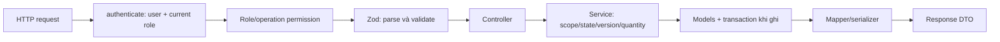
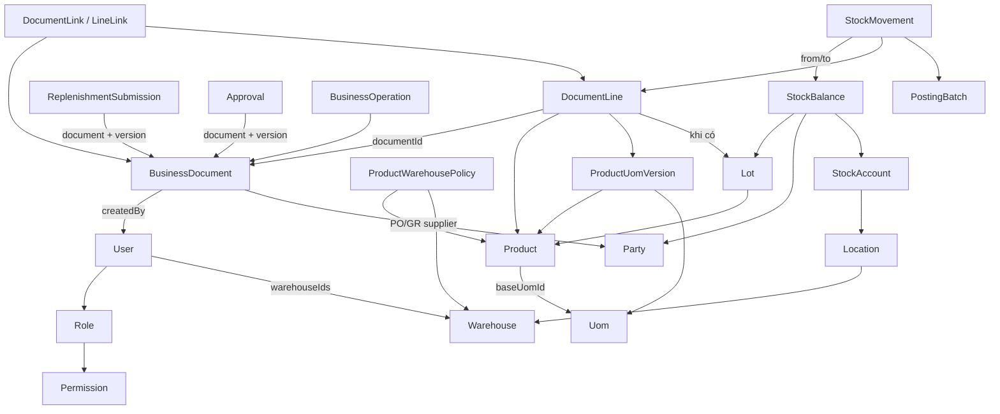
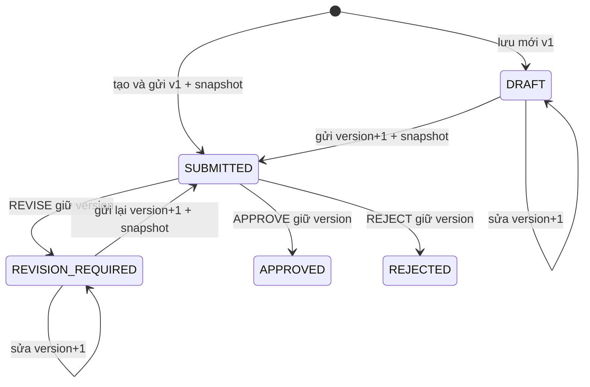
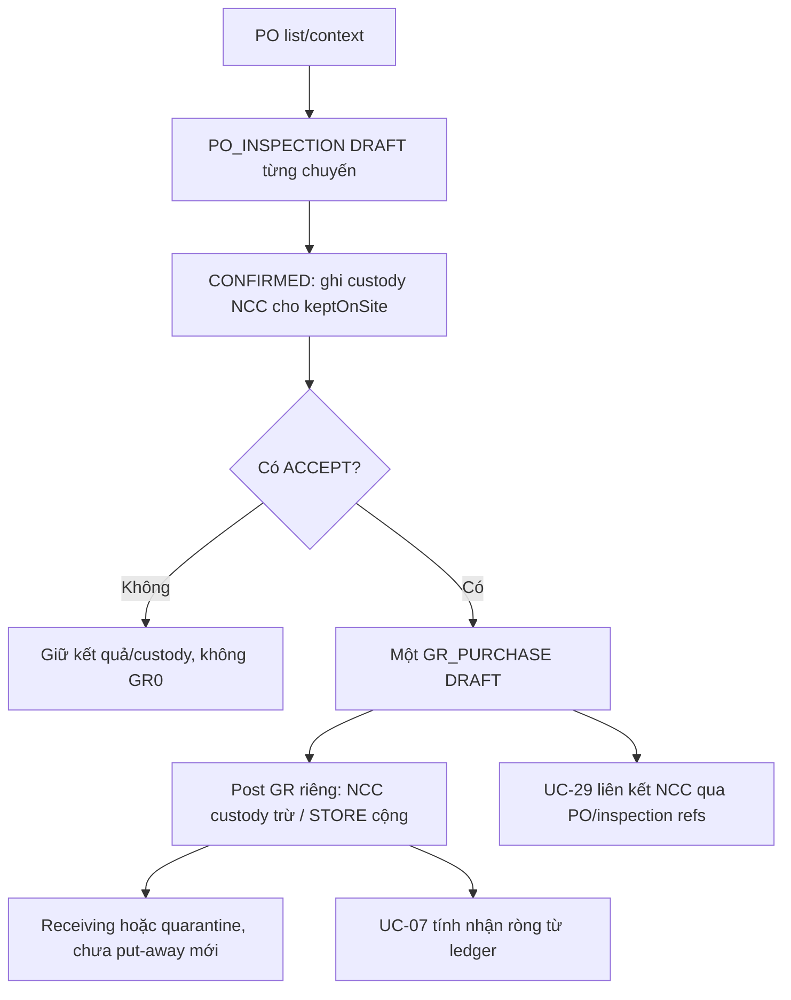

# Review và giải thích toàn bộ UC Iteration 1 của minhtd

## 1. Phạm vi, nguồn và kết luận review

Đã đọc lại trực tiếp [chat Plan iteration 1 use cases](thread://01a18c8f-8d7c-7032-965b-95a746e96ae6?hostId=local). Bản đặc tả chi tiết cuối cùng trong chat thay kế hoạch trước, phân công **23 UC: UC-01–07 và UC-17–32**. Báo cáo này giải thích riêng từng UC, không chỉ mô tả các finding.

**Kết luận hiện tại:** đủ 23 UC có endpoint/service và kiểm thử tương ứng trong backend. Bốn finding RV-01–04 của review trước đã được sửa và có regression test. Điều này xác nhận độ phủ triển khai/backend đã kiểm, không chứng nhận giao diện, tải production hoặc toàn bộ tình huống chưa có assertion.

Sau plan gốc, người dùng đã chốt thêm PO_INSPECTION, custody NCC và post GR riêng. Phần này ảnh hưởng trực tiếp cách UC-07/29 đọc dữ liệu nên báo cáo có phần giải thích bổ sung. Nó không tự đổi danh sách23 UC phân công trong plan gốc thành một danh sách WBS mới.

Snapshot được xem: working tree BE trên nhánh `minhtd`, HEAD `ea2a21f` cùng các thay đổi chưa commit; merge main còn chờ commit. Do nhiều module đang là file mới/chưa commit, **HEAD riêng lẻ không đại diện đầy đủ cho code được review**. Không sửa code ứng dụng hay chạy reset DB trong lượt viết báo cáo này.

### 1.1. Ma trận phạm vi và đường đọc tài liệu

| Nhóm | UC trong plan | Mục báo cáo | Trạng thái backend |
|---|---|---|---|
| Replenishment request | UC-01–06 | Mục5 | List/detail, manual draft/update/submit/review, submission history. |
| PO list | UC-07 | Mục6 | Scoped reader, direct source mới, legacy chain và effective ledger. |
| Product/conversion/policy | UC-17–23 | Mục7 | Danh mục, metadata/status, conversion bất biến, policy theo kho. |
| Lot | UC-24–27 | Mục8 | Catalog, stock/history theo scope, tạo/xác minh/khóa identity. |
| Supplier | UC-28–32 | Mục9 | Master, contact/status phân quyền, audit và related documents. |
| Nhận mua bổ sung | PO_INSPECTION/GR, liên quan UC-16/37 | Mục10 | Đã được chốt sau plan gốc; không phải UC được tự thêm vào phân công Iteration1. |

Các endpoint dưới đây đều có prefix `/api`. Ví dụ `GET /products` nghĩa là `GET /api/products`.

## 2. Cách đọc kiến trúc và quyền

`authenticate()` load lại User từ DB, populate roleId.permissionIds và kiểm active. JWT không được dùng như snapshot quyền vĩnh viễn. `checkPermission()` kiểm role và operation; service command mới còn kiểm lại qua requirePermission. Quyền theo kho/creator/state được xử lý ở service, không giao cho FE.

`validate()` lưu kết quả có default/transform vào req.validated; controller sử dụng kết quả này. Với Express5, req.query là getter nên không dựa vào việc sửa req.query để truyền dữ liệu đã chuẩn hóa.

Controller chủ yếu lấy req.user/input rồi gọi service. Service xử lý nghiệp vụ và transaction. Mapper chuyển ObjectId→string, Decimal128→decimal string và Date→UTC ISO. Model bảo vệ field/type/index/local validation, không tự thực hiện nghiệp vụ hay kiểm foreign key xuyên collection.

Nguồn: [auth middleware](D:/Ky_9/SEP490/src/be/src/middlewares/auth.js:12), [permission](D:/Ky_9/SEP490/src/be/src/middlewares/permission.js:5), [validate](D:/Ky_9/SEP490/src/be/src/middlewares/validate.js:3), [access helpers](D:/Ky_9/SEP490/src/be/src/shared/utils/access.js:5).

### 2.1. Quyền ai làm gì?

| Resource/operation | Role và phạm vi |
|---|---|
| RR read | Owner mọi kho; Accountant kho assigned; Sales/Warehouse thêm createdBy là chính mình. |
| RR create/update/submit | Sales/Warehouse; phiếu đã lưu phải do chính actor tạo, còn assignment hợp lệ. |
| RR review | Owner có approve, khác creator và submitter; không giới hạn assigned warehouses của Owner. |
| PO read | Owner mọi kho; Accountant/Warehouse chỉ assigned; Warehouse nhận projection nhận hàng. |
| Product read | Bốn role kinh doanh, catalog global. |
| Product create/update/status/conversion/policy | Owner theo permission; policy Owner mọi kho. |
| Lot read/create | Owner/Warehouse; metadata dùng chung, stock/history theo kho. |
| Lot update | Chỉ Owner, dù lot do Warehouse vừa tạo. |
| Supplier read | Owner/Accountant, master global. Documents còn kiểm riêng quyền loại chứng từ và kho. |
| Supplier create/contact update | Accountant. |
| Supplier cooperation status | Owner. |

ADMIN không mặc định có quyền nghiệp vụ. Role đúng nhưng permission bị thu hồi vẫn bị chặn. Explicit filter kho ngoài scope thường trả403; detail ngoài scope trả404 để không tiết lộ record. Supplier/Product global không bị lọc theo warehouseIds như RR.

### 2.2. Input/output chung cần hiểu

- Quantity và factor là chuỗi thập phân, không nhận JSON number. Quantity scale6/precision20; factor scale12/precision24. Service dùng ExactDecimal/decimal.js, DB dùng Decimal128.
- `qtyBase = enteredQty × conversionSnapshot`. wholeBaseUnits yêu cầu số nguyên; không tự làm tròn số viên để chấp nhận input sai.
- `neededOn` là ngày lịch Asia/Saigon, nhận YYYY-MM-DD và lưu mốc00:00+07. Timestamp thực hiện trả UTC ISO. Filter đến ngày cuối dùng exclusive đầu ngày tiếp theo.
- List trả `{items,total,page,limit}`; thường mặc định1/10, limit tối đa100. Search literal được escape, sort có allowlist.
- Success `{success:true,message,data}`. Lỗi có message/code/fieldErrors/details tùy loại. Payload JSON quá1MiB trả413.
- GET không tự ghi audit, tăng version, đổi status hoặc post tồn.

## 3. Model: mỗi loại giữ thông tin gì?

### 3.1. Bản đồ quan hệ

| Model | Ý nghĩa và điểm không được nhầm |
|---|---|
| Product | Một SKU và thuộc tính gạch. Không phải quantity tồn. |
| Uom | Danh mục đơn vị; hệ số BOX/M2 của từng SKU không lưu chung ở đây. |
| ProductUomVersion | Một hệ số theo product/UOM/version/validFrom; append-only. |
| ProductWarehousePolicy | Minimum/target của một SKU tại một kho; không tự tạo đơn mua. |
| Lot | Identity product/manufacturer lot/tone/calibre và trạng thái xác minh. Không chứa quantity/quality tồn. |
| Party | Dùng chung SUPPLIER/CUSTOMER/STORE/CARRIER; supplier module ép kind SUPPLIER. |
| BusinessDocument | Header/status/version của nhiều loại chứng từ chung collection, phân biệt documentKind. |
| DocumentLine | Dòng riêng có ID ổn định để link, approval và ledger trỏ tới. |
| ReplenishmentSubmission | Snapshot lần gửi RR, gồm cả header, tên/mã/UOM/factor/lượng/lý do từng dòng; không ghi đè khi sửa phiếu. |
| Approval | Quyết định đúng documentVersion/decisionKind; giữ requested và approved quantity thành hai thông tin khác nhau. |
| BusinessOperation | Receipt command để replay; không phải document trạng thái live và không phải PostingBatch. |
| AuditEvent | Ai làm gì và field trước/sau; master dùng entityType/entityId, chứng từ dùng documentId. |
| DocumentLink / LineLink | Link header và link dòng. Có ID nối nhau chưa chứng minh đúng business chain. |
| StockBalance | Quantity hiện tại theo account+lot+quality+owner; khác quantity PO đã nhận trong lịch sử. |
| StockAccount / Location | Nơi vật lý hoặc transit; account vật lý resolve location→warehouse. |
| PostingBatch / StockMovement | Bằng chứng đã post và ledger before/after, có nguồn/operation/reversal. |
| Reservation / DefectHold / LocationLock | Giữ hàng, chặn hàng lỗi và freeze; dùng khi tính availability. |
| DemandSupplyAllocation | Liên kết nhu cầu với cung; RR manual không tự tạo allocation. |

Nguồn schema: [product/lot](D:/Ky_9/SEP490/src/be/src/models/product.model.js), [party](D:/Ky_9/SEP490/src/be/src/models/party.model.js), [business documents](D:/Ky_9/SEP490/src/be/src/models/business-document.model.js), [document lines](D:/Ky_9/SEP490/src/be/src/models/document-line.model.js), [inventory](D:/Ky_9/SEP490/src/be/src/models/inventory.model.js), [submission](D:/Ky_9/SEP490/src/be/src/models/replenishment-submission.model.js).

### 3.2. Snapshot, version, operation key và audit khác nhau thế nào?

Snapshot lưu **nội dung đã dùng lúc đó**. Version dùng để phát hiện dữ liệu hiện hành đã đổi. Operation key nhận dạng **một lần thực hiện** khi retry. Audit ghi ai thay đổi và thay đổi gì. Chúng bổ trợ nhau, không thay thế nhau.

Ví dụ sản phẩm đổi tên và BOX4 thành BOX6: chứng từ cũ3BOX vẫn giữ tên/factor4/qty12 đã chốt. Draft RR có thể cần chọn conversion hiện hành trước submit. Approval sau submit quyết định trên snapshot đã gửi; không đổi requested quantity theo master mới.

## 4. Kết luận đối chiếu plan và kiểm chứng

| Nội dung | Nhận xét review |
|---|---|
| Danh mục23 UC | Có runtime route/service cho đủ23 mục của plan gốc. |
| Manual RR | Đúng hướng: lý do mỗi dòng, không ép below minimum, không tạo source giả. |
| Phân quyền | Các module có operation + scope/state; đã sửa replay create RR mất kho. |
| Lịch sử | Submission/conversion/approval/audit/operation append-only theo model/service; master update không rewrite document snapshots. |
| PO source | Mới: direct PO_INSPECTION/GR; legacy: typed ARRIVAL/INSPECTION chain. Ledger phải có căn cứ, không suy từ status/text confirmation. |
| Hàng tồn |23 UC gốc không post tồn; custody/GR extension có PostingBatch/Movement theo quyết định bổ sung. |
| Frontend | Plan gốc backend-first; chưa chứng minh UI đã nối các API này. |

Kết quả full suite đã chạy ở lượt triển khai ngay trước báo cáo, ngày02/11/2026: **172 tests,171 pass,0 fail,1 skip Cloudinary live**; đã đọc lại log kết quả. Lượt này đối chiếu source và viết tài liệu, không gọi đó là một lần full-suite mới. Các test integration dùng database random riêng trên replica set.

Test references dùng trong từng mục:

- **RR-read:** [unit đọc RR](D:/Ky_9/SEP490/src/be/test/replenishment-read.test.js), [HTTP/Mongo đọc RR](D:/Ky_9/SEP490/src/be/test/replenishment-read.integration.test.js).
- **RR-command:** [iteration1-replenishment.integration.test.js](D:/Ky_9/SEP490/src/be/test/iteration1-replenishment.integration.test.js).
- **Master:** [iteration1-master.integration.test.js](D:/Ky_9/SEP490/src/be/test/iteration1-master.integration.test.js).
- **PO:** [iteration1-purchase-order.integration.test.js](D:/Ky_9/SEP490/src/be/test/iteration1-purchase-order.integration.test.js).
- **Foundation/Migration:** [foundation](D:/Ky_9/SEP490/src/be/test/iteration1-foundation.test.js), [master migration](D:/Ky_9/SEP490/src/be/test/iteration1-migration.integration.test.js).
- **Receiving:** [po-receiving.integration.test.js](D:/Ky_9/SEP490/src/be/test/po-receiving.integration.test.js), [reset test](D:/Ky_9/SEP490/src/be/test/po-receiving-reset.integration.test.js).

“Có test” dưới đây mô tả tình huống có kiểm chứng; không suy ra test đã bao phủ mọi tổ hợp dữ liệu hoặc race chưa được viết.

## 5. Replenishment — giải thích riêng UC-01–06

### UC-01 — Xem danh sách yêu cầu bổ sung hàng

**Nghiệp vụ/actor:** Owner, Accountant, Sales, Warehouse xem đúng các RR thuộc phạm vi của mình. Chưa có dữ liệu là kết quả rỗng hợp lệ.

**API/input:** GET `/replenishments`; page/limit/search/warehouseId/createdBy/status/approvalDecision/createdFrom/createdTo.

**Flow code:** controller.listReplenishments → [listReplenishments](D:/Ky_9/SEP490/src/be/src/modules/replenishments/replenishment.service.js:199) → buildListPipeline → replenishmentScope → latestApprovalLookup/loadMasters → mapHeader/mapLine/mapApproval.

1. Tạo scope role/kho/creator, intersect với filter người dùng; filter createdBy không thay creator scope của Sales/Warehouse.
2. Lọc documentNo literal và khoảng ngày Việt Nam. Nếu lọc approvalDecision, tìm latest approval và lọc trước count/page.
3. `$facet` lấy total/items; preview tối đa3 active lines và lineCount, bỏ dòng removedAt.
4. Batch load master và map DTO gồm ID, kho, creator, version/status, neededOn, preview, latestDecision.

**Model:** đọc BusinessDocument REPLENISHMENT, DocumentLine REPLENISHMENT, Approval, User/Warehouse/Product/Conversion/Uom. Không ghi dữ liệu.

**Điểm cần hiểu:** latestDecision có thể là quyết định của version trước; không đồng nghĩa nội dung hiện tại đã được duyệt. Ví dụ phiếu trả sửav3 rồi sửa thànhv4 vẫn có latest decision REVISE trênv3.

**Lỗi/test/review:** kho filter ngoài scope403, query sai400; RR-read kiểm filter/intersection/latest-decision trước page và side effects. Thiết kế pipeline phù hợp plan.

### UC-02 — Xem chi tiết RR và lịch sử lần gửi

**Nghiệp vụ/actor:** cùng nhóm UC-01, xem nội dung đang lưu và những gì Owner từng nhận để duyệt.

**API/input:** GET `/replenishments/:id`; GET `/:id/submissions`; GET `/:id/submissions/:version`.

**Flow code:** [getReplenishment](D:/Ky_9/SEP490/src/be/src/modules/replenishments/replenishment.service.js:510) → scoped query → loadMasters/getCurrentAvailability/loadRelations → mapper. History dùng listReplenishmentSubmissions/getReplenishmentSubmission.

1. Query RR ID+kind+scope trước; ngoài scope hoặc không tồn tại404.
2. Load active lines, approval history và submissionCount; lấy currentApproval đúng document.version.
3. Đọc current availability riêng với saved source/evaluation snapshot. Load linked SO/WIR/PO/stocktake và hydrate theo permission nguồn.
4. Dòng APPROVE trả approvedQtyBase đúng version; số0 giữ là string0, không biến thành null.
5. History endpoint đọc ReplenishmentSubmission đúng version. Không có snapshot cũ trả unavailable, không tạo snapshot thay thế từ lines hiện tại.

**Model:** các model UC-01, thêm ReplenishmentSubmission, DocumentLink/LineLink, Reservation/Allocation và stock eligibility models. Chỉ đọc.

**Ví dụ:** gửi100 viên/lý doA ởv3; sửa70/lý doB và gửi v5. Snapshotv3 vẫn100/A; detail hiện tại70/B. Tên master mới không ghi đè tên đã gửi.

**Lỗi/test/review:** nguồn không đủ quyền chỉ reference UNAVAILABLE. RR-read và RR-command kiểm snapshots/history/zero quantities. CurrentStock là thông tin live, chưa phải cam kết cung ứng RR.

### UC-03 — Tạo RR nháp thủ công

**Nghiệp vụ/actor:** Sales/Warehouse có create, tạo yêu cầu dự trữ hoặc nhu cầu khác; không cần SO/cảnh báo/tồn dưới minimum.

**API/input:** POST `/replenishments`, action SAVE_DRAFT, creationKey, warehouseId, neededOn, triggerReason/note,1–100 lines productId/conversionId/enteredQty/reasonNote.

**Flow code:** controller.create → [createReplenishment](D:/Ky_9/SEP490/src/be/src/modules/replenishments/replenishment.commands.js:451) → creationPayload/hash → usableWarehouse → prepareLines → lineDocument → operation/audit.

1. Kiểm role/permission. Tìm create operation theo actor/key; nếu replay phải còn scope kho hiện tại, cùng hash mới trả receipt cũ.
2. Kho active và assigned; draft được có ngày cần đã qua.
3. Batch kiểm product active, conversion đúng product/UOM/current, exact quantity, wholeBaseUnits; chặn trùng product+UOM+reason.
4. Trong transaction tạo RR DRAFTv1, mã RR-ObjectId, lines ép MANUAL_OTHER, operation/result và audit.

**Model ghi:** BusinessDocument, DocumentLine, BusinessOperation, AuditEvent. Đọc Product/Conversion/Uom/Warehouse. Không Submission/Approval/PO/stock posting.

**Ví dụ:** tồn hiện tại200 nhưng muốn đề nghị thêm40 cho đợt bán tới vẫn hợp lệ nếu có lý do riêng. API không giả suggestedQty hay nguồn SO.

**Lỗi/test/review:** qtyBase/actor/source client gửi bị schema chặn; thiếu lý do, product inactive hoặc quantity sai bị từ chối. Cùng creationKey đổi payload409. RR-command kiểm create/replay/role và RV-03 mất kho sau create; finding này đã sửa.

### UC-04 — Sửa RR đang nháp hoặc được trả sửa

**Nghiệp vụ/actor:** creator còn role Sales/Warehouse và update permission; chỉ DRAFT/REVISION_REQUIRED.

**API/input:** PUT `/replenishments/:id`, expectedVersion/operationKey, header mới và toàn bộ active lines muốn giữ. Dòng cũ có id, dòng mới không có id.

**Flow code:** [updateReplenishment](D:/Ky_9/SEP490/src/be/src/modules/replenishments/replenishment.commands.js:579) → ownedDocument/replay → state/version/kho → prepareLines → CAS header → update/soft-delete/add lines.

1. Load đúng creator/scope; kiểm replay trước xử lý command mới.
2. Kiểm editable state/version; cả kho hiện tại và kho mới phải còn active/assignment.
3. Chỉ nhận RR manual. ID dòng phải thuộc phiếu, chưa removed và không lặp; không đổi product trên ID cũ.
4. Giữ ID dòng còn lại; dòng không gửi lại đặt removedAt; dòng thêm có ID mới, lineNo lớn hơn max kể cả dòng đã bỏ.
5. CAS document tăngversion, ghi operation/audit cùng transaction. REVISION_REQUIRED sau save vẫn giữ trạng thái đó.

**Model ghi:** header/lines hiện tại, BusinessOperation/AuditEvent; không ghi đè Submission/Approval cũ. Không đổi tồn.

**Ví dụ:** bỏ dòng2 rồi thêm lại cùng SKU tạo dòng mới có ID/lineNo mới; history gửi trước vẫn giữ dòng2 cũ.

**Lỗi/test/review:** stale version409; không đúng creator/outside scope bị chặn; SUBMITTED/APPROVED/REJECTED không sửa. RR-command kiểm ID preservation, soft-delete, stale và mất assignment. PUT là tập dòng muốn giữ, không phải patch chỉ vài dòng.

### UC-05 — Gửi RR để duyệt

**Nghiệp vụ/actor:** Sales/Warehouse; tạo-gửi mới dùng create, gửi phiếu đã lưu dùng update và đúng creator.

**API/input:** POST collection với action SUBMIT hoặc POST `/replenishments/:id/submit` chỉ expectedVersion/operationKey.

**Flow code:** createReplenishment cho đường mới; [submitReplenishment](D:/Ky_9/SEP490/src/be/src/modules/replenishments/replenishment.commands.js:772) → ownedDocument/replay → prepareLines → writeSubmission.

1. Kiểm scope/quyền và operation cũ. Phiếu đã lưu phải editable/đúng version.
2. Ngày cần không trước hôm nay; kho/product active,1–100 active manual lines và mỗi dòng có lý do.
3. Kiểm lại conversion current; conversion đổi sau draft trả conflict, không tự nhân bằng factor mới.
4. Tạo mới SUBMITTEDv1; hoặc phiếu đã lưu tăngversion, chuyển SUBMITTED, gán submitter/time server.
5. Ghi snapshot header/line/UOM/factor/qty/reason đúng version, operation và audit cùng transaction.

**Model ghi:** BusinessDocument, ReplenishmentSubmission, BusinessOperation, AuditEvent; đường tạo mới còn có DocumentLine. Không tăng tồn/reserve/auto PO/notification.

**Ví dụ:** draftv2 gửi thànhv3, Snapshot.documentVersion=3; hai submit cạnh tranh chỉ một chuyển trạng thái/snapshot.

**Lỗi/test/review:** endpoint submit saved không nhận sửa lines/header. RR-command có conversion drift, competing submit, snapshot/history. Retry cùng key phải giữ receipt cũ kể cả document đã đi tiếp.

### UC-06 — Owner duyệt, từ chối hoặc trả sửa RR

**Nghiệp vụ/actor:** Owner có approve, khác creator và submitter; quyết định trên nội dung đã gửi đúng version.

**API/input:** POST `/replenishments/:id/review`, expectedVersion/operationKey, decision APPROVE/REJECT/REVISE, reason và lines khi approve.

**Flow code:** [reviewReplenishment](D:/Ky_9/SEP490/src/be/src/modules/replenishments/replenishment.commands.js:1033) → load submitted document/snapshot → appendApproval → CAS workflowStatus → operation/audit.

1. Kiểm Owner, user identity độc lập, SUBMITTED và expectedVersion, snapshot hiện tại phải tồn tại.
2. APPROVE bao phủ đúng toàn bộ snapshot lines, không thiếu/thừa/trùng; lượng từ0 đến requested và đúng wholeBaseUnits.
3. Lượng giảm hoặc0 cần lý do từng dòng; phải có ít nhất một dòng dương. Muốn từ chối hết dùng REJECT.
4. REJECT/REVISE cần reason chung, không nhận lượng duyệt; status thành REJECTED/REVISION_REQUIRED.
5. Append Approval đúng version và decisionKind REPLENISHMENT_APPROVAL, update status và ghi operation/audit. Review giữ document.version.

**Model:** đọc snapshot/Product để kiểm độ hạt; ghi Approval, BusinessDocument status, BusinessOperation và AuditEvent. Không ghi giảm requested qty hoặc rewrite snapshot.

**Ví dụ:** đề nghị100, duyệt60 → requested100 vẫn còn, Approval60. Creator sau đó đổi role Owner vẫn không tự duyệt. Conversion mới sau submit không làm requested thay đổi.

**Lỗi/test/review:** thiếu snapshot chặn review, self-approval403, state/version409. RR-command kiểm partial/zero/revise/reject/self sau role change và competing reviews. Đây là authorization mua hàng, chưa phải chứng từ nhập tồn.

### 5.1. Flow RR xuyên suốt và các function dùng chung

Ví dụ v1draft→v2sửa→v3gửi→v3trả sửa→v4sửa→v5gửi→v5duyệt. Submission cóv3/v5; approvalv3 không cấp quyền chov5.

| Helper | Vai trò |
|---|---|
| prepareLines | Trusted product/conversion/UOM, exact qty, current factor và duplicate line check. |
| writeSubmission | Snapshot server-validated, bounded100 lines. |
| ownedDocument / usableWarehouse | Creator và scope hiện tại, active khi thực hiện command mới. |
| canonical payload/hash / assertReplay | Cùng actor/action/target/content mới replay; conflict khi đổi nội dung. |
| replayCreated / replayCommand | Phục hồi thao tác commit trước đó, kể cả duplicate/unknown commit. |
| getReplenishmentOptions | CREATE: assigned active kho; FILTER: đúng scope, có kho inactive lịch sử. |
| getCurrentAvailability / sumAvailableBalances | STORE/GOOD, lot VERIFIED, active STORAGE allocatable; loại hold/freeze và trừ ACTIVE reservation một lần. |

Ví dụ eligible balance100, reservation20→available80. Có active hold trên balance thì code loại cả balance, không tính100−20−holdQty. Reservation vượt balance báo dữ liệu không nhất quán. Receiving/custody không trở thành nguồn tự do cho RR.

## 6. Purchase order — UC-07

### UC-07 — Xem danh sách PO và lượng còn phải nhận

**Nghiệp vụ/actor:** Owner/Accountant/Warehouse xem PO và số nhận sở hữu có căn cứ. Owner toàn kho; hai role còn lại assigned.

**API/input:** GET `/purchase-orders`; page/limit/search/supplierId/warehouseId/status/createdFrom/createdTo/outstanding=YES|NO|UNKNOWN.

**Flow code:** [listPurchaseOrders](D:/Ky_9/SEP490/src/be/src/modules/purchase-orders/purchase-order.service.js:509) → scopedWarehouseFilter → computedDocuments → resolveGrLines → grLineReceivedQuantities → quantityStatus → mapPreviewLines.

1. Query PO theo scope/filter; load PO lines, xác định GR liên quan.
2. GR mới dùng header.purchaseOrderId/poInspectionId và typed PURCHASE_RECEIPT source lines; kiểm đúng PO line, inspection CONFIRMED, product/lot/quality/quantity/kho/supplier.
3. GR legacy resolve PO→ARRIVAL→INSPECTION→GR với loại node/nguồn kiểm nhận phù hợp; không coi link tắt PO→GR là chuỗi hợp lệ.
4. Đọc PostingBatch/Movement; GR draft không giảm outstanding. Kiểm batch/document/ancestry, lot→product, owner/kho và chiều STORE. Mỗi movement tính một lần.
5. Received là effective net STORE receipt, không phải current balance. Outstanding=ordered−received trong ca chưa có fact hủy; CLOSED/CANCELLED thiếu căn cứ hoặc nguồn lỗi trả INCOMPLETE/null.
6. Lọc outstanding trước count/page; hydrate kho/NCC và preview tối đa3 dòng. Không cộng header total giữa các SKU/UOM.

**Model đọc:** BusinessDocument PO/GR/inspection/legacy headers, DocumentLine, LineLink, Party, Lot/Product/Uom, StockBalance/Account/Location, PostingBatch/Movement. Không ghi trên GET.

**Ví dụ:** đặt100, nhận70 sở hữu→còn30 dù thực giao80 và10 đang custody. Draft GR chưa post không tính đã nhận. Root nhập60, đảo20 hợp lệ→nhận ròng40. Text “NCC đồng ý giao đủ” không làm confirmedQty thành100; field đó vẫn null.

**Lỗi/test/review:** PO integration kiểm draft/custody/reversal/over/closed/broken/filter/scope/stock neutrality, regression RV-01/02. Các ca root xuất sai, balance sai SKU, batch sai nguồn nay trả INCOMPLETE. Tính toàn tập candidate trước page đúng về filter nhưng còn chi phí tăng theo dữ liệu; chưa benchmark production.

### 6.1. Những function PO cần mở để đọc sâu

| Function | Vai trò và dữ liệu truyền tiếp |
|---|---|
| resolveGrLines | Map từng PO line tới tập GR lines và trạng thái broken. Có direct source mới, typed chain cũ; Set chống cộng một GR line nhiều lần. |
| grLineReceivedQuantities | Map GR line tới quantity effective và incomplete; kiểm ledger thay vì tin POSTED đơn lẻ. |
| loadBatchGraph / batchSign | Tìm ancestry reversal, dấu đảo, phát hiện chain thiếu/cycle; chiều movement phải tương thích ancestry. |
| computedDocuments | Phát hiện GR không map rõ một PO line, received vượt ordered và incomplete; tính outstanding từng dòng. |
| emptyComputedLine / quantityStatus | Giữ ordered nhưng null các lượng không xác định; một line incomplete làm PO UNKNOWN. |
| purchaseOrderQuantities | Reader dùng lại trong nhận hàng để kiểm source caps trong transaction. |

GR mới link thẳng PO không bỏ việc kiểm inspection: PO reference trả lời nguồn mua, inspection reference chứng minh lượng được phép nhập. Chi tiết phần ghi tồn ở mục10.

## 7. Product — giải thích riêng UC-17–23

### UC-17 — Xem danh sách sản phẩm

**Nghiệp vụ/actor:** bốn role kinh doanh đọc catalog dùng chung, gồm active/inactive theo filter; không tự hiển thị tồn giả hoặc giá bán.

**API/input:** GET `/products`, page/limit/search/nominalSize/isActive/sortBy/sortOrder. SortBy chỉ createdAt/sku/name.

**Flow code:** controller.list → [listProducts](D:/Ky_9/SEP490/src/be/src/modules/products/product.service.js:111) → literal SKU/name filter → count/sort/page → loadUoms → mapProductSummary.

1. requireProductReader kiểm role và product:read.
2. Escape search, whitelist sort, safe pagination; filter isActive chỉ khi người dùng gửi.
3. Query Product và count; load base UOM theo các ID trên trang, map version/status/metadata cơ bản.

**Model:** Product/Uom, chỉ đọc. Không join stock toàn hệ thống hay tạo conversion khi GET.

**Ví dụ:** ngừng kinh doanh SKU vẫn phải xem được lịch sử và catalog record khi không lọc active-only.

**Test/review:** Master có list/detail và auth/admin separation; Foundation/validation chặn unknown sort/quantity types. Global catalog khác kho assigned là chủ ý của plan.

### UC-18 — Xem chi tiết sản phẩm và quy đổi

**Nghiệp vụ/actor:** product reader xem thuộc tính và hệ số có hiệu lực hiện tại, có đường xem lịch sử riêng.

**API/input:** GET `/products/:id`; GET `/:id/conversions` với page/limit/uomId.

**Flow code:** [getProduct](D:/Ky_9/SEP490/src/be/src/modules/products/product.service.js:139) → detailWithMasters → currentConversionsByProduct/loadUoms → mapProductDetail. History dùng listConversions.

1. Kiểm quyền và Product tồn tại, thiếu404.
2. Lấy conversions có validFrom<=now, sort validFrom/version giảm dần và chọn một bản mỗi product/UOM.
3. Map kích thước/factor thành string; optional data thiếu trả null, không bịa brand/creator/reference.
4. History trả cả future/old conversions theo trang; policy không tự lộ vì policy dùng quyền Owner update riêng.

**Model:** Product, ProductUomVersion, Uom, chỉ đọc.

**Ví dụ:** BOXv3 hiệu lực tuần sau chưa thay BOXv2 current hôm nay, dù số version lớn hơn.

**Test/review:** Master kiểm future/current/history và snapshot preservation. nominalSize là nhãn danh nghĩa; actual calibre thuộc Lot, không suy từ kích thước này.

### UC-19 — Tạo sản phẩm

**Nghiệp vụ/actor:** Owner có product:create, khai SKU và thông số danh mục.

**API/input:** POST `/products`; sku/name/baseUomId/wholeBaseUnits và metadata gạch optional.

**Flow code:** [createProduct](D:/Ky_9/SEP490/src/be/src/modules/products/product.service.js:146) → validate/create transaction → Product/base conversion → appendAudit → detailWithMasters.

1. SKU trim+uppercase, name không rỗng; lengthMm/widthMm phải cùng có hoặc cùng thiếu, dimension dương.
2. UOM gốc phải tồn tại. Precheck SKU và unique index chống race duplicate.
3. Transaction tạo Product activev1, ProductUomVersion gốc factor1/version1/actor thật và audit entity PRODUCT.
4. Trả detail; không tự tạo Lot, policy, opening balance hoặc quantity tồn.

**Model ghi:** Product, ProductUomVersion, AuditEvent. Uom chỉ đọc.

**Ví dụ:** tạo SKU gạch60×60 làm catalog có một đơn vị cơ sở; chưa có một viên nào trong kho.

**Lỗi/test/review:** trùng SKU409, UOM không tồn tại400, field status/version client bị strict schema chặn. Master kiểm atomic base conversion và concurrent duplicate SKU.

### UC-20 — Cập nhật thông tin sản phẩm

**Nghiệp vụ/actor:** Owner có product:update, sửa metadata mà không thay danh tính/hệ số của giao dịch cũ.

**API/input:** PUT `/products/:id`, expectedVersion, name và các metadata được phép.

**Flow code:** [updateProduct](D:/Ky_9/SEP490/src/be/src/modules/products/product.service.js:208) → load version → set/unset whitelist → CAS → changedFields/appendAudit → detail.

1. Load Product, kiểm expectedVersion.
2. Chỉ sửa name/nominalSize/category/brand/material/surface/dimensions/origin/description.
3. Optional field bỏ trong PUT được unset; name bắt buộc. Không nhận sku/baseUomId/wholeBaseUnits/isActive/conversion/policy.
4. CAS `_id+version`, tăngversion và audit trước/sau cùng transaction.

**Model ghi:** Product/AuditEvent. Không sửa DocumentLine hay Submission đã dùng Product.

**Ví dụ:** đổi tên catalog không đổi productNameSnapshot trên RR đã gửi.

**Lỗi/test/review:** stale409 có currentVersion sau khi xác nhận record; field ngoài allowlist400. Master kiểm metadata/version và giữ snapshot lịch sử. Khi FE dùng PUT phải gửi đầy đủ optional fields muốn giữ.

### UC-21 — Đổi trạng thái sản phẩm

**Nghiệp vụ/actor:** Owner có product:update bật/tắt dùng SKU cho nghiệp vụ mới, giữ lịch sử.

**API/input:** PATCH `/products/:id/status`, expectedVersion/isActive/reason.

**Flow code:** [changeProductStatus](D:/Ky_9/SEP490/src/be/src/modules/products/product.service.js:257) → load/version → same-state check → CAS status/version → audit.

1. Kiểm Product và version trước, kể cả khi status gửi lên tình cờ đã bằng hiện tại.
2. Same-state trả record, không tăngversion hay tạo audit mới.
3. Nếu đổi thực: cập nhật isActive, version+1, audit reason/old/new; không xóa master/tồn/history.

**Model ghi:** Product/AuditEvent khi transition thực; StockBalance không đổi.

**Ví dụ:** inactive vẫn đọc detail để truy giao dịch cũ, nhưng create RR mới kiểm active sẽ từ chối SKU đó.

**Test/review:** Master kiểm no-op/history và inactive readable. Chặn SKU inactive trong từng flow sử dụng là trách nhiệm service writer, không do flag tự chặn mọi query Mongo.

### UC-22 — Tạo phiên bản quy đổi đóng gói

**Nghiệp vụ/actor:** Owner có product:update, thêm hệ số có căn cứ, giữ versions đã dùng.

**API/input:** POST `/products/:id/conversions`; expectedProductVersion/uomId/basePerUnit/validFrom/verificationReference.

**Flow code:** [createConversion](D:/Ky_9/SEP490/src/be/src/modules/products/product.service.js:300) → Product/Uom checks → CAS Product guard → max conversion.version+1 → append version/audit.

1. Product active/đúng version, UOM tồn tại và khác base UOM; base factor1 không tạo lại qua API này.
2. Factor dương, precision24/scale12, reference văn bản không rỗng. BOX với wholeBaseUnits phải nguyên.
3. validFrom không ở quá khứ lúc server xử lý. Current được chọn bằng ngày hiệu lực, không chỉ version lớn nhất.
4. CAS tăng Product.version để serialize các writers; append conversion version mới và audit cùng transaction.

**Model ghi:** Product version guard, ProductUomVersion và AuditEvent; không update/delete old conversion.

**Ví dụ:** BOXv1=4, BOXv2=6. Chứng từ3BOX factor4 vẫn12 viên; chứng từ dùng v2 thành18. RR draft dùng conversion đã hết current phải chọn lại trước submit.

**Lỗi/test/review:** stale product409; sai factor/UOM/reference/thời gian bị chặn. Master kiểm history, future và competing conversion creation. Product.version và conversion.version là hai phạm vi khác nhau.

### UC-23 — Cấu hình minimum/target theo sản phẩm và kho

**Nghiệp vụ/actor:** Owner có product:update cấu hình policy mọi kho, không phụ thuộc assigned warehouses.

**API/input:** GET `/products/:id/warehouse-policies`; PUT `/:id/warehouse-policies/:warehouseId` với expectedVersion/minimumQtyBase/targetQtyBase optional.

**Flow code:** [configurePolicy](D:/Ky_9/SEP490/src/be/src/modules/products/product.service.js:426) → active Product/Warehouse → exact quantity → insert or CAS policy → audit → mapPolicy. Đọc qua listPolicies.

1. Minimum>=0, target>=minimum; nếu bỏ target thì lấy minimum, kể cả update.
2. wholeBaseUnits yêu cầu minimum/target nguyên.
3. Tạo mới dùng expectedVersion0→policyv1; đã có mà gửi0 conflict. Update dùng đúng policy.version và tăng1.
4. updatedBy lấy actor server, audit trước/sau; không tạo RR, PO hoặc cảnh báo.

**Model ghi:** ProductWarehousePolicy/AuditEvent; Product và Warehouse chỉ đọc. Unique product+warehouse.

**Ví dụ:** min10/target8 bị chặn; min10 không gửi target lưu10. Version của policy không phải version Product.

**Test/review:** Master kiểm create/default/update/conflict, Owner-only và product options. product:read không đủ để đọc policy; lookup chỉ trả warehouse catalogue cho Owner update.

## 8. Lot — giải thích riêng UC-24–27

### UC-24 — Xem danh sách lô

**Nghiệp vụ/actor:** Owner/Warehouse có product_lot:read xem catalog identity dùng chung, kể cả lô chưa nhập kho.

**API/input:** GET `/lots`, page/limit/productId/manufacturerLot/tone/calibre/identificationStatus/warehouseId.

**Flow code:** [listLots](D:/Ky_9/SEP490/src/be/src/modules/lots/lot.service.js:179) → catalog query/count/page → Product + scopedStockRows → mapLotSummary.

1. Validate filter; explicit warehouse ngoài scope403.
2. Query Lot global bằng identity/status rồi phân trang.
3. Resolve Balance→Account→Location→Warehouse/Party để tính stock presence chỉ trong scope, hoặc trong warehouseId nếu gửi.
4. Map product/identity/verification/version và hasScopedStock; không cộng mọi quality/owner thành available.

**Model:** Lot/Product và các stock dimension, chỉ đọc.

**Ví dụ:** Warehouse thấy catalog lô mới chưa có tồn, nhưng không thấy stock presence của kho không được giao.

**Test/review:** Master kiểm catalog và scoped stock. Thực tế hasScopedStock hiện dựa trên có balance row, kể cả quantity0; warehouseId lọc phần presence, không lọc bỏ catalog lot không có stock tại kho đó. FE không nên coi cờ này là “còn hàng để xuất”.

### UC-25 — Xem chi tiết lô và lịch sử tồn

**Nghiệp vụ/actor:** Owner/Warehouse đọc identity chung, số dư và lịch sử kho có quyền.

**API/input:** GET `/lots/:id`; GET `/:id/movements` với page/limit. Movements cần thêm stock_movement:read.

**Flow code:** [getLot](D:/Ky_9/SEP490/src/be/src/modules/lots/lot.service.js:228) → findLot/productForLot/scopedStockRows → mapLotDetail. History qua getLotMovements → endpoint scope → movementDocumentReference.

1. Detail map metadata và stock theo từng warehouse/location/quality/owner, không tự dựng firstImportDate/NCC nguồn thiếu căn cứ.
2. History tìm movement liên quan balance của lot; resolve cả from/to trước khi trả và trước count/page.
3. Một endpoint ngoài scope hoặc không resolve được thì loại movement, không lộ đầu còn lại.
4. Before/after lấy từ ledger, không thay bằng quantity hiện tại. Source document chỉ hydrate khi có permission riêng.

**Model:** Lot/Product, Balance/Account/Location/Warehouse/Party, StockMovement/PostingBatch/BusinessDocument, chỉ đọc.

**Ví dụ:** movement chuyển hai kho mà Warehouse chỉ được một đầu sẽ không được trả đầy đủ như một giao dịch trong kho mình.

**Test/review:** Master kiểm movement permission và hide foreign endpoints. Reader hiện resolve qua Location vật lý, chưa phải reader đầy đủ mọi transit endpoint. UNAVAILABLE source reference không có nghĩa đã có API detail đích.

### UC-26 — Tạo lô hàng

**Nghiệp vụ/actor:** Owner/Warehouse có product_lot:create, đăng ký identity thật hoặc UNKNOWN rõ ràng, không làm tăng tồn.

**API/input:** POST `/lots`, productId/manufacturerLot/tone/calibre/identificationStatus; manufacturedOn/verificationReference/notes optional theo điều kiện.

**Flow code:** [createLot](D:/Ky_9/SEP490/src/be/src/modules/lots/lot.service.js:238) → manufacturedDate/hasUnknown → product active/duplicate check → Lot insert/audit.

1. Trim identity nhưng không tự coi T1 và t1 là cùng mã, không suy actual calibre từ Product.nominalSize.
2. VERIFIED cần đủ identity không có UNKNOWN và reference không rỗng; verifiedBy/At server gán.
3. Ngày sản xuất không tương lai. UNKNOWN giữ dấu chưa biết, không sinh hậu tố ngẫu nhiên né unique.
4. Transaction tạo lotv1/createdBy/identityLocked=false và audit; unique product+manufacturerLot+tone+calibre chống duplicate.

**Model ghi:** Lot/AuditEvent; Product đọc. Không StockBalance, quality hoặc PostingBatch mới.

**Ví dụ:** khai lô L01/toneT1/calibreC1 chưa có nghĩa đã nhận10 thùng; nhận hàng mới ghi lượng ở balance.

**Lỗi/test/review:** duplicate409, thiếu căn cứ VERIFIED400. Master kiểm Warehouse create nhưng không update, UNKNOWN, future date. Việc UNKNOWN không available do eligibility reader/writer áp, không do Lot schema tự chặn mọi giao dịch.

### UC-27 — Cập nhật thông tin lô và bảo vệ identity

**Nghiệp vụ/actor:** chỉ Owner có product_lot:update. Không sửa identity đã dùng để biến hàng cũ thành lô khác.

**API/input:** PUT `/lots/:id`, expectedVersion và fields được phép. productId không có trong payload update.

**Flow code:** [updateLot](D:/Ky_9/SEP490/src/be/src/modules/lots/lot.service.js:316) → findLot/version → lotHasReferences → identity/status verification → CAS/audit.

1. Kiểm cờ identityLocked và references DocumentLine/StockBalance thực; balance bằng0 vẫn là đã tham chiếu.
2. ManufacturerLot/tone/calibre chỉ đổi khi chưa lock/chưa reference. Thay identity cần gửi identificationStatus và căn cứ mới nếu VERIFIED.
3. UNKNOWN→VERIFIED cần đủ nhận dạng/căn cứ; VERIFIED→UNKNOWN bị chặn trong UC này.
4. CAS version, thêm điều kiện identityLocked=false nếu đổi identity; cập nhật metadata/xác minh và audit cùng transaction.

**Model ghi:** Lot/AuditEvent; DocumentLine/Balance chỉ kiểm references. Không đổi quantity/quality/location.

**Ví dụ:** lot từng có stock nay quantity0 vẫn không được đổi tone để dùng lại ID. Sửa notes không đổi hàng GOOD thành DAMAGED.

**Test/review:** Master kiểm referenced lock; [lockLotIdentity](D:/Ky_9/SEP490/src/be/src/shared/utils/lotIdentity.js:10) được writers dùng trước ghi reference trong transaction. Chưa có test cạnh tranh trực tiếp lock-vs-edit; dữ liệu UNKNOWN đã reference cũng cần flow correction phù hợp nếu phải thay identity, không dùng PUT để lách khóa.

## 9. Supplier — giải thích riêng UC-28–32

### UC-28 — Xem danh sách nhà cung cấp

**Nghiệp vụ/actor:** Owner/Accountant có supplier:read đọc catalog NCC global.

**API/input:** GET `/suppliers`, page/limit/search/cooperationStatus.

**Flow code:** [listSuppliers](D:/Ky_9/SEP490/src/be/src/modules/suppliers/supplier.service.js:90) → force kind SUPPLIER → status/search predicate → count/sort/page → mapSupplierSummary.

1. Chỉ query Party SUPPLIER, không trả STORE/CUSTOMER/CARRIER.
2. Search literal code/name. Cooperation filter ACTIVE/SUSPENDED/TERMINATED.
3. Legacy thiếu cooperationStatus: isActive=false được hiểu SUSPENDED, còn lại ACTIVE; không tự suy TERMINATED.
4. Trả contact summary/status/isActive/version và dates; không có debt/payment.

**Model:** Party, chỉ đọc. Không cần tạo collection Supplier riêng.

**Ví dụ:** supplier đã ngừng hợp tác vẫn có trong list khi filter tương ứng để đọc lịch sử.

**Test/review:** Master kiểm supplier-only query, role separation, inactive read. Warehouse/Sales/Admin không được thấy master NCC chỉ vì dùng hàng tại kho.

### UC-29 — Xem hồ sơ, lịch sử và chứng từ NCC

**Nghiệp vụ/actor:** Owner/Accountant đọc contact/status; history và chứng từ phải có nguồn/quyền riêng.

**API/input:** GET `/suppliers/:id`, `/:id/history`, `/:id/documents?kind=PO|GR_PURCHASE|SUPPLIER_RETURN`; subresources phân trang.

**Flow code:** getSupplier→findSupplier/mapSupplierDetail; getSupplierHistory→AuditEvent; [getSupplierDocuments](D:/Ky_9/SEP490/src/be/src/modules/suppliers/supplier.service.js:451) → permission/scope → direct headers hoặc supplierDocumentIdsForGr.

1. findSupplier ép đúng Party SUPPLIER, không dùng Customer ID như supplier.
2. History lọc entityType SUPPLIER/entityId, trả actor/eventAt/changes/details, không mutate.
3. PO/SR có supplier header thì filter trực tiếp cùng warehouse scope.
4. GR mới đối chiếu direct purchaseOrderId/supplierId/poInspectionId, PO/inspection/kho nhất quán; không cần lần ngược ARRIVAL để biết NCC.
5. GR legacy dùng SOURCE links và đúng thứ tự INSPECTION→ARRIVAL→PO, kiểm inspectedSourceLineId/product/kho. Thiếu chain hoặc nguồn mơ hồ không tự gán.
6. Chỉ trả reference documentNo/kind/status/version/kho/date; không cấp API detail mới hoặc URL evidence.

**Model:** Party/AuditEvent, BusinessDocument/DocumentLine/LineLink/Warehouse; không ghi.

**Ví dụ:** Accountant được giao WH01 xem contact NCC dùng chung nhưng không xem GR ở WH02 nếu không được giao. Supplier TERMINATED vẫn đọc hồ sơ/lịch sử hợp lệ.

**Test/review:** Master kiểm PO/GR chain scope; PO regression xác nhận RV-04 shortcut không xuất hiện; Receiving kiểm GR nguồn mới xuất hiện đúng supplier. Direct refs vẫn có consistency checks; không tin client tự gán supplierId.

### UC-30 — Tạo nhà cung cấp

**Nghiệp vụ/actor:** Accountant có supplier:create tạo hồ sơ mới, không cần Owner duyệt.

**API/input:** POST `/suppliers`, code/name và phone/email/address/taxCode/contactPerson/notes optional.

**Flow code:** [createSupplier](D:/Ky_9/SEP490/src/be/src/modules/suppliers/supplier.service.js:137) → normalize/duplicate → Party create + audit → detail mapper.

1. Code trim+uppercase, unique trên toàn Party; không chỉ so trong SUPPLIER.
2. Validate email/contact nếu có; không ép taxCode unique khi chưa có rule đó.
3. Server ép kind SUPPLIER, cooperationStatus ACTIVE/isActive=true/version1; actor không lấy client.
4. Insert và audit entity SUPPLIER cùng transaction; unique index bảo vệ race sau pre-check.

**Model ghi:** Party/AuditEvent. Không PO, Approval hay stock.

**Ví dụ:** Accountant tạo NCC mới có ACTIVE theo quyết định đã chốt; quyền đó không cho đổi trạng thái mọi NCC cũ.

**Lỗi/test/review:** duplicate409, field kind/status/version/actor client bị chặn. Master kiểm concurrent code, default ACTIVE và role quyền.

### UC-31 — Cập nhật hồ sơ liên hệ NCC

**Nghiệp vụ/actor:** Accountant có supplier:update sửa tên/contact; trạng thái hợp tác do UC-32 xử lý.

**API/input:** PUT `/suppliers/:id`, expectedVersion/name và contact fields được phép.

**Flow code:** [updateSupplier](D:/Ky_9/SEP490/src/be/src/modules/suppliers/supplier.service.js:190) → findSupplier/version → whitelist set/unset → CAS/audit → mapSupplierDetail.

1. Load đúng SUPPLIER và version.
2. Không nhận code/kind/cooperationStatus/isActive; field optional bỏ trong PUT được xóa.
3. CAS Party tăngversion, audit before/after; ID supplier giữ nguyên nên PO/GR/SR refs không đổi.
4. Cho sửa contact dù ACTIVE/SUSPENDED/TERMINATED; sửa hồ sơ không khôi phục hợp tác.

**Model ghi:** Party/AuditEvent; không ghi lại các chứng từ đã tham chiếu supplier.

**Ví dụ:** đổi số điện thoại NCC TERMINATED vẫn giữ TERMINATED/isActive=false.

**Lỗi/test/review:** Owner không có quyền sửa contact chỉ nhờ được xem/status; Accountant không activate qua PUT. Master kiểm split quyền, stale version và status preservation.

### UC-32 — Đổi trạng thái hợp tác NCC

**Nghiệp vụ/actor:** Owner có supplier:activate chuyển ACTIVE/SUSPENDED/TERMINATED, gồm khôi phục từ TERMINATED.

**API/input:** PATCH `/suppliers/:id/status`, expectedVersion/cooperationStatus/reason.

**Flow code:** [changeSupplierStatus](D:/Ky_9/SEP490/src/be/src/modules/suppliers/supplier.service.js:238) → supplier/version → same-state check → CAS status/isActive/version → audit.

1. Reason không rỗng; version phải đúng trước khi xét no-op.
2. Same-state trả hiện tại, không có transition/audit mới.
3. Đổi thực: isActive chỉ true khi status ACTIVE, lưu statusReason và version+1.
4. Audit status trước/sau, reason, actor/time; không tự hủy PO hoặc đảo receipt.

**Model ghi:** Party/AuditEvent; lịch sử mua/nhập được giữ.

**Ví dụ:** TERMINATED→ACTIVE hợp lệ với Owner và reason; Accountant sửa hồ sơ không làm thay việc này.

**Test/review:** Master kiểm Owner-only, restore, no-op/history và stale. Cấm dùng NCC inactive cho PO mới thuộc create-PO UC-09 ngoài plan23 UC; không suy rằng UC-32 tự triển khai create-PO guard cho API chưa có.

## 10. Bổ sung nhận mua: vì sao UC-07/29 hiện liên quan PO_INSPECTION?

Đây là thay đổi đã chốt sau plan gốc. Không áp invariant “mọi command đều không đổi tồn” của23 UC sang command intake/post mới.

### 10.1. Function và model ghi theo từng mốc

| Mốc/API | Function | Model/hiệu ứng |
|---|---|---|
| GET PO inspection-context | inspectionContext | Đọc PO lines, quantities, locations; không ghi. |
| POST PO /:id/inspections | createInspection/prepare/writeRows | PO_INSPECTION DRAFT, typed lines, source links, operation/audit; lock lot identity, không quantity stock. |
| PUT /po-inspections/:id | updateInspection | Chỉ DRAFT; thay rows chưa chốt và links, version/operation/audit; không stock. |
| POST /po-inspections/:id/confirm | confirmInspection/remaining/guardPo/guardLocations | CUSTODY_RECEIPT POSTED + batch/ledger/balance NCC; inspection CONFIRMED; tạo GR DRAFT khi có ACCEPT, cùng transaction. |
| POST /purchase-receipts/:id/post | postReceipt/adjust/batch | GR POSTED + batch/movement hai đầu custody→STORE, PO progress/version, operation/audit. |
| PATCH inspection handling-note | updateHandlingNote | Sửa note có before/after audit, giữ facts đã chốt/post. |
| GET/list inspection/receipt | getDocument/listDocuments | Serialize ID/decimal/date và scope, không post. |

Nguồn: [receiving service](D:/Ky_9/SEP490/src/be/src/modules/po-receiving/po-receiving.service.js), [routes/validation](D:/Ky_9/SEP490/src/be/src/modules/po-receiving/po-receiving.routes.js), [contract chi tiết](D:/Ky_9/SEP490/src/be/docs/po-receiving-proposal/IMPLEMENTATION.md).

Mỗi inspection line tham chiếu poLineId, lot, conversion snapshot, qty thực của phần phân loại, quality/disposition/keptOnSite/holdingLocation/handlingNote. GR line có poLineId/inspectionLineId/sourceCustodyBalanceId/receivingLocationId. Header GR chứa purchaseOrderId/poInspectionId/supplierId và snapshot người giao; supplier lấy từ PO server, không nhận từ client.

Quality và disposition là hai chiều: DAMAGED không tự REJECT; ACCEPT hàng DAMAGED nếu nghiệp vụ chọn nhận thì STORE ở quarantine, chưa available. keptOnSite=false chỉ cho REJECT và không sinh custody. Phần PENDING/REJECT cần note; note “NCC sẽ đổi” chưa thực hiện return hoặc sinh hàng thay thế.

### 10.2. Ví dụ xuyên suốt liên kết tất cả nhóm model

1. Owner UC-19 tạo SKU A base PIECE, UC-22 khai BOX4, UC-23 minimum20/target40 ở WH01.
2. Warehouse UC-26 đăng ký lot L01/toneT1/calibreC1 có căn cứ VERIFIED.
3. Sales UC-03 tạo RR manual25BOX=100PIECE với reason; UC-05 gửi, Owner UC-06 duyệt100. Stock vẫn không đổi.
4. Accountant UC-30 tạo NCC; UC-31 sửa contact; Owner UC-32 quản lý hợp tác. UC-09 tạo PO là flow khác ngoài23 UC, chưa được suy là có chỉ vì đã có RR duyệt.
5. Với PO đã lưu hợp lệ đặt100PIECE, chuyến giao80 có70ACCEPT/GOOD và10PENDING/DAMAGED giữ tại kho. Confirm inspection ghi custody NCC80, STORE chưa tăng.
6. GR draft lấy đúng70ACCEPT; post chuyển NCC−70/STORE+70 trong hai đầu movement. NCC còn10; physical total vẫn80, không thành150.
7. UC-07 báo nhận sở hữu70/còn30;30 gồm20 chưa giao và10 chưa chấp nhận, không mặc định toàn bộ30 phải mua mới.
8. UC-24/25 thấy lot theo các dimension owner/location/quality trong scope. RR current availability chưa tăng70 vì GOOD còn RECEIVING.
9. UC-29 nhìn GR theo direct PO/supplier refs. Sau này put-away mới có thể làm phần GOOD đủ điều kiện available; gói này chưa thêm command put-away.

Các con số là minh họa. PO100 ở bước5 cần nguồn/approval allowance hợp lệ100; bước tạo PO thuộc UC-09 được nêu để nối bối cảnh, không phải bằng chứng đã triển khai create-PO trong gói23 UC này.

### 10.3. Transaction và chống cạnh tranh

`command()` namespace key theo actor, hash action/target/payload, kiểm replay sau quyền/scope hiện tại. Result lưu document IDs/batchId đã commit. PO conditional-write serialize confirm/post; location.planningVersion và LocationLock bảo vệ freeze. Balance update theo version; thiếu quantity hoặc sai nguồn rollback.

Mỗi inspection tối đa một GR được unique index bảo vệ. accepted0 không tạo GR. Concurrent confirm phải tính cả quantity already posted và GR draft commitments; concurrent post chỉ một PostingBatch. Reading quantity để kiểm cap nằm trong session/transaction, không dùng kết quả FE tính làm thẩm quyền.

## 11. Các finding cũ, giới hạn hiện tại và kiểm tra nên tiếp tục

### 11.1. Trạng thái RV-01–04

| Finding cũ | Cách sửa hiện có | Bằng chứng |
|---|---|---|
| RV-01 root xuất STORE bị tính nhập | Kiểm hướng STORE tương thích ancestry rồi cộng signed movement đúng một lần. | PO regression root direction sai→INCOMPLETE; nhập/reversal hợp lệ vẫn đúng. |
| RV-02 balance sai product / batch sai doc | Resolve Lot→Product, kiểm GR lot nếu có; batch và ancestry cùng receipt/source movement. | PO regression cho cả hai input sai; quantities trả null. |
| RV-03 create replay bỏ scope kho | Kiểm canAccessWarehouse trước receipt ở nhánh existing và replayCreated fallback. | RR regression mất assignment sau create→403; còn quyền replay bình thường. |
| RV-04 supplier chấp nhận link tắt | GR mới dùng direct refs có consistency checks; legacy đi đúng SOURCE chain và inspectedSourceLineId. | Shortcut bị loại; receiving GR mới xuất hiện đúng NCC. |

Những báo cáo31/10 và01/11 giữ giá trị giải thích nguyên nhân code cũ, không phải trạng thái lỗi còn mở của snapshot này. Các test không ép được mọi nhánh lỗi mạng/unknown commit; nhánh fallback có kiểm source bằng đọc code, không gắn nhãn đã mô phỏng unknown commit thành công.

### 11.2. Giới hạn ảnh hưởng nghiệm thu hoặc vận hành

- **Frontend:** chưa có bằng chứng các màn hình gắn đúng API/version/key và scope. Không coi UI mock là nghiệm thu BE; cũng không coi testBE là nghiệm thu browser.
- **Hiệu năng:** PO outstanding lọc trước page cần tính toàn bộ candidate; supplier GR history và lot movements có phần xử lý toàn tập rồi slice. Chưa benchmark, không đưa số SLA suy đoán.
- **Lot history:** transit endpoint chưa resolve như physical Location; lịch sử thiếu đầu scope bị ẩn. hasScopedStock dựa trên balance presence, không quantity dương.
- **Lot concurrency:** có reference lock và writer protocol nhưng chưa có ca integration chạy trực tiếp lock-vs-update identity. Lot UNKNOWN đã referenced không thể tự đổi identity qua UC-27; cần correction flow phù hợp khi làm tiếp.
- **Receipts bổ sung:** chưa có command hoàn tác kết quả đã chốt, nhận tiếp phần pending, trả NCC hoặc đảo GR mới. Handling note có thể đổi nhưng không thay thế command xử lý thực tế.
- **Reversal phức tạp:** helper có ancestry checks, nhưng không kết luận đủ mọi kiểu correction/reversal-of-reversal đa dòng chỉ từ ca partial reversal hiện có. Cần mở rộng test khi xây command reversal.
- **Migration:** master migration và resetdemo có mục đích khác nhau; reset local demo không phải migration production. Test migration không chứng minh mọi DB khác đã được apply.

Đây là các giới hạn/khoảng trống có căn cứ, không tự nâng thành finding P1/P2 chưa tái hiện. Báo cáo không sửa ứng dụng để làm số test đẹp hơn hoặc thay đổi business rules ngoài yêu cầu.

## 12. Tra cứu function, model và tests theo nhóm

| Nhóm | File dịch vụ chính | Điểm phụ trợ |
|---|---|---|
| RR read | [replenishment.service.js](D:/Ky_9/SEP490/src/be/src/modules/replenishments/replenishment.service.js) | access/availability/mapper và submission model. |
| RR write | [replenishment.commands.js](D:/Ky_9/SEP490/src/be/src/modules/replenishments/replenishment.commands.js) | validation, BusinessOperation, Approval, AuditEvent. |
| Product | [product.service.js](D:/Ky_9/SEP490/src/be/src/modules/products/product.service.js) | product.validation/mapper và product.model. |
| Lot | [lot.service.js](D:/Ky_9/SEP490/src/be/src/modules/lots/lot.service.js) | lotIdentity helper, scoped stock mapper và inventory model. |
| Supplier | [supplier.service.js](D:/Ky_9/SEP490/src/be/src/modules/suppliers/supplier.service.js) | Party model, supplier mapper/status fallback, AuditEvent. |
| PO | [purchase-order.service.js](D:/Ky_9/SEP490/src/be/src/modules/purchase-orders/purchase-order.service.js) | new direct source + legacy resolver + effective ledger. |
| Receiving | [po-receiving.service.js](D:/Ky_9/SEP490/src/be/src/modules/po-receiving/po-receiving.service.js) | typed models, PO quantity reader và location/balance guards. |

### 12.1. Những hành vi tuyệt đối không nên suy từ tên function/model

- Có ProductWarehousePolicy không có nghĩa engine tự tạo RR; manual RR cũng không được tạo PO tự động.
- Có Approval APPROVE không có nghĩa hàng đã nhập kho.
- Có GR DRAFT hoặc PO status text không có nghĩa đã nhận quantity trong ledger.
- Có supplierId/LineLink không tự chứng minh nguồn đúng; service vẫn kiểm consistency.
- Có objectId ref hoặc unique index không thay kiểm role/assignment/quantity/version/transaction.
- Có model ARRIVAL/INSPECTION trong registry không nghĩa command mua mới phải tạo chúng; nguồn mới đã dùng PO_INSPECTION, model chung còn cho legacy/CR/FD.

### 12.2. Cách tự học code từ báo cáo

Chọn một UC, đọc route để biết quyền/schema; vào function service được liên kết trong thẻ UC; đánh dấu các lần đọc và ghi model; sau đó mở integration test của cùng hành vi. Với RR, theo create→update→submit→review rồi xem submission cũ. Với stock, theo inspection confirm→custody→GRpost rồi đối chiếu balance/ledger và PO list. Cách này giúp phân biệt dữ liệu đang được xem với sự kiện nghiệp vụ thực sự làm thay đổi hệ thống.

API request mẫu đầy đủ cho23 UC: [API Iteration1](D:/Ky_9/SEP490/src/be/docs/api/iteration-1/README.md). Contract extension và lệnh seed/reset: [PO receiving implementation](D:/Ky_9/SEP490/src/be/docs/po-receiving-proposal/IMPLEMENTATION.md). Use-case cards cũ được giữ để truy vết plan: [use-cases.md](D:/Ky_9/SEP490/src/be/docs/iteration-1/use-cases.md).
