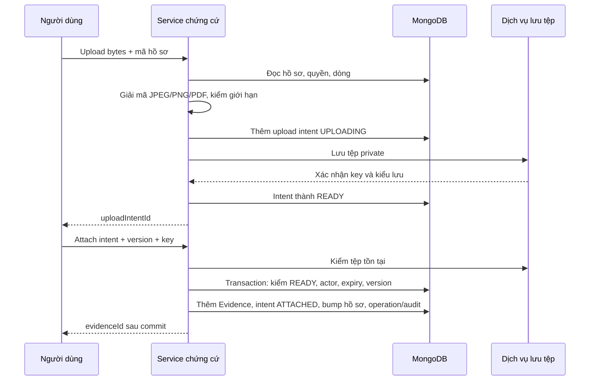

# Lần theo thứ tự đọc/ghi của các nghiệp vụ chính

[Mục lục từng hàm](D:/Ky_9/SEP490/src/be/docs/iteration-1/function-guide-2026-11-05/README.md). Các bảng dưới ghép những helper lại thành một lần thực hiện hoàn chỉnh. Query nguyên văn và code đầy đủ nằm ở mục riêng của từng hàm trong tập 01–07.

Ví dụ dùng sản phẩm A, đơn vị gốc viên, quy đổi thùng bằng4 viên, kho K1, khu nhận R1 và ô cất A1. Những chữ R01/P01/I01/G01 bên dưới là tên minh họa cho các ObjectId khác nhau. Không dùng tên minh họa để gọi API thật.

## 1. Tạo sản phẩm: ba bản ghi cùng giao dịch

Hàm chính `createProduct()` trong tập02. Ví dụ tạo sản phẩm A với đơn vị gốc viên.

| Thứ tự | Hàm/lệnh | Dữ liệu đọc hoặc ghi | Vì sao cần bước này |
|---|---|---|---|
| 1 | `requireProductCreator()` | Không đọc DB thêm; kiểm user đã xác thực | Chỉ chủ cửa hàng có quyền tạo |
| 2 | `session.withTransaction()` | Bắt đầu giao dịch | Product, quy đổi gốc, audit phải cùng thành công |
| 3 | `Uom.findById(baseUomId)` | Đọc đơn vị gốc | Không lưu tham chiếu đơn vị không có thật |
| 4 | `Product.findOne(...)` | Tìm mã trùng, không phân biệt hoa thường | Trả lý do dễ hiểu trước khi save; index vẫn chặn cạnh tranh |
| 5 | `created.save({session})` | Thêm Product: active=true, version1, baseUomId | Mốc ghi hồ sơ sản phẩm |
| 6 | `new ProductUomVersion(...).save` | Thêm quy đổi của đơn vị gốc: factor1, version1 | Chứng từ có thể chọn đơn vị gốc có phiên bản |
| 7 | `appendAudit()` | Thêm AuditEvent loại PRODUCT/mã Product | Biết ai đã tạo |
| 8 | Commit rồi `detailWithMasters()` | Đọc quy đổi hiện hành và Uom để trả kết quả | Dữ liệu trả dùng bản đã commit |

Nếu bước6 thất bại thì không giữ lại Product tạo dở ở bước5. Không có Lot, StockBalance hoặc StockMovement mới trong chức năng này.

## 2. Sửa sản phẩm hoặc nhà cung cấp: phải đọc cả `$set` và `$unset`

Ví dụ Product bản3 có name=A, brand=B, description=C. Gửi `expectedVersion=3`, `name=A mới` nhưng không có brand/description.

1. Trong giao dịch, đọc Product và kiểm bản3.
2. `updateProduct()` dựng `$set` cho name mới và những trường tùy chọn có giá trị.
3. Nó dựng `$unset` cho trường tùy chọn vắng hoặc null. Vì vậy brand/description có thể bị xóa, không được hiểu là “không gửi thì giữ”.
4. Update có điều kiện `_id` và `version=3`, tăng thành4. Một người đã ghi thành4 trước thì update không được ghi đè.
5. `changedFields()` so các trường cho phép; `appendAudit()` ghi trước/sau trong cùng session.

`updateSupplier()` dùng kiểu lưu lại bộ thông tin tương tự. `updateLot()` khác: nó kiểm `Object.hasOwn(input, field)` ở các trường tùy chọn, nên trường không gửi có thể được giữ. Đây là lý do không thể viết một quy tắc frontend dùng chung rồi mặc định mọi hàm PUT giống nhau.

## 3. Tạo và gửi yêu cầu bổ sung

Ví dụ kho đề nghị25 thùng A =100 viên, gửi ngay. Các bước nằm trong `createReplenishment(action=SUBMIT)`.

| Thứ tự | Đọc/ghi | Điều kiện hoặc trường quan trọng |
|---|---|---|
| 1 | Dựng key/hash trong bộ nhớ | Actor + creationKey + nội dung, không dùng mỗi chuỗi key chung cho mọi người |
| 2 | Đọc BusinessDocument REPLENISHMENT đã có | `createdBy` + `header.creationKey`; nếu có thì kiểm lại kho và operation/hash rồi trả cũ |
| 3 | Đọc Warehouse | Tồn tại, active, được giao |
| 4 | Đọc Product | Những productId của dòng; phải active |
| 5 | Đọc ProductUomVersion được chọn và bản hiện hành | Đúng sản phẩm/đơn vị, đã có hiệu lực, là bản được phép dùng hiện tại |
| 6 | Đọc Uom | Tên/mã đơn vị gốc và đơn vị nhập |
| 7 | Tính trong bộ nhớ | `25 × 4 =100`; kiểm chính xác/nguyên viên; mỗi dòng có lý do riêng |
| 8 | Save BusinessDocument R01 | Kind REPLENISHMENT, SUBMITTED, version1, kho/ngày/người gửi/thời điểm |
| 9 | Save DocumentLine | `documentId=R01`, enteredQty25, conversionSnapshot4, qtyBase100, MANUAL_OTHER |
| 10 | Save ReplenishmentSubmission | R01/version1; chụp tên sản phẩm/đơn vị/kho/lượng/lý do đúng lần gửi |
| 11 | Save BusinessOperation | Key/hash + mã R01/version1/status để gửi lại không tạo hai phiếu |
| 12 | Save AuditEvent | Người thực hiện và hành động gửi |
| 13 | Commit | Cả phiếu, dòng, snapshot, biên nhận và audit cùng tồn tại |

Nhánh SAVE_DRAFT bỏ bước10, trạng thái DRAFT và chưa có submittedBy/At. Với phiếu đã lưu, `submitReplenishment()` đọc dòng hiện tại, kiểm lại quy đổi, tăng version và tạo submission cho phiên bản mới; không tạo BusinessDocument RR khác.

**Không ghi:** StockBalance, StockMovement, PostingBatch, Reservation, PurchaseSourceClaim. Lượng100 ở đây là nhu cầu, không phải tồn đã về.

## 4. Chủ cửa hàng duyệt: giữ phiên bản nội dung đã gửi

Ví dụ R01/version2 đã gửi100 viên, chủ duyệt80 có lý do giảm.

| Bước | Hàm/DB | Tác động |
|---|---|---|
| 1 | Đọc BusinessDocument | R01 phải SUBMITTED/version2; user khác creator |
| 2 | Đọc BusinessOperation | Nếu đúngkey đã commit thì trả quyết định cũ, không thêm lần duyệt |
| 3 | Đọc ReplenishmentSubmission | Đúng R01/version2; không duyệt dựa form đang sửa ở nơi khác |
| 4 | `appendApproval()` đọc Product | Kiểm quy tắc nguyên viên của từng sản phẩm |
| 5 | Kiểm trong bộ nhớ | Đủ mọi dòng, không lặp, duyệt80≤100, có lý do giảm |
| 6 | Save Approval | documentVersion2, requestedBy/decidedBy, approvedQty80 trên đúng lineId |
| 7 | Update BusinessDocument | Filter R01/SUBMITTED/version2, set status APPROVED; **không tăng version nội dung** |
| 8 | Save operation/audit và commit | Biên nhận giữ approvalId và version2 |

Sau đó hàm lập đơn mua phải tìm Approval đúng RR.version2 và lượng80; chỉ thấy status APPROVED không đủ quyền mua100. Nếu người đề nghị đổi role thành OWNER sau khi tạo, mã người vẫn trùng nên tự duyệt bị chặn.

## 5. Mở đơn mua: giữ quyền mua, chưa giữ hàng vật lý

Ví dụ RR duyệt100 viên. Có hai PO nháp P01/P02 mỗi đơn80. Tại bước lưu nháp, mỗi dòng có PurchaseSourceClaim qty0.

| Bước khi confirm P01 | Đọc/ghi | Nội dung |
|---|---|---|
| 1 | Đọc PO, Warehouse, supplier | PO DRAFT đúngversion; kho được giao/active; supplier ACTIVE |
| 2 | Đọc dòng PO và LineLink | Mỗi dòng có đúng một link REPLENISHMENT_PURCHASE, lượng khớp |
| 3 | Đọc dòng RR, RR và Approval | Source đúng loại, chưa bỏ, cùng kho/sản phẩm; approval đúng phiên bản |
| 4 | Đọc claim đã lưu ở nháp | approvalId phải còn khớp để không tự đổi nguồn đã review |
| 5 | `claim()` cập nhật RR | Filter RR đúngversion/APPROVED; tăng `header.purchasingVersion` |
| 6 | `claim()` đọc mọi claim của RR line | Tổng quyền mua đã dùng của các PO |
| 7 | Cập nhật claim P01 | Từ0 lên80, có kiểm claim.version; hoặc thêm claim nếu chưa có |
| 8 | `bump()` PO | DRAFT→OPEN, tăng PO.version |
| 9 | Lưu operation/audit, commit | Quyền mua đã được P01 dùng80 |

Khi P02 confirm80, bước6 thấy80 đã dùng;80+80>100 nên bị chặn. Điểm ghi chung ở bước5 làm hai giao dịch cùng nguồn không tự thành công từ hai lần cùng đọc “đã dùng0”. `purchasingVersion` khác `RR.version`: tăng quyền mua không làm mất liên kết quyết định với phiên bản nội dung đã được duyệt.

Không có Reservation hay cộng StockBalance. Muốn mua80 còn chưa có nghĩa nhà cung cấp đã đưa80 tới kho.

## 6. Tạo kiểm nhận và giữ mã dòng

Ví dụ PO theo đơn vị viên hệ số1, giao lôL01 nhận40, lôL02 nhận30.

1. `command()` mở giao dịch, tra key chống lặp.
2. `activePo()` đọc PO/kho/supplier, kiểm PO OPEN/PARTIAL và phiên bản.
3. `prepare()` đọc dòng PO, Product, Lot, vị trí RECEIVING, conversion/Uom; kiểm đúng sản phẩm và quy lượng.
4. `newDoc()` → `save(BusinessDocument)` tạo I01 DRAFT.
5. `writeRows()` → `save(DocumentLine)` tạo hai dòng40/30 cùng poLineId, khác lotId/clientLineKey.
6. `lineLink()` → `save(LineLink)` nối dòng PO tới từng dòng kiểm; `lockLotIdentity()` update Lot.identityLocked=true.
7. `link()` → `save(DocumentLink)` nối P01→I01.
8. `command()` save operation/audit, commit.

Khi sửa nháp và đổi thứ tự hai dòng, `writeRows()` dời lineNo cũ tạm thời rồi update về thứ tự mới để tránh unique `(documentId,lineNo)`. Mã dòng và link nguồn được giữ theo clientLineKey. Bỏ dòng nháp thì delete dòng/link; khác cơ chế removedAt của RR.

Chưa tạo GR, chưa giữ70 trong GR DRAFT và chưa ghi tồn. Dù vậy khóa nhận dạng lô đã được ghi và không tự mở khi bỏ nháp.

## 7. Confirm kiểm nhận: thêm GR nháp mà không tăng tồn

Ví dụ I01 chốt70 trên PO100, chưa có GR khác.

| Bước | Hàm/model | Điều kiện hoặc tác động |
|---|---|---|
| 1 | Đọc I01/PO | I01 DRAFT/version đúng; PO OPEN/PARTIAL/version đúng |
| 2 | So sourcePoVersion | Nháp phải đã được lưu theo tình trạng PO đang dùng |
| 3 | `prepare()` kiểm lại dòng đã lưu | Dòng dương; lô/sản phẩm/vị trí còn phù hợp |
| 4 | `commitments()` đọc nguồn lượng và GR DRAFT | Outstanding100, draft0, headroom100 |
| 5 | Trừ dồn trong bộ nhớ | 40+30=70, phần còn30; không kiểm mỗi dòng độc lập thành hai hạn mức100 |
| 6 | `bump(PO)` | Tăng version PO làm điểm cạnh tranh dùng chung |
| 7 | `newDoc(GR_PURCHASE)` | Thêm G01 DRAFT với purchaseOrderId/poInspectionId/supplierId |
| 8 | Save dòng/link | Hai PURCHASE_RECEIPT40/30 trỏ đúng hai dòng kiểm; nối phiếu nguồn |
| 9 | `bump(I01)` | CONFIRMED, inspectedBy/At; tăngversion |
| 10 | Save operation/audit, commit | Trả goodsReceiptId=G01 |

Sau commit, nhập ròng vẫn0, outstanding100, GR DRAFT giữ70, headroom30. **Không có** PostingBatch, StockMovement, ReceiptPlacement hoặc phần tăng StockBalance trong confirm.

## 8. Post GR: thứ tự ghi tăng tồn thật

Ví dụ G01 một dòng70 viên, lôL01, đíchR1, số dư trước0. Mọi bước dưới nằm trong cùng `command()` transaction.

| Bước | Hàm/lệnh | Model/collection | Dữ liệu chính |
|---|---|---|---|
| 1 | `scoped()` + version | BusinessDocument | G01 DRAFT, I01 CONFIRMED, PO còn mở; tất cả cùng nguồn/kho/supplier |
| 2 | `rows()` | DocumentLine | Dòng GR bao phủ đúng dòng kiểm: sản phẩm/lô/qty/GOOD, không trùng |
| 3 | Đọc Product/Lot/Location | Master tương ứng | Sản phẩmactive, lôđúng, đích RECEIVING cùng kho |
| 4 | `commitments()` | PO/GR/events/movement… | Còn nguồn đủ và các draft không vượt trần |
| 5 | `guardLocations()` | Location + LocationLock | Tăng planningVersion, kiểm vị trí hoạt động/không khóa kiểm kê |
| 6 | `Party.findOne(kind=STORE)` | parties | Xác định chủ sở hữu hàng nhập |
| 7 | `batch()`→`save()` | posting_batches | G01, POST, key/hash, postedBy |
| 8 | `balance()` | stock_accounts, stock_balances | Tìm account R1 và số dư account+L01+GOOD+STORE; thiếu tạo0 |
| 9 | Kiểm hold | defect_holds | Balance đích không có hold ACTIVE |
| 10 | `adjust(balance,+70)` | stock_balances | Set qty70, tăngversion theo filter version cũ; trả before0/after70 |
| 11 | `save(StockMovement)` | stock_movements | batch/GR/line, toBalanceId, qty70, toBefore0/toAfter70; không có fromBalanceId |
| 12 | `save(ReceiptPlacement)` | receipt_placements | receipt/line/PO/sourceBalance, received70, placed/claimed/reversed mặc định0 |
| 13 | `bump(PO)` | business_documents | PARTIAL còn30 hoặc COMPLETED nếu mọi dòng hết |
| 14 | `bump(GR)` | business_documents | POSTED và version mới |
| 15 | Save operation/audit, commit | business_operations, audit_events | Trả batchId/GR/version; gửi lại không tăng70 lần hai |

Nếu dòng thứ hai gặp hold hoặc lỗi phiên bản thì batch, movement và số dư của dòng thứ nhất cũng rollback. Không gửi từng dòng như các giao dịch độc lập trong lệnh này.

Nếu cùng R1/lô/chất lượng/chủ đã có100 từ chuyến trước, `balance()` dùng lại số dư đó: quantity thành170. Placement của G01 vẫn chỉ received70. **Balance biết tổng hiện tại; placement biết phần tiến độ riêng của từng dòng GR**.

## 9. Cất hàng: giữ kế hoạch và thực chuyển là hai lần khác nhau

### 9.1. Tạo nhiệm vụ

Nhận70, lập cất40 vàoA1 và30 vàoA2:

1. Đọc GR POSTED/version, dòng nhập, ReceiptPlacement và balance nguồn đúngversion.
2. Kiểm nguồn STORE/GOOD/RECEIVING và đích STORAGE hoạt động; đích allocatable cần lô VERIFIED.
3. Guard vị trí; thêm TO PUTAWAY OPEN.
4. Với từng phần, đọc lại placement, kiểm unplanned và `pendingTaskQuantity()` của balance.
5. Thêm DocumentLine WAREHOUSE_TASK, nối dòng GR→dòngtask.
6. Tăng placement.claimed40 rồi30; đặt các reference receiptLineId/placementId/sourceBalanceId trên task.
7. Thêm DocumentLink GR→TO, operation/audit, commit.

Balance vẫn70, movement chưa có. Hai nhiệm vụ cạnh tranh phải cùng cập nhật placement.version nên không tự giữ cùng70 hai lần.

### 9.2. Xác nhận thực cất20

| Bước | Model/helper | Tác động |
|---|---|---|
| 1 | `taskState()` | Đọc task/dòng/movement/batch để biết actual cũ và remainder |
| 2 | `source()`/`pendingTaskQuantity()` | Kiểm nguồn/đích/hold/việc khác còn đủ |
| 3 | `guardLocations()` | Ngăn đi qua vị trí vừa bị freeze |
| 4 | `batch()` | Thêm batch PURCHASE_PUTAWAY |
| 5 | `balance()` đích | Tìm/tạo balance A1 đúnglot/STORE/GOOD |
| 6 | `carryReservations()` | Mang phần reservation cần đi theo hàng, không biến hàng giữ thành tựdo |
| 7 | `adjust()` nguồn/đích | R1:70→50; A1:0→20 |
| 8 | Save StockMovement | Một bản có cả from/to và số trước/sau, qty20 |
| 9 | `updatePlacement()` | claimed70→50; placed0→20 |
| 10 | `bump(TO)` | PARTIAL; nếu đủ mọi dòng thì CONFIRMED |

Tổng tồn vẫn70. Sau hủy phần nhiệm vụ chưa làm, claimed50 về0, placed20 giữ nguyên; không ghi movement đảo20. Muốn đổi đích cho50 còn lại lập nhiệm vụ mới.

### 9.3. Reservation được mang bao nhiêu?

Giả sử balance70 có20 đã giữ cho nhu cầu. Cất40 thì có thể lấy từ50 chưa giữ, `toCarry<=0`, không cần sửa reservation. Cất60 thì vượt phần tựdo10: helper mang10 reservation theo đích. Nếu cần mang một phần của một reservation, giảm bản nguồn và thêm bản đích cùng demand/execution; không xóa quan hệ nhu cầu.

## 10. Đảo phiếu: lưu giao dịch ngược, không xóa lịch sử

Ví dụ GR70 chưa cất, không task/reservation/hold/khóa, đủ tồn tạiR1.

1. `preflight()` đọc GR/PO/kho/dòng/placement/batch gốc và đảo; kiểm phụ thuộc, balance, reservation, hold, account/location/lock, movement phía sau.
2. `reverseReceipt()` kiểm lại version, chứng cứ đúngGR và mọi blocker trong transaction.
3. Guard vị trí, thêm PostingBatch REVERSE có reversalOf trỏ batch nhập gốc.
4. Mỗi dòng đọc lại balance; adjust−70; thêm movement chỉ có fromBalanceId, fromBefore70/fromAfter0.
5. Update placement.reversed70, tăngversion; thêm PurchaseEvent REVERSAL với reason/evidence/batch.
6. Tính lại PO net receipt=0, bump PO OPEN và tăngGR.version; operation/audit cùng commit.

GR gốc không bị xóa và vẫn POSTED. Reader phải xem `reversed` hoặc lượng ròng từ lịch sử. Sau đó `replaceInspection()` mới tạo nội dung thay thế; nếu chưa post, correction có thể hủy GR DRAFT ngay trong cùng transaction mà không cần đảo.

**Chặn bảo thủ:** R1 gộp hai GR cùnglô, sau đó có movement lấy hàng ra. Code không biết chính xác từng viên đã lấy thuộcGR nào nên có thể chặn đảo dù tổng balance còn đủ. Chưa có chức năng tự tháo mọi phụ thuộc hoặc đảo một phần trong nhánh hiện tại.

## 11. Chứng cứ: storage ngoài giao dịch, attach trong giao dịch

Upload thành công chưa tạo Evidence. Attach đã commit mới cho các lệnh yêu cầu chứng cứ dùng evidenceId đó. Khi download, service đọc quyền lại rồi mới tạo đường ký60giây. TệpUPLOADING/READY hết hạn có thể bị dọn; ATTACHED không nằm trong điều kiện dọn.

## 12. Query trong GET không được hiểu như command

`listProducts()` và nhiều list dùng `Promise.all(find,count)` ngoài transaction; giữa hai query dữ liệu có thể đổi. `receivingSummary()` dùng snapshot transaction để lượng/phiên bản cùng một tình trạng. Dù reader đã tính headroom30, người khác có thể nhận thêm sau đó; confirm/post luôn kiểm lại trong transaction của lệnh.

Các helper trình bày `mapProductSummary`, `mapLotDetail`, `serialize`, `mapApproval` lấy dữ liệu đã đọc và chuyển dạng. Chúng không query MongoDB, không chọn lại nguồn, không tự cấp quyền. Vì vậy muốn tìm nguyên nhân “số lượng sai” nên đi từ mapper về service tính/đọc nguồn, không chỉ sửa con số trước lúc trả API.
