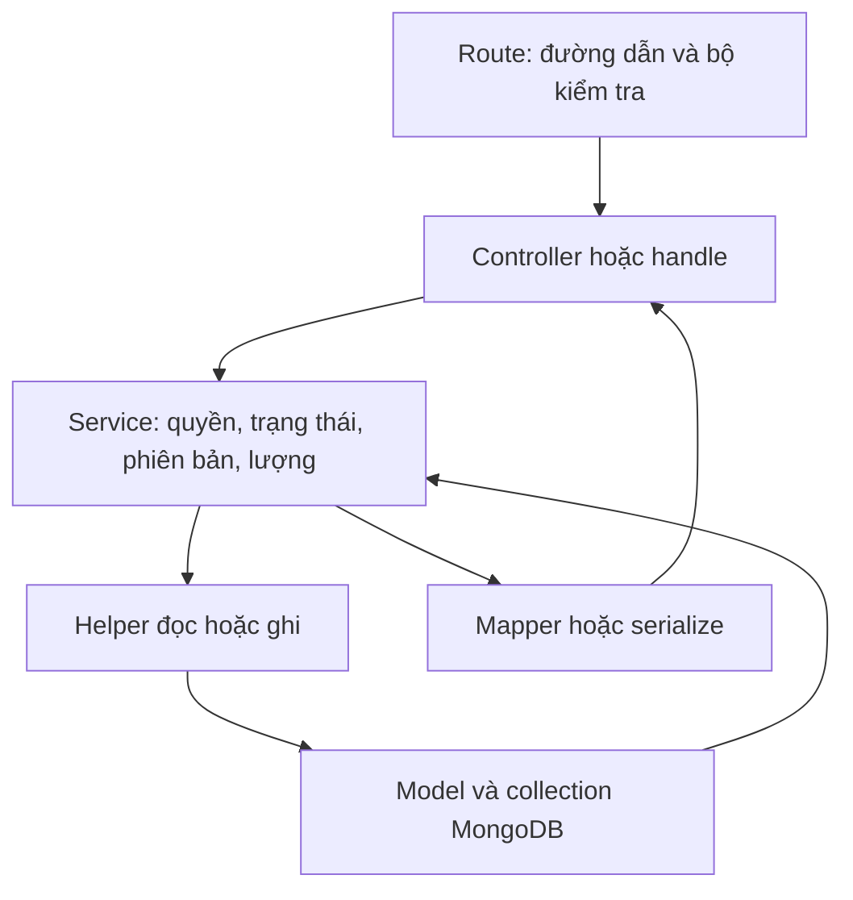

# Giải thích từng hàm và tương tác với cơ sở dữ liệu — 05/11/2026

Bản này bổ sung mức chi tiết theo **từng hàm code**, tiếp nối [bản giải thích nghiệp vụ ngày 03/11](D:/Ky_9/SEP490/src/be/docs/iteration-1/REVIEW_GIAI_THICH_CODE_2026-11-03.md). Phạm vi là những phần đã làm liên quan 23 chức năng Iteration 1: yêu cầu bổ sung, sản phẩm, lô, nhà cung cấp, đọc đơn mua; đồng thời gồm phần mở rộng mua/nhận/cất/sửa sai/chứng cứ hiện đã có code.

Tài liệu đọc source đang có ngày 05/11, gồm thay đổi chưa commit. **Có 342 mục hàm có tên**, gồm hàm khai báo thường, hàm mũi tên, controller được bọc bởi `catchAsync`, hàm cục bộ có tên và các hàm của đối tượng lưu tệp. Các callback không có tên bên trong `map`, `filter`, giao dịch hoặc route được giải thích trong luồng của hàm chứa chúng; không tách mỗi callback nhỏ thành một nghiệp vụ mới.

## 1. Mở đúng phần cần đọc

| Bạn muốn hiểu | Tài liệu |
|---|---|
| Đăng nhập, quyền, phiên bản, ngày, số lượng, nhật ký và helper cơ sở dữ liệu | [01 — Hàm dùng chung](D:/Ky_9/SEP490/src/be/docs/iteration-1/function-guide-2026-11-05/01-shared.md) |
| Tạo/sửa sản phẩm, chọn quy đổi, cấu hình ngưỡng và cách trả thông tin | [02 — Sản phẩm](D:/Ky_9/SEP490/src/be/docs/iteration-1/function-guide-2026-11-05/02-products.md) |
| Tạo/sửa nhận dạng lô, số dư theo kho và lịch sử movement | [03 — Lô hàng](D:/Ky_9/SEP490/src/be/docs/iteration-1/function-guide-2026-11-05/03-lots.md) |
| Hồ sơ nhà cung cấp, trạng thái, lịch sử và chứng từ | [04 — Nhà cung cấp](D:/Ky_9/SEP490/src/be/docs/iteration-1/function-guide-2026-11-05/04-suppliers.md) |
| Tạo/sửa/gửi/duyệt yêu cầu, bản chụp lúc gửi và tồn khả dụng | [05 — Yêu cầu bổ sung](D:/Ky_9/SEP490/src/be/docs/iteration-1/function-guide-2026-11-05/05-replenishments.md) |
| Lập/mở/bổ sung/chốt thiếu đơn mua, tính lượng nhận từ lịch sử | [06 — Đơn mua](D:/Ky_9/SEP490/src/be/docs/iteration-1/function-guide-2026-11-05/06-purchase-orders.md) |
| Kiểm nhận, GR, cất hàng, đảo/sửa sai, ảnh/tệp, queue/history | [07 — Nhận mua và các bước sau](D:/Ky_9/SEP490/src/be/docs/iteration-1/function-guide-2026-11-05/07-receiving.md) |
| Theo dõi lần lượt các lệnh đọc/ghi của một nghiệp vụ hoàn chỉnh | [08 — Luồng ghi dữ liệu có ví dụ](D:/Ky_9/SEP490/src/be/docs/iteration-1/function-guide-2026-11-05/08-database-flows.md) |
| Từ một đường dẫn API tìm hàm; model nằm ở collection nào và liên kết ra sao | [09 — Đường dẫn, bộ kiểm tra và model](D:/Ky_9/SEP490/src/be/docs/iteration-1/function-guide-2026-11-05/09-routes-models.md) |
| Mã hàm, vị trí, các lời gọi và dấu kiểm nội dung source | [Danh mục nguồn dạng JSON](D:/Ky_9/SEP490/src/be/docs/iteration-1/function-guide-2026-11-05/function-inventory.json) |

Trong mỗi tập 01–07, phần **Tìm nhanh** có liên kết tới từng hàm. Tên trùng nhau được phân biệt bằng tên file. Ví dụ `source()` của lập PO khác `source()` của cất hàng; cả hai có mục riêng và truy vấn riêng.

Tên như `getLotMovements.mapEndpoint()` biểu thị hàm cục bộ `mapEndpoint` nằm bên trong `getLotMovements`; đây là cách đặt tên trong tài liệu để tìm đúng chỗ, không phải một thuộc tính công khai để gọi từ API.

## 2. Mỗi mục hàm giải thích những gì?

1. **Code và tham số:** đường dẫn file/dòng thực tế, tên hàm và tham số đúng source. `user` là người đăng nhập đã được backend xác thực; `input` là nội dung yêu cầu đã qua bộ kiểm tra; `session` là giao dịch cơ sở dữ liệu đang dùng.
2. **Công việc:** hàm giải quyết điều gì trong nghiệp vụ.
3. **Thứ tự xử lý:** các bước kiểm tra, nhánh rẽ, tính toán và kết quả.
4. **Ai gọi / gọi tiếp:** các liên kết để đi từ controller tới service rồi helper. Bảng gọi dựng từ lời gọi trực tiếp trong tập source; hàm được truyền như callback hoặc được gọi ở nơi ngoài phạm vi có thể không xuất hiện ở cột người gọi.
5. **Cơ sở dữ liệu trực tiếp:** từng lệnh `find`, `findOne`, `exists`, `aggregate`, `save`, `updateOne`, `findOneAndUpdate`, `deleteOne`… xuất hiện trong thân hàm, có liên kết dòng nguồn và đoạn lệnh nguyên văn.
6. **Ghi thông qua helper:** chỉ rõ lời gọi `save(Model, fields, session)` hoặc `bump`, `adjust`, `link`, `appendAudit` ghi tới model nào. Hàm không có query trực tiếp chưa chắc không chạm cơ sở dữ liệu: controller thường gọi service, service có thể gọi các helper ghi.
7. **Ví dụ:** tình huống cụ thể giúp hiểu tác động. Phần mở rộng cuối mỗi mục chứa code đầy đủ của hàm để bạn so từng câu lệnh.

Các danh sách truy vấn mô tả **những lệnh có thể đi qua theo code**, không phải cam kết mỗi lần gọi sẽ chạy tất cả. Lệnh nằm trong vòng lặp có thể chạy nhiều lần; nhánh bị chặn sớm có thể không tới lệnh ghi nào. Bảng luồng 08 giải thích thứ tự thực hiện của các nghiệp vụ quan trọng, tránh đọc bảng truy vấn như một kịch bản duy nhất.

## 3. Cách đọc câu lệnh MongoDB trong tài liệu

### 3.1. Phần lọc, phần ghi và phần kết quả

Ví dụ tương đương cách bảo vệ phiên bản trong code:

```js
StockBalance.updateOne(
  { _id: balanceId, version: expectedVersion },
  { $set: { qtyBase: after }, $inc: { version: 1 } },
  { session }
)
```

- Đối số đầu là điều kiện: đúng mã số dư và vẫn đúng phiên bản mà hàm đang dùng.
- Đối số hai là thay đổi: đặt lượng mới bằng `$set`, tăng phiên bản bằng `$inc`.
- Đối số ba là cách thực hiện: dùng cùng `session` của giao dịch.
- `matchedCount=0` có thể nghĩa bản ghi đã đổi từ lúc đọc; code dừng bằng lỗi thay vì ghi đè tùy ý.

`$unset` xóa một trường; `$in` khớp một trong danh sách mã; `$or` cho một trong các điều kiện; `$gte/$lte` là lớn hơn hoặc bằng/nhỏ hơn hoặc bằng. `select()` chỉ chọn một số trường cần đọc, `sort()` sắp xếp, `skip()/limit()` chia trang. `lean()` lấy object dữ liệu thường; nó không tự làm query an toàn hoặc tự áp quyền.

### 3.2. Đọc một số dư cần đi qua liên kết nào?

`StockBalance` không có field `productId` hoặc `warehouseId` trực tiếp. Muốn biết sản phẩm/kho:

```text
StockBalance.lotId → Lot.productId → Product
StockBalance.accountId → StockAccount.locationId → Location.warehouseId → Warehouse
StockBalance.ownerPartyId → Party
```

Ví dụ R1 có 70 viên: còn phải biết đó là lô nào, GOOD hay chất lượng khác và thuộc STORE hay bên giữ hộ. Không cộng mọi balance cùng tên gạch rồi gọi đó là khả dụng.

### 3.3. `new Model`, `save`, `session` khác nhau ra sao?

`new Model(fields)` tạo một đối tượng trong bộ nhớ. `save()` mới yêu cầu ghi vào cơ sở dữ liệu. Vì vậy trong mục hàm tạo phiếu, phải tìm tới dòng save hoặc helper `save()` để thấy mốc ghi thật.

Giao dịch dùng `session.withTransaction()`. Các câu đọc/ghi truyền cùng session cùng tham gia giao dịch đó. Khi query được bọc bởi read(query, session), đoạn query trích riêng có thể chưa hiện session; hãy xem lời gọi read và mục helper để biết nó tham gia giao dịch nào. Nếu một bước lỗi, những thay đổi trong giao dịch không được commit từng nửa. `readConcern: snapshot` cho các lần đọc trong giao dịch nhìn cùng một tình trạng; `writeConcern: majority` yêu cầu xác nhận ghi từ đa số thành viên phù hợp của MongoDB.

Đọc đúng một tình trạng **chưa đủ ngăn hai người cùng dùng nguồn**: các command còn ghi có điều kiện lên phiên bản PO/RR/placement/balance hoặc phiên bản kế hoạch vị trí. Hai giao dịch cạnh tranh cùng nguồn phải đi qua điểm ghi chung, thay vì cùng đọc “còn100” rồi mỗi bên tự dùng80.

Tải/xóa tệp trên dịch vụ bên ngoài không nằm trong giao dịch MongoDB. Module chứng cứ dùng bản upload chuẩn bị và trạng thái để theo dõi phần đó; việc attach vào hồ sơ mới có giao dịch cơ sở dữ liệu riêng.

## 4. Những điều chỉnh thực tế so với bản ngày 03/11

Source hiện tại có `scopedPurchaseRead()` và `canReadAllPurchaseOrders()`:

- Kế toán được đọc PO, PO_INSPECTION, GR_PURCHASE mọi kho tại các reader dùng helper mới, vẫn phải có operation permission.
- `inspectionContext()` cho kho có quyền create, hoặc chủ/kế toán có quyền đọc PO.
- Các lệnh ghi vẫn dùng `scoped()` và kiểm kho được phân công; ngoại lệ đọc không cấp quyền lập/mở/sửa/nhận ở kho khác.
- Tab chứng từ trong hồ sơ nhà cung cấp vẫn dùng `warehouseScope()` của supplier service, giới hạn kế toán theo kho được giao. Không suy phạm vi mới của reader mua sang mọi API liên quan nhà cung cấp.
- Tra kết quả thao tác `receivingOperation()` vẫn dùng `scoped()` và mã của chính actor; khác với xem chi tiết hồ sơ bằng helper đọc.
- Danh sách RR vừa có `hasPurchaseOrder` và alias `poCreated`: lookup liên kết mua ở dòng hoặc cả phiếu, lọc trước đếm/chia trang. Hai cờ phản ánh có liên kết, chưa chứng minh PO đã mở hoặc đã nhận đủ. Nếu gửi cả hai tên lọc thì `hasPurchaseOrder` được ưu tiên.

Ví dụ: kế toán được giao kho A có thể mở chi tiết PO kho B, nhưng tạo/sửa PO kho B vẫn bị chặn. Trong tab nhà cung cấp, bộ lọc chứng từ có thể vẫn chỉ trả kho A. Tài liệu này nêu đúng từng hàm, không áp một khẩu hiệu “kế toán mọi kho” cho tất cả đường dẫn.

## 5. Bản đồ đọc code theo nghiệp vụ



Ví dụ lập phiếu kiểm nhận:

```text
POST /purchase-orders/:id/inspections
→ validate(schema): kiểm dữ liệu được phép gửi
→ handle: truyền user + dữ liệu đã kiểm
→ createInspection
→ command: mở giao dịch, tra key
→ activePo: đọc PO/kho/nhà cung cấp, kiểm phiên bản
→ prepare: đọc dòng PO/sản phẩm/lô/quy đổi/vị trí
→ newDoc + save: thêm BusinessDocument PO_INSPECTION
→ writeRows: thêm DocumentLine + LineLink, khóa Lot
→ link: thêm DocumentLink PO→inspection
→ command: thêm BusinessOperation + AuditEvent
→ commit; trả mã phiếu/version
```

Trong chuỗi này chưa có `adjust()` hoặc `StockMovement`: lưu kiểm nhận nháp chưa tăng tồn. Xác nhận kiểm nhận mới tạo GR nháp; `postReceipt()` mới cộng STORE/GOOD tại Receiving. Đây là điểm nên kiểm trực tiếp ở các hàm, thay vì suy từ tên nút “nhận hàng”.

## 6. Những giới hạn cần nhớ khi đọc các hàm

- `/suppliers/names` hiện vẫn có hàm không nhận user và thiếu gate quyền như list chuẩn. Có mục riêng cho cả controller và service, không mặc định mọi hàm đọc đều được bảo vệ giống nhau.
- `prepare()`/`postReceipt()` hiện kiểm lô đúng sản phẩm nhưng chưa bắt VERIFIED. `source()` của cất hàng chặn UNKNOWN ở đích STORAGE allocatable; không xem post thành công là đủ điều kiện cấp hàng.
- `updateProduct()` và `updateSupplier()` xóa trường tùy chọn vắng trong bộ dữ liệu gửi; `updateLot()` dùng cách giữ/xóa khác. Đọc kỹ `$set/$unset` từng hàm.
- `capabilities()` là gợi ý thao tác dựa quyền/trạng thái; chưa thay đầy đủ preflight/lượng/khóa của command thật.
- Danh sách PO khi lọc lượng còn lại, lịch sử lô và nhánh GR của supplier còn có phần tính/đọc trước chia trang; bảng query không phải số đo hiệu năng.
- Hàm hỗ trợ chuyển vị trí được đưa vào tập 01 chỉ gồm `netMovedQuantity`, helper `sign` bên trong, `pendingTaskQuantity`, `carryReservations` vì nhận mua đang gọi chúng. Không khẳng định đã giải thích mọi hàm của phân hệ chuyển vị trí.
- Model là cấu trúc dữ liệu và chỉ mục, không tự thay các bước kiểm quyền/nguồn trong service. Khai báo ref không chứng minh bản ghi nguồn tồn tại; service phải đọc và kiểm lại.
- `writeRows()` xóa dòng nháp và link khi bỏ dòng, chưa kiểm chứng cứ đã gắn trước đó còn trỏ `lineId` ấy. Code kiểm dòng lúc attach không giải quyết trường hợp attach xong rồi mới xóa dòng. Đây là nhánh cần kiểm riêng khi sửa nháp có chứng cứ theo dòng.
- `postReceipt()` chọn COMPLETED khi nhận nốt làm lượng còn lại bằng0; `executeClose()` chọn CLOSED khi bước chốt thiếu làm lượng còn lại bằng0. Nếu có cả nhận và chốt một phần thiếu, trạng thái cuối có thể phụ thuộc bước nào thực hiện sau. Không bỏ các field nhập ròng/chốt thiếu khi giải thích tiến độ chỉ bằng status.

## 7. Kiểm chứng và giới hạn của lượt này

Ngày 05/11 đã chạy lại sáu tệp kiểm thử: danh mục, reader PO, lệnh yêu cầu bổ sung, nhận mua và hai tệp kiểm reader yêu cầu bổ sung. **84/84 bài đạt, 0 lỗi, 0 bỏ qua**, khoảng 14,6 giây trên MongoDB local hỗ trợ giao dịch. Các bộ này tạo cơ sở dữ liệu thử riêng rồi dọn; không reset/seed dữ liệu demo `sep490`.

Không chạy lại toàn bộ backend, lưu tệp thật bên ngoài, trình duyệt hoặc benchmark trong lượt này. Kết quả 187/189 của bản03/11 là lần chạy lịch sử, không đổi nhãn thành kết quả05/11. Danh mục hàm và truy vấn được đối chiếu tĩnh với source; kiểm thử chỉ bổ sung bằng chứng cho các tình huống đã viết.

Các file hướng dẫn giữ phần code được trích đúng tại thời điểm tạo; source thay đổi tiếp có thể làm số dòng/liên kết cũ không còn đúng. `function-inventory.json` có dấu SHA256 của các file source để phát hiện thay đổi. Không sửa runtime, không commit hoặc push trong lượt viết tài liệu này.
