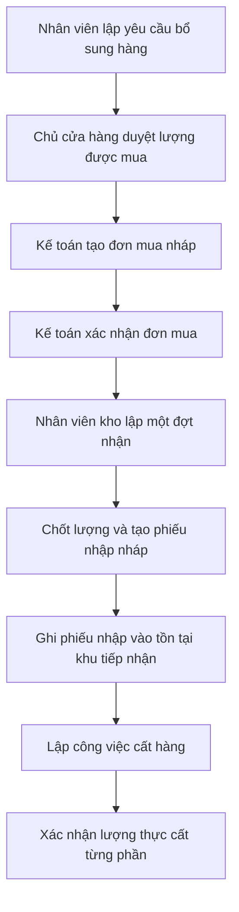

# Review và giải thích luồng đặt mua, nhận hàng và cất hàng

Tài liệu này giải thích **phần xử lý phía máy chủ đã làm**, theo code đang có ngày **03/11/2026**. Mỗi nghiệp vụ được nối với tên hàm, dữ liệu được đọc/ghi và ví dụ cụ thể. Các tên tiếng Anh trong dấu `...` được giữ để bạn tìm trong code; phần giải thích dùng tiếng Việt.

**Kết quả review:** chuỗi chính đã có từ yêu cầu bổ sung được duyệt đến đơn mua, nhiều đợt nhận, phiếu nhập và cất hàng. Hai tình huống cần sửa thêm đã được tái hiện: xóa dòng nháp để lại chứng cứ trỏ đến dòng đã mất; trạng thái đơn mua chưa phân biệt nhất quán giữa nhận đủ và nhận xong phần còn lại sau khi chốt thiếu. Xem mục 14. Lượt review này không sửa code nghiệp vụ.

## Mục lục

1. [Phạm vi và cách đọc](#1-phạm-vi-và-cách-đọc)
2. [Luồng tổng thể và người thực hiện](#2-luồng-tổng-thể-và-người-thực-hiện)
3. [Dữ liệu được tổ chức thế nào](#3-dữ-liệu-được-tổ-chức-thế-nào)
4. [Tạo và xác nhận đơn mua](#4-tạo-và-xác-nhận-đơn-mua)
5. [Tăng lượng mua, ghi lịch giao và chốt thiếu](#5-tăng-lượng-mua-ghi-lịch-giao-và-chốt-thiếu)
6. [Lập đợt nhận và chốt lượng](#6-lập-đợt-nhận-và-chốt-lượng)
7. [Ghi phiếu nhập vào tồn](#7-ghi-phiếu-nhập-vào-tồn)
8. [Cất hàng vào vị trí lưu trữ](#8-cất-hàng-vào-vị-trí-lưu-trữ)
9. [Sửa sai và đảo phiếu nhập](#9-sửa-sai-và-đảo-phiếu-nhập)
10. [Chứng cứ và tệp đính kèm](#10-chứng-cứ-và-tệp-đính-kèm)
11. [Đọc tiến độ, lịch sử và việc còn mở](#11-đọc-tiến-độ-lịch-sử-và-việc-còn-mở)
12. [Các cơ chế bảo vệ dùng chung](#12-các-cơ-chế-bảo-vệ-dùng-chung)
13. [Đối soát và kiểm chứng](#13-đối-soát-và-kiểm-chứng)
14. [Các điểm cần sửa và giới hạn còn lại](#14-các-điểm-cần-sửa-và-giới-hạn-còn-lại)
15. [Bản đồ hàm và thứ tự đọc code](#15-bản-đồ-hàm-và-thứ-tự-đọc-code)

## 1. Phạm vi và cách đọc

### 1.1. Những gì hệ thống đang quản lý

Hệ thống ghi **lượng cửa hàng đồng ý nhận vào tồn**. Cửa hàng đặt 100 viên, xe chở tới 80 viên nhưng cửa hàng chỉ đồng ý nhập 70 viên thì hồ sơ nhận của gói này ghi **70 viên**. Sau khi ghi phiếu nhập vào tồn, cửa hàng có thêm 70 viên; đơn mua còn phải nhận 30 viên.

10 viên còn lại không được tự tạo thành hàng giữ hộ, hàng lỗi hoặc hàng chờ xử lý trong hệ thống. Nếu hàng ấy vẫn nằm ở kho thực tế thì người vận hành phải xử lý ngoài phạm vi hiện tại. Không nên đọc con số 70 và kết luận xe chỉ chở đến 70.

Phần đã có gồm: đơn mua từ yêu cầu bổ sung đã được duyệt; nhận nhiều đợt; chốt lượng; phiếu nhập; cất từng phần vào nhiều vị trí; sửa sai; chứng cứ; lịch sử và đối soát.

Phần chưa làm trong gói này gồm: giao diện mới, xử lý hàng hỏng/sai mặt hàng/chưa nhận diện, giữ hộ hàng của nhà cung cấp, bàn giao trả hàng giữ hộ, thu tiền, công nợ và kế toán. Dữ liệu phục vụ khách trả hàng hoặc điều chuyển ở phân hệ khác vẫn được giữ.

### 1.2. Một số tên cần nhận biết

| Tên trong code | Cách hiểu trong tài liệu |
|---|---|
| `REPLENISHMENT`, thường gọi RR | Yêu cầu bổ sung hàng, xin phép mua thêm một lượng hàng |
| `PO` | Đơn mua gửi nhà cung cấp |
| `PO_INSPECTION` | Hồ sơ một đợt nhận; trong phạm vi mới chủ yếu chốt lượng, lô và vị trí nhận |
| `GR_PURCHASE`, thường gọi GR | Phiếu nhập mua; chỉ khi ghi vào tồn thì mới tăng hàng thuộc cửa hàng |
| `TO`, `PUTAWAY` | Công việc đưa hàng từ khu tiếp nhận vào vị trí lưu trữ |
| `RECEIVING` | Khu tiếp nhận, nơi hàng đã nhập đang chờ cất |
| `STORAGE` | Vị trí lưu trữ trong kho |
| `STORE` | Chủ sở hữu là cửa hàng; không phải tên một kho vật lý |
| `GOOD` | Loại chất lượng nội bộ cho hàng được nhập trong nhánh hiện tại; chương trình không tự đánh giá gạch có hỏng hay không |
| Model | Khuôn dạng dữ liệu và các quy tắc khi lưu dữ liệu |
| Hàm xử lý | Một đoạn chương trình thực hiện một công việc, như tạo đơn hoặc ghi tồn |
| `id` | Mã định danh duy nhất của một bản ghi; khác số chứng từ người dùng đọc |

Ví dụ dùng xuyên suốt: cửa hàng mua **100 viên gạch A**, nhà cung cấp giao nhiều đợt. Kho có khu tiếp nhận R, vị trí lưu trữ A và B. Đây là số liệu minh họa, không phải quy cách thật của một sản phẩm trong cửa hàng.

## 2. Luồng tổng thể và người thực hiện



Ba thời điểm phải phân biệt:

| Thời điểm | Ý nghĩa | Tồn thuộc cửa hàng có tăng không? |
|---|---|---|
| Chốt đợt nhận | Chốt dữ liệu và giữ phần lượng được nhận bằng phiếu nhập nháp | Không |
| Ghi phiếu nhập vào tồn | Ghi nhận hàng thuộc cửa hàng, đang ở khu tiếp nhận | Có |
| Xác nhận cất hàng | Hàng chuyển từ khu tiếp nhận sang vị trí lưu trữ | Không tăng tổng, chỉ đổi vị trí |

**Ví dụ:** chốt 40 viên làm phát sinh phiếu nhập nháp 40. Lúc ấy tồn chưa tăng. Ghi phiếu nhập xong thì khu tiếp nhận tăng 40. Cất 25 viên vào A thì khu tiếp nhận còn 15, A có thêm 25, tổng vẫn là 40.

### Quyền của từng người

| Người thực hiện | Việc được làm trong luồng này |
|---|---|
| Chủ cửa hàng | Duyệt yêu cầu bổ sung; xem đơn/nhập; duyệt đề nghị chốt thiếu |
| Kế toán | Tạo, sửa và xác nhận đơn mua; bổ sung lượng có nguồn được duyệt; ghi xác nhận nhà cung cấp; đề nghị và thực hiện chốt thiếu đã được duyệt |
| Nhân viên kho | Lập đợt nhận, chốt lượng, ghi phiếu nhập, cất hàng và sửa phiếu nhập nhầm khi đủ điều kiện |
| Nhân viên bán hàng | Có thể tham gia yêu cầu bổ sung theo phân hệ đó; không được nhập mua thay nhân viên kho |
| Quản trị viên | Quản trị hệ thống; không tự có quyền nhập hàng hay đảo phiếu |

Người làm kho và kế toán chỉ thao tác trong kho được phân công. Quyền xem không đồng nghĩa quyền sửa. Nhập thông thường và cất hàng thông thường không qua một bước chủ cửa hàng duyệt nữa. Đảo phiếu nhập trong phạm vi đã chốt cũng do nhân viên kho thực hiện có kiểm soát.

## 3. Dữ liệu được tổ chức thế nào

### 3.1. Một phần chung cho chứng từ, một phần riêng cho dòng hàng

Hệ thống **không có một model `PurchaseOrder` riêng**. Nhiều loại chứng từ dùng chung `BusinessDocument`, rồi phân biệt bằng `documentKind`. Dòng hàng dùng chung `DocumentLine`, phân biệt bằng `lineKind`.

| Hồ sơ thực tế | Model chứng từ / loại | Model dòng hàng / loại |
|---|---|---|
| Yêu cầu bổ sung | `BusinessDocument` / `REPLENISHMENT` | `DocumentLine` / `REPLENISHMENT` |
| Đơn mua | `BusinessDocument` / `PO` | `DocumentLine` / `STANDARD` |
| Đợt nhận | `BusinessDocument` / `PO_INSPECTION` | `DocumentLine` / `PO_INSPECTION` |
| Phiếu nhập | `BusinessDocument` / `GR_PURCHASE` | `DocumentLine` / `PURCHASE_RECEIPT` |
| Công việc cất hàng | `BusinessDocument` / `TO`, loại công việc `PUTAWAY` | `DocumentLine` / `WAREHOUSE_TASK` |

Chứng từ lưu thông tin chung: số phiếu, loại, người tạo, trạng thái, phiên bản và các thông tin đầu phiếu. Dòng hàng lưu mặt hàng, lô, lượng nhập, hệ số quy đổi, lượng cơ sở và thông tin nguồn của riêng dòng đó.

**Ví dụ:** đơn mua có hai mặt hàng sẽ có một `BusinessDocument` và hai `DocumentLine`. Hai dòng có cùng `documentId` trỏ về đơn mua ấy. Mỗi dòng nhận từ đợt giao sau lại trỏ đến đúng dòng mua của mình; không chỉ trỏ chung vào cả đơn.

### 3.2. Các model được dùng và lý do cần dùng

| Model | Lưu điều gì? | Ví dụ thực tế |
|---|---|---|
| `User`, `Role`, `Permission` | Người thao tác, vai trò và từng quyền | Anh Nam là nhân viên kho, được ghi nhập ở kho 1 |
| `Warehouse`, `Location` | Kho vật lý và vị trí trong kho | Kho 1 có khu tiếp nhận R và vị trí A |
| `Party` | Cửa hàng, nhà cung cấp và các bên liên quan | Một bản ghi là nhà cung cấp; một bản ghi là chủ sở hữu cửa hàng |
| `Product`, `Uom` | Mặt hàng và đơn vị tính | Gạch A, đơn vị cơ sở là viên |
| `ProductUomVersion` | Quy đổi theo từng phiên bản | Một thùng của quy cách đang dùng có 4 viên |
| `Lot` | Nhận dạng lô, sắc độ và kích thước phân loại thực tế | Cùng gạch A nhưng hai lô có sắc độ khác nhau |
| `BusinessDocument`, `DocumentLine` | Chứng từ và các dòng hàng | Đơn mua 100 viên, dòng nhận đợt đầu 40 viên |
| `Approval` | Quyết định duyệt yêu cầu bổ sung | Chủ cửa hàng duyệt mua tối đa 100 viên của dòng yêu cầu |
| `ReplenishmentSubmission` | Bản nội dung yêu cầu tại lần gửi duyệt | Người duyệt xem đúng lượng và lý do đã gửi, không xem một bản bị sửa sau đó |
| `DocumentLink`, `LineLink` | Liên kết chứng từ với chứng từ, dòng với dòng | Dòng nhận 40 đến từ dòng mua 100; dòng nhập 40 đến từ dòng nhận 40 |
| `PurchaseSourceClaim` | Lượng được mua từ nguồn yêu cầu đã duyệt mà từng dòng đơn đang sử dụng | Đơn mua 1 đã sử dụng 70 trong giới hạn 100 được duyệt |
| `PurchaseEvent` | Sự kiện mua hàng phải giữ lịch sử | Bổ sung mua 20, nhà cung cấp xác nhận, đề nghị/duyệt/thực hiện chốt thiếu, sửa sai, đảo phiếu |
| `StockAccount` | Điểm ghi tồn, ở nhánh mua thường gắn với vị trí | Điểm ghi tồn của khu tiếp nhận R |
| `StockBalance` | Số dư hiện tại theo điểm ghi tồn, lô, chất lượng và chủ sở hữu | R đang có 70 viên lô L thuộc cửa hàng |
| `PostingBatch` | Nhóm các ghi nhận tồn được thực hiện cùng một lần | Lần ghi phiếu nhập gồm ba dòng hàng |
| `StockMovement` | Lịch sử lượng vào/ra và số trước/sau | R từ 0 lên 70; hoặc R từ 70 xuống 50 và A từ 0 lên 20 |
| `ReceiptPlacement` | Tiến độ cất theo từng dòng phiếu nhập | Dòng nhập 70 đã cất 20, đang có kế hoạch cất tiếp 50 |
| `Reservation` | Hàng đã giữ cho một nhu cầu | 10 trong 70 viên đã được giữ cho một đơn hàng |
| `LocationLock`, `DefectHold` | Khóa vị trí khi kiểm kê hoặc giữ hàng do phát hiện lỗi | Vị trí đang kiểm kê thì không được ghi tồn xuyên khóa |
| `PurchaseEvidenceUpload` | Theo dõi một lần tải tệp lên trước khi gắn vào hồ sơ | Ảnh đã lên máy lưu tệp nhưng người dùng chưa bấm gắn chứng cứ |
| `Evidence` | Tham chiếu chứng cứ đã gắn vào chứng từ hoặc dòng | Biên bản chốt thiếu thuộc đơn mua nào |
| `BusinessOperation` | Kết quả của một lần thực hiện, phục vụ gửi lại an toàn | Bấm nhập lần nữa sau mất mạng phải lấy lại kết quả cũ |
| `AuditEvent` | Nhật ký ai làm gì, khi nào | Ai đổi vị trí nhận, ai hủy nháp, ai đảo phiếu |

### 3.3. Các liên kết quan trọng

Ví dụ các mã dưới đây chỉ là tên dễ đọc, không phải mã cơ sở dữ liệu để đưa vào yêu cầu thật:

```text
Dòng yêu cầu L-YC-01 được duyệt 100
  │
  ├─ PurchaseSourceClaim: dòng mua L-MUA-01 dùng 100 từ nguồn này
  └─ LineLink → dòng mua L-MUA-01, lượng gốc 100
                   │
                   └─ LineLink → dòng nhận L-NHAN-01, lượng 40
                                      │
                                      └─ LineLink → dòng phiếu nhập L-NHAP-01, lượng 40
                                                           │
                                                           ├─ StockMovement: tăng tồn R thêm 40
                                                           └─ ReceiptPlacement: nguồn cất của đúng 40 này
                                                                  │
                                                                  └─ dòng công việc cất → movement R sang A
```

`LineLink` trả lời “dòng này đến từ dòng nào”. `PurchaseSourceClaim` trả lời “đã dùng bao nhiêu quyền mua từ yêu cầu được duyệt”. `ReceiptPlacement` trả lời “đã cất bao nhiêu của dòng nhập này”. Ba mục đích khác nhau, không thể lấy một tổng số dư kho để thay cả ba.

Trong cơ sở dữ liệu MongoDB, khai báo tham chiếu model không tự đảm bảo bản ghi nguồn còn tồn tại như một ràng buộc liên kết tự động. Các hàm nghiệp vụ phải đọc và kiểm tra nguồn thật. Mục 14 có một ví dụ liên kết chứng cứ mà code hiện chưa bảo vệ đủ.

**Nguồn:** [model mua hàng](/D:/Ky_9/SEP490/src/be/src/models/purchase.model.js:1), [model chứng từ](/D:/Ky_9/SEP490/src/be/src/models/business-document.model.js:1), [model dòng hàng](/D:/Ky_9/SEP490/src/be/src/models/document-line.model.js:1), [model tồn](/D:/Ky_9/SEP490/src/be/src/models/inventory.model.js:1).

## 4. Tạo và xác nhận đơn mua

### 4.1. Tạo đơn nháp — `createPurchaseOrder()`

Kế toán chọn nhà cung cấp, kho và các dòng yêu cầu đã được chủ cửa hàng duyệt. Chương trình kiểm nhà cung cấp/kho còn hoạt động, mặt hàng hợp lệ, đúng kho và đúng quyết định duyệt.

Sau đó chương trình tạo đơn `DRAFT` — nháp, các dòng mua và liên kết về dòng yêu cầu. Có tạo `PurchaseSourceClaim` nhưng **lượng đang dùng bằng 0**: mục đích lúc nháp là nhớ nguồn và quyết định đã chọn, chưa giữ lượng được mua.

**Ví dụ:** yêu cầu được duyệt 100 viên. Kế toán tạo hai đơn nháp, mỗi đơn 80 viên. Cả hai có thể được lưu để xem xét. Chưa có đơn nào chính thức giữ 80, chưa có tồn hàng và chưa có phiếu nhập.

### 4.2. Sửa nháp — `updatePurchaseOrder()` và `draftLines()`

Chỉ đơn còn nháp mới được sửa bằng cách này. Dòng được giữ lại có thể giữ mã định danh cũ khi gửi `id`. Mặt hàng trên một dòng cũ không được đổi sang mặt hàng khác; dòng trùng mã hoặc trùng nguồn bị từ chối. Liên kết và bản ghi nguồn mua của nháp được ghi lại theo nội dung mới.

**Ví dụ:** đơn nháp đang dự kiến mua 70, kế toán đổi thành 80. Lưu xong vẫn là cùng dòng mua, chưa trừ 80 khỏi lượng đã duyệt. Nếu không gửi mã dòng cũ thì chương trình có thể hiểu là bỏ dòng cũ và thêm dòng mới.

### 4.3. Xác nhận đơn — `confirmPurchaseOrder()` và `claim()`

Đây là lúc đơn chuyển từ nháp sang `OPEN` — mở để nhận hàng. Chương trình kiểm lại nguồn được duyệt mà người dùng đã chọn; không tự thay sang một quyết định duyệt khác.

Với từng dòng, chương trình tính:

```text
Lượng còn được dùng để đặt mua
  = lượng chủ cửa hàng đã duyệt
  - tổng lượng đang được các đơn mua sử dụng từ dòng yêu cầu này
```

Chỉ khi đủ lượng, `PurchaseSourceClaim.qtyBase` mới tăng. Cùng lúc, bộ đếm `purchasingVersion` trên yêu cầu được cập nhật để hai người không cùng sử dụng một phần nguồn trong hai lần xác nhận cạnh tranh.

**Ví dụ tiếp:** hai đơn nháp cùng xin 80 từ yêu cầu duyệt 100. Đơn thứ nhất xác nhận thành công, dùng 80. Đơn thứ hai chỉ còn nguồn 20 nên không thể xác nhận 80. Toàn bộ lần xác nhận thứ hai bị hủy, không sinh một đơn mở thiếu nguồn.

Đây là **giới hạn được đặt mua**, không phải giữ 80 viên hàng thật trong kho. Khi đơn mở, tồn vẫn chưa tăng.

**Nguồn:** [tạo/sửa/xác nhận đơn mua và hàm giữ nguồn](/D:/Ky_9/SEP490/src/be/src/modules/purchase-orders/purchase-order.commands.js:10).

## 5. Tăng lượng mua, ghi lịch giao và chốt thiếu

### 5.1. Tăng lượng có căn cứ — `amendPurchaseOrder()`

Đơn đã mở không được sửa đè lượng gốc. Kế toán bổ sung lượng vào **dòng mua đang có**, chọn nguồn yêu cầu cùng mặt hàng/kho đã được duyệt và gắn chứng cứ thuộc đơn mua.

Chương trình dùng lại `claim()` để kiểm nguồn, rồi thêm `PurchaseEvent` loại `AMENDMENT`. Lượng gốc của dòng mua không bị đổi.

**Ví dụ:** đặt gốc 100, đã nhập 70. Cần mua thêm 20, có một yêu cầu bổ sung 20 được duyệt. Sau khi ghi bổ sung:

| Số liệu | Giá trị |
|---|---:|
| Đặt gốc |100|
| Bổ sung được phép |20|
| Tổng được phép nhận |120|
| Đã nhập vào tồn |70|
| Còn phải nhận |50|

Không được tự tăng thêm 20 chỉ vì nhà cung cấp chở dư. Hàm hiện hỗ trợ bổ sung dòng đã có, không phải một công cụ thêm mặt hàng tùy ý vào đơn đã mở. Đổi ngày dự kiến có thể dùng sự kiện này với danh sách bổ sung lượng rỗng; giảm nghĩa vụ chưa nhận đi qua chốt thiếu bên dưới.

### 5.2. Xác nhận của nhà cung cấp — `supplierConfirmation()`

Kế toán ghi lượng, ngày dự kiến và chứng cứ, chương trình lưu `PurchaseEvent` loại `SUPPLIER_CONFIRMATION`. Không có thay đổi số dư hàng.

**Ví dụ:** đặt 100, nhà cung cấp xác nhận 90 và ngày giao dự kiến. Số đã nhập vẫn là 0. Không được lấy “nhà cung cấp hứa 90” làm “đã có 90 trong kho”. Nếu có xác nhận mới cho cùng dòng, phần đọc lấy xác nhận mới nhất của dòng đó, không cộng cả bản cũ lẫn mới.

Một hồ sơ xác nhận hiện chỉ nhận một mục cho mỗi dòng mua. Nhân viên kho có thể gắn mã xác nhận này vào đợt nhận. Code hiện kiểm mã ấy thuộc đúng đơn mua, **chưa theo dõi một số lượng riêng đã dùng/còn lại của từng lịch giao**. Giới hạn nhận vẫn dựa trên đơn mua. Vì vậy đây chưa phải hệ thống lập lịch chia chuyến đầy đủ.

### 5.3. Chốt thiếu — ba hàm, ba bước riêng

Chốt thiếu nghĩa là cửa hàng thống nhất **không chờ nhận một phần còn lại nữa**, không phải giả nhận cho đủ đơn.

1. `requestClose()` — kế toán lập đề nghị, nêu dòng/lượng/lý do/chứng cứ. Hàm `validateClose()` kiểm không vượt phần chưa nhận và không có phiếu nhập nháp xung đột trên dòng đó.
2. `approveClose()` — chủ cửa hàng khác người đề nghị duyệt đúng hồ sơ và đúng phiên bản. Quyết định lưu bằng `PurchaseEvent` loại `CLOSE_APPROVAL`, nối về `CLOSE_REQUEST`; không dùng một `Approval` mới như bước duyệt yêu cầu bổ sung.
3. `executeClose()` — kế toán thực hiện quyết định còn hiệu lực. Thêm `CLOSE_EXECUTION`, giải phóng lượng nguồn mua tương ứng và tính lại phần còn phải nhận.

**Ví dụ tiếp phần bổ sung:** tổng được phép mua 120, đã nhận 70, nhà cung cấp ngừng giao 50 còn lại. Sau ba bước, số liệu là đặt gốc100, bổ sung20, nhận70, chốt thiếu50, còn phải nhận0. Không phát sinh thêm 50 viên trong kho. Nếu mọi dòng đều hết phần phải nhận, đường xử lý chốt thiếu đặt đơn thành `CLOSED` — đã đóng.

Nếu chỉ chốt thiếu 20 trong 50 còn lại, đơn vẫn còn phải nhận 30. Một phiếu nhập nháp trên cùng dòng phải được giải quyết trước khi chốt thiếu; chương trình không tự đoán nên hủy phiếu nào.

Yêu cầu/duyệt/thực hiện đều phụ thuộc phiên bản hiện tại. Gắn thêm chứng cứ cũng có thể tăng phiên bản đơn. Vì vậy nên chuẩn bị chứng cứ trước, tải lại dữ liệu, rồi thực hiện quyết định; không dùng một màn hình cũ để duyệt sau khi đơn đã đổi.

**Nguồn:** [bổ sung và xác nhận nhà cung cấp](/D:/Ky_9/SEP490/src/be/src/modules/purchase-orders/purchase-order.commands.js:117), [chốt thiếu](/D:/Ky_9/SEP490/src/be/src/modules/purchase-orders/purchase-order.commands.js:151).

## 6. Lập đợt nhận và chốt lượng

### 6.1. Một đơn có nhiều đợt thật

Mỗi chuyến được lập thành một `PO_INSPECTION`. Đầu phiếu có `purchaseOrderId`, kho, nhà cung cấp, thời điểm đến, thông tin người giao và phiên bản đơn mua đã xem. Mỗi dòng có `poLineId`, `lotId`, lượng nhập và vị trí tiếp nhận dự kiến.

**Ví dụ:** một đơn 100 viên được nhận 40, 35 và 25 trong ba ngày. Có ba hồ sơ đợt nhận và ba phiếu nhập; vẫn chỉ có một đơn mua. Không cần nhân bản đơn mua để nhận nhiều lần.

### 6.2. Lấy dữ liệu lập phiếu — `inspectionContext()`

Hàm trả đơn mua, dòng hàng, số lượng đã tính và các vị trí `RECEIVING` còn hoạt động. Các số này được đọc trong cùng một lần đọc nhất quán để hạn chế chuyện lấy lượng đã nhận ở thời điểm này nhưng lượng nháp ở thời điểm khác.

Hàm yêu cầu quyền tạo của nhân viên kho. Chủ cửa hàng/kế toán chỉ muốn xem tiến độ sẽ dùng `receivingSummary()`, không phải được cấp quyền tạo để mở màn hình xem.

### 6.3. Lưu và sửa nháp — `createInspection()`, `updateInspection()`

`activePo()` kiểm đơn còn mở hoặc nhận một phần, đúng phiên bản và đúng phạm vi kho. `prepare()` kiểm từng dòng:

- Dòng mua có thực sự thuộc đơn đang nhận không.
- Mặt hàng còn hoạt động và lô có thuộc đúng mặt hàng không.
- Lượng có dương, quy đổi được chính xác và không tạo viên lẻ khi sản phẩm bắt buộc nguyên viên không.
- Vị trí dự kiến có đúng kho, còn hoạt động và thuộc khu tiếp nhận không.
- Các khóa dòng `clientLineKey` có bị trùng không.

Chỉ lưu nháp thì không có `PostingBatch`, `StockMovement` hay tăng `StockBalance`. Nháp có thể chưa có dòng nào để chuẩn bị thông tin; tối đa100 phần lượng.

**Ví dụ:** Nam nhập trước thông tin người giao rồi lưu nháp. Sau khi đếm, Nam thêm hai dòng: 30 viên lô L1 và 10 viên lô L2, cùng từ dòng mua gạch A. Tổng dự kiến của đợt là 40. Chưa có 40 viên nào được cộng vào tồn.

### 6.4. Giữ đúng dòng khi lưu lại — `writeRows()`

`clientLineKey` là mã ổn định do phía nhập liệu giữ cho một dòng. Khi mã ấy còn tồn tại, `writeRows()` sửa dòng hiện có và giữ mã định danh của nó; liên kết lượng cũng được cập nhật. Dòng mới có mã mới; dòng bị bỏ khỏi danh sách được xóa khi hồ sơ vẫn nháp.

Nếu kéo dòng lô L2 lên trước L1, số thứ tự đổi nhưng mã định danh hai dòng không đổi. Code tạm chuyển số thứ tự cũ lên một vùng khác rồi mới đánh số lại để tránh hai dòng cùng mang số1 trong lúc đang cập nhật.

Một key cũ không được chuyển sang nguồn mua khác. Muốn đổi nguồn thì bỏ dòng đó và tạo dòng mới. **Riêng xóa dòng đã gắn chứng cứ còn một lỗ hổng được ghi ở mục14; không nên hiểu mọi liên kết đều đã được bảo vệ.**

Khi lưu dòng có lô, `lockLotIdentity()` đánh dấu lô đã được sử dụng, ngay cả khi đợt còn nháp. Điều này ngăn sửa nhận dạng lô để làm các dòng đã lưu mang ý nghĩa khác. Khóa nhận dạng lô không phải khóa số lượng tồn.

### 6.5. Quy đổi và thông tin chụp tại thời điểm lập phiếu

Dòng nhận dùng hệ số đã lưu trên dòng đơn mua, không tự lấy quy cách mới nhất rồi tính lại chứng từ cũ.

**Ví dụ:** dòng đặt mua dùng thùng, lúc đặt một thùng có4 viên. Nhận3 thùng thì lượng cơ sở là12 viên. Sau đó quy cách mới của sản phẩm chuyển thành5 viên/thùng, hồ sơ cũ vẫn là12 viên. Không được đổi thành15.

`enteredQty` là lượng theo đơn vị của dòng mua; `qtyBase` là lượng sau quy đổi về đơn vị cơ sở. Gói hiện tại không có trường cho khách gọi chọn một đơn vị bất kỳ trên mỗi dòng nhận. Nếu dòng mua dùng thùng4 viên, muốn biểu diễn70 viên thì có thể là17,5 thùng theo hệ số đó; hệ thống vẫn kiểm kết quả là70 viên nguyên. Giao diện nhập thùng và viên tách riêng cần chuyển đúng về contract này, không tự gửi một hệ số khác.

Thông tin tên/mã mặt hàng, đơn vị và nhãn lô được lưu kèm dòng làm thông tin tại thời điểm lập hồ sơ. Việc đổi tên mặt hàng về sau không nên làm người đọc hiểu lại lịch sử theo tên mới.

### 6.6. Chốt lượng — `confirmInspection()`

Trình tự chính:

1. Kiểm người dùng, kho, trạng thái nháp và phiên bản.
2. Kiểm phiên bản đơn mua hiện tại bằng `sourcePoVersion` đã lưu trên đợt nhận. Nếu đơn đã đổi, yêu cầu tải lại và lưu nháp trước khi chốt.
3. Đọc lại các dòng đã lưu; không lấy lượng mới từ nút chốt để bỏ qua bước lưu/review.
4. Dùng `commitments()` tính phần còn được nhận, bao gồm phiếu nhập nháp khác.
5. Tăng phiên bản đơn mua để các lần chốt cùng nguồn không cùng vượt giới hạn.
6. Tạo `GR_PURCHASE` nháp, dòng `PURCHASE_RECEIPT` và liên kết đúng về dòng nhận.
7. Đặt hồ sơ nhận thành `CONFIRMED`, lưu người/thời điểm chốt, kết quả thao tác và nhật ký.

Tất cả cùng thành công hoặc cùng bị hủy nếu có lỗi. **Bước này không ghi tồn, không tạo hàng giữ hộ nhà cung cấp.** Chốt một hồ sơ rỗng bị từ chối; không tạo phiếu nhập0.

### 6.7. Vì sao “còn phải nhận” khác “còn được chốt thêm”?

Giả sử đơn100, chưa ghi phiếu nhập nào vào tồn, nhưng có một phiếu nhập nháp70:

| Số lượng | Giá trị |
|---|---:|
| Đã ghi nhận vào tồn |0|
| Còn phải nhận |100|
| Đang được phiếu nhập nháp giữ |70|
| Còn được chốt thêm |30|

Nếu chỉ lấy100 trừ tồn đã nhập thì một người khác có thể chốt tiếp40, làm tổng nháp thành110. Vì vậy `commitments()` trừ cả lượng đang nằm trong phiếu nhập nháp.

Nếu mới có hai **hồ sơ đợt nhận nháp** mà chưa chốt thì chúng chưa giữ phần lượng này. Chỉ khi tạo phiếu nhập nháp sau khi chốt mới phát sinh cam kết. Chốt đồng thời được kiểm lại trong giao dịch, không chỉ tin con số đã hiển thị trên màn hình.

**Nguồn:** [dữ liệu nháp, quy đổi và giữ dòng](/D:/Ky_9/SEP490/src/be/src/modules/po-receiving/po-receiving.service.js:12), [chốt đợt nhận](/D:/Ky_9/SEP490/src/be/src/modules/po-receiving/po-receiving.service.js:116).

## 7. Ghi phiếu nhập vào tồn

### 7.1. Hàm `postReceipt()` làm gì?

Đây mới là bước ghi hàng thuộc cửa hàng. Hàm kiểm phiếu còn nháp, hồ sơ đợt đã chốt, nguồn đơn mua/nhà cung cấp/kho đúng nhau và các dòng nhập khớp đúng lượng/lô/mặt hàng đã chốt.

Chương trình còn kiểm lại phần còn được nhận, mặt hàng/lô, vị trí, khóa kiểm kê và việc hàng tại điểm ghi tồn bị giữ do lỗi. Dù gói này chưa có màn hình xử lý hàng lỗi, khóa có sẵn từ phân hệ khác vẫn phải được tôn trọng.

Sau đó, với từng dòng:

1. Tìm `Party` đại diện chủ sở hữu cửa hàng.
2. `balance()` tìm hoặc tạo điểm ghi tồn/số dư đúng vị trí, lô, chất lượng và chủ sở hữu.
3. `adjust()` tăng số dư đúng lượng, có kiểm phiên bản.
4. Tạo một `StockMovement` có đầu vào `toBalanceId`; không có đầu ra từ số dư nhà cung cấp.
5. Tạo `ReceiptPlacement` cho đúng dòng nhập để theo dõi việc cất sau này.

Một `PostingBatch` gom lần ghi này. Phiếu chuyển thành `POSTED`; đơn mua được tính tiến độ nhận. `BusinessOperation` và `AuditEvent` được lưu cùng giao dịch.

**Ví dụ:** R chưa có gạch A lô L. Ghi phiếu70 tạo số dư R/L/cửa hàng/GOOD từ0 lên70. Nhật ký chuyển động lưu lượng70, trước0, sau70. Bản theo dõi cất ghi nhận70, đã cất0, đang có kế hoạch0.

### 7.2. Tiến độ ba đợt nhận

Giả sử chưa có bổ sung hoặc chốt thiếu:

| Sau khi ghi phiếu | Nhận ròng theo đơn | Còn phải nhận | Trạng thái đơn |
|---|---:|---:|---|
| Đợt1:40 |40|60|`PARTIAL` — nhận một phần|
| Đợt2:35 |75|25|`PARTIAL`|
| Đợt3:25 |100|0|`COMPLETED` — hoàn tất phần nhận|

“Nhận ròng” là lượng đã ghi vào tồn sau khi trừ những lần đảo hợp lệ. Không cộng phiếu nháp, không đếm số lượng bằng cách nhìn trạng thái đầu phiếu đơn thuần.

**Đơn nhận xong không có nghĩa hàng đã cất xong.** Có thể đơn đã nhận đủ100 nhưng vẫn còn100 ở R. Công việc cất phải tiếp tục được nhìn thấy và thực hiện.

### 7.3. Có hàng thuộc cửa hàng chưa chắc đã được xuất bán

Hàng ở R được tính là hàng thuộc cửa hàng nhưng chưa tự thành lượng có thể cấp cho đơn bán. Việc cấp hàng còn phụ thuộc vị trí lưu trữ được phép cấp hàng, mặt hàng/lô hợp lệ, không bị khóa/giữ và đã trừ phần giữ cho nhu cầu khác.

Trong nhánh nhận này chất lượng nội bộ là `GOOD`, nhưng lô vẫn có thể chưa được xác minh. Nhập được về R không có nghĩa lô ấy được cất vào một vị trí cấp hàng được phép; `source()` của phần cất kiểm điều kiện lô khi đích cho phép cấp hàng.

### 7.4. Hủy nháp và đổi nơi nhận

`cancelDraft()` hủy hồ sơ nhận hoặc phiếu nhập **còn nháp**. Hủy phiếu nhập70 giải phóng70 khỏi cam kết nhận; không trừ tồn vì phiếu chưa từng tăng tồn. Phiếu đã hủy không được ghi vào tồn sau đó.

`changeDestinations()` chỉ đổi nơi nhận của các dòng GR nháp sang vị trí tiếp nhận hợp lệ trong cùng kho, có lý do và nhật ký trước/sau. Không đổi lượng/lô/nguồn bằng lệnh này.

**Ví dụ:** vị trí R1 đang bận, kho chuyển đích nhận sang R2 trước khi ghi nhập. Ghi nhập sau đó sẽ tăng R2. Nếu phiếu đã `POSTED`, đổi vị trí thật phải bằng nghiệp vụ chuyển/cất phù hợp, không sửa trường đích trên lịch sử nhập.

**Nguồn:** [ghi tồn, hủy và đổi đích](/D:/Ky_9/SEP490/src/be/src/modules/po-receiving/po-receiving.service.js:146).

## 8. Cất hàng vào vị trí lưu trữ

### 8.1. Vì sao cần thêm `ReceiptPlacement`?

`StockBalance` gộp các hàng có cùng vị trí/lô/chất lượng/chủ sở hữu. Nếu hai phiếu nhập cùng lô đưa40 và30 vào R thì có thể chỉ có một số dư70. Nhìn số dư đó không biết40 thuộc phiếu nào và30 thuộc phiếu nào.

`ReceiptPlacement` giữ một bản theo dõi theo từng dòng phiếu nhập. Nó không thay sổ tồn; nó chỉ giữ nguồn và tiến độ cất của dòng đó.

**Ví dụ:** dòng nhập thứ nhất40, dòng thứ hai30, cùng nằm trong số dư70. Tạo công việc cất50 từ dòng thứ nhất bị chặn, dù số dư tổng vẫn có70, vì dòng ấy chỉ có quyền cất40.

### 8.2. Ba số cần phân biệt

```text
Chưa cất = lượng đã nhận - lượng đã đảo - lượng đã thực cất
Chưa có kế hoạch cất = chưa cất - lượng còn đang được các công việc mở giữ
```

| Trường | Giải thích |
|---|---|
| `receivedQtyBase` | Lượng dòng phiếu nhập ban đầu |
| `reversedQtyBase` | Phần đã đảo; gói hiện tại chỉ đảo toàn phiếu |
| `placedQtyBase` | Lượng đã thực cất |
| `claimedQtyBase` | Phần kế hoạch chưa làm mà các công việc đang giữ |
| `unplacedQtyBase` | Chưa thực cất |
| `unplannedQtyBase` | Chưa cất và chưa được công việc nào giữ |

`placementQuantities()` tính các số hiển thị. `updatePlacement()` kiểm và cập nhật tiến độ có phiên bản, không cho tổng đã cất/đang giữ/đã đảo vượt lượng nhận.

### 8.3. Lấy dữ liệu và lập công việc

`putawayContext()` đọc phiếu đã ghi nhập, nguồn, số dư, phiên bản và vị trí Storage. `createPutaway()` tạo chứng từ `TO` và các dòng `WAREHOUSE_TASK`, liên kết từng dòng về dòng phiếu nhập.

Hàm kiểm lượng chưa có kế hoạch của dòng nhập, lượng số dư sau các công việc khác, kho, vị trí, mặt hàng/lô và khóa. Có thể chia một dòng nhập ra nhiều vị trí ngay trong một lần lập.

**Ví dụ:** nhập70, lập kế hoạch40 đến A và30 đến B. Sau khi lập:

| Tồn R | Tồn A | Tồn B | Đã cất | Kế hoạch còn giữ | Chưa có kế hoạch |
|---:|---:|---:|---:|---:|---:|
|70|0|0|0|70|0|

Chưa có chuyển động tồn nào. Hai nhân viên cùng lập kế hoạch trên nguồn70 không thể mỗi người giữ70 thành tổng140.

### 8.4. Xác nhận thực cất — `confirmPutaway()`

Hàm `taskState()` đọc kế hoạch và tính lượng đã làm từ các ghi nhận chuyển động. Mỗi lần xác nhận, hàm kiểm phần còn lại, nguồn thực, các công việc khác, khóa và đích hợp lệ.

Chương trình ghi nguồn giảm, đích tăng trong cùng một lần; lưu `StockMovement`, giảm phần kế hoạch đang giữ và tăng phần đã thực cất trong `ReceiptPlacement`.

**Ví dụ tiếp:**

| Lần thao tác | R | A | B | Đã cất | Kế hoạch còn giữ | Tổng hàng |
|---|---:|---:|---:|---:|---:|---:|
| Vừa lập công việc |70|0|0|0|70|70|
| Thực cất20 vào A |50|20|0|20|50|70|
| Cất tiếp20 vào A |30|40|0|40|30|70|
| Cất30 vào B |0|40|30|70|0|70|

Công việc chuyển `OPEN` → `PARTIAL` → `CONFIRMED`. Ghi lại cùng một lần xác nhận sau mất mạng không làm chuyển thêm lần nữa.

Hiện lượng xác nhận dùng đích đã lập trên dòng công việc. Muốn đổi đích của phần còn lại thì hủy phần chưa làm và lập công việc mới; không truyền một vị trí đích tùy ý vào nút xác nhận.

### 8.5. Hủy phần chưa cất — `cancelPutaway()`

Nếu đã cất20 trong kế hoạch70 rồi hủy phần còn lại, 20 đã cất vẫn giữ nguyên và có lịch sử. 50 chưa làm được giải phóng để lập kế hoạch mới. Không ghi chuyển động tồn để “hủy lại”20 đã làm.

Trạng thái công việc là `CANCELLED`; con số phần chưa thực hiện có thể vẫn được đọc từ kế hoạch gốc trừ thực tế. Giao diện phải đọc cả trạng thái, không hiểu số còn lại là công việc ấy vẫn được tiếp tục xác nhận.

### 8.6. Hàng đã được giữ cho nhu cầu khác

`carryReservations()` dùng chung với chuyển vị trí để mang phần hàng đã giữ theo khi thực sự chuyển hàng.

**Ví dụ:** R có70 viên, trong đó10 viên đang giữ cho một đơn bán. Cất toàn bộ70 sang A thì phần giữ10 cũng chuyển sang số dư A. Không được vô tình coi cả70 là hàng tự do; nếu các điều kiện khác đều đạt, lượng tự do chỉ là60.

`rejectUntrackedPurchaseRelocation()` chặn đường chuyển Receiving chung khi còn nguồn mua đang được theo dõi mà thao tác không mang theo liên kết phiếu nhập. Điều này buộc hàng đi qua công việc cất có nguồn rõ ràng. Luồng cất của điều chuyển liên kho vẫn có cách xác nhận toàn bộ riêng, không bị âm thầm đổi sang kiểu xác nhận từng phần này.

**Nguồn:** [các hàm cất hàng](/D:/Ky_9/SEP490/src/be/src/modules/po-receiving/purchase-putaway.service.js:9), [mang phần giữ theo hàng](/D:/Ky_9/SEP490/src/be/src/modules/location-movements/location-movement.lifecycle.js:115), [chặn mất nguồn](/D:/Ky_9/SEP490/src/be/src/shared/utils/purchaseProvenance.js:1).

## 9. Sửa sai và đảo phiếu nhập

### 9.1. Sai khi còn nháp

Hồ sơ đợt nhận còn `DRAFT` thì sửa bằng `updateInspection()`, chưa có tồn để đảo. Phiếu nhập nháp chỉ sai vị trí nhận thì dùng `changeDestinations()`.

**Ví dụ:** gõ nhầm70 thành700 trước khi chốt, chỉ cần sửa dòng về70 và lưu trên phiên bản mới. Không tạo một phiếu xuất700 rồi một phiếu nhập70 để chữa lỗi nháp.

### 9.2. Đợt đã chốt nhưng phiếu chưa ghi vào tồn — `replaceInspection()`

Không sửa đè dòng đã `CONFIRMED`. Nhân viên kho lập bản sửa với lý do và chứng cứ thuộc hồ sơ đợt gốc.

Trong cùng một giao dịch, chương trình hủy phiếu nhập nháp cũ nếu còn nháp, tăng phiên bản đơn để giải phóng phần giữ cũ, ghi `PurchaseEvent` loại `CORRECTION`, tạo hồ sơ nhận nháp mới và nối liên kết.

**Ví dụ:** đã chốt70 nhưng đếm lại đúng là60. Phiếu nhập70 còn nháp được hủy; bản mới ghi60 để kho xem lại, chốt lại và ghi nhập. Không có bước trừ70 khỏi tồn, vì70 chưa từng được nhập.

Ba trường giúp nhận diện bản sửa:

| Trường | Ý nghĩa |
|---|---|
| `rootInspectionId` | Đợt nhận gốc của toàn bộ chuỗi sửa |
| `replacesInspectionId` | Bản ngay trước đang được thay thế |
| `correctionId` | Sự kiện ghi căn cứ sửa |

Thời điểm hàng đến được giữ từ đợt gốc. Danh sách đợt gom các bản sửa theo gốc nên vẫn là một chuyến hàng, không thành hai chuyến.

### 9.3. Phiếu đã ghi vào tồn — kiểm trước rồi đảo

`reversalPreflight()` chỉ kiểm tra và trả danh sách điều đang chặn. `reverseReceipt()` kiểm lại toàn bộ ngay khi thực hiện, không lấy kết quả kiểm trước đó làm giấy phép cố định.

Điều kiện chính: phiếu đã nhập, chưa đảo, đủ thông tin nguồn, hàng vẫn ở khu tiếp nhận, đủ số dư, chưa thực cất, không có công việc đang giữ, không giữ hàng cho nhu cầu khác, không giữ do lỗi, không khóa kiểm kê và không có chuyển động tiếp theo bị chặn.

**Ví dụ:** Nam kiểm lúc9 giờ thấy có thể đảo70. Đến9 giờ01, người khác lập công việc cất70. Nam bấm đảo lúc9 giờ02 thì lệnh phải bị chặn, dù màn hình kiểm lúc9 giờ báo được phép.

Nếu hợp lệ, hệ thống:

1. Tạo một `PostingBatch` đảo, `reversalOf` trỏ về lần ghi nhập gốc.
2. Ghi các chuyển động giảm đúng lượng khỏi số dư Receiving của cửa hàng.
3. Ghi `ReceiptPlacement.reversedQtyBase` và sự kiện `REVERSAL` có lý do/chứng cứ.
4. Tính lại lượng nhận ròng và tiến độ đơn mua.
5. Giữ phiếu/batch/movement gốc, không xóa dấu vết nhập nhầm.

**Ví dụ:** phiếu ghi70 nhầm lô, chưa có xử lý tiếp theo. Sau đảo, sổ ghi nhận gốc+70 và lần đảo−70, nhận ròng0. Sau đó có thể lập bản sửa cùng đợt và ghi nhận lô/lượng đúng. Trong phạm vi mới không tạo lại một số dư giữ hộ nhà cung cấp khi đảo.

Đảo này là sửa sổ của **một lần ghi nhận nhầm**, không đại diện việc hàng đã nhập đúng rồi được bàn giao thật trả nhà cung cấp. Nó cũng không tự xử lý hàng thực đang nằm ở đâu ngoài những chuyển động được ghi.

### 9.4. Giới hạn đảo cần nhớ

Chỉ đảo **toàn phiếu một lần**. Phiếu có hai dòng mà một dòng đã cất thì không đảo riêng dòng còn lại bằng chức năng này. Có xử lý tiếp theo thì không tự tháo ngược chuỗi nghiệp vụ, không ép số dư âm.

Nếu nhiều phiếu dùng chung một số dư, chuyển động sau thời điểm nhập trên số dư đó được kiểm một cách bảo thủ. Chương trình có thể chặn vì không có đủ căn cứ nói lượng đã di chuyển thuộc phiếu nào. Đó là giới hạn có chủ đích, không phải cho phép đoán nguồn để đảo.

Phiếu gốc vẫn có trạng thái `POSTED`; dấu hiệu đã đảo lấy từ sự kiện/lần ghi đảo và số ròng. Vì vậy đọc trạng thái `POSTED` riêng lẻ không đủ để kết luận hàng vẫn đang được tính vào đơn.

**Nguồn:** [kiểm trước và đảo phiếu](/D:/Ky_9/SEP490/src/be/src/modules/po-receiving/purchase-correction.service.js:8), [tạo bản sửa](/D:/Ky_9/SEP490/src/be/src/modules/po-receiving/purchase-correction.service.js:81).

## 10. Chứng cứ và tệp đính kèm

### 10.1. Vì sao tách tải tệp và gắn chứng cứ?

Tải ảnh/PDF lên máy lưu tệp và ghi chứng từ trong cơ sở dữ liệu là hai công việc khác nhau. Nếu vừa sửa số dư vừa chờ đường truyền tải ảnh, một lần tải chậm có thể giữ giao dịch tồn mở quá lâu.

Luồng hiện tại:

```text
Chọn tệp
→ kiểm quyền hồ sơ và nội dung tệp
→ tạo bản theo dõi tải lên
→ tải riêng tư lên Cloudinary
→ tệp sẵn sàng
→ người dùng gắn vào đúng hồ sơ
→ tạo Evidence và tăng phiên bản hồ sơ
```

Cloudinary là nơi lưu tệp; `Evidence` không lưu cả ảnh/PDF trong MongoDB. `Evidence.objectKey` chỉ là tên tham chiếu tệp trong nơi lưu trữ. Giá trị `sha256` giống dấu nhận dạng tính từ nội dung tệp, dùng để nhận biết nội dung gắn với bản ghi; không phải mật khẩu hoặc đường dẫn tải.

### 10.2. `inspectFile()` và `uploadEvidence()`

`inspectFile()` kiểm dữ liệu tệp thật bằng thư viện đọc ảnh/PDF, không chỉ tin tên đuôi hoặc loại tệp người gửi khai báo. Hiện chấp nhận JPEG, PNG, PDF; tối đa5MB/tệp; ảnh tối đa10 triệu điểm ảnh; PDF có1–2000 trang.

`uploadEvidence()` kiểm quyền trên chứng từ và dòng nếu có, tự sinh tên tệp, lưu người tải/nguồn/thời hạn trong `PurchaseEvidenceUpload`, rồi gọi Cloudinary lưu tệp riêng tư.

**Ví dụ:** đổi tên một tệp văn bản thành `bienban.png` không làm nó thành ảnh hợp lệ; bộ đọc ảnh sẽ từ chối. Một nhân viên kho khác không có quyền trên kho của hồ sơ không được dùng mã hồ sơ đó để tải chứng cứ lên.

### 10.3. `attachEvidence()`

Hàm kiểm tệp tồn tại ở nơi lưu trữ trước khi bắt đầu giao dịch cơ sở dữ liệu. Sau đó trong giao dịch kiểm lại người tải, chứng từ, dòng, hạn dùng và trạng thái, tạo `Evidence`, chuyển bản tải sang `ATTACHED` và tăng phiên bản chứng từ.

**Ví dụ:** Nam tải ảnh cho đợt nhận1. Không được lấy mã lần tải đó gắn vào đợt nhận2. Một người khác cùng có quyền kho cũng không được chiếm mã lần tải của Nam để gắn chứng cứ dưới danh tính mình.

Trạng thái bản tải: `UPLOADING` — đang tải; `READY` — sẵn sàng gắn; `ATTACHED` — đã gắn; `DELETING` — đang dọn; `DELETED` — đã dọn. Hạn của bản tải chưa gắn là24 giờ. Tệp tải thành công không tự trở thành chứng cứ của chứng từ nếu bước gắn chưa thành công.

### 10.4. Đọc, tải và dọn tệp

`listEvidence()` chỉ trả thông tin được xem như mã chứng cứ, loại tệp, người/thời điểm tải và mã dòng. Không trả tên lưu trữ nội bộ hoặc dấu nhận dạng nội dung.

`downloadEvidence()` kiểm quyền hiện tại rồi sinh đường tải có chữ ký, hạn60 giây. Người không có quyền không thể chỉ đoán mã chứng cứ để xin đường tải. Đường tải đã được cấp còn tác dụng trong thời hạn ngắn của nó; chương trình không hỏi lại quyền ở máy chủ ứng dụng cho mỗi byte tải từ Cloudinary.

`cleanupPurchaseEvidence()` chỉ dọn những bản tải chưa gắn hoặc đang dọn dở đã hết hạn. Khi đã nhận quyền dọn một bản, bước gắn không được đồng thời nhận nó nữa. Tệp đã `ATTACHED` không được đưa vào nhóm dọn này.

**Ví dụ:** người dùng tải ảnh rồi đóng màn hình mà không gắn. Sau khi hết hạn, công cụ dọn có thể xóa ảnh mồ côi ấy. Ảnh đã gắn vào biên bản đảo phiếu thì phải giữ; không bị dọn chỉ vì đã cũ24 giờ.

Chứng cứ nhận hàng thông thường là tùy chọn. Bổ sung đơn mua, xác nhận nhà cung cấp, đề nghị/duyệt chốt thiếu và sửa/đảo phiếu có yêu cầu chứng cứ tương ứng. Hiện không có nút xóa chứng cứ đã gắn.

**Nguồn:** [kiểm/tải/gắn/đọc/dọn chứng cứ](/D:/Ky_9/SEP490/src/be/src/modules/po-receiving/purchase-evidence.service.js:37).

## 11. Đọc tiến độ, lịch sử và việc còn mở

### 11.1. Số đã nhập được tính từ đâu?

`purchaseOrderQuantities()` gọi phần đọc và tính nguồn của đơn mua. Các hàm chính:

| Hàm | Việc thực hiện |
|---|---|
| `resolveGrLines()` | Tìm các dòng phiếu nhập đúng nguồn đơn/đợt/dòng, kho, nhà cung cấp, lô và quy đổi |
| `loadBatchGraph()` | Tải các lần ghi tồn và mối nối về lần gốc khi có đảo |
| `batchSign()` | Xác định một lần ghi đang làm tăng hay đảo giảm theo chuỗi nguồn |
| `grLineReceivedQuantities()` | Tính lượng nhận hiệu lực từ lịch sử chuyển động, kiểm chiều vào/ra và chủ sở hữu |
| `computedDocuments()` | Kết hợp lượng gốc, bổ sung, chốt thiếu, xác nhận nhà cung cấp và nhận ròng |
| `mapPreviewLines()` | Đưa lượng và thông tin mặt hàng/đơn vị ra dạng dễ hiển thị |

**Ví dụ:** có hai phiếu nhập40 và35 đã ghi, một phiếu25 còn nháp. Phần đọc trả đã nhận75, không phải100. Nếu phiếu35 được đảo hợp lệ, đã nhận ròng còn40. Lịch sử vẫn giữ cả lần nhập35 và lần đảo35.

Nếu thiếu nguồn chứng minh hoặc các liên kết mâu thuẫn, phần đọc trả lượng không xác định/`INCOMPLETE` thay vì đoán là0. Con số chưa xác định khác “đã xác minh là không có”; các lệnh nhận tiếp phải chặn để đối soát.

### 11.2. Tổng quan — `receivingSummary()`

Trả phiên bản đơn, các lượng từng dòng, số đợt, xác nhận nhà cung cấp và việc đang mở. Chủ cửa hàng/kế toán xem được bằng quyền đọc.

**Ví dụ:** đã nhận70, phiếu nháp20, còn phải nhận30 thì phần còn được chốt thêm là10. Nếu70 đã nhận mới cất được40, tổng quan còn hiển thị30 chưa cất. Hai con số30 này thuộc hai việc khác nhau: một bên là chưa nhận, một bên đã nhận nhưng chưa cất.

### 11.3. Danh sách đợt — `receivingTrips()`

Hàm gom theo đợt gốc và trả các bản sửa, phiếu nhập đi kèm. Lọc trạng thái theo bản mới nhất của đợt; tổng số bản sửa không trở thành tổng số chuyến giao.

**Ví dụ:** đợt1 đã có bản gốc70, bản sửa60 và phiếu nhập60. Màn hình vẫn thấy một đợt giao, mở chi tiết mới thấy cả hai phiên bản và phiếu cũ bị hủy/đảo.

### 11.4. Hàng đợi công việc — `receivingQueue()`

| Nhóm | Dữ liệu cần nhìn |
|---|---|
| `DRAFT_INSPECTION` | Hồ sơ đợt nhận chưa chốt |
| `AWAITING_POST` | Phiếu nhập nháp chưa ghi tồn |
| `AWAITING_PUTAWAY` | Phiếu đã ghi tồn còn lượng chưa cất |
| `CORRECTION` | Bản sửa đang nháp hoặc phiếu đã đảo chưa có bản thay thế theo điều kiện phần đọc dữ liệu |

**Ví dụ:** đơn đã nhận đủ vẫn có thể xuất hiện ở nhóm chờ cất. Không lấy trạng thái “đơn hoàn tất” để giấu hàng ở khu tiếp nhận.

`listDocuments()` đọc danh sách inspection/GR thông thường. `enriched()` gắn dòng hàng, phiếu nhập, tiến độ cất, dấu đã đảo và các gợi ý hành động. `capabilities()` là các cờ giúp giao diện biết nên bật nút nào; lệnh thực hiện vẫn kiểm quyền và dữ liệu lại, không tin cờ do giao diện gửi lên.

### 11.5. Lịch sử — `receivingHistory()`

Lịch sử đơn mua gồm chứng từ con của đơn. Lịch sử đợt nhận gồm các bản sửa, phiếu nhập và công việc cất liên quan. Lịch sử trực tiếp của phiếu nhập/công việc đọc nhật ký của hồ sơ đó. Có phân trang và tên người thực hiện trong phạm vi được phép.

**Ví dụ:** từ đợt nhận gốc có thể xem ai chốt70, ai tạo bản sửa60 và ai ghi nhập60. Không dùng quyền xem nhận mua để mở lịch sử một công việc soạn hàng không liên quan.

**Điểm cần hiểu đúng:** nhật ký có “ai làm thao tác gì” không có nghĩa mỗi lần sửa nháp đều lưu đủ mọi trường trước/sau. Code ghi trước/sau chi tiết khi đổi vị trí nhận; nhiều thao tác chung chỉ có loại thao tác, phiên bản, mã kết quả và lý do. Các bản nháp không phải hệ thống lưu toàn bộ nội dung của mọi phiên bản. Mục14 nêu ảnh hưởng khi cần truy lại dòng đã xóa.

**Nguồn:** [tính lượng đơn mua](/D:/Ky_9/SEP490/src/be/src/modules/purchase-orders/purchase-order.service.js:82), [tổng quan/danh sách/việc mở/lịch sử](/D:/Ky_9/SEP490/src/be/src/modules/po-receiving/purchase-read.service.js:57).

## 12. Các cơ chế bảo vệ dùng chung

### 12.1. Phiên bản là số lần thay đổi, không phải số chuyến

`version()` kiểm số phiên bản phía người dùng gửi có khớp bản đang lưu không. `bump()` ghi thay đổi với điều kiện đúng phiên bản và tăng nó lên1.

**Ví dụ:** Nam và Lan đều mở phiếu phiên bản3. Nam đổi nơi nhận, phiếu thành4. Lan gửi yêu cầu sửa dựa trên3 thì bị chặn; chương trình không âm thầm ghi đè phần Nam vừa sửa.

`sourcePoVersion` trên hồ sơ nhận còn cho biết nội dung đơn mua nào đã được xem lúc lưu. Nếu đơn thay đổi, cần lưu lại nháp sau khi xem dữ liệu mới trước khi chốt.

`purchasingVersion` trên yêu cầu bổ sung là bộ đếm riêng để các đơn mua cạnh tranh cùng nguồn không cùng sử dụng một phần lượng. Nó không làm thay đổi phiên bản nội dung mà chủ cửa hàng đã duyệt. Không nên gộp hai loại phiên bản này làm một.

### 12.2. Gửi lại sau mất mạng không được nhập lần hai

`command()` là khung dùng chung cho các lệnh. Nó dùng mã thao tác của người thật, loại thao tác, đối tượng và dấu nhận dạng của nội dung để biết một lần gửi là mới hay gửi lại.

**Ví dụ:** Nam bấm ghi nhập70, máy chủ đã ghi thành công nhưng mạng đứt trước khi Nam nhận kết quả. Nếu Nam gửi lại cùng key và cùng nội dung thì hệ thống đọc `BusinessOperation` cũ, trả kết quả đã có. Không tăng thêm70 thành140.

Nếu dùng key cũ nhưng đổi lượng/nội dung thì bị xung đột. Một key không được dùng lại tùy tiện cho nút chốt, nút hủy và nút nhập khác nhau. Mã tạo `creationKey` và mã thao tác `operationKey` cần được giữ ổn định cho **một lần hành động**, không phải một mã chung cho cả đời đơn.

`receivingOperation()` giúp hỏi một thao tác của chính người đang dùng đã ghi thành công chưa. `NOT_FOUND` chỉ là chưa thấy kết quả tại thời điểm hỏi. Nó không chứng minh yêu cầu cũ chắc chắn sẽ không hoàn thành, nên không được tự đổi key rồi ghi lại.

Kết quả gửi lại là kết quả lúc thao tác cũ thành công, không phải trạng thái mới nhất. Sau khi nhận lại kết quả, giao diện đọc hồ sơ hiện tại bằng yêu cầu xem riêng.

### 12.3. Một giao dịch giữ nhiều bản ghi đi cùng nhau

Một lần nhập có thể sửa số dư, thêm lịch sử tồn, thêm tiến độ cất, đổi trạng thái, đổi phiên bản đơn và lưu nhật ký. `command()` đặt các thay đổi cơ sở dữ liệu này trong một giao dịch.

**Ví dụ:** phiếu có ba dòng; dòng1 hợp lệ nhưng dòng2 không còn vị trí hợp lệ. Nếu có lỗi trước khi hoàn tất, không được giữ tồn của dòng1 trong khi cả phiếu báo thất bại. Các thay đổi phải bị hủy cùng nhau.

MongoDB cần chế độ hỗ trợ giao dịch, ở môi trường kiểm là replica set — các máy/bản sao dữ liệu làm việc theo cấu hình hỗ trợ giao dịch. Không thể coi một chương trình chạy trên cơ sở dữ liệu không hỗ trợ giao dịch là đã có cùng bảo đảm này.

### 12.4. Vì sao không chỉ đọc tổng rồi mới ghi?

Nếu hai người cùng đọc còn30, mỗi người định chốt20 thì cả hai có thể tưởng mình hợp lệ. Đọc số đúng ở thời điểm riêng của mỗi người chưa đủ.

Code còn cập nhật có điều kiện trên bản ghi dùng chung: phiên bản đơn mua, bộ đếm nguồn yêu cầu, vị trí, số dư và tiến độ cất. Khi có cạnh tranh, một lần phải đọc lại hoặc bị chặn. Không thể chỉ cộng bằng chương trình rồi ghi đè một tổng mới.

`guardLocations()` đi qua các vị trí theo thứ tự ổn định, cập nhật bộ đếm lập kế hoạch và kiểm `LocationLock`. Đây là cách phối hợp với các nghiệp vụ đang dùng cùng nguồn/vị trí. `adjust()` còn kiểm số dư sau thay đổi không âm và đúng phiên bản.

### 12.5. Kiểm quyền ở đâu?

Lớp xác thực lấy người dùng/role hiện tại; `rights()` kiểm quyền và vai trò; `scoped()` đọc hồ sơ đúng phạm vi kho. Các hàm nghiệp vụ còn kiểm trạng thái, nguồn và lượng.

**Ví dụ:** một nhân viên kho có quyền ghi nhập nhưng chỉ được phân công kho2 vẫn không thể ghi phiếu của kho1. Có mã đăng nhập cũ không có nghĩa quyền kho cũ còn hiệu lực. Gửi lại thao tác đã thành công cũng phải kiểm quyền hiện tại.

### 12.6. Số lượng và cách gửi ra giao diện

`exact()` dùng phép tính số thập phân có kiểm soát; giá trị lưu dưới dạng Decimal128 và gửi ra ngoài bằng chuỗi. `serialize()` chuyển lượng và mã định danh về dạng chuỗi đọc được.

**Ví dụ:** không nên tính các hệ số và lượng hàng bằng số thực rồi tùy ý làm tròn để đủ viên. Nếu kết quả quy đổi là một phần viên trong khi sản phẩm bắt buộc nguyên viên, chương trình phải yêu cầu sửa lượng, không tự tăng hoặc giảm cho tròn.

### 12.7. Các hàm tiện ích còn lại

| Hàm trong `purchase-core.js` | Công việc |
|---|---|
| `id()`, `same()` | Chuẩn hóa mã và so hai mã có cùng bản ghi không |
| `read()`, `rows()` | Đọc dữ liệu, đọc dòng của chứng từ; tham gia giao dịch nếu có |
| `save()`, `newDoc()` | Tạo bản ghi và chứng từ đúng model |
| `link()`, `lineLink()` | Tạo liên kết đầu phiếu hoặc dòng hàng |
| `location()` | Kiểm vị trí thuộc đúng kho, loại và còn hoạt động |
| `balance()` | Tìm/tạo điểm ghi tồn và số dư đúng tổ hợp vị trí/lô/chủ hàng/chất lượng |
| `batch()` | Tạo nhóm ghi tồn; đảo thì kèm tham chiếu lần gốc |
| `evidenceFor()` | Kiểm các chứng cứ thuộc đúng chứng từ yêu cầu |
| `receipt()` | Đưa kết quả đã lưu của thao tác ra ngoài |
| `fail()` | Trả lỗi nghiệp vụ có mã và thông tin được phép thấy |

**Nguồn:** [khung lệnh và hàm dùng chung](/D:/Ky_9/SEP490/src/be/src/modules/po-receiving/purchase-core.js:12), [kiểm quyền và kho](/D:/Ky_9/SEP490/src/be/src/shared/utils/access.js:1).

## 13. Đối soát và kiểm chứng

### 13.1. `reconcilePurchasing()` kiểm gì?

Đây là công cụ đọc để tìm chỗ không khớp. Nó không tự sửa số dư và không tự tạo một chứng từ giả để làm các số bằng nhau.

| Đối chiếu | Ví dụ chênh lệch muốn tìm |
|---|---|
| Cộng toàn bộ lượng vào/ra so với `StockBalance` | Lịch sử tính ra70 nhưng số dư đang75 |
| Lịch sử nhập/đảo so với `ReceiptPlacement` | Đã đảo70 nhưng phần theo dõi vẫn tính còn70 để cất |
| Chuyển động cất và công việc mở so với tiến độ cất | Thực chuyển20 nhưng phần đã cất báo30 |
| Nguồn chưa cất so với số dư còn ở nguồn | Các dòng nhập còn đòi cất50 nhưng nguồn thực chỉ có40 |
| `PurchaseSourceClaim` so với quyết định duyệt | Các đơn đang sử dụng110 từ yêu cầu chỉ duyệt100 |
| Lượng nguồn từng dòng mua so với lượng hiệu lực | Chốt thiếu20 nhưng lượng nguồn mua chưa được giải phóng tương ứng |

**Ví dụ:** nếu ai đó sửa trực tiếp số dư R từ70 thành75 mà không có movement, công cụ sẽ báo số dư khác lịch sử. Công cụ không đoán5 viên ấy là hàng mua mới hoặc tự tạo phiếu nhập5.

### 13.2. Các lệnh vận hành

| Lệnh | Mục đích |
|---|---|
| `npm run purchase:reconcile` | Đọc và đối soát dữ liệu mua/tồn; báo các chênh lệch |
| `npm run purchase:cleanup-evidence` | Xem trước số bản tải hết hạn có thể dọn |
| `npm run purchase:cleanup-evidence -- --apply` | Dọn một đợt tệp mồ côi đủ điều kiện; không dọn tệp đã gắn |
| `npm run purchase:benchmark` | Tạo dữ liệu thử ở cơ sở dữ liệu riêng để đo thời gian/query, sau đó xóa cơ sở dữ liệu thử |

Chế độ tạo lại dữ liệu demo là một công cụ khác: chỉ cho localhost/`sep490`, phải sao lưu xong trước khi xóa. Nó không phải công cụ nâng cấp dữ liệu đang vận hành của cửa hàng.

### 13.3. Đã có bằng chứng kiểm thử nào?

Báo cáo của lượt triển khai trước ghi **189 bài kiểm, 187 đạt, 2 bài storage thật không tự bật trong lượt đầy đủ**. Bài kiểm kho tệp thật của nhánh mua đã được bật và chạy riêng thành công: tải PNG/PDF riêng tư, tải có chữ ký được, tải không chữ ký bị chặn và xóa tệp thử thành công.

Các nhóm đã kiểm gồm nhận40+35+25; hai đơn dùng cùng nguồn yêu cầu; hai lần chốt/cất cạnh tranh; hủy tranh chấp với nhập; khóa kiểm kê; cất20/20/30; giữ hàng đi theo; sửa trước nhập; đảo rồi tạo bản sửa; quyền kho; tệp giả và đối soát cuối.

Benchmark trước đó dùng100 đơn, mỗi đơn100 đợt, tổng10.000 đợt và5.000 phiếu nhập nháp. Danh sách5 và50 đợt đều có7 truy vấn: số lần hỏi cơ sở dữ liệu không tăng theo số mục hiển thị trong trường hợp đo. Phần đọc danh sách20 đơn đã được tối ưu từ khoảng4,94 giây xuống khoảng181 mili giây ở phép đo trung vị trên máy local. Đây không phải cam kết thời gian trên mọi máy hoặc tải nhiều người đồng thời.

**Trong lượt viết review này**, đã đọc code và chạy thêm hai tình huống ở mục14 trên một cơ sở dữ liệu thử có tên ngẫu nhiên, rồi xóa đúng cơ sở dữ liệu thử đó. Không chạy lại toàn bộ bài kiểm, không sửa code nghiệp vụ, không tạo lại `sep490` và không tải thêm tệp thật trong lượt review này.

**Nguồn:** [hàm đối soát](/D:/Ky_9/SEP490/src/be/src/modules/po-receiving/purchase-reconciliation.js:7), [báo cáo lần triển khai](/D:/Ky_9/SEP490/src/be/docs/po-receiving-proposal/VERIFICATION_V3.md), [số đo](/D:/Ky_9/SEP490/src/be/docs/po-receiving-proposal/benchmark-v3.json).

## 14. Các điểm cần sửa và giới hạn còn lại

### 14.1. Điểm cần sửa 1 — xóa dòng nháp làm chứng cứ mất liên kết tới dòng

**Đã tái hiện. Mức ảnh hưởng: cần sửa để giữ khả năng truy lại chứng cứ theo dòng; không phải tệp tự bị xóa.**

Tình huống: tạo một hồ sơ nhận nháp5 viên, có một chứng cứ gắn với dòng đó, sau đó cập nhật hồ sơ thành danh sách dòng rỗng.

Kết quả quan sát trên dữ liệu thử:

| Dữ liệu | Sau khi lưu nháp rỗng |
|---|---|
| Dòng hàng cũ | Đã bị xóa |
| Bản ghi chứng cứ | Vẫn tồn tại |
| `Evidence.lineId` | Vẫn trỏ tới mã dòng cũ đã mất |

Nguyên nhân: `writeRows()` xóa `LineLink` và `DocumentLine` bị bỏ, nhưng không kiểm có `Evidence.lineId` đang tham chiếu không. MongoDB không tự chặn kiểu tham chiếu này. Tình huống thử tạo bản ghi thông tin chứng cứ ngay trong cơ sở dữ liệu thử để kiểm liên kết, không tải một tệp thật.

**Ví dụ ảnh hưởng:** ảnh chụp kiện hàng đã gắn với dòng lô L1. Sau khi người dùng bỏ dòng, ảnh vẫn thuộc hồ sơ nhưng mở mã dòng cũ không còn biết dòng ấy từng ghi mặt hàng/lô/lượng gì. Nhật ký sửa nháp chung hiện không lưu đủ toàn bộ nội dung dòng trước khi xóa để khôi phục ý nghĩa đó.

**Hướng sửa đề xuất:** giữ dòng đã gắn chứng cứ bằng cách đánh dấu “đã bỏ khỏi bản nháp hiện hành”, giữ thông tin và liên kết lịch sử; các phép tính chỉ dùng dòng còn hiệu lực. Phương án nhỏ hơn là chặn xóa dòng đã có chứng cứ và giải thích cho người dùng. Chưa nên tự chuyển ảnh sang một dòng khác hoặc xóa chứng cứ để bỏ qua vấn đề.

**Kiểm thử cần bổ sung:** tạo/gắn chứng cứ qua luồng công khai, bỏ dòng, đổi thứ tự, sửa lô; vẫn tìm được ý nghĩa dòng cũ, tính lượng mới không cộng dòng đã bỏ, tải chứng cứ vẫn theo đúng quyền.

**Nguồn:** [đoạn xóa dòng nháp](/D:/Ky_9/SEP490/src/be/src/modules/po-receiving/po-receiving.service.js:65), [chứng cứ gắn theo dòng](/D:/Ky_9/SEP490/src/be/src/modules/po-receiving/purchase-evidence.service.js:77).

### 14.2. Điểm cần sửa 2 — trạng thái sau chốt thiếu phụ thuộc thứ tự thực hiện

**Đã tái hiện. Số lượng nhận/chốt thiếu vẫn đúng; điểm cần thống nhất là trạng thái đầu đơn.**

Tình huống thực chạy:

1. Đơn mua100 viên, chưa nhập.
2. Kế toán đề nghị chốt thiếu20; chủ cửa hàng duyệt; kế toán thực hiện. Đơn còn80 phải nhận và có trạng thái `PARTIAL`.
3. Kho nhận và ghi phiếu nhập80 còn lại.

Kết quả:

| Số liệu | Giá trị |
|---|---:|
| Lượng đặt được phép |100|
| Nhập ròng |80|
| Chốt thiếu |20|
| Còn phải nhận |0|
| Trạng thái sau nhập |`COMPLETED`|

Trong khi đó, `executeClose()` chọn `CLOSED` khi bước chốt thiếu làm hết nghĩa vụ. `postReceipt()` lại chọn `COMPLETED` khi bước nhập làm hết nghĩa vụ, dù trước đó đã có lượng chốt thiếu. Cùng ý nghĩa “nhận80, không chờ20 nữa” có thể mang nhãn khác nhau tùy bước nào làm sau.

**Ví dụ ảnh hưởng:** người quản lý lọc “đơn đã đóng do thiếu” có thể bỏ sót đơn trên nếu chỉ nhìn trạng thái, mặc dù bảng lượng vẫn ghi chốt thiếu20 đúng.

**Hướng sửa đề xuất:** dùng một hàm thống nhất tính trạng thái đơn từ tất cả dòng: còn phải nhận thì tiếp tục mở/nhận một phần; hết nghĩa vụ và có lượng chốt thiếu thì `CLOSED`; hết nghĩa vụ mà không chốt thiếu thì `COMPLETED`. Cả ghi nhập, chốt thiếu, bổ sung lượng và đảo phiếu phải dùng cùng quy tắc. Cần kiểm thêm đơn nhiều dòng và đảo sau khi đã chốt thiếu.

**Kiểm thử cần bổ sung:** thực hiện nhập80 rồi chốt thiếu20 và chốt thiếu20 rồi nhập80; kết quả lượng và trạng thái cuối phải thống nhất. Thử thêm chốt thiếu một dòng nhưng dòng khác còn mở.

**Nguồn:** [trạng thái khi ghi nhập](/D:/Ky_9/SEP490/src/be/src/modules/po-receiving/po-receiving.service.js:146), [trạng thái khi thực hiện chốt thiếu](/D:/Ky_9/SEP490/src/be/src/modules/purchase-orders/purchase-order.commands.js:186).

### 14.3. Giới hạn đã biết, không nhầm thành chức năng đã làm

| Giới hạn | Ví dụ / ảnh hưởng |
|---|---|
| Chưa quản lý lượng không đồng ý nhập | Xe giao80, ghi nhập70; 10 còn lại không có hồ sơ giữ hộ tự động |
| Chưa có xử lý hàng lỗi/sai mặt hàng | Nhập nhánh này giả định người vận hành đã chọn lượng đủ điều kiện nhận; không có quyết định hủy/đổi phẩm cấp mới |
| Không còn `ARRIVAL` trong nhánh mua | Đợt nhận dùng `PO_INSPECTION`; không khôi phục chuỗi chứng từ mua cũ |
| Lịch giao chưa có giới hạn riêng theo chuyến | Cùng mã xác nhận có thể được tham chiếu nhiều lần; trần tổng vẫn theo đơn mua |
| Không nhận thêm mặt hàng tùy ý vào đơn mở bằng chức năng bổ sung lượng | Bổ sung lượng cho dòng đã có cần nguồn đúng mặt hàng; không phải toàn bộ chức năng sửa cấu trúc đơn |
| Chưa có cảnh báo một chuyến bị nhập bằng hai key khác nhau | Cùng key gửi lại được chống trùng; hai lần tạo có key mới, lượng còn đủ và ghi cùng số phiếu giao chưa bị tự coi là trùng |
| Đảo toàn phiếu, không tự tháo việc đã làm sau đó | Đã cất một dòng thì phải xử lý phụ thuộc, không đảo riêng dòng còn ở Receiving bằng chức năng hiện tại |
| Kiểm đảo trên số dư gộp có thể chặn bảo thủ | Hàng cùng lô nhiều đợt đã hòa vào một số dư; không đoán nguồn để cho đảo |
| Nháp không lưu toàn bộ nội dung của từng lần sửa | Có nhật ký phiên bản/thao tác không có nghĩa có thể khôi phục mọi dòng của nháp cũ |
| Cờ bật nút không thay kiểm nghiệp vụ | `reversePreflight=true` chỉ gợi ý được gọi kiểm trước, không hứa chắc đảo được |
| Bộ lọc lượng còn phải nhận có chi phí tính toán | Chưa có bảng tổng hợp sẵn để lọc mọi trường hợp; benchmark không phải thử tải production |
| Công cụ đối soát chỉ chẩn đoán các điều đã lập trình | Không thay kiểm kê vật lý, không tự chứng minh mọi liên kết/chứng cứ ngoài đời là thật |
| Tệp được dọn bằng công cụ, chưa có lịch chạy tự động trong gói này | Cần cấu hình lịch vận hành riêng nếu muốn dọn định kỳ |
| Giao diện chưa được cập nhật trong gói máy chủ | Phải nối đúng quy định dữ liệu trao đổi mới trước khi kết luận luồng người dùng hoàn chỉnh |

Các điểm này tách khỏi hai lỗi đã tái hiện ở trên. Có phần là giới hạn người dùng đã chọn, có phần là việc cần hoàn thiện ở giao diện hoặc trong gói tiếp theo. Không sửa chứng từ cũ hay số dư trực tiếp để che một giới hạn.

## 15. Bản đồ hàm và thứ tự đọc code

### 15.1. Nếu muốn hiểu nhanh từ đầu đến cuối

1. Đọc mục1–3 của tài liệu này để hiểu loại chứng từ và các loại lượng.
2. Đọc các hàm đơn mua bên dưới, nhất là `claim()`.
3. Đọc `confirmInspection()` rồi `postReceipt()` để thấy ranh giới chưa có tồn/có tồn.
4. Đọc `ReceiptPlacement`, `createPutaway()` và `confirmPutaway()` để thấy cách giữ nguồn và cất từng phần.
5. Đọc `command()`, `version()`, `bump()` để hiểu gửi lại và cạnh tranh.
6. Cuối cùng đọc correction, evidence, reader và các điểm review.

### 15.2. Bản đồ các hàm nghiệp vụ

| Nghiệp vụ | Hàm nên tìm | Model chính được đọc/ghi |
|---|---|---|
| Tạo/sửa đơn nháp | `createPurchaseOrder`, `updatePurchaseOrder`, `draftLines`, `source`, `master` trong module purchase-orders | BusinessDocument/DocumentLine, Approval, LineLink, PurchaseSourceClaim, Warehouse/Party/Product/quy đổi |
| Mở đơn và giữ nguồn mua | `confirmPurchaseOrder`, `claim` | BusinessDocument của đơn và yêu cầu, Approval, PurchaseSourceClaim |
| Bổ sung lượng | `amendPurchaseOrder` | PurchaseEvent, PurchaseSourceClaim, Evidence, BusinessDocument |
| Ghi xác nhận nhà cung cấp | `supplierConfirmation` | PurchaseEvent, Evidence, BusinessDocument |
| Chốt thiếu | `requestClose`, `validateClose`, `approveClose`, `executeClose` | PurchaseEvent, PurchaseSourceClaim, Evidence, GR nháp và đơn mua |
| Đọc dữ liệu lập đợt | `inspectionContext`, `commitments`, `activePo` | Đơn/dòng mua, GR nháp, lịch sử nhập và vị trí |
| Lưu/sửa đợt | `createInspection`, `updateInspection`, `prepare`, `writeRows`, `header` | BusinessDocument/DocumentLine, LineLink/DocumentLink, Lot, Product/quy đổi, Location |
| Chốt đợt | `confirmInspection` | Đợt nhận, GR nháp, các dòng/liên kết, phiên bản đơn |
| Ghi nhập | `postReceipt` | GR, StockAccount/Balance, PostingBatch/Movement, ReceiptPlacement, đơn mua |
| Hủy và đổi đích | `cancelDraft`, `changeDestinations` | Chứng từ/dòng nháp, phiên bản đơn, AuditEvent |
| Đọc và lập kế hoạch cất | `putawayContext`, `createPutaway`, `placementQuantities`, `source` trong module put-away | GR/dòng nhập, ReceiptPlacement, TO/WAREHOUSE_TASK, StockBalance, Location, Lot |
| Xác nhận/hủy phần cất | `taskState`, `getPutaway`, `confirmPutaway`, `cancelPutaway`, `updatePlacement` | TO, ReceiptPlacement, PostingBatch/Movement, StockBalance, Reservation |
| Kiểm và thực hiện đảo | `preflight`, `reversalPreflight`, `reverseReceipt` | GR, ReceiptPlacement, StockBalance, Movement/Batch, PurchaseEvent, khóa/giữ hàng |
| Thay hồ sơ sai | `replaceInspection` | Inspection/GR, PurchaseEvent, dòng và liên kết, Evidence |
| Tải/gắn/đọc/dọn chứng cứ | `inspectFile`, `uploadEvidence`, `attachEvidence`, `listEvidence`, `downloadEvidence`, `cleanupPurchaseEvidence` | PurchaseEvidenceUpload, Evidence, chứng từ/dòng; nơi lưu tệp ngoài MongoDB |
| Xem tiến độ | `receivingSummary`, `receivingTrips`, `receivingQueue`, `listDocuments`, `getDocument`, `enriched`, `capabilities` | Chứng từ/dòng, PurchaseEvent, ReceiptPlacement và các lượng đã tính |
| Xem lịch sử/kết quả gửi | `receivingHistory`, `receivingOperation` | AuditEvent, BusinessOperation, chứng từ liên quan, User được chọn trường an toàn |
| Đối soát | `reconcilePurchasing` | StockBalance/Movement, ReceiptPlacement, TO, PurchaseSourceClaim, Approval, đơn mua |

Mọi lệnh đi qua `command()` còn dùng `BusinessOperation` và `AuditEvent`, dù bảng trên không lặp lại hai model đó ở từng hàng. Các hàm cùng tên `source()` nằm ở file khác nhau: một hàm kiểm nguồn yêu cầu được duyệt, một hàm kiểm hàng nguồn của việc cất.

### 15.3. Các tệp nguồn để mở trực tiếp

| Nội dung | Tệp |
|---|---|
| Tạo/mở/bổ sung/chốt thiếu đơn mua | [purchase-order.commands.js](/D:/Ky_9/SEP490/src/be/src/modules/purchase-orders/purchase-order.commands.js) |
| Đọc và tính lượng đơn mua | [purchase-order.service.js](/D:/Ky_9/SEP490/src/be/src/modules/purchase-orders/purchase-order.service.js) |
| Lưu/chốt/ghi nhập/hủy/đổi đích | [po-receiving.service.js](/D:/Ky_9/SEP490/src/be/src/modules/po-receiving/po-receiving.service.js) |
| Cất hàng từng phần | [purchase-putaway.service.js](/D:/Ky_9/SEP490/src/be/src/modules/po-receiving/purchase-putaway.service.js) |
| Sửa và đảo phiếu | [purchase-correction.service.js](/D:/Ky_9/SEP490/src/be/src/modules/po-receiving/purchase-correction.service.js) |
| Tệp và chứng cứ | [purchase-evidence.service.js](/D:/Ky_9/SEP490/src/be/src/modules/po-receiving/purchase-evidence.service.js) |
| Đọc màn hình/lịch sử | [purchase-read.service.js](/D:/Ky_9/SEP490/src/be/src/modules/po-receiving/purchase-read.service.js) |
| Khung xử lý chung | [purchase-core.js](/D:/Ky_9/SEP490/src/be/src/modules/po-receiving/purchase-core.js) |
| Bốn model thêm cho mua hàng | [purchase.model.js](/D:/Ky_9/SEP490/src/be/src/models/purchase.model.js) |
| Đối soát | [purchase-reconciliation.js](/D:/Ky_9/SEP490/src/be/src/modules/po-receiving/purchase-reconciliation.js) |
| Danh sách đường gọi và mẫu dữ liệu | [BACKEND_V3.md](/D:/Ky_9/SEP490/src/be/docs/po-receiving-proposal/BACKEND_V3.md) |
| Bài kiểm nghiệp vụ đã có | [po-receiving.integration.test.js](/D:/Ky_9/SEP490/src/be/test/po-receiving.integration.test.js) |

Tài liệu được viết để đọc cùng source hiện tại, không thay thế hướng dẫn kết nối cho người làm giao diện. Không có thay đổi code nghiệp vụ, dữ liệu `sep490`, commit hoặc push trong lượt viết tài liệu này.
