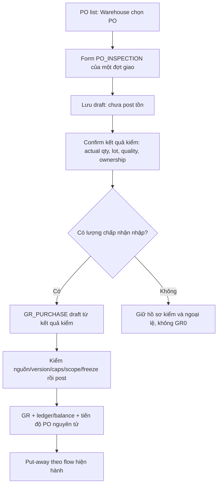

# Đánh giá đề xuất PO_INSPECTION

> Quyết định và triển khai mới hơn (02/11/2026): [IMPLEMENTATION.md](IMPLEMENTATION.md). Báo cáo này giữ nội dung đánh giá tại thời điểm đề xuất.

## 1. Kết luận

**Có thể áp dụng việc gộp ghi nhận hàng đến và kiểm nhận mua hàng thành PO_INSPECTION. Cần giữ dữ liệu từng đợt nhận, lượng thực giao, kết quả kiểm theo lô/chất lượng/quyền sở hữu, và liên kết GR với cả PO lẫn kết quả kiểm.**

Chỉ có lượng chấp nhận và note tự do thì chưa đủ bảo toàn nghiệp vụ nhận thiếu, lỗi, giữ hộ, nhận nhiều đợt và chống nhập trùng. Đây là đánh giá một đề xuất mới, chưa phải quyết định thay thế plan/baseline; không thay model, API hoặc dữ liệu ứng dụng trong lượt đánh giá.

Nguồn đối chiếu: đề xuất người dùng trong chat; context nghiệp vụ BE hiện hành, model/document lines, seed mua hàng/CR/FD, PO reader và supplier reader. Các field và trạng thái đề xuất dưới đây chưa phải runtime contract.

## 2. Phần phù hợp của ý tưởng

- Từ PO list mở form kiểm hàng là điểm vào phù hợp cho Warehouse theo kho được giao.
- Điền sẵn sản phẩm/đơn vị/lượng đặt và lượng còn phải nhận giúp giảm nhập lại. Đây là form dựa trên nguồn, không tạo PO mới.
- Một chứng từ PO_INSPECTION có header rõ PO/kho/đợt giao giúp truy vấn và phân quyền trực tiếp hơn INSPECTION header rỗng hiện tại.
- GR tham chiếu trực tiếp PO giúp trả lời nguồn mua hàng và tìm GR liên quan NCC mà không bắt buộc duyệt ngược qua ARRIVAL/INSPECTION.
- delivererName/delivererContact thể hiện người thực giao, độc lập danh tính NCC. Người giao có thể là nhân viên vận tải và không phải một tài khoản/role của WMSD.

Lợi ích hiệu năng là giảm số bước resolve quan hệ nếu các reader dùng trực tiếp reference mới. Chưa có benchmark để kết luận mức cải thiện thời gian đáp ứng.

## 3. Các lỗ hổng cần bổ sung

| Gap ID | Điểm còn thiếu | Tình huống và tác động | Đề xuất |
|---|---|---|---|
| GAP-001 | Một PO có thể nhận nhiều chuyến | PO100, chuyến1 giao60, chuyến2 giao40; nếu sửa một kết quả chung thì mất lịch sử từng lần. | Một PO có nhiều PO_INSPECTION; mỗi phiếu là một đợt hàng thực đến. |
| GAP-002 | Chỉ có acceptedQty | Giao80, chấp nhận70, chưa biết10 lỗi đang ở đâu hoặc20 chưa giao có bị nhầm là bị từ chối không. | Lưu lượng thực giao, lượng chấp nhận/từ chối/chờ theo từng đợt. Không ghi lượng chưa giao thành lỗi của chuyến. |
| GAP-003 | Note không thay quyết định có cấu trúc | Cùng note “hàng lỗi” có thể là cửa hàng đã nhận sở hữu, giữ hộ NCC hoặc đã trả ngay. | Tách quality khỏi ownership/disposition; note chỉ bổ sung hướng xử lý dự kiến. |
| GAP-004 | Không có lot/tone/calibre | Cùng dòng PO có thể nhận hai lô/tone, chỉ một quantity tổng không đủ post stock theo dimension. | Một dòng PO có thể tạo nhiều dòng/kết quả kiểm theo lot/quality/owner. |
| GAP-005 | GR chỉ có PO link | Không biết kết quả kiểm nào cho phép nhập, có thể dùng cùng acceptedQty để tạo GR hai lần. | GR giữ poId và inspectionId; GR line giữ poLineId và inspectionLineId. |
| GAP-006 | Bỏ INSPECTION trên toàn hệ thống | Seed/model hiện còn dùng inspection cho CR/FD; FD receipt có inspectionLineId. | Thay flow mua hàng có giới hạn; thiết kế thay thế riêng trước khi xóa INSPECTION toàn cục. |
| GAP-007 | Supplier nullable không có điều kiện | GR theo PO có NCC xác định nhưng người dùng có thể bỏ hoặc đổi NCC, gây sai báo cáo. | Supplier của GR-P lấy từ PO phía server; null chỉ cho dữ liệu/loại receipt có lý do và semantics rõ. |
| GAP-008 | Sửa kết quả sau khi đã nhập | GR70 đã post, sau đó đổi inspection accepted50 sẽ làm nguồn và ledger mâu thuẫn. | Khóa số liệu đã làm nguồn GR; correction có lịch sử. Note theo dõi có thể cập nhật riêng và audit. |
| GAP-009 | Copy PO như một snapshot không kiểm lại | PO đã sửa/hủy remainder sau khi form mở, hoặc hai Warehouse cùng tạo từ cùng remainder. | Giữ source line IDs/version; recheck khi confirm/post và dùng shared guard/CAS trong transaction. |
| GAP-010 | Nhập accepted mặc định bằng ordered | Người dùng lưu form mà chưa kiểm hết các dòng sẽ ghi nhận hàng chưa giao. | Chỉ prefill lượng đặt/còn phải nhận; lượng thực kiểm chưa nhập khác số0. |
| GAP-011 | Nhận0, sai hàng hoặc dư hàng | Cả chuyến bị từ chối vẫn cần hồ sơ kiểm, sai/dư không được biến thành lượng hợp lệ của PO. | Lưu inspection kể cả accepted0; ghi ngoại lệ riêng, không tạo GR quantity0 hoặc âm thầm vượt PO. |

## 4. Flow đề xuất



Save/confirm inspection không tự tăng tồn. Trong bản đề xuất ban đầu, nên giữ thao tác post GR riêng để mốc “đã kiểm” và “đã nhập sở hữu” rõ ràng. Có thể thiết kế một thao tác confirm-and-post sau này nếu có yêu cầu, nhưng phải định nghĩa transaction và hiệu ứng cụ thể.

Liên kết nghiệp vụ:

```text
PO ──< PO_INSPECTION từng chuyến
 │             │
 └─────────────┴──> GR_PURCHASE

PO line ──< inspection results theo lot/quality/ownership ──> GR lines
```

GR có direct PO reference để truy vấn; inspection reference chứng minh quyền nhập lượng cụ thể. Hai reference phục vụ hai câu hỏi khác nhau nên giữ đồng thời.

Để giới hạn độ phức tạp ban đầu, có thể chọn một inspection đã chốt sinh tối đa một GR cho toàn bộ phần chấp nhận của chuyến; accepted0 không sinh GR. Nếu cần nhiều GR từ một inspection, phải tính lượng còn được post và khóa cạnh tranh theo từng inspection line. Đây là lựa chọn cần chốt trong đặc tả triển khai, không mặc định schema tự chống nhập trùng.

## 5. Dữ liệu đề xuất

Tiếp tục dùng BusinessDocument/DocumentLine discriminator thay vì mặc định tạo collection song song. Tên PO_INSPECTION và field dưới đây là đề xuất để đánh giá.

### 5.1. PO_INSPECTION header

| Field | Mục đích |
|---|---|
| purchaseOrderId | Bắt buộc chỉ ra PO của đợt kiểm. |
| warehouseId | Lấy/kiểm với PO và scope Warehouse. |
| arrivedAt | Thời điểm hàng thực đến; giữ chức năng nghiệp vụ của ARRIVAL dù gộp chứng từ. |
| deliveryReference | Tham chiếu chuyến/phiếu giao nếu có. |
| delivererName, delivererContact | Người thực giao của chuyến; không dùng thay supplier. |
| inspectedBy, inspectedAt | Người chốt và thời điểm kiểm do server ghi; thời gian/nhân sự riêng từng dòng nếu thực tế cần. |
| sourcePoVersion | Nhận biết PO thay đổi từ lúc chuẩn bị form. |
| note | Ghi chú chung của chuyến. |

documentNo, createdBy, workflowStatus, version kế thừa BusinessDocument. Supplier có thể resolve từ PO; nếu lưu supplier snapshot phải do server lấy, không để client chọn một NCC khác cho PO.

### 5.2. Dòng/kết quả kiểm

- Giữ poLineId thật, productId, conversion version/snapshot, quantity nhập và qtyBase dạng decimal string.
- Lượng thực giao/được kiểm phải phân biệt lượng còn chưa giao của cả PO.
- Lưu kết quả theo lượng, lot/tone/calibre, quality, ownershipDecision; hỗ trợ một PO line có nhiều kết quả.
- Tổng lượng phân loại theo accepted/rejected/pending phải khớp lượng thực giao đã ghi của chuyến. Quality là chiều độc lập: DAMAGED không tự đồng nghĩa REJECT hoặc không thuộc STORE.
- handlingNote mô tả phương hướng xử lý lỗi; chưa phải lệnh trả NCC, hủy hay giải phóng hàng. Khi có module xử lý/return, bổ sung relation/status có cấu trúc, giữ note lịch sử.
- Trong draft có thể chỉnh dữ liệu chưa thực hiện; sau confirm và đặc biệt sau post phải giữ facts đã dùng. Sửa note theo dõi vẫn cần actor/time/audit, không ghi đè kết quả kiểm đã post.

### 5.3. GR_PURCHASE header/line

- Header có purchaseOrderId, poInspectionId, warehouseId; supplierId server lấy từ PO. Giữ receiptKind hiện hành.
- delivererName/delivererContact trên GR là snapshot người giao của đúng chuyến kiểm. Có thể prefill từ PO_INSPECTION để người dùng không phải nhập hai lần; không lấy thông tin người giao từ master supplier.
- Với GR mua từ một PO có supplier hợp lệ, supplierId phải khớp PO. Nullable ở mức schema chung không có nghĩa mọi command đều cho null. Dữ liệu legacy thiếu nguồn phải báo thiếu, không bịa NCC.
- GR line tham chiếu poLineId và inspectionLineId, giữ dimension lot/quality/owner và conversion/qty snapshot để post đúng.

Việc yêu cầu người giao bắt buộc có tên/số liên hệ hay cho thiếu có ghi chú cần dựa vào quy trình cửa hàng; hiện đề xuất chưa chốt điều kiện đó.

## 6. Ví dụ để kiểm thiết kế

PO đặt100 viên A. Đợt1 giao80:70 GOOD được chấp nhận sở hữu,10 DAMAGED còn giữ hộ NCC chưa chấp nhận.20 còn lại chưa giao.

Kết quả cần giữ được:

| Thông tin | Quantity |
|---|---:|
| Đặt mua | 100 |
| Đã thực giao đợt1 | 80 |
| Chấp nhận sở hữu và GR post | 70 |
| Lỗi đang giữ hộ/chờ xử lý | 10 |
| Chưa giao | 20 |
| Chưa nhận sở hữu so với PO | 30 =10 chờ xử lý +20 chưa giao |

Nếu chỉ lưu accepted70 và note “10 lỗi”, hệ thống không có quantity có cấu trúc để phân biệt30 còn thiếu gồm những phần nào. Không được tự tạo nhu cầu mua thêm30 trong khi10 lỗi còn đang chờ kết quả. Nếu kiểm cả chuyến không chấp nhận viên nào, vẫn lưu inspection và lý do nhưng không post GR0.

Ghi inspection quantity10 đang giữ hộ chưa tự chứng minh đã có cơ chế quản lý custody hoàn chỉnh; khi hiện thực phải định nghĩa vị trí/chủ sở hữu và luồng tiếp nhận/trả hàng tương ứng, không cộng10 đó vào owned/available.

## 7. Bất biến cần bảo vệ khi triển khai

- BR-01/02: giữ lot identity và conversion snapshot; không suy m² từ calibre hoặc dùng float để tính quantity.
- BR-06: GR post, ledger/balance, source progress và idempotency cùng transaction; retry không nhân receipt.
- BR-07: tách hàng thực đến, được chấp nhận sở hữu, giữ hộ và từ chối; nhận sở hữu không tự đồng nghĩa available ngay.
- BR-08: nhiều đợt trên một PO; không vượt allowance hợp lệ và không sửa đè phần đã thực hiện.
- BR-24: facts đã post giữ bất biến; correction/reversal có nguồn và kiểm downstream.
- BR-30: bao bì rách không tự là gạch hỏng; quality và packaging độc lập.

Mỗi GR không vượt lượng inspection đã cho phép chưa được dùng; tổng nhận ròng các đợt không vượt PO allowance sau hủy hợp lệ. Nếu cho lập nhiều inspection trước khi post, phải kiểm cả pending commitments có ý nghĩa để không cùng nhận một remainder nhiều lần. Shared guard/CAS trên nguồn và transaction là yêu cầu service, không được thay bằng một lần đọc SUM đơn lẻ.

## 8. Ảnh hưởng source hiện có

| Thành phần | Tác động cần xử lý nếu chấp thuận đề xuất |
|---|---|
| constants.js, business-document.model.js, document-line.model.js | Thêm/đổi typed schema và references cho nhánh mua hàng. |
| purchase-order.service.js | Thay chain cố định PO→ARR→INS→GR bằng nguồn mới; giữ kiểm ledger/direction/product/batch. |
| supplier.service.js | Dùng GR.purchaseOrderId/supplierId có căn cứ, áp scope và kiểm consistency. |
| demo seed, model/integration tests | Dựng lại fixtures mua hàng và assertion; không xóa inspection CR/FD ngoài scope. |
| Dữ liệu lịch sử | Có chiến lược đọc legacy hoặc migrate refs bảo toàn ID/ledger; không drop chứng từ cũ hay tạo kết quả kiểm giả. |
| SRS/UC/context/thiết kế/FE contract | Đồng bộ UC-16/37 và reader UC-07/29; plan cũ chưa có command kiểm/post trong scope Iteration1. |

INSPECTION đang dùng cho cả CR và FD tại [demo.data.js](D:/Ky_9/SEP490/src/be/src/seeds/data/demo.data.js:320). FD receipt line có inspectionLineId tại [document-line.model.js](D:/Ky_9/SEP490/src/be/src/models/document-line.model.js:269). Không thể xóa discriminator chung chỉ vì nhánh mua hàng đổi tên.

Đề xuất giúp thay cách resolve nguồn của RV-04, nhưng không tự sửa RV-01/02 về ledger và không liên quan lỗi retry RR RV-03. Direct supplierId cũng cần guard khi ghi và consistency checks; thêm field không tự chứng minh dữ liệu đúng.

## 9. Kết luận kiến nghị

Chấp nhận hướng thiết kế để đặc tả tiếp theo bốn điều kiện: gộp chứng từ chỉ trong flow PO; giữ một kết quả kiểm cho mỗi đợt thực giao; bổ sung quantity/lot/quality/ownership có cấu trúc; GR tham chiếu trực tiếp cả PO và inspection. supplierId của GR mua được lấy từ PO, người giao được ghi riêng theo chuyến. Note hỗ trợ theo dõi nhưng chưa thực thi xử lý hàng lỗi/return.

Trước khi viết code cần chốt cardinality inspection→GR, mốc confirm/post, cách ghi phần hàng không chấp nhận và quy tắc chỉnh kết quả sau confirm. Báo cáo đề xuất defaults ở trên để thảo luận, chưa sửa baseline hay triển khai API.
