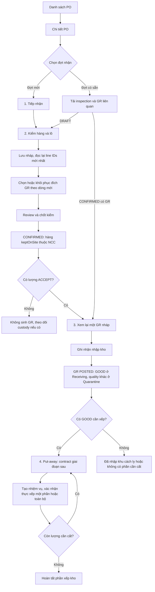

# Luồng người dùng — nhận hàng mua theo PO

> Luồng v1 mô tả baseline nhận mua. Đọc [Plan v2](design-plan-v2.md) cho luồng đề xuất giải quyết custody, GR bổ sung, cancel/correction và put-away; không dùng các giới hạn v1 như quyết định bỏ các nhánh đó khỏi kế hoạch phát triển.

Ngày: 03/11/2026 · Đề xuất UI · [Kế hoạch tổng thể](design-plan.md) · [Wireframe](wireframe-ascii.md).

Actor chính: Warehouse có quyền tại kho được giao. Owner/Accountant chỉ đọc theo scope; quyền xếp kho kiểm riêng. Giữ nguyên BR-06/07/08/09/24/30 của dự án, không tạo mã BR mới cho bản plan.

## 1. Các màn hình và chuyển tiếp

| Màn hình | Người dùng làm gì | Kết quả |
|---|---|---|
| Danh sách PO | Lọc PO rồi mở chi tiết | Chỉ đọc; chưa tạo inspection. |
| Chi tiết PO | Xem tổng quan/đợt cũ hoặc chọn tiếp nhận mới | Tiếp tục đúng inspection đang có hoặc mở form mới. |
| Tiếp nhận | Nhập thời điểm đến và thông tin người giao tùy chọn | Lưu nháp khi người dùng chọn; không có check-in command riêng. |
| Kiểm hàng & lô | Chọn dòng PO, chia các phần lượng và đích nhận, lưu/chốt | DRAFT → CONFIRMED; custody NCC; có ACCEPT thì có GR DRAFT. |
| Xem lại GR | Kiểm lượng/nguồn/đích; ghi nhận nhập kho | GR DRAFT → POSTED, NCC → STORE. |
| Xếp kho | Lập nhiệm vụ, xác nhận vị trí/lượng thực cất | Thiết kế giai đoạn sau; không tăng tổng tồn lần hai. |
| Chi tiết GR độc lập | Mở từ danh sách phiếu nhập hoặc PO | Cùng chứng từ/bộ thao tác bước GR, liên kết về đúng đợt. |

Sơ đồ thể hiện đích thiết kế. Q–U chưa được module nhận mua cung cấp; MVP không cho thực thi các lệnh này khi chưa có contract. Khi mở record POSTED, đi thẳng vào chế độ đọc bước3/tiến độ bước4; không post lại. Chốt kiểm với ACCEPT0 vẫn không có nghĩa hàng PENDING/REJECT giữ tại kho đã được giải quyết.

## 2. Happy path và nhận nhiều đợt

Ví dụ một dòng PO đặt100 thùng; quy cách là giả định minh họa của cùng một SKU, không cộng lẫn các SKU:

| Mốc | NCC giữ hộ | STORE | PO còn phải nhận | Ý nghĩa UI |
|---|---:|---:|---:|---|
| Nháp chuyến1: giao80, nhận70, chờ5, trả ngay5 | 0 | 0 | 100 | Đang kiểm; chưa có stock được post. |
| Chốt kiểm chuyến1 | 75 | 0 | 100 | Chờ GR70;5 đã giao trả ngay không ở custody. |
| Post GR chuyến1 | 5 | 70 | 30 | STORE70 ở receiving nếu GOOD; chưa thành available chỉ vì đã post. |
| Xếp thực tế40 của70 GOOD, giai đoạn sau | 5 | 70 | 30 |40 đã cất,30 còn chờ; available còn tùy các điều kiện khác. |
| Chốt chuyến2 giao30/ACCEPT30 | 35 | 70 | 30 | Chuyến2 có GR nháp riêng. Không nhận lại5 pending của chuyến1. |
| Post GR chuyến2 | 5 | 100 | 0 | PO nhận đủ; chưa suy ra xếp hết hoặc xử lý xong custody5. |

## 3. Nhánh lỗi và tình huống biên

| Tình huống | Hành vi UI và đường tiếp tục |
|---|---|
| Nháp không có dòng | Cho lưu; chốt kiểm bị chặn, dẫn đến nút chọn dòng PO. |
| SKU chưa giao đợt này | Không bắt buộc nhập0; phần chưa giao không là dòng kiểm. |
| Một SKU nhiều lô/kết quả | Thêm phần lượng trong nhóm PO line; tổng các phần là thực giao. |
| Giao dư | Hiện lượng vượt; ACCEPT không vượt cap BE; lượng dư chỉ ghi chờ/không nhận đúng contract. Không có nút override. |
| Sai SKU ngoài PO | Không cho thêm vào GR PO này; báo cần xử lý nguồn/chứng từ riêng. Không gắn giả poLineId. |
| Chỉ có REJECT đã trả ngay | Confirm inspection, không custody cho lượng đó, không GR. |
| DAMAGED nhưng ACCEPT | Cửa hàng nhận sở hữu hàng lỗi; đích GR là QUARANTINE, không STORAGE. |
| Bao bì mở nhưng GOOD | Giữ chất lượng đã kiểm; không tự sinh lỗi hoặc trừ lượng. |
| Lô UNKNOWN | Giữ trạng thái chưa xác minh, cảnh báo chưa đủ điều kiện khả dụng; không tạo chứng cứ xác minh giả. |
| Thiếu vị trí CUSTODY/RECEIVING/QUARANTINE phù hợp | Chỉ rõ loại thiếu; chặn confirm liên quan, cho lưu nháp hợp lệ; không chọn storage thay thế. |
| PO/version đổi | Giữ input, tải nguồn mới, so thay đổi và review; lưu lại draft trên PO version mới trước chốt. |
| PO COMPLETED nhưng còn task | Vẫn mở GR/put-away đúng quyền; không cho tạo đợt nhận mới theo PO đã đóng. |
| Pending sau chốt muốn nhận thêm | Chỉ xem/note; cần command giải quyết custody mới. Không lách bằng chuyến giả hoặc sửa facts. |
| Sửa lượng sau chốt/post | Không có lệnh hỗ trợ hiện tại; khóa chỉnh và nêu giới hạn. |
| Hai người thao tác cùng lúc | Backend quyết định version/cap. Không tự ghi đè, không dùng “lưu lần cuối thắng”. |
| Mất mạng sau confirm/post | Hiện “Chưa xác định kết quả”; đối chiếu trạng thái và retry cùng key/payload. Không tạo key mới hay tự rollback UI thành nháp. |

## 4. Trạng thái giao diện dùng chung

| Trạng thái | Hiển thị | Thao tác |
|---|---|---|
| Normal | Dữ liệu nguồn, trạng thái lưu và bước hiện tại | CTA theo quyền và chứng từ thật. |
| Loading lần đầu | Skeleton vùng header/bảng; chưa có số0 giả | Chặn ghi cho đến khi có nguồn. |
| Refetch | Giữ bản đang xem, báo đang cập nhật | Tạm chặn confirm/post phụ thuộc nguồn; không xóa input. |
| Empty | “PO chưa có đợt nhận” hoặc “Chưa chọn dòng kiểm” | CTA tiếp nhận/chọn dòng đúng quyền. |
| Validation error | Lỗi ngay dưới field và tổng lỗi có link tới dòng | Giữ tất cả input; focus lỗi đầu tiên. |
| Forbidden / ngoài scope | Trang403/404 theo server, có đường về danh sách | Không render facts từ cache tài khoản khác. |
| Conflict409 | Banner nguồn/lượng/version thay đổi hoặc vị trí khóa | Tải lại và review, giữ các giá trị người dùng chưa gửi. |
| Network error / Offline | “Mất kết nối, thay đổi này chưa được lưu” | Có thể giữ input trong phiên; chặn chốt/post, thử lại khi có mạng. |
| Saving / Posting | “Đang lưu”/“Đang ghi nhận”; khóa gửi trùng | Rời trang có cảnh báo; không báo thành công trước response. |
| Saved | “Đã lưu lúc…” cho phần server xác nhận | Đích GR chưa persist có nhãn riêng cần xác nhận lại. |
| Unknown outcome | “Đang kiểm tra kết quả thao tác” | Giữ nguyên key/payload; không coi request lỗi là chắc chắn chưa commit. |

## 5. Quy tắc điều hướng

- Bước đã làm có thể mở lại để xem; chỉ DRAFT cho sửa nội dung kiểm. Chọn bước tương lai không bỏ qua điều kiện server.
- Ở bước2, chuyển tab không làm mất draft. “Chờ/Không nhận” là bộ lọc trên cùng dữ liệu.
- Form chưa lưu có thay đổi phải cảnh báo khi đóng/chuyển route; không auto-create khi mount hoặc vào tab.
- Sau confirm/post, tải lại trạng thái live, invalidation PO/inspection/GR và nguồn tồn liên quan khi có sử dụng; không dùng receipt replay như trạng thái mới nhất.
- Mỗi action có key/payload ổn định. Save mới sau khi chỉnh nội dung là một action mới; timeout của action cũ phải được đối chiếu trước khi thay bằng payload khác.
- Kế hoạch MVP không có offline queue, không lưu stock chính thức vào localStorage, không fallback dữ liệu demo khi HTTP lỗi.

## 6. Điểm kiểm tra khi nghiệm thu UI

Review tối thiểu: nhận đủ; nhiều chuyến; ACCEPT0; split lot/quality; chờ/từ chối giữ kho và trả ngay; cap GR nháp; line IDs sau save; destination mất sau refresh; quyền Warehouse/Owner/Accountant; stale409; freeze/hold; timeout/replay; deep link. Put-away kiểm riêng partial/split/concurrency và bảo toàn tổng tồn khi triển khai giai đoạn sau.
