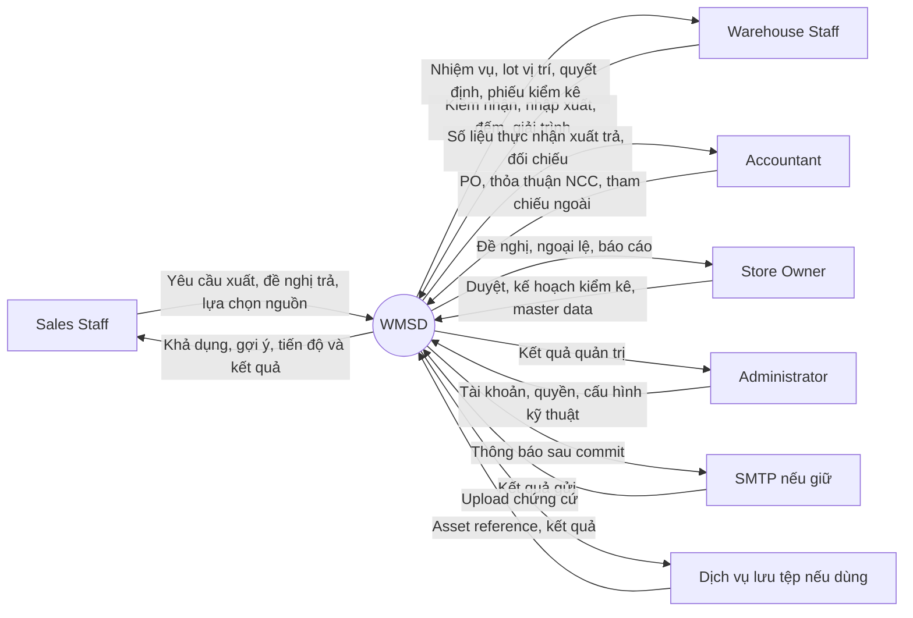
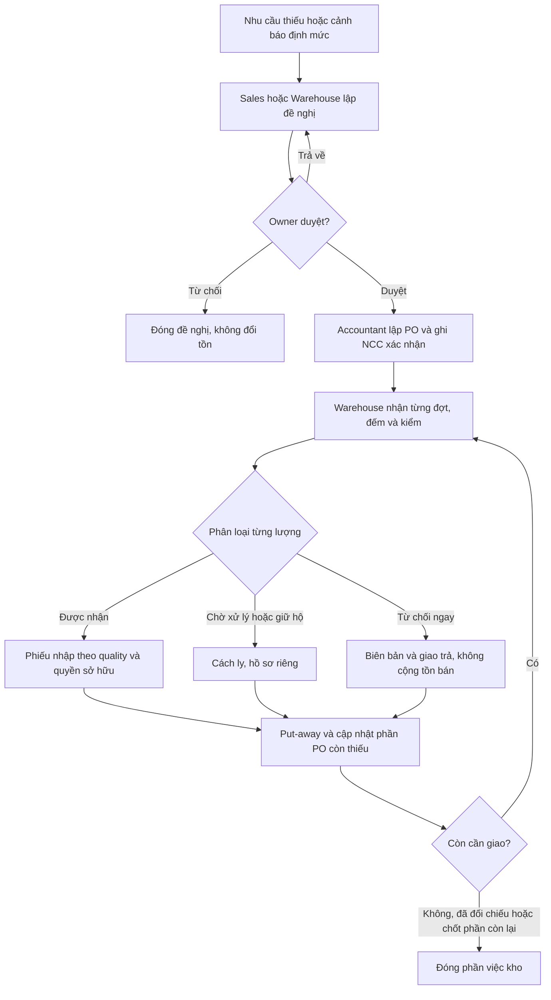
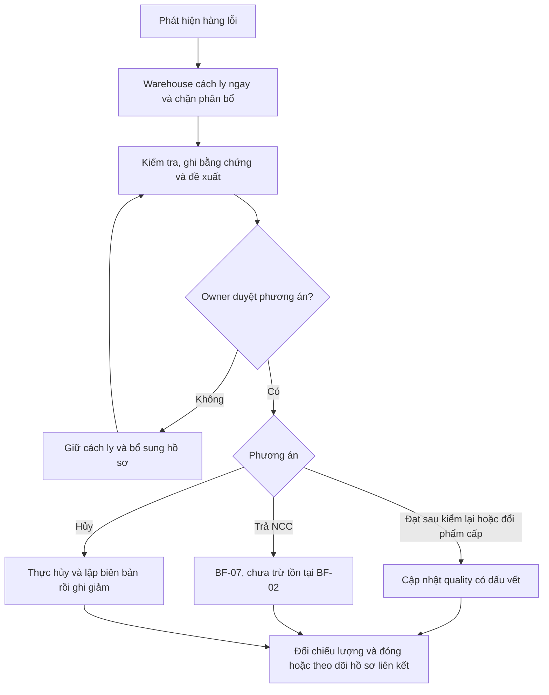
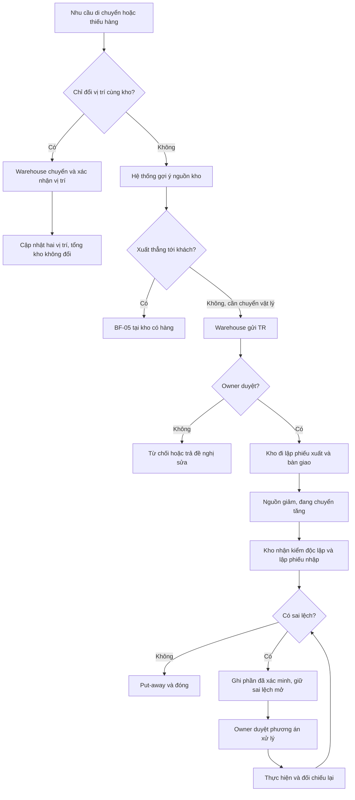
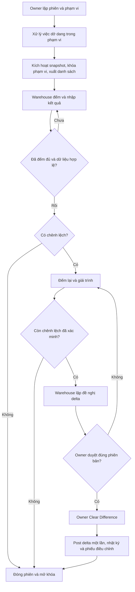
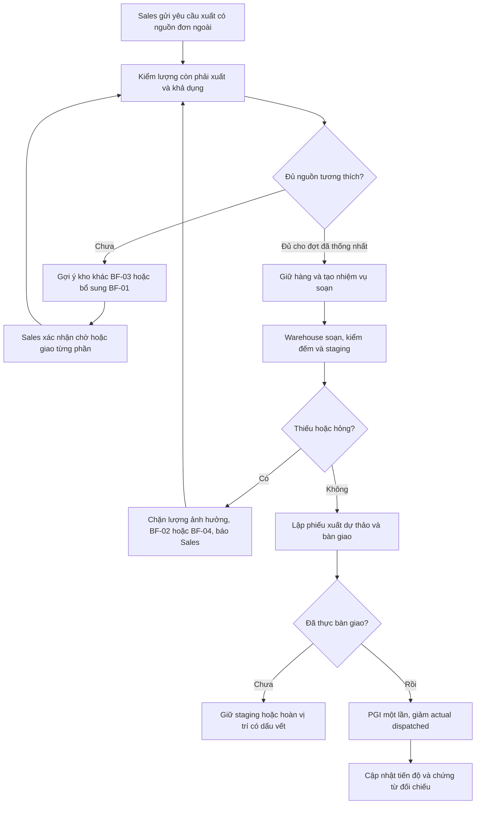
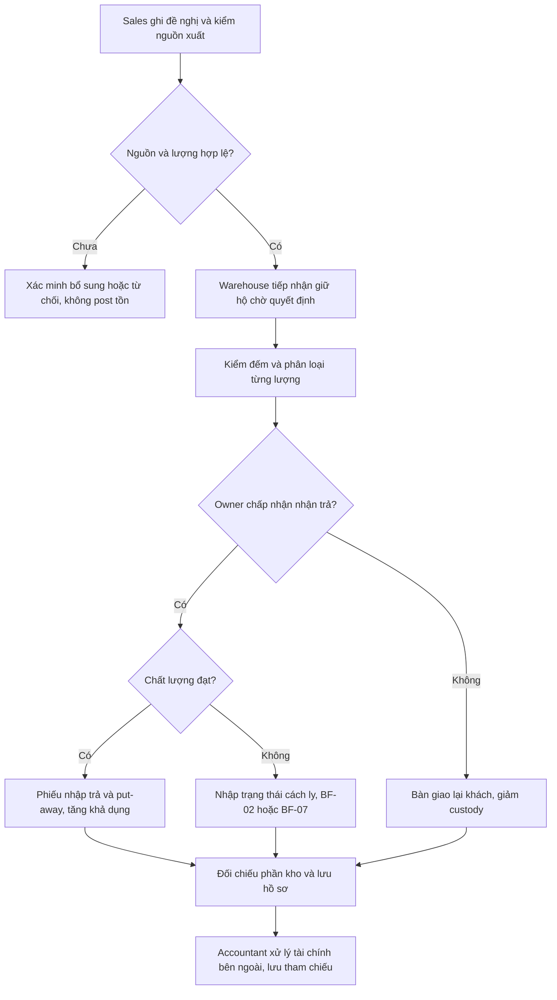
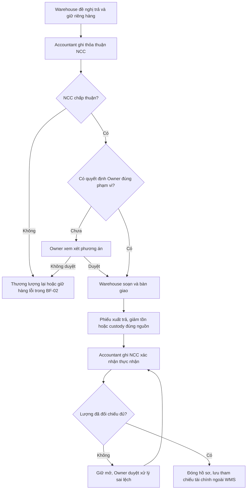

# Đề xuất 7 quy trình nghiệp vụ WMSD sau review 1

> Tài liệu lịch sử: giữ nội dung theo mốc ghi nhận cũ. Phương án hiện hành là [quy trình 2 VI](de_xuat_quy_trinh_2_VI.md) / [EN](de_xuat_quy_trinh_2_EN.md), baseline nghiệp vụ 3.1.0 ngày 24/10, đồng bộ tài liệu 25/10/2026; xem [hậu kiểm mới](../07_ra_soat/Ket_qua_dong_bo_tai_lieu_2026-10-25.md). Các tên nguồn máy cá nhân dưới đây chỉ lưu xuất xứ; bộ SAP v4.1 trong repo không được coi là bản v4.2 đã dùng trước đây.

Ngày đối chiếu: 17/10/2026. Đây là phương án To-be và bản phân tích tác động, chưa phải xác nhận thực địa hay bản SRS đã được cửa hàng phê duyệt. Hai report gốc không bị sửa.

**Bổ sung 19/10/2026:** thêm thuật ngữ kho, danh mục chứng từ và quy tắc post; chi tiết database được tách sang [đề xuất thiết kế database](../03_thiet_ke/de_xuat_database_design_VI.md). SQL là mô hình tham chiếu; hệ thống thực tế sẽ dùng MongoDB (NoSQL).

## Thuật ngữ quản lý kho

| Thuật ngữ | Nghĩa và cách dùng trong WMSD |
|---|---|
| WMS — Warehouse Management System | Hệ thống quản lý thao tác vật lý, vị trí và số lượng hàng trong kho. Không thay thế toàn bộ phần mềm bán hàng/kế toán. |
| Warehouse / Location / Bin | Kho vật lý / vị trí trong kho / ô hoặc kệ chứa. Khu nhận, kệ bán được và khu cách ly trong một địa điểm thường là các location, không phải ba warehouse. |
| SKU — Stock Keeping Unit | Mã mặt hàng/quy cách; cùng SKU vẫn có thể có nhiều lô, tone và calibre. |
| Lot / Batch | Lô sản xuất hoặc lô được nhận dạng để truy xuất. Khóa nhận dạng đề xuất: sản phẩm + mã lô nhà sản xuất + tone + calibre. |
| Tone / Shade | Sắc độ/mã màu thực tế của lô gạch. Hai lô cùng mẫu có thể khác tone. |
| Calibre | Nhóm kích thước thực tế sau sản xuất; khác với kích thước danh nghĩa, ví dụ 600 × 600 mm. Không tự trộn calibre khi đáp ứng công trình. |
| UoM — Unit of Measure | Đơn vị tính: viên, thùng, m². Gạch dùng viên làm đơn vị tồn chuẩn; hệ số quy đổi có phiên bản theo sản phẩm. |
| On-hand | Hàng thuộc cửa hàng đang ở các vị trí vật lý của kho; bao gồm hàng đạt, chờ kiểm, cách ly và staging. |
| Usable / Available | Usable: đủ điều kiện chất lượng và vị trí. Available: phần đủ điều kiện còn rảnh để cấp cho nhu cầu mới sau khi trừ giữ hàng và khóa kiểm kê. |
| Reservation | Giữ một lượng tồn cụ thể cho nhu cầu. Chưa phải xuất kho; khi chuyển vị trí phải chuyển liên kết giữ hàng theo. |
| Allocation | Liên kết nhu cầu với nguồn đáp ứng. Có thể là nguồn dự kiến từ PO/điều chuyển; không đồng nghĩa đã có hàng để xuất. |
| Receiving / Put-away | Khu tiếp nhận / thao tác đưa hàng từ khu tiếp nhận vào vị trí lưu trữ. Put-away không nhập tăng tổng tồn lần nữa. |
| Picking / Staging | Soạn đúng hàng, lô, vị trí / khu tập kết chờ bàn giao. Hàng đã picking vẫn ở trong tồn kho đến khi thực xuất. |
| Quality / Quarantine | Chất lượng hàng / khu cách ly. Một lô có thể đồng thời có 90 viên đạt và 10 viên hỏng ở các số dư khác nhau. |
| In-transit | Hàng đã xuất khỏi kho nguồn, chưa hoàn tất nhận/giải quyết tại kho đích. Đây là trạng thái vận chuyển, không phải chất lượng. |
| Custody | Hàng giữ hộ khách/NCC, chưa thuộc tồn của cửa hàng. Theo dõi vật lý nhưng loại khỏi tồn sở hữu và khả dụng. |
| Replenishment Request — RR | Đề nghị bổ sung hàng do Sales/Warehouse lập, Owner duyệt. Chưa làm tăng tồn. |
| Purchase Order — PO | Đơn đặt mua do Accountant lập từ nhu cầu đã duyệt; theo dõi số đặt, NCC xác nhận và nhiều đợt nhận. |
| Goods Receipt — GR | **Phiếu nhập kho**; tên tiếng Anh chuẩn dùng trong tài liệu là “Goods Receipt”, không dùng “Good Receipt”. Post GR ghi tăng lượng được cửa hàng nhận quản lý, đúng chất lượng và vị trí. |
| Goods Issue — GI / Post Goods Issue — PGI | Phiếu xuất / hành động ghi nhận xuất thực tế. PGI làm giảm lượng tồn đúng một lần khi bàn giao ra ngoài. |
| Transfer Request — TR | Trong **WMSD**: đề nghị chuyển giữa hai kho vật lý, cần Owner duyệt. Trong SAP WM, TR có thể là *Transfer Requirement*, nghĩa khác; không dịch hai khái niệm thành một. |
| Transfer Order — TO | Trong **WMSD**: phiếu giao việc nội kho, gồm put-away, picking, relocation, quarantine, unpick. Bảng kỹ thuật gọi `warehouse_task`. Không phải một lần duyệt liên kho thứ hai. |
| Stock Transport Order — STO | Lệnh điều chuyển giữa các đơn vị/kho trong ví dụ SAP; khác TO thao tác nội kho. WMSD dùng TR đã duyệt để điều phối, không triển khai toàn bộ STO của SAP. |
| Transfer Dispatch — TD | Phiếu xuất điều chuyển nguồn. Post TD: giảm kho nguồn, tăng in-transit. |
| Multi-warehouse Transfer Receipt — MWTR | **Tên quy ước của đề xuất WMSD cho phiếu nhập điều chuyển liên kho**. Mỗi phiếu nhận thuộc một kho đích và một đợt xuất nguồn; không phải phiếu cộng tồn đồng thời ở nhiều kho. Nguồn tham khảo không chứng minh đây là thuật ngữ chuẩn chung của mọi WMS. |
| Handover / POD | Biên bản bàn giao / bằng chứng khách đã nhận (*Proof of Delivery*). Bàn giao cho nhà vận chuyển chưa chứng minh khách đã nhận. |
| Stocktake / Snapshot / Cutoff | Kiểm kê / ảnh chụp số dư bất biến / thời điểm chốt sổ phục vụ đối chiếu. |
| Recount / Adjustment / Disposition | Đếm lại / điều chỉnh chênh lệch tồn / quyết định xử lý hàng lỗi, ví dụ cách ly tiếp, trả NCC, hủy. |
| Posting / Reversal / Idempotency | Ghi nhận có tác động tồn / chứng từ đảo có dấu vết / cùng yêu cầu lặp lại không được ghi nhận hai lần. |
| FIFO | Ưu tiên hàng nhận trước trong tập hàng tương thích để soạn. Đây là quy tắc xuất vật lý, không lựa chọn phương pháp tính giá vốn kế toán. |

## 1. Kết luận và căn cứ thiết kế

**Giữ 7 quy trình và mã BF-01 đến BF-07 của Report 3, nhưng thu hẹp phần bán hàng, sửa trách nhiệm, tách các thời điểm ghi nhận tồn và đồng bộ lại toàn bộ tài liệu.** Không cần bỏ quy trình xử lý hàng lỗi để dành chỗ cho chuyển vị trí: chuyển vị trí là nhánh BF-03 và chức năng FE-04; hàng lỗi vẫn là BF-02 dùng chung cho nhập, xuất, trả hàng, kiểm kê.

Phương án này ưu tiên góp ý hội đồng trong review1, bối cảnh một cửa hàng của Report 1, và khả năng triển khai của nhóm. Nó thay đổi một số cam kết phạm vi hiện có, đặc biệt Sales Order, giá bán, hóa đơn nội bộ và quản lý hoàn tiền. Các thay đổi này phải được ghi rõ trong change log, không trình bày như thể bản cũ đã có cùng phạm vi.

### 1.1 Nguồn thực sự đã đối chiếu

| Nguồn | Cách sử dụng và giới hạn |
|---|---|
| `review1.md` (nguồn lịch sử ngoài repo; chưa đóng gói) | Căn cứ phản hồi hội đồng; các action item như gửi email cho cô là nội dung tài liệu, không phải yêu cầu thực hiện trong lượt này. |
| [Report 1 trực tuyến](https://docs.google.com/document/d/1kb36v5HuFrM75NFCTXvnJcsg6QnPjYkb/edit) | Đã đọc nội dung trực tuyến; thời điểm sửa do Drive trả về: 17/10/2026 16:26:21 giờ Việt Nam. Căn cứ bối cảnh cửa hàng, GAP, FE và LI. |
| [Report 3 trực tuyến](https://docs.google.com/document/d/1HvhlCmYjfXj7766ZVNUBAU4J063Lmr71/edit) | Đã đọc nội dung và kiểm tra ảnh context/flow trong file trực tuyến; thời điểm sửa: 17/10/2026 17:17:15 giờ Việt Nam. Catalogue hiện ghi 102 UC, UC-01–UC-102. |
| SAP Global Bike WM I–IV v4.2, trong `03_Case_Study` (nguồn lịch sử ngoài repo; chưa đóng gói) | Đọc 4 case chính, đối chiếu trang tổng quan và các bước nghiệp vụ; các Data Sheet/Notes phục vụ bối cảnh bài thực hành. Không lấy tài khoản, mã kho hoặc cơ cấu doanh nghiệp mẫu làm yêu cầu của Tân Thương. |
| [MISA SME – Quy trình nghiệp vụ](https://helpsme.misa.vn/2022/kb/quy-trinh-nghiep-vu/) và các hướng dẫn eShop ở cuối tài liệu | Tham khảo loại chứng từ, giao nhận, kiểm kê và ranh giới kho/kế toán. Không sao chép toàn bộ phân hệ tài chính hoặc khẳng định cửa hàng đã bật mọi tính năng. |
| [TikTok cửa hàng](https://www.tiktok.com/@gachoplattanthuong), [Facebook cửa hàng](https://www.facebook.com/p/Showroom-T%C3%A2n-Th%C6%B0%C6%A1ng-61567834853149/) | Đã thử truy cập/tìm kiếm, nhưng TikTok bị chặn và Facebook không trả nội dung có thể kiểm chứng. Không suy ra số kho, nhân sự, doanh thu, vận tải hay chính sách trả hàng từ hai liên kết này. |

### 1.2 Bối cảnh dùng làm baseline

Theo Report 1, Tân Thương là cửa hàng gạch ốp lát tại Phố Tân An, xã Tân An, Yên Dũng, Bắc Giang, đã sử dụng MISA eShop. Đây là địa chỉ được báo cáo ghi nhận; chưa đối chiếu tên đơn vị hành chính hiện hành. Khách mua phục vụ xây dựng, cải tạo và thi công. Những vấn đề nhóm mô tả là quản lý vị trí chưa có cấu trúc, thao tác kho còn rời rạc, khó phân biệt lô/tone/calibre, hàng chờ kiểm tra, hư hỏng và đang chuyển.

Phạm vi phù hợp: **một cửa hàng, nhiều vị trí và có thể nhiều kho vật lý do chính cửa hàng quản lý**. Không mặc định một chuỗi nhiều chi nhánh. Số kho và khoảng cách thực tế chưa được chứng minh; BF-03 liên kho chỉ hoạt động khi cấu hình và khảo sát xác nhận có từ hai kho vật lý. Một khu nhận hàng, một khu bán được và một khu cách ly trong cùng địa điểm không tự động trở thành ba kho vật lý.

Đặc thù cần giữ: mã sản phẩm + lô + tone + calibre thực tế; quy đổi thùng/viên/m²; kiểm đếm theo từng lần giao; nhận/giao từng phần; giữ riêng hàng lỗi; bảo đảm lô phù hợp khi khách lấy bổ sung cho công trình. Các ví dụ số lượng trong tài liệu này là ví dụ thiết kế, không phải số liệu của cửa hàng.

### 1.3 Chốt ranh giới WMSD đề xuất

| Trong WMSD | Thực hiện ngoài WMSD, lưu mã tham chiếu khi cần |
|---|---|
| Nhu cầu bổ sung, chủ duyệt, PO phục vụ kế hoạch nhập và theo dõi giao thiếu | Lựa chọn thương mại phức tạp, thanh toán NCC, công nợ, hạch toán |
| Kiểm nhận, phân loại, phiếu nhập, put-away, tồn lô/vị trí/trạng thái | Hạch toán giá vốn, thuế và sổ cái |
| Tiếp nhận yêu cầu xuất, phân bổ, soạn hàng, kiểm đếm, phiếu xuất, bàn giao | Tạo đơn bán thương mại, báo giá, chiết khấu, thu tiền, hóa đơn thuế |
| Trả hàng vật lý, chứng từ nhập/xuất trả, hồ sơ đối chiếu | Quyết định/chi hoàn tiền trên hệ thống bán hàng–kế toán; WMS chỉ lưu tham chiếu kết quả |
| Điều chuyển, hàng đang chuyển, xử lý sai lệch, kiểm kê và nhật ký | Tối ưu tuyến xe, GPS, điều hành đội xe |

**Không có live MISA integration trong baseline.** Sales/Accountant nhập mã nguồn MISA và đính kèm chứng từ hoặc nhập dữ liệu có kiểm tra theo phạm vi nhóm chốt. Không vẽ mũi tên API đồng bộ tự động. WMS là nguồn chuẩn cho chi tiết kho và sự kiện vật lý; MISA giữ đơn thương mại/tài chính. Kế toán đối chiếu hai bên định kỳ, theo mã chứng từ và số lượng; không cho phép hai hệ thống cùng tự sinh một giao dịch kho từ hai nguồn độc lập.

Các chức năng bỏ khỏi MVP được đề xuất, không phải lệnh xóa dữ liệu đã có: quản lý giá bán UC-23–25, hóa đơn nội bộ UC-59–62, quy trình tính/duyệt/ghi hoàn tiền UC-74–78. Thay phần hoàn tiền bằng ghi nhận tham chiếu xử lý bên ngoài. Nếu nhóm quyết định giữ các chức năng này, phải trình bày đây là phạm vi mở rộng và giải trình với GVHD; không thể vừa giữ nguyên toàn bộ vừa nói đã thu hẹp theo review1.

## 2. Các sai lệch còn tồn tại trong bản hiện tại

| Vị trí đã kiểm tra | Phát hiện | Hướng sửa |
|---|---|---|
| R3 I.2.1, UC-03, permission matrix; R1 Proposed purchasing | Accountant vẫn là người tạo nhu cầu bổ sung. | Sales/Warehouse Staff lập nhu cầu; Accountant tiếp tục PO và chứng từ sau khi được duyệt. |
| R3 I.2.3, UC-40–43 và hình BF-03 | TR → owner duyệt → tạo TO → confirm TO; hình còn đưa nhánh same warehouse vào sau bước duyệt. | Phân loại nội bộ/liên kho ngay đầu; nội bộ không owner duyệt; liên kho từ TR được duyệt đi thẳng thực hiện xuất/nhận. |
| R3 I.2.5, FE-06, UC-45–62; R1 I.2/IV/V | Tạo SO và hóa đơn nội bộ vẫn thuộc WMS. | Đổi SO thành yêu cầu xuất có tham chiếu bên ngoài; bỏ bước billing trong BF-05. |
| R3 I.2.4, UC-87–93 so với hình BF-04 | Phần chữ đã có snapshot; UC-93 giao Owner Clear Difference, hình đặt Post approved adjustment ở lane thực hiện phía nhân viên kho. | Không nói “chưa có snapshot” cho bản mới; bổ sung danh sách kiểm kê, cơ chế cutoff và thống nhất người ghi nhận điều chỉnh. |
| R3 I.2.6, UC-70–73 so với hình BF-06 | Chữ quy định Owner duyệt tiếp nhận trước kiểm tra; hình lại thể hiện kiểm tra rồi owner duyệt disposition. | Chọn một trình tự duy nhất; đề xuất tiếp nhận giữ hộ → thủ kho kiểm → owner quyết định nhận trả → nhập theo trạng thái. |
| Hình BF-06 hiện tại | Đã có nhánh Goods reusable? với hai kết quả khác nhau. | Không lặp lại nguyên xi lỗi Yes/No của bản review cũ; kiểm tra tiếp quyền, chứng từ, ownership và nối nhánh đến trạng thái kết thúc rõ. |
| R3 I.1 context diagram | Có Cloudinary, nhưng I.5.2 chỉ liệt kê API-01 SMTP. Chiều “Evidence Upload” và “Asset URL / Upload Status” đang ngược luồng kỳ vọng. | Bổ sung interface nếu thực sự dùng, sửa hướng; nếu không dùng dịch vụ ngoài thì bỏ thực thể này. |
| Context diagram so với permission matrix | Có Sales Return Data từ Sales, Supplier Return Request Data từ Accountant, nhưng UC-70/81 chỉ giao Inventory Staff. | Đồng bộ mọi mũi tên với quyền mới, không chỉ đổi tên actor. |
| R3 I.3.2 Entity Descriptions | Traceability còn mã cũ: Goods Issue → UC-82–89, Stocktake → UC-70–76, PO → UC-27–32. | Remap bằng catalogue hiện tại và bản đề xuất, không đánh số lại tùy ý. |
| R3 I.3.3 và V.1 | DR-04 có “UC-65–56”; GB-04 có “UC-65–50,92–95”; có tham chiếu lặp và khoảng số sai. | Chuẩn hóa ID, bỏ trùng, xác minh từng tham chiếu. |
| R1 IV so với R3 I.2 | Phần Proposed Solution của R1 hiện có 6 hình; thiếu BF-02 độc lập trong chuỗi tương ứng 7 flow R3. | R1 To-be và slide dùng cùng 7 mã/tên; As-is có thể khác số flow vì mô tả hiện trạng, phải ghi rõ. |

## 3. Actors và nguyên tắc phân quyền

Giữ năm application roles; thống nhất **Warehouse Staff** thay cho Inventory Staff trong toàn bộ bản tiếng Anh. Có thể dịch “nhân viên kho/thủ kho” tùy chức danh thực tế, nhưng không dùng hai tên tiếng Anh cho cùng một role.

| Actor | Trách nhiệm To-be |
|---|---|
| Store Owner | Duyệt bổ sung, điều chuyển liên kho, nhận trả hàng, trả NCC, xử lý hàng lỗi và chênh lệch; xem báo cáo. Không duyệt đổi kệ hàng thông thường. |
| Sales Staff | Ghi nhận yêu cầu xuất và đề nghị khách trả; xác nhận nhu cầu còn lại, giao từng phần, lựa chọn nguồn đáp ứng; liên hệ khách về thay lô/tone. Không xác nhận chất lượng vật lý. |
| Warehouse Staff | Kiểm nhận/kiểm tra, soạn hàng, put-away, nhập/xuất, chuyển vị trí, kiểm kê, cách ly, đề xuất xử lý. Bị giới hạn theo kho được giao. |
| Accountant | Lập/theo dõi PO sau duyệt, ghi nhận thỏa thuận NCC, đối chiếu chứng từ, ghi tham chiếu xử lý hóa đơn/hoàn tiền bên ngoài. Không quyết định nhu cầu tồn thay bộ phận vận hành. |
| Administrator | Tài khoản, phân quyền và cấu hình kỹ thuật. Không tự có quyền duyệt nghiệp vụ, ghi tăng/giảm kho hoặc sửa nhật ký. |

Customer, Supplier, Carrier là bên tham gia nghiệp vụ, có thể có pool trong BPMN nhưng không có tài khoản WMSD mặc định. Warehouse Staff tại kho đi và kho nhận là **hai trách nhiệm theo kho**, chưa cần hai loại role. Người làm bước thực tế phải được lưu bằng userId, không chỉ lưu nhãn role.

**Tách phê duyệt và xác nhận thực hiện:** việc nhân viên xác nhận đã chuyển kệ không phải tự phê duyệt kinh doanh. Nhưng cùng một người không được tạo rồi phê duyệt chính đề nghị bổ sung/điều chuyển/điều chỉnh của mình. Liên kho cần xác nhận nhận hàng độc lập với người xuất. Nếu nhân sự ít, chủ cửa hàng có thể được giao nhiệm vụ kiểm nhận độc lập với quyền rõ ràng; phải xác nhận cách bố trí này khi khảo sát, không dùng chung tài khoản hoặc mặc định có đủ người.

Hệ thống kiểm tra quyền theo **role + thao tác + kho được giao + trạng thái chứng từ + người tạo/người duyệt**. Quyền xem danh sách không đồng nghĩa quyền ghi nhận hoặc duyệt.

## 4. Bảy quy trình To-be

### BF-01 — Bổ sung hàng, đặt mua và nhập kho

**Trigger:** (a) yêu cầu xuất còn thiếu sau khi xét nguồn kho khác; (b) tồn khả dụng dưới mức tối thiểu; (c) sau kiểm kê/xử lý hàng lỗi, kho đề xuất bù lượng thiếu. Cảnh báo theo ngưỡng cố định là chức năng bổ sung đề xuất, không phải dự báo AI hoặc tự đặt mua.

**Luồng chính:**

1. Sales ghi nhu cầu thiếu gắn yêu cầu xuất; Warehouse Staff ghi nhu cầu dự trữ gắn cảnh báo/kiểm kê. Hệ thống hiển thị tồn khả dụng, hàng đã giữ, PO đang chờ, điều chuyển đang về và ngày cần hàng.
2. Hệ thống kiểm tra nhu cầu đã được đáp ứng bởi nguồn khác chưa. Hàng dự kiến về chỉ được trừ vào nhu cầu nếu đúng hàng/lô tương thích, đúng hạn và chưa phân bổ cho nhu cầu khác.
3. Người đề xuất gửi Replenishment Request. Store Owner duyệt/từ chối/trả về sửa với lý do. Chưa duyệt chưa tạo PO từ đề nghị này.
4. Accountant lập PO, ghi nhận NCC xác nhận số lượng và lịch giao. Thay đổi vượt nội dung đã duyệt phải trình duyệt lại phần thay đổi; không sửa đè chứng từ đã thực hiện.
5. Mỗi lần xe đến, Warehouse Staff lập hồ sơ tiếp nhận theo PO, đếm thực giao, kiểm mã hàng, thùng/viên, lot, tone, calibre, nứt vỡ và bao bì. Một PO có nhiều lần nhận.
6. Tách từng lượng: đạt và chấp nhận; đang kiểm/chưa thống nhất; lỗi; không nhận và giao trả ngay. Lập biên bản sai lệch cho thiếu/thừa/sai mã/sai lô.
7. Lập phiếu nhập cho lượng cửa hàng chấp nhận quản lý như tồn của mình, với trạng thái và vị trí thực tế. Hàng giữ hộ/chờ NCC xử lý được theo dõi riêng, không làm tăng tồn bán được. Hàng lỗi thuộc tồn cửa hàng chuyển BF-02; hàng từ chối ngay không được cộng rồi trừ giả tạo.
8. Hệ thống gợi ý vị trí; Warehouse Staff đưa hàng vào vị trí và xác nhận put-away. Hàng đạt chỉ được phân bổ bán khi thỏa kiểm tra và vị trí sẵn sàng.
9. Hệ thống cập nhật lũy kế đã nhận/được chấp nhận/còn thiếu. Accountant đối chiếu PO–phiếu nhập–chứng từ NCC; theo dõi giao tiếp hoặc xin Owner chốt phần không giao. Đóng phần việc kho không phải chờ hạch toán tài chính hoàn tất.

**Ngoại lệ:** NCC giao ít → giữ phần còn thiếu mở; giao thừa → giữ riêng và xin chấp nhận phần tăng; sai tone → không tự thay bằng SKU giống tên; nhận 0 hợp lệ → hồ sơ sai lệch vẫn tồn tại nhưng không sinh lượng bán được; trả lại hàng đã nhập → BF-07, hàng thay thế về tạo receipt mới.

**Tác động tồn:** đề nghị/duyệt/PO không tăng tồn; receipt đã ghi nhận tăng đúng nhóm tồn; put-away đổi vị trí và khả năng phân bổ, không tăng tổng lần hai.

**Chứng từ:** Replenishment Request, PO, biên bản nhận/kiểm tra, phiếu nhập, nhiệm vụ xếp hàng, hồ sơ sai lệch. Căn cứ tham khảo: SAP WM I trang 2, 10–11, 18–22 và [MISA nhập kho mua hàng](https://helpeshop.misa.vn/kb/huong-dan-su-dung-tinh-nang-nhap-kho-tren-phan-mem-misa-eshop). Các kiểm soát tone/calibre và phân quyền ở trên là thiết kế đề xuất riêng cho WMSD.

### BF-02 — Phát hiện, cách ly và xử lý hàng lỗi

**Trigger:** phát hiện nứt vỡ/sai phẩm cấp trong BF-01, BF-03, BF-04, BF-05, BF-06 hoặc kiểm tra thường ngày.

1. Warehouse Staff ghi sự cố theo nguồn, lot, vị trí, lượng, dấu hiệu lỗi, thời gian, ảnh/biên bản.
2. Khóa khả năng phân bổ ngay và đưa vào khu cách ly. **Không đợi Owner duyệt mới chặn xuất hàng lỗi.** Nếu hàng đã giữ cho yêu cầu xuất, báo thiếu và lập lại phân bổ.
3. Kiểm tra xác nhận tình trạng; phân biệt hàng thuộc tồn cửa hàng với hàng khách/NCC gửi chờ xử lý. Không chuyển quyền sở hữu chỉ bằng thao tác cách ly.
4. Warehouse Staff đề xuất: trả lại tồn đạt sau kiểm lại; chuyển phẩm cấp có điều kiện; trả NCC; hoặc hủy. Bán giảm giá nếu có được xử lý thương mại ở MISA, không làm gạch lỗi tự trở thành hàng đạt.
5. Store Owner duyệt phương án và lượng cụ thể hoặc trả về bổ sung chứng cứ. Phương án bị từ chối vẫn giữ cách ly.
6. Warehouse Staff thực hiện phương án đã duyệt. Trả NCC chuyển BF-07; hủy phải có biên bản xác nhận đã hủy và số lượng thực tế; tái phân loại phải lưu trạng thái trước/sau.
7. Hệ thống ghi nhận đúng một lần và chỉ đóng hồ sơ khi toàn bộ lượng đã có kết quả hoặc đã liên kết hồ sơ xử lý còn mở.

**Tác động tồn:** cách ly/đổi phẩm cấp không làm mất tổng tồn của cửa hàng; hủy làm giảm đúng lượng hủy; trả NCC giảm ở BF-07 khi xuất, không giảm lại ở BF-02. Lượng đã bị ghi giảm qua hồ sơ khác không được xử lý giảm tiếp.

**Chứng từ:** hồ sơ hàng lỗi, kết quả kiểm tra, quyết định xử lý, biên bản hủy/phiếu xuất trả. Đây là bổ sung kiểm soát phù hợp gạch và phản hồi hội đồng; bốn case SAP không cung cấp đầy đủ quy trình này để sao chép nguyên dạng.

### BF-03 — Di chuyển vị trí, điều chuyển liên kho và xử lý chênh lệch

**Trigger:** sắp xếp lại hàng trong kho; yêu cầu xuất thiếu tại kho dự kiến; hoặc nhu cầu cân đối giữa các kho cùng cửa hàng.

**Nhánh A — Cùng một kho vật lý:**

1. Warehouse Staff chọn lot/quality và vị trí nguồn–đích; kiểm tra lượng có thể di chuyển, vị trí có phù hợp và có đang kiểm kê hay không.
2. Di chuyển thực tế và xác nhận số lượng, vị trí, thời gian. Hàng đã giữ cho yêu cầu phải giữ liên kết reservation; không biến thành hàng rảnh chỉ vì đổi kệ.
3. Hệ thống giảm nguồn, tăng đích cùng lượng trong một giao dịch, giữ nguyên lot/tone/calibre/chất lượng. Ghi nhật ký. **Không có phê duyệt của Owner, không tạo TR liên kho.**

**Nhánh B — Khác kho vật lý:**

1. Khi thiếu hàng, hệ thống kiểm tra tồn khả dụng đúng lot/tone/calibre tại các kho đã cấu hình. Đưa ra phương án xuất thẳng kho khác hoặc điều chuyển về. Ưu tiên kho theo cấu hình đơn giản và hạn giao; không gọi là tối ưu quãng đường nếu chưa có dữ liệu khoảng cách.
2. Sales xác nhận phương án phục vụ khách; Warehouse Staff gửi TR nếu cần chuyển vật lý. Nếu xuất thẳng kho phụ → BF-05 tại kho phụ, **không lập phiếu nhập giả ở kho chính**.
3. Store Owner duyệt TR. Hệ thống giữ lượng nguồn theo cơ chế kiểm tra đồng thời. Không lập thêm Transfer Order để duyệt/xác nhận lặp lại.
4. Người kho đi soạn, kiểm đếm, lập phiếu xuất điều chuyển và ghi nhận bàn giao. Khi thực xuất: giảm kho nguồn, tăng bucket hàng đang chuyển.
5. Người kho nhận kiểm độc lập hàng thực nhận, lot/tone/calibre và tình trạng; lập phiếu nhập điều chuyển. Phần nhận hợp lệ giảm hàng đang chuyển, tăng kho nhận theo trạng thái thực tế. Nếu chuyển để đáp ứng yêu cầu xuất cụ thể, giữ liên kết phân bổ suốt quá trình nguồn → đang chuyển → đích; lượng đó không trở thành hàng rảnh cho yêu cầu khác khi vừa nhập đích.
6. Nếu khớp: put-away và hoàn thành. Nếu thiếu/thừa/hỏng/sai lô: lưu biên bản; ghi nhận phần đã xác minh, giữ phần chưa rõ mở, trình Owner duyệt phương án.
7. Thực hiện phương án được duyệt: tìm/nhận bổ sung, trả lại nguồn bằng chứng từ mới, cách ly hàng lỗi, hoặc ghi giảm mất mát có chứng cứ. Chỉ đóng khi mọi lượng xuất có kết quả đối chiếu.

**Ví dụ:** kho A xuất 100 thùng; kho B nhận 98, gồm 95 đạt + 3 vỡ. Ghi nhận B +95 đạt, +3 cách ly; còn 2 thùng đang chuyển/chờ giải quyết. Không giữ cả 100 ở hàng đang chuyển sau khi B đã nhận 98; không coi 3 thùng vỡ là mất khỏi kho. Nếu Owner xác nhận mất 2, ghi giảm 2 từ bucket đang chuyển bằng một quyết định xử lý duy nhất.

**Tác động tồn:** tổng tồn do cửa hàng quản lý, kể cả đang chuyển, không đổi do điều chuyển thông thường; chỉ giảm khi đã có nghiệp vụ mất/hủy/xuất ra ngoài phù hợp.

**Chứng từ:** nhật ký chuyển vị trí; TR; phiếu xuất điều chuyển; biên bản bàn giao; phiếu nhập điều chuyển; hồ sơ chênh lệch. SAP WM II tách Stock Transport Order với Goods Issue/Goods Receipt và TO put-away; đây là căn cứ để không gọi mọi lệnh là TO. [MISA chuyển kho](https://helpeshop.misa.vn/kb/huong-dan-cach-chuyen-kho-tren-phan-mem-misa-eshop) phân biệt chuyển giữa các kho cùng chi nhánh với xuất điều chuyển giữa chi nhánh. WMSD áp dụng theo thực tế kho vật lý của một cửa hàng và yêu cầu hai phiếu của review1, không suy ra Tân Thương có nhiều chi nhánh.

### BF-04 — Kiểm kê, đối chiếu và điều chỉnh tồn kho

**Trigger:** kiểm kê định kỳ, theo khu vực hoặc khi có dấu hiệu sai lệch.

1. Store Owner tạo phiên, phạm vi kho/vị trí/lô/trạng thái, lịch và người đếm. Người đề xuất điều chỉnh không tự duyệt điều chỉnh.
2. Trước khi đếm, xử lý các nhiệm vụ nhập/xuất/chuyển dở dang tại phạm vi đếm. Tách rõ hàng staging, cách ly, giữ hộ và đang chuyển; không đếm cả hai đầu của một chuyến điều chuyển.
3. Kích hoạt phiên: hệ thống chụp **snapshot bất biến** tại cutoff và xuất/in **danh sách kiểm kê** theo vị trí/lô/trạng thái; cho phép ghi hàng phát hiện ngoài danh sách. Khuyến nghị phiếu đếm không hiện tồn sổ để giảm việc chép số.
4. **Đề xuất MVP: khóa giao dịch làm thay đổi số lượng/vị trí/trạng thái trong phạm vi đang đếm cho đến khi hoàn tất xử lý phiên**, các khu khác hoạt động bình thường. Đây là thay đổi có chủ đích so với Report 3 đang cho phép giao dịch sau cutoff rồi reconcile. Không triển khai nửa khóa nửa không mà thiếu đối soát.
5. Warehouse Staff đếm thực tế, ghi thùng/viên và tình trạng, người đếm, thời điểm. Ô chưa đếm là “chưa đếm”, không mặc định bằng 0. Lưu mỗi lần đếm lại, không ghi đè lần trước.
6. Hệ thống so snapshot với kết quả hợp lệ. Chênh lệch hoặc lot lạ → kiểm đếm lại, kiểm chứng từ và giải trình. Hàng hỏng còn hiện hữu là sai khác chất lượng, không nhất thiết thiếu tổng số lượng.
7. Không còn chênh lệch → hoàn tất và mở khóa, không tạo phiếu điều chỉnh 0. Có chênh lệch → Warehouse Staff lập đề nghị điều chỉnh đúng phiên bản số liệu.
8. Store Owner duyệt hoặc trả về đếm/giải trình lại. Sau duyệt, Owner thực hiện UC-93 Clear Difference theo quyền hiện có; hệ thống ghi đúng delta một lần, tạo phiếu tăng/giảm tương ứng và nhật ký, đóng phiên/mở khóa khi hết sai lệch.

**Lưu ý khả thi:** lên lịch phiên theo khu nhỏ với Owner sẵn sàng xử lý để tránh khóa dài. Nếu cửa hàng bắt buộc vừa đếm vừa xuất, dùng phương án nâng cao hiện có: tồn kỳ vọng tại lúc đếm = snapshot + nhập sau cutoff − xuất sau cutoff; delta = đếm − tồn kỳ vọng; ghi delta vào tồn hiện hành, không ghi đè tồn bằng số đếm cũ. Phải lưu thời điểm đếm từng dòng và kiểm soát giao dịch đến muộn/backdate. Hai phương án là lựa chọn thiết kế khác nhau, cần chọn một khi chốt SRS.

**Chứng từ:** phiên kiểm kê, danh sách kiểm kê, kết quả đếm/đếm lại, biên bản chênh lệch, đề nghị điều chỉnh, quyết định duyệt, phiếu tăng/giảm. SAP WM IV trang 2, 4–6, 12–17, 20–21, 26–27 có khóa bin, recount và clearing; WMSD chỉ giữ điều chỉnh số lượng kho, không xây hai sổ WM/MM và điều chỉnh giá trị như SAP. [MISA kiểm kê](https://helpeshop.misa.vn/kb/huong-dan-cach-kiem-ke-kho-tren-phan-mem-misa-eshop) là tham khảo cách so lượng thực tế, lý do và chứng từ tăng/giảm; snapshot bất biến và phân quyền duyệt là kiểm soát của phương án WMSD.

### BF-05 — Tiếp nhận yêu cầu xuất, soạn hàng và bàn giao

**Trigger:** Sales gửi Warehouse Issue Request từ đơn bán đã được xử lý thương mại bên ngoài WMSD. Khách mua tại cửa hàng hay nhận tại công trình đều đi qua cùng kiểm soát kho; không cần mô-đun POS mới.

1. Sales nhập mã đơn nguồn, dòng hàng, lượng yêu cầu, đơn vị, nhu cầu lot/tone/calibre, ngày cần, người/nơi nhận và chỉ dẫn giao. Hệ thống chống nhập trùng theo mã nguồn + dòng + đợt giao.
2. Kiểm tra tổng đã xuất, lượng đang giữ và phần còn lại. Kiểm tra tồn khả dụng ở kho dự kiến; thiếu thì gợi ý kho khác/BF-03 hoặc nhu cầu mua/BF-01. Yêu cầu xuất ở trạng thái chờ, không cho tồn âm.
3. Sales xác nhận giao đủ/giao từng phần/chờ hàng theo thỏa thuận khách. Thay tone/calibre hoặc trộn lot phải có xác nhận phù hợp, không tự thay chỉ vì cùng SKU.
4. Hệ thống lập/gợi ý nhiệm vụ soạn theo vị trí–lot và giữ hàng. Trong tập hàng tương thích ưu tiên FIFO theo ngày nhập; quy tắc này là picking vật lý, không quyết định phương pháp tính giá vốn kế toán.
5. Warehouse Staff kiểm tra tại vị trí, soạn và xác nhận lượng thực soạn. Đưa vào staging, kiểm đếm/đóng gói theo quy cách gạch; giữ thông tin thùng lẻ và viên lẻ.
6. Phát hiện thiếu vật lý/hỏng: giữ bằng chứng, chặn lượng nghi ngờ, hàng lỗi sang BF-02; tìm nguồn thay thế tương thích hoặc báo Sales giao từng phần/chờ. Chênh lệch sổ–thực chưa rõ chuyển kiểm kê mục tiêu BF-04. Không tự điều chỉnh tồn cho bằng lượng đang thấy.
7. Lập phiếu xuất dự thảo từ lượng kiểm đếm. Khi bàn giao thực tế, ghi người nhận/vận chuyển, thời gian và chứng cứ; thực hiện Post Goods Issue để giảm đúng lượng đã xuất một lần. Nếu bàn giao thất bại, chưa PGI; hàng còn ở staging hoặc được trả vị trí bằng movement có dấu vết.
8. Hệ thống cập nhật phần đã xuất/còn thiếu, gửi trạng thái cho Sales và xuất chứng từ kho cho đối chiếu với MISA. Đóng khi đã xuất đủ hoặc phần còn lại được hủy hợp lệ. **Bàn giao vận chuyển không tự đồng nghĩa khách đã nhận hàng.**

**Ngoại lệ sau PGI:** không hủy đơn để cộng lại hàng. Nếu hàng thực tế quay về phải có hồ sơ nhận lại, kiểm tra và chứng từ liên quan; nếu sửa do ghi nhận sai cần quy trình đảo/điều chỉnh có dấu vết, không xóa phiếu đã ghi nhận.

**Tác động tồn:** giữ hàng giảm khả dụng; xác nhận soạn chuyển từ bin sang staging, tổng kho chưa giảm; PGI mới giảm tổng kho và giải phóng phần reservation tương ứng. Không trừ tồn khi tạo yêu cầu, in phiếu hoặc gửi email.

**Chứng từ:** yêu cầu xuất, kế hoạch đợt giao, phiếu soạn, biên bản thiếu/hỏng, phiếu xuất, biên bản bàn giao. SAP WM III trang 2 chỉ rõ luồng tích hợp SD–WM; trang 12–17 là picking/confirmation, trang 21–22 là ship/PGI. Hóa đơn và thanh toán không được hướng dẫn trong case WM III. [MISA xuất kho bán hàng](https://helpsme.misa.vn/2022/kb/xuat_kho_ban_hang/) là tham khảo phân tách yêu cầu, phiếu kho và công việc thủ kho.

### BF-06 — Tiếp nhận hàng khách trả và phân loại nhập lại

**Trigger:** khách đề nghị trả hàng đã xuất. Chấp nhận thương mại, chất lượng và quyền sở hữu là ba câu hỏi khác nhau.

1. Sales lập đề nghị trả, gắn đơn/phiếu xuất gốc, mặt hàng, lượng, lý do. Với giao dịch trước ngày dùng WMSD, Accountant xác minh chứng từ bên ngoài và lập tham chiếu lịch sử; không tạo phiếu xuất giả chỉ để hệ thống cho trả.
2. Hệ thống kiểm tra lượng từng dòng đã giao, đã nhận trả và đề nghị còn mở; chặn nhận trả trùng/vượt nguồn. Sales chỉ kiểm chứng từ và điều kiện thương mại, không kết luận gạch đạt kỹ thuật.
3. Warehouse Staff tiếp nhận thực tế ở khu chờ kiểm, lập biên bản giữ hàng chờ quyết định; ghi riêng lượng giữ hộ khách. Bước này chưa làm tăng tồn bán được và chưa xác nhận hoàn tiền.
4. Warehouse Staff kiểm, đếm, xác định lot/tone/calibre, phân loại lượng đạt, lỗi, chờ xác minh; đề xuất lượng cửa hàng nhận lại. Hàng không rõ nguồn không tự gán vào lot bán được.
5. Store Owner quyết định chấp nhận trả toàn phần/từng phần/từ chối dựa trên kết quả kiểm và điều kiện đã thỏa thuận. Đây là UC-71 sửa nghĩa: duyệt nhận trả sau kiểm tra, không phải bắt chủ duyệt trước để nhân viên được kiểm.
6. Nhánh đạt và được nhận trả: lập phiếu nhập hàng trả theo nguồn, giữ đúng lot/trạng thái, put-away rồi cho khả dụng.
7. Nhánh không đạt nhưng cửa hàng vẫn nhận trách nhiệm: lập dòng nhập trả ở trạng thái cách ly, liên kết BF-02/BF-07; không vào hàng bán được. Nhánh không chấp nhận trả: giữ ngoài tồn của cửa hàng, lập bàn giao lại cho khách và đóng phần giữ hộ khi thực bàn giao.
8. Sales thông báo kết quả; Accountant dùng phiếu nhập/biên bản làm căn cứ xử lý hóa đơn, hoàn tiền hoặc bù trừ bên ngoài. WMS lưu mã/tham chiếu và trạng thái xử lý, không sửa đơn/hóa đơn gốc, không tính hoặc chi tiền.
9. Đóng phần kho khi mọi lượng nhận thực tế đã được nhận lại, trả khách hoặc chuyển hồ sơ chờ xử lý có trách nhiệm. Trạng thái xử lý tài chính được theo dõi riêng, không ép hai trạng thái hoàn thành đồng thời.

**Phân nhánh phải xét theo từng lượng/dòng, không một Yes/No cho toàn bộ chuyến.** Ví dụ khách mang 10 thùng: 7 đạt được nhận lại, 2 lỗi được nhận để khiếu nại NCC, 1 sai nguồn không nhận. Kết quả: +7 tồn đạt sau put-away, +2 cách ly của cửa hàng, 1 giữ hộ rồi bàn giao khách; không +10 bán được.

**Phần hóa đơn:** không dùng hướng dẫn SME 2022 để kết luận cứng về thủ tục thuế năm 2026. Hướng dẫn của cơ quan thuế về trả hàng nêu người bán lập hóa đơn điều chỉnh, trừ trường hợp có thỏa thuận người mua lập hóa đơn trả hàng; kế toán phải áp dụng đúng hồ sơ cụ thể. WMSD cung cấp chứng cứ và liên kết, không triển khai nghiệp vụ thuế. [Nguồn Bộ Tài chính](https://portal.mof.gov.vn/hoidapcstc/home/cthoidap/156063).

Tham khảo [MISA eShop trả theo hóa đơn](https://helpeshop.misa.vn/v1/kb/doi-tra-hang-cho-khach-theo-hoa-don-thi-thuc-hien-nhu-the-nao) về liên kết chứng từ nguồn và nhập trả; không lấy việc tự sinh chứng từ bán lẻ thay cho kiểm chất lượng gạch.

### BF-07 — Trả nhà cung cấp và đối chiếu lượng giao nhận

**Trigger:** hàng sai, lỗi hoặc được NCC đồng ý nhận lại, có nguồn từ BF-01/BF-02/BF-06 hoặc tồn thực tế.

1. Warehouse Staff lập đề nghị trả gắn NCC, PO/receipt nguồn, lot/vị trí, lượng, nguyên nhân và ảnh/biên bản. Hàng lỗi bị chặn bán ngay; hàng đạt xin trả được giữ riêng cho hồ sơ để tránh xuất cho mục đích khác.
2. Accountant kiểm chứng từ và làm việc với NCC; ghi nhận đồng ý/từ chối, số lượng, lịch, phương thức bàn giao và tham chiếu thỏa thuận. NCC không đăng nhập WMSD.
3. Store Owner duyệt phương án xuất trả trước khi hàng rời kho. Nếu BF-02 đã có quyết định trả NCC cùng phiên bản/đúng lượng thì dùng lại quyết định đó, không bắt duyệt trùng.
4. Warehouse Staff soạn đúng lot, kiểm đếm và lập phiếu xuất trả. Phải có đủ chấp thuận nội bộ và thỏa thuận NCC. Không đủ điều kiện thì giữ hồ sơ mở; không tự đưa hàng lỗi trở lại bán được khi NCC từ chối.
5. Bàn giao và ghi nhận xuất trả đúng lượng thực tế. Hàng đã nằm trong tồn cửa hàng giảm một lần; hàng từ chối lúc nhập, chỉ giữ hộ NCC, thì giảm hồ sơ giữ hộ, không giảm tồn của cửa hàng.
6. Accountant ghi bằng chứng NCC nhận; Warehouse Staff cung cấp hồ sơ vận chuyển. So lượng xuất với NCC xác nhận. Thiếu/hỏng/từ chối một phần giữ hồ sơ chờ xử lý; không sửa số xuất cho bằng số NCC muốn nhận.
7. Owner duyệt xử lý chênh lệch nếu có. Hàng quay lại kho chỉ được tăng sau khi thực nhận và kiểm tra; tiền bồi thường không tự tạo lại số lượng hàng.
8. Accountant đối chiếu và xử lý chứng từ tài chính bên ngoài; lưu tham chiếu. Owner đóng hồ sơ khi mọi lượng đã có kết quả, hoặc hệ thống đóng theo quyết định đã được ghi nhận; không ghi giảm thêm ở bước đóng.

**Tác động tồn:** lập đề nghị/duyệt không làm giảm tổng; thực xuất trả mới giảm tồn đã sở hữu; xác nhận NCC nhận và đóng hồ sơ không trừ thêm. Hàng thay thế từ NCC là receipt mới có liên kết, không tăng trực tiếp từ trạng thái “NCC đồng ý”.

**Chứng từ:** đề nghị trả, thỏa thuận NCC, duyệt xuất trả, phiếu xuất trả, biên bản giao nhận, hồ sơ sai lệch, tham chiếu xử lý ngoài WMS. [MISA SME trả lại hàng mua](https://helpsme.misa.vn/2022/kb/tralai_hangdamuave_nhapkho/) là tham khảo chuỗi thỏa thuận–chứng từ–xuất trả; không sao chép phần định khoản và hướng dẫn hóa đơn cũ.

## 5. Ma trận thay đổi use case theo catalogue hiện tại

Các UC mới UC-103 trở đi là **mã đề xuất**, chưa có trong Report 3. Giữ nguyên mã cũ để đối chiếu; UC ngừng dùng phải đánh dấu retired và ghi chức năng thay thế, không tái sử dụng mã cho mục tiêu hoàn toàn khác. Các nhóm dưới đây bao phủ toàn bộ UC-01–102; “giữ” vẫn phải đổi Inventory Staff thành Warehouse Staff và kiểm lại quyền/phạm vi dữ liệu.

| UC hiện tại | Thay đổi đề xuất | Tác động cụ thể |
|---|---|---|
| UC-01–02: View replenishment | Sửa quyền xem | Sales/Warehouse xem đề nghị của mình và nhu cầu được giao; Owner/Accountant xem theo trách nhiệm. |
| UC-03: Create replenishment request | Sửa primary actor và trigger | Sales/Warehouse tạo từ thiếu xuất, mức tối thiểu, kết quả kiểm kê. Accountant bỏ quyền tự tạo nhu cầu, có thể ghi chú đối chiếu. Chưa duyệt không tạo PO. |
| UC-04: Approve/reject replenishment | Giữ, siết điều kiện | Owner duyệt đúng phiên bản, userId khác người đề xuất. Có trả về sửa và hủy phần chưa thực hiện. |
| UC-05–07: PO | Giữ, sửa nguồn và ngoại lệ | Accountant lập từ đề nghị đã duyệt, ghi NCC xác nhận; PO thiếu một phần mở tiếp; thay đổi vượt duyệt phải duyệt lại. Không xử lý thanh toán. |
| UC-08–10: Receipt list/detail/create | Giữ, mở rộng dữ liệu đợt nhận | Mỗi lần giao có receipt riêng, tham chiếu PO/dòng, lượng thực nhận và nguồn vận chuyển. |
| UC-11–13: Product/packaging | Giữ, bổ sung mức tồn tối thiểu có kiểm soát | Lưu hệ số thùng/viên/m² và phiên bản. Mức tối thiểu do Owner cấu hình hữu hạn, không phải trình biên tập policy tổng quát. |
| UC-14–16: Lot | Giữ | Không sửa lot/tone/calibre đã có giao dịch để hợp thức hóa thiếu hàng. Đính chính cần lịch sử và chứng cứ; quyền quản lý master không tự cấp quyền đổi chất lượng tồn. |
| UC-17–19: Supplier | Giữ | Accountant duy trì thông tin NCC trong phạm vi hiện có; quyền ngừng sử dụng vẫn theo Owner. |
| UC-20–22: Customer | Thu gọn | Chỉ dữ liệu nhận/giao, liên hệ, mã khách bên MISA và nguồn chứng từ; không xây CRM. |
| UC-23–25: Selling prices | Đề xuất ngừng trong MVP | Giá bán và margin nằm ở MISA; bỏ screen/permission/rule phụ thuộc. Không thay thành “giá vốn” nếu chưa có yêu cầu. |
| UC-26: Inspect and Post Goods Receipt | Giữ, làm rõ kết quả từng lượng | Receipt đạt/chờ kiểm/lỗi/giữ hộ có hiệu lực khác nhau; chống post trùng; trường hợp sai mã/tone hoặc vượt PO có đường xử lý rõ. |
| UC-27–31: Warehouse/location/stock | Giữ, mở rộng view | Phân biệt kho vật lý và vị trí, stock quality, custody, staging, reservation, in-transit; Sales chỉ thấy tồn dùng được/phần được phép, không thấy giá vốn hoặc hồ sơ nội bộ tùy ý. |
| UC-32–33: Put-away TO | Đổi thuật ngữ | “Tạo nhiệm vụ xếp hàng” và “Xác nhận xếp hàng”; đề nghị hệ thống tự sinh gợi ý từ receipt, nhân viên xác nhận thực tế. Đây là thực hiện, không phải approval. |
| UC-34–37: Location movement | Giữ, làm rõ không Owner approval | Cùng kho; bảo toàn lot/status/tổng lượng và reservation. Chặn nếu phạm vi kiểm kê đang khóa. |
| UC-38–39: Warehouse transfer | Giữ | Hiện riêng số lượng yêu cầu, duyệt, đã xuất, đã nhận theo chất lượng, đang chuyển, chênh lệch và phiếu hai đầu. Sales được xem tiến độ liên quan yêu cầu xuất của mình. |
| UC-40: Create Transfer Request | Sửa nguồn phát sinh | Warehouse tạo từ gợi ý UC-103 hoặc nhu cầu điều chuyển hợp lệ. Không tạo khi chỉ đổi vị trí nội bộ. |
| UC-41: Review Transfer Request | Giữ, bỏ điều kiện tạo TO tiếp | Duyệt để thực hiện xuất; kiểm tra người duyệt khác người đề xuất, xác minh/giữ lượng nguồn. |
| UC-42: Create Warehouse Transfer Order | Retired | Bỏ lớp chứng từ/lệnh lặp; thực hiện trực tiếp từ TR đã duyệt. Không xóa nhật ký TO lịch sử nếu đã có dữ liệu. |
| UC-43: Confirm Warehouse Transfer Order | Tách và đổi tên | Thành “Ghi nhận xuất điều chuyển”: Warehouse kho nguồn, phiếu xuất, bàn giao, source giảm/in-transit tăng. Nhận kho đích chuyển UC-104; không một nút xác nhận cả hai đầu. |
| UC-44: Review Transfer Difference Resolution | Giữ | Owner quyết định chênh lệch; UC-43/104 thực hiện phần xử lý thuộc kho tương ứng, đúng phiên bản duyệt. Phương án mất hàng có movement riêng, không sửa số đã xuất/nhận. |
| UC-45–48: Sales Order list/detail/create/update | Đổi thành Warehouse Issue Request | Yêu cầu xuất có sourceOrderRef/sourceLineRef, lượng, hạn và nơi nhận; không tính doanh thu/chiết khấu. Chỉ sửa/hủy phần chưa xuất và chưa bị ràng buộc nhiệm vụ thực hiện. |
| UC-49–51: Outbound Delivery | Giữ vai trò kế hoạch đợt xuất | Một yêu cầu có thể nhiều đợt; tạo đợt theo lượng outstanding, không nhập lại đơn thương mại. Một đợt gắn kho xuất; nếu nhiều kho thì tách đợt và cộng dồn tại yêu cầu. |
| UC-52–55: Picking TO | Đổi thành picking task/list | Hệ thống gợi ý nguồn, Warehouse xác nhận soạn thực tế; xử lý thiếu/hỏng, partial picking, đổi lot có chứng cứ. Không đổi tổng kho ở bước này. |
| UC-56–58: Goods Issue/PGI | Giữ | Thực xuất và bàn giao là điều kiện post; in phiếu không post; retry không trừ lại; chứng từ đã post không sửa/xóa trực tiếp. |
| UC-59–62: Internal Invoice | Đề xuất retired | Bỏ tạo/issue hóa đơn và email hóa đơn; xuất/in phiếu kho nằm trong UC-58, không tái đặt tên invoice thành delivery bill mà giữ logic billing. |
| UC-63–64: Defect list/detail | Giữ | Thêm nguồn sự cố, ownership/custody, lượng chưa xử lý và hồ sơ liên quan. |
| UC-65: Inspect defect/submit disposition | Sửa | Quyền cách ly ngay, ghi chứng cứ, giải phóng/thay phân bổ liên quan; không được tự duyệt hủy. |
| UC-66: Approve defect disposition | Giữ | Owner duyệt đúng hành động, trạng thái và lượng; tái sử dụng quyết định trả NCC tại BF-07. |
| UC-67: Record approved disposition | Giữ, siết hiệu lực tồn | Warehouse thực hiện; write-off chỉ sau thực hủy; chuyển trả NCC không trừ tồn tại đây nếu UC-82 sẽ trừ. |
| UC-68–70: Customer returns | Sửa actor tạo | UC-70 chuyển sang Sales; Warehouse được tiếp nhận và kiểm ở UC-72, không tự duyệt. Bổ sung nguồn xuất bên ngoài đã xác minh cho giao dịch lịch sử. |
| UC-71: Review customer return | Đổi mục tiêu và thứ tự | Owner quyết định chấp nhận trả sau kiểm tra UC-72; nếu cần chấp thuận ngoại lệ thương mại trước thì ghi như nhánh ngoại lệ riêng, không trộn vào approval cuối. |
| UC-72: Inspect customer return | Sửa precondition | Hồ sơ trả hợp lệ/đang tiếp nhận, không cần Owner đã duyệt cho kiểm. Warehouse giữ hộ, kiểm đếm, phân loại; chưa tăng sellable. |
| UC-73: Confirm customer return receipt | Giữ, bổ sung nhánh | Post lượng được nhận theo quality; lượng từ chối vẫn thuộc custody cho đến trả khách. Liên kết BF-02/07, chống nhận vượt nguồn. |
| UC-74–78: Refund workflow | Đề xuất retired trong MVP | Thay bằng UC-108 lưu kết quả xử lý ngoài WMS; không tính eligibility theo số tiền, duyệt hoàn tiền hoặc triển khai payment. Nếu giữ nguyên đây là phạm vi mở rộng cần đồng bộ lại ranh giới. |
| UC-79–81: Supplier return list/detail/create | Giữ, thêm phối hợp Accountant | Warehouse đề xuất vật lý; Accountant xem/ghi thỏa thuận qua UC-107, không thay số kiểm thực tế. |
| UC-82: Supplier return dispatch | Sửa điều kiện và tách mốc | Chỉ xuất khi có duyệt nội bộ + chấp thuận NCC; ghi phiếu xuất và handover. Acknowledgement NCC lưu qua UC-107 sau này, không bắt có trước lúc xuất. |
| UC-83: Supplier return closure | Giữ | Owner kiểm kết quả đối chiếu; không thay thế duyệt trước xuất; đóng không post giảm thêm. |
| UC-84–86: Stocktake/session | Giữ | Rõ phạm vi, người đếm, thời điểm kích hoạt; không nhầm tạo kế hoạch với chụp snapshot. |
| UC-87: Count and record results | Sửa | Kích hoạt snapshot, khóa phạm vi theo phương án MVP, đếm/đếm lại có lịch sử; gọi UC-105 để xuất phiếu. |
| UC-88: Reconcile stocktake | Giữ, sửa thuật toán theo phương án đã chọn | Không nhầm chất lượng lỗi với mất hàng; ghi discrepancy theo bin/lot/quality. Phân biệt chưa đếm và 0. |
| UC-89–91: Adjustment list/detail/request | Giữ | Warehouse lập delta và nguyên nhân, không thay trực tiếp Inventory Balance. |
| UC-92: Approve Inventory Adjustment | Sửa nhánh quyết định | Owner duyệt/trả về bổ sung/từ chối có lý do. Bản hiện tại nói chỉ có approval path cần sửa đồng bộ. Chưa duyệt không post. |
| UC-93: Clear Stocktake Difference | Giữ Owner để ít xáo trộn quyền hiện có | Ghi delta đã duyệt một lần; Owner không phải người lập yêu cầu điều chỉnh. Sửa hình BF-04 cho khớp. Tách approval và post là tách hành động; không tuyên bố đã tách hai người ở hai bước này. |
| UC-94–98: Login/accounts/permissions | Giữ, bổ sung data scope/SoD | Kiểm kho được giao và cấm tự duyệt theo userId; admin không tự có quyền nghiệp vụ; thay đổi quyền có nhật ký. |
| UC-99–102: Reports/movement/trace | Giữ, mở rộng nội dung | Tồn vật lý/khả dụng/giữ hộ/đang chuyển; yêu cầu còn thiếu; hàng lỗi; mismatch; trace xuyên nguồn MISA–request–receipt/issue–return–adjustment. Không bổ sung doanh thu/lợi nhuận. |

### 5.1 UC mới đề xuất

| Mã đề xuất | Tên / Actor | Đầu vào và kết quả chính |
|---|---|---|
| UC-103 | Xem và chọn phương án đáp ứng hàng thiếu — Sales/Warehouse | Hệ thống tự tính gợi ý khi thiếu; người dùng xem tồn theo kho/lot và chọn xuất trực tiếp, điều chuyển hoặc bổ sung. Gợi ý chưa duyệt không tự post hoặc tự đặt mua. Liên kết BF-01/03/05. |
| UC-104 | Kiểm nhận và ghi nhận nhập điều chuyển — Warehouse kho đích | Phiếu xuất nguồn; nhận thực tế, quality, biên bản, put-away; chuyển đúng lượng từ in-transit về kho đích. Người xác nhận nhận độc lập người xuất theo bố trí đã chốt. |
| UC-105 | Xuất/in danh sách kiểm kê — Warehouse/Owner | Phiên đã kích hoạt và snapshot; danh sách theo bin/lot/quality, mã phiên/cutoff và chỗ ghi kết quả. Có thể gộp thao tác này trong UC-87 nếu quy ước catalogue không tách xuất/in, nhưng phải có requirement cụ thể. |
| UC-106 | Duyệt phương án trả NCC — Store Owner | Đề nghị, nguồn và thỏa thuận NCC; quyết định lượng cho phép xuất. Tái sử dụng quyết định BF-02 nếu đủ phạm vi; không duyệt hai lần cùng quyết định. |
| UC-107 | Ghi nhận thỏa thuận và xác nhận nhận hàng của NCC — Accountant | Hai mốc độc lập: NCC đồng ý trước xuất và NCC xác nhận thực nhận sau xuất. Lưu bằng chứng, lượng, ngày; không cập nhật tồn. Sai lệch chuyển UC-106 để Owner duyệt phương án xử lý trong hồ sơ BF-07. |
| UC-108 | Ghi nhận tham chiếu chứng từ bên ngoài — Accountant | Xác minh nguồn lịch sử và lưu kết quả hóa đơn/hoàn tiền/đối chiếu bên ngoài, mã chứng từ, ngày, tài liệu và trạng thái. Không tạo doanh thu, công nợ hay chi tiền. |

**BF-07 dùng UC-106 duyệt phương án xử lý sai lệch trả NCC, UC-83 kiểm đóng**; UC-44 chỉ dành cho BF-03. UC-107 chỉ lưu và phát hiện sai lệch rồi chuyển đúng hồ sơ. UC-106 phân biệt lần duyệt cho xuất ban đầu và lần duyệt xử lý sai lệch sau xuất bằng loại quyết định, phiên bản và số lượng; không tái dùng quyết định cũ để ghi giảm mới.

Nếu gộp UC-105 vào UC-87, số UC sẽ khác phương án giữ riêng. Chốt catalogue rồi mới cập nhật câu “102 active use cases”; không cố giữ con số 102 bằng cách tách vụn thao tác.

## 6. Permission matrix nghiệp vụ đề xuất

V = xem theo phạm vi; T = tạo/ghi nhận nghiệp vụ; D = duyệt; X = thực hiện và post; — = không có quyền. Không cấp quyền xem vô hạn chỉ vì có ký hiệu V. Bảng này là phần thay đổi cốt lõi, catalogue đầy đủ vẫn cần giữ quyền list/detail/master data đã nêu.

| Thao tác | Owner | Sales | Warehouse | Accountant | Admin |
|---|---:|---:|---:|---:|---:|
| Xem tồn khả dụng theo phạm vi | V | V | V | V | — |
| Tạo đề nghị bổ sung | V | T | T | V | — |
| Duyệt bổ sung | D | — | — | — | — |
| PO và xác nhận NCC | V | — | V (phần nhận) | T | — |
| Kiểm nhận, phiếu nhập, put-away | V | V (tiến độ liên quan) | X | V | — |
| Chuyển vị trí cùng kho | V | — | X | — | — |
| Xem/chọn gợi ý nguồn hàng | V | T | T | — | — |
| Tạo TR liên kho | V | V (liên quan) | T | — | — |
| Duyệt TR | D | — | — | — | — |
| Phiếu xuất điều chuyển | V | V (tiến độ) | X kho đi | V | — |
| Phiếu nhập điều chuyển | V | V (tiến độ) | X kho nhận | V | — |
| Duyệt xử lý chênh lệch liên kho | D | — | T đề xuất | V | — |
| Tạo/sửa yêu cầu xuất chưa thực hiện | V | T | V | V | — |
| Soạn, kiểm đếm, PGI và bàn giao | V | V | X | V | — |
| Tạo đề nghị khách trả | V | T | V | V | — |
| Kiểm chất lượng hàng trả | V | — | T | — | — |
| Duyệt nhận hàng trả | D | — | — | — | — |
| Nhập hàng trả / bàn giao lại khách | V | V | X | V | — |
| Cách ly ngay và đề xuất xử lý lỗi | V | — | T | V | — |
| Duyệt hủy/đổi trạng thái/trả NCC | D | — | — | — | — |
| Thực hiện phương án lỗi đã duyệt | V | — | X | V | — |
| Tạo đề nghị trả NCC | V | — | T | V | — |
| Ghi thỏa thuận/acknowledgement NCC | V | — | V | T | — |
| Xuất trả NCC | V | — | X | V | — |
| Duyệt đóng trả NCC | D | — | V | V | — |
| Tạo kế hoạch kiểm kê | T | — | V | V | — |
| Snapshot, xuất phiếu, đếm/đếm lại | V | — | T | V (đối chiếu) | — |
| Giải trình và đề nghị điều chỉnh | V | — | T | V | — |
| Duyệt và Clear Difference | D/X | — | — | V | — |
| Ghi tham chiếu xử lý bên ngoài | V | V (liên quan) | V (phần kho) | T | — |
| Tài khoản và phân quyền kỹ thuật | — | — | — | — | T |

Ràng buộc chéo: một người có nhiều role vẫn không được tự duyệt đề nghị của mình; người xuất/nhận liên kho phải được kiểm soát theo danh tính và phạm vi. Owner tạo kế hoạch kiểm kê không đồng nghĩa Owner tạo đề nghị chênh lệch; đề nghị phải xuất phát từ kết quả kiểm/giải trình của người thực hiện. Không cho sửa approval bằng thay đổi quyền sau khi đã post.

## 7. Context diagram mới và sửa hình hiện tại

Context diagram mô tả **dữ liệu vượt biên phần mềm**, không mô tả hàng vật lý di chuyển, không dùng diamond quyết định và không biến database của WMS thành actor.

| Thực thể ngoài WMS | Dữ liệu vào WMS | Dữ liệu ra WMS |
|---|---|---|
| Sales Staff | Yêu cầu xuất; đề nghị khách trả; xác nhận giao từng phần/thay nguồn; tham chiếu đơn nguồn | Tồn khả dụng; nguồn gợi ý; tiến độ xuất; thiếu hàng; kết quả trả |
| Warehouse Staff | Nhu cầu bổ sung; kiểm nhận; soạn/nhập/xuất; chuyển vị trí; hàng lỗi; đếm; giải trình | Nhiệm vụ được giao; thông tin lô/vị trí; chứng từ nguồn; quyết định duyệt; danh sách kiểm kê |
| Accountant | PO; xác nhận/thỏa thuận NCC; chứng từ tham chiếu ngoài WMS | PO còn thiếu; số liệu nhận/xuất/trả; sai lệch và dữ liệu đối chiếu |
| Store Owner | Quyết định duyệt; phạm vi kiểm kê; master data được phép | Đề nghị chờ duyệt; hồ sơ sai lệch; báo cáo và nhật ký |
| Administrator | Quản lý tài khoản/quyền và cấu hình kỹ thuật | Kết quả thao tác quản trị, trạng thái kỹ thuật |
| SMTP, nếu giữ thông báo | Kết quả gửi/lỗi | Nội dung thông báo nghiệp vụ sau commit; bỏ email hóa đơn nếu bỏ invoice |
| Dịch vụ lưu tệp, nếu chọn Cloudinary | Asset ID/URL có kiểm soát, kết quả upload | Yêu cầu upload chứng cứ/tệp và thông tin xác thực phía máy chủ |

MISA, Customer, Supplier, Carrier không phải integration actor trực tiếp trong baseline không có portal/API. Có thể vẽ riêng **business context** để thể hiện các bên giao nhận/thỏa thuận qua nhân viên. Không nối đường đồng bộ trực tiếp vào software context chỉ để sơ đồ trông đầy đủ.

Đối với hình R3 hiện có, sửa riêng: bỏ Replenishment Request Data từ Accountant; thêm từ Sales/Warehouse; đổi Sales Order Information/Status thành Warehouse Issue Request/Status; bỏ Pricing khỏi dữ liệu Sales nếu bỏ giá; thêm dữ liệu duyệt trả hàng, hàng lỗi, điều chuyển và kiểm kê của Owner. Hướng role/permission management input phải đi Admin → WMS, output kết quả đi ngược lại. Nếu giữ Cloudinary: upload đi WMS → Cloudinary; kết quả/asset reference đi Cloudinary → WMS.

## 8. Business rules cần sửa và bổ sung

### 8.1 Quy tắc tồn thống nhất

Không gộp chất lượng, vị trí, quyền sở hữu và tình trạng giao nhận vào một enum. Ví dụ “đang chuyển” là tình trạng logistics, còn “hỏng” là chất lượng; một lượng có thể vừa đang chuyển vừa đã được báo hỏng.

- **Tồn tại kho:** lượng của cửa hàng đang có tại các vị trí, gồm khu nhận, khu lưu trữ, staging và cách ly; trình bày riêng theo trạng thái.
- **Tồn khả dụng để phân bổ:** lượng đạt ở vị trí được phép lấy, trừ lượng đã giữ cho yêu cầu còn hiệu lực. Không tính hàng giữ hộ, chờ kiểm, hỏng, đang chuyển, vị trí khóa kiểm kê.
- **Hàng đã soạn:** vẫn thuộc tổng kho cho đến PGI, gắn yêu cầu đã phân bổ; không được phân bổ cho đơn khác. Khi tính khả dụng không trừ cùng reservation hai lần.
- **Hàng đang chuyển:** bucket riêng theo chuyến/lô; không đồng thời nằm trong on-hand kho nguồn hoặc khả dụng kho đích.
- **Hàng giữ hộ:** theo dõi kiểm đếm và trách nhiệm bảo quản riêng; không cộng vào tồn sở hữu/khả dụng.

| Mã đề xuất | Nội dung có thể đưa vào SRS | UC/flow bị tác động |
|---|---|---|
| BR-01 | Lot identity phải phân biệt product/lot/tone/calibre; không gộp hàng khác tone để đủ lượng. | DR-01, UC-13/16/26/30/54/55/72 |
| BR-02 | Quy đổi theo sản phẩm và phiên bản đóng gói; chốt hệ số ở dòng chứng từ. Với gạch nguyên viên, không tạo số viên phân số. Dùng diện tích theo quy cách sản phẩm; calibre là thuộc tính tương thích, không tự thay hệ số m². | DR-02, GB-03 |
| BR-03 | Nhu cầu bổ sung từ Sales/Warehouse hoặc cảnh báo; chỉ Owner duyệt; ngưỡng tồn là tham số được kiểm soát, không tự phát hành PO. | UC-03/04/103, BF-01 |
| BR-04 | Không tính trùng nhu cầu đã có PO/điều chuyển/phân bổ; lượng dự kiến về chưa phải khả dụng hiện tại. | BF-01/03/05 |
| BR-05 | Người đề xuất và người duyệt khác userId cho cùng quyết định; nhiều role không vượt ràng buộc này. | GB-01, GB-NEW-01, UC-04/41/66/71/92/106 |
| BR-06 | Receipt/issue/return/adjustment chỉ post một lần, nguyên tử cùng ledger và balance. Không âm tồn khả dụng; retry trả lại kết quả cũ. | DR-09/10/13, GB-09/10/13 |
| BR-07 | Nhận hàng phân tách thực giao, nhận vào tồn, giữ hộ, từ chối; chưa kiểm hoặc chưa sẵn sàng vị trí thì không khả dụng. | DR-04, GB-04, UC-26/33/73 |
| BR-08 | PO nhận nhiều đợt; phần đã ghi nhận bất biến. Chốt thiếu hoặc sửa vượt duyệt có lý do và quyết định phù hợp. | DR-03, GB-05, UC-07/10/26 |
| BR-09 | Chuyển vị trí cùng kho không đổi tổng, lot, chất lượng; không cần Owner duyệt. Bảo toàn liên kết giữ hàng. | DR-06, GB-06, UC-36/37 |
| BR-10 | TR liên kho đã duyệt đủ để thực hiện; phải có hai phiếu và mốc dispatch/receipt riêng. | DR-07, GB-07, UC-41/43/104 |
| BR-11 | Mọi lượng đã xuất điều chuyển = đã nhận hợp lệ + đang chuyển/chưa giải quyết + lượng đã có kết quả xử lý khác có chứng từ. Không đóng nếu thiếu kết quả. Giữ liên kết phân bổ cho nhu cầu nguồn khi chuyển qua in-transit và kho đích. | UC-43/44/104 |
| BR-12 | Người kho nhận xác nhận độc lập người xuất theo phương án nhân sự đã chốt; không một confirm cập nhật cả hai đầu. | UC-43/104, permissions |
| BR-13 | Chọn nguồn theo tương thích lot/tone/calibre trước, FIFO trong tập hợp đó sau. Ghi lý do/chấp thuận khi ngoại lệ; không dùng LIFO làm mặc định nếu chưa khảo sát. | UC-54/55/103 |
| BR-14 | Giữ hàng không trừ tổng; picking chỉ đổi vị trí; PGI trừ actual dispatched một lần. | GB-NEW-03, UC-51/55/58 |
| BR-15 | Thiếu/hỏng khi soạn phải chặn lượng ảnh hưởng, ghi bằng chứng, phân bổ lại hoặc chờ; không tự chỉnh balance. | BF-02/04/05 |
| BR-16 | Đề nghị khách trả gắn nguồn xuất có thể xác minh; tổng nhận trả không vượt lượng đã xuất chưa trả, có kiểm soát hồ sơ đang mở. | DR-11, GB-11, UC-70/73/108 |
| BR-17 | Sales kiểm điều kiện/chứng từ; Warehouse kiểm vật lý; Owner quyết định nhận trả. Đạt kỹ thuật không tự đồng nghĩa được nhận trả và ngược lại. | UC-70/71/72 |
| BR-18 | Nhận trả phân theo từng lượng: bán được, cách ly của cửa hàng, giữ hộ/từ chối. Không sửa hóa đơn hoặc phiếu xuất gốc. | UC-73/108 |
| BR-19 | Cách ly ngay khi có dấu hiệu lỗi; chỉ quyết định hợp lệ mới cho tái phân loại/hủy/trả. Không trừ tồn hai lần khi BF-02 chuyển BF-07. | UC-65/66/67/82 |
| BR-20 | Xuất trả NCC cần chấp thuận nội bộ và thỏa thuận NCC; giữ hộ bị trả không làm giảm tồn sở hữu. NCC chưa nhận đủ thì hồ sơ vẫn mở. | DR-12, GB-12, UC-82/106/107 |
| BR-21 | Snapshot bất biến tại kích hoạt; xuất danh sách kiểm kê; lưu thời gian và phạm vi. Không lấy tồn hiện tại để thay số snapshot. | DR-08, GB-08, UC-87/105 |
| BR-22 | MVP khóa thay đổi trong phạm vi đang đếm; đếm lại có lịch sử; chưa đếm không bằng 0; sai khác chất lượng và số lượng được xử lý riêng. | GB-NEW-07, UC-87/88 |
| BR-23 | Warehouse lập delta; Owner duyệt đúng phiên bản rồi Owner Clear Difference. Không đủ căn cứ → trả về; không chênh → đóng/mở khóa không post điều chỉnh 0. | DR-09, GB-09, GB-NEW-06, UC-91/92/93 |
| BR-24 | Chứng từ đã post không sửa/xóa để xóa dấu vết. Sai sót cần đảo/điều chỉnh liên kết có thẩm quyền. Master inactive giữ nguyên lịch sử. | DR-14, GB-02/13, UC-97/100–102 |
| BR-25 | Thông báo và upload không tạo lại giao dịch tồn; gửi mail thất bại không rollback PGI/receipt đã commit. | API-01, JOB-01, UC-58/26 |
| BR-26 | Không suy ra tình trạng đã giao khách từ bàn giao carrier; không suy ra hoàn tiền từ phiếu nhập trả; không suy ra tăng tồn từ NCC đồng ý đổi hàng. | BF-05/06/07 |
| BR-27 | Chỉ các vai trò được phép xem chứng cứ mới lấy được tệp; URL không mặc định công khai. | Cloudinary/interface lưu tệp, GB-NEW-02 |
| BR-28 | Có source system, source document/line, version và correlation ID để chống nhập/ghi nhận trùng giữa WMS và hồ sơ MISA. | UC-47/51/58/70/108 |

Các BR-xx ở đây là bộ quy tắc đề xuất. Trong SRS, hoặc dùng bộ này làm catalogue chuẩn và cho DR tham chiếu, hoặc giữ GB/DR rồi ánh xạ một–một; không duy trì ba bản diễn đạt gần giống nhưng khác nội dung. GB-NEW-04 (internal invoice) và GB-NEW-05 (refund eligibility) ngừng áp dụng khi chọn MVP thu hẹp; thay bằng BR-18/26/28 và UC-108. GB-POLICY vẫn giữ giới hạn không có trình chỉnh sửa policy tổng quát; cho phép tham số định mức và ưu tiên kho cần nêu rõ là cấu hình hữu hạn.

## 9. Những phần cần đổi trong Report 1 và Report 3

### 9.1 Report 1

| Mục | Cần thay đổi |
|---|---|
| I.1 Project Information | Giữ một cửa hàng; phân biệt warehouse vật lý với area/location; chỉ khẳng định số kho sau khảo sát. |
| I.2 Project Purpose | Bỏ cam kết WMS tự tạo SO và hóa đơn nội bộ/hoàn tiền trong baseline đề xuất; thay bằng tiếp nhận yêu cầu xuất và chứng từ kho. |
| II Product Background | Giữ hiện trạng nếu đó là kết quả khảo sát thật, kể cả hiện trạng kế toán lập đề nghị. Không viết lại As-is để làm như cửa hàng đã vận hành đúng To-be. Thêm vấn đề và căn cứ thay đổi. |
| III Existing Solutions / GAP | Tránh khẳng định MISA thiếu tính năng chỉ từ quan sát sử dụng. GAP là khoảng trống thực hành của cửa hàng: kiểm soát lot/tone/calibre/vị trí/chất lượng xuyên quy trình. |
| IV Proposed Solution | Thay mô tả phạm vi và bộ hình bằng 7 BF tương ứng Report 3; bổ sung BF-02. Ghi rõ các tiểu luồng đổi vị trí/put-away. |
| V.1 Major Features | FE-01 thêm nhu cầu/định mức; FE-02 bỏ giá bán, giữ traceability; FE-05 bỏ TO liên kho, thêm hai mốc và gợi ý; FE-06 đổi thành xuất kho theo yêu cầu; FE-07 bỏ xử lý số tiền hoàn, giữ trả vật lý và tham chiếu; FE-08 thêm phiếu kiểm kê/khóa phạm vi; FE-09 giữ quyền/log/report. |
| V.2 Limitations | LI-02 sửa phần hoàn tiền; LI-03 bỏ internal invoice nhưng giữ no live MISA/no tax e-invoice; LI-08 hiện loại trừ automatic replenishment recommendations nên phải cho phép cảnh báo ngưỡng/gợi ý xác định, tiếp tục loại trừ dự báo/tự đặt mua; LI-10 nêu tham số hữu hạn không phải policy editor. |
| Definition/Change Log | Warehouse Staff, picking task, put-away task, issue request, in-transit, custody; ghi lý do đổi scope từ review1 và phiên bản bộ flow. |

### 9.2 Report 3

| Mục | Cần thay đổi |
|---|---|
| I.1 Context Diagram | Dữ liệu trao đổi theo mục 7; xác định SMTP/lưu tệp; bỏ mũi tên bán hàng–billing vượt scope. |
| I.2.1–2.7 Main Business Flow | Thay trigger, end condition, decision handling và hình theo 7 BF ở mục 4; không sửa mỗi hình. |
| I.3.1 ERD / I.3.2 Entity Descriptions | Thêm/biểu diễn Issue Request, đợt xuất, reservation/allocation, movement ledger, transit, receipt/issue lines, count attempts, approval, custody/evidence/external references. Có thể embedded trong MongoDB; đây là khái niệm nghiệp vụ, không bắt buộc mỗi khái niệm một collection. Sửa các UC traceability còn dùng mã cũ. |
| I.3.3 Data Business Rules | Ánh xạ mục 8, sửa range UC sai và loại trùng; không coi In Transit là một quality status đơn lẻ. |
| I.4.1 Actors | Giữ 5 role, thay tên Warehouse Staff; cập nhật nhiệm vụ Sales/Accountant/Owner; mô tả trách nhiệm nguồn/đích và hạn chế kiêm nhiệm. |
| I.4.2 Catalogue | Giữ/sửa/retire/thêm theo mục 5; đánh dấu rõ UC mới; tính lại số active cuối cùng. |
| I.4.3 UC diagrams | Nối UC-03 với Sales/Warehouse; UC-70 với Sales; UC-72 với Warehouse; Owner UC-71/106; Accountant UC-107/108; bỏ UC-42/23–25/59–62/74–78 nếu chốt MVP. |
| I.4.4 Permission Matrix | Đồng bộ mục 6 với từng thao tác trong UC gộp; quyền kho nguồn/đích và creator≠approver phải ghi trong precondition. |
| I.5.1 Screen Flow / Screen List | Cập nhật SC-06,08,10–19,22,23; bỏ SC-25 giá, SC-26 invoice, SC-27 refund nếu chọn MVP. Thêm gợi ý đáp ứng tại yêu cầu xuất, phiếu nhận điều chuyển tại SC-13, danh sách kiểm kê tại SC-14 và phần tham chiếu bên ngoài. |
| I.5.2 External API Inventory | SMTP chỉ còn thông báo kho nếu giữ; Cloudinary phải có interface tương ứng hoặc xóa khỏi context. Không thêm MISA API mặc định. |
| I.5.3 Background Jobs | JOB-01 bỏ event invoice; thêm đánh giá ngưỡng nếu chạy định kỳ hoặc mô tả rõ đánh giá sau thay đổi tồn. Chống tạo đề nghị trùng, không tự post. |
| II Use Case Specifications | Mỗi UC đổi phải sửa primary actor, trigger, precondition, normal/alternate flows, postcondition, nguồn dữ liệu và điểm post. Không để các mô tả chung “update inventory if applicable” thay kết quả tồn cụ thể. |
| III Functional Requirements | Form cần nguồn tham chiếu, lot/tone/calibre, quantity theo từng loại, snapshot/cutoff, user/time/version, evidence và trạng thái. Sửa title/mockup/field contract theo UC mới. |
| IV Non-functional Requirements | Khóa đồng thời, idempotency, giới hạn dữ liệu theo kho, bảo vệ chứng cứ, khả năng truy vết; kiểm thử từ yêu cầu đến balance/log thật. |
| V Business Rules / Messages | Đồng bộ catalogue rules, thêm lỗi tự duyệt, đang kiểm kê, sai lot/tone, xuất/nhận trùng, nhận trả vượt nguồn, nguồn bên ngoài chưa xác minh. |

**Nguyên tắc UC diagram:** include dùng cho hành vi bắt buộc tái sử dụng, extend dùng cho hành vi tùy điều kiện; không dùng hai quan hệ đó để diễn tả “bước trước/bước sau” hoặc “ai duyệt ai”. Thứ tự nằm ở activity/BPMN. System nằm trong boundary phần mềm; không thêm actor “System” tự gọi chính nó. SMTP/storage chỉ là supporting actor nếu có tương tác thật.

## 10. Flow rút gọn để vẽ lại

Các sơ đồ dưới đây diễn đạt quyết định chính, chưa phải bản BPMN swimlane hoàn chỉnh. Khi vẽ slide/report, lấy actor từ từng bước trong mục 4; mọi diamond có nhãn nhánh, mọi nhánh đều đến trạng thái rõ. Không đổi số bước giữa slide và báo cáo; slide có thể thu gọn thành subprocess mang cùng mã.

### BF-01

### BF-02

### BF-03

### BF-04

### BF-05

### BF-06

### BF-07

## 11. Bộ tình huống nghiệm thu nghiệp vụ

| Tình huống minh họa | Kết quả bắt buộc |
|---|---|
| Cần 80 thùng, kho chính rảnh 30, kho phụ rảnh 50 cùng tone | Gợi ý xuất thẳng 50 hoặc chuyển 50; không tự tạo đề nghị mua 50 trước khi xét nguồn. |
| Hai yêu cầu cùng nhìn thấy 50 thùng rảnh | Sau khi một yêu cầu giữ hàng, yêu cầu còn lại phải kiểm lại; tổng giữ không vượt tồn có thể phân bổ. |
| PO 100, đợt một giao 60 có 5 lỗi được cửa hàng nhận để xử lý | 55 đạt sau put-away, 5 cách ly; số đáp ứng PO và phần cần NCC bù/đổi phải được xác định theo thỏa thuận, không tự coi 60 đều bán được. |
| Di chuyển 10 thùng từ A1 sang A2 cùng kho | A1 −10, A2 +10, tổng không đổi, không Owner approval. |
| Điều chuyển xuất 100, nhận 95 đạt +3 lỗi | Kho nhận ghi 98 theo quality; còn 2 chưa giải quyết; không đóng chuyến. |
| Soạn 20, staging 20, bàn giao thực tế 18 | Tổng kho giảm 18; 2 còn staging/được hoàn vị trí; reservation phần còn lại có kết quả rõ. |
| Yêu cầu đúng tone T1 nhưng chỉ còn T2 | Không tự xuất T2; thông báo thiếu phù hợp và yêu cầu thỏa thuận đổi nguồn/tone. |
| Khách trả 10 gồm 7 đạt, 2 lỗi được nhận lại, 1 không nhận | +7 đạt sau put-away, +2 cách ly của cửa hàng, 1 custody rồi bàn giao; không +10 bán được. |
| Giao dịch gốc trước khi triển khai WMS | Lưu nguồn ngoài đã được Accountant xác minh; không tạo PGI lịch sử giả rồi nhập trả. |
| NCC lấy lại 4 thùng đã bị từ chối tại cửa kho, chưa tăng tồn sở hữu | Chỉ đóng/giảm custody 4, không trừ thêm 4 khỏi tồn cửa hàng. |
| Snapshot 50, đếm 48 trong vùng đã khóa | Đề nghị −2; chưa Owner duyệt/post thì balance không tự đổi; post một lần còn 48; retry không còn 46. |
| Đếm 50 gồm 48 đạt +2 vỡ | Tổng lượng vẫn 50; reclassify 2 sang cách ly, không ghi mất 2 rồi hủy thêm 2. |
| Phiếu kiểm kê còn dòng trống | Không cho đóng như không chênh lệch; phải đếm hoặc loại khỏi phạm vi theo quy trình có dấu vết. |
| Người tạo TR tự chuyển role Owner để duyệt | Bị chặn theo cùng userId. |
| Kho A xác nhận nhận hàng của kho B khi chưa được phân công | Bị chặn theo warehouse scope và trách nhiệm nhận độc lập. |
| SMTP thất bại sau PGI hoặc nhấn post hai lần | PGI vẫn đúng một lần; chỉ retry notification, không xuất lại hàng. |

Các tình huống này là đề xuất acceptance criteria, chưa phải các test đã chạy trên phần mềm của nhóm.

## 12. Những dữ kiện cần chốt với cửa hàng trước khi gọi là quy trình đã xác nhận

1. Có bao nhiêu kho vật lý, địa chỉ/khoảng cách và phân biệt kho với khu vực bên trong kho? Kho nào có thể xuất trực tiếp cho khách?
2. Ai làm Sales, Warehouse, Accountant; có mấy người ở mỗi kho và ai kiểm nhận độc lập khi chuyển hàng?
3. MISA eShop đang dùng phiên bản/gói nào, bật quản lý lot/vị trí hay chưa; ai nhập chứng từ và đối chiếu tổng tồn giữa hai hệ thống?
4. Cửa hàng có ghi tone/calibre trên từng lần nhập không? Có cho lấy nhiều lot cho cùng công trình và ai xác nhận với khách?
5. Quy cách từng sản phẩm: số viên/thùng, diện tích/thùng, bán thùng lẻ/viên lẻ; cách xử lý thùng rách nhưng gạch nguyên?
6. Quy định nhận trả gạch nguyên thùng, thùng lẻ, gạch đã thi công, hàng quá hạn và hàng sai lot là gì? Không tự đặt số ngày/phí trả khi chưa có căn cứ.
7. Khi hàng lỗi đến kho hoặc khách gửi chờ xử lý, khi nào cửa hàng chấp nhận trách nhiệm và nhập vào tồn của mình; ai ký biên bản?
8. Kiểm kê có thể khóa từng khu trong thời gian ngắn không? Nếu không, chọn phương án snapshot + reconciliation đầy đủ thay vì cơ chế khóa MVP.
9. Định mức tồn tối thiểu, ưu tiên kho, quyền duyệt vắng Owner và điều kiện xuất trả NCC thực tế là gì? Không suy ra từ mô hình SAP.

Các câu hỏi này dùng để kiểm chứng giả định; không ngăn nhóm xây bản To-be đề xuất. Khi trình bày trước hội đồng, gắn nhãn rõ “theo Report 1”, “theo góp ý”, “tham khảo phần mềm” và “đề xuất cần xác nhận”.

## 13. Bảng nguồn tham khảo và phần áp dụng

| Nguồn | Nội dung sử dụng |
|---|---|
| `SAP WM I v4.2` (nguồn lịch sử ngoài repo; chưa đóng gói), tr. 2, 10–11, 18–22 | PO, nhận hàng, xếp vào bin và xác nhận; không lấy thanh toán NCC vào WMS. |
| `SAP WM II v4.2` (nguồn lịch sử ngoài repo; chưa đóng gói), tr. 2, 6–7, 12–13, 17, 23–26 | Phân biệt stock transport, xuất nguồn, nhận đích và put-away. Chuyển từ nhà máy tới distribution center là bối cảnh mẫu, không phải cấu trúc Tân Thương. |
| `SAP WM III v4.2` (nguồn lịch sử ngoài repo; chưa đóng gói), tr. 2, 8–9, 12–17, 21–22 | Tách sales/outbound request, picking, confirmation và goods issue; case có tích hợp SD, không có nghĩa WMSD phải xây POS/billing. |
| `SAP WM IV v4.2` (nguồn lịch sử ngoài repo; chưa đóng gói), tr. 2, 4–6, 12–17, 20–21, 26–27 | Kích hoạt phiên, khóa bin, đếm/đếm lại, clearing; giữ nguyên tắc, giản lược tầng hạch toán. |
| [MISA SME quy trình](https://helpsme.misa.vn/2022/kb/quy-trinh-nghiep-vu/) | Phân hệ nghiệp vụ riêng biệt; không dùng toàn bộ làm scope WMS. |
| [MISA SME mua nhập kho](https://helpsme.misa.vn/2022/kb/muahang_trongnuoc_venhapkho/) | Phân biệt lập chứng từ, kiểm nhận và sổ kho/sổ kế toán. |
| [MISA eShop nhập kho](https://helpeshop.misa.vn/kb/huong-dan-su-dung-tinh-nang-nhap-kho-tren-phan-mem-misa-eshop) | Chứng từ nhận hàng, lượng thực tế, vị trí và đính kèm. |
| [MISA eShop chuyển kho](https://helpeshop.misa.vn/kb/huong-dan-cach-chuyen-kho-tren-phan-mem-misa-eshop) | Kho/vị trí nguồn–đích, phân biệt chuyển trong một chi nhánh và điều chuyển giữa chi nhánh. |
| [MISA eShop yêu cầu điều chuyển](https://helpeshop.misa.vn/v1/kb/yeu-cau-dieu-chuyen-hang-hoa-tu-chi-nhanh-nay-sang-chi-nhanh-khach-tren-web-ban-hang) | Tham khảo yêu cầu–đồng ý–nhận kho; không lấy role thu ngân hoặc cơ cấu chuỗi làm actor mặc định. |
| [MISA eShop kiểm kê](https://helpeshop.misa.vn/kb/huong-dan-cach-kiem-ke-kho-tren-phan-mem-misa-eshop) | Đếm, chênh lệch, nguyên nhân và xử lý qua phiếu nhập/xuất. |
| [MISA SME xuất bán](https://helpsme.misa.vn/2022/kb/xuat_kho_ban_hang/) | Phiếu xuất và thao tác thủ kho. |
| [MISA eShop khách trả](https://helpeshop.misa.vn/v1/kb/doi-tra-hang-cho-khach-theo-hoa-don-thi-thuc-hien-nhu-the-nao) | Liên kết hóa đơn nguồn và phiếu nhập hàng trả; phần chất lượng và custody do WMSD bổ sung. |
| [MISA SME trả NCC](https://helpsme.misa.vn/2022/kb/tralai_hangdamuave_nhapkho/) | Thỏa thuận trả, chứng từ nguồn, xuất thực tế và đối chiếu. |
| [Bộ Tài chính – xử lý hóa đơn khi trả hàng](https://portal.mof.gov.vn/hoidapcstc/home/cthoidap/156063) | Phân biệt trả hàng với sửa hóa đơn sai; bộ phận kế toán xử lý chứng từ bên ngoài WMS theo trường hợp cụ thể. |

## 14. Trình tự sửa để tài liệu không lệch lại

1. Chốt phạm vi To-be và giả định với GVHD/cửa hàng; ghi delta scope rõ so với bản 17/10/2026.
2. Chốt glossary, 5 role, các loại quantity và sự kiện post; dùng làm nguồn chuẩn chung.
3. Duyệt logic 7 BF bằng các tình huống ở mục 11; sửa đồng thời R1 IV và R3 I.2.
4. Chốt catalogue UC và mã retired/new; sửa actors, permission, detailed UC, context và rules bằng cùng mapping.
5. Sửa model, màn hình, API/job, NFR và acceptance criteria phụ thuộc. Kiểm mọi tham chiếu UC/FE/BF/SC/BR có đích hợp lệ.
6. Xuất cùng bộ hình cho report và slide, gắn version; slide chỉ rút gọn mức chi tiết bằng subprocess có mã, không vẽ lại thành quy trình khác.

Không có email, tin nhắn hay yêu cầu review gửi ra ngoài trong quá trình lập đề xuất này. Các hành động gửi slide/khảo sát trong review1 là kế hoạch của nhóm cần tổ chức riêng.

## 15. Danh mục chứng từ và quy tắc ghi nhận tồn

### 15.1 Chứng từ và thời điểm tác động tồn

“Tạo” chỉ tạo bản nháp hoặc hồ sơ. “Post” là commit nghiệp vụ đã xác nhận. In/xuất PDF không tự post. Biên bản có thể là dữ liệu có mã và bản in; không bắt mỗi bước phải có một PDF độc lập.

| Mã | Chứng từ | Người lập/xác nhận | Nguồn bắt buộc | Tác động tồn khi post |
|---|---|---|---|---|
| RR | Đề nghị bổ sung | Sales/Warehouse; Owner duyệt | Nhu cầu thiếu/ngưỡng/kiểm kê | Không |
| PO | Đơn đặt mua | Accountant | RR đã duyệt và dòng lượng được duyệt | Không |
| ARR / INS | Biên bản tiếp nhận / kiểm nhận | Warehouse | PO hoặc nguồn trả/điều chuyển phù hợp | INS không tự tăng tồn; ARR chỉ ghi hiện diện/giữ hộ nếu chưa nhận sở hữu |
| GR-P | Goods Receipt mua hàng | Warehouse | Dòng PO, ARR, INS | Tăng tồn sở hữu đúng lượng được nhận, không tự tăng khả dụng |
| TO | Put-away / Picking / Relocation task | Warehouse | GR, delivery, TR hoặc yêu cầu chuyển vị trí | Confirm chuyển vị trí cùng kho; tổng tồn không đổi |
| TR | Transfer Request | Warehouse; Owner duyệt | Nhu cầu, kho nguồn, kho đích | Không; có thể giữ hàng nguồn sau duyệt |
| TD | Transfer Dispatch | Warehouse kho đi | TR đã duyệt | Nguồn −q, in-transit +q |
| MWTR | Phiếu nhập điều chuyển | Warehouse kho nhận độc lập | TD và từng dòng TD | In-transit −q, đích +q theo chất lượng |
| HO | Biên bản bàn giao | Warehouse; ghi người nhận | TD, GI hoặc phiếu trả giữ hộ | Bằng chứng; không ghi giảm lần nữa nếu TD/GI đã post |
| WIR / OD | Yêu cầu xuất / kế hoạch đợt giao | Sales | Dòng đơn nguồn bên ngoài / WIR | Không |
| GI-S | Phiếu xuất giao khách | Warehouse | OD, lượng đã soạn và bàn giao | Staging −q khi PGI |
| DC / DISP | Hồ sơ lỗi / quyết định xử lý | Warehouse đề nghị; Owner duyệt | Sự kiện phát hiện, dòng hàng, bằng chứng | Hồ sơ/duyệt chưa giảm tồn |
| SCRAP | Biên bản hủy và phiếu ghi giảm | Warehouse | DISP đã duyệt, bằng chứng hủy | Tồn cách ly −q đã hủy thực tế |
| ST / COUNT | Phiên và phiếu đếm | Owner tạo phiên; Warehouse đếm | Phạm vi + snapshot | Không |
| ADJ | Đề nghị và phiếu điều chỉnh | Warehouse đề nghị; Owner duyệt/post | Kết quả đếm được chọn, snapshot | Chỉ delta đã duyệt; không tạo ADJ = 0 |
| CR / GR-CR | Đề nghị khách trả / phiếu nhập trả | Sales / Warehouse, Owner duyệt nhận | Dòng GI gốc hoặc nguồn lịch sử được xác minh | Chỉ tăng tồn sở hữu ở lượng được chấp nhận |
| CUS-IN / CUS-OUT | Phiếu giữ hộ / bàn giao trả giữ hộ | Warehouse | ARR hoặc CR và chủ hàng | Chỉ thay đổi sổ giữ hộ, không tăng/giảm tồn của cửa hàng |
| SR / GI-SR | Đề nghị trả NCC / phiếu xuất trả | Warehouse; Accountant ghi thỏa thuận; Owner duyệt | GR/lô nguồn + thỏa thuận + phê duyệt | GI-SR giảm tồn cửa hàng; CUS-OUT dùng cho hàng NCC gửi giữ hộ |
| ACK / VAR | NCC xác nhận nhận / biên bản sai lệch | Accountant / Warehouse | Dòng xuất trả hoặc điều chuyển | Không tự giảm/tăng tồn |
| REV | Chứng từ đảo | Người có quyền sau quyết định xử lý | Batch đã post, lý do | Đảo có kiểm soát; không xóa lịch sử |

**TO và MWTR không thay thế nhau.** Trong BF-03, chuỗi liên kho là `TR đã duyệt → TD → MWTR → TO put-away`. TO picking tại nguồn chỉ cần khi kho dùng staging; nó không tạo thêm vòng Owner duyệt. MWTR là một loại receipt riêng: **không tạo thêm GR-P cho cùng lượng đã nhập qua MWTR**.

### 15.2 Liên kết chứng từ và lượng

- Một PO có nhiều ARR và GR-P; một dòng PO có thể tách vào nhiều receipt line/lô/chất lượng. Một lần giao có thể nhận một phần và giữ hộ một phần.
- Một TR có nhiều TD; một TD có nhiều MWTR khi nhận từng phần. MVP: một MWTR chỉ nhận một TD; nhiều TD trên cùng xe có thể được nhóm bằng HO/tham chiếu chuyến.
- Một dòng TD có nhiều dòng MWTR; mỗi dòng MWTR chỉ tham chiếu một dòng TD. Không vượt lượng còn đang chuyển của dòng đó.
- Một WIR có nhiều OD; một OD có nhiều TO và GI-S. Dòng đã xuất lấy từ ledger, không lấy lượng yêu cầu làm lượng thực xuất.
- Một dòng GI có nhiều CR/GR-CR nhưng tổng lượng đã nhận trả + lượng đang giữ chỗ cho đề nghị trả không vượt lượng nguồn còn đủ điều kiện.
- Liên kết **dòng** lưu số lượng phân bổ; chỉ lưu mã PO/TR ở header là chưa đủ để chống vượt nguồn.

### 15.3 Trạng thái và quyền sửa

| Đối tượng | Trạng thái đề xuất và cách xử lý |
|---|---|
| Đề nghị RR/TR/CR/SR/ADJ | DRAFT → SUBMITTED → APPROVED / REJECTED / REVISION_REQUIRED. Sửa nội dung đã duyệt tăng version và duyệt lại phần thay đổi. |
| PO / WIR / TR thực hiện | OPEN → PARTIAL → COMPLETED; CANCELLED chỉ phần chưa thực hiện. Tổng trạng thái suy ra từ các dòng và quyết định hủy phần còn lại. |
| GR / TD / MWTR / GI / SCRAP | DRAFT → POSTED. POSTED bất biến; nhãn REVERSED chỉ khi có batch đảo hợp lệ. Không xóa chứng từ đã post. |
| TO | OPEN → PARTIAL → CONFIRMED; hủy phần chưa thực hiện. Mỗi lần confirm có operation key riêng. |
| Stocktake | PLANNED → FROZEN → COUNTED → RECONCILING → APPROVED → POSTED/CLOSED. Không chênh lệch đi thẳng CLOSED. |
| Defect/discrepancy | OPEN → UNDER_REVIEW → RESOLVING → CLOSED khi mọi lượng có kết quả hoặc chuyển hồ sơ còn mở có trách nhiệm rõ. |
| Tài chính trả hàng | NOT_RECORDED / PENDING_EXTERNAL / RECORDED_EXTERNAL; độc lập trạng thái hoàn tất phần kho. |

Mã `TR-202610-000123` dùng để người dùng đọc; PK dùng bigint độc lập. Sinh số bằng sequence/counter có khóa, không `MAX()+1`. Cho phép số chứng từ bị khuyết khi rollback; không dùng số liên tục làm tiêu chí đúng tồn.

### 15.4 Chuỗi chứng từ theo quy trình

| Quy trình | Actor chính | Chuỗi chứng từ chính | Mốc thay đổi tồn |
|---|---|---|---|
| BF-01 — Mua và nhận hàng | Sales/Warehouse → Owner → Accountant → Warehouse | RR → duyệt → PO → ARR/INS → GR-P → TO put-away; lập VAR/CUS-IN khi cần | GR-P ghi lượng cửa hàng nhận sở hữu; put-away chỉ chuyển vị trí |
| BF-02 — Hàng lỗi | Warehouse → Owner → Warehouse | DC → cách ly → INS/DISP → duyệt → SCRAP, regrade/release hoặc chuyển SR | Cách ly/regrade giữ nguyên tổng; SCRAP giảm thực tế; trả NCC chỉ giảm ở GI-SR |
| BF-03A — Chuyển vị trí | Warehouse | TO-RELOCATE → xác nhận | Nguồn −q, đích +q trong cùng kho |
| BF-03B — Điều chuyển liên kho | Warehouse kho đi → Owner → Warehouse kho nhận | TR → duyệt → TO-PICK tùy chọn → TD/HO → INS/MWTR → TO put-away → VAR/quyết định nếu lệch | TD chuyển nguồn sang transit; MWTR chuyển lượng thực nhận từ transit sang đích |
| BF-04 — Kiểm kê | Owner → Warehouse → Owner | ST/snapshot/count sheet → COUNT/recount → VAR/ADJ → duyệt/Clear Difference | Chỉ post delta được duyệt; không tạo ADJ=0 |
| BF-05 — Xuất khách | Sales → Warehouse → Accountant đối chiếu | WIR → OD → reservation/TO-PICK → GI-S/HO | PGI giảm hàng đã bàn giao; yêu cầu/soạn chưa giảm tổng |
| BF-06 — Khách trả | Sales → Warehouse → Owner → Warehouse/Accountant | CR → CUS-IN → INS → duyệt → GR-CR hoặc CUS-OUT/HO → tham chiếu xử lý ngoài | GR-CR chuyển đúng lượng được chấp nhận từ custody sang STORE |
| BF-07 — Trả NCC | Warehouse → Accountant → Owner → Warehouse | SR/thỏa thuận → duyệt → GI-SR hoặc CUS-OUT/HO → ACK/VAR → đối chiếu | Xuất hàng thuộc STORE giảm một lần; hàng NCC giữ hộ chỉ giảm custody |

**Phân biệt TO, GR và MWTR:** TO là nhiệm vụ nội kho; GR nhận hàng mua hoặc khách trả; MWTR nhận một đợt điều chuyển vào một kho đích và tham chiếu dòng TD. Cùng một lượng MWTR không được post lần nữa thành GR mua.

Các bước actor, nhánh ngoại lệ và ví dụ nghiệp vụ chi tiết đã mô tả tại [Mục 4 — Bảy quy trình To-be](#4-bảy-quy-trình-to-be).

## 16. Quy ước mainflow và swimlane

Mainflow chỉ có lane của actor thực hiện nghiệp vụ: Store Owner, Sales Staff, Warehouse Staff và Accountant. Ở BF-03B có thể tách Warehouse Staff kho đi và kho nhận để thể hiện trách nhiệm theo kho; đây là cùng application role, không phải role mới. Không tạo lane System, WMSD, Database, API, MISA, Supplier, Customer hoặc Carrier. Admin không có bước nghiệp vụ nên không thêm lane trống.

Mỗi activity thể hiện actor, hành động và chứng từ được tạo/xác nhận. Ví dụ “Warehouse Staff — xác nhận nhận điều chuyển — MWTR”; tác động hệ thống sau hành động là hậu điều kiện nghiệp vụ, không vẽ thành lane riêng. Nhánh từ chối, sửa lại, giao/nhận từng phần và sai lệch được ghi chú trong flow và từng BF. Ngoại lệ có thể liên kết sang quy trình khác thay vì dồn mọi chi tiết lên mainflow.

Sơ đồ draw.io chỉnh sửa được: [WMSD_Mainflows_VI_EN.drawio](../04_so_do/WMSD_Mainflows_VI_EN.drawio). Ảnh BF-03B: [tiếng Việt](../04_so_do/WMSD_Mainflow_BF03B_VI.png), [English](../04_so_do/WMSD_Mainflow_BF03B_EN.png). Sơ đồ mô tả nghiệp vụ và áp dụng giống nhau với mọi công nghệ lưu trữ.
