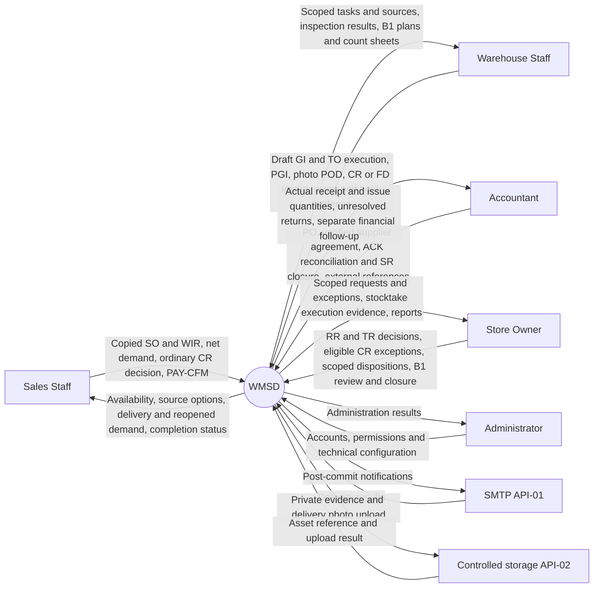
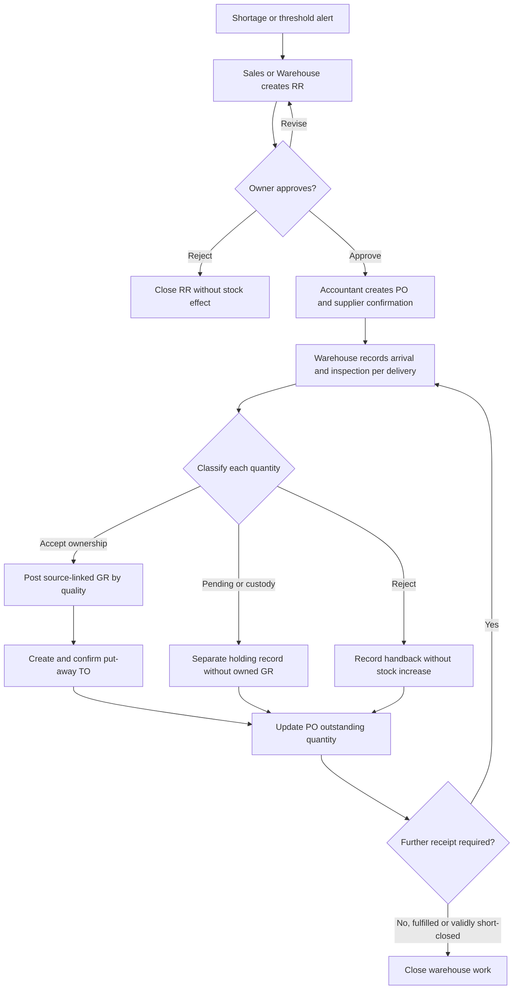
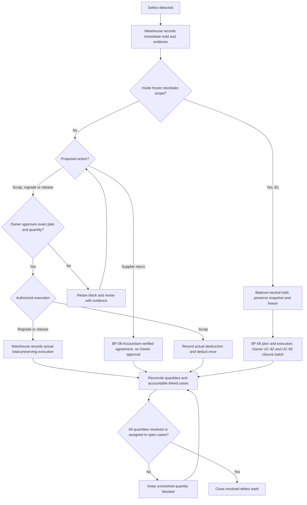
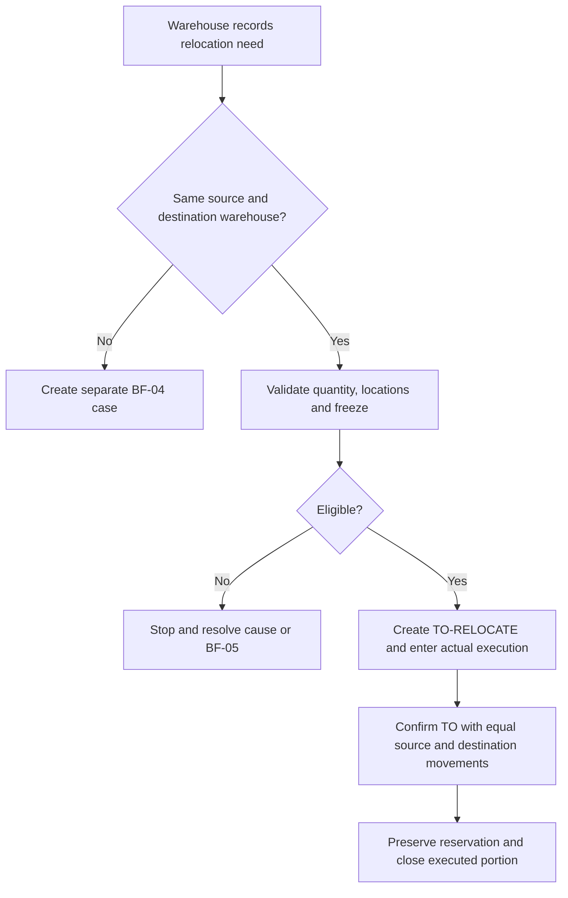
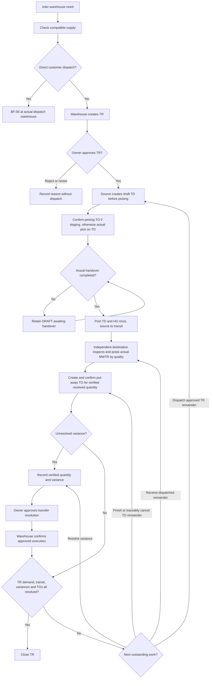
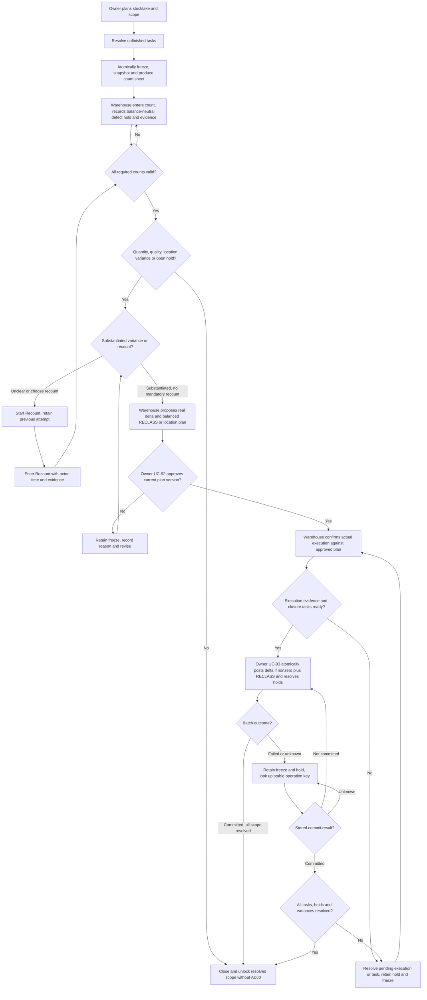
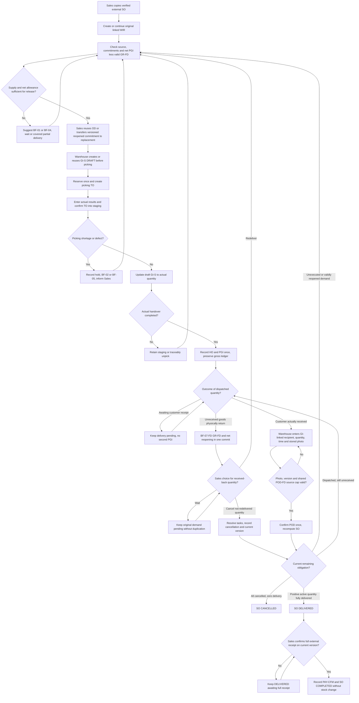
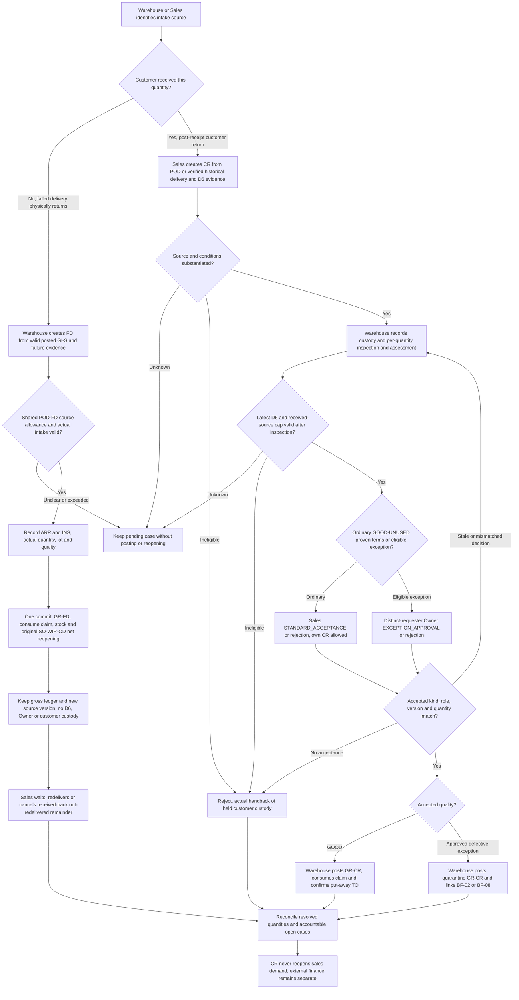
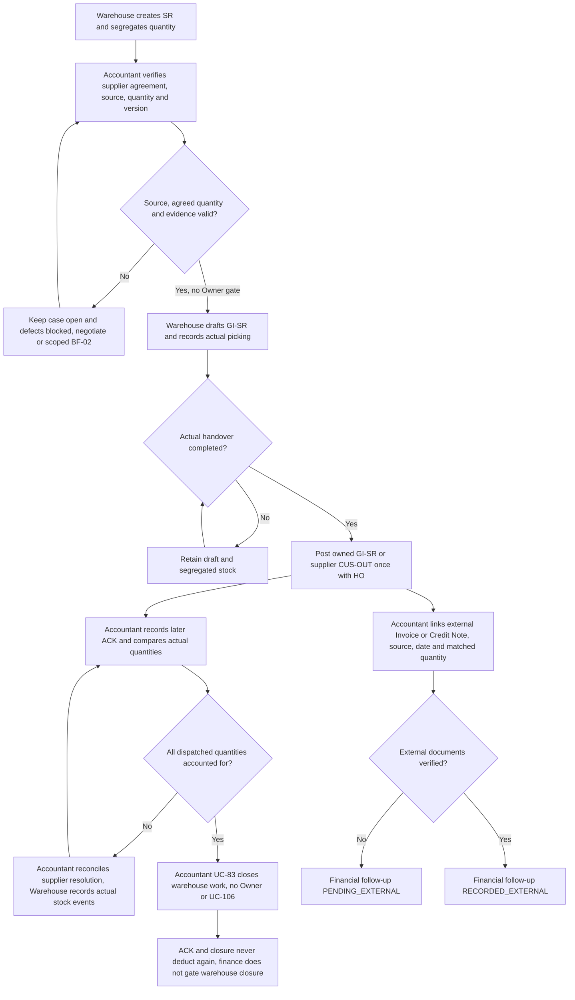

# Process Proposal 2 — WMSD — English

Updated: 25 October 2026. Document revision 3.1.2 reviews/synchronizes text while retaining the 24 October business baseline 3.1.0. Baseline 3.1.0 revises flows against supervisor minutes/draw.io notes. User selections: A1, a failed-delivery intake branch within BF-07; B1, immediate defect blocking with controlled quality posting at stocktake closure; C2, Sales accepts ordinary customer returns and Owner reviews exceptions only; BF-08 has no Owner approval. This is a To-be design, not verified implementation; alternatives and impacts are in section 17.

BF-06: copy MISA/paper order → linked WIR/OD → draft GI-S → picking and TO confirmation → handover/PGI → photo POD → DELIVERED → Sales confirms full external payment receipt → COMPLETED. On 25 October, Report 1/2/3, detailed design, paired data design, reference SQL, README and change log are synchronized to business baseline 3.1.0. The 25 October follow-up updates embedded Mermaid, standalone context, BF-04 PNGs and the reduced ERD package; only draw.io files stay unchanged. The old draw.io baseline does not define revised behavior. See [25 October verification](../07_ra_soat/Ket_qua_dong_bo_tai_lieu_2026-10-25.md).

Vietnamese: [de_xuat_quy_trinh_2_VI.md](de_xuat_quy_trinh_2_VI.md). Data design: [EN proposal](../03_thiet_ke/de_xuat_database_design_EN.md). Change log: [change_logs.md](../../change_logs.md). SQL supports analysis; MongoDB remains runtime.

| Version | Date | Revision |
|---|---|---|
| 1.0.0 | 21 October 2026, before the sales-flow revision | Survey/D1–D8 baseline and exception flows. |
| 2.0.0 | 21 October 2026 | Add SO, POD and PAY-CFM; align data design; revise wording and presentation. |
| 3.0.0 | 22 October 2026 | Separate relocation and warehouse transfer into BF-03/BF-04; renumber through BF-08 and split diagrams/exceptions. |
| 3.1.0 | 24 October 2026 | Draft GI/TD before picking; two stocktake paths; correct custody/multi-release flows; select A1/B1/C2, remove BF-08 Owner approval and retire UC-106 (97 active/14 retired). Only the two process proposals are updated in this revision. |

| 3.1.1 | 25 October 2026 | Review wording/POD–FD acceptance caps and document synchronization status for 3.1.0; preserve all diagrams/Mermaid and selected business decisions. |

| 3.1.2 | 25 October 2026 | Follow-up updates current Mermaid and related exports: FD bypasses POD, B1 separates commit failure from missing execution, C2 and BF-08 finance. Only draw.io files are excluded. |

## Warehouse terminology

| Term | Meaning and use in WMSD |
|---|---|
| WMS — Warehouse Management System | Manages physical warehouse operations, locations and quantities. Does not replace the entire sales/accounting system. |
| Warehouse / Location / Bin | Physical warehouse / location within it / storage bin or rack. Receiving, sellable storage and quarantine at one site are normally locations, not three warehouses. |
| SKU — Stock Keeping Unit | Product/specification identifier; one SKU can have several lots, tones and calibres. |
| Lot / Batch | Production or identifiable traceability lot. Proposed identity: product + manufacturer lot + tone + calibre. |
| Tone / Shade | Actual batch shade/code. The same tile design can differ in tone between lots. |
| Calibre | Actual size group after production, distinct from nominal dimensions such as 600 × 600 mm. Do not automatically mix calibres for a construction project. |
| UoM — Unit of Measure | PIECE, BOX, m². Tiles use pieces as the proposed stock base unit; product conversion factors are versioned. |
| On-hand | Store-owned goods physically in warehouse locations, including good, pending-inspection, quarantined and staged goods. |
| Usable / Available | Usable meets quality/location requirements. Available is the usable quantity still free for new demand after reservations and stocktake locks. |
| Reservation | Reserves specific stock for demand. It is not a goods issue; its link follows stock when relocated. |
| Allocation | Links demand to supply. Planned PO/transfer supply may be allocated without being available for dispatch. |
| Receiving / Put-away | Receiving area / moving goods from receiving to storage. Put-away does not increase total inventory a second time. |
| Picking / Staging | Picking the correct goods, lot and location / staging for handover. Picked stock remains on-hand until actual dispatch. |
| Quality / Quarantine | Goods condition / isolation area. One lot may have 90 good pieces and 10 damaged pieces in separate balances. |
| In-transit | Dispatched from source but not fully received/resolved at destination. It is a transport state, not a quality grade. |
| Custody | Customer/supplier-owned goods held by the store. Track physical responsibility but exclude from store-owned and available stock. |
| Replenishment Request — RR | Sales/Warehouse proposal for additional stock, approved by Owner. Does not increase stock. |
| Purchase Order — PO | Accountant's order against approved demand, tracking ordered/confirmed quantities and multiple receipts. |
| Goods Receipt — GR | Warehouse receipt document; use “Goods Receipt”, not “Good Receipt”. Posting increases the quantity accepted into store ownership at its actual quality/location. |
| Sales Order — SO | Sales manually copies a MISA/paper order with original source and line references. It anchors WIRs and delivery/completion tracking, without pricing or money collection. |
| Warehouse Issue Request — WIR | Warehouse issue demand linked to a saved SO at header and line level, split into warehouse-specific releases where needed. |
| Goods Issue — GI / Post Goods Issue — PGI | Issue document / posting actual dispatch. PGI deducts the physically handed-over quantity exactly once. |
| Transfer Request — TR | In WMSD, a request between physical warehouses requiring Owner approval. SAP WM's *Transfer Requirement* is a different concept; do not translate them as the same thing. |
| Transfer Order — TO | In WMSD, an internal task for put-away, picking, relocation, quarantine or unpick. Technical table: `warehouse_task`. It is not another inter-warehouse approval. |
| Stock Transport Order — STO | Transport order between organizational units/warehouses in SAP examples. Distinct from an internal TO. WMSD uses an approved TR and does not implement full SAP STO functionality. |
| Transfer Dispatch — TD | Source dispatch document. Posting decreases source stock and increases in-transit stock. |
| Multi-warehouse Transfer Receipt — MWTR | WMSD-specific name for an inter-warehouse receipt. Each document belongs to one destination and one source dispatch. It does not credit multiple warehouses simultaneously; the references do not establish this as a universal WMS term. |
| Handover / POD | Handover record / Proof of Delivery. Carrier handover at PGI does not prove customer receipt; customer delivery (DELIVERED) requires Warehouse Staff confirmation of actual customer receipt/pickup with required photo evidence. |
| External Payment Confirmation — PAY-CFM | Sales confirmation of full money receipt outside WMSD, with user, time and reference/evidence/note. Completes SO only after full photo-confirmed delivery. |
| Stocktake / Snapshot / Cutoff | Physical inventory count / immutable book-balance snapshot / reconciliation cutoff time. |
| Recount / Adjustment / Disposition | Recount / stock variance adjustment / decision on defective goods, such as continued quarantine, supplier return or destruction. |
| Posting / Reversal / Idempotency | Committing an inventory-affecting operation / traceable reversing document / repeated requests must not post twice. |
| FIFO | Prefer earlier receipts within compatible stock when picking. This is physical picking, not an accounting cost-valuation choice. |

## 1. Conclusion and design basis

Retain BF-01–BF-08 and five existing roles. WMSD copies external sales orders to track warehouse issue, customer delivery and external receipt confirmation. Pricing, invoicing and actual money collection remain external. Defects belong to BF-02; same-warehouse relocation is BF-03 and inter-warehouse transfer is BF-04.

The proposal follows review1 and the single-store context. The 21 October scope change retains copied SO tracking and adds POD/PAY-CFM, without reinstating retired selling-price, internal-invoice or refund workflows.

### 1.1 Sources and their use

| Source | Use and limitations |
|---|---|
| [Tân Thương survey](../05_khao_sat/khao_sat_kho_gach.csv), 20 October 2026 | One response covering 26 questions; reference original question numbers. Q13 selects both transfer/no transfer; the user confirmed inter-warehouse transfers in D4. The original CSV remains unchanged. |
| User decisions D1–D8, 20 October 2026, and BF-06 revision, 21 October 2026 | D1–D8 retain PGI timing, departmental entry, five roles and frozen stocktake, add return conditions and supported facts, and label other controls To-be. The 21 October BF-06 revision specifies: Sales Staff copies the external sales order into a WMSD Sales Order (SO), then creates a linked WIR; Warehouse Staff confirms actual customer delivery with required photo evidence to set SO to DELIVERED; Sales Staff confirms full payment received outside WMSD to set SO to COMPLETED. |
| `review1.md` (historical source outside this repo; not packaged) | Review-panel feedback; action items such as emailing the supervisor are document content, not instructions for this update. |
| [Supplied G56 meeting minutes](C:/Users/minhs/OneDrive/Desktop/bi_n_b_n_h_p_d_n_nh_m_g56.md) and [24 October review](../07_ra_soat/Bao_cao_ra_soat_quy_trinh_theo_gop_y_GVHD_2026-10-24.md) | Prioritize minutes, then notes in the three supplied draw.io files; old shapes/connectors may be uncorrected. The minutes have no exact meeting date, so do not infer that every comment supersedes D1–D8. Source action items are evidence, not execution instructions. |
| Supplied draw.io notes on Desktop | BF-01: Kv_OsmvDRLkU-hTQ77P0-0 (GR → TO → Confirm TO, further receipts). Transfer: YugwCmwDcmz_hehvzerD-63/-64 and XavdK_t681Dh5oyh7WCD-40/-42 (Picking/put-away confirmations), YugwCmwDcmz_hehvzerD-75 (multiple releases). Stocktake: lS3HtGYTxW23hGVE0gqH-29 (Clear Difference or Recount). File/page identities are in the review; Desktop sources are not yet packaged in the repo. |
| [Online Report 1](https://docs.google.com/document/d/1kb36v5HuFrM75NFCTXvnJcsg6QnPjYkb/edit) | The original review recorded reading its contents and Drive modification time of 17 October 2026, 16:26:21 Vietnam time. Basis for store context, GAP, FE and LI. |
| [Online Report 3](https://docs.google.com/document/d/1HvhlCmYjfXj7766ZVNUBAU4J063Lmr71/edit) | The original review recorded checking text and context/flow figures; modification time 17 October 2026, 17:17:15 Vietnam time. Its baseline catalogue had 102 UCs, UC-01–UC-102. |
| SAP Global Bike WM I–IV v4.1, [local PDFs](../06_tham_khao/sap/) | Current citations use bundled v4.1 pages, verified on 22 October. The earlier review used external v4.2 sources; its page numbers are not carried over. Sample users, warehouse codes and organization are not store requirements. |
| [MISA SME processes](https://helpsme.misa.vn/2022/kb/quy-trinh-nghiep-vu/) and eShop references below | References for documents, handover, stocktake and warehouse/accounting boundaries. Do not copy all finance modules or claim the store enables every feature. |
| [Store TikTok](https://www.tiktok.com/@gachoplattanthuong), [Store Facebook](https://www.facebook.com/p/Showroom-T%C3%A2n-Th%C6%B0%C6%A1ng-61567834853149/) | The earlier review could not obtain verifiable content. Do not infer warehouses, staffing, revenue, transport or return policy from these links. |

### 1.2 Baseline context

Report 1 describes Tân Thương as a tile store at Phố Tân An, Tân An commune, Yên Dũng, Bắc Giang, using MISA eShop. This is the reported address; current administrative naming was not verified. Customers buy for construction, renovation and installation. Survey Q1 confirms inaccurate stock and difficulty tracking reserved, defective and returned goods. Q5 confirms areas/racks and location codes; Q9 confirms recording lot, color and size in software and using carton information/photos. Do not continue describing the store as having no location structure or lot tracking. Whether “size” means actual calibre and whether tracking is consistent across workflows remain unverified.

Scope: one store, at least three warehouses according to Q3, with inter-warehouse transfers confirmed by D4. Do not infer a chain of branches. Exact warehouse count, names, addresses, distances and direct-dispatch permissions are unknown. Q4 only says “Kho gach”; functional area names are not confirmed. Receiving, sellable and quarantine areas at one site are not automatically three warehouses. BF-04 stays in scope; verify actual warehouse master data during configuration.

Retain tile-specific requirements: product + lot + actual tone/calibre, BOX/PIECE/m² conversion, counting each delivery, partial receipts/deliveries, segregated defects and compatible lots for project top-ups. Numerical examples are design examples, not store measurements.

### 1.3 Proposed WMSD boundary

| Inside WMSD | Outside WMSD; retain references where needed |
|---|---|
| Replenishment needs, Owner approval, PO for receipt planning and shortages | Complex commercial selection, supplier payment, debt and accounting |
| Inspection, classification, receipt, put-away, lot/location/status stock | Cost valuation, tax and general ledger |
| Copied Sales Orders (SO) from verified external sources, linked Warehouse Issue Requests (WIR), allocation, picking, counting, goods issue (PGI), handover, photo-evidenced customer delivery confirmation (DELIVERED) and Sales Staff external payment confirmation (COMPLETED) | Independent commercial order negotiation/POS, quotes, selling-price/discount calculation, actual money collection/payment gateway, receivables ledger and tax invoices |
| Physical returns, receipt/issue documents and reconciliation | Refund decisions/payments in sales/accounting; WMS retains outcome references |
| Transfers, transit, discrepancies, stocktake and audit history | Route optimization, GPS and fleet management |

No live MISA integration in the baseline. Sales Staff manually copies verified external orders (MISA, paper or other verified source) into WMSD Sales Orders with source references and attachments, and Accountant/Sales enters external references within the agreed scope. Do not draw automatic API synchronization. WMS is authoritative for detailed physical warehouse events and internal order-fulfilment tracking; MISA retains commercial pricing, invoicing and financial transactions. Accountant reconciles documents and quantities periodically. Do not let two systems independently generate the same warehouse transaction.

Proposed MVP retirements do not delete historical data: selling prices UC-23–25, internal invoices UC-59–62 and refund calculation/approval/completion UC-74–78. Replace refund processing with external outcome references. Keeping these retired pricing/invoicing/refund functions would require an explicitly expanded scope and supervisor justification, rather than claiming the scope has been narrowed.

### 1.4 Survey comparison and selected decisions

| Decision | Reported practice / distinction | Selected To-be, 20–21 October 2026 |
|---|---|---|
| D1 | Q17: deduct stock when creating a sales order/delivery request. Whether the respondent means physical or available stock is unclear. | Creating a copied SO or linked WIR does not change stock; reservation reduces availability and physical deduction occurs only at handover/PGI. Reconciliation with MISA explains ordered-but-undelivered quantities. |
| D2 | Q21: Accountant/one shared data-entry person; Q22: update immediately during work. | Retain each department's own authorized entry/confirmation under personal userId. No proxy entry or shared accounts. Staffing must support this To-be difference. |
| D3 | Q6–7,12,20,23: multiple responsibilities and external delegation. | Retain five roles without dynamic delegation. 24 October scope: Sales accepts inspected ordinary CR, Owner only exceptions; BF-08 no Owner approval. Independent approval remains for scoped Owner decisions and TR/RR/ST. |
| D4 | Q13 selects both transfers and no transfers. | User confirms inter-warehouse transfers. Preserve raw survey; retain independent source/destination confirmation and discrepancy records. |
| D5 | Q14–15: monthly counting, pausing the area, and recording movements separately if they continue. | Retain frozen scope until resolution. Monthly is an operational cadence, not a new scheduler job. Concurrent counting/movement is not selected. |
| D6 | Q18–19: return conditions and refunds recorded in MISA. | Add conditions to BF-07, BR-29 and UC-70–73; do not invent return days. WMS stores refund references only. |
| D7 | Q3–11, 20, 22, 24: warehouses, coded locations, lot/color/size, conversions, collaboration and phones. | Update supported facts without inventing addresses, actual calibre, SKU conversion factors or new rights. Departments update during work through phone-suitable screens. |
| D8 | Custody, staging/put-away, FIFO, idempotency, separation of duties, TR approval and no live MISA are not fully survey-confirmed. | Retain them as To-be, not verified current practice. |
| BF-06 Rev (21 Oct) | Earlier 20/21 Oct text replaced internal SO with WIR and closed orders upon full issue (PGI). User requested explicit copied SO → linked WIR → delivery photo → external payment completion. | Sales Staff creates a WMSD SO copied from MISA/paper, then creates a linked WIR. Warehouse Staff confirms customer delivery with photo evidence to set SO = DELIVERED. Only Sales Staff confirms full external money receipt after DELIVERED to set SO = COMPLETED. |

Units and packaging (Q10–11): receipts/counts use boxes; sales use boxes/pieces/m². Factors are maintained in MISA/Excel; loose pieces are sold and counted in opened cartons. Torn packaging with intact tiles may still be sold; do not automatically classify it as DAMAGED. Retain PIECE as the proposed base unit and versioned conversions; SKU factors have not been supplied.

Physical collaboration does not create software permissions: Owner/Accountant may co-inspect arrivals (Q8), while Warehouse Staff records and confirms inspection. Owner/purchasing personnel may contact suppliers (Q20); Accountant records agreement/evidence, without a purchasing application role.

Devices and entry: responsive phone screens (Q24) support BOX/PIECE/m² entry, readable location codes and photo attachments. Do not infer native-app, offline or automatic scanning requirements. Individual logins and warehouse scope remain.

## 2. Differences identified in the earlier baseline

> Historical findings recorded before synchronization; Report 1/2/3 and designs are updated on 25 October. Current Mermaid and related exports are now updated; only old draw.io findings remain outside the edit scope.

The table retains the 17 October review findings. Process/database proposals, SQL, Report 1/3 text and current figures now follow the revised BF-06 and eight process IDs. The table below is historical evidence, not a current unresolved-work list.

| Reviewed location | Finding | Correction |
|---|---|---|
| R3 I.2.1, UC-03, permission matrix; R1 purchasing | Accountant still creates replenishment needs. | Sales/Warehouse originates demand; Accountant handles PO/documents after approval. |
| R3 I.2.3, UC-34–44 and old figure | The old figure combines relocation and warehouse transfer, with redundant TR → approval → inter-warehouse TO. | Separate BF-03 relocation without Owner approval from BF-04 TR → TD → MWTR transfer; remove repeated inter-warehouse TO approval. |
| R3 I.2.5, FE-06, UC-45–62; R1 I.2/IV/V | WMS still owns independent commercial Sales Orders, pricing and internal invoices, and equates issue with order completion. | Narrow SO (UC-45–48) to an internal tracking copy of a verified external order (MISA/paper) without pricing or internal billing (retire UC-23–25, UC-59–62); link WIR (UC-109) to the saved SO; add Warehouse photo-evidenced customer delivery (DELIVERED, UC-110) and Sales external payment confirmation (COMPLETED, UC-111). |
| R3 I.2.4, UC-87–93 versus BF-05 | Text already has snapshot; UC-93 assigns Owner Clear Difference, but figure puts posting in Warehouse lane. | Do not claim snapshot is absent. Add count sheet/cutoff and align posting actor. |
| R3 I.2.6, UC-70–73 versus BF-07 | Old text requires Owner acceptance before inspection; figure inspects before Owner disposition. | CR: custody → Warehouse inspection → Sales ordinary acceptance or eligible Owner exception → receipt by status. Undelivered FD uses GI-S/GR-FD without D6/Owner/customer custody. |
| Existing BF-07 figure | Already contains Goods reusable? with distinct outcomes. | Do not repeat an obsolete Yes/No criticism; check permissions, documents, ownership and complete branch endings. |
| R3 I.1 context | Cloudinary appears, but only SMTP API-01 is listed; upload/result arrows are reversed. | Add interface if used and correct direction; otherwise remove the external service. |
| Context versus permissions | Sales sends customer-return data and Accountant sends supplier-return requests, while UC-70/81 only authorize Inventory Staff. | Align arrows and permissions rather than merely renaming actors. |
| R3 I.3.2 entity descriptions | Old traceability: Goods Issue → UC-82–89, Stocktake → UC-70–76, PO → UC-27–32. | Remap using current catalogue/proposal without arbitrary renumbering. |
| R3 I.3.3 and V.1 | DR-04 has “UC-65–56”; GB-04 has “UC-65–50,92–95”; duplicate/invalid ranges. | Normalize IDs, deduplicate and verify each target. |
| R1 IV versus R3 I.2 | R1 has six proposed-solution figures, missing standalone BF-02. | Use eight common BF IDs/names in R1 To-be and slides. As-is may have a different count if clearly labeled. |

## 3. Actors and authorization

Retain five application roles. Use **Warehouse Staff** consistently instead of Inventory Staff in English; this is a naming alignment, not a sixth role.

| Actor | To-be responsibility |
|---|---|
| Store Owner | Approves replenishment, inter-warehouse TR, defect destruction/regrade/release and stocktake plans; reviews customer-return exceptions only. Views reports. No approval of ordinary customer returns, relocation or BF-08. |
| Sales Staff | Copies external SO; manages WIR/OD, outstanding demand and redelivery/cancellation of received-back GR-FD quantity. Accepts/rejects ordinary CR after Warehouse inspection and may be its creator; submits exceptions to Owner. Confirms PAY-CFM after DELIVERED. No physical-quality inspection or Warehouse stock posting. |
| Warehouse Staff | Inspects, drafts GI, confirms TO/PGI, POD, GR-CR and GR-FD within assigned warehouses; records FD source/quality without Owner approval for FD/BF-08. In B1 records immediate defect holds and confirms quarantine execution against the approved closure batch, never ordinary freeze-bypassing posting. No commercial CR acceptance for Sales/Owner. |
| Accountant | Creates/tracks approved PO; records supplier agreement, MISA reconciliation and UC-108 external references. In BF-08 verifies agreement, reconciles variances and closes warehouse work through UC-83 against Warehouse documents, without Owner approval. Does not post stock or confirm SO completion for Sales. |
| Administrator | Accounts, permissions and technical settings. No automatic business approval, stock posting or audit-editing rights. |

Customer, Supplier and Carrier are business participants, potentially separate BPMN pools, with no default WMSD account. Source/destination Warehouse Staff are two warehouse responsibilities, not two application roles. Record actual users by userId, not just role labels.

Approval and execution are distinct: confirming a completed shelf move is not self-approval of a business proposal. The same person cannot create and approve their own replenishment/transfer/adjustment request. Inter-warehouse receipt requires someone independent from dispatch. Where staffing is limited, the Owner may be explicitly assigned independent inspection; verify that arrangement, never assume enough people or share accounts.

Authorization checks **role + operation + assigned warehouse + document state + creator/approver identity**. List access does not imply entry or approval.

## 4. Eight To-be processes

### BF-01 — Replenishment, purchasing and goods receipt

Trigger: (a) issue demand remains short after checking other warehouses; (b) availability falls below a fixed minimum; (c) stocktake/defect outcomes cause a replenishment proposal. Fixed-threshold alerts are proposed functionality, not AI forecasting or automatic purchasing.

**Main flow:**

1. Sales records customer shortages linked to issue demand; Warehouse records reserve-stock needs linked to alerts/counts. Show available/reserved stock, open POs, incoming transfers and need date.
2. Check existing supply coverage. Planned inbound supply offsets demand only if compatible, timely and not already allocated.
3. Submit RR. Owner approves, rejects or returns with reasons. No PO before approval.
4. Accountant creates PO and records supplier quantity/schedule confirmation. Changes beyond approval require renewed approval; do not overwrite executed documents.
5. For every delivery, Warehouse records PO-based arrival, actual quantity, product, BOX/PIECE, lot, tone, calibre, cracks and packaging. A PO may have multiple receipts. Q8 permits Owner/Accountant co-inspection recorded in evidence; GR posting stays with Warehouse. Torn packaging alone is not a tile defect; opened cartons require actual piece counts.
6. Split quantities into accepted good, pending inspection/agreement, defective, or rejected/immediately returned. Record short/over/wrong-product/wrong-lot evidence.
7. Receive only quantities accepted into store ownership at actual status/location. Custody/pending-supplier goods remain separate and unavailable. Owned defective goods enter BF-02; immediately rejected goods must not be fictitiously received then issued.
8. Warehouse Staff creates or receives a put-away TO from GR, selects suggested storage and confirms actual placed quantity/location. Only accepted store-owned goods meeting quality/location checks become allocatable. Custody has separate records/holding positions; rejected goods are handed back, not processed as accepted GR/put-away stock.
9. Update cumulative received/accepted/outstanding quantities. Accountant reconciles PO, receipt and supplier documents; follow up or obtain Owner cancellation of undelivered remainder. Warehouse completion need not await accounting.

Exceptions: shortage leaves remainder open; over-delivery stays separate pending acceptance; wrong tone is not substituted merely because SKU names match; zero accepted quantity still has a discrepancy case; return of previously received goods uses BF-08; replacements are new linked receipts.

Inventory effect: RR/approval/PO do not increase stock. Posted receipt increases the correct stock category. Put-away changes location/allocation readiness, not total a second time.

Documents: RR, PO, arrival/inspection, GR, put-away task and discrepancy record. Reference: SAP WM I pp. 10–11, 18–22 and [MISA purchase receipt](https://helpeshop.misa.vn/kb/huong-dan-su-dung-tinh-nang-nhap-kho-tren-phan-mem-misa-eshop). Tone/calibre and permissions are WMSD-specific proposed controls.

#### 01.X — Alternate and exception flows

A denotes an alternate path and E an exception; step numbers refer to the main flow above. Apply outcomes per quantity rather than forcing one result for the whole document.

| ID | Condition | Responsible actor and action | Stock outcome / re-entry | UC |
|---|---|---|---|---|
| BF-01-A1 | Demand already covered | Sales/Warehouse checks allocations, timely PO/TD supply; submit only the uncovered balance, no duplicate RR. | No stock change; return to steps 1–2. | UC-03, UC-103 |
| BF-01-A2 | Owner rejects or requests revision | Retain reason; reject closes the proposal, revision creates a new version for review; Accountant cannot create an unapproved PO. | No stock change; step 3 or end. | UC-04 |
| BF-01-A3 | Supplier partial fulfilment | Accountant records quantities/dates; changes beyond approval need renewed review; Owner authorizes short closure; preserve posted GRs. | Receive each delivery at step 5; no fictitious receipt for cancelled quantities. | UC-07, UC-26 |
| BF-01-E1 | Over or wrong delivery | Warehouse separates quantities, records discrepancy/custody if held; no automatic substitution or excess PO receipt. Accountant coordinates; Owner authorizes required changes before acceptance. | GR only eligible quantities; remainder pending or handed back. | UC-26 |
| BF-01-E2 | Zero accepted quantity | Retain arrival/inspection, evidence and custody/handback outcome; PO outstanding and discrepancy remain open. | No zero-quantity GR; no increase in owned stock. | UC-10, UC-26 |
| BF-01-A4 | Torn/open boxes; replacements | Count actual pieces; inspect quality independently. Supplier replacement is a new linked arrival/GR; never rewrite the original GR. | After GR, put-away at step 8; no second receipt on placement. | UC-26, UC-33 |

### BF-02 — Defect detection, isolation and disposition

**Trigger:** cracks/quality defects discovered in BF-01/03/04/05/06/07 or routine work.

1. Warehouse records source, lot, location, quantity, symptoms, time and photos/record.
2. Immediately record allocation blocking and a quarantine case without awaiting Owner approval. In B1 frozen stocktake scope, initially record defect hold/evidence only; quality/location changes use the approved BF-05 closure batch, never ordinary posting to bypass the freeze. Retain blocking until reclassification/quarantine completes. Replan affected reservations and notify Sales.
3. Verify condition and ownership/custody. Quarantine alone never transfers ownership.
4. Warehouse proposes release after reinspection, regrade, supplier return or destruction. Supplier return follows BF-08 with Accountant-recorded agreement, without Owner dispatch approval; destruction/regrade/release outside stocktake still uses step 5 Owner authorization. Discounted sales remain external and do not turn defects into good stock.
5. For destruction/regrade/release outside stocktake, Owner approves precise action/quantity or requests evidence; otherwise retain isolation. Supplier return bypasses this approval. B1 stocktake reclassification uses UC-92 approval and UC-93 closure rather than duplicate UC-66 approval.
6. Warehouse confirms authorized destruction/regrade/release; destruction requires actual evidence/quantity. Supplier return goes to BF-08 on Accountant/supplier agreement without Owner approval. In B1 quality/location posts only through stocktake closure, never ordinary UC-67.
7. Post exactly once. Close only when every quantity is resolved or linked to an accountable open case.

Inventory effect: quarantine/regrade preserves store-owned totals. Destruction reduces actual destroyed quantity; supplier return deducts in BF-08, not again here. Previously deducted quantities cannot be deducted through another case.

Documents: defect case, inspection, disposition decision, destruction record/return issue. These controls address tiles and panel feedback; the four SAP cases do not provide this complete workflow to copy.

#### 02.X — Alternate and exception flows

A denotes an alternate path and E an exception; step numbers refer to the main flow above. Apply outcomes per quantity rather than forcing one result for the whole document.

| ID | Condition | Responsible actor and action | Stock outcome / re-entry | UC |
|---|---|---|---|---|
| BF-02-E1 | Defect in reserved or picked stock | Warehouse immediately blocks defective quantity, preserves demand linkage and informs Sales; seek replacement supply without awaiting quarantine approval. | Owned total unchanged; BF-06 waits/replans. | UC-65, UC-103 |
| BF-02-A1 | Ownership or cause unclear | Keep PENDING/BLOCKED quality and recorded owner; obtain evidence, never turn custody into store stock through a note. | Wait at steps 3–4; unavailable. | UC-65 |
| BF-02-A2 | Owner returns/rejects scoped plan or approves partly | Applies to destruction/regrade/release outside stocktake; unapproved quantity stays isolated. Supplier return needs no Owner and uses BF-08; B1 uses UC-92/93. | No fictitious issue/destruction; follow branch authority. | UC-66, UC-67, UC-92 |
| BF-02-E2 | Supplier return/destruction not executed | Supplier return needs Accountant/supplier agreement, not Owner; UC-82 deducts at dispatch. Destruction outside stocktake needs approval/actual evidence; B1 never uses ordinary scrap/reclass posting. | Keep unexecuted work open without duplicate deduction. | UC-67, UC-82, UC-93 |

### BF-03 — Same-warehouse relocation

Trigger: goods must move between locations within one physical warehouse. Warehouse Staff executes without Owner approval or an inter-warehouse Transfer Request (TR).

1. Select product/lot/quality, source/destination, quantity and reason. Check both locations belong to the same warehouse, destination suitability, sufficient source quantity and absence of stocktake locks or conflicting tasks.
2. Create a relocation task (TO-RELOCATE). Preserve reservations and demand links for already committed goods.
3. Warehouse enters execution results and confirms TO-RELOCATE: actual moved quantity, locations, user and time. Physical movement/counting supports confirmation rather than a standalone software activity. Partial execution leaves the remainder open or traceably cancelled; do not confirm unperformed quantities.
4. Atomically decrease source/increase destination by the same quantity, preserving warehouse, owner, lot/tone/calibre and quality. Move the reservation with the stock and retain audit history; warehouse total is unchanged.

End: the task is fully confirmed or its unexecuted remainder is traceably cancelled. A physical move to another warehouse requires a separate BF-04 case.

Documents: TO-RELOCATE and location confirmation history. This process uses UC-34–37, without TR, TD or MWTR.

#### 03.X — Alternate and exception flows

| ID | Condition | Responsible actor and action | Stock outcome / re-entry | UC |
|---|---|---|---|---|
| BF-03-A1 | Relocating stock already reserved for an order | Warehouse preserves owner/lot/quality and moves the reservation to the new position with the goods. | Equal source/destination changes; no new free supply for another demand. | UC-36, UC-37 |
| BF-03-E1 | Different warehouse, frozen location or insufficient source quantity | Stop confirmation. Different warehouse uses BF-04; wait for freeze release; investigate physical mismatch through BF-05 where needed. Never edit balance or bypass the freeze. | No location posting before confirmation; resolve cause and recheck. | UC-36, UC-37, UC-87 |

### BF-04 — Inter-warehouse transfer and discrepancy resolution

Trigger: stock must move between two physical warehouses for balancing or fulfilment. Warehouse requests, Owner approves, and source/destination confirm independently. Same-warehouse relocation uses BF-03 instead.

1. Check compatible availability at configured warehouses. Suggest direct dispatch or transfer. Use simple warehouse priority and due date; do not claim distance optimization without distance data.
2. Sales confirms customer fulfilment. Warehouse submits TR if physical transfer is needed. Direct dispatch from another warehouse uses BF-06 there, without a fictitious receipt at the main warehouse.
3. Owner approves TR and reserves source stock with concurrency checks. Do not add another inter-warehouse order or Owner approval of TO; picking/put-away TOs are internal tasks with execution confirmation where applicable.
4. Source Warehouse creates a draft TD from approved TR lines before picking, without stock effect. With staging, create/receive and confirm the picking TO using actual quantity/lot/location; without staging, record actual picking on TD without another order layer. At actual handover, confirm HO and post TD: source decreases/transit increases. TD is the transfer goods issue; do not post an additional GI for the same quantity.
5. Independent destination staff inspect quantity, lot/tone/calibre and condition and create MWTR. Verified receipt reduces transit/increases destination by actual quality. Preserve demand allocation throughout source → transit → destination; newly received allocated stock is not free for other requests.
6. Destination records shortage/overage/damage/wrong-lot evidence and verified quantities; unresolved amounts remain open for Owner decision. For valid receipts, create/receive and confirm put-away TO by actual location/quality without a second receipt increase. A matched release does not automatically complete the entire TR.
7. Confirm approved additional receipt, new return-to-source documents, quarantine or evidenced loss. Continue MWTR for dispatched quantities still in transit; create another TD for approved TR demand not yet dispatched. Close TR only when unexecuted demand is fulfilled/validly cancelled, all dispatched quantity is accounted for, transit/variances are resolved and related TOs are confirmed or traceably cancelled for unexecuted portions.

Example: A dispatches 100 boxes; B receives 98: 95 good + 3 broken. B receives 95 good and 3 quarantined; 2 remain transit/unresolved. Do not leave all 100 in transit or treat the 3 physically present damaged boxes as lost. Owner-approved loss of 2 deducts that transit quantity through one resolution.

**Inventory effect:** store-managed total including transit is preserved by ordinary transfer; only valid loss/destruction/external issue reduces it.

Documents: TR, TD, handover, MWTR, discrepancy case. SAP WM II distinguishes STO, issue/receipt and put-away TO. [MISA transfer](https://helpeshop.misa.vn/kb/huong-dan-cach-chuyen-kho-tren-phan-mem-misa-eshop) distinguishes warehouse moves within a branch and inter-branch transfers. WMSD applies physical warehouses of one store and review1's two-document requirement without inferring multiple branches.

#### 04.X — Alternate and exception flows

| ID | Condition | Responsible actor and action | Stock outcome / re-entry | UC |
|---|---|---|---|---|
| BF-04-A1 | Direct issue from another warehouse | Sales agrees with customer; split OD by actual warehouse and run BF-06 there, no fictitious receipt at the requested warehouse. | No transit without physical transfer. | UC-51, UC-103 |
| BF-04-E1 | Rejected TR or unavailable resources | Owner records reason; Warehouse rechecks stock/freeze before dispatch. Wait or revise unexecuted quantity with authorization; absent an independent receiver, wait for staffing rather than using the dispatch user. | No posting without prerequisites; changed scope requires review. | UC-41, UC-43, UC-104 |
| BF-04-E2 | Partial or damaged receipt | Destination posts actual quantities by quality; shortages remain transit and later MWTRs may receive them. Damaged stock physically received is quarantine, not also lost transit. | TD100, receive95GOOD+3DAMAGED → transit2. | UC-104 |
| BF-04-E3 | Excess, wrong lot or evidenced loss | Record separate evidence; no negative transit or silent lot substitution. Owner resolves; Warehouse executes linked additional receipt, return or loss documents for authorized quantities. | Close only with accountable quantities; preserve original TD/MWTR. | UC-44, UC-43, UC-104 |

### BF-05 — Stocktake, reconciliation and adjustment

**Trigger:** monthly periodic stocktake per Q14, area counts or suspected discrepancies.

1. Owner plans scope by warehouse/location/lot/status, schedule and counters. Adjustment requester cannot approve their own request.
2. Resolve unfinished receipt/issue/transfer tasks in scope. Separate staged, quarantined, custody and transit stock; never count both ends of a transfer.
3. Activate an **immutable cutoff snapshot** and export/print a **count sheet** by location/lot/status. Allow newly found items. Prefer blind count sheets without book quantities.
4. Selected MVP: lock quantity/location/status-changing transactions in the counted scope until the session is resolved. Other areas continue. This replaces the earlier Report 3 post-cutoff reconciliation model. Do not implement partial locking without reconciliation.
5. Warehouse enters physical BOX/PIECE counts, condition, user and time. Blank means uncounted, not zero. Each Enter Recount creates a retained count attempt rather than overwriting a previous one.
6. Compare complete/valid counts with snapshot across quantity, location and quality. Variance with insufficient evidence uses Start Recount → Enter Recount → compare again, repeatable; sufficient evidence proceeds to explanation/resolution in step 7 without mandatory recount. Present damaged goods are not automatically missing quantity. Under B1 immediately record defect hold/evidence without ordinary balance/quality/location posting in the frozen scope.
7. No quantity/location/quality variance and no unresolved defect hold → close/unlock without ADJ=0. Otherwise Warehouse proposes a versioned plan: actual shortage/overage delta, total-preserving RECLASS and quarantine location with execution evidence. Book 50 good / count 48 good + 2 broken means total delta=0 and RECLASS2, never shortage -2 or ADJ=0. Unsubstantiated portions retain freeze/recount.
8. Owner approves/returns the plan through UC-92. Warehouse records actual quarantine/placement confirmation against that plan under controlled session closure; Owner performs UC-93 to post nonzero delta if any and RECLASS/location movements in the same authorized, idempotent ledger batch. Retain freeze until every line, defect hold and quarantine task is resolved; failure rolls back the entire batch without partial unlocking. Quality-only resolution still needs a decision/RECLASS but no ADJ=0. Owner cannot approve a self-originated plan.

Feasibility: D5 selected locking; the following advanced alternative is not selected. Count small areas with Owner available to avoid prolonged locks. If operations must continue during counting, expected quantity at count time = snapshot + receipts after cutoff − issues after cutoff; delta = physical count − expected quantity. Apply delta to current stock, never replace current stock with an old count. This requires per-line count timestamps and late/backdated movement controls. These are distinct designs and cannot be mixed casually.

Documents: session, count sheet, counts/recounts, variance record, adjustment request, approval and increase/decrease documents. SAP WM IV pp. 2, 4–6, 12–17, 20–21, 26–27 supports freeze/recount/clearing concepts, not a requirement to implement SAP WM/MM dual books or value accounting. [MISA stocktake](https://helpeshop.misa.vn/kb/huong-dan-cach-kiem-ke-kho-tren-phan-mem-misa-eshop) informs quantity/reason/document handling; immutable snapshot and approval controls are WMSD To-be.

#### 05.X — Alternate and exception flows

A denotes an alternate path and E an exception; step numbers refer to the main flow above. Apply outcomes per quantity rather than forcing one result for the whole document.

| ID | Condition | Responsible actor and action | Stock outcome / re-entry | UC |
|---|---|---|---|---|
| BF-05-E1 | Open tasks or overlapping freeze | Owner/Warehouse resolve before activation; reject overlap with another frozen session. Freeze blocks receipt, issue, movement and quality changes in scope. | No snapshot until atomic freeze succeeds; other scope continues. | UC-86, UC-87 |
| BF-05-A1 | Blank, zero or newly found stock | Warehouse distinguishes uncounted from valid zero. Verified found stock gets a flagged found_after_cutoff row with book=0; original snapshot rows remain immutable. | Blank never implies total loss; recount appends a new attempt. | UC-87, UC-88 |
| BF-05-A2 | Quality variance or unsubstantiated cause | Record immediate hold; unclear cases recount/reconcile. Substantiated cases propose delta and RECLASS/location for B1 closure; present damage is not loss. | Freeze remains until both quality and quantity resolve. | UC-65, UC-88, UC-91–93 |
| BF-05-A3 | No variance or Owner rejection/revision | Direct closure requires no quantity/quality/location variance or open hold. Revise plan or choose recount with new version; quality-only still approves/posts RECLASS without ADJ=0. | UC-93 unlocks after completed batch, not approval alone. | UC-92, UC-93 |
| BF-05-E2 | Interrupted clearing | Recover saved session/history and retain scope freeze. Check committed batch before retry with the same operation key; do not auto-unlock or switch to concurrent-movement counting. | Failed batch rolls back; committed batch returns prior result. | UC-87, UC-93 |

### BF-06 — Sales order, warehouse issue, customer delivery and completion

Trigger: Sales Staff receives a verified external order from MISA, paper or another source. Sales records the order in WMSD before requesting warehouse issue. Store pickup and site delivery follow the same process.

1. Sales creates a Sales Order (SO) with customer, need date, destination, products, quantities, units and lot/tone/calibre requirements. Keep original order/line references and source evidence. Verify phone/Zalo instructions and record a source order before entry; do not duplicate the same external order. Entry is manual, without live MISA synchronization.
2. Sales creates a Warehouse Issue Request (WIR) from the saved SO, linked to that order and its individual lines. One SO may have several WIRs; each WIR may have several outbound releases (OD), with one warehouse per release.
3. Check net SO/WIR/OD outstanding fulfilment, commitments/reservations and compatible availability per line. Net = valid PGI less posted GR-FD; absent goods do not reopen demand. Shortages use other supply/BF-04 or BF-01, without negative stock or duplicate demand.
4. Sales agrees full delivery, partial delivery or waiting with the customer. Record customer consent before substituting lot/tone/calibre.
5. Sales creates or continues a warehouse-specific OD for agreed WIR demand. Warehouse creates or reuses draft GI-S for the planned handover before picking, recording planned quantities rather than requiring actual handover. Reserve compatible stock and create/receive the picking TO; FIFO applies within compatible supply. Draft GI does not reduce stock.
6. Warehouse enters actual picked quantity/lot/location, cartons/loose pieces and confirms the picking TO into staging. Physical picking/counting supplies the execution evidence; TO confirmation only changes location, not inventory total.
7. On shortage or damage, Warehouse records evidence, blocks suspect stock and informs Sales. Defects use BF-02; unexplained book/physical differences use BF-05. Never overwrite the balance directly.
8. Warehouse updates draft GI-S to confirmed actual picking; retries reuse document/operation key rather than creating another issue. Distinct valid handovers may have separate GI-S within the OD's remaining fulfilment quantity. At actual handover record recipient, time, HO and PGI the actual quantity once. Before handover GI remains DRAFT and stock stays staged or is traceably unpicked. Carrier handover does not prove customer receipt.
9. Warehouse records actual customer POD with recipient, time, quantity per posted GI-S in the same SO/WIR/OD and required photo. Enforce shared POD/GR-FD/open-FD cap below; no POD for FD quantity. Missing photo/awaiting receipt updates only POD without repeated picking/PGI. Partial delivery → PARTIALLY_DELIVERED; full active quantity > 0 with photos → DELIVERED.
10. After SO is DELIVERED, Sales Staff confirms full money receipt outside WMSD. Keep confirmer, time and receipt reference, evidence or confirmation note (PAY-CFM). Both delivery and external receipt confirmation are required for COMPLETED. Unpaid/partial/unclear payment leaves DELIVERED; prepayment cannot complete an undelivered order.

Quantity and status controls:

| Subject | Rule |
|---|---|
| SO → WIR | WIR commitments include net fulfilment and remaining demand, capped by SO after valid cancellation. GR-FD reopens the same WIR source quantity without duplicate demand. |
| WIR → OD → GI-S | OD commitments remain within WIR; valid PGI less posted GR-FD cannot exceed authorized fulfilment. Replacement OD transfers reopened commitment without double-counting; retain gross dispatch history. |
| GI-S → POD | Per GI line, effective POD + posted GR-FD + open FD claims cannot exceed valid unreversed PGI, checked atomically. FD-received/claimed quantity cannot receive POD; same-key retries return stored result. |
| Remainder cancellation | Sales cancels only unissued or received-back GR-FD quantity not redelivered, resolving tasks/reservations/version. No cancellation of goods not yet returned. Full cancellation at zero delivery → CANCELLED; partial delivery plus valid remainder cancellation permits DELIVERED only for active quantity > 0 with full POD. |
| Warehouse fulfilment versus order completion | WIR may close on full issue. SO still requires photo-confirmed customer delivery followed by Sales confirmation of full external receipt. |

After PGI, failed-delivery goods returning use BF-07-FD (A1): posted GI-S + failure evidence → inspection → GR-FD. No fictitious POD or ordinary D6 return eligibility is required. Posted GR-FD reopens exactly its net-fulfilment quantity on the original SO/WIR/OD; Sales chooses waiting/redelivery/cancellation of that reopened portion. Status edits cannot restore stock or rewrite issues. Mistaken POD/PAY-CFM is traceably voided with reason/history and recalculated progress. Ordinary post-delivery CUSTOMER_RETURN uses D6, preserves original POD/PAY-CFM and does not automatically reopen sales demand.
**Net fulfilment:** cumulative valid PGI less posted GR-FD for the same source lines. SO/WIR/OD execution caps use net fulfilment and remaining commitments, not gross physical dispatch without deducting accepted failed-delivery receipts. Redelivery uses reopened demand on the same SO/WIR; reuse an eligible OD or transfer only the reopened commitment to a linked/versioned replacement OD, without duplicate demand. Preserve all gross PGI/GR-FD ledger events. Cancel only unissued demand or received-back GR-FD quantity not yet redelivered; unresolved off-site goods cannot be cancelled to bypass controls.

Inventory effect: SO/WIR creation changes no stock; reservation reduces availability; picking changes location; PGI deducts once. POD and PAY-CFM only update progress, without stock postings or payment execution.

Documents: SO, WIR, OD, picking TO, GI-S/HO, photo-evidenced POD and PAY-CFM. SAP WM III p. 2, pp. 12–17 and pp. 21–22 inform picking and PGI, not WMSD payment scope. [MISA sales issue](https://helpsme.misa.vn/2022/kb/xuat_kho_ban_hang/) informs requests, warehouse documents and responsibilities.

#### 06.X — Alternate and exception flows

A denotes an alternate path and E an exception; step numbers refer to the main flow above. Apply outcomes per quantity rather than forcing one result for the whole document.

| ID | Condition | Responsible actor and action | Stock outcome / re-entry | UC |
|---|---|---|---|---|
| BF-06-E1 | Unverified external order, duplicate SO/WIR copy, missing SO link or stock race | Sales verifies external source before creating SO (with Accountant UC-108 support for historical/reconciliation checks); reject duplicate external source+doc+line on SO, reject WIR without a saved SO or exceeding SO line demand, and reject duplicate release. Reserve atomically; later demand gets remaining supply or waits. | No WIR without saved SO; no duplicate demand/reservation; no negative availability. | UC-47, UC-109, UC-51, UC-108 |
| BF-06-A1 | Partial, delayed or substituted fulfilment across releases | Sales records customer agreement on quantities/compatible lots on SO/WIR and splits WIR/OD releases; shortage uses UC-103→BF-01/04. Resolve bound tasks before editing/cancelling unissued SO/WIR remainder. | Reserve covered release quantity only; remainder stays outstanding on SO/WIR. | UC-48, UC-109, UC-51, UC-103 |
| BF-06-E2 | Picking discrepancy | Warehouse records actuals and isolates defects/BF-02; unexplained mismatch triggers targeted BF-05. Sales chooses replacement/waiting; no direct balance edit. | Picking changes position/reservation only, not total. | UC-55, UC-65 |
| BF-06-A2 | Cancelled or delayed handover before PGI | Keep staged stock or document Warehouse unpick to eligible storage; release corresponding reservation before Sales cancels unissued WIR/SO remainder with reason. | No PGI without handover; warehouse total unchanged. | UC-48, UC-109, UC-55, UC-58 |
| BF-06-E3 | After PGI: missing photo, awaiting receipt or physical return | Missing photo updates only POD. Unreceived goods actually returning use BF-07-FD/GR-FD with shared source caps/net reopening; POD-confirmed returns use CR/D6. Sales cancels only unissued or GR-FD-received-back quantity. | No fictitious POD, GI rewrite or status-based stock restoration. | UC-58, UC-70–73, UC-109, UC-110 |
| BF-06-A3 | External payment pending, partial, unclear or known early before DELIVERED | Only Sales Staff confirms PAY-CFM (UC-111). If payment is unpaid/partial/unclear after DELIVERED, keep SO at DELIVERED. If customer prepaid externally before full delivery, record reference note only; SO cannot become COMPLETED until DELIVERED with required photos is satisfied. Traceable correction if reference note is updated. | No stock change on DELIVERED or COMPLETED; no payment gateway or accounting ledger post in WMSD. | UC-48, UC-110, UC-111, UC-108 |

### BF-07 — Post-delivery customer returns and failed-delivery intake

**Select the source branch:** CUSTOMER_RETURN for goods actually received by the customer; FAILED_DELIVERY (BF-07-FD) for posted issues not confirmed by POD that physically return. Neither branch inherits the other's eligibility or ownership assumptions.

#### 07.CR — Return after customer receipt

D6: sealed boxes/unused loose pieces are assessed individually. Installed/customer-damaged/verified-overdue goods are ineligible; Owner cannot override these exclusions. Do not invent a return period; unverified conditions/deadlines remain PENDING. Supplier defects may be reviewed as exceptions, distinct from customer-caused damage.

1. Sales creates CR from POD/GI lines or Accountant-verified external history, recording reason/quantity without fictitious historical GI/POD.
2. Per source line, posted ordinary receipts plus open claims cannot exceed eligible actual customer-received quantity. Verified externally delivered quantity substitutes for internal POD only for historical sources. Unknown origin waits for verification.
3. Warehouse records customer custody pending inspection, without owned/available increase; enters actual lot/tone/calibre, quantity, packaging, use/installation, damage-cause and deadline evidence.
4. **C2 — Ordinary case:** verified source/quantity, sealed or unused loose tiles, good condition, verified return terms/deadline and no dispute/deviation. After inspection Sales Staff accepts/rejects each quantity and may be the CR creator. This is explicitly selected ordinary commercial acceptance authority, not self-granted Owner approval or automatic acceptance of sealed goods.
5. **Exception:** supplier defects, disputes or agreement deviations that are not D6 exclusions go to Owner after inspection/evidence, with a different user from the exception proposer. Unknown eligibility stays PENDING; approval cannot replace verification. No Owner approval for ordinary cases and no repeated approval after GR.
6. Warehouse posts GR-CR only for the current inspected/eligible version accepted by Sales or exception-approved by Owner: good goods use confirmed put-away TO before availability; accepted defects enter quarantine/BF-02/08. Rejected goods remain custody until actual handback. Commercial acceptance itself posts no stock. GR-CR posting/rejection/closure releases the exact CR claim so resolved quantity is not held twice.
7. Sales communicates; Accountant records external invoice/refund references. Close warehouse work once every quantity is received/handed back or assigned to an accountable open case, independently of finance. Ordinary returns preserve original POD/PAY-CFM and do not automatically reopen sales demand.

Example: 10 returned boxes: Sales accepts 7 good, Owner approves 2 supplier-defective as exceptions, and 1 wrong-source box is rejected → +7 good after put-away, +2 quarantine, custody1 until handback.

#### 07.FD — A1: Failed-delivery receipt

1. Warehouse creates FD from POSTED GI-S and the same SO/WIR/OD lines, failure/handover evidence and expected returning quantity. No commercial CR or Owner approval is required; no fictitious POD or D6 test for goods the customer never received.
2. Atomically claim/check each GI line: effective POD + posted GR-FD + open FD claimed quantity cannot exceed valid unreversed PGI. POD-confirmed quantity cannot also use FD; customer-received goods use 07.CR.
3. Warehouse records ARR/INS with actual returned quantity, lot, quality and dispatch-trip evidence. Track receipt against the issue, not customer-owned custody. Only verified quantities may post; wrong-source/unresolved goods remain separately held/unposted, outside owned/available balances.
4. Warehouse posts GR-FD exactly once using UC-73 failed-delivery mode: increase actual received quantity by quality; GOOD awaits put-away TO, DAMAGED goes to quarantine/BF-02/08. Never edit the original GI/PGI or post GR-CR for the same quantity. Atomically convert received FD claim into GR-FD and release the corresponding open claim; never count both for one quantity. Cancelling an unposted claim only releases its hold, without stock/net-fulfilment changes.
5. In the GR-FD commit, update net fulfilment = valid PGI − posted GR-FD, reopen exactly linked SO/WIR/OD demand, increment version and recalculate status. Sales chooses wait/redeliver/cancel received-back demand without duplicate SO/WIR. Redelivery has new GI/POD within net caps; any replacement OD transfers the reopened commitment with traceable linkage rather than adding demand.
6. Close FD only when every claimed quantity has evidenced receipt/correction/non-return outcome. Goods not physically received cannot increase stock or reduce executed fulfilment. SO becomes DELIVERED only for a fully POD-confirmed active obligation greater than zero; total cancellation with zero actual delivery means CANCELLED, never COMPLETED. Old PAY-CFM authority does not carry over to a changed version.

#### 07.X — Alternate and exception flows

| ID | Condition | Responsible actor and action | Outcome / re-entry | UC |
|---|---|---|---|---|
| BF-07-A1 | Historical external transaction | Accountant verifies delivered/returned/open quantities; no fictitious GI/POD. | Unverified waits; CR intake is customer custody. | UC-70, UC-108 |
| BF-07-A2 | Mixed return | Sales decides ordinary portions; Owner only eligible exceptions; Warehouse splits GR-CR by quality. | No all-or-nothing outcome; rejected goods stay custody until handback. | UC-71, UC-72, UC-73 |
| BF-07-E1 | D6 excluded or unverified | Installed/customer-damaged/verified overdue → reject; unknown → PENDING and substantiate. | No GR-CR or approval bypass of eligibility. | UC-70–73 |
| BF-07-E2 | Changed assessment/excess claim | Serialize source claims; changed quantity/case type/terms increments version and requires the proper role's fresh decision. | Ordinary acceptance cannot authorize exceptions or stale versions. | UC-70, UC-71, UC-73 |
| BF-07-A3 | Withdrawn request/delayed handback | Sales closes unreceived remainder; Warehouse releases custody only on actual handback. | No release on a promise. | UC-70, UC-73 |
| BF-07-FD1 | PGI10/POD0, all10 return | Warehouse verifies failure and posts GR-FD10, without commercial CR/D6/customer custody/Owner approval. Sales decides reopened demand. | Net issue0; redelivery10 permitted, retaining PGI10 + GR-FD10 + new PGI. | UC-58, UC-72, UC-73, UC-109, UC-110 |
| BF-07-FD2 | PGI10/POD7, unreceived3 return | FD cap3; return of any of the received7 requires separate CR. | Both caps share source controls; no same quantity in both branches. | UC-70–73, UC-110 |
| BF-07-FD3 | Goods absent/wrong source/retry | Retain evidence/case; unverified quantities do not post; retry with same operation key. | No stock increase/demand reopening before posted GR-FD. | UC-72, UC-73 |

### BF-08 — Supplier return and quantity reconciliation

**Trigger:** wrong/defective goods or other supplier-agreed returns from BF-01/02/07 or existing stock.

1. Warehouse proposes return linked to supplier, source PO/receipt, lot/location, quantity, reason and evidence. Defects are immediately blocked; good goods proposed for return are reserved for the case.
2. Accountant verifies documents and records supplier agreement/refusal, quantity, schedule, handover method and references. Q20 also permits Owner/purchasing personnel to contact suppliers externally; Accountant still records WMS evidence without a purchasing role. Supplier has no WMSD login.
3. Accountant verifies supplier agreement against source/lines/quantity before dispatch; Warehouse checks case quantity and duplicate handling. BF-08 requires no Owner dispatch, variance or closure approval. A historical BF-02 decision is a reference if present, never a mandatory dispatch prerequisite.
4. Warehouse creates draft GI-SR against source and supplier-agreed quantity, records correct-lot picking and confirms actual handover. Missing agreement or unclear source/quantity keeps the case open without dispatch; supplier refusal does not make defective goods available.
5. Record actual handover/issue. Store-owned stock deducts once; goods rejected at arrival and held for supplier custody only reduce custody.
6. Accountant records supplier receipt evidence; Warehouse provides transport evidence. Compare dispatched versus acknowledged quantity. Short/damaged/partially refused amounts remain open; do not rewrite dispatch to the supplier's desired quantity.
7. Accountant reconciles and records supplier-agreed resolution per quantity; Warehouse confirms supporting physical documents. Unresolved disputes remain open without a BF-08 Owner approval step. Goods coming back increase stock only after linked receipt/inspection; compensation does not recreate quantities. Destruction/release of defective stock still on site uses BF-02 authorization.
8. Accountant records Invoice/Credit Note or applicable external references through UC-108: type, ID/date, purchase/GI-SR lines and reconciled quantity, evidence/verification state. UC-107 messages do not prove debt adjustment; unverified finance remains PENDING_EXTERNAL and no Credit Note is required before dispatch. Accountant closes warehouse work through UC-83 when every quantity reconciles to Warehouse-confirmed documents, without Owner approval; finance remains independent and closure makes no further deduction.

BF-08 inventory effect: SR/agreement verification does not reduce total; actual Warehouse dispatch reduces source-correct owned/custody stock once. ACK/closure never deducts again. Replacement requires actual new receipt, never stock from agreement/money.

BF-08 documents: SR, Accountant-verified supplier agreement, GI-SR or CUS-OUT/HO, ACK/VAR, reconciliation outcome and EXT-REF. No Owner/UC-106 approval. Section 13 MISA purchased-goods-return guidance is reference only, not a WMSD approval/accounting requirement.

#### 08.X — Alternate and exception flows

A denotes an alternate path and E an exception; step numbers refer to the main flow above. Apply outcomes per quantity rather than forcing one result for the whole document.

| ID | Condition | Responsible actor and action | Stock outcome / re-entry | UC |
|---|---|---|---|---|
| BF-08-A1 | Pending/refused/partial supplier agreement | Accountant UC-107 records agreed quantity; Warehouse UC-82 issues only source-backed agreed amounts. Unclear work stays open and defects blocked. | No Owner approval or UC-106. | UC-81, UC-82, UC-107 |
| BF-08-A2 | Historical BF-02 decision exists | Retain reference if present, never require it for supplier return. UC-107 checks source/quantity/agreement and duplicate handling. | Historical decision permits no extra dispatch/earlier deduction. | UC-67, UC-82, UC-107 |
| BF-08-E1 | Short pick or supplier custody | Warehouse checks ownership and actual picked quantity; revise only unexecuted scope. Supplier goods never owned by the store reduce custody only. | Owned dispatch deducts once; custody dispatch does not deduct owned stock. | UC-82 |
| BF-08-E2 | Supplier acknowledges shortage/damage/refusal | Accountant keeps actual ACK and supplier resolution; Warehouse confirms any return-back receipt. Never rewrite GI or route to Owner; disputes stay open. | ACK never deducts again; return-back increase requires actual receipt. | UC-82, UC-83, UC-107 |
| BF-08-A3 | Replacement/external settlement | Accountant UC-108 records documents; replacements require new GR. Accountant UC-83 closes reconciled warehouse quantity independently from finance, without Owner approval. | Money/agreement never creates stock. | UC-83, UC-108 |

### 4.X — Shared failures across all processes

| ID | Condition | Required outcome |
|---|---|---|
| EX-01 | Wrong role/warehouse, self-approval or transfer receiver equals dispatcher | Reject server-side, protect evidence scope and leave data/stock unchanged. |
| EX-02 | Version conflict or competing claims on the same quantity | Recheck version/source/approval in transaction; roll back the whole failed batch, refresh and handle the remainder. |
| EX-03 | Retry after connection loss with unknown commit | Look up idempotency and operation keys; return committed result or retry the uncommitted operation with the same key; changed payload conflicts. |
| EX-04 | Stocktake-frozen location | Block ordinary quantity/location/quality postings and backdating. Allow balance-neutral defect hold/evidence; only version-matched UC-92-approved B1 plan/UC-93 closure with Warehouse evidence may post. Retain freeze until batch/holds/tasks resolve; failure rolls back without unlock. |
| EX-05 | Upload/print/email failure | Required evidence missing blocks posting; post-commit notification failure retries outbox only, without rollback or repeat stock posting. |

Accept each branch by its BF-xx-A/E ID above and EX-01–05. These are implementation acceptance criteria, not reported backend test results.

## 5. UC change matrix against the existing catalogue

Retain existing IDs for traceability; mark retired/new IDs explicitly rather than renumbering the entire catalogue. A combined UC still requires operation-specific permissions and data scope.

| Existing UC | Proposed change | Specific impact |
|---|---|---|
| UC-01–02: View replenishment | Revise access | Sales/Warehouse sees own/assigned requests; Owner/Accountant sees responsibility-scoped demand. |
| UC-03: Create replenishment request | Change primary actor/trigger | Sales/Warehouse creates from issue shortage, minimum level or count. Accountant does not originate operational demand, but may record reconciliation notes. No PO before approval. |
| UC-04: Approve/reject replenishment | Retain with constraints | Owner approves exact version, with userId different from requester. Support revision and cancellation of unexecuted remainder. |
| UC-05–07: PO | Retain; revise sources/exceptions | Accountant uses approved demand and supplier confirmation. Partial PO stays open; excess changes require reapproval. No payments. |
| UC-08–10: Receipt list/detail/create | Retain; expand delivery data | Each delivery has its own receipt, PO/line linkage, actual quantity and transport source. |
| UC-11–13: Product/packaging | Retain; add controlled minimum | Version BOX/PIECE/m² factors. Owner configures finite thresholds, not a general policy editor. |
| UC-14–16: Lot | Retain | Do not rewrite transacted lot/tone/calibre to conceal shortages. Corrections need evidence/history; master-data rights do not grant quality-change rights. |
| UC-17–19: Supplier | Retain | Accountant maintains supplier information; deactivation remains Owner-controlled. |
| UC-20–22: Customer | Narrow | Delivery/contact, MISA customer code and source references only; no CRM. |
| UC-23–25: Selling prices | Retire in selected MVP | Prices/margins stay in MISA; remove dependent screens/permissions/rules. Do not replace with cost pricing without requirements. |
| UC-26: Inspect and Post Goods Receipt | Retain; clarify per-quantity outcomes | Good/pending/defective/custody have different effects. Prevent repeat posting; explicitly handle wrong code/tone and PO excess. |
| UC-27–31: Warehouse/location/stock | Retain; expand views | Separate warehouses/locations, quality, custody, staging, reservations and transit. Sales sees authorized availability, not unrestricted internal/cost data. |
| UC-32–33: Put-away TO | Rename | Create/confirm put-away tasks; suggest from receipt and confirm actual placement. Execution, not approval. |
| UC-34–37: Location movement | Retain; no Owner approval | Same warehouse; preserve lot/status/total/reservations. Block frozen stocktake scope. |
| UC-38–39: Warehouse transfer | Retain | Show requested/approved/dispatched/received-by-quality/transit/discrepancy amounts and two-end documents. Sales sees related progress. |
| UC-40: Create Transfer Request | Revise trigger | Warehouse creates from UC-103 suggestion or valid transfer need; not for local relocation. |
| UC-41: Review Transfer Request | Retain; no subsequent TO approval | Authorize dispatch, separate requester/approver and validate/reserve source quantity. |
| UC-42: Create Warehouse Transfer Order | Retired | Remove redundant order layer; execute approved TR. Preserve historical TO records. |
| UC-43: Record Transfer Dispatch | Separate draft/post | Source Warehouse drafts TD from TR before picking, confirms TO where staging applies and posts TD/HO on actual handover; no added Owner approval. UC-104 handles destination receipt. |
| UC-44: Review Transfer Difference Resolution | Retain | Owner decides transfer variances; UC-43/104 executes relevant warehouse actions against approved version. Loss has its own movement, not edited dispatch/receipt. |
| UC-45–48: Sales Order list/detail/create/update | External SO and net demand | Sales copies/views/updates sourced SO; edit/cancel only unexecuted or GR-FD-received-back demand not redelivered, resolving tasks/version first. No unresolved off-site cancellation, pricing or stock posting. |
| UC-49–51: Outbound Delivery | Release planning/redelivery | Create/continue warehouse OD within net outstanding WIR fulfilment. GR-FD reopens original OD or traceably transfers versioned commitment to replacement OD without double-counting. |
| UC-52–55: Picking TO | Rename picking task/list | Suggest stock; Warehouse confirms actual picking. Handle shortages/defects, partial picks and evidenced lot changes. No total deduction here. |
| UC-56–58: Goods Issue/PGI | Split UC-58 operations | UC-58 creates/updates draft GI-S from OD before picking, then posts confirmed handover; each operation checks role/state. No repeated deduction on retry. PGI never sets DELIVERED/COMPLETED; redelivery uses net caps after GR-FD. |
| UC-59–62: Internal Invoice | Retired | Remove invoice creation/issue/email. Warehouse document print is in UC-58; do not rename invoice as “delivery bill” while retaining billing logic. |
| UC-63–64: Defect list/detail | Retain | Include event source, ownership/custody, unresolved quantity and linked cases. |
| UC-65: Inspect defect/submit disposition | Revise | Immediate quarantine/evidence and affected allocation release/replacement; no self-approved destruction. |
| UC-66: Approve defect disposition | Limit actions | Owner authorizes destruction/regrade/release outside stocktake. Supplier return uses BF-08 without Owner; B1 quality uses UC-92/93 without duplicate UC-66 approval. |
| UC-67: Record defect disposition | Separate execution | Warehouse records approved destruction/regrade; supplier routing makes no deduction before UC-82 GI-SR. B1 quality/location posts through UC-93 closure rather than ordinary operations. |
| UC-68–70: Customer returns | Commercial CR | Sales creates CR against customer-received/verified historical quantity and D6. UC-70 is not mandatory for Warehouse-created FD under UC-72/73. |
| UC-71: Decide customer return acceptance | Two C2 modes | Sales accepts/rejects ordinary cases after UC-72 and may be CR creator. Owner approves eligible exceptions only, against version and a different exception proposer. Never override D6 exclusions; UC-71 does not apply to FD. |
| UC-72: Inspect return/intake | Distinguish source | Warehouse inspects CR customer custody; FD records ARR/INS and GI-S failure evidence without assumed customer ownership/D6/Owner approval. Unverified intake remains unposted. |
| UC-73: Post return/intake receipt | GR-CR and GR-FD | Warehouse posts GR-CR against current Sales acceptance/Owner exception; FD posts GR-FD from issued GI and actual return without commercial acceptance. Prevent POD/FD/CR source overlap; GR-FD atomically reopens net demand and never triggers refund. |
| UC-74–78: Refund workflow | Retired in selected MVP | Replace with UC-108 external outcomes; no monetary eligibility, refund approval or payment implementation. Retaining these would expand scope. |
| UC-79–81: Supplier returns | Retain; coordinate Accountant | Warehouse proposes physical return; Accountant sees/records agreement through UC-107 without changing physical counts. |
| UC-82: Supplier return dispatch | Remove Owner approval | Warehouse drafts/posts GI-SR against source, Accountant-verified supplier agreement and actual handover. Neither UC-106 nor Owner decision is required; actual ACK follows dispatch. |
| UC-83: Supplier return closure | Accountant executes | Accountant reconciles all quantity against Warehouse documents and ACK/settlement evidence, then closes warehouse work. Open disputes block closure; no Owner approval/extra deduction; finance remains separate. |
| UC-84–86: Stocktake/session | Retain | Specify scope, counter and activation time. Planning is not snapshot activation. |
| UC-87: Count and record results | Revise | Activate snapshot/frozen scope; retain count history; use UC-105 count sheet. |
| UC-88: Reconcile stocktake | Alternatives + B1 | No quantity/quality/location variance permits closure; substantiated variance proceeds directly to plan, otherwise repeat recount. Separate shortage from total-preserving RECLASS. |
| UC-89–91: Adjustment/resolution list/detail/request | ST plan | Warehouse proposes actual delta and evidenced RECLASS/location; quality-only is ST resolution without ADJ=0. No direct balance edit. |
| UC-92: Approve Stocktake Resolution | B1 plan | Owner approves/returns the exact actual-delta, RECLASS and quarantine-location plan, independently from proposer; approval never bypasses snapshot/freeze. |
| UC-93: Clear Stocktake Difference | B1 closure batch | Owner posts nonzero delta if any plus approved RECLASS/location with Warehouse execution evidence and idempotent ledger; unlock only after full resolution. Quality-only creates no ADJ=0. |
| UC-94–98: Login/accounts/permissions | Retain; scope/SoD | Check assigned warehouses and same-user self-approval; Admin has no default business rights. Audit permission changes. |
| UC-99–102: Reports/movement/trace | Retain; expand content | Physical/available/custody/transit, shortages, defects, mismatch and trace across MISA source → SO → WIR → receipt/issue (PGI) → delivery (POD) → payment confirmation (PAY-CFM) → return → adjustment. No revenue/profit reports. |

### 5.1 New UCs

| ID | Name / actor | Input and result |
|---|---|---|
| UC-103 | View and Select Shortage Fulfilment Options — Sales/Warehouse | Suggested compatible warehouse/lot supply; choose direct dispatch, transfer or replenishment. No automatic posting/purchasing. Links BF-01/04/06. |
| UC-104 | Inspect and Post Transfer Receipt — destination Warehouse | Dispatch lines, actual receipt/quality/evidence/put-away. Move actual quantity from transit to destination. Receiver independent from dispatcher under agreed staffing. |
| UC-105 | Export or Print Stocktake Count Sheet — Warehouse/Owner | Activated session/snapshot; bin/lot/quality, session/cutoff and count spaces. Could be merged into UC-87 under another catalogue convention, but this version retains it separately. |
| UC-106 | Retired — supplier-return approval | Inactive from 24 October after removing BF-08 Owner approval. No active permission/call; preserve identifier/history. UC-107 records agreement/variance, UC-82 issues and Accountant UC-83 closes. |
| UC-107 | Record supplier agreement, ACK and variance reconciliation — Accountant | Separate pre-issue agreement and later actual receipt; record quantity/resolution evidence without stock posting or Owner/UC-106 routing. Unresolved quantities keep the case open. |
| UC-108 | Record External Document References — Accountant | Actual Invoice/Credit Note or applicable type, ID/date, purchase/GI-SR lines, reconciled quantity, evidence/status; verify historical sources. No revenue/debt/payment creation or replacement for UC-111. |
| UC-109 | Manage WIR and reopened demand — Sales | Create/update/cancel unexecuted or received-back GR-FD demand not yet redelivered; reuse SO/WIR, traceably transfer OD commitment and enforce net caps. No cancellation of unresolved off-site goods. |
| UC-110 | Confirm POD — Warehouse | Posted GI-S, quantity/recipient/time/photo; effective POD + posted GR-FD + open FD claims cannot exceed valid PGI. POD-confirmed quantity returns through CR, never FD. |
| UC-111 | Confirm Full External Payment Receipt — Sales Staff | After DELIVERED, record full external receipt with user/time and reference/evidence/note; set SO to COMPLETED. No collection or stock change. |

BF-08 uses neither UC-106 nor Owner approval. Accountant UC-107 records agreement/ACK/reconciliation; Warehouse UC-82 posts actual dispatch; Accountant UC-83 closes evidenced quantities. UC-44 belongs only to BF-04. Keep UC-106 history without making old decisions a prerequisite or new posting authority.

Catalogue 3.1.0 retains 111 IDs, 97 active/14 retired: UC-23–25, UC-42, UC-59–62, UC-74–78 and UC-106. UC-103–111 were additions, but UC-106 is now historical only. FD/B1 add no IDs, extending UC-72/73 and UC-92/93 modes. Report 3 specifications, permissions and screens are synchronized to this catalogue on 25 October.

## 6. Proposed business permission matrix

V = scoped view; T = create/record; D = approve; X = execute/confirm as defined by the operation (post stock only for inventory events); — = no right. V is not unrestricted access. This matrix captures core changes; catalogue list/detail/master-data permissions still apply.

| Operation | Owner | Sales | Warehouse | Accountant | Admin |
|---|---:|---:|---:|---:|---:|
| View scoped availability | V | V | V | V | — |
| Create replenishment | V | T | T | V | — |
| Approve replenishment | D | — | — | — | — |
| PO and supplier confirmation | V | — | V receipt scope | T | — |
| Inspect, receive, put away | V | V related progress | X | V | — |
| Same-warehouse relocation | V | — | X | — | — |
| View/select stock options | V only | T | T | — | — |
| Create inter-warehouse TR | V | V related | T | — | — |
| Approve TR | D | — | — | — | — |
| Transfer dispatch | V | V progress | X source | V | — |
| Transfer receipt | V | V progress | X destination | V | — |
| Approve transfer variance | D | — | T proposal | V | — |
| Copy/update external Sales Order (SO, UC-45–48) | V | T | V related | V | — |
| Create/edit linked issue request (WIR, UC-109) and delivery releases (OD, UC-49–51) | V | T | V | V | — |
| Pick, count, PGI and warehouse handover (GI-S/HO, UC-52–58) | V | V | X | V | — |
| Confirm customer delivery with photo evidence (POD → DELIVERED, UC-110) | V | V | X | V | — |
| Confirm full external money receipt and complete SO (PAY-CFM → COMPLETED, UC-111) | V | X | V | V | — |
| Create customer return | V | T | V | V | — |
| Inspect returned quality | V | — | T | — | — |
| Accept ordinary CR after inspection (UC-71) | V | X (may be creator) | V | V | — |
| Approve eligible CR exceptions (UC-71) | D | T proposal | V | V | — |
| Receive failed-delivery GR-FD (UC-72/73) | V | V/redelivery choice | X | V | — |
| Return receipt / customer handback | V | V | X | V | — |
| Immediate quarantine / disposition proposal | V | — | T | V | — |
| Approve destruction/regrade/release outside stocktake (not supplier return) | D | — | — | V | — |
| Execute approved destruction/regrade/release outside stocktake | V | — | X | V | — |
| Create supplier return | V | — | T | V | — |
| Record supplier agreement/acknowledgement | V | — | V | T | — |
| Dispatch supplier return | V | — | X | V | — |
| Reconcile supplier variance/close warehouse work (UC-83/107) | V | — | V/confirm documents | X | — |
| Plan stocktake | T | — | V | V | — |
| Snapshot, count sheet, count/recount | V | — | T | V reconciliation | — |
| Explain/propose adjustment | V | — | T | V | — |
| Approve/post B1 closure batch (delta/RECLASS) | D/X | — | X execution confirmation, not ordinary posting | V | — |
| Record external outcomes | V | V related | V warehouse part | T | — |
| Technical accounts/permissions | — | — | — | — | T |

Cross-cutting constraints: same-user approval is prohibited for RR/TR, CR exceptions, destruction/regrade and stocktake plans regardless of multiple roles. The user-selected exception lets Sales accept an ordinary CR they created after Warehouse inspection; it is not Owner approval and never authorizes exception cases. Only assigned Warehouse posts stock/POD/GR-FD; only Sales manages SO/WIR, reopened demand and PAY-CFM after DELIVERED. BF-08 has no Owner approval; Accountant reconciles/closes without Warehouse stock posting. Only approved B1 closure batches may change quality/location under freeze; rights changes cannot rewrite posted authority.

## 7. Software context and figure corrections

A context diagram shows **data crossing the software boundary**, not physical goods, decision diamonds or a database actor.

| External entity | Data into WMS | Data out |
|---|---|---|
| Sales Staff | External-source SO copies, linked WIR/return requests, partial delivery/source decisions, source references and external payment receipt confirmations (PAY-CFM) | Availability, source suggestions, SO/WIR/delivery/DELIVERED/COMPLETED progress, shortages and outcomes |
| Warehouse Staff | Replenishment, inspection, picking/receipt/issue (PGI), customer delivery confirmations with required photos (POD), relocation, defects, counts and explanations | Assigned tasks, lot/location, source SO/WIR documents, approvals, count sheets |
| Accountant | PO, supplier agreement/acknowledgement, external accounting/reconciliation references (UC-108) | Outstanding PO, received/issued/delivered/returned quantities and reconciliation |
| Store Owner | Approvals, stocktake scope and authorized master data | Pending requests, exceptions, reports and audit |
| Administrator | Accounts/permissions and technical configuration | Administration results and technical status |
| SMTP (API-01) | Delivery/failure results | Post-commit notifications; no internal-invoice email |
| Controlled evidence storage (API-02), provider unselected | Controlled asset ID/URL and upload result | Evidence/file upload (including required customer delivery photos) and server-side authentication |

MISA, Customer, Supplier and Carrier are not direct integration actors without portals/APIs. A separate business context may show their staff-mediated handovers/agreements. Do not add synchronization arrows just to make the diagram look complete.

Current Mermaid contexts in paired processes, Report 3 and the standalone file are synchronized on 25 October: Sales ordinary CR/net demand, Warehouse CR/FD and B1 execution/hold, Accountant SR reconciliation/closure and scoped Owner decisions. Five roles, SMTP API-01 and provider-undecided evidence API-02; no MISA/payment integration.

## 8. Business rules to revise/add

### 8.1 Consistent inventory rules

Do not combine quality, location, ownership and delivery state in one enum. “In transit” is logistics; “damaged” is quality. Goods can be both in transit and reported damaged.

- **On-hand:** store-owned stock in receiving, storage, staging and quarantine, separately presented by state.
- **Available for allocation:** good stock in permitted picking locations minus active reservations. Exclude custody, pending inspection, damage, transit and frozen locations.
- **Picked stock:** remains on-hand until PGI and linked to its demand; never deduct the same reservation twice.
- **Transit:** separate dispatch/lot bucket, not simultaneously source on-hand or destination availability.
- **Custody:** separate quantities/responsibility, outside store-owned/available stock.

| Rule | SRS requirement | Affected UC/flow |
|---|---|---|
| BR-01 | Lot identity distinguishes product/lot/tone/calibre; do not pool different tones to fill demand. | DR-01, UC-13/16/26/30/54/55/72 |
| BR-02 | Version product/packaging conversions and snapshot them on lines. Whole tiles cannot be fractional pieces. Use product area specifications; calibre does not determine m² factors. | DR-02, GB-03 |
| BR-03 | Sales/Warehouse or fixed alerts originate needs; only Owner approves. Controlled thresholds do not automatically issue POs. | UC-03/04/103, BF-01 |
| BR-04 | Do not double-count demand already covered by PO/transfer/allocation. Planned receipts are not current availability. | BF-01/04/06 |
| BR-05 | Same-user approval prohibited for RR/TR, CR exceptions, destruction/regrade and stocktake plans. C2 permits Sales ordinary acceptance of own CR after Warehouse inspection, never exception/Owner approval. BF-08 has no Owner approval. | UC-04/41/66/71/92 |
| BR-06 | Post receipt/issue/return/adjustment once, atomically with ledger/balance. No negative availability; retry returns prior result. | DR-09/10/13, GB-09/10/13 |
| BR-07 | Separate actual delivery, accepted ownership, custody and rejection. Uninspected/not-ready stock is unavailable. | DR-04, GB-04, UC-26/33/73 |
| BR-08 | PO supports multiple receipts; posted parts are immutable. Short closure/excess change requires reasons and authorization. | DR-03, GB-05, UC-07/10/26 |
| BR-09 | Local relocation preserves total/lot/quality and reservations; no Owner approval. | DR-06, GB-06, UC-36/37 |
| BR-10 | Approved TR → draft TD before picking → execution confirmation → TD/HO post at handover → MWTR → confirmed put-away TO. No Owner TO approval or additional GI for the same TD. | UC-41/43/104 |
| BR-11 | Posted TD cannot exceed approved TR after cancellation. Dispatch = valid receipt + transit/unresolved + documented other outcomes. TR closes only after demand, dispatched quantities and related TOs are resolved; a matched release alone is insufficient. | UC-43/44/104 |
| BR-12 | Destination confirmation is independent of source dispatch under verified staffing; one confirm cannot update both ends. | UC-43/104, permissions |
| BR-13 | Compatibility precedes FIFO. Record exception reasons/consent; do not assume LIFO without evidence. | UC-54/55/103 |
| BR-14 | SO/WIR/draft GI change no stock; picking TO only relocates; PGI deducts actual handover once. GR-FD increases actual receipt and reopens exact net demand; POD/PAY-CFM change no stock. Retain redelivery ledger history. | UC-47/109/55/58/73/110/111 |
| BR-15 | Picking shortage/defects block affected quantity, preserve evidence and reallocate/wait; never silently change balance. | BF-02/05/06 |
| BR-16 | Ordinary CR cap is customer-received POD/verified historical quantity less returned/open claims. FD uses PGI not covered by POD/GR-FD/open FD. Atomically share source controls; no quantity belongs to both branches. | UC-70/72/73/108/110 |
| BR-17 | Sales accepts/rejects ordinary CR after Warehouse inspection and may be creator; Owner approves eligible exceptions only. Warehouse GR-CR requires proper decision kind/version. FD needs no commercial acceptance/Owner approval. | UC-70–73 |
| BR-18 | CR splits good/quarantine/custody-rejection, preserving original POD/GI/invoice. FD uses GI/failure evidence, not customer custody or automatic refund; post GR-FD once and atomically reopen net demand. | UC-73/108/109 |
| BR-19 | Block defects immediately; outside stocktake destruction/regrade/release requires Owner. B1 retains hold until UC-93 closure. BF-08 supplier return has no Owner approval and deducts only at GI-SR, never also BF-02. | UC-65/66/67/82/93 |
| BR-20 | Supplier return requires source/quantity agreement verified by Accountant and actual Warehouse dispatch; no Owner approval, UC-106 retired. Accountant reconciles/closes UC-83/107 when all quantities resolve; UC-108 finance stays separate. Custody release never deducts owned stock. | UC-82/83/107/108 |
| BR-21 | Snapshot is immutable at activation; export count sheet with time/scope. Never replace snapshot with current balance. | DR-08, GB-08, UC-87/105 |
| BR-22 | Freeze ordinary stocktake-scope postings; record balance-neutral defect hold/evidence immediately. B1 only approved closure posts delta/RECLASS/location, retaining freeze/holds until resolution. Uncounted differs from zero; preserve recount history. | UC-87/88/92/93 |
| BR-23 | Substantiated variance may proceed directly to a plan; unclear variance recounts. Warehouse proposes, Owner approves/posts version-matched actual delta plus total-preserving RECLASS without duplicate deductions; quality-only creates no ADJ=0. | UC-88/91/92/93 |
| BR-24 | Posted documents cannot be edited/deleted to remove history. Authorized linked reversal/adjustment corrects errors; inactive masters preserve history. | DR-14, GB-02/13, UC-97/100–102 |
| BR-25 | Notification/upload retries never repeat stock posting. Email failure does not roll back committed PGI/receipt. | API-01, JOB-01, UC-58/26/110 |
| BR-26 | Carrier handover or PGI is not customer delivery (DELIVERED), and customer delivery alone is not Sales Order completion (COMPLETED); return receipt is not refund; supplier replacement agreement is not received stock. | BF-06/07/08, UC-58/110/111 |
| BR-27 | Only evidence-authorized users retrieve files; URLs are not public by default. | API-02 evidence storage, GB-NEW-02 |
| BR-28 | Source system/document/line, version and correlation ID prevent duplicate WMS/MISA recording across SO, WIR, OD, GI-S, `CR` and `EXT-REF`. | UC-47/109/51/58/70/108 |
| BR-29 | CR sealed/unused goods are individually assessed; installed/customer-damaged/verified overdue is rejected and unknown waits. C2 Sales decides eligible ordinary cases; Owner only substantiated exceptions, never excluded conditions. D6 does not apply to FD never received by customer. | BF-07, UC-70–73 |
| BR-30 | Torn/opened packaging alone is not tile damage. Count actual pieces and inspect quality. BOX/PIECE/m² conversions follow product/version, not inferred calibre. | D7, BF-01/05/06/07, UC-13/26/55/72/87 |
| BR-31 | Verified SO and line-linked WIR/OD commitments stay within SO after cancellation. Execution caps use valid PGI less posted GR-FD; redelivery reuses original SO/WIR demand without adding replacement OD as new demand. | UC-45–48/51/58/73/109 |
| BR-32 | POD requires POSTED GI-S, recipient/time/quantity/photo. Effective POD + posted GR-FD + open FD ≤ valid PGI per line. DELIVERED requires full active quantity > 0; full cancellation at zero delivery → CANCELLED. | UC-58/73/110 |
| BR-33 | Only Sales confirms full external receipt after DELIVERED to set COMPLETED. Partial payment or prepayment before full delivery cannot complete SO. POD/PAY-CFM change no stock; corrections preserve history and recalculate order progress. | BF-06, UC-48/110/111/108 |

BR-01–BR-33 are the canonical rule catalogue synchronized in the SRS and design; DR/GB are mapped historical aliases, not competing rule sets. These remain To-be requirements rather than implemented-service claims. GB-NEW-04 (invoice) and GB-NEW-05 (refund eligibility) cease under the narrowed MVP; use BR-18/26/28/31–33 and UC-108/109–111. GB-POLICY excludes a general policy editor while finite minimum/priority parameters remain allowed.

## 9. Report 1 and Report 3 synchronization checklist

On 25 October the text of Report 1/2/3, detailed design, paired data design and reference SQL is synchronized to A1/B1/C2/Owner-free BF-08. The tables below remain a contract checklist for maintenance; Mermaid and related exports are updated in the follow-up; only draw.io files stay unchanged. Report 2 scope/test priorities are updated without effort/schedule re-estimation; external Word/Google Docs have not been republished. API-02 stores evidence with provider undecided; JOB-01 notifies after commit.

### 9.1 Report 1

| Section | Required change |
|---|---|
| I.1 Project Information | One store; distinguish physical warehouse from area/location and substantiate warehouse counts with survey. |
| I.2 Project Purpose | Remove independent commercial pricing, internal invoicing and refund engines; state that WMSD records an internal Sales Order (SO) copied from verified external orders (MISA/paper), links Warehouse Issue Requests (WIR), tracks photo-evidenced customer delivery (DELIVERED) and completes the SO upon Sales Staff confirmation of external payment receipt (COMPLETED). |
| II Product Background | Preserve genuine As-is findings, even Accountant-created requests if historically observed. Do not rewrite history to look like To-be; state reasons for change. |
| III Existing Solutions / GAP | Do not infer missing MISA capabilities from usage. GAP concerns the store's practice of lot/tone/calibre/location/quality control across processes. |
| IV Proposed Solution | Align scope and eight BF figures with Report 3; include BF-02, relocation/put-away subflows, and the revised BF-06 SO → WIR → PGI → DELIVERED (photo) → COMPLETED (external payment) flow. |
| V.1 Major Features | FE-01 needs/thresholds; FE-02 traceability without prices; FE-05 separate dispatch/receipt and suggestions without redundant TO; FE-06 copied external SO, linked WIR, outbound delivery/PGI, photo-evidenced DELIVERED and Sales external payment COMPLETED; FE-07 physical returns/external references without refund amounts; FE-08 count sheets/freeze; FE-09 rights/logs/reports. |
| V.2 Limitations | Revise LI-02 refunds; LI-03 no internal invoice, no pricing/payment gateway, retain no live MISA/tax invoicing (while allowing manual SO copy and external payment confirmation reference); LI-08 allow deterministic threshold/source suggestions while excluding forecast/automatic orders; LI-10 finite parameters, not policy editor. |
| Definitions/Change Log | Warehouse Staff, picking/put-away task, copied Sales Order (SO), linked issue request (WIR), customer delivery photo (POD), external payment confirmation (PAY-CFM), transit, custody; explain review1 and 21 Oct BF-06 scope changes. |

### 9.2 Report 3

| Section | Required change |
|---|---|
| I.1 Context Diagram | Section 7 data; include copied SO, linked WIR, delivery photo POD and external payment confirmation PAY-CFM; decide SMTP/storage; remove out-of-scope pricing/billing arrows. |
| I.2.1–2.8 Main Business Flow | Align trigger, completion, decisions and figures with section 4 (especially BF-06 SO → WIR → PGI → DELIVERED → COMPLETED), not figures alone. |
| I.3.1 ERD / I.3.2 Entity Descriptions | Text/reference DDL now represents CR/FD, GI/POD/GR-FD lines/claims, reopening/replacement OD, decision_kind, defect holds/B1 plans and Invoice/Credit Note EXT-REF. Mermaid ERD updated for A1/B1/C2; runtime schema/API remains unimplemented and MongoDB may embed bounded lifecycle concepts. |
| I.3.3 Data Business Rules | Map section 8 (BR-01–BR-33); fix invalid ranges/duplicates; transit is not a quality enum. |
| I.4.1 Actors | Five roles, Warehouse Staff naming, revised Sales (SO copy, linked WIR, external payment COMPLETED), Warehouse (POD photo confirmation DELIVERED), Accountant and Owner responsibilities, and source/destination independence. |
| I.4.2 Catalogue | Align 111 IDs: 97 active/14 retired including UC-106. UC-71 Sales ordinary/Owner exception, UC-73 CR/FD, UC-83 Accountant closure, UC-92/93 B1. No new ID for FD/RECLASS. |
| I.4.3 UC diagrams | Sales UC-71 ordinary; Owner UC-71 exceptions and scoped UC-66/92; Warehouse UC-72/73 FD and B1 execution; Accountant UC-83/107/108. Remove UC-106 and other retired UCs from active diagrams; no Owner in BF-08. |
| I.4.4 Permission Matrix | Align section 6 with sub-operations/warehouses: Owner decisions require creator≠approver; C2 permits Sales own ordinary CR acceptance; BF-08 has no Owner approval. Warehouse-only UC-110 and Sales-only UC-111. |
| I.5.1 Screen Flow / List | Revise SC-06,08,10–19,22,23; remove SC-25 price, SC-26 invoice and SC-27 refund under narrowed MVP. Support copied SO and linked WIR, fulfilment suggestions, destination receipt at SC-13, count sheet at SC-14, customer delivery photo confirmation (POD), Sales external payment confirmation (PAY-CFM) and external references. |
| I.5.2 External API Inventory | SMTP only warehouse notifications if retained; declare Cloudinary/file storage interface for evidence/delivery photos or remove it. No automatic MISA API or payment gateway. |
| I.5.3 Background Jobs | Remove invoice events from JOB-01. Describe threshold evaluation periodically or after balance changes; no duplicate proposals or automatic posting. |
| II Use Case Specifications | Revise actors, triggers, conditions, normal/alternate flows, outcomes, sources and posting events for UC-45–58 and add UC-109–111. Replace vague “update inventory if applicable” with exact effects. |
| III Functional Requirements | Forms need source refs, SO↔WIR line links, lot/tone/calibre, quantity categories, snapshot/cutoff, user/time/version, required delivery photos, external payment confirmation fields and statuses. Align names/mockups/contracts. |
| IV Non-functional Requirements | Concurrency, idempotency, warehouse scope, evidence security, traceability and end-to-end checks. Add phone-responsive quantity/photo entry during work, not assumed native/offline support. |
| V Business Rules / Messages | Align catalogue (BR-01–BR-33); add self-approval, frozen scope, wrong lot/tone, duplicate SO/WIR/receipt/issue, missing SO link, missing delivery photo, unauthorized/premature completion, over-return and unverified external-source errors. |

UC diagram principle: include is mandatory reused behavior; extend is conditional behavior. Neither represents chronology or approval hierarchy. Sequence belongs in activity/BPMN. System is inside the software boundary, not an actor calling itself. SMTP/storage is supporting actor only with real interaction.

## 10. Simplified flows for redrawing

These diagrams show principal decisions, not complete BPMN swimlanes. Use section 4 actors for reports/slides. Label decision branches and give each branch a clear outcome. Slides may collapse identified subprocesses, but must not invent different process steps.

### BF-01

### BF-02

### BF-03

### BF-04

### BF-05

### BF-06

### BF-07

### BF-08

## 11. Business acceptance scenarios

| Scenario | Required outcome |
|---|---|
| Need 80 boxes; main warehouse has 30 free and another has 50 compatible | Suggest direct dispatch/transfer of 50; do not immediately create purchase demand for 50. |
| Two requests both see 50 free boxes | Recheck after the first reservation; total reservations cannot exceed allocatable stock. |
| PO 100, first delivery 60 including 5 defective accepted for resolution | 55 good after put-away, 5 quarantine. PO fulfilment and replacement obligation follow agreement; not all 60 are sellable. |
| Move 10 boxes A1 → A2 in one warehouse | A1 −10, A2 +10; same total, no Owner approval. |
| Transfer dispatch 100, receive 95 good + 3 defective | Destination receives 98 by quality; 2 remain unresolved; transfer stays open. |
| Pick/stage 20, actually hand over 18 | Total decreases by 18; 2 remain staged or are unpicked; remaining reservation has explicit disposition. |
| Required T1, only T2 remains | No automatic T2 issue; report compatible shortage and obtain substitution agreement. |
| Return 10: 7 good accepted, 2 defective accepted, 1 rejected | 7 good after put-away, 2 store-owned quarantine, 1 custody then handback; not 10 sellable. |
| Original transaction predates WMS | Accountant verifies external history; no fabricated historical PGI. |
| Supplier retrieves 4 boxes rejected at arrival, never store-owned | Release custody only; do not deduct another 4 from store-owned stock. |
| Snapshot 50, physical 48 in locked area | Propose −2; balance unchanged before approval/post. Post once to 48; retry must not produce 46. |
| Count50:48 good+2 broken under freeze | Record hold2 immediately; Warehouse proposes RECLASS/quarantine, Owner UC-92 approves and UC-93 closes after execution evidence. Total50, no ADJ=0/shortage-2; no unlock before committed batch. |
| Count sheet has blank lines | Cannot close as no-variance; count or traceably exclude from scope. |
| TR creator switches to Owner role to approve | Block by same userId. |
| Warehouse A confirms B's receipt without assignment | Block by scope/independent receiver responsibility. |
| SMTP fails after PGI or user posts twice | PGI remains exactly once; retry notification only. |
| Customer proposes sealed boxes or unused loose pieces | Case-by-case after inspection/verification; no automatic acceptance/refund. |
| Installed, customer-damaged or confirmed overdue goods arrive | No GR-CR; if physically held, custody then handback. |
| Applicable return deadline lacks evidence | Pending verification; do not assume 7/15/30 days or that goods are within deadline. |
| Supplier-defective goods meet other conditions and Owner accepts | Receive approved quantity into quarantine and link BF-02/08; customer-damage rejection does not cover every defect. |
| Torn packaging with intact tiles or remaining pieces in open box | Inspect/count actual pieces; do not automatically set DAMAGED; use snapshotted conversion. |
| Eligibility assessment changes after Owner approval | New version and renewed review/approval before posting; old approval cannot be reused. |
| Attempt to create WIR without a saved SO, or with WIR/OD/POD line quantities exceeding their layer caps | Block save/confirm: `sum(active WIR) ≤ ordered − authorized_cancelled` per SO line; `sum(active OD) ≤ authorized WIR qty` per WIR line (never summing WIR and OD as separate demand); each POD line must reference one POSTED GI-S line and WIR/SO line with `effective POD + valid GR-FD + OPEN FD ≤ valid PGI` (excluding reversed/ineligible dispatch), while same-key retries return prior result without a second stock deduction. |
| PGI/carrier handover completed, or customer delivery submitted without required photo / only partial quantity delivered / all quantities cancelled with zero delivery | Stock deducts once at PGI, but SO does not become DELIVERED; missing photo loops only to POD confirmation (no re-picking/re-PGI), partial delivery keeps SO in PARTIALLY_DELIVERED, and cancelling all quantities with zero actual delivery sets SO = CANCELLED (never DELIVERED or COMPLETED). |
| SO is DELIVERED with photos, or customer paid externally before full delivery | Only Sales Staff may confirm PAY-CFM (UC-111) after DELIVERED to set SO = COMPLETED; unpaid/partial payment keeps SO at DELIVERED, early payment before DELIVERED cannot complete the order, and neither DELIVERED nor COMPLETED changes stock. |

These are proposed acceptance criteria, not claims that the team's software has passed them.

**Additional 3.1.0 scenarios**

| Scenario | Required outcome |
|---|---|
| Draft GI-S/TD before picking, no actual handover yet | Draft changes no stock; TO only relocates; PGI/TD posts after actual handover. Retry creates no extra issue/deduction. |
| TR100, fully received TD60, unissued40 remains | Do not close TR; unissued40 is not transit. Continue TD or validly cancel; all TO/variance outcomes must resolve. |
| Snapshot50/count48, substantiated or unclear | Substantiated -2 plan may proceed without recount; unclear cases Start/Enter Recount then compare. Retried closure never produces46. |
| PGI10/POD0/GR-FD10 then redeliver10 | No fictitious POD/D6/Owner approval; receipt increases10 and reopens10 on original SO/WIR. Gross PGI20, GR-FD10, net10; no excess order/double intake. |
| PGI10/POD7, attempted FD4 or CR8 | Reject FD above unreceived3 and CR above received7; atomically share claim/POD/receipt source caps. No quantity can be received through both branches. |
| Ordinary CR versus supplier-defect exception | Sales may accept own inspected, D6-eligible ordinary CR; supplier defect routes to Owner exception. Ordinary acceptance never authorizes exceptions, nor Owner excluded installed/verified-overdue goods. |
| Supplier dispatch without Owner approval, no Credit Note yet | Dispatch permitted with Accountant-verified source/agreement and Warehouse actual handover. Accountant UC-83 closes accounted warehouse quantity; finance remains PENDING_EXTERNAL until verification. No UC-106. |
| B1 closure failure or open hold/quarantine TO | Roll back failed batch and retain freeze/hold; check commit before same-key retry. No availability release before full completion. |

These additions are also proposed criteria, not executed software tests.

## 12. Confirmed facts and remaining verification

| Topic | Current evidence | Unresolved / To-be treatment |
|---|---|---|
| Warehouses/transfers | Q3: at least three; D4: transfers exist. | Exact list/count, addresses, distances, direct dispatch and warehouse/area distinctions remain incomplete. |
| Locations | Q5: areas/racks and codes. Q4: “Kho gach”. | Receiving/storage/staging/quarantine names/codes need further verification. |
| Staffing | Multiple responsibilities and substitute decision-makers; D2/D3 retain departmental entry and five roles. | Headcount and independent dispatcher/receiver identities unknown. No self-approval, proxy entry or dynamic delegation. |
| MISA/reconciliation | Q2: sales/orders/invoices, receipt/issue/stock, customers/suppliers; Q19: refunds in MISA. | Version/package, exact lot/location fields and cadence unknown. D1 differs from Q17; Sales manually copies verified external orders into WMSD SOs and confirms external payment receipt (COMPLETED), while Accountant reconciles SO/WIR/GI-S against MISA. No live integration. |
| Lot/color/size | Q9: software and cartons. | Actual calibre, mixing lots for a project and substitution approver remain unverified. |
| Units/packaging | Q10–11: BOX receipts/counts; BOX/PIECE/m² sales; factors, loose sales/counts and intact tiles in torn packaging. | Per-SKU pieces/box and m²/box not supplied. PIECE base unit remains To-be. |
| Customer returns | Q18/D6 eligibility, Q19 external MISA refund; user selected C2 on 24 October. | Sales decides inspected ordinary cases; Owner only exceptions. Unknown deadline waits without invented days; never-received FD is separate from D6. |
| Ownership | Survey mentions defects/returns. | Responsibility-transfer timing and signatories for pending customer/supplier goods remain unknown; retain custody as To-be. |
| Stocktake | Monthly, recount and variance approval; D5 frozen scope. | Schedule/session length and Owner availability need operational confirmation. No concurrent counting/movements in selected MVP. |
| Replenishment/priority | Sales/Warehouse demand, Owner approval, Accountant supplier order. | No thresholds or warehouse priorities supplied; do not invent values. |
| Phone use | Q22/24: update during work on phones. | Offline/native/automatic scanning not confirmed or assumed. |
| Delivery photo & external payment confirmation | Q16: demand channels, holds and partial delivery; Q22/Q24: entry timing and phone use; Q8/Q12: inbound/defect evidence photos. Mandatory customer POD photos and PAY-CFM follow the 21 October BF-06 design instruction. | Exact customer-delivery photo checklist and external payment receipt reference format in MISA/cashbook are To-be operational rules; Warehouse Staff confirms POD with photo (DELIVERED) and Sales Staff confirms external payment (COMPLETED). |

Survey evidence establishes current-practice facts; D1–D8 and the 21 October BF-06 revision select design choices for this revision. Controls not demonstrated by the survey remain “To-be proposed”, not an assertion that the store confirmed every process.

## 13. Reference catalogue and applied concepts

| Source | Applied content |
|---|---|
| [SAP WM I v4.1](../06_tham_khao/sap/Intro_S4HANA_Using_Global_Bike_Case_Study_WM_I_en_v4.1.pdf), pp. 2, 10, 18, 21 | PO, receipt, bin placement and confirmation; no supplier payments in WMS. |
| [SAP WM II v4.1](../06_tham_khao/sap/Intro_S4HANA_Using_Global_Bike_Case_Study_WM_II_en_v4.1.pdf), pp. 2, 6, 12, 18, 26, 29 | Separate transport, source issue, destination receipt and put-away. Factory/DC sample organization is not Tân Thương's structure. |
| [SAP WM III v4.1](../06_tham_khao/sap/Intro_S4HANA_Using_Global_Bike_Case_Study_WM_III_en_v4.1.pdf), pp. 2, 14, 19, 25 | Separate sales/outbound demand, picking, confirmation and issue. Integrated SD does not require WMSD POS/billing. |
| [SAP WM IV v4.1](../06_tham_khao/sap/Intro_S4HANA_Using_Global_Bike_Case_Study_WM_IV_en_v4.1.pdf), pp. 2, 4, 12, 14, 21, 27 | Activation, bin lock, count/recount and clearing; retain principles with simplified accounting layers. |
| [MISA SME processes](https://helpsme.misa.vn/2022/kb/quy-trinh-nghiep-vu/) | Separate business modules; not the entire WMS scope. |
| [MISA SME purchase receipt](https://helpsme.misa.vn/2022/kb/muahang_trongnuoc_venhapkho/) | Document creation, physical inspection and warehouse/accounting records. |
| [MISA eShop receipt](https://helpeshop.misa.vn/kb/huong-dan-su-dung-tinh-nang-nhap-kho-tren-phan-mem-misa-eshop) | Receipt documents, actual quantities, locations and attachments. |
| [MISA eShop transfer](https://helpeshop.misa.vn/kb/huong-dan-cach-chuyen-kho-tren-phan-mem-misa-eshop) | Source/destination warehouse/location and intra-/inter-branch distinction. |
| [MISA eShop transfer request](https://helpeshop.misa.vn/v1/kb/yeu-cau-dieu-chuyen-hang-hoa-tu-chi-nhanh-nay-sang-chi-nhanh-khach-tren-web-ban-hang) | Request/agreement/receipt; do not adopt cashier or chain organization as default actors. |
| [MISA eShop stocktake](https://helpeshop.misa.vn/kb/huong-dan-cach-kiem-ke-kho-tren-phan-mem-misa-eshop) | Count, variance, reasons and receipt/issue adjustment documents. |
| [MISA SME sales issue](https://helpsme.misa.vn/2022/kb/xuat_kho_ban_hang/) | Issue documents and Warehouse actions. |
| [MISA eShop customer returns](https://helpeshop.misa.vn/v1/kb/doi-tra-hang-cho-khach-theo-hoa-don-thi-thuc-hien-nhu-the-nao) | Source invoice linkage and return receipt; WMSD adds quality/custody controls. |
| [MISA SME supplier returns](https://helpsme.misa.vn/2022/kb/tralai_hangdamuave_nhapkho/) | Agreement, source evidence, actual issue and reconciliation. |
| [Ministry of Finance return-invoice reference](https://portal.mof.gov.vn/hoidapcstc/home/cthoidap/156063) | Distinguishes returns from incorrect-invoice corrections; Accountant handles case-specific external documents. |

## 14. Ongoing synchronization sequence

1. Confirm To-be scope/assumptions with supervisor/store; record scope differences from 17 October and the 21 October BF-06 revision.
2. Establish one glossary, five roles, quantity categories and posting events (distinguishing PGI, POD → DELIVERED and PAY-CFM → COMPLETED).
3. Review eight BFs using section 11 scenarios; keep R1 IV, R3 I.2 and current figures synchronized whenever a flow changes.
4. Align the 111-ID catalogue: 97 active/14 retired including UC-106, revised UC-71/73/83/92/93, C2/B1/BF-08 permissions, specifications, context, screens and rules. Preserve history and five roles.
5. Align model, screens, API/jobs, NFR and acceptance criteria in Report 3, database design proposals and reference SQL. Every UC/FE/BF/SC/BR reference must resolve.
6. When figures are within update scope, publish the same versioned set for reports/slides using identified subprocesses for simplification. The follow-up updates Mermaid and related exports; only draw.io files stay unchanged with explicit version limits.

No email, message or external review request was sent in preparing this proposal. review1's slide/survey communications are separate team actions.

## 15. Documents and inventory recognition

### 15.1 Documents and posting effects

“Create” creates a draft/case. “Post” commits a confirmed business event. Printing/exporting PDF does not post. A record can be structured data with an ID and printable representation; every step need not create a separate PDF.

| Code | Document | Creator / confirmer | Required source | Effect when posted |
|---|---|---|---|---|
| RR | Replenishment request | Sales/Warehouse; Owner approval | Shortage/threshold/count need | None |
| PO | Purchase order | Accountant | Approved RR lines/quantities | None |
| ARR / INS | Arrival / inspection record | Warehouse | PO or appropriate return/transfer source | INS itself does not increase stock; ARR records presence/custody before ownership acceptance |
| GR-P | Purchase Goods Receipt | Warehouse | PO line, ARR, INS | Increases accepted owned quantity; not automatically available |
| TO | Put-away / picking / relocation task | Warehouse | GR, delivery, TR or relocation need | Confirmation changes internal location; total unchanged |
| TR | Transfer request | Warehouse; Owner approval | Need, source and destination | None; may reserve source after approval |
| TD | Transfer dispatch | Source Warehouse | Draft from approved TR before picking; posting requires actual picking/handover confirmation | Post source −q, transit +q; draft changes no stock |
| MWTR | Inter-warehouse receipt | Independent destination Warehouse | TD and TD lines | Transit −q, destination +q by quality |
| HO | Handover record | Warehouse; record recipient | TD, GI or custody handback | Evidence, not another deduction if TD/GI posted |
| SO | WMSD Sales Order (external copy) | Sales Staff | Verified external order/lines (MISA/paper) + attachment/evidence | None |
| WIR / OD | Linked issue request / delivery release | Sales Staff | Saved WMSD SO and SO lines / WIR | None; OD may reserve compatible stock |
| GI-S | Customer issue | Warehouse | Draft from OD before picking; posting requires actual picked/handover quantity and net caps after GR-FD | PGI deducts actual handover once; draft changes no stock |
| POD | Actual customer receipt with photo | Warehouse | POSTED GI-S, SO/WIR lines, recipient/time/quantity/photo | No stock effect. Effective POD + posted GR-FD + open FD ≤ valid PGI per line; DELIVERED requires full active quantity >0 |
| PAY-CFM | External payment receipt confirmation | Sales Staff | SO in DELIVERED state + external payment reference/evidence/note | None (sets SO = COMPLETED; no money movement or stock change) |
| DC / DISP | Defect case / resolution | Warehouse proposes; Owner only destruction/regrade/release outside stocktake | Event/lines/evidence; supplier return has no Owner, B1 uses ST | No deduction before execution; hold is balance-neutral |
| SCRAP | Destruction record / deduction | Warehouse | Approved DISP and destruction evidence | Quarantine −actual destroyed q |
| ST / COUNT | Stocktake session / count | Owner plans; Warehouse counts | Scope + snapshot | None |
| ADJ | Stocktake quantity adjustment | Warehouse proposes; Owner approves/posts | Count/snapshot and current B1 plan | Only nonzero total delta; separate total-preserving RECLASS in same batch |
| RECLASS | B1 quality/location movement | Warehouse confirms execution; Owner UC-93 posts | UC-92-approved plan, count/snapshot, DC/hold and evidence | Equal source/destination quantities preserve total; no ADJ=0 |
| CR / GR-CR | Customer-return request / receipt | Sales ordinary acceptance; Owner exceptions only; Warehouse posts | POD/GI or verified delivered history, D6 and proper decision/version | Increase accepted quantity only; no automatic sales-demand reopening |
| FD / GR-FD | Failed-delivery case / receipt | Warehouse UC-72/73 | Posted GI-S, unused POD/FD cap, failure evidence and actual returned quantity; no D6/Owner/customer custody | GR-FD increases by quality and atomically reopens exact net demand; draft/claim changes no stock |
| CUS-IN / CUS-OUT | Custody intake / release | Warehouse | ARR or CR and owner | Custody ledger only, not store-owned total |
| SR / GI-SR | Supplier request / return issue | Warehouse; Accountant verifies agreement | Source GR/lot + quantity-matched agreement; no Owner/UC-106 | GI-SR deducts owned stock once; custody uses CUS-OUT |
| ACK / VAR | Supplier acknowledgement / discrepancy | Accountant / Warehouse | Return dispatch or transfer lines | No automatic stock change |
| EXT-REF | External Invoice/Credit Note reference | Accountant UC-108 | Type/ID/date, purchase/GI-SR lines, reconciled quantity, evidence/state | No inventory/debt/money posting; finance status is independent |
| REV | Reversal document | Authorized user after resolution | Posted batch and reason | Controlled reversal, no history deletion |

TO and MWTR are not interchangeable. BF-04: approved TR → draft TD → picking TO confirmation with staging → post TD/HO at handover → MWTR → create/confirm put-away TO. No second GR-P for MWTR. Without staging record actual picking on TD without another Owner approval layer. FD/GR-FD is UC-72/73 failed-delivery mode, not post-receipt customer GR-CR.

### 15.2 Document and quantity links

- One PO has many ARR/GR-P; a PO line may split across receipt lines/lots/qualities. A delivery may partly enter ownership and partly remain custody.
- One TR has many TD; one TD has many MWTR for partial receipt. MVP: each MWTR receives one TD; TDs on one vehicle may share handover/trip reference.
- One TD line has multiple MWTR lines; each MWTR line refers to exactly one TD line and cannot exceed its outstanding transit quantity.
- One source order/line has one SO; one SO has many WIRs with each WIR line linked to one SO line. Commitments comprise net fulfilment plus remaining demand, capped by SO after cancellation. Redelivery PGI never creates another SO/WIR or duplicate commitment. Preserve gross dispatch and GR-FD separately.
- One WIR has many OD; an OD has picking tasks and GI-S per handover. Draft GI precedes picking; valid PGI less GR-FD stays within OD/WIR quantity. Reopened GR-FD reuses or traceably transfers source/version commitment to replacement OD without double-counting. POD links its GI-S/photo and excludes FD-received/claimed quantity. PAY-CFM requires current DELIVERED SO.
- A GI line supports CR/GR-CR from delivered POD quantity and FD/GR-FD from undelivered quantity. Posted CR + open CR claims ≤ eligible customer-received quantity; effective POD + posted GR-FD + open FD claims ≤ valid PGI. Atomically validate/record claims and posting per line. GR-FD reopens net demand, GR-CR does not. Verified external delivered quantity substitutes for POD only for historical sources, without fictitious POD.
- **Line-level** links carry allocated quantities; header PO/TR/SO/WIR IDs alone cannot prevent source overuse.

Record an external provider revision only when supplied; do not invent it. Internal document/verification version and stable WMS correlation remain recorded. `external_reference.source_version` is nullable; `correlation_id` is UNIQUE and nonblank. Retry uses stable operation/idempotency keys rather than a fresh correlation to bypass deduplication.

### 15.3 Statuses and edit rights

| Object | Proposed status / handling |
|---|---|
| RR/TR/ADJ requests | DRAFT → SUBMITTED → APPROVED / REJECTED / REVISION_REQUIRED by version-matched authority. CR has decision modes below; SR has no Owner approval. |
| CR | DRAFT → SUBMITTED → APPROVED / REJECTED / REVISION_REQUIRED; APPROVED records decision_kind=STANDARD_ACCEPTANCE by Sales or EXCEPTION_APPROVAL by Owner after inspection. Changed kind/eligibility/version needs a fresh proper-role decision; status alone never accepts stock. |
| SR | DRAFT → AGREEMENT_PENDING → READY → PARTIAL / COMPLETED; READY requires Accountant agreement verification and Warehouse source checks. Accountant UC-83 closes accounted quantity without Owner approval. |
| FD | OPEN → INSPECTED → PARTIAL / RECEIVED → CLOSED; unresolved quantities remain explicit. No commercial APPROVED state is required; GR-FD posts stock/net reopening. |
| WMSD Sales Order (SO) | DRAFT → OPEN → IN_PROGRESS/PARTIALLY_DELIVERED → DELIVERED → COMPLETED. GR-FD reopens net quantity/version and recalculates status; old PAY-CFM never authorizes a changed version. Cancel only unexecuted/received-back not-redelivered quantity; full cancellation at zero delivery → CANCELLED. |
| Executing PO/WIR/TR | OPEN → PARTIAL → COMPLETED. WIR/OD may reopen exact posted GR-FD quantity in the same commit with version/net fulfilment. Cancel only unexecuted or received-back demand not redelivered, never unresolved off-site stock. WIR completion does not imply customer delivery. |
| GR/GR-FD/TD/MWTR/GI/SCRAP/RECLASS | DRAFT → POSTED with history. B1 RECLASS posts only in approved UC-93 batch; valid linked reversal never edits/deletes original. |
| Customer delivery (POD) and external receipt (PAY-CFM) | DRAFT → CONFIRMED; mistakes are traceably VOIDED with reasons and retained history. Partial delivery progress belongs to SO, not a separate POD status set. |
| TO | OPEN → PARTIAL → CONFIRMED; cancel unexecuted part. Each confirmation has its own operation key. |
| Stocktake | PLANNED → FROZEN → COUNTED → RECONCILING → APPROVED → POSTED/CLOSED. Direct CLOSED requires no variance/open hold. Quality-only still APPROVED/POSTED via RECLASS without ADJ=0; freeze persists through batch/execution completion. |
| Defect/discrepancy | OPEN → UNDER_REVIEW → RESOLVING → CLOSED once all quantities are resolved or assigned to accountable open cases. |
| Return financial follow-up | NOT_RECORDED / PENDING_EXTERNAL / RECORDED_EXTERNAL, independent of warehouse completion. |

Human-readable number example: `TR-202610-000123`; independent bigint PK. Use locked sequence/counter, not `MAX()+1`. Rollback gaps are acceptable; consecutive numbering does not prove inventory correctness.

### 15.4 Document chains by process

| Process | Principal actors | Document chain | Inventory event |
|---|---|---|---|
| BF-01 — Purchase/receipt | Sales/Warehouse → Owner → Accountant → Warehouse | RR → approval → PO → ARR/INS → GR-P → put-away TO; VAR/CUS-IN as needed | GR-P accepts ownership; put-away only relocates |
| BF-02 — Defects | Warehouse; Owner only scoped actions | DC/hold → inspect → BF-08 without Owner, or approved destruction/regrade/release; B1 via ST | Case changes no total; actual SCRAP or GI-SR deducts once; B1 RECLASS preserves total |
| BF-03 — Relocation | Warehouse | TO-RELOCATE → confirmation | Source −q, destination +q in one warehouse |
| BF-04 — Inter-warehouse transfer | Source Warehouse → Owner TR → destination Warehouse | Approved TR → draft TD → picking TO with staging → posted TD/HO → MWTR → confirmed put-away TO → reconcile whole TR | TD source to transit, MWTR transit to destination; close only after demand/transit/TO/variances resolve |
| BF-05 — Stocktake | Owner → Warehouse → Owner | ST/snapshot → COUNT → compare → optional recount or delta/RECLASS plan → UC-92/93 | Nonzero delta records real difference; RECLASS/location preserves total before unlock |
| BF-06 — Sales Order, issue and delivery | Sales → Warehouse → Sales | SO → WIR/OD → draft GI-S → confirmed picking TO → GI-S/HO PGI → POD → PAY-CFM; failed returns via BF-07-FD | PGI deducts actual handover; GR-FD increases actual receipt/reopens net demand; POD/PAY-CFM change no stock |
| BF-07 — CR and FD | Sales/Owner exceptions → Warehouse for CR; Warehouse → Sales for FD | CR/custody/INS → Sales ordinary or Owner exception → GR-CR; FD/GI-S/INS → GR-FD without Owner/D6 | CR receives accepted quantity without demand reopening; FD receives actual return and reopens source net demand |
| BF-08 — Supplier return | Warehouse → Accountant → Warehouse → Accountant | SR/agreement → GI-SR or CUS-OUT/HO → ACK/VAR → UC-83 close → EXT-REF; no Owner approval | Owned decreases at issue; custody release affects custody only; closure/ACK never deducts again |

TO, GR and MWTR: TO is an internal task; GR receives purchased/customer-returned goods; MWTR receives one dispatch into one destination with TD-line links. The same MWTR quantity must not also be posted as a purchase GR.

Detailed actors, exceptions and examples are in [section 4 — Eight To-be processes](#4-eight-to-be-processes).

## 16. Mainflow and swimlane conventions

Mainflows contain only business-performing actor lanes: Store Owner, Sales Staff, Warehouse Staff and Accountant. BF-04 may separate source and destination Warehouse Staff to show warehouse responsibility; these are the same application role. Do not add System, WMSD, Database, API, MISA, Supplier, Customer or Carrier lanes. Admin has no business step and therefore no empty lane.

Each activity names actor, action and created/confirmed document, for example “Warehouse Staff — confirm transfer receipt — MWTR”. System consequences are postconditions, not a separate lane. Rejection, revision, partial receipt/delivery and discrepancy branches are noted in the flow and process. Exceptions may reference another process rather than crowding every detail into the mainflow.

Draw.io files remain the 22 October 3.0.0 snapshot: [VI/EN draw.io, 16 pages](../04_so_do/WMSD_Mainflows_VI_EN.drawio), [EN draw.io, 8 pages](../04_so_do/WMSD_Mainflows_EN.drawio), BF-04 [VI](../04_so_do/WMSD_Mainflow_BF04_VI.png)/[EN](../04_so_do/WMSD_Mainflow_BF04_EN.png) are regenerated from section 10 Mermaid on 25 October at baseline 3.1.0, not from old draw.io. Current Mermaid/context/ERDs are synchronized; old draw.io cannot restore BF-08 Owner approval or mandatory recount. The 20 October BF-03B images remain historical.

## 17. 24 October decisions, risk alternatives and impact

### 17.1 Selected A1 — Failed-delivery intake

| Alternative | Organization | Benefit | Cost / decision |
|---|---|---|---|
| A1 — BF-07-FD branch | GI-S/failure evidence → ARR/INS → GR-FD through UC-72/73 FD mode, without D6/Owner/customer custody. | Retains eight BFs and reuses source-linked inspection/receipt. | **Selected by user.** Requires distinct POD/FD/CR caps and net reopening, not merely another connector. |
| A2 — BF-06 exception | Handle incoming failed-delivery goods in delivery flow, keeping BF-07 post-receipt CR only. | Entire delivery/failure lifecycle in one BF. | Not selected; expands receipt operations and related UC/screens in BF-06. |
| A3 — Separate BF-09 | Dedicated failed-delivery intake process. | Clear separation for larger operational responsibility. | Not selected; adds a BF and more report/diagram synchronization than the retained-eight-flow scope. |

**Quantity example:** SO10 → PGI10 → POD0 → GR-FD10 → new PGI10 → new POD10. Ledger retains gross dispatch20 and return receipt10; net fulfilment10, never an order for20. PGI10/POD7 permits FD at most3. Only posted actual GR-FD reopens demand; a claim/refusal message alone cannot permit replacement dispatch.

Quantities described as posted PGI/GR-FD mean valid, unreversed events. Reversals must recheck dependent claims, POD, reopened commitments and redelivery; reject a reversal that would invalidate these until the dependencies are traceably resolved. Control source lines, not merely SO headers. Atomically share POD/FD claims/GR-FD/CR claims to avoid double delivery/intake. Ordinary CR never reopens sales demand; that behavior belongs specifically to A1 GR-FD.

### 17.2 Selected B1 — Defects in frozen stocktake scope

| Alternative | Organization | Benefit | Cost / decision |
|---|---|---|---|
| B1 — Immediate hold, closure RECLASS | Record balance-neutral blocking/evidence; Warehouse proposes/confirms execution, Owner UC-92/93 posts delta/RECLASS/location before unlock. | Retains D5 and immutable snapshot; resolves condition before releasing availability. | **Selected by user.** Closure must support quality-only, rollback and holds rather than quantity ADJ alone. |
| B2 — In-session exception | Approved logged quality/location postings during count, reconciled to snapshot. | Posts/isolation without waiting for entire-scope closure. | Not selected; more reconciliation complexity and missed-event risk. |
| B3 — End affected scope and recount | Keep defect block, traceably close/cancel affected session, isolate and start another session. | Fewer posting-exception modes within a session. | Not selected; additional counting and no availability gap may occur between sessions. |

**B1 does not let ordinary operations bypass freeze.** Closure plan has ID/version and an independent approver; Warehouse records linked actual quarantine, Owner posts only authorized scope. Quality/location and actual delta share idempotent ledger batch; release only resolved freeze/holds after committed completion. Missing physical confirmation or open tasks blocks closure/unlock.

Book50 good/count48 good+2 broken → RECLASS2, total50, no ADJ=0. Count 46 good + 2 broken means total 48: actual delta-2 plus RECLASS2, never shortage-4. Quality-only uses ST resolution and UC-92/93 rather than a zero-quantity ADJ request to obtain approval.

### 17.3 Selected C2 and BF-08 authority

- **Ordinary CR:** Sales individually accepts after Warehouse inspection and may be CR creator. Require verified source/quantity, unused good goods, substantiated deadline/terms and no dispute/deviation. Owner only reviews eligible exceptions; D6 exclusions still block. Owner self-approval constraints cannot negate explicitly selected ordinary Sales authority.
- **FD:** Warehouse receives against GI-S/evidence without commercial acceptance or Owner approval. Sales decides outstanding demand only after GR-FD.
- **BF-08:** no Owner dispatch, variance or closure approval. Accountant verifies agreement/reconciles/closes; Warehouse posts actual stock events. Retire UC-106, retain ID/history and five roles. Destruction/release of defective goods still on site remains BF-02; removing BF-08 approval does not permit unauthorized destruction.
- **Catalogue:** 111 IDs, 97 active/14 retired: UC-23–25, UC-42, UC-59–62, UC-74–78, UC-106.

### 17.4 Scope and follow-up synchronization

| Impact | Result |
|---|---|
| Documents updated | 25 October: Report 1/2/3, detailed design, paired data design, reference DDL and overview/history align to business baseline 3.1.0. Process document 3.1.2 also updates current Mermaid; older review reports remain snapshots. |
| Documents pending | Only draw.io files are excluded/preserved; Mermaid, context and related PNG/HTML exports are updated. External Word/Google Docs have not been republished; old draw.io is not claimed to match revised text. |
| Data/API implementation assessment | Reference DDL now represents A1/B1/C2 and API/authority/acceptance contracts are aligned. Runtime MongoDB/API/backend remain unmodified and untested; service/transaction controls still require implementation. |
| Verification criteria | Section 11 draft/post, two stocktake paths, capped GR-FD/redelivery, disjoint CR/FD, Sales ordinary/Owner exceptions, Owner-free BF-08 and B1 quality-only/rollback scenarios. Proposed criteria, not software test results. |
| Schedule | Implement/verify R-01–26/T01–T56 against current processes; revise draw.io separately when requested. No invented story-point/deadline/Report 2 effort re-estimate. |
