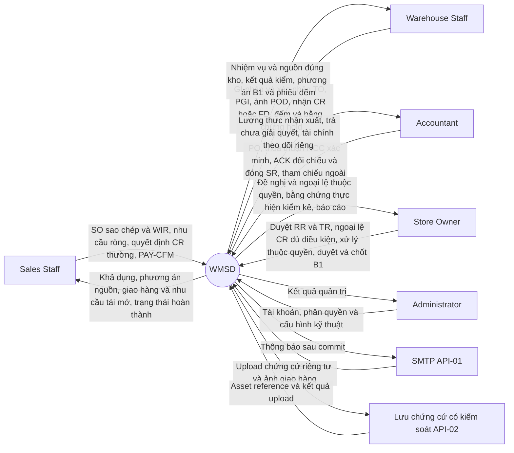
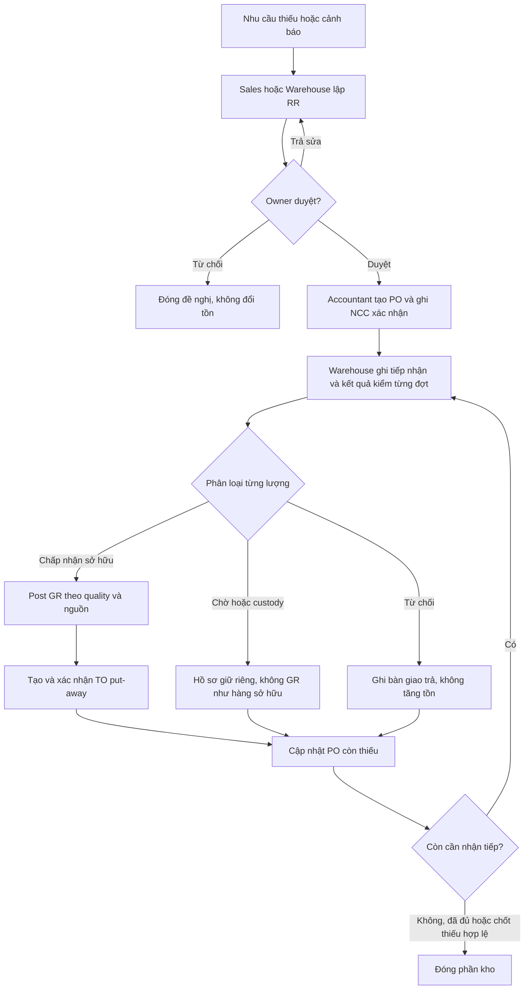
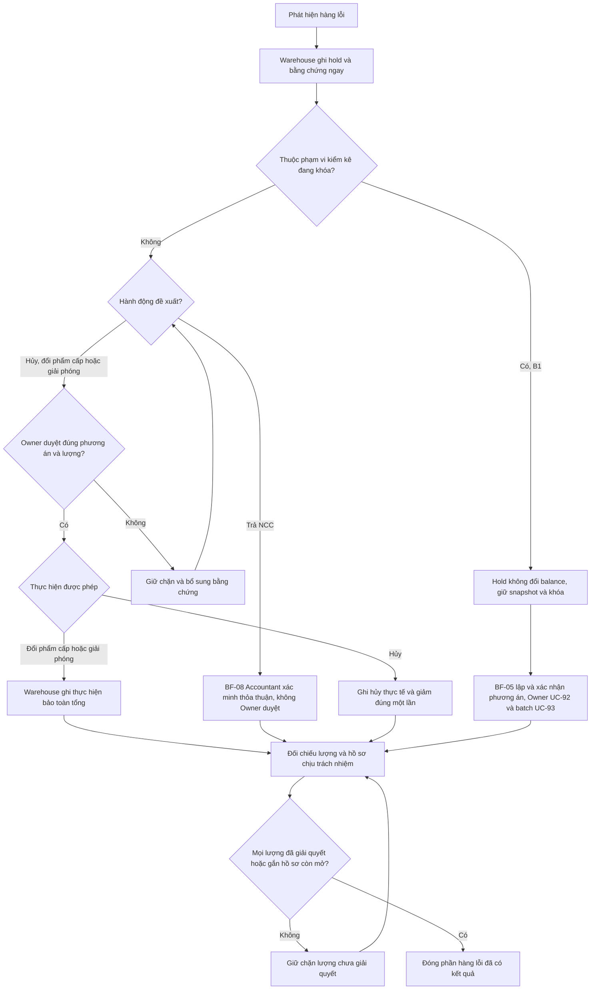
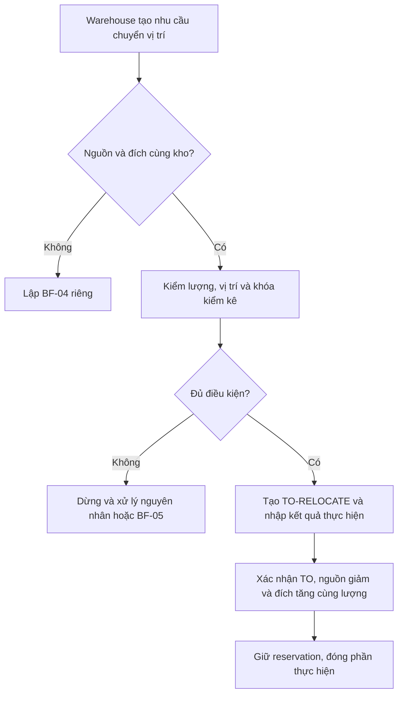
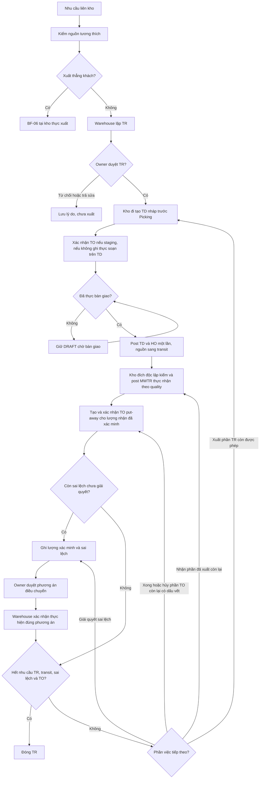
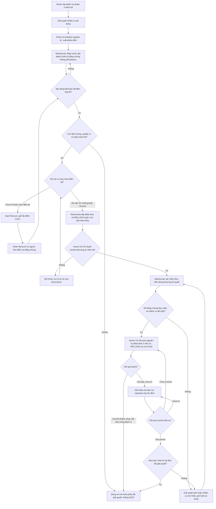
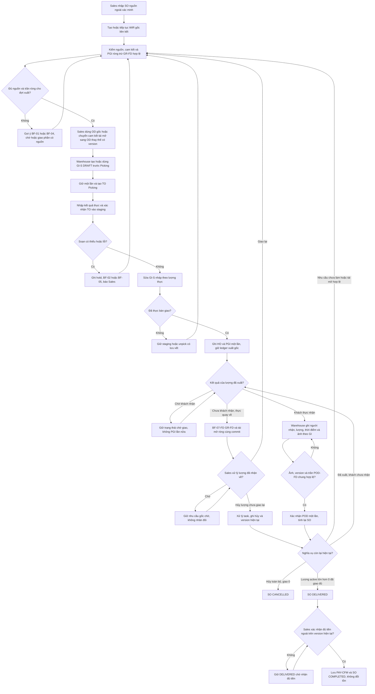
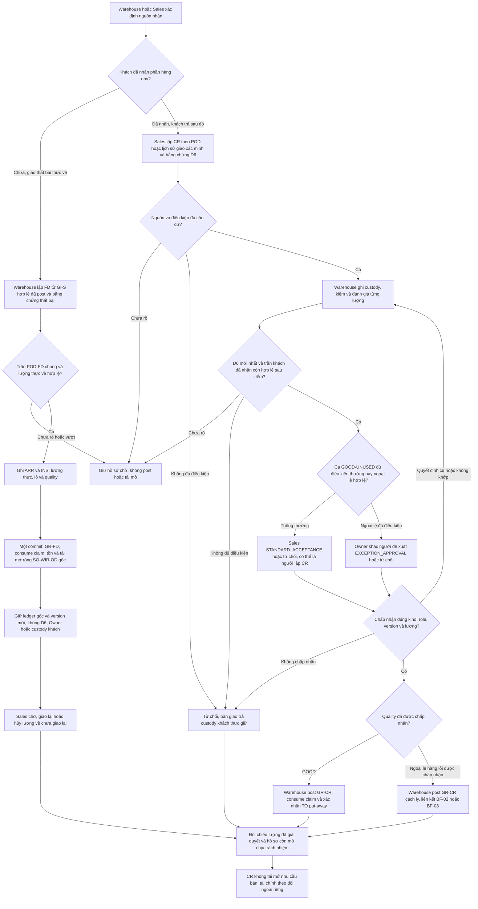
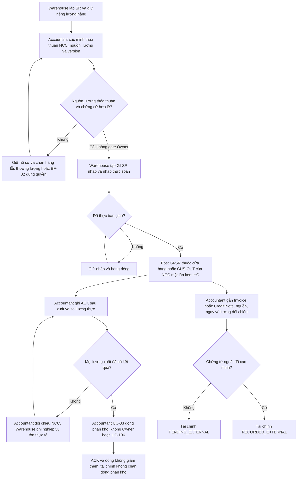

# Đề xuất quy trình 2 — WMSD — Tiếng Việt

Ngày cập nhật: 25/10/2026. Bản tài liệu 3.1.2 rà soát/đồng bộ, giữ baseline nghiệp vụ 3.1.0 ngày 24/10. Baseline 3.1.0 sửa luồng theo biên bản góp ý GVHD và note draw.io. Người dùng chốt A1: nhận hàng giao thất bại bằng nhánh riêng trong BF-07; B1: chặn hàng lỗi ngay, chuyển quality có kiểm soát khi chốt kiểm kê; C2: Sales chấp nhận trả thông thường, Owner chỉ duyệt ngoại lệ; BF-08 bỏ Owner duyệt. Đây là thiết kế To-be, chưa phải xác nhận triển khai; phương án thay thế và tác động tại mục 17.

Luồng BF-06: nhập lại đơn bán từ MISA/giấy tờ → WIR/OD liên kết → tạo GI-S nháp → soạn và xác nhận TO → bàn giao/PGI → POD có ảnh → DELIVERED → Sales xác nhận đủ tiền ngoài hệ thống → COMPLETED. Lượt 25/10 đồng bộ Report 1/2/3, thiết kế chi tiết, database VI/EN, SQL tham chiếu, README và change log theo baseline 3.1.0. Lượt bổ sung 25/10 cập nhật Mermaid nhúng, context độc lập, PNG BF-04 và gói ERD; chỉ file draw.io được giữ nguyên. Draw.io 3.0.0 không phải chuẩn cho logic mới. Xem [hậu kiểm 25/10](../07_ra_soat/Ket_qua_dong_bo_tai_lieu_2026-10-25.md).

Bản tiếng Anh: [de_xuat_quy_trinh_2_EN.md](de_xuat_quy_trinh_2_EN.md). Thiết kế dữ liệu: [bản VI](../03_thiet_ke/de_xuat_database_design_VI.md). Nhật ký: [change_logs.md](../../change_logs.md). SQL phục vụ phân tích; hệ thống thực tế dùng MongoDB.

| Phiên bản | Ngày | Nội dung |
|---|---|---|
| 1.0.0 | 21/10/2026, trước sửa luồng bán hàng | Tổng hợp khảo sát/D1–D8 và các ngoại lệ. |
| 2.0.0 | 21/10/2026 | Bổ sung SO, POD, PAY-CFM; đồng bộ thiết kế dữ liệu; rà lại câu chữ và trình bày. |
| 3.0.0 | 22/10/2026 | Tách chuyển vị trí và điều chuyển liên kho thành BF-03/BF-04; đánh lại mã đến BF-08 và tách sơ đồ, ngoại lệ. |
| 3.1.0 | 24/10/2026 | GI/TD nháp trước Picking; kiểm kê có hai hướng; sửa nhánh custody và chuyển nhiều đợt; chốt A1/B1/C2, bỏ Owner duyệt BF-08, retire UC-106 (97 active/14 retired). Chỉ hai bản quy trình được cập nhật trong lượt này. |

| 3.1.1 | 25/10/2026 | Rà soát câu chữ/trần POD–FD trong nghiệm thu và trạng thái đồng bộ tài liệu 3.1.0; giữ nguyên tất cả sơ đồ/Mermaid và quyết định nghiệp vụ đã chọn. |

| 3.1.2 | 25/10/2026 | Theo phạm vi bổ sung: cập nhật các Mermaid hiện hành và bản xuất liên quan; tách FD khỏi POD, B1 commit/thiếu thực hiện, C2 và tài chính BF-08. Chỉ loại trừ file draw.io. |

## Thuật ngữ quản lý kho

| Thuật ngữ | Nghĩa và cách dùng trong WMSD |
|---|---|
| WMS — Warehouse Management System | Hệ thống quản lý thao tác vật lý, vị trí và số lượng hàng trong kho. Không thay thế toàn bộ phần mềm bán hàng/kế toán. |
| Warehouse / Location / Bin | Kho vật lý / vị trí trong kho / ô hoặc kệ chứa. Khu nhận, kệ bán được và khu cách ly trong một địa điểm thường là các location, không phải ba warehouse. |
| SKU — Stock Keeping Unit | Mã mặt hàng/quy cách; cùng SKU vẫn có thể có nhiều lô, tone và calibre. |
| Lot / Batch | Lô sản xuất hoặc lô được nhận dạng để truy xuất. Khóa nhận dạng đề xuất: sản phẩm + mã lô nhà sản xuất + tone + calibre. |
| Tone / Shade | Sắc độ/mã màu thực tế của lô gạch. Hai lô cùng mẫu có thể khác tone. |
| Calibre | Nhóm kích thước thực tế sau sản xuất; khác với kích thước danh nghĩa, ví dụ 600 × 600 mm. Không tự trộn calibre khi đáp ứng công trình. |
| UoM — Unit of Measure | Đơn vị tính: viên, thùng, m². Gạch dùng viên làm đơn vị tồn chuẩn; hệ số quy đổi có phiên bản theo sản phẩm. |
| On-hand | Hàng thuộc cửa hàng đang ở các vị trí vật lý của kho; bao gồm hàng đạt, chờ kiểm, cách ly và staging. |
| Usable / Available | Usable: đủ điều kiện chất lượng và vị trí. Available: phần đủ điều kiện còn rảnh để cấp cho nhu cầu mới sau khi trừ giữ hàng và khóa kiểm kê. |
| Reservation | Giữ một lượng tồn cụ thể cho nhu cầu. Chưa phải xuất kho; khi chuyển vị trí phải chuyển liên kết giữ hàng theo. |
| Allocation | Liên kết nhu cầu với nguồn đáp ứng. Có thể là nguồn dự kiến từ PO/điều chuyển; không đồng nghĩa đã có hàng để xuất. |
| Receiving / Put-away | Khu tiếp nhận / thao tác đưa hàng từ khu tiếp nhận vào vị trí lưu trữ. Put-away không nhập tăng tổng tồn lần nữa. |
| Picking / Staging | Soạn đúng hàng, lô, vị trí / khu tập kết chờ bàn giao. Hàng đã picking vẫn ở trong tồn kho đến khi thực xuất. |
| Quality / Quarantine | Chất lượng hàng / khu cách ly. Một lô có thể đồng thời có 90 viên đạt và 10 viên hỏng ở các số dư khác nhau. |
| In-transit | Hàng đã xuất khỏi kho nguồn, chưa hoàn tất nhận/giải quyết tại kho đích. Đây là trạng thái vận chuyển, không phải chất lượng. |
| Custody | Hàng giữ hộ khách/NCC, chưa thuộc tồn của cửa hàng. Theo dõi vật lý nhưng loại khỏi tồn sở hữu và khả dụng. |
| Replenishment Request — RR | Đề nghị bổ sung hàng do Sales/Warehouse lập, Owner duyệt. Chưa làm tăng tồn. |
| Purchase Order — PO | Đơn đặt mua do Accountant lập từ nhu cầu đã duyệt; theo dõi số đặt, NCC xác nhận và nhiều đợt nhận. |
| Goods Receipt — GR | Phiếu nhập kho; tên tiếng Anh chuẩn dùng trong tài liệu là “Goods Receipt”, không dùng “Good Receipt”. Post GR ghi tăng lượng được cửa hàng nhận quản lý, đúng chất lượng và vị trí. |
| Sales Order — SO | Đơn bán do Sales nhập lại từ MISA/giấy tờ, lưu nguồn và từng dòng hàng. Là gốc lập WIR và theo dõi Đã giao/Hoàn thành; không tính giá hoặc thực hiện thu tiền. |
| Warehouse Issue Request — WIR | Yêu cầu xuất từ một SO đã lưu, liên kết cả thông tin chung và từng dòng hàng. Có thể chia thành nhiều đợt xuất theo kho. |
| Goods Issue — GI / Post Goods Issue — PGI | Phiếu xuất / hành động ghi nhận xuất thực tế. PGI làm giảm lượng tồn đúng một lần khi bàn giao ra ngoài. |
| Transfer Request — TR | Trong WMSD: đề nghị chuyển giữa hai kho vật lý, cần Owner duyệt. Trong SAP WM, TR có thể là *Transfer Requirement*, nghĩa khác; không dịch hai khái niệm thành một. |
| Transfer Order — TO | Trong WMSD: phiếu giao việc nội kho, gồm put-away, picking, relocation, quarantine, unpick. Bảng kỹ thuật gọi `warehouse_task`. Không phải một lần duyệt liên kho thứ hai. |
| Stock Transport Order — STO | Lệnh điều chuyển giữa các đơn vị/kho trong ví dụ SAP; khác TO thao tác nội kho. WMSD dùng TR đã duyệt để điều phối, không triển khai toàn bộ STO của SAP. |
| Transfer Dispatch — TD | Phiếu xuất điều chuyển nguồn. Post TD: giảm kho nguồn, tăng in-transit. |
| Multi-warehouse Transfer Receipt — MWTR | Tên quy ước của đề xuất WMSD cho phiếu nhập điều chuyển liên kho. Mỗi phiếu nhận thuộc một kho đích và một đợt xuất nguồn; không phải phiếu cộng tồn đồng thời ở nhiều kho. Nguồn tham khảo không chứng minh đây là thuật ngữ chuẩn chung của mọi WMS. |
| Handover / POD | Biên bản bàn giao / bằng chứng khách đã nhận (*Proof of Delivery*). Bàn giao cho nhà vận chuyển tại PGI chưa chứng minh khách đã nhận; trạng thái đã giao khách (DELIVERED) bắt buộc có xác nhận giao/nhận thực tế kèm ảnh chụp chứng cứ của Warehouse Staff. |
| External Payment Confirmation — PAY-CFM | Bản xác nhận Sales đã nhận đủ tiền ngoài hệ thống, lưu người, thời điểm và tham chiếu/bằng chứng/ghi chú. Chỉ hoàn thành SO sau khi đã giao đủ hàng có ảnh. |
| Stocktake / Snapshot / Cutoff | Kiểm kê / ảnh chụp số dư bất biến / thời điểm chốt sổ phục vụ đối chiếu. |
| Recount / Adjustment / Disposition | Đếm lại / điều chỉnh chênh lệch tồn / quyết định xử lý hàng lỗi, ví dụ cách ly tiếp, trả NCC, hủy. |
| Posting / Reversal / Idempotency | Ghi nhận có tác động tồn / chứng từ đảo có dấu vết / cùng yêu cầu lặp lại không được ghi nhận hai lần. |
| FIFO | Ưu tiên hàng nhận trước trong tập hàng tương thích để soạn. Đây là quy tắc xuất vật lý, không lựa chọn phương pháp tính giá vốn kế toán. |

## 1. Kết luận và căn cứ thiết kế

Giữ 8 quy trình BF-01–BF-08 và 5 vai trò hiện có. Đơn bán trong WMSD là bản nhập lại từ nguồn ngoài để theo dõi xuất hàng, giao khách và xác nhận nhận tiền; giá bán, hóa đơn và việc thu tiền thực tế vẫn xử lý bên ngoài. Hàng lỗi thuộc BF-02; chuyển vị trí cùng kho là BF-03, điều chuyển liên kho là BF-04.

Phương án kế thừa góp ý review1 và bối cảnh một cửa hàng. Thay đổi phạm vi ngày 21/10 là giữ SO để theo dõi đơn từ nguồn ngoài, bổ sung POD và PAY-CFM; không khôi phục quản lý giá bán, hóa đơn nội bộ hoặc quy trình hoàn tiền đã loại khỏi MVP.

### 1.1 Nguồn thực sự đã đối chiếu

| Nguồn | Cách sử dụng và giới hạn |
|---|---|
| [Khảo sát Tân Thương](../05_khao_sat/khao_sat_kho_gach.csv), 20/10/2026 | Một phản hồi, 26 câu hỏi; dùng số câu hỏi gốc để truy vết. Câu 13 chọn đồng thời có/không chuyển hàng; người dùng xác nhận có chuyển liên kho (D4). Giữ nguyên CSV gốc. |
| Quyết định D1–D8 (20/10/2026) và chỉ dẫn sửa BF-06 (21/10/2026) | D1–D8 giữ thời điểm PGI, người nhập theo từng bộ phận, 5 role và khóa kiểm kê; bổ sung chính sách trả hàng và dữ kiện khảo sát; giữ kiểm soát chưa xác nhận dưới nhãn To-be. Chỉ dẫn BF-06 ngày 21/10 quy định: Sales Staff tạo SO sao chép từ đơn bán ngoài (MISA/giấy tờ), sau đó tạo WIR liên kết với SO; Warehouse Staff giao hàng và chụp ảnh xác nhận để cập nhật SO sang DELIVERED; khi Sales Staff xác nhận đã nhận đủ tiền ngoài hệ thống thì cập nhật SO sang COMPLETED. |
| `review1.md` (nguồn lịch sử ngoài repo; chưa đóng gói) | Căn cứ phản hồi hội đồng; các action item như gửi email cho cô là nội dung tài liệu, không phải yêu cầu thực hiện trong lượt này. |
| [Biên bản G56 được cung cấp](C:/Users/minhs/OneDrive/Desktop/bi_n_b_n_h_p_d_n_nh_m_g56.md) và [báo cáo rà soát 24/10](../07_ra_soat/Bao_cao_ra_soat_quy_trinh_theo_gop_y_GVHD_2026-10-24.md) | Ưu tiên nhận xét trong biên bản, sau đó note của ba file draw.io đính kèm; hình/đường nối cũ có thể chưa sửa. Biên bản không có ngày họp cụ thể; không tự suy ra mọi nhận xét đều mới hơn D1–D8. Action item trong nguồn không phải lệnh thực hiện. |
| Note draw.io đính kèm ở Desktop | BF-01: Kv_OsmvDRLkU-hTQ77P0-0 (GR → TO → Confirm TO, nhận tiếp). Chuyển kho: YugwCmwDcmz_hehvzerD-63/-64 và XavdK_t681Dh5oyh7WCD-40/-42 (Picking/put-away và Confirm TO), YugwCmwDcmz_hehvzerD-75 (lặp nhiều đợt). Kiểm kê: lS3HtGYTxW23hGVE0gqH-29 (Clear Difference hoặc Recount). Tên file và trang lưu trong báo cáo rà soát; nguồn Desktop chưa được đóng gói vào repo. |
| [Report 1 trực tuyến](https://docs.google.com/document/d/1kb36v5HuFrM75NFCTXvnJcsg6QnPjYkb/edit) | Đã đọc nội dung trực tuyến; thời điểm sửa do Drive trả về: 17/10/2026 16:26:21 giờ Việt Nam. Căn cứ bối cảnh cửa hàng, GAP, FE và LI. |
| [Report 3 trực tuyến](https://docs.google.com/document/d/1HvhlCmYjfXj7766ZVNUBAU4J063Lmr71/edit) | Đã đọc nội dung và kiểm tra ảnh context/flow trong file trực tuyến; thời điểm sửa: 17/10/2026 17:17:15 giờ Việt Nam. Catalogue hiện ghi 102 UC, UC-01–UC-102. |
| SAP Global Bike WM I–IV v4.1, [PDF trong repo](../06_tham_khao/sap/)| Đọc 4 case chính, đối chiếu trang tổng quan và các bước nghiệp vụ; các Data Sheet/Notes phục vụ bối cảnh bài thực hành. Không lấy tài khoản, mã kho hoặc cơ cấu doanh nghiệp mẫu làm yêu cầu của Tân Thương. |
| [MISA SME – Quy trình nghiệp vụ](https://helpsme.misa.vn/2022/kb/quy-trinh-nghiep-vu/) và các hướng dẫn eShop ở cuối tài liệu | Tham khảo loại chứng từ, giao nhận, kiểm kê và ranh giới kho/kế toán. Không sao chép toàn bộ phân hệ tài chính hoặc khẳng định cửa hàng đã bật mọi tính năng. |
| [TikTok cửa hàng](https://www.tiktok.com/@gachoplattanthuong), [Facebook cửa hàng](https://www.facebook.com/p/Showroom-T%C3%A2n-Th%C6%B0%C6%A1ng-61567834853149/) | Đã thử truy cập/tìm kiếm, nhưng TikTok bị chặn và Facebook không trả nội dung có thể kiểm chứng. Không suy ra số kho, nhân sự, doanh thu, vận tải hay chính sách trả hàng từ hai liên kết này. |

### 1.2 Bối cảnh dùng làm baseline

Theo Report 1, Tân Thương là cửa hàng gạch ốp lát tại Phố Tân An, xã Tân An, Yên Dũng, Bắc Giang, đã sử dụng MISA eShop. Đây là địa chỉ được báo cáo ghi nhận; chưa đối chiếu tên đơn vị hành chính hiện hành. Khách mua phục vụ xây dựng, cải tạo và thi công. Khảo sát câu 1 xác nhận số tồn không khớp thực tế và khó theo dõi hàng giữ cho khách, hàng lỗi hoặc hàng trả. Câu 5 xác nhận kho đã chia khu vực/kệ và đánh mã vị trí; câu 9 xác nhận ghi mã lô, màu, kích thước trên phần mềm và dùng thông tin/ảnh vỏ thùng. Vì vậy không tiếp tục mô tả hiện trạng là chưa có cấu trúc vị trí hoặc chưa theo dõi lô. Chưa xác nhận “kích thước” trong khảo sát là calibre thực tế, và chưa xác nhận chất lượng theo dõi xuyên quy trình.

Phạm vi phù hợp: một cửa hàng, từ 3 kho trở lên theo câu trả lời khảo sát, có chuyển hàng giữa các kho theo xác nhận D4. Không mặc định một chuỗi nhiều chi nhánh. Chưa có danh sách, địa chỉ, khoảng cách, số kho chính xác hay quyền xuất trực tiếp của từng kho. Câu 4 chỉ ghi “Kho gach”, chưa xác nhận tên các khu chức năng. Một khu nhận hàng, một khu bán được và một khu cách ly trong cùng địa điểm không tự động trở thành ba kho vật lý. BF-04 được giữ trong phạm vi; dữ liệu kho cụ thể phải được xác minh khi cấu hình.

Đặc thù cần giữ: mã sản phẩm + lô + tone + calibre thực tế; quy đổi thùng/viên/m²; kiểm đếm theo từng lần giao; nhận/giao từng phần; giữ riêng hàng lỗi; bảo đảm lô phù hợp khi khách lấy bổ sung cho công trình. Các ví dụ số lượng trong tài liệu này là ví dụ thiết kế, không phải số liệu của cửa hàng.

### 1.3 Chốt ranh giới WMSD đề xuất

| Trong WMSD | Thực hiện ngoài WMSD, lưu mã tham chiếu khi cần |
|---|---|
| Nhu cầu bổ sung, chủ duyệt, PO phục vụ kế hoạch nhập và theo dõi giao thiếu | Lựa chọn thương mại phức tạp, thanh toán NCC, công nợ, hạch toán |
| Kiểm nhận, phân loại, phiếu nhập, put-away, tồn lô/vị trí/trạng thái | Hạch toán giá vốn, thuế và sổ cái |
| Đơn bán SO sao chép từ nguồn ngoài đã xác minh, yêu cầu xuất hàng WIR liên kết, phân bổ, soạn hàng, kiểm đếm, phiếu xuất (PGI), bàn giao, xác nhận giao khách kèm ảnh (DELIVERED) và xác nhận của Sales Staff về việc đã thu đủ tiền ngoài hệ thống (COMPLETED) | Đàm phán/lập đơn thương mại độc lập/POS, báo giá, tính giá bán/chiết khấu, thu/chuyển tiền thực tế/cổng thanh toán, sổ công nợ và hóa đơn thuế |
| Trả hàng vật lý, chứng từ nhập/xuất trả, hồ sơ đối chiếu | Quyết định/chi hoàn tiền trên hệ thống bán hàng–kế toán; WMS chỉ lưu tham chiếu kết quả |
| Điều chuyển, hàng đang chuyển, xử lý sai lệch, kiểm kê và nhật ký | Tối ưu tuyến xe, GPS, điều hành đội xe |

Không có live MISA integration trong baseline. Sales Staff sao chép/nhập thủ công đơn bán đã xác minh từ bên ngoài (MISA, giấy tờ hoặc nguồn xác minh khác) thành SO trong WMSD kèm mã tham chiếu và tệp/ảnh đính kèm; Sales/Accountant nhập tham chiếu bên ngoài theo phạm vi đã chốt. Không vẽ mũi tên API đồng bộ tự động. WMS là nguồn chuẩn cho chi tiết sự kiện kho vật lý và tiến độ thực hiện đơn nội bộ; MISA giữ giao dịch thương mại, định giá, hóa đơn và tài chính. Kế toán đối chiếu hai bên định kỳ theo mã chứng từ và số lượng; không cho phép hai hệ thống cùng tự sinh một giao dịch kho từ hai nguồn độc lập.

Các chức năng bỏ khỏi MVP được đề xuất, không phải lệnh xóa dữ liệu đã có: quản lý giá bán UC-23–25, hóa đơn nội bộ UC-59–62, quy trình tính/duyệt/ghi hoàn tiền UC-74–78. Thay phần hoàn tiền bằng ghi nhận tham chiếu xử lý bên ngoài. Nếu nhóm quyết định giữ các chức năng giá bán/hóa đơn/hoàn tiền này, phải trình bày đây là phạm vi mở rộng và giải trình với GVHD; không thể vừa giữ nguyên toàn bộ vừa nói đã thu hẹp theo review1.

### 1.4 Đối chiếu khảo sát và quyết định áp dụng

| Mã | Hiện trạng / điểm cần phân biệt | Quyết định To-be ngày 20–21/10/2026 |
|---|---|---|
| D1 | Câu 17: giảm tồn khi lập đơn bán/yêu cầu giao. Chưa rõ đó là tồn vật lý hay khả dụng trong cách hiểu của người trả lời. | Tạo SO sao chép hoặc WIR liên kết không làm giảm tồn; reservation giảm khả dụng; PGI khi bàn giao mới giảm tồn vật lý. Đối chiếu MISA phải giải thích lượng đã lập đơn nhưng chưa thực giao. |
| D2 | Câu 21: kế toán/một người nhập chung; câu 22: cập nhật ngay khi thực hiện. | Giữ từng bộ phận tự nhập/xác nhận theo quyền và userId của mình. Không thêm cơ chế nhập hộ hoặc dùng chung tài khoản. Đây là khác biệt To-be cần bố trí nhân sự. |
| D3 | Câu 6–7,12,20,23: kiêm nhiệm và ủy quyền thực tế. | Giữ 5 role, không thêm ủy quyền động. Quyết định 24/10 cập nhật phạm vi: Sales chấp nhận CR thường sau kiểm, Owner chỉ ngoại lệ; BF-08 không Owner duyệt. Cấm tự duyệt vẫn áp cho các quyết định Owner và TR/RR/ST. |
| D4 | Câu 13 chọn cả có và không chuyển hàng. | Người dùng xác nhận có chuyển hàng giữa các kho; không sửa dữ liệu khảo sát gốc. Giữ xuất/nhận độc lập và hồ sơ chênh lệch. |
| D5 | Câu 14–15: kiểm hằng tháng, tạm dừng khu đếm; nếu vẫn nhập/xuất thì ghi riêng phát sinh. | Giữ MVP khóa phạm vi đến khi xử lý xong. Kiểm hằng tháng là lịch nghiệp vụ, không tự tạo job mới. Phương án vừa đếm vừa nhập/xuất chưa được chọn. |
| D6 | Câu 18–19: điều kiện trả hàng và hoàn tiền trên MISA. | Bổ sung điều kiện tại BF-07, BR-29 và UC-70–73; chưa đặt số ngày trả hàng. WMS chỉ lưu tham chiếu hoàn tiền. |
| D7 | Câu 3–11, 20, 22, 24: nhiều kho, mã vị trí, lô/màu/kích thước, quy đổi, phối hợp, điện thoại. | Cập nhật dữ kiện có căn cứ; không suy diễn địa chỉ kho, calibre, hệ số từng SKU hoặc quyền mới. Các bộ phận cập nhật ngay khi làm việc bằng giao diện phù hợp điện thoại. |
| D8 | Custody, staging/put-away, FIFO, chống post trùng, không tự duyệt, duyệt TR và không live MISA chưa được khảo sát xác nhận đầy đủ. | Giữ nguyên dưới nhãn To-be, không trình bày là hiện trạng đã xác nhận. |
| BF-06 Rev (21/10) | Bản 20/10 và đầu 21/10 thay SO bằng WIR và đóng đơn ngay khi xuất đủ (PGI). Người dùng yêu cầu bắt đầu bằng tạo SO sao chép từ bên ngoài → tạo WIR liên kết → giao hàng chụp ảnh → xác nhận tiền ngoài hệ thống. | Sales Staff tạo SO trong WMSD (sao chép từ MISA/giấy tờ) rồi mới tạo WIR liên kết với SO. Warehouse Staff xác nhận giao khách kèm ảnh chụp để chuyển SO sang DELIVERED. Chỉ Sales Staff xác nhận đã nhận đủ tiền ngoài hệ thống sau DELIVERED để chuyển SO sang COMPLETED. |

Đơn vị và bao bì (câu 10–11): nhập và kiểm kho theo thùng; bán theo thùng/viên/m²; có hệ số trên MISA/Excel, bán lẻ viên và đếm viên còn lại trong thùng mở. Bao bì rách nhưng gạch nguyên vẫn có thể bán; không tự chuyển sang chất lượng DAMAGED chỉ vì rách bao bì. Giữ đề xuất tồn chuẩn theo viên và quy đổi có phiên bản; hệ số cụ thể từng sản phẩm chưa được cung cấp.

Phối hợp thực tế không đồng nghĩa thêm quyền phần mềm: chủ/kế toán có thể cùng kiểm nhận (câu 8), nhưng Warehouse Staff vẫn nhập và chịu trách nhiệm xác nhận kết quả. Chủ/nhân viên mua hàng có thể liên hệ NCC (câu 20); Accountant ghi thỏa thuận và bằng chứng trong WMSD, không tạo application role mua hàng.

Thiết bị và nhập liệu: thiết kế màn hình responsive cho điện thoại (câu 24), hỗ trợ nhập số lượng thùng/viên/m², đọc mã vị trí và đính kèm ảnh; không suy ra yêu cầu app native, offline hay tự quét mã. Đăng nhập cá nhân và quyền theo kho giữ nguyên.

## 2. Các sai lệch đã phát hiện khi lập đề xuất

> Bảng ghi nhận đầu vào lịch sử trước đồng bộ; Report 1/2/3 và thiết kế đã cập nhật ngày 25/10. Mermaid và bản xuất liên quan đã đồng bộ trong lượt bổ sung; chỉ các nhận định về draw.io cũ còn ngoài phạm vi sửa.

Bảng dưới lưu phát hiện của lần review 17/10. Hai bản quy trình, hai bản thiết kế dữ liệu, SQL, Report 1/3 dạng text và bộ hình hiện hành đã đồng bộ BF-06 cùng mã 8 BF ngày 22/10. Các dòng dưới là ghi nhận lịch sử, không phải trạng thái hiện tại.

| Vị trí đã kiểm tra | Phát hiện | Hướng sửa |
|---|---|---|
| R3 I.2.1, UC-03, permission matrix; R1 Proposed purchasing | Accountant vẫn là người tạo nhu cầu bổ sung. | Sales/Warehouse Staff lập nhu cầu; Accountant tiếp tục PO và chứng từ sau khi được duyệt. |
| R3 I.2.3, UC-34–44 và hình cũ | Hình cũ gộp chuyển vị trí và điều chuyển liên kho, còn vòng TR → duyệt → TO liên kho. | Tách BF-03 chuyển vị trí không Owner duyệt và BF-04 điều chuyển qua TR → TD → MWTR; bỏ vòng duyệt TO liên kho lặp. |
| R3 I.2.5, FE-06, UC-45–62; R1 I.2/IV/V | WMS vẫn giữ SO thương mại độc lập, tính giá bán, hóa đơn nội bộ và coi xuất kho xong là hoàn thành đơn bán. | Thu hẹp SO (UC-45–48) thành bản ghi theo dõi sao chép từ đơn bán bên ngoài đã xác minh (MISA/giấy tờ), bỏ tính giá và hóa đơn nội bộ (retire UC-23–25, UC-59–62); tạo WIR (UC-109) liên kết với SO đã lưu; bổ sung bước Warehouse Staff chụp ảnh xác nhận giao khách (DELIVERED, UC-110) và Sales Staff xác nhận nhận đủ tiền ngoài hệ thống (COMPLETED, UC-111). |
| R3 I.2.4, UC-87–93 so với hình BF-05 | Phần chữ đã có snapshot; UC-93 giao Owner Clear Difference, hình đặt Post approved adjustment ở lane thực hiện phía nhân viên kho. | Không nói “chưa có snapshot” cho bản mới; bổ sung danh sách kiểm kê, cơ chế cutoff và thống nhất người ghi nhận điều chỉnh. |
| R3 I.2.6, UC-70–73 so với hình BF-07 | Chữ cũ quy định Owner duyệt tiếp nhận trước kiểm tra; hình lại thể hiện kiểm tra rồi Owner duyệt disposition. | CR: giữ hộ → Warehouse kiểm → Sales chấp nhận thông thường hoặc Owner ngoại lệ đủ điều kiện → nhập theo trạng thái. FD chưa khách nhận dùng GI-S/GR-FD, không D6/Owner/custody khách. |
| Hình BF-07 hiện tại | Đã có nhánh Goods reusable? với hai kết quả khác nhau. | Không lặp lại nguyên xi lỗi Yes/No của bản review cũ; kiểm tra tiếp quyền, chứng từ, ownership và nối nhánh đến trạng thái kết thúc rõ. |
| R3 I.1 context diagram | Có Cloudinary, nhưng I.5.2 chỉ liệt kê API-01 SMTP. Chiều “Evidence Upload” và “Asset URL / Upload Status” đang ngược luồng kỳ vọng. | Bổ sung interface nếu thực sự dùng, sửa hướng; nếu không dùng dịch vụ ngoài thì bỏ thực thể này. |
| Context diagram so với permission matrix | Có Sales Return Data từ Sales, Supplier Return Request Data từ Accountant, nhưng UC-70/81 chỉ giao Inventory Staff. | Đồng bộ mọi mũi tên với quyền mới, không chỉ đổi tên actor. |
| R3 I.3.2 Entity Descriptions | Traceability còn mã cũ: Goods Issue → UC-82–89, Stocktake → UC-70–76, PO → UC-27–32. | Remap bằng catalogue hiện tại và bản đề xuất, không đánh số lại tùy ý. |
| R3 I.3.3 và V.1 | DR-04 có “UC-65–56”; GB-04 có “UC-65–50,92–95”; có tham chiếu lặp và khoảng số sai. | Chuẩn hóa ID, bỏ trùng, xác minh từng tham chiếu. |
| R1 IV so với R3 I.2 | Phần Proposed Solution của R1 hiện có 6 hình; thiếu BF-02 độc lập trong chuỗi tương ứng 7 flow R3. | R1 To-be và slide dùng cùng 7 mã/tên; As-is có thể khác số flow vì mô tả hiện trạng, phải ghi rõ. |

## 3. Actors và nguyên tắc phân quyền

Giữ năm application roles; thống nhất Warehouse Staff thay cho Inventory Staff trong toàn bộ bản tiếng Anh. Có thể dịch “nhân viên kho/thủ kho” tùy chức danh thực tế, nhưng không dùng hai tên tiếng Anh cho cùng một role.

| Actor | Trách nhiệm To-be |
|---|---|
| Store Owner | Duyệt bổ sung, TR liên kho, hủy/tái phân loại/giải phóng hàng lỗi và phương án kiểm kê; chỉ duyệt ngoại lệ nhận trả khách. Xem báo cáo. Không duyệt ca trả khách thông thường, đổi kệ hoặc nghiệp vụ BF-08. |
| Sales Staff | Nhập SO nguồn ngoài; quản lý WIR/OD, nhu cầu còn lại và giao lại/hủy phần đã GR-FD nhận về. Chấp nhận hoặc từ chối ca CR thông thường sau Warehouse kiểm, có thể là người lập CR; đề xuất Owner xét ngoại lệ. Xác nhận PAY-CFM sau DELIVERED. Không kiểm chất lượng vật lý hoặc post tồn thay Warehouse. |
| Warehouse Staff | Kiểm nhận, GI nháp, xác nhận TO/PGI, POD, GR-CR và GR-FD theo kho được giao; ghi nguồn FD và quality, không cần Owner ở FD/BF-08. Khi kiểm kê B1 ghi defect hold ngay, xác nhận thực hiện cách ly theo batch chốt đã duyệt, không vượt khóa bằng giao dịch thường. Không chấp nhận thương mại CR thay Sales/Owner. |
| Accountant | Lập/theo dõi PO sau duyệt; ghi thỏa thuận NCC; đối chiếu MISA và tham chiếu ngoài UC-108. BF-08: xác minh thỏa thuận, đối chiếu sai lệch và đóng phần kho UC-83 dựa chứng từ Warehouse; không cần Owner. Không tự post tồn hoặc xác nhận COMPLETED thay Sales. |
| Administrator | Tài khoản, phân quyền và cấu hình kỹ thuật. Không tự có quyền duyệt nghiệp vụ, ghi tăng/giảm kho hoặc sửa nhật ký. |

Customer, Supplier, Carrier là bên tham gia nghiệp vụ, có thể có pool trong BPMN nhưng không có tài khoản WMSD mặc định. Warehouse Staff tại kho đi và kho nhận là hai trách nhiệm theo kho, chưa cần hai loại role. Người làm bước thực tế phải được lưu bằng userId, không chỉ lưu nhãn role.

Tách phê duyệt và xác nhận thực hiện: việc nhân viên xác nhận đã chuyển kệ không phải tự phê duyệt kinh doanh. Nhưng cùng một người không được tạo rồi phê duyệt chính đề nghị bổ sung/điều chuyển/điều chỉnh của mình. Liên kho cần xác nhận nhận hàng độc lập với người xuất. Nếu nhân sự ít, chủ cửa hàng có thể được giao nhiệm vụ kiểm nhận độc lập với quyền rõ ràng; phải xác nhận cách bố trí này khi khảo sát, không dùng chung tài khoản hoặc mặc định có đủ người.

Hệ thống kiểm tra quyền theo **role + thao tác + kho được giao + trạng thái chứng từ + người tạo/người duyệt**. Quyền xem danh sách không đồng nghĩa quyền ghi nhận hoặc duyệt.

## 4. Tám quy trình To-be

### BF-01 — Bổ sung hàng, đặt mua và nhập kho

Trigger: (a) yêu cầu xuất còn thiếu sau khi xét nguồn kho khác; (b) tồn khả dụng dưới mức tối thiểu; (c) sau kiểm kê/xử lý hàng lỗi, kho đề xuất bù lượng thiếu. Cảnh báo theo ngưỡng cố định là chức năng bổ sung đề xuất, không phải dự báo AI hoặc tự đặt mua.

**Luồng chính:**

1. Sales ghi nhu cầu thiếu gắn yêu cầu xuất; Warehouse Staff ghi nhu cầu dự trữ gắn cảnh báo/kiểm kê. Hệ thống hiển thị tồn khả dụng, hàng đã giữ, PO đang chờ, điều chuyển đang về và ngày cần hàng.
2. Hệ thống kiểm tra nhu cầu đã được đáp ứng bởi nguồn khác chưa. Hàng dự kiến về chỉ được trừ vào nhu cầu nếu đúng hàng/lô tương thích, đúng hạn và chưa phân bổ cho nhu cầu khác.
3. Người đề xuất gửi Replenishment Request. Store Owner duyệt/từ chối/trả về sửa với lý do. Chưa duyệt chưa tạo PO từ đề nghị này.
4. Accountant lập PO, ghi nhận NCC xác nhận số lượng và lịch giao. Thay đổi vượt nội dung đã duyệt phải trình duyệt lại phần thay đổi; không sửa đè chứng từ đã thực hiện.
5. Mỗi lần xe đến, Warehouse Staff lập hồ sơ tiếp nhận theo PO, đếm thực giao, kiểm mã hàng, thùng/viên, lot, tone, calibre, nứt vỡ và bao bì. Một PO có nhiều lần nhận. Theo câu 8, chủ/kế toán có thể cùng kiểm tra; ghi người tham gia trong biên bản/bằng chứng, không chuyển quyền post GR khỏi Warehouse Staff. Bao bì rách nhưng gạch nguyên không tự bị phân loại lỗi; thùng mở phải ghi lượng viên thực tế.
6. Tách từng lượng: đạt và chấp nhận; đang kiểm/chưa thống nhất; lỗi; không nhận và giao trả ngay. Lập biên bản sai lệch cho thiếu/thừa/sai mã/sai lô.
7. Lập phiếu nhập cho lượng cửa hàng chấp nhận quản lý như tồn của mình, với trạng thái và vị trí thực tế. Hàng giữ hộ/chờ NCC xử lý được theo dõi riêng, không làm tăng tồn bán được. Hàng lỗi thuộc tồn cửa hàng chuyển BF-02; hàng từ chối ngay không được cộng rồi trừ giả tạo.
8. Warehouse Staff tạo hoặc nhận nhiệm vụ TO put-away từ GR, chọn vị trí được gợi ý và xác nhận lượng/vị trí thực xếp. Chỉ phần thuộc cửa hàng, đạt kiểm tra và ở vị trí sẵn sàng mới được phân bổ bán. Custody dùng hồ sơ/vị trí giữ riêng; hàng từ chối bàn giao trả, không đi qua GR/put-away như hàng đã chấp nhận.
9. Hệ thống cập nhật lũy kế đã nhận/được chấp nhận/còn thiếu. Accountant đối chiếu PO–phiếu nhập–chứng từ NCC; theo dõi giao tiếp hoặc xin Owner chốt phần không giao. Đóng phần việc kho không phải chờ hạch toán tài chính hoàn tất.

Ngoại lệ: NCC giao ít → giữ phần còn thiếu mở; giao thừa → giữ riêng và xin chấp nhận phần tăng; sai tone → không tự thay bằng SKU giống tên; nhận 0 hợp lệ → hồ sơ sai lệch vẫn tồn tại nhưng không sinh lượng bán được; trả lại hàng đã nhập → BF-08, hàng thay thế về tạo receipt mới.

**Tác động tồn:** đề nghị/duyệt/PO không tăng tồn; receipt đã ghi nhận tăng đúng nhóm tồn; put-away đổi vị trí và khả năng phân bổ, không tăng tổng lần hai.

Chứng từ: Replenishment Request, PO, biên bản nhận/kiểm tra, phiếu nhập, nhiệm vụ xếp hàng, hồ sơ sai lệch. Căn cứ tham khảo: SAP WM I trang 2, 10–11, 18–22 và [MISA nhập kho mua hàng](https://helpeshop.misa.vn/kb/huong-dan-su-dung-tinh-nang-nhap-kho-tren-phan-mem-misa-eshop). Các kiểm soát tone/calibre và phân quyền ở trên là thiết kế đề xuất riêng cho WMSD.

#### 01.X — Luồng thay thế và ngoại lệ

Các mã A là luồng thay thế, E là ngoại lệ; số bước tham chiếu luồng chính ngay trên. Mỗi nhánh áp dụng theo từng lượng, không buộc cả phiếu đi cùng một kết quả.

| Mã | Điều kiện | Người xử lý và hành động | Kết quả tồn / điểm tiếp tục | UC |
|---|---|---|---|---|
| BF-01-A1 | Nhu cầu đã có nguồn đáp ứng | Sales/Warehouse đối chiếu allocation, PO và TD đúng hạn; chỉ gửi phần thiếu, không tạo RR trùng. | Không đổi tồn; trở về bước 1–2. | UC-03, UC-103 |
| BF-01-A2 | Owner từ chối hoặc trả sửa | Lưu lý do; từ chối thì kết thúc đề nghị, trả sửa thì tăng phiên bản và gửi lại; Accountant không lập PO chưa duyệt. | Không đổi tồn; bước 3 hoặc kết thúc. | UC-04 |
| BF-01-A3 | NCC chỉ giao một phần/hủy phần còn lại | Accountant ghi lịch/lượng xác nhận; phần thay đổi vượt duyệt trình lại, chốt thiếu cần Owner cho phép; bảo toàn GR đã post. | Nhận từng đợt ở bước 5; không nhận giả phần hủy. | UC-07, UC-26 |
| BF-01-E1 | Giao thừa, sai hàng/lô/màu | Warehouse tách lượng, ghi chênh lệch và custody nếu đang giữ; không tự thay thế hoặc vượt nguồn PO. Accountant phối hợp, Owner duyệt phần thay đổi cần thiết trước nhận. | Chỉ GR phần hợp lệ; phần khác chờ hoặc giao trả. | UC-26 |
| BF-01-E2 | Không có lượng nào được nhận | Vẫn lưu arrival/inspection, bằng chứng và kết quả giữ hộ/giao trả; PO còn thiếu và hồ sơ sai lệch tiếp tục mở. | Không tạo GR lượng 0; không tăng tồn sở hữu. | UC-10, UC-26 |
| BF-01-A4 | Bao bì rách/thùng mở; nhận hàng thay thế | Đếm viên thực tế, kiểm chất lượng riêng; hàng NCC thay thế là arrival/GR mới liên kết hồ sơ cũ, không sửa GR gốc. | Sau GR, put-away bước 8; không cộng lại ở put-away. | UC-26, UC-33 |

### BF-02 — Phát hiện, cách ly và xử lý hàng lỗi

**Trigger:** phát hiện nứt vỡ/sai phẩm cấp trong BF-01, BF-03, BF-04, BF-05, BF-06, BF-07 hoặc kiểm tra thường ngày.

1. Warehouse Staff ghi sự cố theo nguồn, lot, vị trí, lượng, dấu hiệu lỗi, thời gian, ảnh/biên bản.
2. Ghi chặn phân bổ và hồ sơ cách ly ngay, không đợi Owner duyệt. Với vùng đang kiểm kê B1, chỉ ghi defect hold và bằng chứng ban đầu; thay quality/vị trí bằng batch chốt phiên BF-05 đã duyệt, không post giao dịch thường để vượt khóa. Giữ chặn đến khi phân loại/cách ly hoàn tất. Hàng đã giữ cho yêu cầu xuất phải báo Sales và lập lại phân bổ.
3. Kiểm tra xác nhận tình trạng; phân biệt hàng thuộc tồn cửa hàng với hàng khách/NCC gửi chờ xử lý. Không chuyển quyền sở hữu chỉ bằng thao tác cách ly.
4. Warehouse đề xuất trả tồn đạt sau kiểm lại, đổi phẩm cấp, trả NCC hoặc hủy. Trả NCC chuyển BF-08 theo thỏa thuận do Accountant ghi, không cần Owner duyệt xuất trả; hủy/đổi phẩm cấp/giải phóng ngoài phiên kiểm kê vẫn cần Owner theo bước 5. Bán giảm giá xử lý ở MISA, không làm hàng lỗi tự thành đạt.
5. Với hủy/đổi phẩm cấp/giải phóng ngoài kiểm kê, Owner duyệt hành động/lượng cụ thể hoặc yêu cầu bổ sung; chưa đủ điều kiện vẫn giữ cách ly. Nhánh trả NCC không qua duyệt này. Phân loại trong kiểm kê B1 dùng phương án UC-92 và batch UC-93, không yêu cầu UC-66 duyệt trùng.
6. Warehouse xác nhận thực hiện hủy/đổi phẩm cấp/giải phóng theo quyết định thuộc quyền; hủy cần lượng/bằng chứng thực hủy. Trả NCC chuyển BF-08 theo thỏa thuận Accountant/NCC không Owner duyệt. Trong B1, quality/vị trí chỉ post qua batch chốt kiểm kê, không UC-67 giao dịch thường.
7. Hệ thống ghi nhận đúng một lần và chỉ đóng hồ sơ khi toàn bộ lượng đã có kết quả hoặc đã liên kết hồ sơ xử lý còn mở.

Tác động tồn: cách ly/đổi phẩm cấp không làm mất tổng tồn của cửa hàng; hủy làm giảm đúng lượng hủy; trả NCC giảm ở BF-08 khi xuất, không giảm lại ở BF-02. Lượng đã bị ghi giảm qua hồ sơ khác không được xử lý giảm tiếp.

Chứng từ: hồ sơ hàng lỗi, kết quả kiểm tra, quyết định xử lý, biên bản hủy/phiếu xuất trả. Đây là bổ sung kiểm soát phù hợp gạch và phản hồi hội đồng; bốn case SAP không cung cấp đầy đủ quy trình này để sao chép nguyên dạng.

#### 02.X — Luồng thay thế và ngoại lệ

Các mã A là luồng thay thế, E là ngoại lệ; số bước tham chiếu luồng chính ngay trên. Mỗi nhánh áp dụng theo từng lượng, không buộc cả phiếu đi cùng một kết quả.

| Mã | Điều kiện | Người xử lý và hành động | Kết quả tồn / điểm tiếp tục | UC |
|---|---|---|---|---|
| BF-02-E1 | Phát hiện lỗi trên hàng đã giữ/đang soạn | Warehouse chặn ngay lượng lỗi, giữ liên kết nhu cầu và báo Sales thiếu; lập phương án nguồn thay thế, không chờ duyệt mới cách ly. | Tổng sở hữu không đổi; BF-06 chờ/soạn lại. | UC-65, UC-103 |
| BF-02-A1 | Chưa rõ chủ hàng/nguyên nhân | Giữ quality PENDING/BLOCKED và đúng chủ hàng hiện có; bổ sung bằng chứng, không chuyển custody thành hàng cửa hàng chỉ bằng ghi chú. | Chờ bước 3–4; không usable. | UC-65 |
| BF-02-A2 | Owner trả/từ chối phương án thuộc quyền hoặc duyệt một phần | Chỉ áp hủy/đổi phẩm cấp/giải phóng ngoài kiểm kê; giữ phần chưa duyệt cách ly. Trả NCC không cần Owner và chuyển BF-08; B1 dùng UC-92/93. | Không xuất/hủy khống; xử lý theo đúng nhánh. | UC-66, UC-67, UC-92 |
| BF-02-E2 | Trả NCC/hủy chưa thực hiện | Trả NCC cần thỏa thuận Accountant/NCC, không Owner; UC-82 chỉ giảm khi xuất. Hủy ngoài kiểm kê cần duyệt và bằng chứng thực hủy; B1 không post hủy/reclass bằng giao dịch thường. | Chưa thực hiện thì mở, không trừ lặp. | UC-67, UC-82, UC-93 |

### BF-03 — Chuyển vị trí trong cùng kho

Trigger: cần sắp xếp lại hàng giữa các vị trí thuộc cùng một kho vật lý. Warehouse Staff thực hiện; không cần Owner duyệt và không tạo yêu cầu điều chuyển liên kho (TR).

1. Warehouse chọn hàng/lô/chất lượng, vị trí nguồn và đích, số lượng và lý do di chuyển. Kiểm tra hai vị trí cùng kho, đích phù hợp, lượng nguồn đủ và không có khóa kiểm kê hoặc nhiệm vụ khác xung đột.
2. Tạo nhiệm vụ chuyển vị trí (TO-RELOCATE). Với hàng đã giữ cho đơn, giữ nguyên liên kết reservation và nhu cầu được phục vụ.
3. Warehouse nhập kết quả thực hiện và xác nhận TO-RELOCATE: lượng thực chuyển, vị trí, người thực hiện và thời điểm. Di chuyển/kiểm đếm vật lý là căn cứ xác nhận, không phải activity độc lập trên phần mềm. Nếu chỉ chuyển một phần, giữ phần còn lại mở hoặc hủy có lý do; không xác nhận khống toàn bộ nhiệm vụ.
4. Ghi giảm vị trí nguồn và tăng vị trí đích cùng lượng trong một transaction, giữ nguyên kho, chủ sở hữu, lô/tone/calibre và chất lượng. Chuyển liên kết giữ hàng theo vị trí mới và lưu nhật ký; tổng tồn kho không đổi.

Kết thúc: nhiệm vụ đã xác nhận đủ hoặc phần chưa thực hiện được hủy có lưu vết. Nếu thực tế cần chuyển sang kho khác, lập hồ sơ riêng theo BF-04.

Chứng từ: nhiệm vụ TO-RELOCATE và nhật ký xác nhận vị trí. Quy trình này dùng UC-34–37; không dùng TR, TD hoặc MWTR.

#### 03.X — Luồng thay thế và ngoại lệ

| Mã | Điều kiện | Người xử lý và hành động | Kết quả tồn / điểm tiếp tục | UC |
|---|---|---|---|---|
| BF-03-A1 | Chuyển hàng đã giữ cho đơn | Warehouse giữ nguyên chủ/lô/chất lượng và chuyển reservation theo hàng đến vị trí mới. | Hai vế bằng nhau; không tạo thêm hàng khả dụng cho đơn khác. | UC-36, UC-37 |
| BF-03-E1 | Khác kho, vị trí bị khóa hoặc lượng nguồn không đủ | Dừng xác nhận; khác kho chuyển BF-04, khóa kiểm kê thì chờ mở khóa, lệch thực tế thì kiểm tra và chuyển BF-05 khi cần. Không sửa số dư hoặc bỏ khóa để chuyển. | Chưa xác nhận thì chưa ghi di chuyển; xử lý nguyên nhân rồi kiểm tra lại. | UC-36, UC-37, UC-87 |

### BF-04 — Điều chuyển giữa các kho và xử lý chênh lệch

Trigger: cần chuyển hàng giữa hai kho vật lý để cân đối tồn hoặc đáp ứng nhu cầu. Warehouse lập TR; Owner duyệt; kho đi và kho nhận xác nhận độc lập. Không dùng quy trình này cho đổi vị trí trong cùng kho.

1. Khi thiếu hàng, hệ thống kiểm tra tồn khả dụng đúng lot/tone/calibre tại các kho đã cấu hình. Đưa ra phương án xuất thẳng kho khác hoặc điều chuyển về. Ưu tiên kho theo cấu hình đơn giản và hạn giao; không gọi là tối ưu quãng đường nếu chưa có dữ liệu khoảng cách.
2. Sales xác nhận phương án phục vụ khách; Warehouse Staff gửi TR nếu cần chuyển vật lý. Nếu xuất thẳng kho phụ → BF-06 tại kho phụ, **không lập phiếu nhập giả ở kho chính**.
3. Store Owner duyệt TR. Hệ thống giữ lượng nguồn theo kiểm tra đồng thời. Không thêm lớp lệnh điều chuyển hoặc vòng Owner duyệt TO lặp; TO Picking/put-away là nhiệm vụ nội kho vẫn cần xác nhận thực hiện khi áp dụng.
4. Warehouse kho đi tạo TD nháp từ dòng TR đã duyệt trước Picking; chưa đổi tồn. Nếu dùng staging, tạo/nhận TO Picking và xác nhận lượng/lô/vị trí thực soạn; nếu không dùng staging, ghi lượng thực soạn trên TD mà không thêm một lớp lệnh. Khi thực bàn giao, xác nhận HO và post TD đúng lượng: giảm kho nguồn, tăng in-transit. TD là phiếu xuất điều chuyển, không post thêm GI cho cùng lượng.
5. Người kho nhận kiểm độc lập hàng thực nhận, lot/tone/calibre và tình trạng; lập phiếu nhập điều chuyển. Phần nhận hợp lệ giảm hàng đang chuyển, tăng kho nhận theo trạng thái thực tế. Nếu chuyển để đáp ứng yêu cầu xuất cụ thể, giữ liên kết phân bổ suốt quá trình nguồn → đang chuyển → đích; lượng đó không trở thành hàng rảnh cho yêu cầu khác khi vừa nhập đích.
6. Kho đích ghi biên bản thiếu/thừa/hỏng/sai lô và lượng đã xác minh, giữ phần chưa rõ mở để Owner quyết định. Với lượng nhận hợp lệ, tạo/nhận và xác nhận TO put-away theo vị trí/chất lượng thực tế; không cộng tồn lần nữa. Một đợt khớp không tự làm toàn bộ TR hoàn tất.
7. Xác nhận thực hiện phương án được duyệt: nhận bổ sung, chứng từ trả nguồn mới, cách ly hoặc tổn thất có bằng chứng. Tiếp tục MWTR nếu còn lượng đã xuất đang chuyển; tạo TD mới cho phần TR còn được phép xuất. Chỉ đóng TR khi phần yêu cầu chưa thực hiện đã được đáp ứng/hủy hợp lệ, mọi lượng đã xuất có kết quả, không còn transit/sai lệch chưa giải quyết và các TO liên quan đã xác nhận hoặc hủy phần chưa làm có lưu vết.

Ví dụ: kho A xuất 100 thùng; kho B nhận 98, gồm 95 đạt + 3 vỡ. Ghi nhận B +95 đạt, +3 cách ly; còn 2 thùng đang chuyển/chờ giải quyết. Không giữ cả 100 ở hàng đang chuyển sau khi B đã nhận 98; không coi 3 thùng vỡ là mất khỏi kho. Nếu Owner xác nhận mất 2, ghi giảm 2 từ bucket đang chuyển bằng một quyết định xử lý duy nhất.

**Tác động tồn:** tổng tồn do cửa hàng quản lý, kể cả đang chuyển, không đổi do điều chuyển thông thường; chỉ giảm khi đã có nghiệp vụ mất/hủy/xuất ra ngoài phù hợp.

Chứng từ: TR; phiếu xuất điều chuyển; biên bản bàn giao; phiếu nhập điều chuyển; hồ sơ chênh lệch. SAP WM II tách Stock Transport Order với Goods Issue/Goods Receipt và TO put-away; đây là căn cứ để không gọi mọi lệnh là TO. [MISA chuyển kho](https://helpeshop.misa.vn/kb/huong-dan-cach-chuyen-kho-tren-phan-mem-misa-eshop) phân biệt chuyển giữa các kho cùng chi nhánh với xuất điều chuyển giữa chi nhánh. WMSD áp dụng theo thực tế kho vật lý của một cửa hàng và yêu cầu hai phiếu của review1, không suy ra Tân Thương có nhiều chi nhánh.

#### 04.X — Luồng thay thế và ngoại lệ

| Mã | Điều kiện | Người xử lý và hành động | Kết quả tồn / điểm tiếp tục | UC |
|---|---|---|---|---|
| BF-04-A1 | Xuất trực tiếp kho khác | Sales thống nhất khách, tách OD theo kho thực xuất; Warehouse kho đó làm BF-06, không tạo nhận giả tại kho yêu cầu. | Không transit nếu không có chuyển vật lý. | UC-51, UC-103 |
| BF-04-E1 | TR bị từ chối, tồn nguồn giảm hoặc chưa có người nhận độc lập | Owner lưu lý do; Warehouse kiểm lại tồn/khóa trước xuất. Thiếu nguồn thì chờ/giảm phần chưa thực hiện có kiểm soát; chưa có người nhận độc lập thì chờ bố trí, không dùng cùng user xác nhận hai đầu. | Không post thiếu điều kiện; duyệt lại khi đổi phạm vi. | UC-41, UC-43, UC-104 |
| BF-04-E2 | Nhận thiếu/hỏng hoặc nhiều chuyến | Kho đích nhận đúng lượng và từng quality; còn thiếu giữ transit, có thể nhận MWTR tiếp theo. Hỏng đã hiện diện ở đích là quarantine, không đồng thời coi mất transit. | TD100, nhận95GOOD+3DAMAGED → transit2. | UC-104 |
| BF-04-E3 | Nhận thừa/sai lô hoặc thất lạc đã xác minh | Ghi chứng cứ riêng; không âm transit hay tự nhận thay lô. Owner quyết định; Warehouse thực hiện chứng từ bổ sung/trả nguồn/tổn thất đúng lượng. | Chỉ đóng khi mọi lượng có kết quả; không sửa TD/MWTR cũ. | UC-44, UC-43, UC-104 |

### BF-05 — Kiểm kê, đối chiếu và điều chỉnh tồn kho

**Trigger:** kiểm kê định kỳ hằng tháng theo câu 14, theo khu vực hoặc khi có dấu hiệu sai lệch.

1. Store Owner tạo phiên, phạm vi kho/vị trí/lô/trạng thái, lịch và người đếm. Người đề xuất điều chỉnh không tự duyệt điều chỉnh.
2. Trước khi đếm, xử lý các nhiệm vụ nhập/xuất/chuyển dở dang tại phạm vi đếm. Tách rõ hàng staging, cách ly, giữ hộ và đang chuyển; không đếm cả hai đầu của một chuyến điều chuyển.
3. Kích hoạt phiên: hệ thống chụp snapshot bất biến tại cutoff và xuất/in danh sách kiểm kê theo vị trí/lô/trạng thái; cho phép ghi hàng phát hiện ngoài danh sách. Khuyến nghị phiếu đếm không hiện tồn sổ để giảm việc chép số.
4. Đề xuất MVP: khóa giao dịch làm thay đổi số lượng/vị trí/trạng thái trong phạm vi đang đếm cho đến khi hoàn tất xử lý phiên, các khu khác hoạt động bình thường. Đây là lựa chọn D5 đã đồng bộ trong Report 3; phương án reconcile giao dịch sau cutoff thuộc bản thiết kế cũ. Không triển khai nửa khóa nửa không mà thiếu đối soát.
5. Warehouse Staff nhập kết quả kiểm đếm theo thùng/viên, tình trạng, người đếm và thời điểm. Ô chưa đếm không mặc định bằng 0. Mỗi Enter Recount là lần đếm mới có lịch sử; không ghi đè lần trước.
6. So snapshot với kết quả đã nhập đủ/hợp lệ, xét cả lượng, vị trí và chất lượng. Có chênh: chưa đủ căn cứ → Start Recount → Enter Recount → so sánh lại, có thể lặp; đã đủ căn cứ → giải trình/lập phương án bước 7, không buộc đếm lại. Hàng lỗi còn hiện hữu không mặc định là thiếu lượng. Với B1, ghi defect hold/evidence ngay nhưng không sửa balance/quality/vị trí bằng giao dịch thường trong vùng khóa.
7. Không có chênh lệch lượng/vị trí/quality và không còn defect hold chưa xử lý → đóng/mở khóa, không ADJ=0. Nếu có lệch đã xác minh, Warehouse lập phương án phiên bản hóa: delta mất/thừa thực tế, RECLASS bảo toàn tổng và vị trí cách ly cùng bằng chứng xác nhận thực hiện. Ví dụ sổ 50 đạt, đếm 48 đạt +2 vỡ: delta tổng=0, RECLASS 2, không ADJ âm 2 hoặc ADJ=0. Phần chưa đủ căn cứ tiếp tục giữ khóa/đếm lại.
8. Owner duyệt/trả phương án qua UC-92. Warehouse ghi xác nhận xếp/cách ly thực tế theo đúng phương án, dưới giao dịch chốt phiên có kiểm soát; Owner thực hiện UC-93 post delta khác 0 nếu có và RECLASS/đổi vị trí theo cùng batch được duyệt, có idempotency/ledger. Giữ khóa đến khi mọi dòng, defect hold và nhiệm vụ cách ly đã có kết quả; lỗi rollback toàn batch, không mở khóa một phần. Quality-only vẫn cần quyết định và RECLASS nhưng không tạo ADJ=0. Owner không tự lập phương án của mình để duyệt.

Lưu ý khả thi: D5 đã chọn cơ chế khóa; phương án nâng cao dưới đây chỉ là phương án chưa chọn, không thuộc baseline hiện tại. Lên lịch phiên theo khu nhỏ với Owner sẵn sàng xử lý để tránh khóa dài. Nếu cửa hàng bắt buộc vừa đếm vừa xuất, dùng phương án nâng cao hiện có: tồn kỳ vọng tại lúc đếm = snapshot + nhập sau cutoff − xuất sau cutoff; delta = đếm − tồn kỳ vọng; ghi delta vào tồn hiện hành, không ghi đè tồn bằng số đếm cũ. Phải lưu thời điểm đếm từng dòng và kiểm soát giao dịch đến muộn/backdate. Baseline hiện hành đã chọn khóa phạm vi theo D5; phương án nâng cao chỉ được áp dụng khi có quyết định thay đổi và đồng bộ lại toàn bộ SRS.

Chứng từ: phiên kiểm kê, danh sách kiểm kê, kết quả đếm/đếm lại, biên bản chênh lệch, đề nghị điều chỉnh, quyết định duyệt, phiếu tăng/giảm. SAP WM IV trang 2, 4–6, 12–17, 20–21, 26–27 có khóa bin, recount và clearing; WMSD chỉ giữ điều chỉnh số lượng kho, không xây hai sổ WM/MM và điều chỉnh giá trị như SAP. [MISA kiểm kê](https://helpeshop.misa.vn/kb/huong-dan-cach-kiem-ke-kho-tren-phan-mem-misa-eshop) là tham khảo cách so lượng thực tế, lý do và chứng từ tăng/giảm; snapshot bất biến và phân quyền duyệt là kiểm soát của phương án WMSD.

#### 05.X — Luồng thay thế và ngoại lệ

Các mã A là luồng thay thế, E là ngoại lệ; số bước tham chiếu luồng chính ngay trên. Mỗi nhánh áp dụng theo từng lượng, không buộc cả phiếu đi cùng một kết quả.

| Mã | Điều kiện | Người xử lý và hành động | Kết quả tồn / điểm tiếp tục | UC |
|---|---|---|---|---|
| BF-05-E1 | Task dở dang hoặc khóa kiểm kê chồng lấn | Owner/Warehouse giải quyết trước kích hoạt; từ chối phạm vi đã khóa phiên khác. Khi khóa, cả nhập/xuất/chuyển/đổi quality trong phạm vi phải bị chặn. | Chưa snapshot nếu chưa khóa nguyên tử được; kho khác tiếp tục. | UC-86, UC-87 |
| BF-05-A1 | Chưa đếm, đếm 0 hoặc tìm thấy hàng mới | Warehouse lưu trạng thái chưa đếm riêng; 0 là kết quả hợp lệ. Hàng tìm thấy bổ sung dòng có dấu found_after_cutoff, book=0 sau xác minh, không sửa dòng snapshot gốc. | Chưa đếm thì không tự tính mất toàn bộ; đếm lại lưu attempt mới. | UC-87, UC-88 |
| BF-05-A2 | Lệch chất lượng hoặc chưa rõ nguyên nhân | Ghi defect hold ngay; chưa rõ thì recount/đối chiếu. Đủ căn cứ lập phương án delta và RECLASS/vị trí cho batch B1; hỏng đủ lượng không ghi mất. | Giữ khóa đến khi chốt cả quality và lượng. | UC-65, UC-88, UC-91–93 |
| BF-05-A3 | Không chênh hoặc Owner trả/từ chối | Chỉ đóng thẳng khi không lệch lượng/quality/vị trí và không hold mở. Trả phương án thì bổ sung hoặc chọn recount, tăng version; quality-only vẫn duyệt/post RECLASS không ADJ=0. | UC-93 mở khóa sau batch hoàn tất, không chỉ sau approval. | UC-92, UC-93 |
| BF-05-E2 | Đứt kết nối hoặc lỗi khi Clear Difference | Khôi phục phiên và lịch sử đã lưu; giữ khóa phạm vi. Kiểm kết quả batch trước retry cùng operation key; không tự mở khóa hoặc dùng mô hình vừa đếm vừa giao dịch. | Rollback toàn batch lỗi; đã commit thì trả kết quả cũ. | UC-87, UC-93 |

### BF-06 — Lập đơn bán, xuất kho, giao hàng và hoàn thành đơn

Trigger: Sales Staff nhận đơn bán từ MISA, giấy tờ hoặc nguồn bên ngoài đã xác minh. Sales nhập lại đơn vào WMSD rồi mới lập yêu cầu xuất hàng. Khách nhận tại cửa hàng và giao tới công trình áp dụng cùng quy trình.

1. Sales tạo đơn bán (SO), ghi thông tin khách, ngày cần hàng, địa chỉ nhận, từng mặt hàng, số lượng, đơn vị và yêu cầu lô/tone/calibre. Lưu mã đơn, mã dòng nguồn và ảnh hoặc tệp chứng từ. Với yêu cầu qua điện thoại/Zalo, Sales xác minh và ghi thành đơn nguồn trước khi nhập; không tạo hai SO cho cùng đơn nguồn. Đây là thao tác nhập thủ công, không phải đồng bộ MISA.
2. Sales tạo yêu cầu xuất hàng (WIR) từ SO đã lưu. WIR phải liên kết đúng SO và từng dòng hàng. Một SO có thể được thực hiện qua nhiều WIR; một WIR có thể có nhiều đợt xuất (OD), mỗi đợt thuộc một kho.
3. Kiểm lượng SO/WIR/OD còn phải thực hiện ròng, cam kết/reservation và nguồn khả dụng theo từng dòng. Ròng = PGI hợp lệ trừ GR-FD đã post; chưa thực nhận không tái mở. Thiếu nguồn thì chọn kho khác/BF-04 hoặc BF-01; không tồn âm hoặc nhân đôi nhu cầu.
4. Sales thống nhất với khách về giao đủ, giao từng phần hoặc chờ hàng. Nếu thay lô/tone/calibre, phải lưu sự đồng ý của khách trước khi soạn hàng thay thế.
5. Sales lập hoặc tiếp tục OD theo kho và lượng WIR đã thống nhất. Warehouse tạo hoặc dùng GI-S nháp của lần bàn giao dự kiến trước Picking; ghi lượng dự kiến, chưa cần lượng thực bàn giao. Giữ hàng tương thích và tạo/nhận TO Picking; FIFO trong nhóm đáp ứng đúng yêu cầu. Tạo GI nháp không giảm tồn.
6. Warehouse nhập lượng/lô/vị trí thực soạn, số thùng/viên lẻ và xác nhận TO Picking vào staging. Việc lấy/đếm hàng vật lý là căn cứ nhập kết quả; xác nhận TO chỉ chuyển vị trí, không giảm tổng tồn.
7. Nếu phát hiện thiếu hoặc hỏng, Warehouse lưu bằng chứng, chặn phần hàng nghi lỗi và báo Sales. Hàng lỗi xử lý qua BF-02; chênh lệch sổ–thực chưa rõ nguyên nhân chuyển BF-05 để kiểm tra. Không tự sửa số dư tồn.
8. Warehouse cập nhật GI-S nháp theo lượng thực soạn đã xác nhận; retry dùng lại phiếu/operation key, không tạo phiếu mới chỉ để thử lại. Mỗi lần bàn giao hợp lệ có thể có GI-S riêng trong lượng OD còn phải thực hiện. Khi thực bàn giao, ghi người nhận, thời gian, HO và PGI đúng lượng một lần. Chưa bàn giao thì GI giữ DRAFT; hàng ở staging hoặc unpick có lưu vết. Bàn giao cho nhà vận chuyển chưa chứng minh khách đã nhận.
9. Warehouse ghi POD khi khách thực nhận: người nhận, thời điểm, lượng theo dòng GI-S đã post, đúng SO/WIR/OD và ảnh bắt buộc. Kiểm trần chung POD/GR-FD/FD đang giữ chỗ theo bảng dưới; không ghi POD cho lượng thuộc FD. Thiếu ảnh/chờ nhận chỉ bổ sung POD, không Picking/PGI lại. Giao một phần → PARTIALLY_DELIVERED; giao đủ phần active > 0 có ảnh → DELIVERED.
10. Sau khi SO đã DELIVERED, Sales Staff xác nhận cửa hàng đã nhận đủ tiền ngoài hệ thống. Lưu người xác nhận, thời điểm và mã chứng từ thu tiền, tệp bằng chứng hoặc ghi chú xác nhận (PAY-CFM). Khi đủ cả điều kiện giao hàng và xác nhận nhận tiền, SO chuyển sang COMPLETED (Hoàn thành). Chưa nhận đủ tiền hoặc chưa rõ kết quả thì giữ DELIVERED. Khách trả trước cũng không làm đơn hoàn thành trước khi giao đủ hàng.

Kiểm soát số lượng và trạng thái:

| Nội dung | Quy tắc |
|---|---|
| SO → WIR | Cam kết WIR gồm phần thực hiện ròng và phần còn phải thực hiện, không vượt lượng SO sau hủy hợp lệ. GR-FD tái mở đúng nguồn trên cùng WIR, không sinh WIR trùng. |
| WIR → OD → GI-S | Cam kết OD nằm trong WIR; tổng PGI hợp lệ − GR-FD đã post không vượt lượng thực hiện được phép. Chuyển phần tái mở sang OD thay thế không tính hai cam kết; giữ nguyên lịch sử xuất vật lý. |
| GI-S → POD | Theo dòng GI: POD hiệu lực + GR-FD đã post + FD đang giữ chỗ không vượt PGI hợp lệ chưa đảo; kiểm cùng transaction. Không POD cho lượng đã nhận/giữ chỗ FD; retry cùng mã trả kết quả cũ. |
| Hủy phần còn lại | Sales chỉ hủy phần chưa xuất hoặc GR-FD đã nhận lại, chưa giao lại; giải quyết task/reservation và version liên quan. Không hủy hàng chưa quay về. Hủy toàn bộ khi thực giao bằng 0 → CANCELLED; giao một phần và hủy hợp lệ phần còn lại chỉ DELIVERED nếu phần active > 0 có POD đủ. |
| Hoàn tất kho và hoàn thành đơn | WIR có thể hoàn tất khi đã xuất đủ. SO vẫn phải chờ giao khách có ảnh, sau đó chờ Sales xác nhận nhận đủ tiền ngoài hệ thống. |

Sau PGI, hàng giao thất bại quay về dùng BF-07-FD (A1): GI-S đã post + bằng chứng giao thất bại → kiểm nhận → GR-FD; không yêu cầu POD giả và không áp D6 của khách trả thông thường. GR-FD đã post mở lại đúng lượng thực hiện ròng trên SO/WIR/OD gốc; Sales chọn chờ/giao lại/hủy phần tái mở. Không tăng tồn hoặc sửa lượng xuất bằng đổi trạng thái. Đính chính POD/PAY-CFM phải hủy hiệu lực có lý do, giữ lịch sử và tính lại tiến độ. Khách trả sau khi đã nhận vẫn dùng nhánh CUSTOMER_RETURN/D6, không xóa POD/PAY-CFM gốc hoặc tự mở lại nhu cầu bán.
**Lượng thực hiện ròng:** PGI hợp lệ lũy kế trừ GR-FD đã post cùng dòng nguồn. Trần thực hiện SO/WIR/OD dùng lượng ròng và phần còn cam kết, không dùng tổng xuất vật lý chưa trừ hàng giao thất bại đã nhận về. Khi giao lại, dùng nguồn tái mở trên cùng SO/WIR; tái dùng OD còn phù hợp hoặc chuyển đúng phần cam kết tái mở sang OD thay thế có liên kết/phiên bản, không nhân đôi nhu cầu. Giữ nguyên tổng PGI/GR-FD gốc trong ledger. Chỉ cho hủy phần chưa xuất hoặc phần đã GR-FD nhận lại và chưa giao lại; không hủy hàng đang ngoài kho/chưa rõ kết quả để lách kiểm soát.

Tác động tồn: tạo SO/WIR không đổi tồn; giữ hàng giảm khả dụng; soạn hàng chỉ chuyển vị trí; PGI giảm tồn đúng một lần. POD và PAY-CFM chỉ cập nhật tiến độ, không tạo phiếu ghi tăng/giảm tồn hoặc thực hiện thanh toán.

Chứng từ: SO, WIR, OD, TO soạn hàng, GI-S/HO, POD kèm ảnh và PAY-CFM. SAP WM III p. 2, pp. 12–17, pp. 21–22 là tham khảo về soạn hàng và PGI; không quyết định phạm vi thanh toán WMSD. [MISA xuất kho bán hàng](https://helpsme.misa.vn/2022/kb/xuat_kho_ban_hang/) là tham khảo về yêu cầu xuất, phiếu kho và trách nhiệm thủ kho.

#### 06.X — Luồng thay thế và ngoại lệ

Các mã A là luồng thay thế, E là ngoại lệ; số bước tham chiếu luồng chính ngay trên. Mỗi nhánh áp dụng theo từng lượng, không buộc cả phiếu đi cùng một kết quả.

| Mã | Điều kiện | Người xử lý và hành động | Kết quả tồn / điểm tiếp tục | UC |
|---|---|---|---|---|
| BF-06-E1 | Đơn nguồn chưa xác minh, trùng bản sao SO/WIR, thiếu liên kết SO hoặc tranh chấp giữ hàng | Sales xác minh đơn nguồn bên ngoài trước khi tạo SO (phối hợp Accountant UC-108 khi cần tra lịch sử/đối chiếu); chặn trùng nguồn+đơn+dòng trên SO, chặn tạo WIR khi chưa có SO đã lưu hoặc vượt lượng dòng SO, và chặn trùng đợt giao. Reservation kiểm nguyên tử, bên đến sau chỉ được phần còn lại hoặc chờ. | Không tạo WIR thiếu SO; không nhân đôi nhu cầu/reservation; không âm khả dụng. | UC-47, UC-109, UC-51, UC-108 |
| BF-06-A1 | Giao một phần, chờ hàng hoặc đổi lô qua các đợt xuất | Sales ghi chấp thuận của khách về số lượng/lô tương thích trên SO/WIR, tách đợt WIR/OD; thiếu hàng thì UC-103 chọn BF-01/04; sửa/hủy phần chưa xuất trên SO/WIR phải giải phóng task đang gắn trước. | Chỉ giữ phần có nguồn cho đợt giao; phần còn lại tiếp tục chờ thực hiện trên SO/WIR. | UC-48, UC-109, UC-51, UC-103 |
| BF-06-E2 | Soạn thiếu/hỏng hoặc hàng không đúng yêu cầu | Warehouse ghi thực tế, chặn lượng nghi lỗi/BF-02; lệch chưa rõ chuyển BF-05 mục tiêu; Sales chọn soạn thay hoặc chờ, không sửa balance trực tiếp. | Picking chỉ đổi vị trí/reservation, không trừ tổng. | UC-55, UC-65 |
| BF-06-A2 | Hủy/trễ bàn giao trước PGI | Hàng giữ staging hoặc Warehouse unpick có chứng từ về vị trí hợp lệ; giải phóng đúng reservation rồi Sales hủy phần chưa xuất trên WIR/SO có lý do. | Chưa bàn giao thì chưa PGI; tổng kho không đổi. | UC-48, UC-109, UC-55, UC-58 |
| BF-06-E3 | Sau PGI: thiếu ảnh, chưa nhận hoặc quay về | Thiếu ảnh chỉ bổ sung POD. Lượng chưa POD thực về dùng BF-07-FD/GR-FD, kiểm trần chung nguồn và tái mở ròng; phần đã POD muốn trả dùng CR/D6. Sales chỉ hủy phần chưa xuất hoặc GR-FD đã nhận lại. | Không POD giả, sửa GI hoặc tăng tồn bằng trạng thái. | UC-58, UC-70–73, UC-109, UC-110 |
| BF-06-A3 | Chưa nhận tiền, mới nhận một phần, thông tin tiền chưa rõ hoặc biết trả trước khi DELIVERED | Chỉ Sales Staff xác nhận PAY-CFM (UC-111). Nếu sau DELIVERED khách chưa trả/mới trả một phần/chưa rõ thì giữ SO ở DELIVERED. Nếu khách trả trước bên ngoài khi chưa giao đủ hàng thì chỉ ghi chú tham chiếu; SO không được sang COMPLETED khi chưa DELIVERED đủ lượng kèm ảnh. Đính chính tham chiếu lưu vết đầy đủ. | Không thay đổi tồn khi chuyển DELIVERED hoặc COMPLETED; không chạy cổng thanh toán hay bút toán công nợ trong WMSD. | UC-48, UC-110, UC-111, UC-108 |

### BF-07 — Khách trả sau nhận hàng và nhận quay về do giao thất bại

**Chọn nhánh theo nguồn:** CUSTOMER_RETURN cho khách trả sau khi thực nhận; FAILED_DELIVERY (BF-07-FD) cho lượng đã PGI nhưng chưa được POD xác nhận và thực quay về. Không dùng điều kiện/ownership của nhánh này thay cho nhánh kia.

#### 07.CR — Khách trả sau khi đã nhận

D6: nguyên thùng và viên lẻ chưa dùng được xét từng trường hợp. Đã thi công, hỏng do khách hoặc quá hạn đã xác minh → không đủ điều kiện; Owner không được duyệt vượt các điều cấm này. Không tự đặt số ngày trả; thiếu căn cứ về điều kiện/thời hạn → PENDING. Hàng lỗi do NCC có thể xét nhận qua ngoại lệ; không đồng nhất mọi lỗi với hỏng do khách.

1. Sales lập CR từ dòng POD/GI hoặc nguồn lịch sử do Accountant xác minh; lưu lý do/lượng, không tạo GI/POD lịch sử giả.
2. Kiểm trần theo từng dòng: lượng nhận trả thông thường đã post + yêu cầu còn giữ chỗ không vượt lượng khách đã thực nhận còn đủ điều kiện. Với lịch sử ngoài WMS, dùng lượng đã giao đã xác minh thay POD nội bộ. Hàng không rõ nguồn chờ xác minh.
3. Warehouse nhập biên bản giữ hộ khách ở khu chờ kiểm, chưa tăng tồn sở hữu/khả dụng; nhập kết quả kiểm thực tế theo lô/tone/calibre, số lượng, bao bì, đã/chưa dùng, nguyên nhân lỗi và bằng chứng thời hạn.
4. **C2 — Ca thông thường:** đủ nguồn/lượng, nguyên thùng hoặc viên chưa dùng, chất lượng đạt, điều kiện và thời hạn đã xác minh, không tranh chấp/khác thỏa thuận. Sales Staff chấp nhận hoặc từ chối từng lượng sau kiểm; Sales có thể là người lập CR. Đây là quyền chấp nhận thương mại thông thường được người dùng chốt, không phải tự cấp Owner approval và không tự động nhận chỉ vì hàng nguyên thùng.
5. **Ngoại lệ:** lỗi do NCC, tranh chấp hoặc khác thỏa thuận nhưng không thuộc điều cấm D6 → Owner quyết định sau kiểm và đủ căn cứ, khác user đề xuất ngoại lệ. Điều kiện chưa rõ tiếp tục PENDING; không dùng Owner approval để bỏ bước xác minh. Không có phê duyệt Owner cho ca thông thường hoặc duyệt lại sau GR.
6. Warehouse post GR-CR đúng phần đủ điều kiện đã được Sales chấp nhận hoặc Owner duyệt ngoại lệ đúng phiên bản: hàng đạt → TO put-away/xác nhận rồi khả dụng; hàng lỗi được nhận → quarantine và BF-02/BF-08. Hàng từ chối còn custody đến khi bàn giao trả thực tế. Chấp nhận thương mại không tự post tồn. Post GR-CR hoặc từ chối/đóng phần chưa nhận phải giải phóng đúng claim CR; không giữ chỗ lặp cho lượng đã có kết quả.
7. Sales thông báo kết quả; Accountant lưu tham chiếu hóa đơn/hoàn tiền bên ngoài. Đóng phần kho khi mọi lượng đã nhận/trả hoặc có hồ sơ mở chịu trách nhiệm; tài chính độc lập. Khách trả thông thường không xóa POD/PAY-CFM gốc và không tự mở lại nhu cầu bán.

Ví dụ: 10 thùng trả gồm 7 đạt được Sales chấp nhận, 2 lỗi NCC được Owner duyệt ngoại lệ, 1 sai nguồn không nhận → +7 đạt sau put-away, +2 cách ly, 1 custody đến khi bàn giao trả.

#### 07.FD — A1: Nhận hàng giao thất bại quay về

1. Warehouse lập hồ sơ FD từ GI-S đã POSTED, cùng dòng SO/WIR/OD, lý do/giao nhận thất bại và lượng dự kiến quay về. Không yêu cầu Sales lập CR thương mại hoặc Owner duyệt; không tạo POD giả và không áp D6 cho lượng khách chưa nhận.
2. Giữ chỗ/kiểm đồng thời theo dòng GI: POD có hiệu lực + GR-FD đã post + lượng hồ sơ FD đang giữ chỗ không vượt PGI hợp lệ chưa đảo. Một lượng đã POD không thể đồng thời nhận theo FD; hàng đã khách nhận phải dùng 07.CR.
3. Warehouse ghi ARR/INS về lượng thực về, lô, chất lượng và chứng cứ liên kết chuyến xuất. Đây là hàng nhận quay về theo nguồn xuất, không ghi là custody thuộc khách. Chỉ post phần xác minh; phần sai nguồn/chưa rõ ở hồ sơ chờ riêng, chưa vào tồn sở hữu/khả dụng.
4. Warehouse post GR-FD qua chế độ nhận quay về của UC-73, đúng một lần: tăng lượng thực nhận theo quality; GOOD chờ TO put-away, DAMAGED cách ly/BF-02 hoặc BF-08. Không sửa GI/PGI cũ và không đồng thời post GR-CR cho cùng lượng. Cùng commit, chuyển claim FD đã nhận sang GR-FD và giảm lượng giữ chỗ tương ứng; không cộng cả claim lẫn receipt cho một lượng. Hủy claim trước post chỉ giải phóng giữ chỗ, không đổi tồn/thực hiện ròng.
5. Cùng commit GR-FD, cập nhật liên kết lượng thực hiện ròng = PGI hợp lệ − GR-FD đã post; mở lại đúng phần SO/WIR/OD liên quan, tăng phiên bản và tính lại trạng thái. Sales chọn chờ/giao lại/hủy phần đã tái mở; không tạo SO/WIR trùng. Đợt giao lại có GI/POD mới, trong trần ròng; nếu đổi OD, chuyển cam kết tái mở có liên kết thay vì cộng nhu cầu mới.
6. Chỉ đóng FD khi toàn bộ lượng khai báo có kết quả nhận/đính chính/không quay về kèm bằng chứng; lượng chưa thực về không được tăng tồn hoặc khấu trừ khỏi trần thực hiện. SO chỉ DELIVERED khi phần còn phải giao > 0 được POD đủ; hủy toàn bộ khi giao thực bằng 0 thì CANCELLED, không COMPLETED. PAY-CFM cũ không tự áp cho phiên bản đơn đã đổi.

#### 07.X — Luồng thay thế và ngoại lệ

| Mã | Điều kiện | Người xử lý và hành động | Kết quả / điểm tiếp tục | UC |
|---|---|---|---|---|
| BF-07-A1 | Giao dịch lịch sử ngoài WMS | Accountant xác minh dòng/lượng đã giao, đã trả và hồ sơ mở; không GI/POD giả. | Chưa rõ thì chờ; đã giữ là custody khách ở nhánh CR. | UC-70, UC-108 |
| BF-07-A2 | Trả hỗn hợp | Sales quyết định phần thông thường; Owner chỉ phần ngoại lệ đủ điều kiện; Warehouse tách GR-CR theo quality. | Không cho cả chuyến cùng một kết quả; phần từ chối custody đến giao trả. | UC-71, UC-72, UC-73 |
| BF-07-E1 | D6 không đủ hoặc chưa rõ | Đã thi công/hỏng do khách/quá hạn xác minh → từ chối; chưa rõ → PENDING, bổ sung nguồn. | Không GR-CR hoặc dùng approval để vượt điều kiện. | UC-70–73 |
| BF-07-E2 | Thay đánh giá/nhận vượt nguồn | Khóa theo dòng nguồn; thay lượng/loại ca/điều kiện tăng version và lấy lại quyết định đúng vai trò. | Không dùng Sales acceptance cho ngoại lệ hoặc approval cũ cho bản mới. | UC-70, UC-71, UC-73 |
| BF-07-A3 | Rút yêu cầu/trả khách muộn | Sales đóng phần chưa nhận; Warehouse chỉ giảm custody khi bàn giao thực tế. | Không tự đóng giữ hộ bằng lời hứa. | UC-70, UC-73 |
| BF-07-FD1 | PGI 10, POD 0, về thực 10 | Warehouse xác minh thất bại, post GR-FD 10; không CR/D6/custody khách/Owner duyệt. Sales quyết định nhu cầu tái mở. | Ròng đã xuất 0; giao lại 10 được phép, giữ lịch sử PGI10 + GR-FD10 + PGI mới. | UC-58, UC-72, UC-73, UC-109, UC-110 |
| BF-07-FD2 | PGI 10, POD 7, chỉ 3 chưa giao quay về | FD tối đa 3; muốn trả phần trong 7 đã nhận phải tạo CR riêng. | Hai trần dùng chung nguồn, không nhận một lượng ở cả hai nhánh. | UC-70–73, UC-110 |
| BF-07-FD3 | Hàng chưa về/nguồn sai/retry | Lưu hồ sơ/bằng chứng, chưa post phần chưa xác minh; retry dùng operation key. | Không tăng tồn/mở lại nhu cầu trước GR-FD đã post. | UC-72, UC-73 |

### BF-08 — Trả nhà cung cấp và đối chiếu lượng giao nhận

**Trigger:** hàng sai, lỗi hoặc được NCC đồng ý nhận lại, có nguồn từ BF-01/BF-02/BF-07 hoặc tồn thực tế.

1. Warehouse Staff lập đề nghị trả gắn NCC, PO/receipt nguồn, lot/vị trí, lượng, nguyên nhân và ảnh/biên bản. Hàng lỗi bị chặn bán ngay; hàng đạt xin trả được giữ riêng cho hồ sơ để tránh xuất cho mục đích khác.
2. Accountant kiểm chứng từ và làm việc với NCC; ghi nhận đồng ý/từ chối, số lượng, lịch, phương thức bàn giao và tham chiếu thỏa thuận. Theo câu 20, chủ hoặc nhân viên mua hàng cũng có thể trực tiếp liên hệ NCC; Accountant vẫn ghi kết quả/bằng chứng trong WMSD, không thêm role mua hàng. NCC không đăng nhập WMSD.
3. Accountant xác minh thỏa thuận NCC đúng nguồn/dòng/lượng trước xuất; Warehouse kiểm lượng thuộc hồ sơ và không bị xử lý trùng. BF-08 không yêu cầu Owner duyệt xuất, duyệt sai lệch hoặc duyệt đóng. Quyết định BF-02 lịch sử chỉ là tham chiếu nếu có, không là điều kiện bắt buộc để xuất trả.
4. Warehouse tạo GI-SR nháp theo nguồn và lượng NCC đã thỏa thuận, ghi kết quả soạn đúng lot và xác nhận lượng thực bàn giao. Chưa có thỏa thuận hoặc nguồn/lượng không rõ thì giữ hồ sơ mở, không tự xuất; NCC từ chối không làm hàng lỗi trở lại khả dụng.
5. Bàn giao và ghi nhận xuất trả đúng lượng thực tế. Hàng đã nằm trong tồn cửa hàng giảm một lần; hàng từ chối lúc nhập, chỉ giữ hộ NCC, thì giảm hồ sơ giữ hộ, không giảm tồn của cửa hàng.
6. Accountant ghi bằng chứng NCC nhận; Warehouse Staff cung cấp hồ sơ vận chuyển. So lượng xuất với NCC xác nhận. Thiếu/hỏng/từ chối một phần giữ hồ sơ chờ xử lý; không sửa số xuất cho bằng số NCC muốn nhận.
7. Accountant đối chiếu và ghi kết quả xử lý với NCC theo từng lượng; Warehouse xác nhận chứng từ vật lý cần thiết. Tranh chấp còn mở thì chưa đóng; không chờ Owner duyệt trong BF-08. Hàng quay về chỉ tăng tồn sau kiểm nhận/chứng từ liên kết; tiền bồi thường không tạo lại lượng. Nếu cần hủy hoặc giải phóng hàng lỗi còn ở kho thì chuyển BF-02 theo quyền của luồng đó.
8. Accountant ghi tham chiếu Invoice/Credit Note hoặc chứng từ phù hợp qua UC-108: loại, mã/ngày, nguồn mua/GI-SR và lượng đối chiếu, bằng chứng/trạng thái xác minh. Tin nhắn UC-107 không tự chứng minh điều chỉnh công nợ; chưa rõ thì PENDING_EXTERNAL, không bắt có Credit Note trước xuất. Accountant đóng phần kho qua UC-83 khi mọi lượng đã đối chiếu bằng chứng từ Warehouse xác nhận, không cần Owner; tài chính độc lập, đóng không giảm tồn thêm.

Tác động tồn BF-08: lập SR/xác minh thỏa thuận không giảm tổng; Warehouse thực xuất mới giảm owned hoặc custody đúng nguồn một lần. ACK/đóng không giảm thêm. Hàng thay thế phải receipt mới sau thực nhận, không tăng từ thỏa thuận/tiền.

Chứng từ BF-08: SR, thỏa thuận NCC được Accountant xác minh, GI-SR hoặc CUS-OUT/HO, ACK/VAR, kết quả đối chiếu và EXT-REF. Không có approval Owner/UC-106. Hướng dẫn MISA trả hàng mua trong mục 13 chỉ là tham khảo, không mang cơ chế duyệt hoặc hạch toán vào WMSD.

#### 08.X — Luồng thay thế và ngoại lệ

Các mã A là luồng thay thế, E là ngoại lệ; số bước tham chiếu luồng chính ngay trên. Mỗi nhánh áp dụng theo từng lượng, không buộc cả phiếu đi cùng một kết quả.

| Mã | Điều kiện | Người xử lý và hành động | Kết quả tồn / điểm tiếp tục | UC |
|---|---|---|---|---|
| BF-08-A1 | NCC chưa đồng ý/từ chối/đồng ý một phần | Accountant UC-107 ghi lượng được thỏa thuận; Warehouse UC-82 chỉ xuất lượng có nguồn và thỏa thuận hợp lệ. Chưa rõ thì giữ mở; hàng lỗi vẫn chặn. | Không Owner approval hoặc UC-106. | UC-81, UC-82, UC-107 |
| BF-08-A2 | Có quyết định BF-02 lịch sử | Lưu tham chiếu nếu có; không đòi quyết định này để trả NCC. Kiểm nguồn/lượng/thỏa thuận ở UC-107 và tránh xử lý trùng. | Quyết định cũ không tạo quyền xuất thêm hoặc giảm trước. | UC-67, UC-82, UC-107 |
| BF-08-E1 | Soạn không đủ hoặc hàng là custody NCC | Warehouse kiểm chủ hàng và thực soạn; thiếu thì sửa phần chưa thực hiện đúng phạm vi. Hàng NCC chưa từng thuộc cửa hàng chỉ xuất giảm custody. | Xuất owned giảm owned một lần; custody không giảm owned. | UC-82 |
| BF-08-E2 | NCC nhận thiếu/hỏng/từ chối sau xuất | Accountant giữ ACK thực tế, ghi đối chiếu và kết quả xử lý với NCC; Warehouse xác nhận chứng từ quay về nếu có. Không sửa GI hoặc chuyển Owner duyệt; còn tranh chấp thì mở. | ACK không trừ thêm; hàng quay về chỉ tăng sau receipt thực tế. | UC-82, UC-83, UC-107 |
| BF-08-A3 | Đổi hàng/bồi thường ngoài WMS | Accountant UC-108 ghi chứng từ; hàng thay thế là GR mới. UC-83 do Accountant đóng phần kho khi lượng có kết quả; tài chính độc lập, không Owner duyệt. | Tiền/thỏa thuận không tạo tồn. | UC-83, UC-108 |

### 4.X — Lỗi dùng chung cho mọi quy trình

| Mã | Tình huống | Kết quả bắt buộc |
|---|---|---|
| EX-01 | Sai role/kho hoặc tự duyệt; người nhận liên kho là người xuất | Từ chối trên server; không lộ chứng cứ ngoài phạm vi; không thay đổi dữ liệu/tồn. |
| EX-02 | Phiên bản thay đổi hoặc hai tác vụ tranh cùng lượng | Kiểm lại version/nguồn/approval trong transaction; rollback toàn batch, refresh rồi xử lý phần còn lại; không bỏ qua quyết định cũ. |
| EX-03 | Retry sau mất kết nối, chưa rõ commit | Tra idempotency và operation key; đã commit trả kết quả cũ, chưa commit mới retry cùng key; cùng key khác payload báo conflict. |
| EX-04 | Vị trí khóa kiểm kê | Chặn giao dịch thường thay lượng/vị trí/quality, không backdate. Cho ghi defect hold/evidence không đổi balance; chỉ phương án B1 đã UC-92 duyệt đúng phiên bản và UC-93 chốt có xác nhận Warehouse được post. Giữ khóa đến khi batch và mọi hold/task giải quyết xong; lỗi rollback, không mở khóa. |
| EX-05 | Upload/in/email lỗi | Thiếu chứng cứ bắt buộc thì chưa post; lỗi thông báo sau commit chỉ retry outbox, không rollback hoặc post lại tồn. |

Đối chiếu nghiệm thu từng nhánh theo mã BF-xx-A/E ở trên và EX-01–05; đây là tiêu chí cần kiểm thử khi triển khai, không phải kết quả backend đã kiểm thử.

## 5. Ma trận thay đổi use case theo catalogue hiện tại

Catalogue 3.1.0 giữ UC-01–111: 97 active và 14 retired, gồm UC-106 ngừng áp dụng ngày 24/10; Report 3 đã đồng bộ cùng catalogue ngày 25/10. Không đổi số để tránh mất truy vết; mã retired không có quyền/luồng thực thi.

| UC hiện tại | Thay đổi đề xuất | Tác động cụ thể |
|---|---|---|
| UC-01–02: View replenishment | Sửa quyền xem | Sales/Warehouse xem đề nghị của mình và nhu cầu được giao; Owner/Accountant xem theo trách nhiệm. |
| UC-03: Create replenishment request | Sửa primary actor và trigger | Sales/Warehouse tạo từ thiếu xuất, mức tối thiểu, kết quả kiểm kê. Accountant bỏ quyền tự tạo nhu cầu, có thể ghi chú đối chiếu. Chưa duyệt không tạo PO. |
| UC-04: Approve/reject replenishment | Giữ, siết điều kiện | Owner duyệt đúng phiên bản, userId khác người đề xuất. Có trả về sửa và hủy phần chưa thực hiện. |
| UC-05–07: PO | Giữ, sửa nguồn và ngoại lệ | Accountant lập từ đề nghị đã duyệt, ghi NCC xác nhận; PO thiếu một phần mở tiếp; thay đổi vượt duyệt phải duyệt lại. Không xử lý thanh toán. |
| UC-08–10: Receipt list/detail/create | Giữ, mở rộng dữ liệu đợt nhận | Mỗi lần giao có receipt riêng, tham chiếu PO/dòng, lượng thực nhận và nguồn vận chuyển. |
| UC-11–13: Product/packaging | Giữ, bổ sung mức tồn tối thiểu có kiểm soát | Lưu hệ số thùng/viên/m² và phiên bản. Mức tối thiểu do Owner cấu hình hữu hạn, không phải trình biên tập policy tổng quát. |
| UC-14–16: Lot | Giữ | Không sửa lot/tone/calibre đã có giao dịch để hợp thức hóa thiếu hàng. Đính chính cần lịch sử và chứng cứ; quyền quản lý master không tự cấp quyền đổi chất lượng tồn. |
| UC-17–19: Supplier | Giữ | Accountant duy trì thông tin NCC trong phạm vi hiện có; quyền ngừng sử dụng vẫn theo Owner. |
| UC-20–22: Customer | Thu gọn | Chỉ dữ liệu nhận/giao, liên hệ, mã khách bên MISA và nguồn chứng từ; không xây CRM. |
| UC-23–25: Selling prices | Đề xuất ngừng trong MVP | Giá bán và margin nằm ở MISA; bỏ screen/permission/rule phụ thuộc. Không thay thành “giá vốn” nếu chưa có yêu cầu. |
| UC-26: Inspect and Post Goods Receipt | Giữ, làm rõ kết quả từng lượng | Receipt đạt/chờ kiểm/lỗi/giữ hộ có hiệu lực khác nhau; chống post trùng; trường hợp sai mã/tone hoặc vượt PO có đường xử lý rõ. |
| UC-27–31: Warehouse/location/stock | Giữ, mở rộng view | Phân biệt kho vật lý và vị trí, stock quality, custody, staging, reservation, in-transit; Sales chỉ thấy tồn dùng được/phần được phép, không thấy giá vốn hoặc hồ sơ nội bộ tùy ý. |
| UC-32–33: Put-away TO | Đổi thuật ngữ | “Tạo nhiệm vụ xếp hàng” và “Xác nhận xếp hàng”; đề nghị hệ thống tự sinh gợi ý từ receipt, nhân viên xác nhận thực tế. Đây là thực hiện, không phải approval. |
| UC-34–37: Location movement | Giữ, làm rõ không Owner approval | Cùng kho; bảo toàn lot/status/tổng lượng và reservation. Chặn nếu phạm vi kiểm kê đang khóa. |
| UC-38–39: Warehouse transfer | Giữ | Hiện riêng số lượng yêu cầu, duyệt, đã xuất, đã nhận theo chất lượng, đang chuyển, chênh lệch và phiếu hai đầu. Sales được xem tiến độ liên quan yêu cầu xuất của mình. |
| UC-40: Create Transfer Request | Sửa nguồn phát sinh | Warehouse tạo từ gợi ý UC-103 hoặc nhu cầu điều chuyển hợp lệ. Không tạo khi chỉ đổi vị trí nội bộ. |
| UC-41: Review Transfer Request | Giữ, bỏ điều kiện tạo TO tiếp | Duyệt để thực hiện xuất; kiểm tra người duyệt khác người đề xuất, xác minh/giữ lượng nguồn. |
| UC-42: Create Warehouse Transfer Order | Retired | Bỏ lớp chứng từ/lệnh lặp; thực hiện trực tiếp từ TR đã duyệt. Không xóa nhật ký TO lịch sử nếu đã có dữ liệu. |
| UC-43: Record Transfer Dispatch | Sửa tách nháp/post | Warehouse kho nguồn tạo TD nháp từ TR trước Picking, xác nhận TO nếu dùng staging, post TD/HO khi thực bàn giao. Không thêm lớp Owner duyệt; UC-104 nhận đích. |
| UC-44: Review Transfer Difference Resolution | Giữ | Owner quyết định chênh lệch; UC-43/104 thực hiện phần xử lý thuộc kho tương ứng, đúng phiên bản duyệt. Phương án mất hàng có movement riêng, không sửa số đã xuất/nhận. |
| UC-45–48: Sales Order list/detail/create/update | SO nguồn ngoài và nhu cầu ròng | Sales nhập/xem/sửa SO có nguồn; chỉ hủy/sửa phần chưa thực hiện hoặc đã GR-FD nhận về chưa giao lại, xử lý task/version trước. Không hủy lượng ngoài kho chưa rõ; không định giá hoặc post tồn. |
| UC-49–51: Outbound Delivery | Kế hoạch và giao lại | Lập/tiếp tục OD theo kho, trong lượng WIR còn phải thực hiện ròng. GR-FD tái mở trên OD gốc hoặc chuyển cam kết sang OD thay thế có version; không cộng phần thay thế hai lần. |
| UC-52–55: Picking TO | Đổi thành picking task/list | Hệ thống gợi ý nguồn, Warehouse xác nhận soạn thực tế; xử lý thiếu/hỏng, partial picking, đổi lot có chứng cứ. Không đổi tổng kho ở bước này. |
| UC-56–58: Goods Issue/PGI | Tách thao tác UC-58 | UC-58 tạo/cập nhật GI-S nháp theo OD trước Picking, sau đó post lượng bàn giao đã xác nhận; mỗi thao tác kiểm role/state riêng. Retry không xuất lại. PGI không tự DELIVERED/COMPLETED; giao lại kiểm trần ròng sau GR-FD. |
| UC-59–62: Internal Invoice | Đề xuất retired | Bỏ tạo/issue hóa đơn và email hóa đơn; xuất/in phiếu kho nằm trong UC-58, không tái đặt tên invoice thành delivery bill mà giữ logic billing. |
| UC-63–64: Defect list/detail | Giữ | Thêm nguồn sự cố, ownership/custody, lượng chưa xử lý và hồ sơ liên quan. |
| UC-65: Inspect defect/submit disposition | Sửa | Quyền cách ly ngay, ghi chứng cứ, giải phóng/thay phân bổ liên quan; không được tự duyệt hủy. |
| UC-66: Approve defect disposition | Giới hạn hành động | Owner duyệt hủy/đổi phẩm cấp/giải phóng ngoài kiểm kê. Trả NCC dùng BF-08 không Owner; quality trong B1 dùng UC-92/93, không duyệt trùng UC-66. |
| UC-67: Record defect disposition | Tách thực hiện | Warehouse ghi hủy/đổi phẩm cấp đã duyệt; chuyển trả NCC không trừ tại đây mà chỉ GI-SR ở UC-82. Trong B1 quality/vị trí post qua batch UC-93, không giao dịch thường. |
| UC-68–70: Customer returns | CR thương mại | Sales lập CR theo lượng khách đã nhận/nguồn lịch sử xác minh, kiểm D6; UC-70 không bắt buộc cho FD do Warehouse tạo theo UC-72/73. |
| UC-71: Decide customer return acceptance | Hai chế độ C2 | Sales chấp nhận/từ chối ca thông thường sau UC-72, có thể là người lập CR; Owner chỉ duyệt ngoại lệ đủ điều kiện đúng phiên bản và khác người đề xuất ngoại lệ. Không vượt điều cấm D6; không dùng UC-71 cho FD. |
| UC-72: Inspect return/intake | Phân biệt nguồn | Warehouse kiểm CR thuộc custody khách; với FD ghi ARR/INS và bằng chứng từ GI-S, không mặc định custody khách hoặc cần D6/Owner. Chưa đủ căn cứ thì giữ hồ sơ chờ, không post. |
| UC-73: Post return/intake receipt | GR-CR và GR-FD | Warehouse post GR-CR theo Sales acceptance hoặc Owner exception đúng phiên bản; FD post GR-FD theo GI đã xuất và lượng thực về, không cần quyết định thương mại. Chặn nguồn trùng giữa POD/FD/CR; GR-FD tái mở ròng trong cùng commit, không tự hoàn tiền. |
| UC-74–78: Refund workflow | Đề xuất retired trong MVP | Thay bằng UC-108 lưu kết quả xử lý ngoài WMS; không tính eligibility theo số tiền, duyệt hoàn tiền hoặc triển khai payment. Nếu giữ nguyên đây là phạm vi mở rộng cần đồng bộ lại ranh giới. |
| UC-79–81: Supplier return list/detail/create | Giữ, thêm phối hợp Accountant | Warehouse đề xuất vật lý; Accountant xem/ghi thỏa thuận qua UC-107, không thay số kiểm thực tế. |
| UC-82: Supplier return dispatch | Bỏ Owner duyệt | Warehouse tạo/post GI-SR đúng nguồn, lượng NCC đã thỏa thuận do Accountant xác minh và lượng thực bàn giao. Không cần UC-106 hoặc quyết định Owner; ACK thực nhận là mốc sau xuất. |
| UC-83: Supplier return closure | Accountant thực hiện | Accountant đối chiếu toàn bộ lượng theo chứng từ Warehouse và ACK/thỏa thuận giải quyết rồi đóng phần kho; tranh chấp còn mở chưa đóng. Không cần Owner, không post giảm thêm; tài chính riêng. |
| UC-84–86: Stocktake/session | Giữ | Rõ phạm vi, người đếm, thời điểm kích hoạt; không nhầm tạo kế hoạch với chụp snapshot. |
| UC-87: Count and record results | Sửa | Kích hoạt snapshot, khóa phạm vi theo phương án MVP, đếm/đếm lại có lịch sử; gọi UC-105 để xuất phiếu. |
| UC-88: Reconcile stocktake | Hai hướng + B1 | Không chênh lượng/quality/vị trí thì đóng; chênh đủ căn cứ lập phương án trực tiếp, chưa rõ recount lặp. Phân biệt thiếu lượng với RECLASS bảo toàn tổng. |
| UC-89–91: Adjustment/resolution list/detail/request | Phương án ST | Warehouse lập delta thực tế và RECLASS/vị trí có bằng chứng; quality-only là phương án ST không tạo ADJ=0. Chưa được sửa balance trực tiếp. |
| UC-92: Approve Stocktake Resolution | Mở rộng phương án B1 | Owner duyệt/trả đúng phiên bản gồm delta thực tế, RECLASS và vị trí cách ly, khác người lập; không approval cho phép bỏ snapshot/khóa. |
| UC-93: Clear Stocktake Difference | Batch chốt B1 | Owner post delta khác 0 nếu có và RECLASS/vị trí đã duyệt, với xác nhận thực hiện của Warehouse và idempotency/ledger; chỉ mở khóa khi toàn bộ được giải quyết. Quality-only không ADJ=0. |
| UC-94–98: Login/accounts/permissions | Giữ, bổ sung data scope/SoD | Kiểm kho được giao và cấm tự duyệt theo userId; admin không tự có quyền nghiệp vụ; thay đổi quyền có nhật ký. |
| UC-99–102: Reports/movement/trace | Giữ, mở rộng nội dung | Tồn vật lý/khả dụng/giữ hộ/đang chuyển; yêu cầu còn thiếu; hàng lỗi; mismatch; trace xuyên nguồn MISA–SO–WIR–receipt/issue (PGI)–giao khách (POD)–xác nhận tiền (PAY-CFM)–return–adjustment. Không bổ sung doanh thu/lợi nhuận. |

### 5.1 UC mới đề xuất

| Mã đề xuất | Tên / Actor | Đầu vào và kết quả chính |
|---|---|---|
| UC-103 | Xem và chọn phương án đáp ứng hàng thiếu — Sales/Warehouse | Hệ thống tự tính gợi ý khi thiếu; người dùng xem tồn theo kho/lot và chọn xuất trực tiếp, điều chuyển hoặc bổ sung. Gợi ý chưa duyệt không tự post hoặc tự đặt mua. Liên kết BF-01/04/06. |
| UC-104 | Kiểm nhận và ghi nhận nhập điều chuyển — Warehouse kho đích | Phiếu xuất nguồn; nhận thực tế, quality, biên bản, put-away; chuyển đúng lượng từ in-transit về kho đích. Người xác nhận nhận độc lập người xuất theo bố trí đã chốt. |
| UC-105 | Xuất/in danh sách kiểm kê — Warehouse/Owner | Phiên đã kích hoạt và snapshot; danh sách theo bin/lot/quality, mã phiên/cutoff và chỗ ghi kết quả. Có thể gộp thao tác này trong UC-87 nếu quy ước catalogue không tách xuất/in, nhưng phải có requirement cụ thể. |
| UC-106 | Retired — duyệt trả NCC | Ngừng active ngày 24/10 theo yêu cầu bỏ Owner duyệt BF-08. Không cấp permission hoặc gọi từ luồng mới; giữ ID/lịch sử. UC-107 ghi thỏa thuận/sai lệch; UC-82 xuất; Accountant UC-83 đóng. |
| UC-107 | Ghi thỏa thuận, ACK và đối chiếu sai lệch NCC — Accountant | Tách mốc đồng ý trước xuất và thực nhận sau xuất. Ghi lượng/kết quả xử lý và chứng cứ; không post tồn, không chuyển Owner/UC-106. Chưa giải quyết đủ thì hồ sơ mở. |
| UC-108 | Ghi tham chiếu chứng từ ngoài — Accountant | Lưu Invoice/Credit Note hoặc chứng từ phù hợp: loại, mã/ngày, nguồn mua/GI-SR và lượng đối chiếu, bằng chứng/trạng thái; xác minh lịch sử. Không tạo doanh thu/công nợ/chi tiền hoặc thay UC-111. |
| UC-109 | Quản lý WIR và nhu cầu tái mở — Sales | Tạo/sửa/hủy phần chưa thực hiện và phần đã GR-FD nhận về chưa giao lại; giữ SO/WIR cũ, chuyển cam kết OD có liên kết, kiểm trần ròng. Không hủy lượng đang ngoài kho chưa giải quyết. |
| UC-110 | Xác nhận POD — Warehouse | GI-S đã post, lượng/người/thời điểm/ảnh; kiểm POD hiệu lực + GR-FD đã post + FD đang giữ chỗ không vượt PGI hợp lệ. Đã POD thì muốn trả dùng CR, không FD. |
| UC-111 | Xác nhận nhận tiền ngoài hệ thống — Sales Staff | Sau DELIVERED, Sales ghi đã nhận đủ tiền cùng người/thời điểm và tham chiếu/bằng chứng/ghi chú; SO sang COMPLETED. Không thực hiện thu tiền hoặc đổi tồn. |

BF-08 không dùng UC-106 hoặc Owner approval. Accountant UC-107 ghi thỏa thuận/ACK/kết quả đối chiếu; Warehouse UC-82 post xuất theo thực tế; Accountant UC-83 đóng khi mọi lượng có chứng cứ. UC-44 chỉ thuộc BF-04. Giữ lịch sử UC-106 nhưng không dùng quyết định cũ như một điều kiện hoặc quyền post mới.

Catalogue 3.1.0: 111 ID, 97 active/14 retired. Retired: UC-23–25, UC-42, UC-59–62, UC-74–78 và UC-106. UC-103–111 là nhóm ID từng bổ sung, UC-106 nay chỉ lịch sử. Không thêm ID cho FD/B1: mở rộng chế độ UC-72/73 và UC-92/93; các đặc tả, permission, màn hình trong Report 3 cần đồng bộ, chưa được sửa ở lượt này.

## 6. Permission matrix nghiệp vụ đề xuất

V = xem theo phạm vi; T = tạo/ghi nhận nghiệp vụ; D = duyệt; X = thực hiện/xác nhận theo loại nghiệp vụ (chỉ post tồn khi nghiệp vụ có tác động tồn); — = không có quyền. Không cấp quyền xem vô hạn chỉ vì có ký hiệu V. Bảng này là phần thay đổi cốt lõi, catalogue đầy đủ vẫn cần giữ quyền list/detail/master data đã nêu.

| Thao tác | Owner | Sales | Warehouse | Accountant | Admin |
|---|---:|---:|---:|---:|---:|
| Xem tồn khả dụng theo phạm vi | V | V | V | V | — |
| Tạo đề nghị bổ sung | V | T | T | V | — |
| Duyệt bổ sung | D | — | — | — | — |
| PO và xác nhận NCC | V | — | V (phần nhận) | T | — |
| Kiểm nhận, phiếu nhập, put-away | V | V (tiến độ liên quan) | X | V | — |
| Chuyển vị trí cùng kho | V | — | X | — | — |
| Xem/chọn gợi ý nguồn hàng | V | T | T | — | — |
| Tạo TR liên kho | V | V (liên quan) | T | — | — |
| Duyệt TR | D | — | — | — | — |
| Phiếu xuất điều chuyển | V | V (tiến độ) | X kho đi | V | — |
| Phiếu nhập điều chuyển | V | V (tiến độ) | X kho nhận | V | — |
| Duyệt xử lý chênh lệch liên kho | D | — | T đề xuất | V | — |
| Sao chép/cập nhật đơn bán từ nguồn ngoài (SO, UC-45–48) | V | T | V (liên quan) | V | — |
| Tạo/sửa yêu cầu xuất hàng liên kết (WIR, UC-109) và đợt giao (OD, UC-49–51) | V | T | V | V | — |
| Soạn, kiểm đếm, PGI và bàn giao kho (GI-S/HO, UC-52–58) | V | V | X | V | — |
| Xác nhận giao hàng cho khách kèm ảnh (POD → DELIVERED, UC-110) | V | V | X | V | — |
| Xác nhận đã nhận đủ tiền ngoài hệ thống và hoàn thành SO (PAY-CFM → COMPLETED, UC-111) | V | X | V | V | — |
| Tạo đề nghị khách trả | V | T | V | V | — |
| Kiểm chất lượng hàng trả | V | — | T | — | — |
| Chấp nhận CR thông thường sau kiểm (UC-71) | V | X (có thể là người lập) | V | V | — |
| Duyệt ngoại lệ CR đủ điều kiện (UC-71) | D | T đề xuất | V | V | — |
| Nhận hàng giao thất bại GR-FD (UC-72/73) | V | V/chọn giao lại | X | V | — |
| Nhập hàng trả / bàn giao lại khách | V | V | X | V | — |
| Cách ly ngay và đề xuất xử lý lỗi | V | — | T | V | — |
| Duyệt hủy/đổi phẩm cấp/giải phóng ngoài kiểm kê (không trả NCC) | D | — | — | V | — |
| Thực hiện hủy/đổi phẩm cấp/giải phóng đã duyệt ngoài kiểm kê | V | — | X | V | — |
| Tạo đề nghị trả NCC | V | — | T | V | — |
| Ghi thỏa thuận/acknowledgement NCC | V | — | V | T | — |
| Xuất trả NCC | V | — | X | V | — |
| Đối chiếu sai lệch và đóng phần kho trả NCC (UC-83/107) | V | — | V/xác nhận chứng từ | X | — |
| Tạo kế hoạch kiểm kê | T | — | V | V | — |
| Snapshot, xuất phiếu, đếm/đếm lại | V | — | T | V (đối chiếu) | — |
| Giải trình và đề nghị điều chỉnh | V | — | T | V | — |
| Duyệt và post batch chốt kiểm kê B1 (delta/RECLASS) | D/X | — | X xác nhận thực hiện, không post thường | V | — |
| Ghi tham chiếu xử lý bên ngoài | V | V (liên quan) | V (phần kho) | T | — |
| Tài khoản và phân quyền kỹ thuật | — | — | — | — | T |

Ràng buộc chéo: cấm cùng user tự duyệt RR/TR, ngoại lệ CR, hủy/đổi phẩm cấp và phương án kiểm kê; có nhiều role không vượt ràng buộc. Ngoại lệ được người dùng chốt là Sales chấp nhận CR thông thường do chính mình lập sau Warehouse kiểm; đây không phải Owner approval và không áp cho ca ngoại lệ. Chỉ Warehouse được phân công post tồn/POD/GR-FD; chỉ Sales quản lý SO/WIR, xử lý nhu cầu tái mở và PAY-CFM sau DELIVERED. BF-08 không có approval Owner; Accountant đối chiếu/đóng nhưng không post thay Warehouse. B1 chỉ batch chốt đã duyệt được thay quality/vị trí dưới khóa; không sửa approval bằng đổi quyền sau post.

## 7. Context diagram mới và sửa hình hiện tại

Context diagram mô tả **dữ liệu vượt biên phần mềm**, không mô tả hàng vật lý di chuyển, không dùng diamond quyết định và không biến database của WMS thành actor.

| Thực thể ngoài WMS | Dữ liệu vào WMS | Dữ liệu ra WMS |
|---|---|---|
| Sales Staff | Bản sao đơn bán nguồn ngoài (SO); yêu cầu xuất liên kết (WIR); đề nghị khách trả; xác nhận giao từng phần/thay nguồn; tham chiếu đơn nguồn và xác nhận đã nhận tiền ngoài hệ thống (PAY-CFM) | Tồn khả dụng; nguồn gợi ý; tiến độ SO/WIR/giao khách (DELIVERED)/hoàn thành (COMPLETED); thiếu hàng; kết quả trả |
| Warehouse Staff | Nhu cầu bổ sung; kiểm nhận; soạn/nhập/xuất (PGI); xác nhận giao hàng cho khách kèm ảnh bắt buộc (POD); chuyển vị trí; hàng lỗi; đếm; giải trình | Nhiệm vụ được giao; thông tin lô/vị trí; chứng từ SO/WIR nguồn; quyết định duyệt; danh sách kiểm kê |
| Accountant | PO; xác nhận/thỏa thuận NCC; chứng từ tham chiếu kế toán/đối chiếu ngoài WMS (UC-108) | PO còn thiếu; số liệu nhận/xuất/đã giao/trả; sai lệch và dữ liệu đối chiếu |
| Store Owner | Quyết định duyệt; phạm vi kiểm kê; master data được phép | Đề nghị chờ duyệt; hồ sơ sai lệch; báo cáo và nhật ký |
| Administrator | Quản lý tài khoản/quyền và cấu hình kỹ thuật | Kết quả thao tác quản trị, trạng thái kỹ thuật |
| SMTP (API-01) | Kết quả gửi/lỗi | Nội dung thông báo nghiệp vụ sau commit; không gửi hóa đơn nội bộ |
| Lưu chứng cứ có kiểm soát (API-02), chưa chốt nhà cung cấp | Asset ID/URL có kiểm soát, kết quả upload | Yêu cầu upload chứng cứ/tệp (gồm ảnh chụp xác nhận giao hàng cho khách) và thông tin xác thực phía máy chủ |

MISA, Customer, Supplier, Carrier không phải integration actor trực tiếp trong baseline không có portal/API. Có thể vẽ riêng business context để thể hiện các bên giao nhận/thỏa thuận qua nhân viên. Không nối đường đồng bộ trực tiếp vào software context chỉ để sơ đồ trông đầy đủ.

Context Mermaid trong hai quy trình, Report 3 và file độc lập đã đồng bộ 25/10: Sales quyết định CR thường/nhu cầu tái mở; Warehouse ghi nhận CR/FD, hold và thực hiện B1; Accountant xác minh/đối chiếu/đóng SR; Owner chỉ quyết định đúng phạm vi và chốt B1. Giữ năm role, API-01 SMTP và API-02 lưu chứng cứ chưa chốt nhà cung cấp, không API MISA/thanh toán.

## 8. Business rules cần sửa và bổ sung

### 8.1 Quy tắc tồn thống nhất

Không gộp chất lượng, vị trí, quyền sở hữu và tình trạng giao nhận vào một enum. Ví dụ “đang chuyển” là tình trạng logistics, còn “hỏng” là chất lượng; một lượng có thể vừa đang chuyển vừa đã được báo hỏng.

- **Tồn tại kho:** lượng của cửa hàng đang có tại các vị trí, gồm khu nhận, khu lưu trữ, staging và cách ly; trình bày riêng theo trạng thái.
- Tồn khả dụng để phân bổ: lượng đạt ở vị trí được phép lấy, trừ lượng đã giữ cho yêu cầu còn hiệu lực. Không tính hàng giữ hộ, chờ kiểm, hỏng, đang chuyển, vị trí khóa kiểm kê.
- **Hàng đã soạn:** vẫn thuộc tổng kho cho đến PGI, gắn yêu cầu đã phân bổ; không được phân bổ cho đơn khác. Khi tính khả dụng không trừ cùng reservation hai lần.
- **Hàng đang chuyển:** bucket riêng theo chuyến/lô; không đồng thời nằm trong on-hand kho nguồn hoặc khả dụng kho đích.
- **Hàng giữ hộ:** theo dõi kiểm đếm và trách nhiệm bảo quản riêng; không cộng vào tồn sở hữu/khả dụng.

| Mã đề xuất | Nội dung có thể đưa vào SRS | UC/flow bị tác động |
|---|---|---|
| BR-01 | Lot identity phải phân biệt product/lot/tone/calibre; không gộp hàng khác tone để đủ lượng. | DR-01, UC-13/16/26/30/54/55/72 |
| BR-02 | Quy đổi theo sản phẩm và phiên bản đóng gói; chốt hệ số ở dòng chứng từ. Với gạch nguyên viên, không tạo số viên phân số. Dùng diện tích theo quy cách sản phẩm; calibre là thuộc tính tương thích, không tự thay hệ số m². | DR-02, GB-03 |
| BR-03 | Nhu cầu bổ sung từ Sales/Warehouse hoặc cảnh báo; chỉ Owner duyệt; ngưỡng tồn là tham số được kiểm soát, không tự phát hành PO. | UC-03/04/103, BF-01 |
| BR-04 | Không tính trùng nhu cầu đã có PO/điều chuyển/phân bổ; lượng dự kiến về chưa phải khả dụng hiện tại. | BF-01/04/06 |
| BR-05 | Cấm tự duyệt RR/TR, ngoại lệ CR, hủy/đổi phẩm cấp và phương án kiểm kê theo userId. Sales được chấp nhận CR thông thường mình lập sau Warehouse kiểm, theo C2; không tự duyệt ngoại lệ hoặc cấp quyền Owner. BF-08 không có approval Owner. | UC-04/41/66/71/92 |
| BR-06 | Receipt/issue/return/adjustment chỉ post một lần, nguyên tử cùng ledger và balance. Không âm tồn khả dụng; retry trả lại kết quả cũ. | DR-09/10/13, GB-09/10/13 |
| BR-07 | Nhận hàng phân tách thực giao, nhận vào tồn, giữ hộ, từ chối; chưa kiểm hoặc chưa sẵn sàng vị trí thì không khả dụng. | DR-04, GB-04, UC-26/33/73 |
| BR-08 | PO nhận nhiều đợt; phần đã ghi nhận bất biến. Chốt thiếu hoặc sửa vượt duyệt có lý do và quyết định phù hợp. | DR-03, GB-05, UC-07/10/26 |
| BR-09 | Chuyển vị trí cùng kho không đổi tổng, lot, chất lượng; không cần Owner duyệt. Bảo toàn liên kết giữ hàng. | DR-06, GB-06, UC-36/37 |
| BR-10 | TR duyệt → TD nháp trước Picking → xác nhận thực hiện → post TD/HO khi bàn giao → MWTR → xác nhận TO put-away. Không thêm Owner duyệt TO hoặc GI thứ hai cho cùng TD. | UC-41/43/104 |
| BR-11 | Tổng TD đã post không vượt TR được duyệt sau hủy. Đã xuất = nhận hợp lệ + transit/chưa giải quyết + kết quả khác có chứng từ. TR chỉ đóng khi yêu cầu hết phần còn phải làm, mọi lượng xuất đã đối chiếu và TO liên quan đã xử lý; khớp một đợt chưa đủ. | UC-43/44/104 |
| BR-12 | Người kho nhận xác nhận độc lập người xuất theo phương án nhân sự đã chốt; không một confirm cập nhật cả hai đầu. | UC-43/104, permissions |
| BR-13 | Chọn nguồn theo tương thích lot/tone/calibre trước, FIFO trong tập hợp đó sau. Ghi lý do/chấp thuận khi ngoại lệ; không dùng LIFO làm mặc định nếu chưa khảo sát. | UC-54/55/103 |
| BR-14 | SO/WIR/GI nháp không đổi tồn; TO Picking chỉ đổi vị trí; PGI giảm thực bàn giao một lần. GR-FD tăng lượng thực nhận và tái mở ròng đúng nguồn; POD/PAY-CFM không đổi tồn. Không sửa ledger để giấu giao lại. | UC-47/109/55/58/73/110/111 |
| BR-15 | Thiếu/hỏng khi soạn phải chặn lượng ảnh hưởng, ghi bằng chứng, phân bổ lại hoặc chờ; không tự chỉnh balance. | BF-02/05/06 |
| BR-16 | CR thông thường lấy trần khách đã nhận (POD/nguồn lịch sử xác minh) trừ lượng trả/đang giữ chỗ; FD dùng phần PGI chưa POD, chưa GR-FD hoặc giữ chỗ FD. Kiểm trần nguyên tử chung nguồn; một lượng không thuộc cả hai nhánh. | UC-70/72/73/108/110 |
| BR-17 | Sales chấp nhận/từ chối CR thông thường sau Warehouse kiểm, có thể là người lập; Owner chỉ duyệt ngoại lệ đủ điều kiện. Warehouse post GR-CR theo quyết định đúng loại/version. FD không cần chấp nhận thương mại hoặc Owner approval. | UC-70–73 |
| BR-18 | CR phân từng lượng: đạt/cách ly/custody-từ chối; giữ POD/GI/hóa đơn gốc. FD theo GI và bằng chứng thất bại, không ghi custody khách, không tự hoàn tiền; chỉ post GR-FD một lần và mở lại ròng cùng commit. | UC-73/108/109 |
| BR-19 | Chặn lượng lỗi ngay; ngoài kiểm kê hủy/đổi phẩm cấp/giải phóng cần Owner. B1 giữ hold đến batch UC-93. Trả NCC theo BF-08 không Owner approval, chỉ GI-SR giảm tồn; không giảm tại BF-02 rồi giảm lại. | UC-65/66/67/82/93 |
| BR-20 | Trả NCC cần thỏa thuận đúng nguồn/lượng do Accountant xác minh, Warehouse xác nhận thực xuất; không Owner approval, UC-106 retired. Accountant đối chiếu/đóng UC-83/107 khi mọi lượng có kết quả; tài chính UC-108 độc lập. Custody không giảm owned. | UC-82/83/107/108 |
| BR-21 | Snapshot bất biến tại kích hoạt; xuất danh sách kiểm kê; lưu thời gian và phạm vi. Không lấy tồn hiện tại để thay số snapshot. | DR-08, GB-08, UC-87/105 |
| BR-22 | Khóa giao dịch thường trong kiểm kê; defect hold/evidence không đổi balance được ghi ngay. B1 chỉ batch chốt đã duyệt post delta/RECLASS/vị trí; giữ khóa/hold đến hoàn tất. Chưa đếm khác 0; lưu recount. | UC-87/88/92/93 |
| BR-23 | Chênh đủ căn cứ có thể lập phương án trực tiếp hoặc recount nếu chưa rõ. Warehouse đề xuất, Owner duyệt/post đúng version. Batch delta thực tế + RECLASS bảo toàn tổng không ghi giảm hai lần; quality-only không ADJ=0. | UC-88/91/92/93 |
| BR-24 | Chứng từ đã post không sửa/xóa để xóa dấu vết. Sai sót cần đảo/điều chỉnh liên kết có thẩm quyền. Master inactive giữ nguyên lịch sử. | DR-14, GB-02/13, UC-97/100–102 |
| BR-25 | Thông báo và upload không tạo lại giao dịch tồn; gửi mail thất bại không rollback PGI/receipt đã commit. | API-01, JOB-01, UC-58/26/110 |
| BR-26 | Không suy ra tình trạng đã giao khách (DELIVERED) chỉ từ PGI/bàn giao cho nhà vận chuyển, và không suy ra hoàn thành đơn bán (COMPLETED) chỉ từ đã giao hàng; không suy ra hoàn tiền từ phiếu nhập trả; không suy ra tăng tồn từ NCC đồng ý đổi hàng. | BF-06/07/08, UC-58/110/111 |
| BR-27 | Chỉ các vai trò được phép xem chứng cứ mới lấy được tệp; URL không mặc định công khai. | API-02 lưu chứng cứ, GB-NEW-02 |
| BR-28 | Có source system, source document/line, version và correlation ID để chống nhập/ghi nhận trùng giữa WMS và hồ sơ MISA trên SO, WIR, OD, GI-S, `CR` và `EXT-REF`. | UC-47/109/51/58/70/108 |
| BR-29 | CR: nguyên thùng/viên chưa dùng xét từng ca; không nhận đã thi công/hỏng do khách/quá hạn xác minh, chưa rõ thì chờ. C2 Sales quyết định ca đạt thông thường; Owner chỉ ngoại lệ đủ căn cứ, không vượt điều cấm. D6 không áp cho FD chưa khách nhận. | BF-07, UC-70–73 |
| BR-30 | Bao bì rách/thùng mở không tự đồng nghĩa gạch hỏng. Ghi số viên thực tế; phân loại chất lượng sau kiểm tra. Hệ số thùng/viên/m² theo sản phẩm và phiên bản, không suy từ calibre. | D7, BF-01/05/06/07, UC-13/26/55/72/87 |
| BR-31 | SO nguồn xác minh, WIR/OD liên kết dòng; cam kết không vượt SO sau hủy. Trần thực hiện dùng PGI hợp lệ trừ GR-FD đã post; giao lại dùng phần tái mở trên SO/WIR cũ, không cộng OD thay thế thành nhu cầu mới. | UC-45–48/51/58/73/109 |
| BR-32 | POD cần GI-S POSTED, người/thời điểm/lượng/ảnh. POD hiệu lực + GR-FD đã post + FD giữ chỗ ≤ PGI hợp lệ mỗi dòng. Chỉ DELIVERED nếu phần active > 0 đã giao đủ; hủy toàn bộ giao 0 → CANCELLED. | UC-58/73/110 |
| BR-33 | Chỉ Sales xác nhận nhận đủ tiền ngoài hệ thống sau DELIVERED để chuyển SO sang COMPLETED. Chưa đủ tiền hoặc trả trước khi chưa giao đủ không làm hoàn thành đơn. POD/PAY-CFM không đổi tồn; đính chính phải giữ lịch sử và tính lại tiến độ đơn. | BF-06, UC-48/110/111/108 |

BR-01–BR-33 là catalogue quy tắc chuẩn đã đồng bộ trong SRS và thiết kế; DR/GB chỉ là alias lịch sử có mapping, không duy trì bộ quy tắc cạnh tranh. Đây vẫn là yêu cầu To-be, không phải xác nhận service đã triển khai. GB-NEW-04 (internal invoice) và GB-NEW-05 (refund eligibility) ngừng áp dụng trong MVP thu hẹp; thay bằng BR-18/26/28/31–33 và UC-108/109–111. GB-POLICY giữ giới hạn không có trình chỉnh sửa policy tổng quát; định mức và ưu tiên kho là cấu hình hữu hạn.

## 9. Danh mục đồng bộ Report 1 và Report 3

Ngày 25/10 đã đồng bộ phần văn bản Report 1/2/3, thiết kế chi tiết, database VI/EN và SQL tham chiếu theo A1/B1/C2/BF-08. Các bảng dưới là checklist hợp đồng để duy trì đồng bộ; Mermaid và bản xuất liên quan đã cập nhật trong lượt bổ sung; chỉ các file draw.io giữ nguyên. Report 2 đã cập nhật phạm vi/kiểm thử, chưa tái ước lượng effort/lịch; Word/Google Docs ngoài repo chưa phát hành lại. API-02 lưu chứng cứ, nhà cung cấp chưa chốt; JOB-01 thông báo sau commit.

### 9.1 Report 1

| Mục | Cần thay đổi |
|---|---|
| I.1 Project Information | Giữ một cửa hàng; phân biệt warehouse vật lý với area/location; chỉ khẳng định số kho sau khảo sát. |
| I.2 Project Purpose | Bỏ cam kết WMS tự tính giá bán, xuất hóa đơn nội bộ và hoàn tiền; nêu rõ WMSD lưu bản sao đơn bán SO từ đơn ngoài đã xác minh (MISA/giấy tờ), liên kết yêu cầu xuất WIR, theo dõi giao hàng có ảnh chụp (DELIVERED) và hoàn thành đơn khi Sales Staff xác nhận đã thu đủ tiền ngoài hệ thống (COMPLETED). |
| II Product Background | Giữ hiện trạng nếu đó là kết quả khảo sát thật, kể cả hiện trạng kế toán lập đề nghị. Không viết lại As-is để làm như cửa hàng đã vận hành đúng To-be. Thêm vấn đề và căn cứ thay đổi. |
| III Existing Solutions / GAP | Tránh khẳng định MISA thiếu tính năng chỉ từ quan sát sử dụng. GAP là khoảng trống thực hành của cửa hàng: kiểm soát lot/tone/calibre/vị trí/chất lượng xuyên quy trình. |
| IV Proposed Solution | Thay mô tả phạm vi và bộ hình bằng 8 BF tương ứng Report 3; bổ sung BF-02, các tiểu luồng đổi vị trí/put-away và luồng BF-06 mới (SO → WIR → PGI → DELIVERED có ảnh → COMPLETED khi xác nhận tiền ngoài). |
| V.1 Major Features | FE-01 thêm nhu cầu/định mức; FE-02 bỏ giá bán, giữ traceability; FE-05 bỏ TO liên kho, thêm hai mốc và gợi ý; FE-06 cập nhật thành sao chép SO nguồn ngoài, lập WIR liên kết, xuất kho/PGI, xác nhận giao khách kèm ảnh (DELIVERED) và xác nhận tiền ngoài hệ thống (COMPLETED); FE-07 bỏ xử lý số tiền hoàn, giữ trả vật lý và tham chiếu; FE-08 thêm phiếu kiểm kê/khóa phạm vi; FE-09 giữ quyền/log/report. |
| V.2 Limitations | LI-02 sửa phần hoàn tiền; LI-03 bỏ internal invoice và cổng thanh toán/tính giá bán, giữ no live MISA/no tax e-invoice (nhưng cho phép nhập bản sao SO và ghi nhận xác nhận đã thu tiền bên ngoài); LI-08 cho phép cảnh báo ngưỡng/gợi ý xác định, tiếp tục loại trừ dự báo/tự đặt mua; LI-10 nêu tham số hữu hạn không phải policy editor. |
| Definition/Change Log | Warehouse Staff, picking task, put-away task, đơn bán sao chép (SO), yêu cầu xuất liên kết (WIR), xác nhận giao hàng có ảnh (POD), xác nhận tiền ngoài hệ thống (PAY-CFM), in-transit, custody; ghi lý do đổi scope từ review1 và sửa đổi BF-06 ngày 21/10. |

### 9.2 Report 3

| Mục | Cần thay đổi |
|---|---|
| I.1 Context Diagram | Dữ liệu trao đổi theo mục 7; bổ sung dữ liệu SO sao chép, WIR liên kết, ảnh giao khách POD và xác nhận tiền ngoài PAY-CFM; xác định SMTP/lưu tệp; bỏ mũi tên định giá–billing vượt scope. |
| I.2.1–2.8 Main Business Flow | Thay trigger, end condition, decision handling và hình theo 8 BF ở mục 4 (đặc biệt chuỗi BF-06 SO → WIR → PGI → DELIVERED → COMPLETED); không chỉ sửa hình. |
| I.3.1 ERD / I.3.2 Entity Descriptions | Mô tả/DDL tham chiếu đã có CR/FD, dòng GI/POD/GR-FD và claim, tái mở/OD thay thế, decision_kind, defect hold/phương án B1, Invoice/Credit Note EXT-REF. ERD Mermaid đã cập nhật A1/B1/C2; schema/API runtime chưa triển khai, MongoDB có thể embed theo vòng đời. |
| I.3.3 Data Business Rules | Ánh xạ mục 8 (BR-01–BR-33), sửa range UC sai và loại trùng; không coi In Transit là một quality status đơn lẻ. |
| I.4.1 Actors | Giữ 5 role, thay tên Warehouse Staff; cập nhật nhiệm vụ Sales (sao chép SO, lập WIR liên kết, xác nhận tiền ngoài COMPLETED), Warehouse (xác nhận giao khách kèm ảnh DELIVERED), Accountant, Owner; mô tả trách nhiệm nguồn/đích và hạn chế kiêm nhiệm. |
| I.4.2 Catalogue | Đồng bộ 111 ID: 97 active/14 retired, bổ sung UC-106 vào retired; UC-71 Sales thường/Owner ngoại lệ, UC-73 CR/FD, UC-83 Accountant đóng, UC-92/93 B1. Không thêm ID cho nhánh FD hoặc RECLASS. |
| I.4.3 UC diagrams | Sales nối UC-71 ca thường; Owner UC-71 ngoại lệ và UC-66/92 theo phạm vi; Warehouse UC-72/73 FD và xác nhận B1; Accountant UC-83/107/108; bỏ UC-106 cùng các retired khỏi sơ đồ active, không nối Owner vào BF-08. |
| I.4.4 Permission Matrix | Đồng bộ mục 6 với từng thao tác/kho: quyết định Owner cần creator≠approver, Sales được chấp nhận CR thông thường mình lập theo C2; BF-08 không Owner. Warehouse riêng UC-110, Sales riêng UC-111. |
| I.5.1 Screen Flow / Screen List | Cập nhật SC-06,08,10–19,22,23; bỏ SC-25 giá, SC-26 invoice, SC-27 refund. Hỗ trợ màn hình SO sao chép và WIR liên kết, gợi ý đáp ứng, phiếu nhận điều chuyển tại SC-13, danh sách kiểm kê tại SC-14, xác nhận giao khách kèm ảnh (POD), xác nhận tiền ngoài hệ thống của Sales (PAY-CFM) và tham chiếu bên ngoài. |
| I.5.2 External API Inventory | SMTP chỉ còn thông báo kho nếu giữ; Cloudinary/lưu tệp phải có interface tương ứng cho bằng chứng và ảnh giao hàng hoặc xóa khỏi context. Không thêm MISA API hay cổng thanh toán mặc định. |
| I.5.3 Background Jobs | JOB-01 bỏ event invoice; thêm đánh giá ngưỡng nếu chạy định kỳ hoặc mô tả rõ đánh giá sau thay đổi tồn. Chống tạo đề nghị trùng, không tự post. |
| II Use Case Specifications | Sửa primary actor, trigger, precondition, normal/alternate flows, postcondition, nguồn dữ liệu và điểm post cho UC-45–58 và thêm đặc tả UC-109–111. Không để các mô tả chung “update inventory if applicable” thay kết quả tồn cụ thể. |
| III Functional Requirements | Form cần nguồn tham chiếu, liên kết dòng SO↔WIR, lot/tone/calibre, quantity theo từng loại, snapshot/cutoff, user/time/version, ảnh giao hàng bắt buộc, thông tin xác nhận tiền ngoài và trạng thái. Sửa title/mockup/field contract theo UC mới. |
| IV Non-functional Requirements | Khóa đồng thời, idempotency, giới hạn dữ liệu theo kho, bảo vệ chứng cứ, khả năng truy vết; kiểm thử từ yêu cầu đến balance/log thật. Bổ sung responsive trên điện thoại, nhập đơn vị và chụp/tải ảnh giao hàng thuận tiện ngay khi thao tác; không mặc định native/offline. |
| V Business Rules / Messages | Đồng bộ catalogue rules (BR-01–BR-33), thêm lỗi tự duyệt, đang kiểm kê, sai lot/tone, trùng SO/WIR/xuất/nhận, thiếu liên kết SO, thiếu ảnh giao hàng, xác nhận hoàn thành sai quyền/chưa đủ điều kiện, nhận trả vượt nguồn, nguồn bên ngoài chưa xác minh. |

Nguyên tắc UC diagram: include dùng cho hành vi bắt buộc tái sử dụng, extend dùng cho hành vi tùy điều kiện; không dùng hai quan hệ đó để diễn tả “bước trước/bước sau” hoặc “ai duyệt ai”. Thứ tự nằm ở activity/BPMN. System nằm trong boundary phần mềm; không thêm actor “System” tự gọi chính nó. SMTP/storage chỉ là supporting actor nếu có tương tác thật.

## 10. Flow rút gọn để vẽ lại

Các sơ đồ dưới đây diễn đạt quyết định chính, chưa phải bản BPMN swimlane hoàn chỉnh. Khi vẽ slide/report, lấy actor từ từng bước trong mục 4; mọi diamond có nhãn nhánh, mọi nhánh đều đến trạng thái rõ. Không đổi số bước giữa slide và báo cáo; slide có thể thu gọn thành subprocess mang cùng mã.

### BF-01

### BF-02

### BF-03

### BF-04

### BF-05

### BF-06

### BF-07

### BF-08

## 11. Bộ tình huống nghiệm thu nghiệp vụ

| Tình huống minh họa | Kết quả bắt buộc |
|---|---|
| Cần 80 thùng, kho chính rảnh 30, kho phụ rảnh 50 cùng tone | Gợi ý xuất thẳng 50 hoặc chuyển 50; không tự tạo đề nghị mua 50 trước khi xét nguồn. |
| Hai yêu cầu cùng nhìn thấy 50 thùng rảnh | Sau khi một yêu cầu giữ hàng, yêu cầu còn lại phải kiểm lại; tổng giữ không vượt tồn có thể phân bổ. |
| PO 100, đợt một giao 60 có 5 lỗi được cửa hàng nhận để xử lý | 55 đạt sau put-away, 5 cách ly; số đáp ứng PO và phần cần NCC bù/đổi phải được xác định theo thỏa thuận, không tự coi 60 đều bán được. |
| Di chuyển 10 thùng từ A1 sang A2 cùng kho | A1 −10, A2 +10, tổng không đổi, không Owner approval. |
| Điều chuyển xuất 100, nhận 95 đạt +3 lỗi | Kho nhận ghi 98 theo quality; còn 2 chưa giải quyết; không đóng chuyến. |
| Soạn 20, staging 20, bàn giao thực tế 18 | Tổng kho giảm 18; 2 còn staging/được hoàn vị trí; reservation phần còn lại có kết quả rõ. |
| Yêu cầu đúng tone T1 nhưng chỉ còn T2 | Không tự xuất T2; thông báo thiếu phù hợp và yêu cầu thỏa thuận đổi nguồn/tone. |
| Khách trả 10 gồm 7 đạt, 2 lỗi được nhận lại, 1 không nhận | +7 đạt sau put-away, +2 cách ly của cửa hàng, 1 custody rồi bàn giao; không +10 bán được. |
| Giao dịch gốc trước khi triển khai WMS | Lưu nguồn ngoài đã được Accountant xác minh; không tạo PGI lịch sử giả rồi nhập trả. |
| NCC lấy lại 4 thùng đã bị từ chối tại cửa kho, chưa tăng tồn sở hữu | Chỉ đóng/giảm custody 4, không trừ thêm 4 khỏi tồn cửa hàng. |
| Snapshot 50, đếm 48 trong vùng đã khóa | Đề nghị −2; chưa Owner duyệt/post thì balance không tự đổi; post một lần còn 48; retry không còn 46. |
| Đếm 50 gồm 48 đạt +2 vỡ trong vùng khóa | Ghi hold 2 ngay; Warehouse lập RECLASS/quarantine, Owner duyệt UC-92 và UC-93 chốt sau xác nhận thực hiện. Tổng 50, không ADJ=0 hoặc ghi thiếu -2; không mở khóa trước batch thành công. |
| Phiếu kiểm kê còn dòng trống | Không cho đóng như không chênh lệch; phải đếm hoặc loại khỏi phạm vi theo quy trình có dấu vết. |
| Người tạo TR tự chuyển role Owner để duyệt | Bị chặn theo cùng userId. |
| Kho A xác nhận nhận hàng của kho B khi chưa được phân công | Bị chặn theo warehouse scope và trách nhiệm nhận độc lập. |
| SMTP thất bại sau PGI hoặc nhấn post hai lần | PGI vẫn đúng một lần; chỉ retry notification, không xuất lại hàng. |
| Gạch nguyên thùng hoặc viên lẻ chưa dùng được khách đề nghị trả | Xét từng trường hợp sau kiểm và xác minh điều kiện; không tự nhận hoặc tự hoàn tiền. |
| Khách mang hàng đã thi công, hỏng do khách hoặc đã xác minh quá hạn | Không post GR-CR; nếu đã nhận vật lý thì custody rồi bàn giao lại. |
| Chưa có căn cứ xác minh thời hạn nhận trả | Chờ xác minh; không tự dùng 7/15/30 ngày, không tự cho là còn hạn. |
| Hàng lỗi do NCC và đủ điều kiện khác được Owner đồng ý nhận | Nhập cách ly đúng lượng, liên kết BF-02/08; không áp lệnh từ chối hỏng do khách cho mọi loại lỗi. |
| Thùng rách, gạch nguyên hoặc thùng mở còn viên | Kiểm gạch và đếm viên; không tự đổi quality thành DAMAGED; dùng hệ số quy đổi đã chốt. |
| Đổi đánh giá điều kiện trả sau khi Owner đã duyệt | Tăng phiên bản, đánh giá/duyệt lại trước post; không dùng approval cũ. |
| Tạo WIR khi chưa lưu SO, tổng WIR vượt `lượng_đặt − lượng_hủy` trên dòng SO, hoặc tổng OD vượt lượng dòng WIR cha | Chặn lưu WIR/OD; bắt buộc có SO sao chép từ nguồn ngoài đã lưu, `tổng(WIR active) <= lượng_đặt − lượng_hủy` trên từng dòng SO và `tổng(OD active) <= lượng WIR` (không cộng gộp WIR và OD thành hai nhu cầu riêng). |
| Đã PGI/bàn giao cho nhà vận chuyển, thiếu ảnh POD, tổng POD của một dòng GI-S vượt lượng PGI hợp lệ đã POSTED, hoặc hủy toàn bộ đơn khi lượng thực giao bằng `0` | Tồn kho giảm đúng một lần tại PGI, nhưng SO không sang DELIVERED khi mới bàn giao cho nhà vận chuyển/thiếu ảnh (retry thiếu ảnh chỉ quay lại bước POD, không soạn lại hay PGI lại); chặn nguyên tử mọi POD không gắn dòng GI-S đã POSTED hoặc có lũy kế vượt lượng PGI hợp lệ (không tính lượng đã đảo); hủy toàn bộ đơn khi chưa giao hàng chuyển SO = CANCELLED (tuyệt đối không DELIVERED/COMPLETED), còn giao một phần kèm hủy hợp lệ phần chưa xuất với lượng active đã giao `> 0` thì được chuyển DELIVERED. |
| SO đã DELIVERED kèm ảnh chụp, hoặc khách trả tiền bên ngoài trước khi giao đủ hàng | Chỉ Sales Staff được xác nhận PAY-CFM (UC-111) sau khi đã DELIVERED để chuyển SO = COMPLETED; chưa trả/trả một phần giữ SO ở DELIVERED, trả tiền trước khi DELIVERED không thể hoàn thành đơn, và cả DELIVERED lẫn COMPLETED đều không làm thay đổi tồn kho. |

Các tình huống này là đề xuất acceptance criteria, chưa phải các test đã chạy trên phần mềm của nhóm.

**Tình huống bổ sung cho 3.1.0**

| Tình huống | Kết quả bắt buộc |
|---|---|
| Tạo GI-S/TD nháp trước Picking rồi chưa bàn giao | Nháp không đổi tồn; xác nhận TO chỉ đổi vị trí; post PGI/TD sau thực bàn giao. Retry không tạo thêm phiếu hoặc trừ lại. |
| TR100, TD60 nhận đủ, phần40 chưa xuất | Không đóng TR; chưa xuất40 không phải transit, tạo TD tiếp hoặc hủy hợp lệ. TO và sai lệch mọi đợt phải có kết quả. |
| Snapshot50, đếm48 đã đủ căn cứ hoặc chưa rõ | Có đường lập phương án -2 trực tiếp, không buộc recount; chưa rõ có Start/Enter Recount quay lại so sánh. Retry chốt không thành46. |
| PGI10, POD0, GR-FD10, giao lại10 | Không POD giả/D6/Owner; nhận quay về tăng10 và tái mở10 trên SO/WIR cũ. Tổng PGI vật lý20, GR-FD10, ròng10; không vượt đơn hoặc nhập trùng. |
| PGI10, POD7, yêu cầu FD4 hoặc CR8 | Chặn FD vượt3 chưa giao và CR vượt7 đã nhận; claim/POD/receipt kiểm chung nguồn nguyên tử. Không chuyển cùng lượng giữa hai nhánh để nhận hai lần. |
| Ca CR thông thường và ca lỗi NCC | Sales có thể chấp nhận CR mình lập sau kiểm nếu đủ D6; ca lỗi NCC chuyển Owner ngoại lệ. Không dùng Sales acceptance cho ngoại lệ hoặc Owner để nhận hàng đã thi công/quá hạn đã xác minh. |
| Xuất trả NCC không có Owner approval và chưa Credit Note | Được xuất khi Accountant xác minh thỏa thuận/nguồn và Warehouse xác nhận thực bàn giao; Accountant UC-83 đóng khi lượng có kết quả. Tài chính PENDING_EXTERNAL đến xác minh chứng từ; không gọi UC-106. |
| Lỗi batch chốt B1 hoặc còn hold/TO cách ly mở | Rollback batch lỗi, giữ khóa/hold, tra kết quả commit trước retry cùng key; chưa hoàn tất không được mở khả dụng. |

Các dòng trên cũng là tiêu chí đề xuất, chưa phải kết quả test phần mềm.

## 12. Dữ kiện đã xác nhận và phần còn cần xác minh

| Chủ đề | Căn cứ hiện có | Phần chưa rõ / cách ghi trong To-be |
|---|---|---|
| Kho và điều chuyển | Câu 3: từ 3 kho; D4: có chuyển liên kho. | Tên, địa chỉ, số kho chính xác, khoảng cách, kho xuất trực tiếp và phân biệt kho với khu chưa đủ. |
| Vị trí | Câu 5: chia khu/kệ, có mã. Câu 4: “Kho gach”. | Danh sách/mã khu nhận, lưu trữ, staging, cách ly phải cấu hình theo khảo sát bổ sung. |
| Nhân sự | Có các chức năng, kiêm nhiệm và người thay chủ. D2/D3 giữ từng role tự nhập, đúng 5 role. | Chưa có số người mỗi kho, danh tính người xuất/nhận độc lập. Không coi kiêm nhiệm là quyền tự duyệt; không bổ sung nhập hộ/ủy quyền động. |
| MISA và đối chiếu | Câu 2: bán hàng, đơn, hóa đơn, nhập/xuất/tồn, khách/NCC; câu 19: hoàn tiền trên MISA. | Chưa rõ phiên bản/gói, trường lot/vị trí và lịch đối chiếu. D1 khác thời điểm giảm tồn trong câu 17; Sales sao chép thủ công đơn bán nguồn ngoài thành SO và xác nhận đã thu tiền ngoài hệ thống (COMPLETED), Accountant đối chiếu SO/WIR/GI-S với MISA. Không live integration. |
| Lô/màu/kích thước | Câu 9: trên phần mềm và vỏ thùng. | Calibre thực tế, quy tắc trộn lô cho công trình và người xác nhận thay lô chưa được khảo sát đủ. |
| Đơn vị/bao bì | Câu 10–11: nhập/kiểm theo thùng, bán thùng/viên/m², có hệ số, bán lẻ và đếm viên còn lại; bao bì rách/gạch nguyên vẫn bán. | Chưa có số viên/thùng, m²/thùng từng SKU. Viên làm tồn chuẩn là quyết định To-be giữ nguyên. |
| Khách trả | Câu 18 và D6: điều kiện nhận/từ chối; câu 19: hoàn tiền MISA. Người dùng chốt C2 ngày 24/10. | Sales quyết định ca thông thường sau kiểm, Owner chỉ ngoại lệ; chưa biết thời hạn thì chờ, không tự đặt ngày. FD chưa khách nhận là nhánh riêng không áp D6. |
| Quyền sở hữu | Có hàng lỗi và hàng trả trong khảo sát. | Thời điểm nhận trách nhiệm và người ký khi khách/NCC gửi chờ xử lý chưa được xác nhận; giữ mô hình custody dưới nhãn To-be. |
| Kiểm kê | Hằng tháng, đếm lại, duyệt lệch; D5 giữ khóa phạm vi. | Xác nhận lịch/độ dài phiên và bố trí Owner để tránh khóa lâu. Không triển khai vừa đếm vừa nhập/xuất trong MVP đã chọn. |
| Bổ sung/ưu tiên | Sales/kho báo nhu cầu, chủ duyệt, kế toán đặt NCC. | Chưa có định mức và thứ tự ưu tiên kho; không tự đặt số liệu. |
| Điện thoại | Câu 22, 24: nhập ngay khi làm việc, dùng điện thoại. | Chưa xác nhận offline, app native hoặc tự quét mã; không đưa thành yêu cầu mặc định. |
| Ảnh giao hàng & xác nhận tiền ngoài hệ thống | Câu 16: kênh nhận yêu cầu/giữ hàng/giao nhiều đợt; câu 22/24: cập nhật khi làm việc bằng điện thoại; câu 8/12: ảnh bằng chứng nhập hàng/hàng lỗi. Ảnh POD bắt buộc và PAY-CFM theo chỉ dẫn thiết kế BF-06 ngày 21/10. | Quy chuẩn chi tiết ảnh chụp giao hàng và mẫu mã tham chiếu thu tiền ngoài (MISA/sổ quỹ) là quy tắc vận hành To-be; Warehouse Staff xác nhận POD kèm ảnh (DELIVERED) và Sales Staff xác nhận đã thu đủ tiền ngoài hệ thống (COMPLETED). |

Khảo sát xác nhận dữ kiện hiện trạng; quyết định D1–D8 và sửa đổi BF-06 ngày 21/10 chốt lựa chọn thiết kế cho lần cập nhật này. Các phần chưa được khảo sát chứng minh tiếp tục ghi “To-be đề xuất”; không gọi toàn bộ quy trình là đã được cửa hàng xác nhận.

## 13. Bảng nguồn tham khảo và phần áp dụng

| Nguồn | Nội dung sử dụng |
|---|---|
| [SAP WM I v4.1](../06_tham_khao/sap/Intro_S4HANA_Using_Global_Bike_Case_Study_WM_I_en_v4.1.pdf), tr. 2, 10, 18, 21 | PO, nhận hàng, xếp vào bin và xác nhận; không lấy thanh toán NCC vào WMS. |
| [SAP WM II v4.1](../06_tham_khao/sap/Intro_S4HANA_Using_Global_Bike_Case_Study_WM_II_en_v4.1.pdf), tr. 2, 6, 12, 18, 26, 29 | Phân biệt stock transport, xuất nguồn, nhận đích và put-away. Chuyển từ nhà máy tới distribution center là bối cảnh mẫu, không phải cấu trúc Tân Thương. |
| [SAP WM III v4.1](../06_tham_khao/sap/Intro_S4HANA_Using_Global_Bike_Case_Study_WM_III_en_v4.1.pdf), tr. 2, 14, 19, 25 | Tách sales/outbound request, picking, confirmation và goods issue; case có tích hợp SD, không có nghĩa WMSD phải xây POS/billing. |
| [SAP WM IV v4.1](../06_tham_khao/sap/Intro_S4HANA_Using_Global_Bike_Case_Study_WM_IV_en_v4.1.pdf), tr. 2, 4, 12, 14, 21, 27 | Kích hoạt phiên, khóa bin, đếm/đếm lại, clearing; giữ nguyên tắc, giản lược tầng hạch toán. |
| [MISA SME quy trình](https://helpsme.misa.vn/2022/kb/quy-trinh-nghiep-vu/) | Phân hệ nghiệp vụ riêng biệt; không dùng toàn bộ làm scope WMS. |
| [MISA SME mua nhập kho](https://helpsme.misa.vn/2022/kb/muahang_trongnuoc_venhapkho/) | Phân biệt lập chứng từ, kiểm nhận và sổ kho/sổ kế toán. |
| [MISA eShop nhập kho](https://helpeshop.misa.vn/kb/huong-dan-su-dung-tinh-nang-nhap-kho-tren-phan-mem-misa-eshop) | Chứng từ nhận hàng, lượng thực tế, vị trí và đính kèm. |
| [MISA eShop chuyển kho](https://helpeshop.misa.vn/kb/huong-dan-cach-chuyen-kho-tren-phan-mem-misa-eshop) | Kho/vị trí nguồn–đích, phân biệt chuyển trong một chi nhánh và điều chuyển giữa chi nhánh. |
| [MISA eShop yêu cầu điều chuyển](https://helpeshop.misa.vn/v1/kb/yeu-cau-dieu-chuyen-hang-hoa-tu-chi-nhanh-nay-sang-chi-nhanh-khach-tren-web-ban-hang) | Tham khảo yêu cầu–đồng ý–nhận kho; không lấy role thu ngân hoặc cơ cấu chuỗi làm actor mặc định. |
| [MISA eShop kiểm kê](https://helpeshop.misa.vn/kb/huong-dan-cach-kiem-ke-kho-tren-phan-mem-misa-eshop) | Đếm, chênh lệch, nguyên nhân và xử lý qua phiếu nhập/xuất. |
| [MISA SME xuất bán](https://helpsme.misa.vn/2022/kb/xuat_kho_ban_hang/) | Phiếu xuất và thao tác thủ kho. |
| [MISA eShop khách trả](https://helpeshop.misa.vn/v1/kb/doi-tra-hang-cho-khach-theo-hoa-don-thi-thuc-hien-nhu-the-nao) | Liên kết hóa đơn nguồn và phiếu nhập hàng trả; phần chất lượng và custody do WMSD bổ sung. |
| [MISA SME trả NCC](https://helpsme.misa.vn/2022/kb/tralai_hangdamuave_nhapkho/) | Thỏa thuận trả, chứng từ nguồn, xuất thực tế và đối chiếu. |
| [Bộ Tài chính – xử lý hóa đơn khi trả hàng](https://portal.mof.gov.vn/hoidapcstc/home/cthoidap/156063) | Phân biệt trả hàng với sửa hóa đơn sai; bộ phận kế toán xử lý chứng từ bên ngoài WMS theo trường hợp cụ thể. |

## 14. Quy trình duy trì đồng bộ tài liệu

1. Chốt phạm vi To-be và giả định với GVHD/cửa hàng; ghi delta scope rõ so với bản 17/10/2026 và sửa đổi BF-06 ngày 21/10/2026.
2. Chốt glossary, 5 role, các loại quantity và sự kiện post (phân biệt rõ PGI, POD → DELIVERED và PAY-CFM → COMPLETED); dùng làm nguồn chuẩn chung.
3. Duyệt logic 8 BF bằng các tình huống ở mục 11; giữ đồng bộ R1 IV, R3 I.2 và sơ đồ khi thay đổi.
4. Đồng bộ catalogue 111 mã: 97 active/14 retired (UC-106 mới retired), UC-71/73/83/92/93 và permissions C2/B1/BF-08 với đặc tả, context, màn hình và rules. Không xóa lịch sử hoặc phát sinh role thứ sáu.
5. Sửa model, màn hình, API/job, NFR và acceptance criteria phụ thuộc trong Report 3, thiết kế database và SQL tham chiếu. Kiểm mọi tham chiếu UC/FE/BF/SC/BR có đích hợp lệ.
6. Khi hình nằm trong phạm vi cập nhật, xuất cùng bộ có version cho report/slide; slide chỉ rút gọn bằng subprocess có mã. Lượt bổ sung 25/10 cập nhật Mermaid/bản xuất liên quan, chỉ giữ nguyên file draw.io và ghi rõ giới hạn phiên bản.

Không có email, tin nhắn hay yêu cầu review gửi ra ngoài trong quá trình lập đề xuất này. Các hành động gửi slide/khảo sát trong review1 là kế hoạch của nhóm cần tổ chức riêng.

## 15. Danh mục chứng từ và quy tắc ghi nhận tồn

### 15.1 Chứng từ và thời điểm tác động tồn

“Tạo” chỉ tạo bản nháp hoặc hồ sơ. “Post” là commit nghiệp vụ đã xác nhận. In/xuất PDF không tự post. Biên bản có thể là dữ liệu có mã và bản in; không bắt mỗi bước phải có một PDF độc lập.

| Mã | Chứng từ | Người lập/xác nhận | Nguồn bắt buộc | Tác động tồn khi post |
|---|---|---|---|---|
| RR | Đề nghị bổ sung | Sales/Warehouse; Owner duyệt | Nhu cầu thiếu/ngưỡng/kiểm kê | Không |
| PO | Đơn đặt mua | Accountant | RR đã duyệt và dòng lượng được duyệt | Không |
| ARR / INS | Biên bản tiếp nhận / kiểm nhận | Warehouse | PO hoặc nguồn trả/điều chuyển phù hợp | INS không tự tăng tồn; ARR chỉ ghi hiện diện/giữ hộ nếu chưa nhận sở hữu |
| GR-P | Goods Receipt mua hàng | Warehouse | Dòng PO, ARR, INS | Tăng tồn sở hữu đúng lượng được nhận, không tự tăng khả dụng |
| TO | Put-away / Picking / Relocation task | Warehouse | GR, delivery, TR hoặc yêu cầu chuyển vị trí | Confirm chuyển vị trí cùng kho; tổng tồn không đổi |
| TR | Transfer Request | Warehouse; Owner duyệt | Nhu cầu, kho nguồn, kho đích | Không; có thể giữ hàng nguồn sau duyệt |
| TD | Phiếu xuất điều chuyển | Warehouse kho nguồn | Nháp từ TR đã duyệt trước Picking; post cần lượng soạn/xác nhận bàn giao | Post nguồn −q, transit +q; nháp không đổi tồn |
| MWTR | Phiếu nhập điều chuyển | Warehouse kho nhận độc lập | TD và từng dòng TD | In-transit −q, đích +q theo chất lượng |
| HO | Biên bản bàn giao | Warehouse; ghi người nhận | TD, GI hoặc phiếu trả giữ hộ | Bằng chứng; không ghi giảm lần nữa nếu TD/GI đã post |
| SO | Đơn bán WMSD (bản sao nguồn ngoài) | Sales Staff | Đơn/dòng bán bên ngoài đã xác minh (MISA/giấy tờ) + bằng chứng đính kèm | Không |
| WIR / OD | Yêu cầu xuất liên kết / kế hoạch đợt giao | Sales Staff | SO và các dòng SO đã lưu trong WMSD / WIR | Không; OD có thể giữ hàng tương thích |
| GI-S | Phiếu xuất giao khách | Warehouse | Nháp từ OD trước Picking; post cần lượng thực soạn và bàn giao; trần thực hiện ròng sau GR-FD | PGI giảm lượng thực bàn giao một lần; nháp không đổi tồn |
| POD | Xác nhận khách thực nhận có ảnh | Warehouse | GI-S POSTED, dòng SO/WIR, người/thời điểm/lượng/ảnh | Không đổi tồn. POD hiệu lực + GR-FD đã post + FD giữ chỗ ≤ PGI hợp lệ từng dòng; DELIVERED chỉ khi phần active >0 được giao đủ |
| PAY-CFM | Xác nhận đã nhận tiền ngoài hệ thống | Sales Staff | SO ở trạng thái DELIVERED + mã tham chiếu/bằng chứng/ghi chú thu tiền ngoài | Không (chuyển SO = COMPLETED; không chuyển tiền hay đổi tồn kho) |
| DC / DISP | Hồ sơ lỗi / phương án | Warehouse đề xuất; Owner chỉ hủy/đổi phẩm cấp/giải phóng ngoài kiểm kê | Sự kiện, dòng/lượng/bằng chứng; trả NCC không Owner, B1 theo ST | Chưa thực hiện thì không giảm; hold không đổi balance |
| SCRAP | Biên bản hủy và phiếu ghi giảm | Warehouse | DISP đã duyệt, bằng chứng hủy | Tồn cách ly −q đã hủy thực tế |
| ST / COUNT | Phiên và phiếu đếm | Owner tạo phiên; Warehouse đếm | Phạm vi + snapshot | Không |
| ADJ | Phiếu điều chỉnh lượng kiểm kê | Warehouse đề xuất; Owner duyệt/post | Count/snapshot và phương án B1 hiện hành | Chỉ delta tổng khác 0; RECLASS riêng bảo toàn tổng trong cùng batch |
| RECLASS | Phân loại/đổi vị trí theo kiểm kê B1 | Warehouse xác nhận thực hiện; Owner UC-93 post | Phương án UC-92 đã duyệt, count/snapshot, DC/hold và bằng chứng | Các vế nguồn/đích bằng nhau, giữ tổng; không ADJ=0 |
| CR / GR-CR | Đề nghị khách trả / nhập trả | Sales chấp nhận ca thường; Owner chỉ ngoại lệ; Warehouse post | POD/GI hoặc lịch sử giao xác minh, D6 và quyết định đúng loại/version | Chỉ tăng phần chấp nhận; không tái mở nhu cầu bán tự động |
| FD / GR-FD | Hồ sơ giao thất bại / nhận quay về | Warehouse UC-72/73 | GI-S đã post, trần chưa POD/FD, bằng chứng thất bại và lượng thực về; không D6/Owner/custody khách | GR-FD tăng theo quality và tái mở đúng lượng ròng cùng commit; nháp/claim không tăng tồn |
| CUS-IN / CUS-OUT | Phiếu giữ hộ / bàn giao trả giữ hộ | Warehouse | ARR hoặc CR và chủ hàng | Chỉ thay đổi sổ giữ hộ, không tăng/giảm tồn của cửa hàng |
| SR / GI-SR | Đề nghị / xuất trả NCC | Warehouse; Accountant xác minh thỏa thuận | GR/lô nguồn + thỏa thuận đúng lượng; không Owner/UC-106 | GI-SR giảm owned một lần; custody dùng CUS-OUT |
| ACK / VAR | NCC xác nhận nhận / biên bản sai lệch | Accountant / Warehouse | Dòng xuất trả hoặc điều chuyển | Không tự giảm/tăng tồn |
| EXT-REF | Tham chiếu Invoice/Credit Note bên ngoài | Accountant UC-108 | Loại/mã/ngày, dòng nguồn mua/GI-SR, lượng đối chiếu, chứng cứ/trạng thái | Không post tồn/công nợ/tiền; trạng thái tài chính độc lập |
| REV | Chứng từ đảo | Người có quyền sau quyết định xử lý | Batch đã post, lý do | Đảo có kiểm soát; không xóa lịch sử |

TO và MWTR không thay thế nhau. BF-04: TR duyệt → TD nháp → xác nhận Picking TO khi dùng staging → post TD/HO khi bàn giao → MWTR → tạo/xác nhận TO put-away. Không post GR-P thứ hai cho MWTR. Khi không staging, ghi lượng thực soạn trên TD, không thêm lớp Owner duyệt. FD/GR-FD là chế độ nhận quay về của UC-72/73, không phải GR-CR khách trả sau nhận.

### 15.2 Liên kết chứng từ và lượng

- Một PO có nhiều ARR và GR-P; một dòng PO có thể tách vào nhiều receipt line/lô/chất lượng. Một lần giao có thể nhận một phần và giữ hộ một phần.
- Một TR có nhiều TD; một TD có nhiều MWTR khi nhận từng phần. MVP: một MWTR chỉ nhận một TD; nhiều TD trên cùng xe có thể được nhóm bằng HO/tham chiếu chuyến.
- Một dòng TD có nhiều dòng MWTR; mỗi dòng MWTR chỉ tham chiếu một dòng TD. Không vượt lượng còn đang chuyển của dòng đó.
- Một đơn/dòng nguồn có một SO, một SO có nhiều WIR và mỗi dòng WIR gắn một dòng SO. Cam kết gồm lượng thực hiện ròng và phần còn phải làm, không vượt SO sau hủy; PGI lặp cho giao lại không sinh SO/WIR mới hoặc nhân đôi cam kết. Giữ lịch sử tổng xuất và GR-FD riêng.
- Một WIR có nhiều OD; một OD có các TO và GI-S theo lần bàn giao. GI-S nháp trước Picking, tổng thực hiện PGI hợp lệ trừ GR-FD không vượt lượng OD/WIR. Phần GR-FD tái mở chỉ tái dùng hoặc chuyển cam kết sang OD thay thế có nguồn/version; không tính phần thay thế hai lần. POD gắn GI-S và ảnh riêng, không vượt phần GI chưa được nhận/giữ chỗ FD. PAY-CFM chỉ trên SO DELIVERED hiện hành.
- Một dòng GI có CR/GR-CR từ phần POD và FD/GR-FD từ phần chưa POD. CR đã post + CR đang giữ chỗ ≤ lượng khách đã nhận còn đủ điều kiện; POD hiệu lực + GR-FD đã post + FD đang giữ chỗ ≤ PGI hợp lệ. Kiểm/ghi claim và post nguyên tử theo dòng; GR-FD dùng để tái mở ròng, GR-CR không. Lịch sử ngoài WMS dùng lượng giao đã xác minh thay POD, không tạo POD giả.
- Liên kết **dòng** lưu số lượng phân bổ; chỉ lưu mã PO/TR/SO/WIR ở thông tin chung của chứng từ là chưa đủ để chống vượt nguồn.

Phiên bản nguồn bên ngoài chỉ ghi khi nguồn có cung cấp; không tự bịa mã revision. `document.version`/phiên bản xác minh nội bộ và correlation ID WMS ổn định vẫn được lưu để truy vết. `external_reference.source_version` nullable; `correlation_id` UNIQUE, không trống. Retry vẫn dùng operation/idempotency key ổn định, không tạo correlation mới để lách chống trùng.

### 15.3 Trạng thái và quyền sửa

| Đối tượng | Trạng thái đề xuất và cách xử lý |
|---|---|
| Đề nghị RR/TR/ADJ | DRAFT → SUBMITTED → APPROVED / REJECTED / REVISION_REQUIRED theo quyết định đúng version. CR dùng loại quyết định riêng dưới đây; SR không có Owner approval. |
| CR | DRAFT → SUBMITTED → APPROVED / REJECTED / REVISION_REQUIRED; APPROVED ghi decision_kind=STANDARD_ACCEPTANCE bởi Sales hoặc EXCEPTION_APPROVAL bởi Owner, sau inspection. Đổi loại/điều kiện/version cần quyết định mới đúng vai trò; không tự nhận từ status. |
| SR | DRAFT → AGREEMENT_PENDING → READY → PARTIAL / COMPLETED; READY khi Accountant xác minh thỏa thuận, Warehouse kiểm nguồn. UC-83 do Accountant đóng khi đủ kết quả, không Owner approval. |
| FD | OPEN → INSPECTED → PARTIAL / RECEIVED → CLOSED; lượng chưa rõ theo dõi riêng. Không cần APPROVED thương mại; GR-FD mới post tồn/tái mở ròng. |
| Đơn bán WMSD (SO) | DRAFT → OPEN → IN_PROGRESS/PARTIALLY_DELIVERED → DELIVERED → COMPLETED. GR-FD tái mở lượng ròng và version; tính lại trạng thái, không dùng PAY-CFM cũ cho version mới. Hủy chỉ phần chưa làm/đã nhận quay về chưa giao lại; giao0 và hủy toàn bộ → CANCELLED. |
| PO / WIR / TR thực hiện | OPEN → PARTIAL → COMPLETED. WIR/OD có thể mở lại đúng phần GR-FD cùng commit, lưu version và tính thực hiện ròng. Hủy chỉ phần chưa làm hoặc đã nhận về chưa giao lại; không hủy lượng ngoài kho chưa giải quyết. WIR hoàn tất không đồng nghĩa SO giao đủ. |
| GR / GR-FD / TD / MWTR / GI / SCRAP / RECLASS | DRAFT → POSTED; giữ lịch sử. RECLASS B1 chỉ post trong batch UC-93 đã duyệt; chứng từ đảo cần liên kết hợp lệ, không sửa/xóa gốc. |
| Xác nhận giao khách (POD) và nhận tiền (PAY-CFM) | DRAFT → CONFIRMED; nếu ghi nhầm thì VOIDED có lý do và lưu lịch sử. Trạng thái giao một phần thuộc SO, không dùng một bộ trạng thái khác cho từng phiếu POD. |
| TO | OPEN → PARTIAL → CONFIRMED; hủy phần chưa thực hiện. Mỗi lần confirm có operation key riêng. |
| Stocktake | PLANNED → FROZEN → COUNTED → RECONCILING → APPROVED → POSTED/CLOSED. Không lệch và không hold mở mới CLOSED trực tiếp. Quality-only vẫn APPROVED/POSTED bằng RECLASS không ADJ=0; khóa giữ đến batch/thực hiện hoàn tất. |
| Defect/discrepancy | OPEN → UNDER_REVIEW → RESOLVING → CLOSED khi mọi lượng có kết quả hoặc chuyển hồ sơ còn mở có trách nhiệm rõ. |
| Tài chính trả hàng | NOT_RECORDED / PENDING_EXTERNAL / RECORDED_EXTERNAL; độc lập trạng thái hoàn tất phần kho. |

Mã `TR-202610-000123` dùng để người dùng đọc; PK dùng bigint độc lập. Sinh số bằng sequence/counter có khóa, không `MAX()+1`. Cho phép số chứng từ bị khuyết khi rollback; không dùng số liên tục làm tiêu chí đúng tồn.

### 15.4 Chuỗi chứng từ theo quy trình

| Quy trình | Actor chính | Chuỗi chứng từ chính | Mốc thay đổi tồn |
|---|---|---|---|
| BF-01 — Mua và nhận hàng | Sales/Warehouse → Owner → Accountant → Warehouse | RR → duyệt → PO → ARR/INS → GR-P → TO put-away; lập VAR/CUS-IN khi cần | GR-P ghi lượng cửa hàng nhận sở hữu; put-away chỉ chuyển vị trí |
| BF-02 — Hàng lỗi | Warehouse; Owner chỉ hành động thuộc quyền | DC/hold → kiểm → BF-08 không Owner, hoặc hủy/đổi phẩm cấp/giải phóng đã duyệt; B1 theo ST | Không trừ khi lập hồ sơ; SCRAP thực tế hoặc GI-SR giảm một lần; B1 RECLASS bảo toàn tổng |
| BF-03 — Chuyển vị trí | Warehouse | TO-RELOCATE → xác nhận | Nguồn −q, đích +q trong cùng kho |
| BF-04 — Điều chuyển liên kho | Warehouse nguồn → Owner TR → Warehouse đích | TR duyệt → TD nháp → TO Picking nếu staging → post TD/HO → MWTR → TO put-away xác nhận → đối chiếu toàn TR | TD nguồn sang transit, MWTR transit sang đích; hết nhu cầu/transit/TO/sai lệch mới đóng |
| BF-05 — Kiểm kê | Owner → Warehouse → Owner | ST/snapshot → COUNT → so sánh → recount nếu chọn hoặc phương án delta/RECLASS → UC-92/93 | Delta khác 0 tăng/giảm thực tế; RECLASS/đổi vị trí bảo toàn tổng, chốt trước mở khóa |
| BF-06 — Đơn bán, xuất và giao | Sales → Warehouse → Sales | SO → WIR/OD → GI-S nháp → TO Picking xác nhận → GI-S/HO PGI → POD → PAY-CFM; thất bại quay về qua BF-07-FD | PGI giảm thực bàn giao; GR-FD tăng thực về và tái mở ròng; POD/PAY-CFM không đổi tồn |
| BF-07 — CR và FD | Sales/Owner ngoại lệ → Warehouse với CR; Warehouse → Sales với FD | CR/custody/INS → Sales thường hoặc Owner ngoại lệ → GR-CR; FD/GI-S/INS → GR-FD không Owner/D6 | CR tăng phần được nhận, không tái mở nhu cầu; FD tăng thực về và tái mở ròng đúng nguồn |
| BF-08 — Trả NCC | Warehouse → Accountant → Warehouse → Accountant | SR/thỏa thuận → GI-SR hoặc CUS-OUT/HO → ACK/VAR → UC-83 đóng → EXT-REF; không Owner duyệt | Owned giảm tại xuất; custody chỉ giảm custody; đóng/ACK không giảm thêm |

Phân biệt TO, GR và MWTR: TO là nhiệm vụ nội kho; GR nhận hàng mua hoặc khách trả; MWTR nhận một đợt điều chuyển vào một kho đích và tham chiếu dòng TD. Cùng một lượng MWTR không được post lần nữa thành GR mua.

Các bước actor, nhánh ngoại lệ và ví dụ nghiệp vụ chi tiết đã mô tả tại [Mục 4 — Tám quy trình To-be](#4-tám-quy-trình-to-be).

## 16. Quy ước mainflow và swimlane

Mainflow chỉ có lane của actor thực hiện nghiệp vụ: Store Owner, Sales Staff, Warehouse Staff và Accountant. Ở BF-04 có thể tách Warehouse Staff kho đi và kho nhận để thể hiện trách nhiệm theo kho; đây là cùng application role, không phải role mới. Không tạo lane System, WMSD, Database, API, MISA, Supplier, Customer hoặc Carrier. Admin không có bước nghiệp vụ nên không thêm lane trống.

Mỗi activity thể hiện actor, hành động và chứng từ được tạo/xác nhận. Ví dụ “Warehouse Staff — xác nhận nhận điều chuyển — MWTR”; tác động hệ thống sau hành động là hậu điều kiện nghiệp vụ, không vẽ thành lane riêng. Nhánh từ chối, sửa lại, giao/nhận từng phần và sai lệch được ghi chú trong flow và từng BF. Ngoại lệ có thể liên kết sang quy trình khác thay vì dồn mọi chi tiết lên mainflow.

Các file draw.io giữ snapshot 3.0.0 ngày 22/10: [draw.io VI/EN, 16 trang](../04_so_do/WMSD_Mainflows_VI_EN.drawio), [draw.io EN, 8 trang](../04_so_do/WMSD_Mainflows_EN.drawio), BF-04 [VI](../04_so_do/WMSD_Mainflow_BF04_VI.png)/[EN](../04_so_do/WMSD_Mainflow_BF04_EN.png) đã dựng lại từ Mermaid mục 10 ngày 25/10 theo 3.1.0, không xuất từ draw.io cũ. Mermaid/context/ERD hiện hành đã đồng bộ; draw.io cũ không khôi phục Owner BF-08 hoặc buộc recount. Ảnh BF-03B ngày 20/10 tiếp tục là lịch sử.

## 17. Quyết định 24/10, phương án rủi ro và tác động

### 17.1 A1 đã chọn — Nhận hàng giao thất bại

| Phương án | Cách tổ chức | Ưu điểm | Hạn chế / trạng thái |
|---|---|---|---|
| A1 — Nhánh BF-07-FD | GI-S + bằng chứng thất bại → ARR/INS → GR-FD; UC-72/73 theo chế độ FD, không D6/Owner/custody khách. | Giữ tám BF, dùng lại năng lực kiểm/nhận và liên kết nguồn. | **Người dùng đã chọn.** Phải tách trần POD/FD/CR và tái mở ròng, không chỉ thêm một đường nối. |
| A2 — Ngoại lệ BF-06 | Nhận quay về trong quy trình giao hàng, BF-07 chỉ CR sau nhận. | Giữ vòng đời giao và nhận thất bại cùng một BF. | Chưa chọn; phải đưa thao tác receipt vào BF-06 và sửa phạm vi UC/nhóm màn hình liên quan. |
| A3 — BF-09 độc lập | Luồng riêng nhận hàng giao thất bại. | Tách trách nhiệm/tình huống lớn rõ. | Chưa chọn; thêm BF và nhiều điểm đồng bộ report/sơ đồ, vượt mục tiêu giữ tám BF. |

**Ví dụ kiểm số:** SO10 → PGI10 → POD0 → GR-FD10 → PGI mới10 → POD mới10. Ledger giữ xuất vật lý20, nhận quay về10; thực hiện ròng10, không coi khách đặt20. Nếu PGI10/POD7 thì FD tối đa3. GR-FD chỉ tái mở khi thực nhận/post; claim hoặc tin khách từ chối chưa đủ để xuất bù.

Lượng PGI/GR-FD đã post trong các công thức là lượng hợp lệ chưa đảo. Chứng từ đảo phải kiểm lại claim, POD, cam kết tái mở và giao lại; không cho đảo làm sai trần khi nghiệp vụ phụ thuộc chưa được xử lý có dấu vết. Đơn vị kiểm soát là dòng nguồn, không chỉ mã SO. POD, claim FD, GR-FD và claim CR phải được kiểm đồng thời để không nhận/giao trùng. CR thông thường không mở lại nhu cầu bán; chỉ A1 GR-FD có hành vi này.

### 17.2 B1 đã chọn — Hàng lỗi trong kiểm kê khóa phạm vi

| Phương án | Cách tổ chức | Ưu điểm | Hạn chế / trạng thái |
|---|---|---|---|
| B1 — Hold ngay, RECLASS khi chốt | Ghi chặn/evidence không đổi balance; Warehouse lập và xác nhận thực hiện phương án, Owner UC-92/93 chốt delta/RECLASS/vị trí trước mở khóa. | Giữ D5, snapshot bất biến; kiểm soát cùng thời điểm giải phóng tồn. | **Người dùng đã chọn.** Batch chốt phải xử lý quality-only và rollback/hold, không chỉ ADJ lượng. |
| B2 — Ngoại lệ trong phiên | Cho quality/vị trí thay đổi có phê duyệt và nhật ký trong lúc đếm, reconcile với snapshot. | Cách ly/post ngay không chờ chốt toàn phạm vi. | Chưa chọn; tăng độ phức tạp đối soát và nguy cơ bỏ sót sự kiện. |
| B3 — Kết thúc phạm vi rồi kiểm lại | Giữ block lỗi, đóng/hủy phiên bị ảnh hưởng có dấu vết, cách ly rồi tạo phiên mới. | Không cần nhiều loại ngoại lệ post trong phiên. | Chưa chọn; đếm lại tốn công và phải bảo đảm không có khoảng mở khả dụng giữa hai phiên. |

**B1 không phải cho giao dịch thường vượt khóa.** Phương án chốt có ID/version, người lập khác người duyệt; Warehouse ghi thực hiện cách ly liên quan, Owner post batch đúng phạm vi. Dòng quality/location và delta có ledger/idempotency chung; chỉ bỏ khóa/hold đã được xử lý sau commit thành công. Nếu chưa có xác nhận vật lý hoặc còn task thì chưa chốt/mở khóa.

Sổ50 đạt, đếm48 đạt+2 vỡ → RECLASS2, tổng vẫn50, không ADJ=0. Nếu thực đếm46 đạt+2 vỡ thì tổng48: delta thực tế -2 và RECLASS2, không ghi mất4. Quality-only dùng phương án ST và UC-92/93, không tạo đề nghị ADJ lượng0 để lấy approval.

### 17.3 C2 và BF-08 — Quyền được người dùng chốt

- **CR thông thường:** Sales chấp nhận từng ca sau Warehouse kiểm; được là người tạo CR. Đủ nguồn/lượng, chưa dùng, đạt chất lượng, thời hạn/điều kiện xác minh, không tranh chấp/khác thỏa thuận. Owner chỉ ngoại lệ đủ điều kiện; điều cấm D6 vẫn chặn. Không dùng quy tắc cấm tự duyệt của Owner để vô hiệu quyền Sales thông thường đã chốt.
- **FD:** Warehouse nhận lại theo GI-S và bằng chứng, không chấp nhận thương mại hoặc Owner approval. Sales chỉ quyết định nhu cầu sau GR-FD.
- **BF-08:** không Owner duyệt xuất, sai lệch hoặc đóng. Accountant xác minh thỏa thuận/đối chiếu/đóng; Warehouse post thực tế. UC-106 retired; không thêm role, không xóa ID/lịch sử. Các quyết định hủy/giải phóng hàng lỗi còn trong kho vẫn theo BF-02, không lấy việc bỏ duyệt BF-08 để tự hủy.
- **Catalogue:** 111 ID, 97 active/14 retired; nhóm retired UC-23–25, UC-42, UC-59–62, UC-74–78, UC-106.

### 17.4 Phạm vi và đồng bộ tiếp

| Góc tác động | Nội dung |
|---|---|
| Tài liệu đã sửa | Ngày 25/10: Report 1/2/3, thiết kế chi tiết, database VI/EN, DDL tham chiếu và tổng quan/nhật ký đồng bộ baseline 3.1.0; bản quy trình 3.1.2 cập nhật cả Mermaid hiện hành. Các báo cáo rà soát cũ giữ snapshot. |
| Tài liệu còn cần sửa | Chỉ file draw.io được giữ nguyên; Mermaid, context và bản xuất PNG/HTML liên quan đã cập nhật. Word/Google Docs ngoài repo chưa phát hành lại; không coi draw.io 3.0.0 đã khớp tài liệu mới. |
| Dữ liệu/API cần đánh giá khi triển khai | DDL tham chiếu đã bổ sung A1/B1/C2, hợp đồng API/quyền và nghiệm thu đã đồng bộ. MongoDB/runtime/API/backend chưa được sửa hoặc kiểm thử; các kiểm soát service/transaction vẫn cần triển khai. |
| Kiểm thử | Dùng các tình huống mục 11: nháp/post, hai hướng kiểm kê, GR-FD/giao lại không vượt, CR/FD không trùng, Sales thường/Owner ngoại lệ, BF-08 không Owner, B1 quality-only và rollback. Đây là tiêu chí, không phải kết quả test phần mềm. |
| Kế hoạch | Triển khai/kiểm thử theo R-01–26/T01–T56 và quy trình hiện hành; cập nhật draw.io ở lượt riêng khi được yêu cầu. Chưa tự ước lượng lại story point/thời hạn hoặc effort Report 2. |
