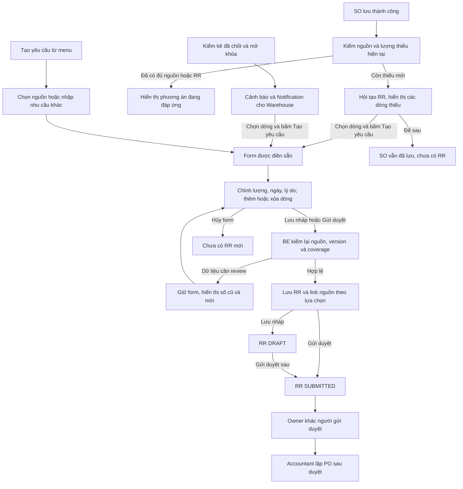

# Đề xuất sửa cấu trúc dữ liệu bổ sung hàng

Bản 1.4.0 đã được người dùng chấp thuận và đồng bộ vào baseline 3.3.0: một nút Tạo yêu cầu mở form điền sẵn, cho chỉnh sửa/thêm sản phẩm rồi Lưu nháp hoặc Gửi duyệt. Sau lưu SO còn thiếu nguồn phù hợp, hệ thống hỏi có muốn mở form tạo RR. Model, seed, contract FE và tài liệu/context đã được đồng bộ; API/consumer/UI mới vẫn là thiết kế chưa triển khai. MongoDB là runtime, SQL là tham chiếu.

## 1. Quyết định sau phỏng vấn — bản 1.4.0

| Nội dung | Quyết định hiện tại |
|---|---|
| Một luồng tạo RR | Tạo yêu cầu → mở form điền sẵn → kiểm tra/chỉnh sửa → Lưu nháp hoặc Gửi duyệt; mở form chưa tạo chứng từ |
| Tạo từ cảnh báo | Người dùng chọn những dòng cần bổ sung; hệ thống mở form có sản phẩm, kho, số lượng gợi ý, lý do và link nguồn |
| Tạo từ menu | Người dùng chọn nguồn SO/kiểm kê để lấy dữ liệu, hoặc nhập nhu cầu khác có lý do; sau đó dùng cùng một form |
| Sau lưu SO | Lưu SO thành công rồi đánh giá nguồn; nếu chưa đủ nguồn phù hợp đúng hạn thì hỏi có muốn tạo RR cho phần thiếu; chọn tạo mới mở form, chưa sinh chứng từ |
| Quyền sửa | Sửa lượng, ngày cần và lý do; sản phẩm/kho/link nguồn của dòng cảnh báo cố định. Muốn đổi nguồn phải chọn lại và tính lại |
| Thêm sản phẩm | Được thêm ngoài danh sách cảnh báo; mỗi dòng phải xác định nguồn đúng hoặc lý do nhu cầu khác, cùng kho/ngày cần của RR |
| Nhiều kho/ngày cần | Một RR vẫn một kho nhận và một ngày cần; các nhóm khác nhau tạo phiếu riêng và phải được người dùng xác nhận |
| Dữ liệu thay đổi | Khi lưu, đánh giá lại; hiển thị số cũ/mới và giữ nội dung người dùng nhập để xác nhận, không tự đổi lượng rồi lưu |
| Người tạo và duyệt | Sales/Warehouse tạo/gửi theo quyền; Owner khác người gửi duyệt; Accountant lập PO sau duyệt |
| Lý do và nguồn | Giữ lý do văn bản, nguồn từng dòng và snapshot; sửa câu chữ hoặc thêm sản phẩm không làm sai nguồn SO/kiểm kê |
| Notification | Tiếp tục lưu thông báo theo người nhận; cảnh báo nghiệp vụ tính lại. Đọc hoặc đóng thông báo không giải quyết nhu cầu |

Phạm vi cần làm: form chung, chọn dòng cảnh báo, điền sẵn từ nguồn, lời hỏi sau lưu SO, thêm dòng nhu cầu khác, kiểm dữ liệu thay đổi và lưu/gửi theo quyền. Phạm vi giữ cho giai đoạn sau: vòng đời StockAlert/giao việc/hẹn nhắc và tự tạo RR trong nền. Biên bản quyết định tại [phỏng vấn 27/10](brainstorms/tao_rr_form_dien_san_2026-10-27.md).

## 2. Kết quả kiểm tra hiện trạng

| Thành phần hiện có | Đã hỗ trợ | Phần còn thiếu cho yêu cầu mới |
|---|---|---|
| `ProductWarehousePolicy` | `productId`, `warehouseId`, `minimumQty`; unique theo sản phẩm/kho | Đã thêm targetQty/version/updatedBy; service tính gợi ý còn cần triển khai |
| `BusinessDocument`, loại `REPLENISHMENT` | Kho, ngày cần, `triggerReason` văn bản, người tạo, trạng thái và version | Có creationKey/submittedBy/At và index; command service còn cần triển khai |
| `DocumentLine` | Sản phẩm, lượng và snapshot quy đổi | Đã thêm discriminator REPLENISHMENT, nguồn SO/kiểm kê và snapshots; kiểm liên collection còn ở service |
| `DocumentLink` / `LineLink` | Nối chứng từ, nối dòng và lượng liên kết | Đã thêm catalogue quan hệ và index childDocumentId; kiểm nguồn/sản phẩm/chuỗi/lượng còn ở service |
| `DemandSupplyAllocation` | Gán lượng cung cho dòng nhu cầu | Chưa có service coverage/chống dùng một nguồn cung vượt lượng |
| `StocktakeSnapshot`, `CountAttempt`, `ST_RESOLUTION` | Căn cứ kiểm kê, lần đếm, phương án và batch chốt | Số sổ tại cutoff không phải số khả dụng sau chốt; RR line đã có trường snapshot đánh giá, service còn cần triển khai |
| `AuditEvent`, `BusinessDocument.createdBy` | User thực hiện | Giữ người thực sự lưu/gửi; mở form điền sẵn chưa phải tạo chứng từ |
| `OutboxEvent` | Event key unique và retry | Đã thêm documentVersion bắt buộc với hai trigger mới; consumer sau commit còn cần triển khai |
| `Notification` | Đã bổ sung schema trong checkout | Consumer/API thông báo vẫn cần triển khai |
| Cảnh báo tồn thấp | Chưa có model riêng trong checkout | Tính bằng service đánh giá; chưa cần collection `StockAlert` cho MVP |

Checkout chưa có module nghiệp vụ RR/kiểm kê trong `src/modules`. Cấu trúc model hiện tại không chứng minh luồng này đã chạy. BF-01 giữ Owner duyệt trước khi Accountant lập PO; BF-05 giữ chốt/mở khóa kiểm kê có kiểm soát.

## 3. Các nguyên tắc nghiệp vụ

1. RR vẫn là BusinessDocument loại REPLENISHMENT; là yêu cầu bổ sung, chờ Owner duyệt trước PO. Chứng từ nhập thực tế phát sinh khi nhận hàng.
2. Một form tạo thống nhất. Việc mở từ menu, cảnh báo hoặc lời hỏi sau lưu SO chỉ quyết định dữ liệu được điền sẵn; lý do từng dòng vẫn là SALES_SHORTAGE, STOCKTAKE_LOW_STOCK hoặc MANUAL_OTHER. MANUAL_OTHER là mã nhu cầu khác, không phải một cách tạo trên giao diện.
3. Nhấn Tạo yêu cầu hoặc đồng ý lời hỏi sau lưu SO chỉ mở form. Chưa có RR, source links hay pending coverage cho đến khi Lưu nháp/Gửi duyệt thành công. Đóng/hủy form không ảnh hưởng SO đã lưu hoặc tạo chứng từ ngầm.
4. SO hợp lệ đã lưu là nguồn thiếu bán; WIR tùy chọn. Không ép tạo WIR trước RR. Một nghĩa vụ SO line có thể có nhiều release nhưng không được cộng thành nhiều nhu cầu độc lập.
5. Mỗi RR có một kho nhận/ngày cần. SO chưa xác định kho thì người dùng chọn kho có quyền trước khi hoàn tất form; không đoán kho từ địa chỉ giao. Các dòng khác kho/ngày cần phải tách phiếu.
6. Nguồn tồn thấp gồm sản phẩm + kho + policy + phiên kiểm kê đã chốt/mở khóa. Cảnh báo khi available < minimum; target >= minimum, mặc định target=minimum. Đánh giá cả SKU0 và hoãn phạm vi còn freeze.
7. Có thể giữ lượng gợi ý hoặc sửa kèm giải trình. Phần vượt thiếu bán đã xác minh phải tách thành dòng dự trữ/nhu cầu khác có lý do; không tăng linkedQty của nguồn bán vượt phần thiếu.
8. Thêm/xóa dòng là thao tác trên form. Dòng thêm phải có nguồn riêng hoặc lý do nhu cầu khác; không mặc nhiên gán mọi sản phẩm thêm vào SO/kiểm kê đang mở.
9. Lưu nháp ghi RR DRAFT. Gửi duyệt kiểm toàn bộ dữ liệu, lưu phiên bản và chuyển SUBMITTED theo quyền; Owner khác người gửi duyệt. Accountant lập PO sau duyệt. Owner chốt kiểm kê không được cấp thêm quyền tạo RR.
10. Gợi ý/Notification không là cam kết cung. Mở hoặc đọc thông báo không đổi stock/reservation; mọi lệnh lưu/gửi đều kiểm lại nguồn, coverage, version và chống trùng.

## 4. Cấu trúc cần sửa

### 4.1. `ProductWarehousePolicy`

| Trường | Kiểu đề xuất | Quy tắc |
|---|---|---|
| `productId`, `warehouseId`, `minimumQty` | Giữ nguyên | Ngưỡng theo sản phẩm/kho, dùng base UOM |
| `targetQty` | Decimal128 | `targetQty >= minimumQty >= 0`; nếu không cấu hình mức riêng thì dùng minimum |
| `version` | Integer >= 1 | Tăng khi đổi ngưỡng hoặc target |
| `updatedBy` | User ref, tùy chọn với dữ liệu cũ | User thay cấu hình thật; không gán giả cho lịch sử |

Giữ unique `(productId, warehouseId)`. Không thêm cờ tự tạo RR sau kiểm kê. `neededOn` vẫn do người dùng xác nhận khi tạo; thiếu bán gợi ý theo SO. Nếu sau này cần gợi ý ngày cho nhu cầu dự trữ thì thêm lead days hữu hạn do Owner cấu hình, không tự mặc định lịch nhập.

### 4.2. BusinessDocument, header REPLENISHMENT

| Trường | Đề xuất 1.4.0 |
|---|---|
| createdBy | User thực sự lưu/tạo RR, lấy từ session |
| header.warehouseId, neededOn | Bắt buộc khi lưu/gửi; gợi ý từ nguồn có căn cứ rồi người dùng xác nhận |
| header.triggerReason | Văn bản bắt buộc; hệ thống điền từ các dòng nguồn, người dùng được sửa. RR gồm dòng nguồn và dòng thêm phải diễn đạt đủ cả hai nhu cầu |
| header.creationKey | Giữ key ổn định của lần lưu mới; partial unique theo createdBy + creationKey, so payloadHash khi retry |
| header.submittedBy, submittedAt | Ghi theo cặp khi gửi duyệt, đúng user có quyền; lưu nháp chưa gửi thì để vắng |

Form có thể được điền sẵn từ nhiều dòng nguồn nhưng dùng chung thao tác lưu/gửi. Source và triggerType từng dòng diễn đạt lý do; ngữ cảnh mở form có thể ghi audit khi cần.

Contract tạo mới dùng action SAVE_DRAFT/SUBMIT và creationKey. Với nháp đã lưu, contract cập nhật dùng ID trên route, documentVersion và operationKey của thao tác cập nhật/gửi; giữ ID RR, không gọi lại lệnh tạo với creationKey cũ và payload khác.

Dòng đã lưu gửi lineId để giữ identity; dòng thêm chưa có lineId. BE kiểm mọi lineId thuộc chính RR đang sửa và trạng thái cho phép chỉnh; không thay ID dòng nguồn chỉ vì đổi thứ tự hiển thị hoặc sửa lý do.

Mở form chỉ giữ trạng thái nhập ở FE, không tạo RR DRAFT để giả làm form. Lưu nháp thành công trả ID/version; chỉnh tiếp phải cập nhật cùng RR đó theo version, không tạo một RR mới. Gửi duyệt trực tiếp từ form chỉ hợp lệ sau khi kiểm dữ liệu và ghi nhận đầy đủ RR/người gửi/nguồn trong transaction.

FE giữ creationKey ổn định khi double click/retry cùng payload; BE trả kết quả cũ nếu đã commit, báo conflict nếu cùng key khác payload. Lỗi mạng không rõ kết quả phải tra thao tác trước khi quyết định lưu lại. Sau một lần từ chối rõ ràng do dữ liệu cũ, người dùng review payload mới và thực hiện lần xác nhận mới; không đổi key để né một giao dịch chưa rõ kết quả.

### 4.3. `DocumentLine`, thêm `lineKind=REPLENISHMENT`

`productId`, `qtyBase`, `conversionId`, `conversionSnapshot` của base line vẫn là dữ liệu chính. `qtyBase` là lượng đề nghị thực tế; `suggestedQty` giữ số hệ thống tính để Owner thấy việc điều chỉnh. Một dòng giữ một nguồn chính; nếu gom nhiều đơn bán thì tách dòng theo SO line.

| Trường trong `details` | Ý nghĩa/quy tắc |
|---|---|
| `triggerType` | `SALES_SHORTAGE`, `STOCKTAKE_LOW_STOCK`, `MANUAL_OTHER` |
| `sourceSalesOrderLineId` | Bắt buộc khi thiếu bán; giữ khi người dùng sửa lượng/lý do; từ dòng này truy được SO |
| `sourceSalesOrderVersion` | Version SO tại lần đánh giá |
| `sourceIssueRequestLineId`, `sourceIssueRequestVersion` | Tùy chọn nếu đã có WIR đúng SO line; cùng có/cùng vắng |
| `sourceStocktakeId`, `sourceStocktakeVersion` | Bắt buộc với dòng tồn thấp sau chốt kiểm kê |
| `policyId`, `policyVersion` | Bắt buộc khi tồn thấp; cùng sản phẩm/kho |
| `evaluationKey` | Nhận dạng lần tính/snapshot, phục vụ kiểm tra dữ liệu đã thay đổi; không phải unique key tiêu thụ nhu cầu |
| `evaluatedAt` | Thời điểm đánh giá thực tế |
| `availableQtySnapshot` | Khả dụng cùng kho tại lần đánh giá |
| `otherWarehouseCoverageQtySnapshot` | Phần nguồn kho khác tương thích/đúng hạn có phương án thực hiện |
| `remainingDemandQtySnapshot` | Phần nghĩa vụ bán còn cần đáp ứng, đã loại thực hiện ròng và hủy hợp lệ |
| `reservedForDemandQtySnapshot` | Reservation còn giữ cho các release của cùng nghĩa vụ bán |
| `onHandCoverageQtySnapshot` | Khả dụng cùng kho được tính cho nhu cầu này |
| `incomingCoverageQtySnapshot` | Phần PO/nguồn đang về đúng hạn và chưa dành cho nhu cầu khác |
| `pendingRequestCoverageQtySnapshot` | Phần RR trước còn hiệu lực, chưa chuyển thành supply, phục vụ cùng nhu cầu |
| `minimumQtySnapshot`, `targetQtySnapshot` | Bắt buộc cho tồn thấp |
| `suggestedQty` | Decimal128 > 0 ở dòng có gợi ý; có thể vắng với MANUAL_OTHER thuần túy |
| `reasonNote` | Văn bản bắt buộc ở từng dòng, tự điền hoặc user viết; không dùng thay source refs |
| `quantityAdjustmentReason` | Giải trình khi user điều chỉnh lượng so với gợi ý, đặc biệt khi muốn lượng lớn hơn |

Một SO có nhiều WIR/OD nhưng vẫn là một nghĩa vụ gốc theo SO line. Không cộng cả SO/WIR/OD thành nhiều demand. Dòng WIR tùy chọn chỉ mô tả release/ngữ cảnh; RR trước tạo từ SO phải được tính khi kiểm thiếu từ WIR và ngược lại.

Form điền qtyBase từ suggestedQty sau quy đổi hợp lệ; người dùng có thể chỉnh lượng và phải giải trình khi khác gợi ý mới nhất. Nếu lượng cao hơn thiếu bán đã xác minh thì tách phần thêm thành dòng nhu cầu khác có lý do; không tăng linkedQty của nguồn bán để hợp thức hóa lượng thêm. Dòng thêm ngoài danh sách cũng dùng loại REPLENISHMENT, với triggerType phù hợp từng nguồn.

Lý do có thể ghi: “Bổ sung cho SO-015, gạch A cần 100; kho hiện có 40; kho khác đáp ứng 20; PO sắp về đã dành 30; đề nghị thêm 10.” Dòng nguồn vẫn giữ SO-015 và nguồn từng dòng dù người dùng đổi nội dung câu chữ. Lưu snapshot có cấu trúc song song để đọc được phép tính lịch sử.

Snapshot của version đã duyệt giữ lịch sử. Khi thay nguồn/lượng phải kiểm version, lưu lịch sử đánh giá và yêu cầu review lại; không sửa đè phần đã có PO/thực hiện. Client không tự gán snapshot/coverage làm dữ liệu đáng tin: BE tính/xác nhận lại trước khi lưu.

### 4.4. `DocumentLink`, `LineLink`, `DemandSupplyAllocation`

Giữ cấu trúc collection; thêm kiểm tra loại nguồn, sản phẩm, scope, lượng và index tra ngược `DocumentLink.childDocumentId`. Catalogue mã quan hệ mới không loại bỏ mã cũ.

| Nguồn → đích | Model / mã quan hệ đề xuất | Mục đích |
|---|---|---|
| SO → RR | DocumentLink / `REPLENISHES_SALES_ORDER` | Link đơn bán khi có dòng RR thực sự bổ sung cho nhu cầu SO |
| SO line → RR line | LineLink / `REPLENISHES_DEMAND` | Ghi phần thiếu cụ thể, linkedQty |
| WIR → RR | DocumentLink / `RELATED_ISSUE_REQUEST` | Ngữ cảnh tùy chọn khi đã có WIR |
| Stocktake → RR | DocumentLink / `STOCKTAKE_REPLENISHMENT` | Truy phiên đã chốt dẫn tới cảnh báo |
| RR → PO; RR line → PO line | DocumentLink/LineLink / `REPLENISHMENT_PURCHASE` | Truy lượng được mua để đáp ứng RR |
| SO line → PO/transfer supply line | DemandSupplyAllocation | Cung cho nghĩa vụ bán gốc; các release WIR của cùng SO line dùng chung coverage này |
| RR dự trữ line → PO/transfer supply line | DemandSupplyAllocation | Cung cho phần dự trữ; không chiếm lại phần đã dành cho đơn bán |

Các allocation cũ dùng WIR line phải được resolve về SO line khi tính coverage. Khi chuyển sang mô hình nguồn gốc SO, đối chiếu/backfill có kiểm chứng rồi mới dùng canonical SO-line key; không giữ cả allocation SO và WIR cho cùng lượng như hai cam kết độc lập. Mongoose ref DocumentLine hiện có đủ kiểu ID, nhưng service cần định nghĩa loại demandLine được chấp nhận.

`DocumentLink` chỉ nối BusinessDocument. Product/policy ref lưu đúng trường, không nhét vào parentDocumentId. Trường nguồn trên RR line là căn cứ xử lý; DocumentLink/LineLink được sinh nhất quán cùng transaction và phục vụ truy vết. Không có yêu cầu Evidence hay ExternalReference mới chỉ để giải thích tồn thấp.

Khi RR chuyển sang PO, coverage chuyển từ pending RR sang incoming đúng một lần. Khi cung trở thành hàng khả dụng/reservation, giảm/chuyển incoming để không cộng cả PO và stock đã nhận. RECEIVING chưa phải khả dụng; theo dõi nguồn đang xử lý đến put-away hoặc kết quả lỗi/hủy.

### 4.5. Đánh giá, form chưa lưu và chống lưu trùng

MVP có Notification theo người nhận; cảnh báo vẫn tính lại từ dữ liệu đã commit, không thêm StockAlert. GET danh sách/chi tiết và mở form không lưu RR hoặc tạo pending coverage. Notification lưu nội dung tại lúc phát hiện, trang cảnh báo trả số hiện tại.

- POST /api/replenishments/evaluate [TK] nhận nguồn/version/kho/ngày cần và phương án nguồn; trả dòng gợi ý, số liệu và evaluationKey. Form dùng kết quả để điền sẵn; client không quyết định snapshot đáng tin.
- Command lưu/gửi RR nhận source refs/version, creationKey, các trường người dùng nhập và mục đích lưu nháp/gửi duyệt. BE tính lại nhu cầu và kiểm source, scope, product/tone/calibre, UOM, ngày cần, version, coverage.
- Nếu dữ liệu dùng để quyết định lượng/nguồn đã đổi, chưa ghi RR: trả số hiện tại và khác biệt để người dùng review. Giữ lượng/ngày/lý do đã nhập trên form, không tự thay rồi lưu. Lượng cao hơn thiếu bán hiện tại phải giảm hoặc tách dòng khác; lượng thấp hơn có thể là đáp ứng một phần có giải trình.
- Nếu nguồn bị hủy, hết nhu cầu, hết quyền hoặc không còn hợp lệ, đánh dấu dòng lỗi và giữ form để sửa/xóa; không âm thầm đổi sang MANUAL_OTHER hoặc bỏ source refs. Không tạo dòng0.
- Dùng creationKey/payloadHash cho retry và ReplenishmentPlanningGuard theo kho/sản phẩm, resolve SO-line gốc để hai form/source WIR-SO không cùng mua bù một lượng. Mọi command thay coverage cần cùng conditional-write protocol; schema và phép SUM đơn thuần chưa chống write skew.
- Lưu RR header/lines/source links/audit/idempotency cùng transaction; nếu gửi ngay thì cả trạng thái/người gửi phải nhất quán. Không post stock hoặc tạo PostingBatch cho RR.
- Outbox STOCKTAKE_CLOSED/SALES_ORDER_SAVED có documentVersion được ghi cùng command nguồn; consumer đánh giá/thông báo sau commit, không mở hộ form hoặc tạo RR. Lỗi đánh giá/thông báo không rollback SO/kiểm kê đã lưu; chỉ retry phần xử lý còn thiếu.

### 4.6. Model `Notification` và cảnh báo tính lại

| Thành phần | Dữ liệu và mục đích | Quyết định MVP |
|---|---|---|
| `OutboxEvent` | Sự kiện nguồn đã commit, dùng xử lý nền và retry | Dùng model hiện có; chỉ đánh dấu xử lý xong sau khi consumer đã hoàn tất |
| `Notification` | Ai được thông báo, nội dung tại lúc đánh giá, nguồn liên quan, đã đọc hay chưa | Thêm model và collection `notifications` |
| Cảnh báo tồn thấp/thiếu bán | Số khả dụng, ngưỡng, coverage và lượng thiếu mới theo trạng thái hiện tại | Service tính lại khi mở danh sách/chi tiết hoặc trước tạo RR |
| RR | Đề nghị do người dùng xác nhận, giữ source refs và snapshot tại lúc tạo | Vẫn dùng BusinessDocument/DocumentLine và gửi duyệt |

**Trường đề xuất cho `Notification`:**

| Trường | Kiểu đề xuất | Quy tắc |
|---|---|---|
| `recipientId` | User ref, bắt buộc | Một record cho một người nhận; trạng thái đọc độc lập giữa các nhân viên |
| `type` | Enum | Ban đầu gồm `LOW_STOCK_AFTER_STOCKTAKE`, `SALES_SHORTAGE` |
| `title`, `message` | String có giới hạn, bắt buộc | Nội dung tại thời điểm đánh giá; có thể tổng hợp nhiều sản phẩm trong cùng kho/nguồn |
| `warehouseId` | Warehouse ref | Bắt buộc với thông báo sau kiểm kê; thiếu bán chỉ gắn khi đã xác định kho, không tự suy kho của SO |
| `sourceDocumentId` | BusinessDocument ref, bắt buộc | Phiên kiểm kê hoặc SO dẫn tới thông báo |
| `sourceDocumentVersion` | Integer >= 1 | Version nguồn được đọc tại lần đánh giá; không thay version kiểm lại khi tạo RR |
| `eventKey` | String, bắt buộc | Khóa sự kiện outbox dẫn tới thông báo, phục vụ truy vết |
| `evaluatedAt` | Date, bắt buộc | Thời điểm hệ thống thực sự tính dữ liệu cho nội dung thông báo; có thể muộn hơn thời điểm chốt/lưu nguồn |
| `readAt` | Date hoặc null | Chưa đọc thì null; chỉ người nhận được đánh dấu đã đọc thông báo của mình |
| `dedupKey` | String, unique | Sinh phía BE từ eventKey + type + recipientId + warehouseId nếu có; retry không tạo trùng |
| `createdAt`, `updatedAt` | Timestamps | Theo convention model hiện có |

Đề xuất index tra danh sách `(recipientId, createdAt desc)`, tra chưa đọc `(recipientId, readAt, createdAt desc)` và unique `dedupKey`. Khóa chống trùng Notification độc lập với `creationKey` của RR. Notification do hệ thống sinh, không phải BusinessDocument và không cần gán user giả vào `BusinessDocument.createdBy`.

Sau kiểm kê, gửi một thông báo tổng hợp theo phiên/kho/người nhận cho các Warehouse đang active, được phân công tại kho và có quyền xem phần nghiệp vụ liên quan. Nếu một người quản lý nhiều kho thì mỗi thông báo giữ đúng kho nguồn. Không suy ra mọi Warehouse đều được nhận hoặc xem mọi phiên. Với thiếu bán, cảnh báo ngay cho người xử lý SO theo quyền nguồn; nếu phát Notification thì người nhận cũng phải có quyền đối với SO/kho liên quan, không gửi hàng loạt cho Warehouse không liên quan.

BE kiểm scope khi lấy danh sách, số chưa đọc và khi mở nguồn. Người đã mất quyền kho/chứng từ không tiếp tục xem nội dung nhạy cảm chỉ vì từng là người nhận; giữ record lịch sử nhưng lọc theo quyền hiện hành. Quyền đọc/đánh dấu thông báo không cấp thêm quyền tạo hoặc duyệt RR. Đánh dấu đã đọc là command riêng có kiểm recipient, không thực hiện ngầm bằng GET danh sách.

Consumer dùng upsert theo `dedupKey`; retry sau khi đã ghi được một phần người nhận không ghi trùng hoặc reset `readAt`. Event chỉ hoàn tất sau khi xử lý hết người nhận hợp lệ; không có người nhận hợp lệ thì vẫn có thể hoàn tất, còn cảnh báo nghiệp vụ vẫn truy vấn được theo quyền. Phát Notification khi lần đánh giá phát hiện tồn dưới ngưỡng hoặc thiếu bán; nếu đã có coverage đủ thì nội dung nêu đã có phương án đáp ứng, không mời tạo RR trùng. Nếu tại lúc consumer chạy điều kiện đã hết thì không cần tạo thông báo thiếu hàng cũ.

**Cách Warehouse nhìn thấy và xử lý:**

- Sau chốt thành công, Owner có thể thấy kết quả đánh giá ngay trên màn hình. Warehouse nhận thông báo trong ứng dụng sau khi consumer xử lý; mở danh sách/refresh đọc Notification đã lưu. MVP có thể dùng truy vấn định kỳ, không bắt buộc WebSocket.
- Thông báo ví dụ: “Sau kiểm kê KK-001, Kho A có 3 mặt hàng dưới ngưỡng.” Người dùng vắng mặt lúc chốt vẫn đọc được thông báo khi đăng nhập lại, nếu còn quyền.
- Bấm thông báo mở trang Cảnh báo tồn thấp với kho và phiên làm ngữ cảnh; BE tính lại tồn, policy và coverage. Hiển thị riêng thời điểm phát hiện và thời điểm đánh giá hiện tại, không trình bày số cũ như số hiện hành.
- Mỗi mặt hàng hiển thị sản phẩm/kho, tồn khả dụng, minimum/target, nguồn bổ sung đang có, lượng thiếu mới và link phiên kiểm kê. Ví dụ available18/min50/target50/incoming10 thì gợi ý22; người dùng chọn các mặt hàng cần rồi bấm **Tạo yêu cầu** để mở form điền sẵn, hoặc **Để sau** theo quyền.
- Chọn Để sau hoặc đọc thông báo không lưu RR, không tiêu thụ coverage và không ẩn mặt hàng khỏi danh sách nếu điều kiện cảnh báo vẫn còn. Khi có RR/cung đủ thì trang hiện đã có phương án đáp ứng; Notification cũ vẫn là lịch sử thông báo, không là bằng chứng rằng đang còn thiếu.
- Khi lưu/gửi RR, hệ thống kiểm lại dữ liệu và lưu snapshot/source refs theo mục 4.2–4.5. Không sao chép lượng từ nội dung Notification làm lượng đề nghị mặc định mà bỏ bước đánh giá lại.

**Khi nào mới thêm `StockAlert`:** Khi cần giao người phụ trách từng cảnh báo, hẹn nhắc lại, bỏ qua có lý do hoặc lưu lịch sử trạng thái xử lý riêng. Khi đó StockAlert giữ vòng đời nghiệp vụ, Notification trỏ tới cảnh báo và vẫn giữ trạng thái đọc theo từng người. Các chức năng này nằm ngoài MVP hiện tại; lựa chọn Để sau chỉ là chưa xử lý, không mang nghĩa hẹn nhắc hay miễn cảnh báo.

## 5. Luồng tạo RR thống nhất



### 5.1. Sau khi lưu SO — đề xuất lời hỏi tạo RR

1. Lưu SO/source lines hợp lệ trước. Chỉ sau commit thành công mới đánh giá/phát lời hỏi; SO không bị coi là lưu thất bại vì thiếu hàng hoặc vì người dùng chọn Để sau.
2. Kiểm lượng còn phải đáp ứng theo SO line, tồn khả dụng cùng kho, các kho khác và PO/transfer phù hợp đúng product/tone/calibre, đúng hạn, chưa dành cho nhu cầu khác; trừ pending RR hợp lệ. Nguồn khác kho cần phương án giao/điều chuyển có thể thực hiện. Chưa rõ nguồn/đang lỗi đánh giá là CHƯA XÁC ĐỊNH, không kết luận nguồn bằng0.
3. Có nguồn khác khả thi mà người dùng chưa chọn: trình bày phương án đó trước; không gọi là không có nguồn chỉ vì chưa có allocation. Khi vẫn còn phần chưa được đáp ứng thì gợi ý RR cho phần đó. Không đủ kho/ngày cần thì người dùng chọn/xác nhận trước khi mở form hoàn chỉnh.
4. Nếu không có nguồn phù hợp đáp ứng đúng hạn: hiện “Đơn SO-015 đã được lưu. Các mặt hàng dưới đây chưa có nguồn phù hợp đáp ứng trước ngày cần. Bạn có muốn tạo yêu cầu bổ sung?” Kèm danh sách các dòng thiếu, số cần, nguồn đang có và lượng đề nghị.
5. Đề xuất dùng cùng lời hỏi khi nguồn chỉ đáp ứng một phần, với câu “Đã có nguồn đáp ứng90/100; còn thiếu10. Bạn có muốn tạo yêu cầu bổ sung cho phần còn thiếu?” Như vậy trường hợp có chút tồn vẫn được hỗ trợ, không chỉ trường hợp mọi nguồn bằng0.
6. Người dùng tick các dòng cần, bấm Tạo yêu cầu để mở form điền sẵn. Các hành động còn lại là Xem nguồn đáp ứng và Để sau/đóng hộp thoại. Chưa chọn dòng thì chưa mở form có hàng; chưa lưu/gửi form thì chưa có RR.
7. Đã có pending RR hoặc nguồn đủ bù toàn phần thì hiện đã có phương án và link RR/nguồn liên quan, không hỏi tạo thêm cùng lượng. Pending chỉ đáp ứng một phần thì hỏi cho phần thiếu mới. Hàng sai tone, bị khóa hoặc về sau hạn được giải thích rõ, không tính như nguồn phù hợp.
8. Lời hỏi hiện một lần theo thao tác lưu có thay đổi dữ liệu ảnh hưởng nhu cầu. Refresh trang, mở thông báo, retry cùng thao tác hoặc sửa ghi chú không liên quan không tự bật lại hộp thoại; cảnh báo/nút Tạo yêu cầu vẫn truy cập được trên chi tiết SO. Một lần lưu sau có thay đổi sản phẩm/lượng/ngày cần có thể đánh giá và hỏi lại nếu còn thiếu mới.
9. Đánh giá chậm/lỗi: xác nhận SO đã lưu và hiện đang kiểm tra nguồn hoặc chưa kiểm tra được, có nút thử lại. Không hiển thị thiếu0 nguồn hoặc tự điền lượng từ dữ liệu chưa xác minh.

Ví dụ: SO100, không có tồn/nguồn phù hợp → hỏi bổ sung100. SO100, cùng kho40 + kho khác theo phương án20 + PO đúng hạn đã dành30 → hỏi bổ sung10. Nếu đã có RR10 còn hiệu lực thì không tạo gợi ý10 lần nữa khi mở form hoặc tạo WIR.

### 5.2. Sau kiểm kê

1. Warehouse kiểm đếm/đối chiếu và xác nhận thực hiện; khi có chênh lệch Owner duyệt/chốt batch UC-92/93. Nhánh không lệch đóng hợp lệ theo BF-05. Chỉ sau commit cập nhật tồn và mở khóa mới phát đánh giá/thông báo.
2. Đánh giá toàn sản phẩm/kho theo policy gồm SKU0. Available theo STORE/GOOD, lot VERIFIED, kho/vị trí/product active, STORAGE allocatable, không hold/freeze và trừ ACTIVE reservation một lần. Không lấy một kệ làm tổng kho; DefectHold hiện chặn toàn balance có hold.
3. Hoãn khi scope liên quan còn freeze. Hàng đã nhận chờ put-away là nguồn đang xử lý phù hợp, chưa là available; không đề nghị bù hai lần.
4. Warehouse active đúng kho thấy Notification tổng hợp và danh sách Cảnh báo tồn thấp. Khi mở, hệ thống tính lại. Dòng đã có RR/cung đủ hiển thị đang có phương án đáp ứng; chỉ dòng còn thiếu mới có lượng gợi ý tạo.
5. Người dùng chọn mặt hàng, bấm Tạo yêu cầu, kiểm tra/chỉnh form rồi Lưu nháp/Gửi duyệt. Owner chốt chỉ kích hoạt bước đánh giá; không tự tạo RR và không được cấp thêm quyền tạo.

### 5.3. Tạo trực tiếp từ menu

Người dùng chọn kho nhận/ngày cần, sau đó chọn nguồn SO hoặc phiên kiểm kê đủ quyền để lấy các dòng gợi ý; cũng có thể nhập nhu cầu khác có lý do. Khi chọn nguồn, các product/source refs được cố định theo dòng và giữ khi sửa lượng/lý do. Nhu cầu khác chọn sản phẩm và nhập lượng, không phải có SO/kiểm kê giả. Tất cả đi qua cùng form và kiểm quyền, coverage, version, idempotency khi lưu/gửi.

### 5.4. Trường trên form và việc thêm sản phẩm

| Trường | Điền sẵn | Người dùng xử lý |
|---|---|---|
| Kho nhận | Theo cảnh báo/nguồn nếu đã xác định | Xác nhận; đổi kho phải chọn lại ngữ cảnh và tính lại, không đổi tùy ý trên dòng nguồn |
| Sản phẩm và link nguồn | Theo các dòng được chọn | Chỉ đọc trên dòng nguồn; được xóa dòng hoặc thêm dòng sản phẩm khác |
| Lượng đề nghị | Lượng còn thiếu sau coverage | Được sửa; lượng khác gợi ý mới nhất cần giải trình |
| Ngày cần | Theo SO có căn cứ; sau kiểm kê/nhu cầu khác để người dùng chọn nếu chưa có căn cứ | Được sửa/xác nhận, không tự đặt số ngày nhập; nếu trễ hạn SO phải thể hiện chưa đáp ứng đúng hạn |
| Đơn vị/quy đổi | Theo nguồn hoặc đơn vị cơ sở hợp lệ của sản phẩm | Kiểm quy đổi/version và whole-piece; không tự làm tròn sai lượng |
| Lý do chung/từng dòng | Tự soạn từ nguồn và số liệu | Được sửa; dòng thêm nhu cầu khác phải có lý do riêng |
| Tồn, coverage, lượng gợi ý và thời điểm tính | Do BE đánh giá | Chỉ đọc; dùng so sánh với lượng đề nghị, không là trường client tùy gán |

- Có thể bỏ chọn/xóa sản phẩm cảnh báo và thêm sản phẩm ngoài danh sách. Một form chỉ nhận các dòng cùng kho/ngày cần; khác nhóm thì hướng dẫn tạo phiếu riêng, không âm thầm sinh nhiều RR.
- Sản phẩm thêm có SO line khác còn thiếu hoặc cảnh báo hợp lệ: người dùng chọn nguồn đó và hệ thống đánh giá/gắn refs riêng. Nếu không có nguồn nhu cầu cụ thể, dùng MANUAL_OTHER và lý do bắt buộc.
- Sản phẩm không nằm trong SO gốc không được gắn giả vào SO line đó. Ví dụ RR có gạch A bổ sung SO-015 và gạch B mua dự trữ: A có sourceSalesOrderLineId/LineLink; B có MANUAL_OTHER/reasonNote, không có link lượng vào SO-015. DocumentLink SO→RR chỉ cho biết RR có dòng phục vụ SO, không biến mọi dòng thành nhu cầu bán.
- Cùng sản phẩm nhưng khác SO line/lý do có thể tách dòng; trùng đúng cùng nguồn thì cảnh báo để gộp/sửa, không nhân nhu cầu. Số vượt phần thiếu bán của cùng sản phẩm cũng tách dòng nhu cầu khác có giải trình.

### 5.5. Dữ liệu thay đổi trong lúc mở form

Khi Lưu nháp/Gửi duyệt, so version/evaluationKey và coverage hiện tại. Nếu thay đổi ảnh hưởng quyết định thì giữ form, hiển thị so sánh tồn/nguồn/gợi ý trước–sau và yêu cầu người dùng xác nhận lại dữ liệu mới. Không tự thay số lượng đã nhập hoặc loại bỏ nguồn/dòng. Người dùng chọn cập nhật lượng theo gợi ý mới, giữ lượng thấp hơn như đáp ứng một phần có giải trình, hoặc xử lý phần vượt thành nhu cầu khác hợp lệ. Dòng nguồn hết nhu cầu/bị hủy/không còn quyền phải sửa/xóa trước khi lưu; không ghi RR theo nguồn cũ đã vô hiệu.

## 6. Lượng gợi ý và lượng user đề nghị

```text
Thiếu bán mới
  = max(0, SO-line còn phải thực hiện ròng
           - reservation còn giữ cho cùng nghĩa vụ
           - available cùng kho được gán cho nghĩa vụ
           - coverage kho khác theo phương án thực hiện
           - incoming đúng hạn đã gán
           - pending RR chưa chuyển thành supply cho cùng nghĩa vụ)

Khi available < minimumQty, xét riêng nhu cầu dự trữ:
Lượng gợi ý dự trữ
  = max(0, targetQty
           - available còn lại sau phục vụ nghĩa vụ bán đã biết
           - incoming còn lại dành cho dự trữ
           - pending RR dự trữ chưa chuyển thành supply)
```

Một lượng tồn/cung chỉ dùng một lần; có thể phân bổ từng phần cho nhiều SO nhưng tổng không vượt nguồn. Nghĩa vụ bán gốc SO line bao gồm các release WIR của nó; loại lượng đã thực hiện ròng/hủy hợp lệ. Giữ quy tắc PGI hợp lệ trừ GR-FD đã post khi xác định phần tái mở, không cộng OD giao lại như demand mới.

MVP ưu tiên hiển thị **hai gợi ý tách biệt** nếu đồng thời có thiếu bán và thiếu dự trữ. User có thể chỉ chọn bổ sung cho đơn bán; không tự cộng lượng dự trữ vào RR bán vì user chưa chọn nhu cầu đó. Nếu chọn cả hai thì planner chia nguồn và tạo các dòng lý do riêng sau khi kiểm lại coverage.

Ví dụ không có đơn bán: available18, minimum50, target50, incoming10 còn dùng → gợi ý22. Bấm Tạo yêu cầu mở form điền22; người dùng có thể giữ nguyên hoặc chỉnh kèm giải trình, rồi mới lưu/gửi. Chỉ hiển thị cảnh báo22 chưa được tính là pending22. Sau khi user lưu RR22, lần đánh giá sau không đề nghị lại22. Với incoming32 đủ bù tới50, vẫn có thể cảnh báo tồn hiện tại thấp và hiện nguồn đã đáp ứng; không tạo dòng0.

Pending coverage gồm RR DRAFT đã lưu còn hiệu lực, SUBMITTED và phần APPROVED chưa chuyển sang PO. Loại rejected/cancelled/đã chuyển supply. Cần xử lý phần proposal mất nhu cầu khi SO/PO thay đổi để nó không chặn đề nghị mới mãi. Không tính lượng trên form chưa lưu hoặc gợi ý chưa được user chọn.

Lượng đề nghị thấp hơn gợi ý có thể được gửi duyệt như đáp ứng từng phần. Nếu user muốn cao hơn, phần vượt nhu cầu xác minh phải tách lý do dự trữ/nhu cầu khác; cả lượng và giải trình hiện cho Owner trước duyệt. Mọi thay đổi vẫn giữ source links.

## 7. Ví dụ dữ liệu khi đã lưu form

```js
// Minh họa rút gọn, không phải payload đầy đủ để ghi DB.
{
  createdBy: 'USER-SALES-01',
  header: {
    warehouseId: 'K1',
    creationKey: 'stable-user-save-key',
    triggerReason: 'Bổ sung cho SO-015 và mua thêm hàng dự trữ.',
    neededOn: '2026-11-01T00:00:00+07:00',
  },
}
// Hai dòng chung một RR, mỗi dòng có căn cứ riêng:
[
  {
    lineKind: 'REPLENISHMENT', productId: 'PRODUCT-A', qtyBase: '10',
    details: {
      triggerType: 'SALES_SHORTAGE', sourceSalesOrderLineId: 'SO-015-L1', sourceSalesOrderVersion: 2,
      evaluationKey: 'SO-015-L1:v2:coverage-hash', evaluatedAt: '2026-10-27T08:00:00.000Z',
      remainingDemandQtySnapshot: '100', reservedForDemandQtySnapshot: '0',
      availableQtySnapshot: '40', onHandCoverageQtySnapshot: '40', otherWarehouseCoverageQtySnapshot: '20',
      incomingCoverageQtySnapshot: '30', pendingRequestCoverageQtySnapshot: '0', suggestedQty: '10',
      reasonNote: 'SO-015 cần100, các nguồn đáp ứng90, bổ sung10.',
    },
  },
  {
    lineKind: 'REPLENISHMENT', productId: 'PRODUCT-B', qtyBase: '5',
    details: { triggerType: 'MANUAL_OTHER', reasonNote: 'Mua dự trữ mẫu B cho nhu cầu trưng bày mới.' },
  },
]
```

Chỉ dòng A có LineLink SO-015-L1→RR-line với linkedQty10. Dòng B được thêm trên form và không chiếm nhu cầu của SO-015. Nguồn được giữ khi sửa lý do hoặc chỉnh lượng. Mở form có dữ liệu trên nhưng chưa lưu thì chưa có RR, link nguồn hoặc pending coverage trong DB.

## 8. Phạm vi 1.4.0 và tiêu chí nghiệm thu

| Hạng mục | Cấu trúc và hợp đồng hiện hành |
|---|---|
| Model/contract | Một form tạo RR; giữ nguồn/snapshots, creationKey, submission; contract SAVE_DRAFT/SUBMIT |
| Service | Một command lưu/gửi form; fill từ nguồn, SO post-save evaluation/prompt DTO, kiểm thêm dòng, recheck/stale response, guard/idempotency, RR→PO→stock coverage |
| FE | Một nút Tạo yêu cầu; form chung, chọn dòng cảnh báo, thêm/xóa sản phẩm, chọn nguồn từ menu, lời hỏi sau lưu SO, giữ form khi dữ liệu đổi |
| Seed/kiểm chứng | Chuyển mẫu hai mode sang hai bối cảnh mở cùng form; thêm RR hỗn hợp nguồn/nhu cầu khác, mở/hủy form không có record, thiếu0 nguồn/thiếu một phần/pending đủ/stale form |
| Notification | Giữ collection và scope/dedup/readAt; nút mở dẫn đến cảnh báo/form tính lại, không tạo RR |
| Quyền và duyệt | Giữ Sales/Warehouse create, Owner khác người gửi approve và Accountant PO sau duyệt; không cấp quyền từ việc mở cảnh báo |
| Tài liệu/context | Đồng bộ lại BF-01/05/06, UC liên quan, BR-03/25, SQL và DTO khi áp dụng; baseline/model 3.3.0 đã đồng bộ cấu trúc, còn API/consumer/UI chưa triển khai |

Các trường hợp dưới là tiêu chí đề xuất, không phải kết quả test đã chạy cho 1.4.0:

| Trường hợp | Kết quả kỳ vọng |
|---|---|
| Chốt kiểm kê available18/min50/incoming10 | Cảnh báo gợi ý22; đúng Warehouse nhận Notification sau commit, chưa có RR |
| Bấm Tạo yêu cầu từ cảnh báo | Mở form điền22/nguồn/lý do; chưa ghi RR hoặc pending coverage |
| Đóng/hủy form hoặc chọn Để sau | Không có RR mới; SO/kiểm kê đã lưu vẫn thành công, cảnh báo còn nếu còn điều kiện |
| Lưu nháp form hợp lệ | Một RR DRAFT, user thật, nguồn/snapshots/lý do đầy đủ |
| Gửi duyệt trực tiếp từ form | Lưu đúng một RR và gửi SUBMITTED theo quyền; Owner khác người gửi duyệt |
| Đã lưu nháp rồi chỉnh/gửi | Cập nhật chính RR đó theo ID/version, không tạo phiếu khác |
| SO100, mọi nguồn phù hợp bằng0 | Sau lưu hỏi tạo RR100; người dùng chọn dòng và mở form, chưa tự lưu |
| SO100, nguồn40+20+30 | Đề xuất lời hỏi cho phần thiếu10, không đề nghị100 |
| Đã có RR/cung đủ10 cho phần thiếu | Hiện phương án/link đã có, không hỏi tạo RR trùng10 |
| Có kho khác phù hợp nhưng chưa chọn phương án | Hiển thị phương án, không thông báo sai rằng không có nguồn |
| Đánh giá nguồn lỗi/chưa rõ | SO vẫn lưu; hiện chưa kiểm tra được và cho thử lại, không coi nguồn bằng0 |
| Refresh/retry lưu SO/sửa ghi chú | Không tự lặp hộp thoại, không tạo RR; vẫn có cảnh báo/nút tạo khi phù hợp |
| Chọn nhiều sản phẩm cùng kho/ngày cần | Đưa các dòng đã chọn vào một form, giữ source từng dòng |
| Thêm B không có trong SO nguồn | Dòng nhu cầu khác có reason riêng; không gắn B vào SO line của A |
| Thêm dòng có SO/kiểm kê khác | Chọn và đánh giá nguồn riêng theo scope; giữ chung kho/ngày cần |
| Đổi sản phẩm/kho của dòng nguồn | Không sửa ID trực tiếp; chọn lại nguồn/ngữ cảnh rồi đánh giá lại |
| Tồn/cung/nguồn đổi trước khi lưu | Giữ form, hiển thị số cũ/mới; chưa ghi RR tới khi user xác nhận dữ liệu hợp lệ |
| Nguồn bị hủy/hết nhu cầu/mất quyền | Dòng báo lỗi, cần sửa/xóa; không âm thầm đổi lý do hoặc lưu nguồn cũ |
| Double click/retry cùng key/payload | Một kết quả; cùng key khác payload conflict; unknown commit tra trước khi lưu lại |
| Đọc Notification/consumer retry | Không tạo RR, không giải quyết thiếu hàng hoặc reset readAt; mở tính lại hiện tại |
| SKU0/scope còn freeze/chốt rollback | Bao gồm SKU0 hợp lệ; không phát cảnh báo sau chốt từ dữ liệu chưa commit hoặc đang bị khóa |
| SO/WIR và nhiều form tạo đồng thời | Cùng nghĩa vụ SO-line và guard; không mua bù trùng lượng |
| Tạo/duyệt RR | Không tăng giảm tồn; nhập thực tế mới có stock effect |

## 9. Nguồn đối chiếu trong checkout

- [Policy sản phẩm/kho](../../../src/models/product.model.js), [BusinessDocument](../../../src/models/business-document.model.js), [DocumentLine](../../../src/models/document-line.model.js).
- [DocumentLink/LineLink](../../../src/models/document-link.model.js), [allocation và tồn kho](../../../src/models/inventory.model.js), [kiểm kê](../../../src/models/stocktake.model.js), [audit/outbox](../../../src/models/event.model.js).
- [Quy trình VI](../02_nghiep_vu/de_xuat_quy_trinh_2_VI.md), BF-01/BF-05/BF-06 và BR-03/04/21–23/31; [quy trình EN](../02_nghiep_vu/de_xuat_quy_trinh_2_EN.md), các mục tương ứng.
- [SQL tham chiếu](WMSD_SQL_schema.sql), product_warehouse_policy/replenishment_request/document_link/line_link/demand_supply_allocation/available_stock.
- [Notification](../../../src/models/notification.model.js), [planning guard](../../../src/models/replenishment.model.js) và [seed demo](../../../src/seeds/data/demo.data.js).
- [Context BE](../../../context.md) và [Context FE](../../../../fe/context.md), các UC liên quan.

Bản hiện hành dùng một form chung, Notification theo người nhận, source từng dòng, lý do văn bản và cảnh báo tính lại.

## 10. Trạng thái áp dụng

Đã đồng bộ model/validation/index/export, seed, DTO FE, SQL tham chiếu, quy trình/database VI–EN, Report1/2/3 dạng text, context FE/BE và README theo một form tạo RR. Chi tiết tại [báo cáo đồng bộ](../07_ra_soat/CR-2026-10-27-REPLENISHMENT.md). Các tiêu chí UI/API/consumer vẫn cần thực thi khi triển khai nghiệp vụ. Chưa chạy seed/migration vào database người dùng; không tự commit.
