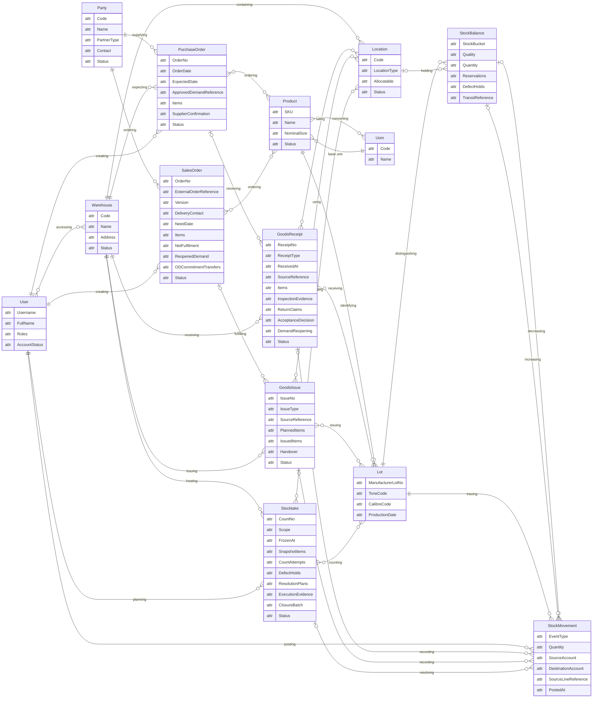

# ERD khái niệm rút gọn — các thực thể cốt lõi WMSD

14 thực thể: 7 thực thể danh mục/quản trị và 7 thực thể nghiệp vụ. Sơ đồ thể hiện góc nhìn tổng quan, với các bảng dòng và bảng trung gian được rút gọn thành nhóm thuộc tính hoặc quan hệ. Đối chiếu thiết kế chi tiết tại [SQL schema](../WMSD_SQL_schema.sql).

`attr` chỉ là token cú pháp Mermaid, không phải kiểu dữ liệu. [Bản HTML](erd.html) không hiển thị cột này.

Mỗi SalesOrder bắt buộc gắn một Party loại CUSTOMER. Quan hệ quy đổi giữa Product và Uom được thể hiện tổng quát; hệ số và lịch sử phiên bản được lưu trong `ProductUomVersion` ở thiết kế chi tiết.

Quan hệ SalesOrder–GoodsIssue là truy vết qua SO → WIR → OD → GI-S. Các thực thể điều chuyển, trả hàng, giao nhận và xác nhận thanh toán không có ô riêng trong góc nhìn này; quan hệ trên hình có thể tổng hợp qua nhiều bảng, không nhất thiết là FK trực tiếp.
Tên trong sơ đồ được đối chiếu với model MongoDB hiện tại: `Party`, `Lot`, `Uom` và `StockBalance`. `PurchaseOrder`, `GoodsReceipt`, `SalesOrder`, `GoodsIssue` và `Stocktake` là các khái niệm nghiệp vụ trong sơ đồ; backend biểu diễn chúng bằng các loại `BusinessDocument`, không phải model hay collection riêng. `StockBalance` chỉ đại diện phần số dư trong khái niệm tồn kho tổng hợp; tài khoản tồn, giữ hàng và các thành phần liên quan được lưu riêng.
