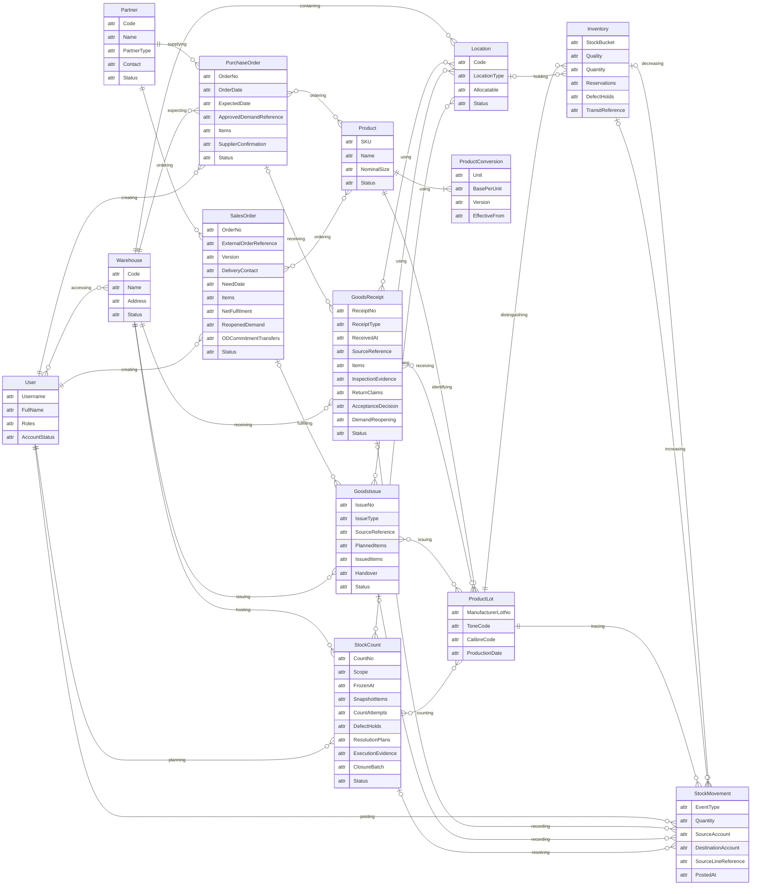

# ERD khái niệm rút gọn — các thực thể cốt lõi WMSD

14 thực thể: 7 thực thể danh mục/quản trị và 7 thực thể nghiệp vụ. Sơ đồ thể hiện góc nhìn tổng quan, với các bảng dòng và bảng trung gian được rút gọn thành nhóm thuộc tính hoặc quan hệ. Đối chiếu thiết kế chi tiết tại [SQL schema](../WMSD_SQL_schema.sql).

`attr` chỉ là token cú pháp Mermaid, không phải kiểu dữ liệu. [Bản HTML](erd.html) không hiển thị cột này.

`Unit`, `BasePerUnit`, `Version`, `EffectiveFrom` tương ứng với `uom_code`, `base_per_unit`, `version`, `valid_from` trong `product_uom_version`. Mỗi SalesOrder bắt buộc gắn một Partner loại CUSTOMER.

Quan hệ SalesOrder–GoodsIssue là truy vết qua SO → WIR → OD → GI-S. Các thực thể điều chuyển, trả hàng, giao nhận và xác nhận thanh toán không có ô riêng trong góc nhìn này; quan hệ trên hình có thể tổng hợp qua nhiều bảng, không nhất thiết là FK trực tiếp.
