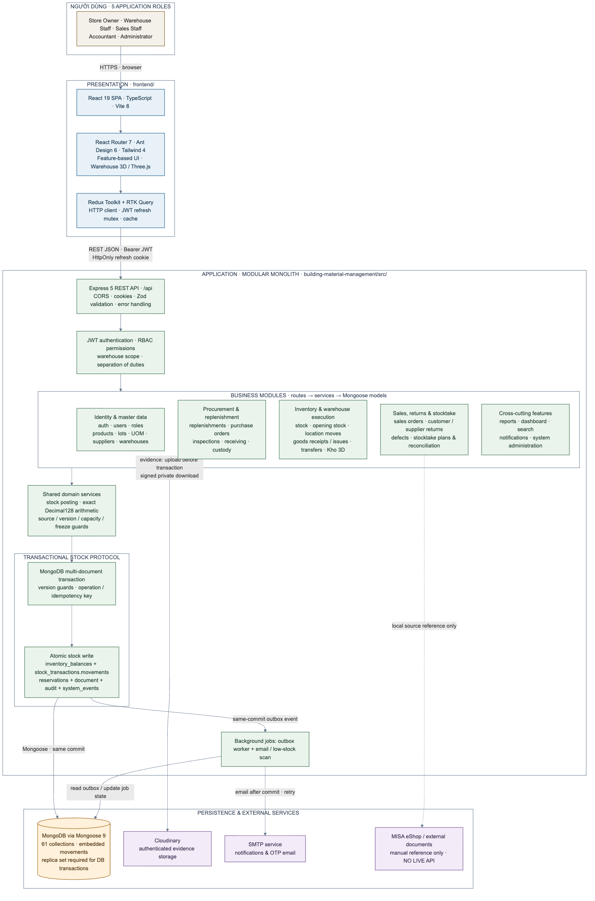

# WMSD — Software Architecture

Mốc hiện trạng: **26/11/2026**. Sơ đồ mô tả kiến trúc triển khai trong hai repository `frontend/` và `building-material-management/`; không phải đề xuất microservices và không thay thế ERD dữ liệu.



Bản vector: [SVG](WMSD_Software_Architecture.svg) · Bản nguồn có thể chỉnh sửa: [Mermaid](WMSD_Software_Architecture.mmd) · [Cấu hình render](WMSD_Software_Architecture.config.json)

## 1. Kiểu kiến trúc

WMSD là **layered, feature-modular monolith**:

| Tầng | Trách nhiệm và vị trí code |
|---|---|
| Presentation | React SPA tại `frontend/src/`; routes/features dùng Redux Toolkit/RTK Query, Ant Design và shared UI. Kho 3D dùng Three.js và được tải riêng khi cần. |
| Application/API | Express 5 tại `building-material-management/src/app.js`, mount REST API dưới `/api`; middleware xử lý cookie, CORS, validation, metrics và lỗi. |
| Business modules | `src/modules/<feature>/` tổ chức routes/controllers và domain services theo nghiệp vụ. `src/routes.js` là composition root của các module. |
| Domain/consistency | `src/shared/utils/` giữ access, stock posting, document command, exact decimal, transaction, audit và notification helpers. |
| Persistence | `src/models/` chứa 61 collection schemas và nested schemas; `runtime.js` cung cấp model đã đăng ký cho services qua Mongoose 9/MongoDB. |
| Integrations | Cloudinary lưu evidence riêng tư; SMTP gửi notification/OTP; MISA chỉ là nguồn tham chiếu thủ công, không có live API integration. |

## 2. Luồng request và dữ liệu

1. Người dùng thuộc một trong năm application roles truy cập React SPA qua browser.
2. RTK Query gửi REST JSON tới `/api`, kèm Bearer access token và HttpOnly refresh cookie khi phù hợp. Refresh được giới hạn bằng mutex để tránh các request 401 làm refresh chồng nhau.
3. Express routes kiểm JWT, active user, permission và phạm vi kho/bản ghi. Zod validation và business services kiểm trạng thái, nguồn, phiên bản, số lượng và separation of duties; UI không thay authorization của backend.
4. Các command ghi tồn dùng operation/idempotency key và version guards. Document, balances, embedded stock movements, reservations, audit, operation result và outbox event được xử lý trong cùng MongoDB transaction. Lỗi rollback toàn bộ; retry cùng key/payload trả kết quả đã commit.
5. Evidence được tải lên Cloudinary trước transaction xác nhận; download dùng signed private URL. Worker đọc `system_events` sau commit, tạo notification và gửi SMTP với retry/deduplication. Low-stock scan và notification email chạy trong background loop của cùng Node process; chúng không post lại tồn.

## 3. Các nhóm module chính

- **Identity & master data:** auth, users, roles, products, lots, UOM/conversions, suppliers, warehouses/locations.
- **Procurement & replenishment:** replenishment requests, purchase orders, inspections, receiving, custody.
- **Inventory & warehouse execution:** stock/opening stock, location moves, goods receipts/issues, transfers, warehouse 3D layout.
- **Sales, returns & stocktake:** sales orders, customer/supplier returns, defects, stocktake plans và reconciliation.
- **Cross-cutting:** operational reports, dashboard, search, notifications, system administration, monitoring/audit.

Các nhóm trên là cách gom phục vụ đọc sơ đồ, không phải các deployable services. Runtime là một Express application dùng chung model registry và database.

## 4. Giới hạn của sơ đồ

- `61 collections` là số schema hiện tại trong model registry (58 business + 3 system administration); embedded stock movements không tạo collection riêng.
- MongoDB multi-document transactions yêu cầu deployment hỗ trợ transaction, thông thường là replica set; sơ đồ không khẳng định cấu hình production hiện tại.
- Docker Compose cho phát triển có hai container `web` và `api`; MongoDB và external services không được khởi tạo bởi file Compose này.
- Một số legacy routes/models vẫn được giữ để tương thích. Sơ đồ thể hiện ranh giới runtime, không tuyên bố mọi màn hình/flow đã hoàn tất nghiệm thu.

## 5. Tái tạo ảnh

Chạy từ workspace root, sau khi chỉnh `WMSD_Software_Architecture.mmd`:

```bash
export DIAGRAM_DIR=building-material-management/git_doc/docs/03_thiet_ke
export PUPPETEER_EXECUTABLE_PATH='/Applications/Google Chrome.app/Contents/MacOS/Google Chrome'

npx --yes --package @mermaid-js/mermaid-cli@11.12.0 mmdc \
  -c "$DIAGRAM_DIR/WMSD_Software_Architecture.config.json" \
  -i "$DIAGRAM_DIR/WMSD_Software_Architecture.mmd" \
  -o "$DIAGRAM_DIR/WMSD_Software_Architecture.svg" -b white

npx --yes --package @mermaid-js/mermaid-cli@11.12.0 mmdc \
  -c "$DIAGRAM_DIR/WMSD_Software_Architecture.config.json" \
  -i "$DIAGRAM_DIR/WMSD_Software_Architecture.mmd" \
  -o "$DIAGRAM_DIR/WMSD_Software_Architecture.png" -b white -s 2
```

Renderer được ghim `@mermaid-js/mermaid-cli@11.12.0` (Mermaid 11) vì bản 12.2.0/Mermaid 12.3.0 tạo layout bất thường với nested subgraphs của sơ đồ này trên môi trường kiểm tra. Không thêm dependency vào application package. Thay `PUPPETEER_EXECUTABLE_PATH` bằng Chrome/Chromium phù hợp trên máy khác.

Nguồn kiểm chứng chính: `frontend/package.json`, `frontend/src/shared/lib/apiClient.ts`, `frontend/src/app/store.ts`, `frontend/vite.config.ts`, `building-material-management/package.json`, `src/app.js`, `src/routes.js`, `src/index.js`, `src/middlewares/`, `src/shared/utils/document-command.js`, `src/shared/utils/stock.js`, `src/modules/notifications/`, `src/models/`, `git_doc/MODEL_MAP.md`, `git_doc/PROJECT_GUIDE.md` và workspace `docker-compose.yml`.
