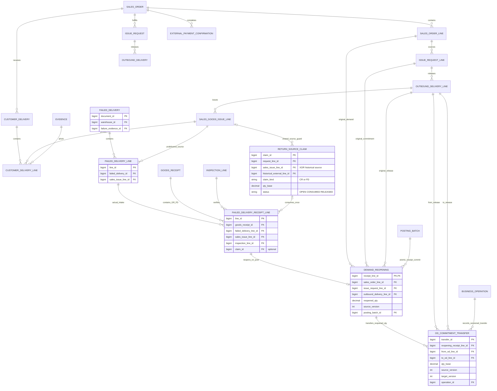
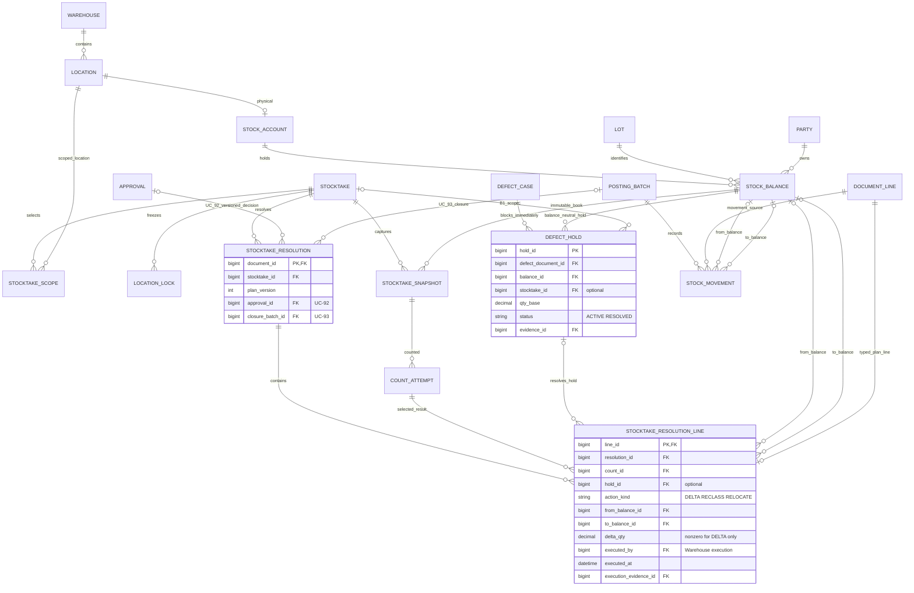
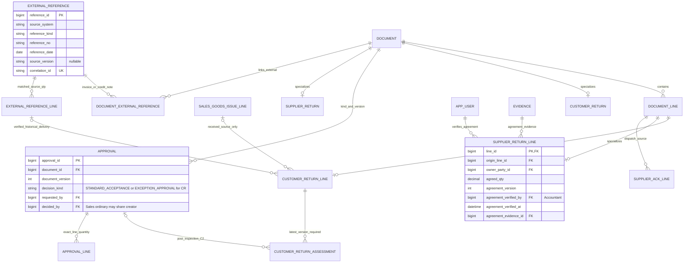

# WMSD — Đề xuất thiết kế cơ sở dữ liệu

SQL Server/T-SQL trong tài liệu là mô hình quan hệ để phân tích thiết kế; hệ thống thực tế dùng MongoDB. DDL không phải migration cho MongoDB và chưa cung cấp service nghiệp vụ.

Cập nhật 25/10/2026 theo quy trình 3.1.0 (A1/B1/C2 và BF-08 không Owner), khảo sát, D1–D8 và luồng BF-06 hiện hành trong [Đề xuất quy trình 2 — VI](../02_nghiep_vu/de_xuat_quy_trinh_2_VI.md). SQL tham chiếu: [WMSD_SQL_schema.sql](WMSD_SQL_schema.sql). Nhật ký: [change_logs.md](../../change_logs.md).

| Phiên bản | Ngày | Nội dung |
|---|---|---|
| 1.0.0 | 21/10/2026, trước sửa luồng bán hàng | Baseline D1–D8: WIR tham chiếu trực tiếp dòng đơn ngoài. |
| 2.0.0 | 21/10/2026 | SO → WIR → PGI → POD có ảnh → PAY-CFM; sửa liên kết nguồn WIR, thêm kiểm soát trạng thái và giao dịch xác nhận. |
| 3.0.0 | 22/10/2026 | Tách BF-03 chuyển vị trí và BF-04 điều chuyển; đánh lại mã BF-05–08, không thay đổi bảng/cột SQL. |

| 3.1.0 | 25/10/2026 | Đồng bộ A1 GR-FD/tái mở ròng, C2 quyết định đúng loại, BF-08 không Owner/UC-106 retired; B1 hold/RECLASS/batch; 26 R, 56 T. Sơ đồ giữ nguyên ngoài phạm vi. |

| 3.1.1 | 25/10/2026 | Cập nhật ERD Mermaid thành ba góc nhìn A1/B1/C2-BF-08; chỉ file draw.io giữ nguyên. Không đổi DDL hoặc baseline nghiệp vụ 3.1.0. |

## 1. Trạng thái, căn cứ và phạm vi

### 1.1 Nguồn và thứ tự áp dụng

| Mã | Nguồn | Cách áp dụng |
|---|---|---|
| S1 | [Đề xuất quy trình 2 — VI](../02_nghiep_vu/de_xuat_quy_trinh_2_VI.md), baseline 3.1.0 ngày 24/10; đồng bộ tài liệu ngày 25/10/2026 | Nguồn nghiệp vụ hiện hành: 8 BF, 5 vai trò, 111 UC (97 active/14 retired), BR-01–33; không đồng bộ MISA tự động. |
| S2 | [Report 1 text](../01_bao_cao/WMSD_Report1_Fix.docx.txt), đồng bộ 25/10/2026 | Bối cảnh một cửa hàng, khảo sát từ 3 kho, 8 BF và phạm vi SO/POD/PAY-CFM hiện hành; As-is không phải To-be đã triển khai. |
| S3 | [Report 3 text](../01_bao_cao/WMSD_Report3_Fix.docx.txt), baseline 3.1.0, đồng bộ 25/10/2026 | 111 UC (97 active/14 retired), BR-01–33, SC-01–31; SO ở UC-45–48, WIR/POD/PAY-CFM ở UC-109–111. MongoDB runtime. |
| S4 | [WMSD_Bangach.drawio](../04_so_do/WMSD_Bangach.drawio), 21 trang có nhãn lịch sử | Chỉ đối chiếu các phương án cũ; không dùng lane System/WMSD, giá bán hoặc TO liên kho cũ làm yêu cầu hiện hành. |
| S5 | [SAP WM I](../06_tham_khao/sap/Intro_S4HANA_Using_Global_Bike_Case_Study_WM_I_en_v4.1.pdf), [II](../06_tham_khao/sap/Intro_S4HANA_Using_Global_Bike_Case_Study_WM_II_en_v4.1.pdf), [III](../06_tham_khao/sap/Intro_S4HANA_Using_Global_Bike_Case_Study_WM_III_en_v4.1.pdf), [IV](../06_tham_khao/sap/Intro_S4HANA_Using_Global_Bike_Case_Study_WM_IV_en_v4.1.pdf) | Bộ **v4.1** trong repo: I GR tr.10, TO tr.18/21; II STO tr.6, GI tr.12, GR tr.18, TO tr.26/29; III picking tr.14/19, ship tr.25; IV snapshot/đếm/đếm lại/clear tr.4/12/14/21/27. Không tái dùng số trang v4.2 từ đề xuất cũ. |
| S6 | [Tổng hợp quy trình](../06_tham_khao/quy_trinh/Tổng%20hợp%20quy%20trình.pdf), 4 trang | Tham khảo chứng từ giao nhận và bối cảnh; phần công nợ/thanh toán/xe không tự trở thành phạm vi MVP. |
| S7 | [Các link tham khảo](../06_tham_khao/link_tham_khao.md) | Dùng hướng dẫn chính thức MISA, Odoo, Microsoft để đối chiếu khái niệm; các quyết định riêng của WMSD được mô tả dưới đây. |
| S8 | [Sơ đồ database](WMSD_database_design.drawio), 10 trang | Snapshot 3.0.0: 73 bảng/173 FK/2 view tại 22/10; giữ nguyên theo phạm vi loại trừ diagrams. DDL 3.1.0 có 82 bảng/2 view; không tuyên bố hình đồng bộ DDL mới. |
| S9 | [Mainflow VI/EN](../04_so_do/WMSD_Mainflows_VI_EN.drawio), 16 trang | Snapshot 3.0.0, chưa sửa theo 3.1.0; chỉ dùng tham khảo bố cục. Quy trình văn bản hiện hành chi phối. |

Thứ tự áp dụng: yêu cầu hiện tại → S1/D1–D8 và [change log](../../change_logs.md) → Report 1/3 cùng baseline → thiết kế/S8/S9 → khảo sát và nguồn tham khảo. S4 là sơ đồ lịch sử, không ghi đè quyết định hiện hành. Hiện có 111 UC (97 active/14 retired). SQL là mô hình tham chiếu, MongoDB là lưu trữ thực tế.

### 1.2 Phạm vi và thay đổi kiến trúc

- Một cửa hàng; khảo sát xác nhận từ 3 kho trở lên, đã chia khu/kệ và đánh mã. D4 giữ điều chuyển liên kho với xác nhận độc lập hai đầu. Chưa có danh sách, địa chỉ hoặc số người từng kho; không seed dữ liệu giả.
- Theo 8 quy trình hiện hành: bổ sung SO sao chép, POD có ảnh và PAY-CFM xác nhận tiền ngoài. Không thêm xử lý thu tiền, công nợ, hóa đơn thuế hoặc đồng bộ MISA tự động.
- SQL DDL minh họa mô hình quan hệ chuẩn hóa để review cấu trúc dữ liệu và các bất biến. Nó không thay đổi quyết định lưu trữ: MongoDB/NoSQL là database runtime.
- FK/UNIQUE/CHECK trong mô hình SQL diễn đạt các quan hệ và quy tắc nghiệp vụ. Khi cài bằng MongoDB, cưỡng chế tương ứng qua collection validation, unique/partial indexes, tham chiếu ID và transaction/service logic. MongoDB không cung cấp FK giữa collection như SQL.

### 1.3 Khác biệt công nghệ

| Lớp | Đề xuất trong tài liệu này | Triển khai thực tế |
|---|---|---|
| Database | SQL quan hệ chuẩn hóa để kiểm tra mô hình | MongoDB/NoSQL, theo Report 3 |
| Định danh | PK/FK minh họa quan hệ | ObjectId và reference IDs |
| Ràng buộc liên collection | FK, UNIQUE, CHECK minh họa ý nghĩa | Schema validation, unique index và kiểm tra trong server/service |
| Ghi stock/ledger/chứng từ | Transaction nhiều bảng trong mô hình | MongoDB transaction nhiều document trên môi trường hỗ trợ; cần atomicity, idempotency và concurrency checks |
| File SQL đính kèm | DDL tham chiếu cho thiết kế/đối chiếu | Không chạy như schema của runtime MongoDB |

### 1.4 Truy vết use case của thiết kế

| Nhóm | Nội dung đã đồng bộ trong SRS |
|---|---|
| BF-01 | Sales/Warehouse tạo nhu cầu; Accountant lập PO sau duyệt |
| BF-03 | Chuyển vị trí trong cùng kho: Warehouse thực hiện TO-RELOCATE, không Owner duyệt, giữ nguyên tổng tồn và reservation; UC-34–37. |
| BF-04 | Điều chuyển giữa các kho: TR do Owner duyệt → TD kho đi → MWTR kho nhận độc lập → put-away; UC-38–44/104. |
| BF-05 | Owner lập phiên; Warehouse đếm/giải trình trực tiếp hoặc recount, lập/xác nhận phương án B1; Owner UC-92/93 duyệt/post delta và RECLASS trước mở khóa. |
| BF-06 | Sales nhập SO từ nguồn ngoài → WIR liên kết → soạn/PGI → Warehouse xác nhận POD có ảnh → DELIVERED → Sales xác nhận PAY-CFM → COMPLETED. UC-45–48/109–111; BR-31–33. |
| BF-07 | CR sau POD/lịch sử giao: Sales chấp nhận thông thường hoặc Owner ngoại lệ, Warehouse GR-CR không tái mở. FD theo GI-S chưa POD: Warehouse GR-FD không D6/Owner/custody khách, tái mở ròng cùng commit. |
| BF-08 | Warehouse đề nghị/thực xuất; Accountant xác minh thỏa thuận, đối chiếu ACK và đóng UC-83; không Owner approval/UC-106. |
| Lưu trữ | MongoDB là runtime; SQL là mô hình phân tích và DDL tham chiếu |

## 2. Ánh xạ thiết kế sang MongoDB runtime

Bảng dưới đây mô tả cách ánh xạ các khái niệm của mô hình quan hệ sang MongoDB. Ánh xạ này cùng baseline với [thiết kế hệ thống chi tiết](WMSD_Thiet_ke_he_thong_chi_tiet.md); vẫn cần cài và kiểm service/index/transaction trước vận hành.

| Mô hình quan hệ dùng để phân tích | Collection/embedding dự kiến trên MongoDB |
|---|---|
| app_user, app_role, permission, user_warehouse | users, roles, permissions; quan hệ bằng ObjectId reference/role IDs |
| warehouse, location, party, product, uom, lot | warehouses, locations, parties, products, lots; snapshot thuộc tính quan trọng vào dòng chứng từ |
| document + typed header + document_line | business_documents phân loại documentType, hoặc collection theo bounded context cùng documentId; embed header/lines nếu cùng vòng đời và giới hạn kích thước |
| sales_order + line + cancellations | sales_orders với dòng hàng và tham chiếu nguồn; cancellation_events lưu từng lần hủy có kiểm soát; unique source và version trên đơn |
| customer_delivery + line / external_payment_confirmation / business_operation | customer_deliveries, external_payment_confirmations và business_operations; tham chiếu SO/GI/ảnh, unique operation keys; không ghi ledger tồn |
| approval + approval_line | approvals, lưu version được duyệt, actor, decision và lượng được phép |
| external_reference + line | external_references, đủ trường nguồn để đối chiếu và khử trùng |
| stock_balance | stock_balances; unique compound index theo account/location + lot + quality + owner |
| stock_movement + posting_batch | stock_movements append-only và posting_batches, liên kết ObjectId, idempotency key unique |
| reservation + demand_supply_allocation | reservations và demand_supply_allocations với trạng thái, lượng và source IDs |
| stocktake + snapshot + count_attempt | stocktakes/stocktake_snapshots và count attempts append-only, lưu cutoff/version |
| customer_return_assessment | return_assessments append-only theo returnLineId, assessmentNo và documentVersion; index truy vấn đánh giá mới nhất; approval reference đúng version |
| failed_delivery + line / failed_delivery_receipt_line | failed_deliveries và typed goods_receipts GR-FD; giữ GI-S/inspection/evidence/quality, không customer custody |
| return_source_claim | return_source_claims OPEN/CONSUMED/RELEASED; POD/CR/FD cùng cập nhật guard GI/SO, consume claim cùng receipt |
| demand_reopening + od_commitment_transfer | demand_reopenings và od_commitment_transfers có source/version; append lịch sử, không nhân nhu cầu hoặc tự post tồn |
| defect_hold + stocktake_resolution + line | defect_holds và stocktake_resolutions; hold không balance, plan/version/action/count/execution/evidence, batch chốt UC-93 |
| evidence, audit_event, outbox_event | evidence_refs, audit_events append-only, outbox_events có event key unique |

Không biến từng bảng SQL thành một MongoDB collection. Chỉ embed dữ liệu khi cùng vòng đời, được đọc/cập nhật như một đơn vị và không tăng vô hạn. Chứng từ đã post, ledger, audit và các lần đếm lại cần lịch sử bền vững, không ghi đè. Transaction cập nhật nhiều document phải commit posting batch, movements, balance, reservations, trạng thái chứng từ, audit và outbox cùng nhau.

Tạo unique indexes cho số chứng từ, mã chống ghi lặp, mã thao tác và các thành phần xác định số dư. Xác nhận collation, partial index cho bản ghi active, index báo cáo/truy vết và chiến lược shard theo tải thực; không thêm sharding chỉ vì MongoDB hỗ trợ.

## 3. Mô hình dữ liệu quan hệ tham chiếu (SQL)

### 3.1 Chuẩn hóa và quy ước kiểu SQL

Trong mô hình này, PK là khóa chính, FK là khóa ngoại, UNIQUE bảo đảm giá trị không trùng, CHECK kiểm tra điều kiện, 3NF là dạng chuẩn ba. DDL hiện tại dùng Microsoft SQL Server/T-SQL trong schema `wmsd`; đây là mô hình quan hệ tham chiếu, không đổi runtime MongoDB.
- **1NF:** một ô chứa một giá trị; không lưu danh sách product/lot/warehouse bằng chuỗi CSV, không nhét dòng chứng từ vào JSON làm nguồn giao dịch chính.
- **2NF:** bảng nối có PK đầy đủ; ví dụ quyền theo `(role_code, permission_code)`, phân công theo `(user_id, warehouse_id)`.
- **3NF:** tên kho, sản phẩm, NCC ở master; phiếu tham chiếu FK. `document` là supertype, bảng nghiệp vụ là subtype 1:1, không phải cặp `entity_type/entity_id` không có FK.
- Snapshot tên hàng, địa chỉ giao, hệ số quy đổi trên chứng từ là dữ liệu lịch sử có chủ đích. `stock_balance` là projection/cache được cập nhật cùng ledger, là phi chuẩn hóa có kiểm soát và phải đối soát.
- Trong mô hình SQL tham chiếu: PK `BIGINT IDENTITY(1,1)`; lượng `NUMERIC(20,6)`, hệ số `NUMERIC(24,12)`, ngày `DATE`, sự kiện `DATETIMEOFFSET`. Đây không phải kiểu lưu runtime; MongoDB dùng ObjectId, UTC Date và Decimal128 theo hợp đồng hiện hành. Không dùng kiểu floating point cho lượng kho.
- T-SQL dùng `bit` cho cờ, `SYSDATETIMEOFFSET()` cho thời gian, filtered unique index cho khóa nullable và `GO` phân batch view/schema. Chạy bằng client hiểu `GO`; không gửi nguyên file như một câu SQL.
- Trạng thái hữu hạn, tên bảng/cột `snake_case`. Không cascade delete lịch sử. Master ngừng sử dụng bằng `active=false`; lịch sử vẫn tra cứu được.

### 3.2 Master data và phân quyền

| Bảng | Khóa và trường chính | Quy tắc |
|---|---|---|
| `app_user` | PK user_id; username UNIQUE, display_name, credential_hash, active | Hash mật khẩu/credential, không lưu plaintext |
| `app_role`, `user_role` | Role code; PK ghép user-role | Năm role; một user nhiều role vẫn chịu cấm tự duyệt |
| `permission`, `role_permission` | Permission code; role-permission PK | Quyền theo thao tác; Admin không tự có nghiệp vụ |
| `warehouse`, `user_warehouse` | warehouse_id; code UNIQUE; user-warehouse PK | Phạm vi kho được giao |
| `location` | location_id, warehouse_id FK, code, kind, allocatable, active | UNIQUE(warehouse,code); chỉ STORAGE có thể allocatable |
| `party` | party_id, code UNIQUE, kind, contact | STORE/SUPPLIER/CUSTOMER/CARRIER; một STORE trong MVP; không là tài khoản đăng nhập |
| `uom`, `product` | uom_code; product_id, sku UNIQUE, base_uom FK, whole_base_units | Gạch base=PIECE; không hard-code mọi hàng là gạch |
| `product_uom_version` | conversion_id, product_id, uom_code, version, base_per_unit | UNIQUE(product,uom,version); version đã dùng bất biến |
| `product_warehouse_policy` | PK(product,warehouse), minimum_qty | Ngưỡng bổ sung cố định, không trình biên tập policy tổng quát |
| `lot` | lot_id, product_id, manufacturer_lot, tone, calibre, identification_status | Một lot không chứa tổng tồn; UNKNOWN không được phân bổ bán |
| `quality_status` | quality_code | PENDING, GOOD, DAMAGED, BLOCKED; không thêm IN_TRANSIT vào quality |

### 3.3 Mô hình chứng từ

| Bảng | Trường/quan hệ chính | Mục đích |
|---|---|---|
| `document` | document_id PK; document_no UNIQUE; kind, status, version, creator, timestamps | Danh tính chứng từ, trạng thái và phiên bản |
| `document_line` | line_id PK; document_id FK; UNIQUE(document,line_no); product, lot?, conversion, entered_qty, qty_base, snapshots | Dòng kế hoạch có thể chưa xác định lot; dòng post phải có lot đã xác minh hoặc lot tạm bị chặn |
| `document_link` | parent_document_id, child_document_id, relation_code PK | Truy vết header qua FK thật |
| `line_link` | source_line_id, target_line_id, relation_code, linked_qty | RR→PO, PO→GR, SO→WIR→OD→GI→POD theo lượng; BF-06 còn có FK cụ thể để kiểm đúng chứng từ cha |
| `approval`, `approval_line` | document/version/decision_kind UNIQUE; dòng/lượng/outcome | STANDARD_ACCEPTANCE là Sales quyết định CR thông thường sau kiểm, được cùng creator; các approval khác requester ≠ approver. Service kiểm vai trò/loại/version, không chỉ CHECK. |
| `evidence` | document_id, object_key, sha256, MIME, người/thời điểm tải; UNIQUE(evidence_id,document_id) | Tệp riêng tư. POD/PAY-CFM dùng FK ghép để chỉ nhận ảnh/tệp thuộc đúng phiếu; service kiểm nội dung và kết quả tải. |
| `external_reference`, `document_external_reference` | UNIQUE(system,kind,number), reference_date; source_version nếu nguồn có; correlation_id UNIQUE không trống; verifier/time và nối document-reference | Version nguồn không được bịa; document.version quản phiên bản nội bộ; correlation ổn định để truy vết |
| `external_reference_line` | reference_id, line_key duy nhất trong nguồn; product, eligible_qty; UNIQUE(external_line_id,reference_id) | Sales xác minh đơn nguồn hiện tại; Accountant hỗ trợ nguồn lịch sử/đối chiếu. SO line liên kết đúng nguồn của SO. |


**Nguồn ngoài và phiên bản:** `external_reference.source_version` nullable vì nguồn có thể không có mã phiên bản; `correlation_id` bắt buộc, UNIQUE và không trống để truy vết WMS ổn định. `document.version` vẫn kiểm phiên bản hồ sơ/duyệt nội bộ. Không dùng correlation mới mỗi lần retry thay cho operation key.

### 3.4 Các bảng nghiệp vụ

Các bảng header dưới đây có **PK đồng thời là FK `document_id → document`**; bảng line có **PK/FK `line_id → document_line`**. Không tạo hai mã cho cùng một GR chỉ vì có supertype/subtype.

| Nhóm | Bảng và trường riêng quan trọng |
|---|---|
| BF-01 | `replenishment_request`: warehouse, needed_on, trigger_reason. `purchase_order`: supplier, receiving warehouse, expected date, supplier_confirmation. `arrival`: warehouse, supplier?, arrived_at, delivery_reference. |
| Kiểm nhận dùng chung | `inspection_line`: inspected_source_line, quality, ownership_decision, inspector/time. Tách dòng khi khác chất lượng/quyền sở hữu. |
| Nhập mua/trả khách/giao thất bại | `goods_receipt`: warehouse, receipt_kind PURCHASE/CUSTOMER_RETURN/FAILED_DELIVERY; GR-FD có typed line, inspection và GI-S gốc. |
| BF-03 | warehouse_task loại RELOCATE; warehouse_task_line có vị trí nguồn/đích cùng kho, cùng lô/chủ/chất lượng; document/audit lưu xác nhận. |
| BF-04 | `transfer_request`: source/destination warehouses khác nhau. `transfer_dispatch`: request FK, dispatcher/time. `transfer_receipt`: dispatch FK, receiver/time. `transfer_receipt_line`: dispatch_line FK, quality. |
| Bàn giao | `handover`: related_document FK, recipient_name, carrier?, time, confirmer; bằng chứng qua evidence. |
| BF-06 | sales_order/line/cancellation; issue_request/line gắn SO; outbound_delivery/line; sales_goods_issue_line; customer_delivery/line; external_payment_confirmation và business_operation. Chi tiết tại mục 3.4.2. |
| Công việc kho | `warehouse_task`: warehouse, kind, assigned_to. `warehouse_task_line`: from/to location, quality; hai location cùng warehouse của task. |
| BF-02 | `defect_case`: discovered_at, reason. `disposition_line`: defect_line, outcome, approval. Chứng từ SCRAP nằm trong document/line, liên kết DISP. |
| BF-07 | `customer_return`/line/assessment cho CR sau nhận; `failed_delivery`/line và GR-FD cho FD chưa nhận; `return_source_claim` giữ trần nguồn dùng chung. Chi tiết mục 3.4.3. |
| BF-08 | `supplier_return`: thỏa thuận và tài chính riêng. `supplier_return_line`: origin_line, owner_party, agreed_qty, agreement_version/verified_by/at/evidence_id; không authorization_id của Owner. `supplier_ack_line` theo thực nhận. |
| Sai lệch dùng chung | `discrepancy_line`: source_line, SHORT/OVER/DAMAGED/WRONG_LOT/WRONG_PRODUCT, status, resolution_document. |

`SUPPLIER_ACK`, `CUSTODY_RECEIPT`, `CUSTODY_RELEASE`, `HANDOVER`, `REVERSAL`, `SCRAP`, `OPENING` là document kinds. Không cần một bảng header trống riêng cho từng kind khi không có thuộc tính riêng. Một phiếu có nhiều dòng, không có mảng embedded. Mỗi FK nguồn phải được service kiểm tra thêm đúng loại chứng từ và cùng sản phẩm/lô theo quy tắc, vì FK tồn tại chưa chứng minh nguồn hợp lệ về nghiệp vụ.


### 3.4.1 Đánh giá điều kiện khách trả và kiểm bao bì

| Bảng/trường | Hợp đồng hiện hành |
|---|---|
| `customer_return_assessment` | FK `return_line_id`; UNIQUE(return_line_id,assessment_no); `document_version`, `assessed_by/at`, lý do không trống và `approval_id` tham chiếu quyết định sau kiểm. Append-only; thay điều kiện/lượng tạo phiên bản mới. |
| Bao bì / sử dụng / nguyên nhân | `packaging_condition`=SEALED/OPENED/TORN/UNKNOWN; `installation_status`=UNUSED/INSTALLED/UNKNOWN; `damage_cause`=NONE/CUSTOMER/SUPPLIER/OTHER/UNKNOWN. Tách dòng nếu điều kiện khác nhau. |
| Thời hạn | `deadline_status`=WITHIN/EXCEEDED/NOT_APPLICABLE/UNKNOWN; giá trị đã xác minh cần `deadline_reference` không trống, kể cả NOT_APPLICABLE. Không có số ngày mặc định. |
| Điều kiện xét | INELIGIBLE khi đã thi công/hỏng do khách/quá hạn xác minh; nếu chưa có căn cứ loại mà còn UNKNOWN thì PENDING; đầy đủ căn cứ để xét là CASE_REVIEW, chưa phải chấp nhận. Sales quyết định ca thông thường; Owner chỉ ngoại lệ đủ điều kiện. CASE_REVIEW chưa phải chấp nhận; cả hai không vượt điều cấm D6. |
| `inspection_line.packaging_condition` | Quan sát bao bì chung cho nhập/nhận trả. UNKNOWN mặc định, cần cập nhật theo thực kiểm; không tự đặt quality DAMAGED khi TORN. Số viên thực nằm ở dòng quantity và conversion snapshot, không suy từ số vỏ thùng. |

Service chọn assessment mới nhất theo dòng và đúng version hiện tại; kiểm inspection, nguồn khách đã nhận được xác minh, APPROVE với decision_kind=STANDARD_ACCEPTANCE bởi Sales hoặc EXCEPTION_APPROVAL bởi Owner và approval_line đúng dòng/lượng trước GR-CR. CHECK/FK không chứng minh những liên kết này. Approval cũ không hợp lệ khi điều kiện thay đổi. PENDING/INELIGIBLE vẫn là custody nếu đang giữ; bàn giao trả thực tế mới giảm custody. Lot chưa xác minh dùng identification_status=UNKNOWN và giá trị tham chiếu chưa rõ được ghi minh bạch; không bịa calibre hoặc dùng kích thước danh nghĩa thay calibre đã kiểm.

### 3.4.2 Đơn bán, ảnh giao hàng và xác nhận nhận tiền

BF-06 mới dùng các bản ghi dưới đây. Số lượng nằm tại document_line theo đơn vị tồn chuẩn; riêng bản ghi hủy lưu cancelled_qty_base. Mô hình nhập hàng, điều chuyển, hàng lỗi, trả hàng và kiểm kê hiện có được kế thừa.

| Bảng | Trường và liên kết | Quy tắc |
|---|---|---|
| sales_order | document PK/FK; external_reference_id duy nhất; khách, ngày cần, địa chỉ nhận | Loại SALES_ORDER là bản nhập lại thủ công từ một đơn nguồn đã xác minh. Lưu chứng từ nguồn; sửa/mở lại SO cũ thay vì tạo bản sao khác. |
| sales_order_line | dòng hàng; SO và tham chiếu nguồn; external_line_id duy nhất; tone/calibre yêu cầu | FK ghép giữ dòng hàng trong đúng SO và đúng đơn nguồn của SO đó. Service kiểm sản phẩm, quy đổi và số lượng nguồn. |
| sales_order_cancellation | SO/dòng hàng, cancelled_qty_base dương, người/thời điểm, lý do không trống, operation_id duy nhất | Lưu từng lần hủy phần chưa thực hiện hoặc đã GR-FD nhận về chưa giao lại, không ghi đè lịch sử. Kiểm tổng hủy; giảm cam kết WIR/OD chưa xuất và giải phóng lượng giữ trong cùng transaction. |
| issue_request / issue_request_line | SO bắt buộc; dòng lưu WIR/SO/dòng SO; UNIQUE(dòng SO,release_key) | Thông tin chung và dòng WIR phải cùng tham chiếu một SO. FK ghép chặn dùng dòng của đơn khác; thông tin khách lấy từ SO. |
| outbound_delivery_line | dòng hàng, OD, WIR và dòng WIR | FK ghép buộc dòng hàng thuộc đúng WIR của đợt xuất. Mỗi OD thuộc một kho. |
| sales_goods_issue_line | dòng hàng, goods_issue_id, outbound_delivery_line_id | Phần mở rộng dành riêng cho dòng GI-S bán hàng. Service kiểm sản phẩm/lô/kho và PGI đã post hợp lệ. Nguồn phiếu xuất trả NCC giữ cách xử lý hiện có. |
| customer_delivery / customer_delivery_line | chứng từ POD, SO, kho, người nhận, thời điểm khách nhận, người/thời điểm xác nhận, mã thao tác; dòng → GI-S + photo_evidence_id bắt buộc | Mỗi dòng gắn một dòng GI-S đã post. FK ghép buộc ảnh thuộc chính chứng từ POD; service kiểm ảnh đã lưu, quyền truy cập và trần lượng giao. Chỉ có thông tin chung của chuyến giao chưa đủ để xác nhận khách nhận hàng. |
| external_payment_confirmation | chứng từ PAY-CFM, SO, delivered_order_version, full_payment_received=1, người/thời điểm, mã thao tác; tham chiếu/bằng chứng/ghi chú thu tiền | UNIQUE(SO,delivered_order_version) chặn xác nhận tiền lặp cho cùng phiên bản đã giao. CHECK yêu cầu tham chiếu/ghi chú không trống hoặc tệp bằng chứng. Sales xác nhận đã nhận đủ tiền bên ngoài sau khi SO hiện tại là DELIVERED; không tính tiền hoặc chuyển tiền. |
| business_operation | chứng từ, thao tác/mã lần thực hiện, idempotency_key duy nhất, payload_hash, document_version, người/thời điểm, lý do khi cần | Lưu thao tác không ghi tăng/giảm tồn, tách khỏi posting_batch. Gửi lại cùng mã trả kết quả cũ; cùng mã nhưng khác nội dung bị từ chối. |

Giới hạn từng dòng: tổng cam kết WIR chưa hủy (kể cả phần đã xuất) không vượt lượng đặt SO trừ phần hủy hợp lệ; tổng OD không vượt lượng WIR được phép sau hủy; PGI hợp lệ trừ GR-FD hợp lệ không vượt lượng OD/WIR; POD hiệu lực + GR-FD đã post + FD OPEN không vượt PGI hợp lệ của dòng GI-S. OD thay thế chuyển cam kết, không cộng nhu cầu mới. Không cộng lượng chứng từ cha và con thành hai nhu cầu. Kiểm tổng trong transaction, không thay bằng CHECK trên một dòng.

| Đối tượng | Trạng thái và tác động |
|---|---|
| SO | DRAFT → OPEN → IN_PROGRESS/PARTIALLY_DELIVERED → DELIVERED → COMPLETED. DELIVERED cần giao đủ từng dòng còn phải thực hiện, có ảnh, tổng lượng này lớn hơn 0. Hủy toàn bộ mà chưa giao thì CANCELLED. COMPLETED cần thêm Sales xác nhận đã nhận đủ tiền ngoài hệ thống. |
| POD / PAY-CFM | DRAFT → CONFIRMED; nếu ghi nhầm thì VOIDED có lý do và nhật ký đính chính. Các xác nhận này không đổi tồn. WIR hoàn tất công việc kho độc lập với trạng thái giao hàng/hoàn thành SO. |

Giữ nội dung xác nhận gốc khi hủy hiệu lực do ghi nhầm; tạo business_operation mới, tăng phiên bản và tính lại tiến độ SO và không tái dùng điều kiện hoàn thành cũ. PAY-CFM phải gắn phiên bản SO hiện đã giao đủ. Khách trả hàng thông thường vẫn giữ lịch sử POD/PAY-CFM và xử lý riêng qua BF-07. Tải ảnh lỗi thì chưa xác nhận POD; gửi thông báo lỗi sau xác nhận chỉ gửi lại thông báo.

### 3.4.3 A1/C2 — Nhận quay về, claim và tái mở nhu cầu

| Bảng / hợp đồng 3.1.0 | Nội dung và kiểm soát |
|---|---|
| `failed_delivery`, `failed_delivery_line` | FD có kho nhận, lý do/evidence thất bại; dòng → GI-S đã post, chưa khách nhận. Không lập CR/D6/POD giả hoặc custody khách. Warehouse UC-72/73 ghi ARR/INS và thực về. |
| `return_source_claim` | request_line, nguồn GI-S XOR lịch sử ngoài, claim_kind CR/FD, qty, OPEN/CONSUMED/RELEASED, business operation. FD bắt buộc GI-S; CR bắt buộc lượng khách đã nhận/POD hoặc lịch sử giao xác minh. Claim không tăng tồn/tái mở. |
| `failed_delivery_receipt_line` | Dòng GR-FD thuộc goods_receipt FAILED_DELIVERY, liên kết FD/GI-S, inspection và claim nếu có. Một FD có thể nhận nhiều đợt/quality; lượng nằm ở document_line. |
| `demand_reopening` | Mỗi dòng GR-FD đã post có receipt_line duy nhất, SO/WIR/OD-line gốc, lượng tái mở, source_version, posting_batch. Commit cùng receipt/claim/balance/ledger/tiến độ; không dùng claim để giao thay thế sớm. |
| `od_commitment_transfer` | Chuyển lượng cam kết tái mở từ OD cũ sang OD thay thế cùng nguồn WIR/SO và version/operation. Tổng lượng chuyển không vượt tái mở; không tính cả OD cũ/thay thế thành hai nhu cầu. |
| `approval.decision_kind` C2 | STANDARD_ACCEPTANCE: Sales chấp nhận CR thông thường sau Warehouse kiểm, có thể chính creator; đủ D6/GOOD/UNUSED/thời hạn/điều kiện, không tranh chấp. EXCEPTION_APPROVAL: Owner cho ngoại lệ đủ điều kiện, khác người đề xuất. Không loại nào vượt D6 bị cấm hoặc UNKNOWN. Đổi kind/version cần quyết định mới. |

Mỗi dòng GI dùng một guard cập nhật có điều kiện chung: **POD hiệu lực + GR-FD hợp lệ + FD OPEN ≤ PGI hợp lệ**; **GR-CR hợp lệ + CR OPEN ≤ lượng khách đã nhận đủ điều kiện**. Chuyển claim sang CONSUMED khi post receipt cùng commit; không cộng claim đã consume với receipt. PGI/GR hợp lệ loại phần đã đảo đúng quy định. Đảo phải kiểm POD/claim/tái mở/giao lại và chặn nếu làm sai nghiệp vụ phụ thuộc.

Ví dụ SO10 → PGI10/POD0 → GR-FD10 → PGI mới10/POD mới10: giữ xuất vật lý20, nhận quay về10, thực hiện ròng10. GR-FD làm SO/WIR/OD gốc tái mở và tăng version; PAY-CFM của version cũ không cho hoàn thành version mới. Sales chọn chờ/giao lại/hủy phần đã nhận về chưa giao lại; không hủy lượng còn ngoài kho chưa giải quyết. GR-CR thông thường không tự tái mở nhu cầu.

SR: DRAFT → AGREEMENT_PENDING → READY → PARTIAL/COMPLETED; READY cần Accountant xác minh thỏa thuận đúng nguồn/lượng và Warehouse kiểm nguồn. Accountant UC-83 đóng phần kho sau đối chiếu UC-107; không Owner hoặc UC-106. FD: OPEN → INSPECTED → PARTIAL/RECEIVED → CLOSED theo lượng. CR giữ DRAFT/SUBMITTED/APPROVED/REJECTED/REVISION_REQUIRED nhưng APPROVED phải mang đúng kind/role/version sau inspection, không chỉ một cờ trạng thái.

Invoice/Credit Note ngoài WMS được liên kết bằng external_reference, external_reference_line và document_external_reference: loại/mã/reference_date, nguồn mua/GI-SR, lượng đối chiếu, verifier/evidence và trạng thái tài chính riêng. Không tạo chứng từ tiền hoặc buộc phần kho chờ tài chính.

### 3.5 Tồn, giữ hàng và ledger

| Bảng | Khóa/trường | Bất biến |
|---|---|---|
| `stock_account` | account_id; **location_id XOR transit_dispatch_line_id**, mỗi cột UNIQUE | Một tài khoản là bin vật lý hoặc transit riêng một dòng TD; transit không gán giả vào kho đích |
| `stock_balance` | balance_id; UNIQUE(account,lot,quality,owner_party); qty_base ≥0; version | Không NULL trong dimension để tránh hai số dư “giống nhau” do NULL |
| `posting_batch` | batch_id; document FK; UNIQUE(idempotency_key); UNIQUE(document,operation,operation_key); payload_hash; actor/time; reversal_of UNIQUE | Mỗi lần ghi tăng/giảm tồn có một batch; gửi lại cùng mã khác nội dung bị từ chối. POD/PAY-CFM dùng business_operation riêng |
| `stock_movement` | batch, document_line, from_balance?, to_balance?, q>0; before/after | Ít nhất một đầu; hai đầu khi di chuyển; một đầu khi nhập/xuất khỏi phạm vi theo dõi |
| `reservation` | demand_line, execution_line, balance, qty, ACTIVE/CONSUMED/RELEASED | Tổng ACTIVE trên balance ≤ balance.qty; chuyển theo hàng, không tạo hai lượt giữ cho cùng nhu cầu |
| `demand_supply_allocation` | PK(demand_line,supply_line), qty, trạng thái | PO/TD dự kiến dành cho nhu cầu; không đưa vào available trước khi đủ điều kiện |
| `audit_event`, `outbox_event` | actor/action/time; event_key UNIQUE, attempts, delivered_at | Audit và sự kiện tạo trong transaction; email sau commit, thất bại không rollback kho |

Tồn sở hữu = tổng số dư có `party_kind=STORE`. Tồn vật lý một kho = số dư sở hữu ở location thuộc kho đó. Transit = số dư sở hữu có transit_dispatch_line_id. Custody = số dư chủ hàng khác STORE, báo cáo riêng.

`available_stock` chỉ tính GOOD, lot VERIFIED, sản phẩm/kho/vị trí active, vị trí allocatable và không khóa kiểm kê; trừ ACTIVE reservations đúng balance. Hàng đang staging hoặc transit đã dành cho một đơn vẫn giữ reservation nhưng **không phải nguồn rảnh cho đơn mới**.

Ledger dùng movement không dấu gồm đầu đi/đầu đến; view `inventory_ledger` tạo bút toán số lượng âm/dương. Đây là sổ **số lượng**, không phải sổ kế toán tiền. Với cùng phạm vi sở hữu: `cuối = đầu + tổng delta`. Chuyển bin/đổi chất lượng có hai vế bằng nhau; đổi chủ custody→STORE tăng sở hữu nhưng không tăng hàng vật lý hiện diện.

### 3.6 Kiểm kê

| Bảng | Nội dung |
|---|---|
| `stocktake` | document_id, warehouse, cutoff, completion, mode=FROZEN |
| `stocktake_scope` | PK(stocktake_id,location_id); phạm vi đếm |
| `location_lock` | location_id PK; stocktake_id FK; mỗi location chỉ một phiên khóa |
| `stocktake_snapshot` | UNIQUE(stocktake,balance), book_qty, found_after_cutoff; dòng gốc bất biến |
| `count_attempt` | UNIQUE(snapshot,attempt_no); counted_qty ≥0, counter/time; không có record nghĩa là chưa đếm |
| `adjustment_line` | line_id, count_id được chọn, delta_qty≠0, approval_id khi được duyệt |

Delta âm/dương dùng trong adjustment_line; `document_line.qty_base` là trị tuyệt đối. Đổi chất lượng/vị trí dùng dòng RECLASS/RELOCATE hai vế bảo toàn tổng trong phương án ST_RESOLUTION; không giả thành thiếu rồi tăng hoặc ADJ=0. Dòng phát hiện mới phải nằm trong location đã khóa; mở rộng scope cần khóa và snapshot bổ sung trước khi đếm, không tùy tiện thêm vị trí sau cutoff.

### 3.6.1 B1 — Hold, phương án và batch chốt

| Bảng | Nội dung |
|---|---|
| `defect_hold` | DC/balance/ST nếu thuộc phiên, lượng, evidence, người/thời điểm, ACTIVE/RESOLVED. Hold chặn cấp hàng ngay, không đổi quantity/quality/location/owner của balance hoặc snapshot. View available_stock loại balance có hold ACTIVE để chặn bảo thủ; khi triển khai có thể tách phần đủ điều kiện bằng giao dịch được phép. |
| `stocktake_resolution` | Chứng từ ST_RESOLUTION, ST gốc, plan_version, approval_id UC-92 và closure_batch_id UC-93. Quality-only dùng phương án này, không tạo ADJ=0. |
| `stocktake_resolution_line` | Count đã chọn, hold, DELTA/RECLASS/RELOCATE; nguồn/đích balance, delta khác 0 chỉ khi DELTA; qty_base dương trên dòng. Warehouse executed_by/at/evidence là xác nhận thực hiện, không phải approval. |

So sánh đủ căn cứ → giải trình/lập phương án trực tiếp; chưa rõ hoặc chọn đếm lại → Start Recount → Enter Recount → so sánh lại, lưu attempts. Owner UC-92 duyệt đúng version, khác người lập; UC-93 post một batch delta thực tế + RECLASS/vị trí đã duyệt sau Warehouse xác nhận thực hiện, bảo toàn tổng của RECLASS. Còn TO/hold chưa giải quyết, thiếu evidence hoặc batch lỗi thì giữ freeze; không UC-67 hoặc giao dịch thường vượt khóa.

Book50GOOD/count48GOOD+2vỡ: RECLASS2, tổng50, không thiếu−2/ADJ0. Count46GOOD+2vỡ: delta−2 + RECLASS2, tổng48, không thiếu−4 rồi hủy2. Commit batch/movement/balance/plan/hold/audit/outbox cùng nhau; rollback không mở khóa, unknown commit tra key trước retry.

### 3.7 ERD rút gọn

> Ba Mermaid dưới đây là các góc nhìn logic hiện hành 3.1.0, cập nhật 25/10: A1, B1 và C2/BF-08. Không vẽ đủ 82 bảng DDL; PK/FK/thuộc tính trọng yếu chỉ hiển thị cho phần mới. Các cạnh contains theo header/dòng có thể đi qua document/document_line dùng chung; không thay cho toàn bộ FK/kiểm service.

Sơ đồ này thể hiện cấu trúc chính; toàn bộ cột, FK, bảng nối và subtype nằm trong DDL.

#### A1 — GI/POD, GR-FD và nhu cầu ròng



#### B1 — Hold và batch chốt kiểm kê



#### C2 và BF-08 — Quyết định CR, thỏa thuận SR và tài chính ngoài



## 4. Ràng buộc và transaction

### 4.1 Phạm vi DDL và giới hạn ràng buộc

DDL cung cấp PK/FK, UNIQUE, kiểu số chính xác, CHECK cục bộ, XOR nguồn, kiểm tra quantity before/after và index. **DDL này không phải toàn bộ backend đã vận hành được**: chưa cung cấp stored procedure/service post, authorization, trigger bất biến hay API. Quy tắc tổng nhiều dòng không được giả vờ đã giải quyết bằng `CHECK`. CHECK cục bộ không thay được kiểm tổng lượng/liên bảng; các kiểm này phải nằm trong service/transaction.

| ID | Ràng buộc | Cách cưỡng chế khi triển khai |
|---|---|---|
| R-01 | Không tồn âm, không giữ vượt lượng | Lock balance; tính ACTIVE reservation trong transaction; CHECK qty≥0 là lớp cuối |
| R-02 | Đúng kho/vị trí/lô/sản phẩm/chủ hàng | FK + kiểm subtype, location của task, product của lot và nguồn; cấm đổi dimension balance đã có lịch sử |
| R-03 | Không nhận/xuất/trả vượt nguồn | Lock dòng nguồn; cộng toàn bộ batch đã post, reservation/đề nghị mở và hủy/đảo hợp lệ |
| R-04 | MWTR đúng TD, cùng TR và đích | Kiểm receipt.dispatch, receipt_line.dispatch_line và quyền warehouse; tổng q không vượt transit còn lại |
| R-05 | Đúng version và lượng duyệt | Kiểm approval.document/version, từng line/outcome; thay đổi nội dung làm mất hiệu lực duyệt cũ |
| R-06 | Tách người duyệt/nhận đúng quyết định | RR/TR, Owner ngoại lệ CR, disposition và B1: actor khác requester; C2 Sales thông thường được chấp nhận CR mình lập. Receiver≠dispatcher; không tin danh tính client. |
| R-07 | Không post trùng | Hai UNIQUE ở posting_batch + kiểm hash payload; operation_key là mã lần thực hiện nghiệp vụ, không key ngẫu nhiên mỗi lần bấm |
| R-08 | Không sửa/xóa lịch sử đã post | Hạn chế DML, service/stored procedure duy nhất, trigger chặn sửa/xóa ledger/snapshot/approval/posted source; audit quyền admin |
| R-09 | Không chen giao dịch vào kiểm kê | Mọi posting lock cùng các location rows rồi kiểm location_lock; activation cũng dùng protocol đó trước snapshot |
| R-10 | Không cộng custody vào STORE | Kiểm owner_party của balance; acceptance có chứng từ chuyển chủ, không chỉ sửa master party |
| R-11 | Giữ đúng đơn vị/làm tròn | Snapshot conversion; với whole_base_units, kiểm qty nguyên; dữ liệu m² yêu cầu nhập viên/thùng thực khi quy đổi không nguyên |
| R-12 | Cân đối ledger/balance, đúng batch | batch.document_id = movement.document_id; delta balance khớp movement và before/after; không UPDATE balance riêng |
| R-13 | D6 và quyết định CR đúng dòng/lượng/version | Kiểm assessment mới nhất, inspection, nguồn khách đã nhận, decision_kind/vai trò và approval_line; PENDING/INELIGIBLE không post. D6 không áp FD. |
| R-14 | Bao bì và đơn vị thực | Lưu packaging_condition và actual quantity; bao bì rách không tự đổi quality; version hệ số không sửa lịch sử |
| R-15 | Đúng phạm vi UC và vai trò | Đúng 5 role; 14 UC retired không permission active; UC-107/108 không post tồn; D2 mỗi bộ phận tự ghi |
| R-16 | SO và nguồn WIR | Nguồn SO/dòng duy nhất; FK ghép đúng chứng từ cha; Sales xác minh nguồn và lưu bằng chứng; dùng lại SO khi sửa/mở lại |
| R-17 | Trần SO→WIR→OD→GI ròng | Cam kết ≤ SO sau hủy; PGI hợp lệ − GR-FD hợp lệ ≤ OD/WIR; OD thay thế chuyển cam kết có version, không nhân nhu cầu; chưa nhận về không được hủy lượng ngoài kho. |
| R-18 | POD có ảnh và cùng trần FD | Warehouse đúng kho, GI-S POSTED hợp lệ, ảnh cùng phiếu/tải xong; kiểm chung POD hiệu lực + GR-FD + FD OPEN ≤ PGI trên dòng nguồn. |
| R-19 | DELIVERED/COMPLETED đúng điều kiện | Giao đủ lượng còn phải thực hiện >0 mới DELIVERED; Sales xác nhận đủ tiền ngoài trên phiên bản hiện tại mới COMPLETED; hủy toàn bộ chưa giao là CANCELLED |
| R-20 | Xác nhận không ghi tồn và không trùng | business_operation có key/hash; cùng transaction với xác nhận, tiến độ SO, audit/outbox; không tạo movement cho POD/PAY-CFM |
| R-21 | Đính chính có lưu lịch sử | VOIDED có lý do; tính lại SO và vô hiệu điều kiện hoàn thành cũ. BF-07 thông thường giữ lịch sử giao/nhận tiền gốc |
| R-22 | CR/FD/POD chia trần nguồn | Cùng guard dòng GI: POD hiệu lực + GR-FD hợp lệ + FD OPEN ≤ PGI hợp lệ; GR-CR + CR OPEN ≤ lượng khách nhận đủ điều kiện. CONSUMED không cộng lại với receipt. |
| R-23 | GR-FD tái mở ròng nguyên tử | Post thực về và demand_reopening trên SO/WIR/OD gốc cùng commit; PGI ròng = PGI hợp lệ − GR-FD hợp lệ. Chuyển cam kết OD thay thế có version, không nhân nhu cầu; đảo kiểm downstream. |
| R-24 | C2 và BF-08 đúng thẩm quyền | STANDARD_ACCEPTANCE chỉ Sales/CR thông thường sau kiểm, có thể cùng creator; EXCEPTION_APPROVAL chỉ Owner khác người đề xuất, không vượt D6. SR không approval Owner; Accountant UC-83/107 đối chiếu/đóng. |
| R-25 | B1 hold không đổi balance | defect_hold/evidence ghi ngay dưới freeze; chặn phân bổ, giữ snapshot. Chỉ UC-93 batch được duyệt post delta khác 0 và RECLASS/vị trí; không ADJ=0 hoặc giao dịch thường vượt khóa. |
| R-26 | Chốt B1 và TR toàn bộ phạm vi | B1 cần count/plan/version/UC-92 và Warehouse xác nhận thực hiện, không task/hold chưa giải quyết; rollback giữ khóa. TR cần hết nhu cầu, transit, sai lệch và TO; một đợt khớp chưa đủ. |

Với gạch 4 viên/thùng và 0,36 m²/viên: 3 thùng +2 viên =14 viên =5,04 m². Lưu thành hai dòng nhập hoặc tách các thành phần đơn vị rõ; không lưu “3,5 thùng” rồi suy ra khả năng xuất nửa thùng mà thiếu thông tin viên. M² dùng hiển thị/đặt nhu cầu; xuất thực phải đạt độ hạt sản phẩm. Version quy đổi sau này không tính lại lịch sử.

### 4.2 Transaction ghi tăng/giảm tồn

```text
BEGIN
1. Xác thực user; kiểm role + operation + warehouse + trạng thái.
2. Kiểm idempotency key và payload hash; nếu đã commit, trả kết quả cũ.
3. Lock document, các dòng nguồn, location và balance theo thứ tự thống nhất.
4. Kiểm version, quyết định duyệt, stocktake lock, nguồn và lượng còn lại.
5. Tạo posting_batch; tạo movement; cập nhật balance và reservation nguyên tử.
6. Cập nhật phần đã thực hiện/trạng thái; append audit và outbox.
COMMIT
7. Sau commit mới gửi thông báo/in từ snapshot; lỗi thông báo không đổi tồn.
```

MongoDB không dùng row lock hay `SELECT FOR UPDATE`. Cập nhật từng balance nguyên tử bằng filter theo ObjectId, version và điều kiện đủ lượng; dùng conditional increment. Balance mới dựa trên unique compound index và xử lý duplicate-key/retry. Transaction đọc lại version chứng từ, cờ stocktake freeze và lượng nguồn; retry write conflict với cùng idempotency key. Để stocktake không đua với posting, activation và posting phải cùng cập nhật/kiểm phiên bản phạm vi trong một transaction. Commit posting batch, ledger, balance, reservation, trạng thái chứng từ, audit và outbox cùng nhau. Kiểm tra giới hạn transaction và tải với dữ liệu đại diện.

### 4.2.1 Transaction xác nhận không ghi tăng/giảm tồn

1. Kiểm quyền Sales cho SO/WIR/hủy/PAY-CFM hoặc Warehouse được giao kho cho POD; kiểm loại chứng từ, trạng thái và phiên bản.
2. Tra business_operation theo mã thao tác ổn định và kiểm payload_hash. Gửi lại cùng nội dung trả kết quả cũ; cùng mã nhưng đổi nội dung bị từ chối.
3. Kiểm soát cập nhật đồng thời trên SO, dòng WIR/OD và GI nguồn. Đọc lại tổng lượng, PGI hợp lệ, ảnh đã lưu và phiên bản SO hiện tại; ảnh chưa tải xong chưa đủ điều kiện xác nhận giao.
4. Lưu xác nhận/hủy, business_operation, tiến độ SO, audit và outbox trong cùng transaction. POD/PAY-CFM không tạo posting_batch, movement hoặc thay đổi balance/reservation. Hủy phần chưa xuất có thể giải phóng reservation nhưng không đổi tồn sở hữu.
5. Với PAY-CFM, kiểm lại đã giao đủ và Sales xác nhận nhận đủ tiền ngoài hệ thống trong cùng transaction, rồi mới đặt COMPLETED. Không chỉ tin trạng thái client gửi hoặc phiên bản cũ.

Trong MongoDB, cập nhật có điều kiện trên phiên bản SO/dòng nguồn phải khiến các lần xác nhận cạnh tranh cùng một bản ghi. Chỉ đọc snapshot không ngăn được hai POD khác nhau cùng vượt nguồn. Khi retry do xung đột ghi, giữ nguyên mã thao tác. DDL mô tả hợp đồng dữ liệu, chưa triển khai service thực thi các quy tắc này.

### 4.2.2 Transaction bổ sung 3.1.0

GR-FD: Warehouse kiểm GI/inspection/evidence/quality và guard nguồn chung POD/FD/CR; post nhận thực về, consume claim, lưu demand_reopening, cập nhật SO/WIR/OD ròng/version và ledger/balance/audit/outbox cùng commit. FD claim không tự mở nhu cầu; GR-CR không tái mở. Hủy/giao lại xử lý task và chuyển cam kết OD theo nguồn/version; đảo phải kiểm toàn bộ downstream.

B1: activation/posting cùng guard scope; hold/evidence không đổi balance được ghi ngay. UC-93 kiểm current plan/count/UC-92, Warehouse execution và nguồn/đích/quantity; post delta thực tế khác 0 và RECLASS/RELOCATE bảo toàn tổng cùng batch. Hoàn tất mọi task/hold/sai lệch rồi mới đóng/unlock trong commit. Lỗi giữ khóa và dữ liệu trước post.

C2: kiểm decision_kind/role/latest inspection/assessment/quantity trong transaction, chỉ cho cùng requester với Sales STANDARD_ACCEPTANCE thông thường. BF-08 kiểm Accountant-verified agreement và Warehouse nguồn/thực xuất, không tìm Owner approval; Accountant closure không post tồn.

### 4.3 Ví dụ transaction liên kho

TD xuất 400 viên từ A: `movement(A_GOOD → TRANSIT_TD_LINE,400)`. MWTR nhận 380 đạt +12 vỡ: hai movement `TRANSIT→B_RECEIVING_GOOD,380` và `TRANSIT→B_QUARANTINE_DAMAGED,12`. Còn 8 viên transit. Mọi dòng trên MWTR cùng một batch/transaction; nếu một dòng lỗi thì không nhận một nửa batch. Có thể tạo MWTR thứ hai cho phần nhận sau.

### 4.4 Đảo, sửa sai và đóng phần còn lại

Chỉ đảo toàn batch khi không có nghiệp vụ sau phụ thuộc và đủ tồn/điều kiện tại các đầu cần đảo. `reversal_of UNIQUE` chặn đảo toàn phần hai lần; đảo tạo batch/movement mới, không sửa batch gốc. Sửa một phần hoặc đã có downstream dùng chứng từ điều chỉnh/hoàn trả riêng, không dùng full reversal tùy tiện. Hủy phần PO/WIR/TR chưa thực hiện hoặc WIR đã GR-FD nhận về chưa giao lại phải lưu lượng và thẩm quyền, giải phóng reservation/allocation tương ứng; không giảm tổng kế hoạch xuống dưới lượng đã post.

## 5. Phân quyền và truy xuất báo cáo

| Hành động | Sales | Warehouse | Accountant | Owner | Admin |
|---|---:|---:|---:|---:|---:|
| Lập RR | Có | Có | Không | Xem/duyệt | Không |
| PO, thỏa thuận NCC, tham chiếu tài chính ngoài | Xem phần liên quan | Xem phần nhận/thực xuất | Có; đối chiếu/đóng SR UC-83 | Xem; không duyệt BF-08 | Không |
| GR, TO, TD, MWTR, GI | Không | Theo kho được giao | Đối chiếu | Xem | Không |
| WIR, OD, CR đề nghị/quyết định | Có; chấp nhận CR thông thường sau kiểm | Xem/kiểm/nhận CR hoặc FD | Xác minh nguồn | Chỉ ngoại lệ CR đủ điều kiện | Không |
| Nhập/sửa SO; hủy phần chưa xuất | Có | Xem phần liên quan | Hỗ trợ đối chiếu | Xem | Không |
| POD: xác nhận giao khách có ảnh (UC-110) | Xem | Theo kho được giao | Xem/đối chiếu | Xem | Không |
| PAY-CFM: xác nhận đủ tiền ngoài (UC-111) | Có | Xem | Xem/đối chiếu | Xem | Không |
| Cách ly ngay; đề nghị xử lý | Không | Có | Đối chiếu | Duyệt xử lý | Không |
| Đếm/phương án B1 | Không | Đếm, hold, đề xuất/xác nhận thực hiện | Đối chiếu | Tạo phiên, UC-92/93 duyệt/post delta/RECLASS | Không |
| Phân quyền kỹ thuật | Không | Không | Không | Không | Có |

Đây là ma trận thao tác cốt lõi, không mở rộng quyền master data của SRS. Kho nguồn/đích phải kiểm theo user ID và warehouse assignment. Cấm tự duyệt các quyết định Owner; ngoại lệ C2 cho phép Sales chấp nhận CR thông thường mình lập sau kiểm. BF-08 không Owner approval. Các báo cáo và tệp chứng cứ áp cùng phạm vi truy cập như màn hình; Sales không thấy giá vốn hay toàn bộ dữ liệu cách ly. Accountants chỉ xem chuỗi chứng từ được giao trách nhiệm.

Báo cáo gồm tồn/khả dụng/giữ hộ/transit, nhu cầu PO/SO/WIR còn thiếu, lượng đã xuất và khách thực nhận, đơn DELIVERED đang chờ xác nhận tiền, đơn COMPLETED, hủy và sai lệch. Truy vết nguồn ngoài → SO → WIR → OD → GI-S → POD → PAY-CFM và hồ sơ trả/điều chỉnh liên quan. Đối chiếu SUM(inventory_ledger.delta) với stock_balance, kể cả OPENING; POD/PAY-CFM không tham gia ledger tồn.

## 6. Kịch bản nghiệm thu thiết kế

| ID | Tình huống | Kết quả bắt buộc |
|---|---|---|
| T01 | PO nhận 78/100, trong đó 3 hỏng; 2 từ chối | ARR=80; owned=78; usable tối đa75 sau put-away; PO còn22 |
| T02 | Retry GR cùng key hoặc key mới cùng operation_key | Chỉ một batch; payload khác cùng key báo conflict |
| T03 | Hai người đồng thời giữ 60 và 50 trên balance100 | Không vượt100; transaction thứ hai phải kiểm lại |
| T04 | TO chuyển bin hoặc picking | Tổng sở hữu không đổi; reservation theo vị trí mới |
| T05 | TD100, MWTR95GOOD+3DAMAGED | Transit2; B98; chỉ95 đủ điều kiện sau put-away |
| T06 | MWTR thêm3 khi transit còn2 | Từ chối; sai lệch thừa ghi riêng, không âm transit |
| T07 | Người xuất tự xác nhận nhận liên kho | Từ chối dù có role WAREHOUSE ở cả hai kho |
| T08 | Khách trả10: nhận7 đạt+2 lỗi, từ chối1 | Owned+9, custody1 đến khi trả; không usable+10 |
| T09 | Trả NCC hàng giữ hộ chưa nhập sở hữu | Custody giảm; owned không đổi |
| T10 | Hai SR/disposition cùng xử lý một lượng lỗi | Tổng thực xuất/hủy không vượt lượng còn đủ điều kiện |
| T11 | Snapshot20, đếm18, Owner duyệt −2 | Post−2 một lần; không overwrite balance bằng18 ở thời điểm khác |
| T12 | Chưa đếm và đếm0 | Hai trạng thái khác nhau; không tự tạo thiếu toàn bộ từ ô trống |
| T13 | Posting đua với stocktake activation | Giao dịch được tuần tự hóa; snapshot không bỏ sót movement đã commit trước khóa |
| T14 | Đổi quy cách 4 lên5 viên/thùng | Phiếu cũ giữ4; phiếu mới dùng version mới |
| T15 | Email lỗi sau PGI | GI và tồn giữ nguyên; outbox retry, không PGI lần nữa |
| T16 | Sửa lot/tone hoặc chứng từ đã post | Bị chặn; cần chứng từ đính chính phù hợp và audit |
| T17 | Không lệch kiểm kê | Đóng và mở khóa; không tạo ADJ0 |
| T18 | Lịch sử chưa có GI trong WMS | CR tham chiếu nguồn ngoài được xác minh; không GI giả |
| T19 | Khách trả đã thi công/hỏng do khách/quá hạn đã rõ | INELIGIBLE; không GR-CR, custody đến giao trả nếu đã giữ |
| T20 | Thời hạn/điều kiện chưa xác minh | PENDING; không tự đặt 7/15/30 ngày; cần bằng chứng |
| T21 | Nguyên thùng hoặc viên lẻ chưa dùng đủ căn cứ | CASE_REVIEW; Sales quyết định ca thông thường sau kiểm, có thể cùng creator; Owner chỉ ngoại lệ đủ điều kiện; không tự nhận. |
| T22 | Đổi assessment/lượng/decision_kind sau quyết định | Version mới và quyết định mới đúng vai trò; quyết định cũ không được post. |
| T23 | NCC chưa ACK hoặc ACK lệch GI | Mở BF-08; Accountant UC-107 đối chiếu/giải quyết và UC-83 đóng khi đủ lượng; không Owner/UC-106, không trừ thêm. |
| T24 | Thùng rách, gạch nguyên và số viên thực được kiểm | Chất lượng theo kiểm, không tự DAMAGED; quantity theo viên/version |
| T25 | Lỗi mạng giữa posting và trả response | Tra batch/operation key; không post lặp, không mất audit |
| T26 | Kiểm kê theo tháng | Owner tạo phiên thủ công; D5 khóa phạm vi; không job tạo phiên |
| T27 | Nhập lại cùng đơn bán hoặc dòng nguồn lần hai | Chặn trùng SO/nguồn; phải có xác minh và bằng chứng; không tạo giao dịch tồn. |
| T28 | Thông tin chung WIR gắn SO A nhưng dòng gắn SO B; dòng OD gắn WIR khác | FK ghép chặn sai chứng từ cha; service còn kiểm sản phẩm và đơn vị. |
| T29 | Nhiều WIR/OD cùng dùng một dòng SO, có phần đã xuất | Kiểm trần riêng SO→WIR và WIR→OD; WIR đã hoàn tất không làm phát sinh lại nhu cầu. |
| T30 | Hủy phần chưa xuất nhưng đã giữ hàng hoặc gắn task | Xử lý task, giảm cam kết, giải phóng đúng lượng giữ; lưu lý do/người/thời điểm hủy. |
| T31 | POD dùng GI chưa post, đã đảo, sai đơn hoặc sai kho | Từ chối; giao khách phải dựa trên dòng phiếu xuất bán đã post còn hợp lệ. |
| T32 | POD thiếu ảnh, ảnh thuộc phiếu khác, tệp không phải ảnh hoặc tải lỗi | FK chặn thiếu/sai chứng từ ảnh; service chặn tệp không phải ảnh/chưa tải xong; không DELIVERED. |
| T33 | PGI 10; hai POD khác nhau đồng thời xác nhận 6 và 5 | Tổng xác nhận tối đa 10; kiểm đồng thời dòng nguồn chặn vượt. Hai lần 6+4 hợp lệ mới giao đủ. |
| T34 | Gửi lại POD/PAY-CFM cùng mã, sau đó đổi nội dung với mã cũ | Trả kết quả đã lưu; đổi nội dung bị từ chối; không tăng lượng giao hoặc ghi tồn lần hai. |
| T35 | Đã PGI/bàn giao vận chuyển nhưng khách chưa nhận | SO còn IN_PROGRESS; khách nhận một phần có ảnh thì PARTIALLY_DELIVERED. |
| T36 | Chưa nhận tiền, mới nhận một phần hoặc khách trả trước khi giao đủ | Không hoàn thành SO; đã giao mà chưa nhận đủ tiền thì giữ DELIVERED. |
| T37 | Warehouse/Accountant xác nhận PAY-CFM; Sales xác nhận đủ tiền trên SO DELIVERED hiện tại | Chặn sai vai trò; Sales có tham chiếu/bằng chứng/ghi chú được xác nhận và chuyển COMPLETED cùng transaction, không đổi tồn. |
| T38 | Hủy toàn bộ số đặt và khách chưa nhận hàng | SO=CANCELLED, không DELIVERED/COMPLETED. Giao một phần kết hợp hủy hợp lệ phần chưa xuất có thể đạt DELIVERED. |
| T39 | Hủy hiệu lực POD/PAY-CFM ghi nhầm hoặc dùng phiên bản đã giao cũ | Giữ bằng chứng gốc, lý do/audit; tính lại SO; điều kiện hoàn thành cũ không cho phép xác nhận mới. |
| T40 | Transaction xác nhận lỗi hoặc khách trả hàng thông thường sau đó | Không lưu một phần thao tác/trạng thái khi transaction thất bại; BF-07 giữ lịch sử giao/nhận tiền và dùng chứng từ tồn riêng. |
| T41 | TD/GI-S nháp trước Picking, chưa bàn giao | Nháp không đổi tồn; xác nhận TO chỉ thực hiện nội kho; post thực bàn giao một lần. |
| T42 | TR100, TD60 đã nhận đủ, còn40 chưa xuất | TR còn mở;40 chưa xuất không phải transit; chỉ đóng khi phần còn lại/hủy, transit, sai lệch và TO được xử lý. |
| T43 | Snapshot50, đếm48, có căn cứ hoặc chưa rõ | Đủ căn cứ cho phép lập phương án −2 trực tiếp; chưa rõ/chọn đếm lại thì Start Recount → Enter Recount → so sánh, lưu mọi lần. |
| T44 | PGI10/POD0/GR-FD10, giao lại10 | Warehouse nhận không D6/Owner/POD giả/custody khách. Ledger xuất20, nhận10, ròng10; SO/WIR gốc tái mở10 cùng commit. |
| T45 | PGI10/POD7, FD4 hoặc CR8 | Chặn FD>3 và CR>7; dùng guard nguồn chung, CR/FD không cùng nhận một lượng. |
| T46 | FD OPEN3 trên PGI10/POD7; post receipt3 và retry | Đổi claim sang CONSUMED cùng GR-FD3; chỉ tính receipt3, không claim3+receipt3; retry không nhận hoặc tái mở thêm. |
| T47 | Claim FD hoặc tin giao thất bại nhưng chưa thực nhận | Không tăng tồn/tái mở; Sales chưa tạo lượng giao thay thế từ claim. Không hủy lượng còn ngoài kho chưa giải quyết. |
| T48 | GR-FD tái mở rồi dùng OD gốc hoặc OD thay thế | Dùng lại hoặc chuyển đúng cam kết/source/version; không cộng OD cũ và thay thế thành hai nhu cầu; chỉ hủy lượng về chưa giao lại. |
| T49 | Đảo GI/GR-FD sau POD/claim/giao lại | Kiểm dependencies; từ chối đảo làm sai trần/tái mở đến khi xử lý có lưu vết. Giữ ledger gốc. |
| T50 | Sales chấp nhận CR thông thường mình lập sau kiểm | Cho phép STANDARD_ACCEPTANCE khi đạt D6, GOOD/UNUSED, điều kiện/thời hạn rõ, không tranh chấp. GR-CR không tái mở nhu cầu. |
| T51 | Sales nhận ngoại lệ hoặc Owner nhận hàng D6 bị cấm | Chặn; Owner chỉ EXCEPTION_APPROVAL đủ điều kiện, khác người đề xuất; đổi kind/version cần quyết định mới, UNKNOWN vẫn chờ. |
| T52 | SR đủ thỏa thuận nhưng không Owner/UC-106, chưa Credit Note | Warehouse xuất được; Accountant đối chiếu/đóng UC-83 khi đủ lượng. Tài chính PENDING_EXTERNAL độc lập; không giảm khi ACK/đóng. |
| T53 | B1 book50GOOD, đếm48GOOD+2vỡ | Ghi hold2 ngay, không sửa balance/snapshot; Warehouse lập/xác nhận cách ly, Owner UC-92/93 RECLASS2; tổng50, không ADJ=0 hoặc thiếu−2. |
| T54 | B1 book50, đếm46GOOD+2vỡ | Delta thực−2 và RECLASS2 chung batch; tổng48, không thiếu−4 rồi hủy thêm2. |
| T55 | B1 thiếu xác nhận thực hiện, còn TO/hold, hoặc batch lỗi | Chặn chốt/mở khóa; lỗi rollback mọi ledger/balance/plan/hold, unknown commit tra key trước retry. Không giao dịch thường vượt freeze. |
| T56 | Đổi plan B1/assessment CR sau duyệt hoặc nhận trả thường sau POD | Version mới cần quyết định đúng thẩm quyền; quality-only dùng ST_RESOLUTION/RECLASS không ADJ0; GR-CR giữ lịch sử POD/PAY-CFM và không tái mở. |

Đây là **acceptance criteria**, không phải tuyên bố toàn bộ backend đã vượt qua kiểm thử. DDL và sơ đồ được kiểm tra độc lập; cần triển khai posting service và chạy concurrency/integration tests trước sử dụng thực tế.

**Lịch sử kiểm tra:** kiểm tra PostgreSQL/PGlite ngày 18/10 áp dụng bản DDL trước chuyển đổi, không xác nhận T-SQL hiện tại. Change log ngày 20/10 ghi ScriptDom parse thành công và test biểu thức D6 trong SQLite; đó không phải chạy SQL Server hoặc backend. Kiểm tra của lượt 21/10 được ghi riêng tại [change log](../../change_logs.md); không gán kết quả lịch sử cho file mới.


### 6.1 Truy vết luồng ngoại lệ

Các nhánh BF-01–08 của 3.1.0 và EX-01–05 trong mục 4 của đề xuất quy trình là đầu vào nghiệm thu dữ liệu: chứng từ/approval lưu hành động và phiên bản; line_link/nguồn lưu lượng; stock_account/balance phân owner/location/transit; posting_batch/movement chống ghi lặp; stocktake/location_lock/count_attempt giữ phạm vi và lịch sử; evidence/audit/outbox giữ chứng cứ và retry. Mỗi lỗi transaction phải để balance, ledger và lượng nguồn đồng nhất. Các case cần service không được coi đã cưỡng chế chỉ vì DDL parse thành công.


Các case T27–T56 kiểm hợp đồng mới của BF-06 và UC-109–111/BR-31–33. Kiểm SQL cục bộ không thay cho kiểm phân quyền, transaction/concurrency và tải ảnh trên backend MongoDB.

## 7. Thứ tự triển khai và quyết định cần chốt

Triển khai theo thứ tự: MongoDB collection validation/index/master data → role/scope → document shape/approval → ledger append-only và posting/idempotency service → BF-01/TO → BF-06 → BF-03/BF-04 → BF-02/07/08 → BF-05 → báo cáo và đối soát. Dùng dữ liệu mẫu khác biệt tone/calibre, nhận từng phần, custody và transit ngay từ đầu.

Các quyết định cần nhóm/cửa hàng xác nhận trước chốt SRS: danh sách/số lượng chính xác và địa chỉ kho (đã biết từ 3); người nhận độc lập ở liên kho; chính sách chấp nhận hàng lỗi và mốc nhận quyền quản lý; độ hạt đơn vị; thời lượng khóa kiểm kê; quy tắc thay lô; tiêu chí xác minh nguồn lịch sử; mẫu in/mã chứng từ. Đề xuất đã chọn baseline để thiết kế tiếp, không coi các điểm này là đã khảo sát xong.

### Tham khảo trực tuyến và giới hạn áp dụng

- [MISA eShop — chuyển kho](https://helpeshop.misa.vn/kb/huong-dan-cach-chuyen-kho-tren-phan-mem-misa-eshop): phân biệt chuyển kho cùng chi nhánh với xuất điều chuyển chi nhánh; WMSD dùng hai checkpoint xuất/nhận theo yêu cầu riêng.
- [Odoo 18 — three-step receipt](https://www.odoo.com/documentation/18.0/applications/inventory_and_mrp/inventory/shipping_receiving/daily_operations/receipts_three_steps.html): tham khảo tách input, quality và stock; không yêu cầu WMSD sao chép mọi bước cấu hình Odoo.
- [Microsoft — transfer order receiving](https://learn.microsoft.com/en-us/dynamics365/supply-chain/warehousing/configure-transfer-order-receiving-process): minh họa nhận điều chuyển và xử lý hậu trường có thể tách; không lấy cấu hình tài chính Dynamics làm phạm vi WMSD.

Toàn bộ tên bảng, mã MWTR, supertype chứng từ, tài khoản transit theo dòng TD và transaction protocol là **thiết kế đề xuất của tài liệu này**, không phải trích nguyên một mô hình dữ liệu của SAP/MISA/Odoo/Microsoft. Các nguồn thuế/hóa đơn không được dùng để đưa ra hướng dẫn pháp lý trong đề xuất kho này.
