# WMSD Backend Package Diagram

As of 26 November 2026. This diagram documents the current source tree, not a proposed refactor. The source of truth is the literal ESM imports, re-exports and resolved literal dynamic imports under `src/`.

## Deliverables

- [Editable Draw.io file: two pages](WMSD_Backend_Packages_UML.drawio).
- Overview: [PNG, 3600 x 2560](WMSD_Backend_Packages_UML.png) / [SVG](WMSD_Backend_Packages_UML.svg).
- Selected feature dependencies: [PNG, 3600 x 2560](WMSD_Backend_Packages_UML_Features.png) / [SVG](WMSD_Backend_Packages_UML_Features.svg).

## Reading the diagram

- A tabbed package represents an actual directory. `shared / utils` represents `src/shared/utils`, not two independent packages.
- The rectangle with a folded corner lists root source files; it does not introduce a bootstrap or routing directory.
- A dashed line with an open arrow points from the importer to the imported package. It is a UML dependency, not a request sequence, stock movement or data relationship.
- Nesting denotes source containment only. The overview lists all 29 actual feature directories and selects 14 of 18 cross-package dependencies. It does not imply every module imports every shared package.
- The second page shows six directed edges between three selected feature pairs. These are two-way dependencies between package aggregates; different files may provide the two directions. This alone does not prove a circular dependency between individual files.
- Third-party libraries, external services, database deployment nodes and the frontend are outside this source-package view. The 61 model files define collection schemas; this is not a live database inventory.

## Source packages

- Root files: `src/index.js`, `src/app.js`, `src/routes.js`, `src/worker.js`.
- `config`: database, token, cookie, Cloudinary and local MongoDB configuration.
- `middlewares`: authentication, permissions, validation, multipart upload and error handling.
- `modules`: the 29 feature directories listed below. Route/controller/service/validation files live inside these directories when applicable; they are not global layers or extra packages.
- `shared/utils`: domain and infrastructure helpers, including transactional commands, stock, conversions, access, audit and SMTP mail.
- `models`: 61 `*.model.js` collection schemas, nested schemas, registry and runtime exports. GoodsReceipt discriminators share their collection.
- `seeds`: seed entry points, fixtures and permission data; `shared/utils/userRole.js` imports the permission catalogue as static data. That dependency does not execute a seed.
- `migrations`: conversion and historical rebuild transformations. Their presence does not mean they run on API startup.

### All 29 feature directories

- `src/modules/auth`
- `src/modules/dashboard`
- `src/modules/goods-issues`
- `src/modules/goods-receipts`
- `src/modules/health`
- `src/modules/location-movements`
- `src/modules/lots`
- `src/modules/notifications`
- `src/modules/opening-stock`
- `src/modules/operational-reports`
- `src/modules/po-receiving`
- `src/modules/products`
- `src/modules/purchase-orders`
- `src/modules/replenishments`
- `src/modules/return-workflows`
- `src/modules/roles`
- `src/modules/sales-orders`
- `src/modules/search`
- `src/modules/settings`
- `src/modules/stock-alerts`
- `src/modules/stocktake-closure`
- `src/modules/stocktake-plans`
- `src/modules/suppliers`
- `src/modules/system`
- `src/modules/transfers`
- `src/modules/uoms`
- `src/modules/upload`
- `src/modules/users`
- `src/modules/warehouse-stock`

## Complete cross-package dependency list

Every arrow below has at least one direct source import. The overview shows 14 of these 18 edges; `seeds -> config`, `seeds -> migrations`, `seeds -> shared/utils` and `migrations -> seeds` are omitted from that page for readability.

- `middlewares -> models`: [src/middlewares/auth.js](../../../src/middlewares/auth.js) (line 3, imports `../models/runtime.js`).
- `middlewares -> shared/utils`: [src/middlewares/auth.js](../../../src/middlewares/auth.js) (line 2, imports `../shared/utils/ApiError.js`).
- `migrations -> models`: [src/migrations/conversions.js](../../../src/migrations/conversions.js) (line 2, imports `../models/model-utils.js`).
- `migrations -> seeds`: [src/migrations/rebuild/deploy.js](../../../src/migrations/rebuild/deploy.js) (line 1, imports `../../seeds/rebuild/database.js`).
- `modules -> config`: [src/modules/auth/auth.controller.js](../../../src/modules/auth/auth.controller.js) (line 4, imports `../../config/jwt.js`).
- `modules -> middlewares`: [src/modules/auth/auth.routes.js](../../../src/modules/auth/auth.routes.js) (line 3, imports `../../middlewares/validate.js`).
- `modules -> models`: [src/modules/auth/auth.service.js](../../../src/modules/auth/auth.service.js) (line 3, imports `../../models/runtime.js`).
- `modules -> shared/utils`: [src/modules/auth/auth.controller.js](../../../src/modules/auth/auth.controller.js) (line 1, imports `../../shared/utils/catchAsync.js`).
- `seeds -> config`: [src/seeds/rebuild/run.js](../../../src/seeds/rebuild/run.js) (line 9, imports `../../config/local-mongo.js`).
- `seeds -> migrations`: [src/seeds/rebuild/data.js](../../../src/seeds/rebuild/data.js) (line 5, imports `../../migrations/rebuild/transform.js`).
- `seeds -> models`: [src/seeds/goods-issue-permissions.js](../../../src/seeds/goods-issue-permissions.js) (line 1, imports `../models/runtime.js`).
- `seeds -> shared/utils`: [src/seeds/goods-issue-permissions.js](../../../src/seeds/goods-issue-permissions.js) (line 2, imports `../shared/utils/persistence.js`).
- `shared/utils -> models`: [src/shared/utils/audit.js](../../../src/shared/utils/audit.js) (line 2, imports `../../models/runtime.js`).
- `shared/utils -> seeds`: [src/shared/utils/userRole.js](../../../src/shared/utils/userRole.js) (line 1, imports `../../seeds/data/permissions.data.js`).
- `src files -> config`: [src/index.js](../../../src/index.js) (line 4, imports `./config/database.js`).
- `src files -> middlewares`: [src/app.js](../../../src/app.js) (line 7, imports `./middlewares/errorHandler.js`).
- `src files -> modules`: [src/app.js](../../../src/app.js) (line 9, imports `./modules/system/monitor.service.js`).
- `src files -> shared/utils`: [src/app.js](../../../src/app.js) (line 3, imports `./shared/utils/routeRegistry.js`).

## Complete cross-feature dependency list

All 34 unique directed edges are listed below. These are direct imports between different `src/modules/*` directories; dependencies on shared packages are covered above.

- `dashboard -> search`: [src/modules/dashboard/dashboard.routes.js](../../../src/modules/dashboard/dashboard.routes.js) (line 11, imports `../search/search.service.js`).
- `dashboard -> settings`: [src/modules/dashboard/dashboard.routes.js](../../../src/modules/dashboard/dashboard.routes.js) (line 8, imports `../settings/sales-policy.service.js`).
- `dashboard -> stock-alerts`: [src/modules/dashboard/dashboard.routes.js](../../../src/modules/dashboard/dashboard.routes.js) (line 9, imports `../stock-alerts/stock-alert.service.js`).
- `dashboard -> system`: [src/modules/dashboard/dashboard.service.js](../../../src/modules/dashboard/dashboard.service.js) (line 5, imports `../system/audit-log.service.js`).
- `goods-issues -> return-workflows`: [src/modules/goods-issues/direct-sales.service.js](../../../src/modules/goods-issues/direct-sales.service.js) (line 1, imports `../return-workflows/native.shared.js`).
- `goods-issues -> sales-orders`: [src/modules/goods-issues/goods-issue.routes.js](../../../src/modules/goods-issues/goods-issue.routes.js) (line 8, imports `../sales-orders/sales.validation.js`).
- `goods-receipts -> po-receiving`: [src/modules/goods-receipts/goods-receipt.routes.js](../../../src/modules/goods-receipts/goods-receipt.routes.js) (line 13, imports `../po-receiving/po-receiving.routes.js`).
- `goods-receipts -> transfers`: [src/modules/goods-receipts/goods-receipt.routes.js](../../../src/modules/goods-receipts/goods-receipt.routes.js) (line 20, imports `../transfers/transfer-read.service.js`).
- `notifications -> goods-issues`: [src/modules/notifications/sources.js](../../../src/modules/notifications/sources.js) (line 3, imports `../goods-issues/goods-issue.service.js`).
- `notifications -> po-receiving`: [src/modules/notifications/sources.js](../../../src/modules/notifications/sources.js) (line 8, imports `../po-receiving/purchase-read.service.js`).
- `notifications -> purchase-orders`: [src/modules/notifications/sources.js](../../../src/modules/notifications/sources.js) (line 4, imports `../purchase-orders/purchase-order.service.js`).
- `notifications -> replenishments`: [src/modules/notifications/sources.js](../../../src/modules/notifications/sources.js) (line 5, imports `../replenishments/replenishment.commands.js`).
- `notifications -> stock-alerts`: [src/modules/notifications/background.js](../../../src/modules/notifications/background.js) (line 5, imports `../stock-alerts/stock-alert.service.js`).
- `notifications -> stocktake-closure`: [src/modules/notifications/sources.js](../../../src/modules/notifications/sources.js) (line 7, imports `../stocktake-closure/stocktake-closure.service.js`).
- `notifications -> transfers`: [src/modules/notifications/sources.js](../../../src/modules/notifications/sources.js) (line 6, imports `../transfers/transfer-read.service.js`).
- `operational-reports -> sales-orders`: [src/modules/operational-reports/operational-reports.routes.js](../../../src/modules/operational-reports/operational-reports.routes.js) (line 7, imports `../sales-orders/sales.validation.js`).
- `po-receiving -> purchase-orders`: [src/modules/po-receiving/po-receiving.service.js](../../../src/modules/po-receiving/po-receiving.service.js) (line 29, imports `../purchase-orders/purchase-order.service.js`).
- `po-receiving -> sales-orders`: [src/modules/po-receiving/po-receiving.service.js](../../../src/modules/po-receiving/po-receiving.service.js) (line 39, imports `../sales-orders/sales-read.service.js`).
- `products -> upload`: [src/modules/products/product.controller.js](../../../src/modules/products/product.controller.js) (line 4, imports `../upload/upload.service.js`).
- `purchase-orders -> po-receiving`: [src/modules/purchase-orders/purchase-order.commands.js](../../../src/modules/purchase-orders/purchase-order.commands.js) (line 28, imports `../po-receiving/purchase-core.js`).
- `purchase-orders -> sales-orders`: [src/modules/purchase-orders/purchase-order.service.js](../../../src/modules/purchase-orders/purchase-order.service.js) (line 10, imports `../sales-orders/sales-read.service.js`).
- `return-workflows -> po-receiving`: [src/modules/return-workflows/native.read.js](../../../src/modules/return-workflows/native.read.js) (line 5, imports `../po-receiving/purchase-evidence.service.js`).
- `return-workflows -> sales-orders`: [src/modules/return-workflows/native.read.js](../../../src/modules/return-workflows/native.read.js) (line 2, imports `../sales-orders/sales-read.service.js`).
- `sales-orders -> goods-issues`: [src/modules/sales-orders/sales-execution.service.js](../../../src/modules/sales-orders/sales-execution.service.js) (line 1, imports `../goods-issues/direct-sales.service.js`).
- `sales-orders -> return-workflows`: [src/modules/sales-orders/sales-execution.service.js](../../../src/modules/sales-orders/sales-execution.service.js) (line 2, imports `../return-workflows/native.shared.js`).
- `stock-alerts -> notifications`: [src/modules/stock-alerts/stock-alert.service.js](../../../src/modules/stock-alerts/stock-alert.service.js) (line 5, imports `../notifications/email.js`).
- `stock-alerts -> replenishments`: [src/modules/stock-alerts/stock-alert.service.js](../../../src/modules/stock-alerts/stock-alert.service.js) (line 4, imports `../replenishments/replenishment.evaluation.js`).
- `stocktake-closure -> po-receiving`: [src/modules/stocktake-closure/stocktake-evidence.service.js](../../../src/modules/stocktake-closure/stocktake-evidence.service.js) (line 3, imports `../po-receiving/purchase-evidence.service.js`).
- `stocktake-closure -> sales-orders`: [src/modules/stocktake-closure/stocktake-closure.routes.js](../../../src/modules/stocktake-closure/stocktake-closure.routes.js) (line 9, imports `../sales-orders/sales.validation.js`).
- `stocktake-plans -> sales-orders`: [src/modules/stocktake-plans/stocktake-plan.routes.js](../../../src/modules/stocktake-plans/stocktake-plan.routes.js) (line 8, imports `../sales-orders/sales.validation.js`).
- `stocktake-plans -> stocktake-closure`: [src/modules/stocktake-plans/stocktake-plan.service.js](../../../src/modules/stocktake-plans/stocktake-plan.service.js) (line 8, imports `../stocktake-closure/stocktake-commands.service.js`).
- `system -> notifications`: [src/modules/system/monitor.service.js](../../../src/modules/system/monitor.service.js) (line 9, imports `../notifications/email.js`).
- `transfers -> sales-orders`: [src/modules/transfers/transfer-completion.js](../../../src/modules/transfers/transfer-completion.js) (line 4, imports `../sales-orders/sales-read.service.js`).
- `users -> auth`: [src/modules/users/user.validation.js](../../../src/modules/users/user.validation.js) (line 3, imports `../auth/auth.validation.js`).

## Validation and limitations

- The exports use the same node positions, labels, line coordinates and arrow directions. PNG uses the installed Pillow renderer; SVG and Draw.io are vector/editable formats.
- The generation check resolves every extracted relative source path, verifies every displayed dependency, and checks 29 feature directories, 61 model files, 18 cross-package edges and 34 cross-feature edges. This is static source inspection, not runtime or database verification.
- XML, endpoint integrity, module coverage, source links, image output and `npm run docs:check` are checked before handoff. Application tests are outside this documentation-only change; no database access or mutation is needed.
- The pre-existing `WMSD_Backend_Package_Diagram.drawio` is preserved as a separate earlier artifact.
