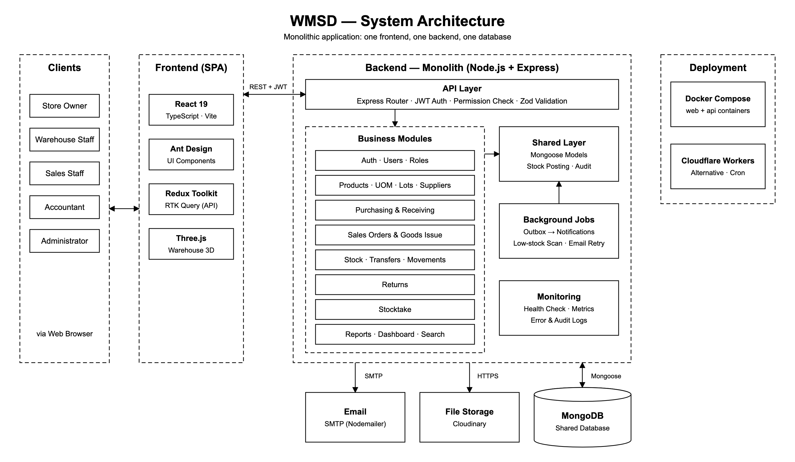

# WMSD — System Architecture

Source snapshot: **26 November 2026**. The layout follows the user's microservices reference (clients → entry layer → service list → infrastructure row), adapted to WMSD's single monolithic backend and drawn in black and white with short labels.

[Draw.io source](WMSD_System_Architecture.drawio) · [SVG vector](WMSD_System_Architecture.svg) · [PNG image](WMSD_System_Architecture.png)

## Architecture

| Area | Content |
|---|---|
| Clients | The five application roles use the system through a web browser. |
| Frontend (SPA) | React 19 + TypeScript (Vite), Ant Design, Redux Toolkit / RTK Query, Three.js warehouse 3D view. Calls the backend through REST with a JWT. |
| Backend (monolith) | One Node.js / Express application. The API layer applies routing, JWT authentication, permission checks and Zod validation. Business modules are in-process feature groups, not separate services. They share one Mongoose model layer with stock posting and audit. Background jobs (notification outbox, low-stock scan, email retry) and monitoring (health check, request metrics, error and audit logs) run in the same application. The notification outbox job runs only when `NOTIFICATIONS_START_AT` is configured. |
| Infrastructure | MongoDB is the single shared database (Mongoose). Cloudinary stores uploaded files over HTTPS. Email is sent through SMTP (Nodemailer). |
| Deployment | Docker Compose runs the `web` and `api` containers. A Cloudflare Workers configuration with a cron trigger is an alternative target for the same backend. |

The eight module boxes group the backend's feature directories; they do not list every directory. The reference's API gateway, event bus, caching and separate per-service databases have no counterpart in WMSD and are intentionally absent. MISA remains a manual external reference with no live API integration, so it is not drawn. The figure does not verify a live deployment.

## Source evidence

- [`src/app.js`](../../../src/app.js) and [`src/routes.js`](../../../src/routes.js): one Express application and API module composition.
- [`src/middlewares/`](../../../src/middlewares/): JWT authentication, permission and validation middleware.
- [`src/models/runtime.js`](../../../src/models/runtime.js): shared Mongoose registry.
- [`src/modules/notifications/background.js`](../../../src/modules/notifications/background.js) and [`src/worker.js`](../../../src/worker.js): background jobs and the Cloudflare scheduled handler.
- [`src/modules/system/monitor.service.js`](../../../src/modules/system/monitor.service.js) and [`src/modules/health/`](../../../src/modules/health/): request metrics, error logs and health check.
- [`src/shared/utils/mailer.js`](../../../src/shared/utils/mailer.js) and [`purchase-evidence.service.js`](../../../src/modules/po-receiving/purchase-evidence.service.js): SMTP and Cloudinary callers.
- [`wrangler.json`](../../../wrangler.json) and the workspace `docker-compose.yml`: configured deployment targets.
- [PROJECT_GUIDE](../../PROJECT_GUIDE.md): approved scope and external-reference limits.

The paired frontend manifest establishes React, TypeScript, Ant Design, Redux Toolkit and Three.js.

## Editing and checks

The Draw.io source has one 1600 × 930 page. Each box is one editable cell, and the connectors are attached to their source and target cells. The SVG is generated from the same layout, and the PNG is a 3200 × 1860 headless Chrome render of that SVG. All drawing colors are black or white. After editing the source, regenerate both previews.

Validation covers XML parsing, edge endpoints, visual inspection of the PNG and `npm run docs:check`. Native diagrams.net import and round-trip editing are not verified.
