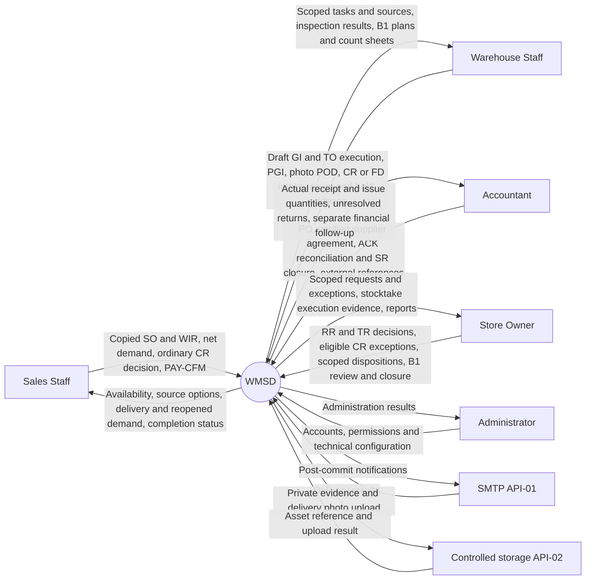

# Report 3 — Front matter, context and eight business flows

All replacement content is included below. Do not ask for a baseline file, upload, repository path or external comparison document. Replace the named sections with the English text inside each <replacement_text> block; the wrapper tags are editing markers and must not appear in the report. Preserve the document template and convert Markdown tables into document tables. Preserve existing content outside the specified replacement scope. Do not claim to have changed embedded images or tested software unless those actions were actually completed.

Replace the front matter, definitions and I.1–I.2.9. Preserve historical change-log entries, but do not reintroduce excluded functions as current scope.

Remove UC-23–25, UC-42, UC-59–62, UC-74–78 and UC-106 from active catalogues, permissions, detailed specifications, diagrams and navigation. Remove SC-25–27 from active screen requirements. Preserve the original IDs of the 97 remaining use cases and 28 active screens; do not renumber them. Keep UC-108 external document references and UC-111 external payment-receipt confirmation in scope.

## Replacement content

<replacement_text>

CAPSTONE PROJECT REPORT
Report 3 – Software Requirements Specification
– Hanoi, Oct 2026 –

Table of Contents
I. Overall Requirements
1. Context Diagram
2. Main Business Flow: BF-01–08 and Shared Failures
3. Conceptual Data Model and Data Rules
4. Actors, Use-Case Catalogue, Actor Associations and Permission Matrix
5. Screens, Interfaces and Jobs
II. Use Case Specifications: 97 Active Use Cases
III. Functional Requirements: 28 Active Screens
IV. Non-Functional Requirements
V. Requirement Appendix

Scope baseline: 3.1.0. The functional catalogue contains 97 active use cases and 28 active screens. Original identifiers are preserved; excluded functions are not executable operations.

Definition and Acronyms
WMSD = Warehouse Management System Development; SRS = Software Requirements Specification; UC = Use Case; FE = Feature; BF = Business Flow; SO = copied external Sales Order; POD = photo Proof of Delivery; PAY-CFM = external payment-receipt confirmation; RR = Replenishment Request; PO = Purchase Order; GR = Goods Receipt; WIR = Warehouse Issue Request; OD = Outbound Delivery; PGI = Post Goods Issue; TR = Transfer Request; TD = Transfer Dispatch; MWTR = destination transfer receipt; ADJ = actual nonzero stocktake quantity adjustment; FD/GR-FD = failed-delivery case/actual return receipt; RECLASS = total-preserving quality/location reclassification at B1 closure.
Warehouse Staff is the canonical existing warehouse application role. Put-away/picking tasks may retain TO as a historical task abbreviation; no redundant inter-warehouse TO layer. Custody is physically held customer/supplier-owned stock. Transit is a stock-account state, not a quality grade. Available stock additionally meets verified identity, GOOD quality, eligible location, ownership, freeze and reservation conditions. N–X–T means Inbound–Outbound–Closing quantity report.

### Selected design decisions

| Decision | Selected To-be rule |
|---|---|
| D1 | Deduct physical warehouse stock at actual handover/PGI; reconcile the copied external order reference with retail records rather than copying the retail system's order-time deduction. |
| D2 | Each department records its own work using personal accounts and assigned operation/warehouse permissions. |
| D3 | Keep exactly five application roles; external purchasing/delivery participants and survey-reported delegation do not create new roles or dynamic approval rights. |
| D4 | Retain physical inter-warehouse transfers with separate dispatch and independent destination receipt. |
| D5 | Freeze the selected stocktake scope from snapshot activation through authorized resolution; concurrent-movement stocktake is not the selected MVP. |
| D6 | Assess sealed cartons and unused loose tiles individually. Installed, customer-damaged or verified-overdue returns are ineligible; unknown conditions remain pending. No numerical return period is assumed. These conditions do not apply to failed-delivery goods never received by the customer. |
| D7 | Torn/open packaging alone is not tile damage. Count actual loose pieces and inspect condition; use verified, versioned BOX/PIECE/m² conversions. |
| External-system boundary | Preserve the warehouse/retail boundary using verified external source references, explicit warehouse events and separately recorded external financial outcomes; do not introduce live synchronization or financial execution. |

I. Overall Requirements
1. Context Diagram
Exactly five roles, with exactly one role assigned to each user: Sales copies verified external SO, manages linked WIR/OD and customer-return demand and confirms full external payment receipt (UC-111); assigned Warehouse records physical operations and photo POD (UC-110); Accountant records approved PO, supplier agreements/ACK and external accounting references; Owner makes scoped decisions and clears differences; Administrator manages technical accounts/permissions without business-posting rights.
MISA, Customer, Supplier and Carrier are staff-mediated business parties/systems, not direct API/login actors. Commercial selling/prices/invoices/refunds/payment execution/debt/accounting remain external. WMSD SO is a manually copied source record; POD/PAY-CFM track fulfilment without executing payment. No automatic channel/MISA integration. D2/D3 retain personal departmental entry and five roles despite survey-reported shared entry/delegation.
API-01 SMTP sends post-commit warehouse notifications. API-02 controlled storage supports private evidence upload/retrieval; provider selection remains open, Cloudinary is not an assumed deployed dependency.

Figure 1 — editable text context:

2. Main Business Flow
The following eight business flows define the selected To-be process baseline 3.1.0. Survey observations remain historical As-is evidence.

2.1 BF-01 — Replenishment, purchasing and goods receipt

Trigger: (a) issue demand remains short after checking other warehouses; (b) availability falls below a fixed minimum; (c) stocktake/defect outcomes cause a replenishment proposal. Fixed-threshold alerts are proposed functionality, not AI forecasting or automatic purchasing.

**Main flow:**

1. Sales records customer shortages linked to issue demand; Warehouse records reserve-stock needs linked to alerts/counts. Show available/reserved stock, open POs, incoming transfers and need date.
2. Check existing supply coverage. Planned inbound supply offsets demand only if compatible, timely and not already allocated.
3. Submit RR. Owner approves, rejects or returns with reasons. No PO before approval.
4. Accountant creates PO and records supplier quantity/schedule confirmation. Changes beyond approval require renewed approval; do not overwrite executed documents.
5. For every delivery, Warehouse records PO-based arrival, actual quantity, product, BOX/PIECE, lot, tone, calibre, cracks and packaging. A PO may have multiple receipts. Q8 permits Owner/Accountant co-inspection recorded in evidence; GR posting stays with Warehouse. Torn packaging alone is not a tile defect; opened cartons require actual piece counts.
6. Split quantities into accepted good, pending inspection/agreement, defective, or rejected/immediately returned. Record short/over/wrong-product/wrong-lot evidence.
7. Receive only quantities accepted into store ownership at actual status/location. Custody/pending-supplier goods remain separate and unavailable. Owned defective goods enter BF-02; immediately rejected goods must not be fictitiously received then issued.
8. Warehouse Staff creates or receives a put-away TO from GR, selects suggested storage and confirms actual placed quantity/location. Only accepted store-owned goods meeting quality/location checks become allocatable. Custody has separate records/holding positions; rejected goods are handed back, not processed as accepted GR/put-away stock.
9. Update cumulative received/accepted/outstanding quantities. Accountant reconciles PO, receipt and supplier documents; follow up or obtain Owner cancellation of undelivered remainder. Warehouse completion need not await accounting.

Exceptions: shortage leaves remainder open; over-delivery stays separate pending acceptance; wrong tone is not substituted merely because SKU names match; zero accepted quantity still has a discrepancy case; return of previously received goods uses BF-08; replacements are new linked receipts.

Inventory effect: RR/approval/PO do not increase stock. Posted receipt increases the correct stock category. Put-away changes location/allocation readiness, not total a second time.

Documents: RR, PO, arrival/inspection, GR, put-away task and discrepancy record. Reference: SAP WM I pp. 10–11, 18–22 and [MISA purchase receipt](https://helpeshop.misa.vn/kb/huong-dan-su-dung-tinh-nang-nhap-kho-tren-phan-mem-misa-eshop). Tone/calibre and permissions are WMSD-specific proposed controls.

#### 01.X — Alternate and exception flows

A denotes an alternate path and E an exception; step numbers refer to the main flow above. Apply outcomes per quantity rather than forcing one result for the whole document.

| ID | Condition | Responsible actor and action | Stock outcome / re-entry | UC |
|---|---|---|---|---|
| BF-01-A1 | Demand already covered | Sales/Warehouse checks allocations, timely PO/TD supply; submit only the uncovered balance, no duplicate RR. | No stock change; return to steps 1–2. | UC-03, UC-103 |
| BF-01-A2 | Owner rejects or requests revision | Retain reason; reject closes the proposal, revision creates a new version for review; Accountant cannot create an unapproved PO. | No stock change; step 3 or end. | UC-04 |
| BF-01-A3 | Supplier partial fulfilment | Accountant records quantities/dates; changes beyond approval need renewed review; Owner authorizes short closure; preserve posted GRs. | Receive each delivery at step 5; no fictitious receipt for cancelled quantities. | UC-07, UC-26 |
| BF-01-E1 | Over or wrong delivery | Warehouse separates quantities, records discrepancy/custody if held; no automatic substitution or excess PO receipt. Accountant coordinates; Owner authorizes required changes before acceptance. | GR only eligible quantities; remainder pending or handed back. | UC-26 |
| BF-01-E2 | Zero accepted quantity | Retain arrival/inspection, evidence and custody/handback outcome; PO outstanding and discrepancy remain open. | No zero-quantity GR; no increase in owned stock. | UC-10, UC-26 |
| BF-01-A4 | Torn/open boxes; replacements | Count actual pieces; inspect quality independently. Supplier replacement is a new linked arrival/GR; never rewrite the original GR. | After GR, put-away at step 8; no second receipt on placement. | UC-26, UC-33 |

2.2 BF-02 — Defect detection, isolation and disposition

**Trigger:** cracks/quality defects discovered in BF-01/03/04/05/06/07 or routine work.

1. Warehouse records source, lot, location, quantity, symptoms, time and photos/record.
2. Immediately record allocation blocking and a quarantine case without awaiting Owner approval. In B1 frozen stocktake scope, initially record defect hold/evidence only; quality/location changes use the approved BF-05 closure batch, never ordinary posting to bypass the freeze. Retain blocking until reclassification/quarantine completes. Replan affected reservations and notify Sales.
3. Verify condition and ownership/custody. Quarantine alone never transfers ownership.
4. Warehouse proposes release after reinspection, regrade, supplier return or destruction. Supplier return follows BF-08 with Accountant-recorded agreement, without Owner dispatch approval; destruction/regrade/release outside stocktake still uses step 5 Owner authorization. Discounted sales remain external and do not turn defects into good stock.
5. For destruction/regrade/release outside stocktake, Owner approves precise action/quantity or requests evidence; otherwise retain isolation. Supplier return bypasses this approval. B1 stocktake reclassification uses UC-92 approval and UC-93 closure rather than duplicate UC-66 approval.
6. Warehouse confirms authorized destruction/regrade/release; destruction requires actual evidence/quantity. Supplier return goes to BF-08 on Accountant/supplier agreement without Owner approval. In B1 quality/location posts only through stocktake closure, never ordinary UC-67.
7. Post exactly once. Close only when every quantity is resolved or linked to an accountable open case.

Inventory effect: quarantine/regrade preserves store-owned totals. Destruction reduces actual destroyed quantity; supplier return deducts in BF-08, not again here. Previously deducted quantities cannot be deducted through another case.

Documents: defect case, inspection, disposition decision, destruction record/return issue. These controls address tiles and panel feedback; the four SAP cases do not provide this complete workflow to copy.

#### 02.X — Alternate and exception flows

A denotes an alternate path and E an exception; step numbers refer to the main flow above. Apply outcomes per quantity rather than forcing one result for the whole document.

| ID | Condition | Responsible actor and action | Stock outcome / re-entry | UC |
|---|---|---|---|---|
| BF-02-E1 | Defect in reserved or picked stock | Warehouse immediately blocks defective quantity, preserves demand linkage and informs Sales; seek replacement supply without awaiting quarantine approval. | Owned total unchanged; BF-06 waits/replans. | UC-65, UC-103 |
| BF-02-A1 | Ownership or cause unclear | Keep PENDING/BLOCKED quality and recorded owner; obtain evidence, never turn custody into store stock through a note. | Wait at steps 3–4; unavailable. | UC-65 |
| BF-02-A2 | Owner returns/rejects scoped plan or approves partly | Applies to destruction/regrade/release outside stocktake; unapproved quantity stays isolated. Supplier return needs no Owner and uses BF-08; B1 uses UC-92/93. | No fictitious issue/destruction; follow branch authority. | UC-66, UC-67, UC-92 |
| BF-02-E2 | Supplier return/destruction not executed | Supplier return needs Accountant/supplier agreement, not Owner; UC-82 deducts at dispatch. Destruction outside stocktake needs approval/actual evidence; B1 never uses ordinary scrap/reclass posting. | Keep unexecuted work open without duplicate deduction. | UC-67, UC-82, UC-93 |

2.3 BF-03 — Same-warehouse relocation

Trigger: goods must move between locations within one physical warehouse. Warehouse Staff executes without Owner approval or an inter-warehouse Transfer Request (TR).

1. Select product/lot/quality, source/destination, quantity and reason. Check both locations belong to the same warehouse, destination suitability, sufficient source quantity and absence of stocktake locks or conflicting tasks.
2. Create a relocation task (TO-RELOCATE). Preserve reservations and demand links for already committed goods.
3. Warehouse enters execution results and confirms TO-RELOCATE: actual moved quantity, locations, user and time. Physical movement/counting supports confirmation rather than a standalone software activity. Partial execution leaves the remainder open or traceably cancelled; do not confirm unperformed quantities.
4. Atomically decrease source/increase destination by the same quantity, preserving warehouse, owner, lot/tone/calibre and quality. Move the reservation with the stock and retain audit history; warehouse total is unchanged.

End: the task is fully confirmed or its unexecuted remainder is traceably cancelled. A physical move to another warehouse requires a separate BF-04 case.

Documents: TO-RELOCATE and location confirmation history. This process uses UC-34–37, without TR, TD or MWTR.

#### 03.X — Alternate and exception flows

| ID | Condition | Responsible actor and action | Stock outcome / re-entry | UC |
|---|---|---|---|---|
| BF-03-A1 | Relocating stock already reserved for an order | Warehouse preserves owner/lot/quality and moves the reservation to the new position with the goods. | Equal source/destination changes; no new free supply for another demand. | UC-36, UC-37 |
| BF-03-E1 | Different warehouse, frozen location or insufficient source quantity | Stop confirmation. Different warehouse uses BF-04; wait for freeze release; investigate physical mismatch through BF-05 where needed. Never edit balance or bypass the freeze. | No location posting before confirmation; resolve cause and recheck. | UC-36, UC-37, UC-87 |

2.4 BF-04 — Inter-warehouse transfer and discrepancy resolution

Trigger: stock must move between two physical warehouses for balancing or fulfilment. Warehouse requests, Owner approves, and source/destination confirm independently. Same-warehouse relocation uses BF-03 instead.

1. Check compatible availability at configured warehouses. Suggest direct dispatch or transfer. Use simple warehouse priority and due date; do not claim distance optimization without distance data.
2. Sales confirms customer fulfilment. Warehouse submits TR if physical transfer is needed. Direct dispatch from another warehouse uses BF-06 there, without a fictitious receipt at the main warehouse.
3. Owner approves TR and reserves source stock with concurrency checks. Do not add another inter-warehouse order or Owner approval of TO; picking/put-away TOs are internal tasks with execution confirmation where applicable.
4. Source Warehouse creates a draft TD from approved TR lines before picking, without stock effect. With staging, create/receive and confirm the picking TO using actual quantity/lot/location; without staging, record actual picking on TD without another order layer. At actual handover, confirm HO and post TD: source decreases/transit increases. TD is the transfer goods issue; do not post an additional GI for the same quantity.
5. Independent destination staff inspect quantity, lot/tone/calibre and condition and create MWTR. Verified receipt reduces transit/increases destination by actual quality. Preserve demand allocation throughout source → transit → destination; newly received allocated stock is not free for other requests.
6. Destination records shortage/overage/damage/wrong-lot evidence and verified quantities; unresolved amounts remain open for Owner decision. For valid receipts, create/receive and confirm put-away TO by actual location/quality without a second receipt increase. A matched release does not automatically complete the entire TR.
7. Confirm approved additional receipt, new return-to-source documents, quarantine or evidenced loss. Continue MWTR for dispatched quantities still in transit; create another TD for approved TR demand not yet dispatched. Close TR only when unexecuted demand is fulfilled/validly cancelled, all dispatched quantity is accounted for, transit/variances are resolved and related TOs are confirmed or traceably cancelled for unexecuted portions.

Example: A dispatches 100 boxes; B receives 98: 95 good + 3 broken. B receives 95 good and 3 quarantined; 2 remain transit/unresolved. Do not leave all 100 in transit or treat the 3 physically present damaged boxes as lost. Owner-approved loss of 2 deducts that transit quantity through one resolution.

**Inventory effect:** store-managed total including transit is preserved by ordinary transfer; only valid loss/destruction/external issue reduces it.

Documents: TR, TD, handover, MWTR, discrepancy case. SAP WM II distinguishes STO, issue/receipt and put-away TO. [MISA transfer](https://helpeshop.misa.vn/kb/huong-dan-cach-chuyen-kho-tren-phan-mem-misa-eshop) distinguishes warehouse moves within a branch and inter-branch transfers. WMSD applies physical warehouses of one store and review1's two-document requirement without inferring multiple branches.

#### 04.X — Alternate and exception flows

| ID | Condition | Responsible actor and action | Stock outcome / re-entry | UC |
|---|---|---|---|---|
| BF-04-A1 | Direct issue from another warehouse | Sales agrees with customer; split OD by actual warehouse and run BF-06 there, no fictitious receipt at the requested warehouse. | No transit without physical transfer. | UC-51, UC-103 |
| BF-04-E1 | Rejected TR or unavailable resources | Owner records reason; Warehouse rechecks stock/freeze before dispatch. Wait or revise unexecuted quantity with authorization; absent an independent receiver, wait for staffing rather than using the dispatch user. | No posting without prerequisites; changed scope requires review. | UC-41, UC-43, UC-104 |
| BF-04-E2 | Partial or damaged receipt | Destination posts actual quantities by quality; shortages remain transit and later MWTRs may receive them. Damaged stock physically received is quarantine, not also lost transit. | TD100, receive95GOOD+3DAMAGED → transit2. | UC-104 |
| BF-04-E3 | Excess, wrong lot or evidenced loss | Record separate evidence; no negative transit or silent lot substitution. Owner resolves; Warehouse executes linked additional receipt, return or loss documents for authorized quantities. | Close only with accountable quantities; preserve original TD/MWTR. | UC-44, UC-43, UC-104 |

2.5 BF-05 — Stocktake, reconciliation and adjustment

**Trigger:** monthly periodic stocktake per Q14, area counts or suspected discrepancies.

1. Owner plans scope by warehouse/location/lot/status, schedule and counters. Adjustment requester cannot approve their own request.
2. Resolve unfinished receipt/issue/transfer tasks in scope. Separate staged, quarantined, custody and transit stock; never count both ends of a transfer.
3. Activate an **immutable cutoff snapshot** and export/print a **count sheet** by location/lot/status. Allow newly found items. Prefer blind count sheets without book quantities.
4. Selected MVP: lock quantity/location/status-changing transactions in the counted scope until the session is resolved. Other areas continue. This replaces the earlier Report 3 post-cutoff reconciliation model. Do not implement partial locking without reconciliation.
5. Warehouse enters physical BOX/PIECE counts, condition, user and time. Blank means uncounted, not zero. Each Enter Recount creates a retained count attempt rather than overwriting a previous one.
6. Compare complete/valid counts with snapshot across quantity, location and quality. Variance with insufficient evidence uses Start Recount → Enter Recount → compare again, repeatable; sufficient evidence proceeds to explanation/resolution in step 7 without mandatory recount. Present damaged goods are not automatically missing quantity. Under B1 immediately record defect hold/evidence without ordinary balance/quality/location posting in the frozen scope.
7. No quantity/location/quality variance and no unresolved defect hold → close/unlock without ADJ=0. Otherwise Warehouse proposes a versioned plan: actual shortage/overage delta, total-preserving RECLASS and quarantine location with execution evidence. Book 50 good / count 48 good + 2 broken means total delta=0 and RECLASS2, never shortage -2 or ADJ=0. Unsubstantiated portions retain freeze/recount.
8. Owner approves/returns the plan through UC-92. Warehouse records actual quarantine/placement confirmation against that plan under controlled session closure; Owner performs UC-93 to post nonzero delta if any and RECLASS/location movements in the same authorized, idempotent ledger batch. Retain freeze until every line, defect hold and quarantine task is resolved; failure rolls back the entire batch without partial unlocking. Quality-only resolution still needs a decision/RECLASS but no ADJ=0. Owner cannot approve a self-originated plan.

Feasibility: D5 selected locking; the following advanced alternative is not selected. Count small areas with Owner available to avoid prolonged locks. If operations must continue during counting, expected quantity at count time = snapshot + receipts after cutoff − issues after cutoff; delta = physical count − expected quantity. Apply delta to current stock, never replace current stock with an old count. This requires per-line count timestamps and late/backdated movement controls. These are distinct designs and cannot be mixed casually.

Documents: session, count sheet, counts/recounts, variance record, adjustment request, approval and increase/decrease documents. SAP WM IV pp. 2, 4–6, 12–17, 20–21, 26–27 supports freeze/recount/clearing concepts, not a requirement to implement SAP WM/MM dual books or value accounting. [MISA stocktake](https://helpeshop.misa.vn/kb/huong-dan-cach-kiem-ke-kho-tren-phan-mem-misa-eshop) informs quantity/reason/document handling; immutable snapshot and approval controls are WMSD To-be.

#### 05.X — Alternate and exception flows

A denotes an alternate path and E an exception; step numbers refer to the main flow above. Apply outcomes per quantity rather than forcing one result for the whole document.

| ID | Condition | Responsible actor and action | Stock outcome / re-entry | UC |
|---|---|---|---|---|
| BF-05-E1 | Open tasks or overlapping freeze | Owner/Warehouse resolve before activation; reject overlap with another frozen session. Freeze blocks receipt, issue, movement and quality changes in scope. | No snapshot until atomic freeze succeeds; other scope continues. | UC-86, UC-87 |
| BF-05-A1 | Blank, zero or newly found stock | Warehouse distinguishes uncounted from valid zero. Verified found stock gets a flagged found_after_cutoff row with book=0; original snapshot rows remain immutable. | Blank never implies total loss; recount appends a new attempt. | UC-87, UC-88 |
| BF-05-A2 | Quality variance or unsubstantiated cause | Record immediate hold; unclear cases recount/reconcile. Substantiated cases propose delta and RECLASS/location for B1 closure; present damage is not loss. | Freeze remains until both quality and quantity resolve. | UC-65, UC-88, UC-91–93 |
| BF-05-A3 | No variance or Owner rejection/revision | Direct closure requires no quantity/quality/location variance or open hold. Revise plan or choose recount with new version; quality-only still approves/posts RECLASS without ADJ=0. | UC-93 unlocks after completed batch, not approval alone. | UC-92, UC-93 |
| BF-05-E2 | Interrupted clearing | Recover saved session/history and retain scope freeze. Check committed batch before retry with the same operation key; do not auto-unlock or switch to concurrent-movement counting. | Failed batch rolls back; committed batch returns prior result. | UC-87, UC-93 |

2.6 BF-06 — Sales order, warehouse issue, customer delivery and completion

Trigger: Sales Staff receives a verified external order from MISA, paper or another source. Sales records the order in WMSD before requesting warehouse issue. Store pickup and site delivery follow the same process.

1. Sales creates a Sales Order (SO) with customer, need date, destination, products, quantities, units and lot/tone/calibre requirements. Keep original order/line references and source evidence. Verify phone/Zalo instructions and record a source order before entry; do not duplicate the same external order. Entry is manual, without live MISA synchronization.
2. Sales creates a Warehouse Issue Request (WIR) from the saved SO, linked to that order and its individual lines. One SO may have several WIRs; each WIR may have several outbound releases (OD), with one warehouse per release.
3. Check net SO/WIR/OD outstanding fulfilment, commitments/reservations and compatible availability per line. Net = valid PGI less posted GR-FD; absent goods do not reopen demand. Shortages use other supply/BF-04 or BF-01, without negative stock or duplicate demand.
4. Sales agrees full delivery, partial delivery or waiting with the customer. Record customer consent before substituting lot/tone/calibre.
5. Sales creates or continues a warehouse-specific OD for agreed WIR demand. Warehouse creates or reuses draft GI-S for the planned handover before picking, recording planned quantities rather than requiring actual handover. Reserve compatible stock and create/receive the picking TO; FIFO applies within compatible supply. Draft GI does not reduce stock.
6. Warehouse enters actual picked quantity/lot/location, cartons/loose pieces and confirms the picking TO into staging. Physical picking/counting supplies the execution evidence; TO confirmation only changes location, not inventory total.
7. On shortage or damage, Warehouse records evidence, blocks suspect stock and informs Sales. Defects use BF-02; unexplained book/physical differences use BF-05. Never overwrite the balance directly.
8. Warehouse updates draft GI-S to confirmed actual picking; retries reuse document/operation key rather than creating another issue. Distinct valid handovers may have separate GI-S within the OD's remaining fulfilment quantity. At actual handover record recipient, time, HO and PGI the actual quantity once. Before handover GI remains DRAFT and stock stays staged or is traceably unpicked. Carrier handover does not prove customer receipt.
9. Warehouse records actual customer POD with recipient, time, quantity per posted GI-S in the same SO/WIR/OD and required photo. Enforce shared POD/GR-FD/open-FD cap below; no POD for FD quantity. Missing photo/awaiting receipt updates only POD without repeated picking/PGI. Partial delivery → PARTIALLY_DELIVERED; full active quantity > 0 with photos → DELIVERED.
10. After SO is DELIVERED, Sales Staff confirms full money receipt outside WMSD. Keep confirmer, time and receipt reference, evidence or confirmation note (PAY-CFM). Both delivery and external receipt confirmation are required for COMPLETED. Unpaid/partial/unclear payment leaves DELIVERED; prepayment cannot complete an undelivered order.

Quantity and status controls:

| Subject | Rule |
|---|---|
| SO → WIR | WIR commitments include net fulfilment and remaining demand, capped by SO after valid cancellation. GR-FD reopens the same WIR source quantity without duplicate demand. |
| WIR → OD → GI-S | OD commitments remain within WIR; valid PGI less posted GR-FD cannot exceed authorized fulfilment. Replacement OD transfers reopened commitment without double-counting; retain gross dispatch history. |
| GI-S → POD | Per GI line, effective POD + posted GR-FD + open FD claims cannot exceed valid unreversed PGI, checked atomically. FD-received/claimed quantity cannot receive POD; same-key retries return stored result. |
| Remainder cancellation | Sales cancels only unissued or received-back GR-FD quantity not redelivered, resolving tasks/reservations/version. No cancellation of goods not yet returned. Full cancellation at zero delivery → CANCELLED; partial delivery plus valid remainder cancellation permits DELIVERED only for active quantity > 0 with full POD. |
| Warehouse fulfilment versus order completion | WIR may close on full issue. SO still requires photo-confirmed customer delivery followed by Sales confirmation of full external receipt. |

After PGI, failed-delivery goods returning use BF-07-FD (A1): posted GI-S + failure evidence → inspection → GR-FD. No fictitious POD or ordinary D6 return eligibility is required. Posted GR-FD reopens exactly its net-fulfilment quantity on the original SO/WIR/OD; Sales chooses waiting/redelivery/cancellation of that reopened portion. Status edits cannot restore stock or rewrite issues. Mistaken POD/PAY-CFM is traceably voided with reason/history and recalculated progress. Ordinary post-delivery CUSTOMER_RETURN uses D6, preserves original POD/PAY-CFM and does not automatically reopen sales demand.
**Net fulfilment:** cumulative valid PGI less posted GR-FD for the same source lines. SO/WIR/OD execution caps use net fulfilment and remaining commitments, not gross physical dispatch without deducting accepted failed-delivery receipts. Redelivery uses reopened demand on the same SO/WIR; reuse an eligible OD or transfer only the reopened commitment to a linked/versioned replacement OD, without duplicate demand. Preserve all gross PGI/GR-FD ledger events. Cancel only unissued demand or received-back GR-FD quantity not yet redelivered; unresolved off-site goods cannot be cancelled to bypass controls.

Inventory effect: SO/WIR creation changes no stock; reservation reduces availability; picking changes location; PGI deducts once. POD and PAY-CFM only update progress, without stock postings or payment execution.

Documents: SO, WIR, OD, picking TO, GI-S/HO, photo-evidenced POD and PAY-CFM. SAP WM III p. 2, pp. 12–17 and pp. 21–22 inform picking and PGI, not WMSD payment scope. [MISA sales issue](https://helpsme.misa.vn/2022/kb/xuat_kho_ban_hang/) informs requests, warehouse documents and responsibilities.

#### 06.X — Alternate and exception flows

A denotes an alternate path and E an exception; step numbers refer to the main flow above. Apply outcomes per quantity rather than forcing one result for the whole document.

| ID | Condition | Responsible actor and action | Stock outcome / re-entry | UC |
|---|---|---|---|---|
| BF-06-E1 | Unverified external order, duplicate SO/WIR copy, missing SO link or stock race | Sales verifies external source before creating SO (with Accountant UC-108 support for historical/reconciliation checks); reject duplicate external source+doc+line on SO, reject WIR without a saved SO or exceeding SO line demand, and reject duplicate release. Reserve atomically; later demand gets remaining supply or waits. | No WIR without saved SO; no duplicate demand/reservation; no negative availability. | UC-47, UC-109, UC-51, UC-108 |
| BF-06-A1 | Partial, delayed or substituted fulfilment across releases | Sales records customer agreement on quantities/compatible lots on SO/WIR and splits WIR/OD releases; shortage uses UC-103→BF-01/04. Resolve bound tasks before editing/cancelling unissued SO/WIR remainder. | Reserve covered release quantity only; remainder stays outstanding on SO/WIR. | UC-48, UC-109, UC-51, UC-103 |
| BF-06-E2 | Picking discrepancy | Warehouse records actuals and isolates defects/BF-02; unexplained mismatch triggers targeted BF-05. Sales chooses replacement/waiting; no direct balance edit. | Picking changes position/reservation only, not total. | UC-55, UC-65 |
| BF-06-A2 | Cancelled or delayed handover before PGI | Keep staged stock or document Warehouse unpick to eligible storage; release corresponding reservation before Sales cancels unissued WIR/SO remainder with reason. | No PGI without handover; warehouse total unchanged. | UC-48, UC-109, UC-55, UC-58 |
| BF-06-E3 | After PGI: missing photo, awaiting receipt or physical return | Missing photo updates only POD. Unreceived goods actually returning use BF-07-FD/GR-FD with shared source caps/net reopening; POD-confirmed returns use CR/D6. Sales cancels only unissued or GR-FD-received-back quantity. | No fictitious POD, GI rewrite or status-based stock restoration. | UC-58, UC-70–73, UC-109, UC-110 |
| BF-06-A3 | External payment pending, partial, unclear or known early before DELIVERED | Only Sales Staff confirms PAY-CFM (UC-111). If payment is unpaid/partial/unclear after DELIVERED, keep SO at DELIVERED. If customer prepaid externally before full delivery, record reference note only; SO cannot become COMPLETED until DELIVERED with required photos is satisfied. Traceable correction if reference note is updated. | No stock change on DELIVERED or COMPLETED; no payment gateway or accounting ledger post in WMSD. | UC-48, UC-110, UC-111, UC-108 |

2.7 BF-07 — Post-delivery customer returns and failed-delivery intake

**Select the source branch:** CUSTOMER_RETURN for goods actually received by the customer; FAILED_DELIVERY (BF-07-FD) for posted issues not confirmed by POD that physically return. Neither branch inherits the other's eligibility or ownership assumptions.

#### 07.CR — Return after customer receipt

D6: sealed boxes/unused loose pieces are assessed individually. Installed/customer-damaged/verified-overdue goods are ineligible; Owner cannot override these exclusions. Do not invent a return period; unverified conditions/deadlines remain PENDING. Supplier defects may be reviewed as exceptions, distinct from customer-caused damage.

1. Sales creates CR from POD/GI lines or Accountant-verified external history, recording reason/quantity without fictitious historical GI/POD.
2. Per source line, posted ordinary receipts plus open claims cannot exceed eligible actual customer-received quantity. Verified externally delivered quantity substitutes for internal POD only for historical sources. Unknown origin waits for verification.
3. Warehouse records customer custody pending inspection, without owned/available increase; enters actual lot/tone/calibre, quantity, packaging, use/installation, damage-cause and deadline evidence.
4. **C2 — Ordinary case:** verified source/quantity, sealed or unused loose tiles, good condition, verified return terms/deadline and no dispute/deviation. After inspection Sales Staff accepts/rejects each quantity and may be the CR creator. This is explicitly selected ordinary commercial acceptance authority, not self-granted Owner approval or automatic acceptance of sealed goods.
5. **Exception:** supplier defects, disputes or agreement deviations that are not D6 exclusions go to Owner after inspection/evidence, with a different user from the exception proposer. Unknown eligibility stays PENDING; approval cannot replace verification. No Owner approval for ordinary cases and no repeated approval after GR.
6. Warehouse posts GR-CR only for the current inspected/eligible version accepted by Sales or exception-approved by Owner: good goods use confirmed put-away TO before availability; accepted defects enter quarantine/BF-02/08. Rejected goods remain custody until actual handback. Commercial acceptance itself posts no stock. GR-CR posting/rejection/closure releases the exact CR claim so resolved quantity is not held twice.
7. Sales communicates; Accountant records external invoice/refund references. Close warehouse work once every quantity is received/handed back or assigned to an accountable open case, independently of finance. Ordinary returns preserve original POD/PAY-CFM and do not automatically reopen sales demand.

Example: 10 returned boxes: Sales accepts 7 good, Owner approves 2 supplier-defective as exceptions, and 1 wrong-source box is rejected → +7 good after put-away, +2 quarantine, custody1 until handback.

#### 07.FD — A1: Failed-delivery receipt

1. Warehouse creates FD from POSTED GI-S and the same SO/WIR/OD lines, failure/handover evidence and expected returning quantity. No commercial CR or Owner approval is required; no fictitious POD or D6 test for goods the customer never received.
2. Atomically claim/check each GI line: effective POD + posted GR-FD + open FD claimed quantity cannot exceed valid unreversed PGI. POD-confirmed quantity cannot also use FD; customer-received goods use 07.CR.
3. Warehouse records ARR/INS with actual returned quantity, lot, quality and dispatch-trip evidence. Track receipt against the issue, not customer-owned custody. Only verified quantities may post; wrong-source/unresolved goods remain separately held/unposted, outside owned/available balances.
4. Warehouse posts GR-FD exactly once using UC-73 failed-delivery mode: increase actual received quantity by quality; GOOD awaits put-away TO, DAMAGED goes to quarantine/BF-02/08. Never edit the original GI/PGI or post GR-CR for the same quantity. Atomically convert received FD claim into GR-FD and release the corresponding open claim; never count both for one quantity. Cancelling an unposted claim only releases its hold, without stock/net-fulfilment changes.
5. In the GR-FD commit, update net fulfilment = valid PGI − posted GR-FD, reopen exactly linked SO/WIR/OD demand, increment version and recalculate status. Sales chooses wait/redeliver/cancel received-back demand without duplicate SO/WIR. Redelivery has new GI/POD within net caps; any replacement OD transfers the reopened commitment with traceable linkage rather than adding demand.
6. Close FD only when every claimed quantity has evidenced receipt/correction/non-return outcome. Goods not physically received cannot increase stock or reduce executed fulfilment. SO becomes DELIVERED only for a fully POD-confirmed active obligation greater than zero; total cancellation with zero actual delivery means CANCELLED, never COMPLETED. Old PAY-CFM authority does not carry over to a changed version.

#### 07.X — Alternate and exception flows

| ID | Condition | Responsible actor and action | Outcome / re-entry | UC |
|---|---|---|---|---|
| BF-07-A1 | Historical external transaction | Accountant verifies delivered/returned/open quantities; no fictitious GI/POD. | Unverified waits; CR intake is customer custody. | UC-70, UC-108 |
| BF-07-A2 | Mixed return | Sales decides ordinary portions; Owner only eligible exceptions; Warehouse splits GR-CR by quality. | No all-or-nothing outcome; rejected goods stay custody until handback. | UC-71, UC-72, UC-73 |
| BF-07-E1 | D6 excluded or unverified | Installed/customer-damaged/verified overdue → reject; unknown → PENDING and substantiate. | No GR-CR or approval bypass of eligibility. | UC-70–73 |
| BF-07-E2 | Changed assessment/excess claim | Serialize source claims; changed quantity/case type/terms increments version and requires the proper role's fresh decision. | Ordinary acceptance cannot authorize exceptions or stale versions. | UC-70, UC-71, UC-73 |
| BF-07-A3 | Withdrawn request/delayed handback | Sales closes unreceived remainder; Warehouse releases custody only on actual handback. | No release on a promise. | UC-70, UC-73 |
| BF-07-FD1 | PGI10/POD0, all10 return | Warehouse verifies failure and posts GR-FD10, without commercial CR/D6/customer custody/Owner approval. Sales decides reopened demand. | Net issue0; redelivery10 permitted, retaining PGI10 + GR-FD10 + new PGI. | UC-58, UC-72, UC-73, UC-109, UC-110 |
| BF-07-FD2 | PGI10/POD7, unreceived3 return | FD cap3; return of any of the received7 requires separate CR. | Both caps share source controls; no same quantity in both branches. | UC-70–73, UC-110 |
| BF-07-FD3 | Goods absent/wrong source/retry | Retain evidence/case; unverified quantities do not post; retry with same operation key. | No stock increase/demand reopening before posted GR-FD. | UC-72, UC-73 |

2.8 BF-08 — Supplier return and quantity reconciliation

**Trigger:** wrong/defective goods or other supplier-agreed returns from BF-01/02/07 or existing stock.

1. Warehouse proposes return linked to supplier, source PO/receipt, lot/location, quantity, reason and evidence. Defects are immediately blocked; good goods proposed for return are reserved for the case.
2. Accountant verifies documents and records supplier agreement/refusal, quantity, schedule, handover method and references. Q20 also permits Owner/purchasing personnel to contact suppliers externally; Accountant still records WMS evidence without a purchasing role. Supplier has no WMSD login.
3. Accountant verifies supplier agreement against source/lines/quantity before dispatch; Warehouse checks case quantity and duplicate handling. BF-08 requires no Owner dispatch, variance or closure approval. A historical BF-02 decision is a reference if present, never a mandatory dispatch prerequisite.
4. Warehouse creates draft GI-SR against source and supplier-agreed quantity, records correct-lot picking and confirms actual handover. Missing agreement or unclear source/quantity keeps the case open without dispatch; supplier refusal does not make defective goods available.
5. Record actual handover/issue. Store-owned stock deducts once; goods rejected at arrival and held for supplier custody only reduce custody.
6. Accountant records supplier receipt evidence; Warehouse provides transport evidence. Compare dispatched versus acknowledged quantity. Short/damaged/partially refused amounts remain open; do not rewrite dispatch to the supplier's desired quantity.
7. Accountant reconciles and records supplier-agreed resolution per quantity; Warehouse confirms supporting physical documents. Unresolved disputes remain open without a BF-08 Owner approval step. Goods coming back increase stock only after linked receipt/inspection; compensation does not recreate quantities. Destruction/release of defective stock still on site uses BF-02 authorization.
8. Accountant records Invoice/Credit Note or applicable external references through UC-108: type, ID/date, purchase/GI-SR lines and reconciled quantity, evidence/verification state. UC-107 messages do not prove debt adjustment; unverified finance remains PENDING_EXTERNAL and no Credit Note is required before dispatch. Accountant closes warehouse work through UC-83 when every quantity reconciles to Warehouse-confirmed documents, without Owner approval; finance remains independent and closure makes no further deduction.

BF-08 inventory effect: SR/agreement verification does not reduce total; actual Warehouse dispatch reduces source-correct owned/custody stock once. ACK/closure never deducts again. Replacement requires actual new receipt, never stock from agreement/money.

BF-08 documents: SR, Accountant-verified supplier agreement, GI-SR or CUS-OUT/HO, ACK/VAR, reconciliation outcome and EXT-REF. No Owner approval is required. Section 13 MISA purchased-goods-return guidance is reference only, not a WMSD approval/accounting requirement.

#### 08.X — Alternate and exception flows

A denotes an alternate path and E an exception; step numbers refer to the main flow above. Apply outcomes per quantity rather than forcing one result for the whole document.

| ID | Condition | Responsible actor and action | Stock outcome / re-entry | UC |
|---|---|---|---|---|
| BF-08-A1 | Pending/refused/partial supplier agreement | Accountant UC-107 records agreed quantity; Warehouse UC-82 issues only source-backed agreed amounts. Unclear work stays open and defects blocked. | No Owner approval is required. | UC-81, UC-82, UC-107 |
| BF-08-A2 | Historical BF-02 decision exists | Retain reference if present, never require it for supplier return. UC-107 checks source/quantity/agreement and duplicate handling. | Historical decision permits no extra dispatch/earlier deduction. | UC-67, UC-82, UC-107 |
| BF-08-E1 | Short pick or supplier custody | Warehouse checks ownership and actual picked quantity; revise only unexecuted scope. Supplier goods never owned by the store reduce custody only. | Owned dispatch deducts once; custody dispatch does not deduct owned stock. | UC-82 |
| BF-08-E2 | Supplier acknowledges shortage/damage/refusal | Accountant keeps actual ACK and supplier resolution; Warehouse confirms any return-back receipt. Never rewrite GI or route to Owner; disputes stay open. | ACK never deducts again; return-back increase requires actual receipt. | UC-82, UC-83, UC-107 |
| BF-08-A3 | Replacement/external settlement | Accountant UC-108 records documents; replacements require new GR. Accountant UC-83 closes reconciled warehouse quantity independently from finance, without Owner approval. | Money/agreement never creates stock. | UC-83, UC-108 |

2.9 — Shared failures across all processes

| ID | Condition | Required outcome |
|---|---|---|
| EX-01 | Wrong role/warehouse, self-approval or transfer receiver equals dispatcher | Reject server-side, protect evidence scope and leave data/stock unchanged. |
| EX-02 | Version conflict or competing claims on the same quantity | Recheck version/source/approval in transaction; roll back the whole failed batch, refresh and handle the remainder. |
| EX-03 | Retry after connection loss with unknown commit | Look up idempotency and operation keys; return committed result or retry the uncommitted operation with the same key; changed payload conflicts. |
| EX-04 | Stocktake-frozen location | Block ordinary quantity/location/quality postings and backdating. Allow balance-neutral defect hold/evidence; only version-matched UC-92-approved B1 plan/UC-93 closure with Warehouse evidence may post. Retain freeze until batch/holds/tasks resolve; failure rolls back without unlock. |
| EX-05 | Upload/print/email failure | Required evidence missing blocks posting; post-commit notification failure retries outbox only, without rollback or repeat stock posting. |

Accept each branch by its BF-xx-A/E ID above and EX-01–05. These are implementation acceptance criteria, not reported backend test results.

</replacement_text>
