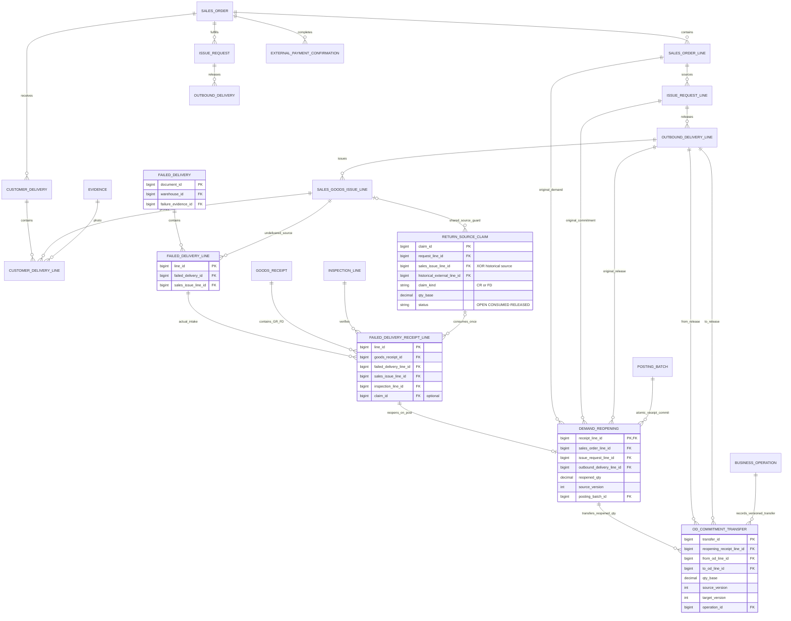
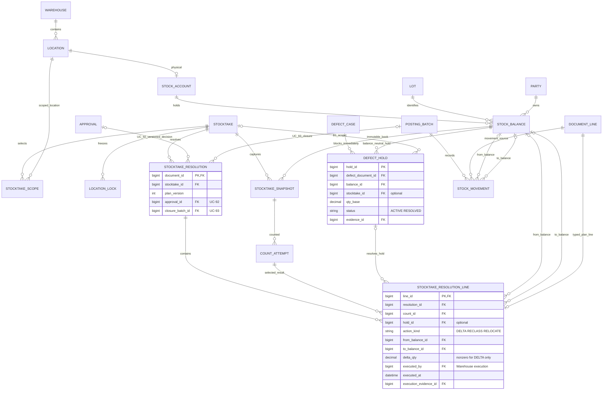
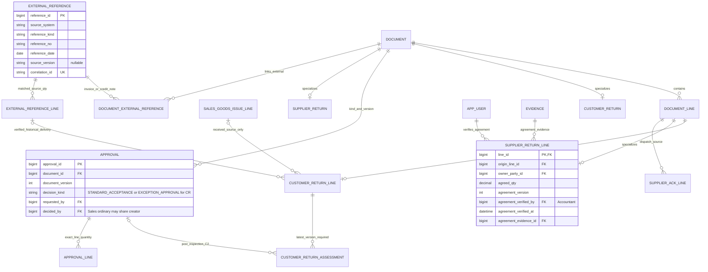

# Report 3 — Conceptual data model and data-rule mapping

All replacement content is included below. Do not ask for a baseline file, upload, repository path or external comparison document. Replace the named sections with the English text inside each <replacement_text> block; the wrapper tags are editing markers and must not appear in the report. Preserve the document template and convert Markdown tables into document tables. Preserve existing content outside the specified replacement scope. Do not claim to have changed embedded images or tested software unless those actions were actually completed.

Replace I.3 completely. The Mermaid blocks below are editable diagram definitions; render or redraw them in the report if the editor supports diagrams.

Remove UC-23–25, UC-42, UC-59–62, UC-74–78 and UC-106 from active catalogues, permissions, detailed specifications, diagrams and navigation. Remove SC-25–27 from active screen requirements. Preserve the original IDs of the 97 remaining use cases and 28 active screens; do not renumber them. Keep UC-108 external document references and UC-111 external payment-receipt confirmation in scope.

## Replacement content

<replacement_text>

3. Conceptual Data Model
3.1 Entity Relationship Diagram
The three logical views below describe failed delivery and net-demand reopening (A1), stocktake holds and resolution closure (B1), and customer-return decisions and supplier returns (C2/BF-08). They show key identifiers, attributes and relationships. Shared document/document-line records support typed business records. MongoDB may embed bounded lifecycle records; a logical concept does not require a separate collection.

A1 — GI/POD, GR-FD and net demand

B1 — Holds and stocktake closure batch

C2 and BF-08 — CR decisions, SR agreement and external finance

3.2 Entity Descriptions
| Concept | Identity, lifecycle and attributes | UC traceability |
|---|---|---|
| Warehouse / Location | Configured physical warehouse and coded receiving/storage/staging/quarantine/custody position; active/scope/freeze; no nonempty deactivation. | UC-27–29, UC-36–41, UC-43–44, UC-104 |
| Product / Conversion Version | Unique SKU, nominal specifications, whole-piece granularity and positive versioned BOX/PIECE/m² factors snapshotted on lines. | UC-11–13, UC-26, UC-55, UC-87 |
| Lot | Product/manufacturer lot/tone/actual calibre; VERIFIED/UNKNOWN; transacted identity immutable. | UC-14–16, UC-26, UC-30–31 |
| Party / User / Assignment | Business party distinct from login; personal accounts, five roles, operation and warehouse scope. | UC-17–22, UC-94–98 |
| Document / Line / Link | Versioned document/kind/status, homogeneous quantity and real source links/ceilings; posted history immutable. | UC-03–10, UC-47–58, UC-70–73, UC-81–93 |
| Approval / Line | Typed decision/version/actor/line/quantity. Sales STANDARD_ACCEPTANCE of own ordinary inspected CR allowed; Owner exceptions and other approvals require distinct requester. No SR approval. | UC-04, UC-41, UC-66, UC-71, UC-92 |
| Replenishment / PO | Uncovered need, Owner decision, Accountant PO and supplier confirmation; partial receipt/outstanding/short closure. | UC-01–10, UC-103 |
| Arrival / Inspection / GR | Actual delivery distinct from accepted ownership/custody; packaging/quality split; receipt once then put-away. | UC-08–10, UC-26, UC-32–33, UC-72–73 |
| Warehouse Task | Put-away/pick/relocate/quarantine/unpick; actual same-warehouse locations/quantities/reservations; no extra approval. | UC-32–37, UC-52–55 |
| TR / TD / MWTR | Approved request, actual source dispatch and independent destination receipt; quality/transit/discrepancy. | UC-38–41, UC-43–44, UC-104 |
| SO / SO Line / Cancellation | One copied order/line per verified external source; versioned identity and append-only unissued cancellations. No pricing or actual payment. | UC-45–48, UC-109–111 |
| WIR / OD / GI | WIR and each line reference saved SO/line; OD references WIR; posted GI-S line references OD line. Preserve cumulative commitments and source ceilings. | UC-49–58, UC-109 |
| POD / PAY-CFM / Business Operation | Actual receipt per valid GI-S line with photo; Sales full external receipt bound to current delivered SO version. Immutable CONFIRMED/VOIDED history and atomic progress/audit/outbox; no stock posting. | UC-110–111 |
| Stock Account / Balance | Physical location XOR TD-line transit; unique account/lot/quality/owner; nonnegative quantity/version. | UC-30–31, UC-43, UC-58, UC-73, UC-82, UC-104 |
| Reservation / Supply Allocation | On-hand active/consumed/released hold versus planned assigned supply; planned supply unavailable. | UC-03, UC-41, UC-47–55, UC-103 |
| Posting Batch / Movement | Unique operation/idempotency keys/hash, source/actor/time/before-after; append-only linked correction. | UC-26, UC-33, UC-37, UC-43, UC-55, UC-58, UC-67, UC-73, UC-82, UC-93, UC-100–104 |
| Defect / Disposition | Immediate balance-neutral hold under B1; outside freeze scoped Owner scrap/regrade/release. Supplier return uses BF-08 without Owner; no double deduction. | UC-63–67, UC-81–82, UC-92–93 |
| Customer Return / Assessment | Customer-received POD or verified historical delivery; latest D6 version/inspection, Sales ordinary or Owner eligible exception; GR-CR never reopens demand. | UC-68–73, UC-108 |
| Supplier Return / Agreement / ACK | Accountant-verified agreement/source/quantity; Warehouse actual GI-SR/custody release; Accountant reconciliation/UC-83 closure, no Owner approval. External finance independent. | UC-79–83, UC-107–108 |
| Stocktake / Scope / Lock / Snapshot | Monthly/targeted plan; activation atomically freezes immutable cutoff scope through resolution. | UC-84–88, UC-105 |
| Count Attempt / Adjustment | Append-only count/recount; direct substantiated plan or recount. B1 versioned resolution, actual delta plus RECLASS/location; Warehouse execution and Owner UC-92/93 closure before unlock, no ADJ0. | UC-87–93 |
| Custody / Handover / Discrepancy | Other-party owned quantity, actual release/conversion; actual handover/evidence and accountable unresolved quantity. | UC-26, UC-43–44, UC-58, UC-65, UC-72–73, UC-81–83, UC-104 |
| External Reference / Evidence / Audit / Outbox | Verified source system/document/line/version/correlation, private file/hash, actor/time and notification retry. | UC-100–102, UC-107–108 |

| FD / GR-FD / Source Claim / Demand Reopening | Posted GI-linked failed-delivery actual receipt, disjoint POD/CR caps, consumed claims not counted twice; atomically reopen original SO/WIR/OD net quantity/version; version replacement OD commitment. | UC-72–73, UC-48, UC-51, UC-58, UC-109–110 |

3.3 Data Business Rules
BR-01–33 in V.1 are the single current rule catalogue. Historical DR/GB codes are aliases, not competing statements.
| Historical rule | Current rule | Correct UC scope |
|---|---|---|
| DR-01 | BR-01 | UC-13, UC-16, UC-26, UC-30, UC-54, UC-55, UC-72 |
| DR-02 | BR-02,BR-30 | UC-13, UC-26, UC-55, UC-87 |
| DR-03 | BR-08 | UC-07, UC-10, UC-26 |
| DR-04 | BR-07,BR-18 | UC-26, UC-33, UC-65–67, UC-73 |
| DR-05 | BR-24 | UC-29, UC-33, UC-37 |
| DR-06 | BR-09 | UC-36–37 |
| DR-07 | BR-10–12 | UC-40–41, UC-43–44, UC-104 |
| DR-08 | BR-21–22 | UC-86–88, UC-105 |
| DR-09 | BR-06,BR-23 | UC-91–93 |
| DR-10 | BR-06,BR-14–15,BR-31–33 | UC-47–48, UC-51, UC-54–58, UC-109–111 |
| DR-11 | BR-16–18,BR-29 | UC-70–73, UC-108 |
| DR-12 | BR-19–20 | UC-67, UC-81–83, UC-107 |
| DR-13 | BR-06,BR-24 | UC-100–102 |
| DR-14 | BR-24 | UC-13, UC-16, UC-19, UC-22, UC-29, UC-97 |

</replacement_text>
