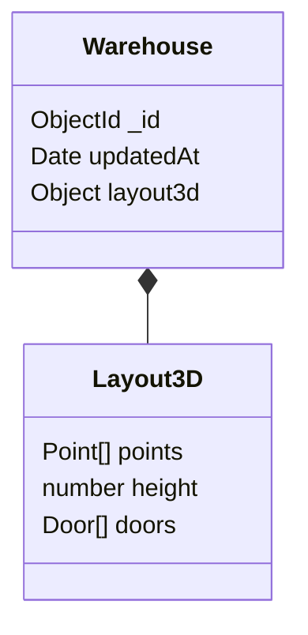

# Kho 3D — Chặng 1: mặt bằng, tường và cửa

Ngày 12/11/2026. Tài liệu mô tả chặng 1; cập nhật mới nhất về khu vực/ô, nháp/áp dụng nằm tại [chặng 2](STAGE2_ZONES.md). Không phải xác nhận rollout DB hoặc nghiệm thu toàn bộ phiên bản 1.

## Cách sử dụng

Mở Kho & vị trí → Xem chi tiết kho → Thiết kế Kho 3D. Trang `/warehouses/:id/design` có bộ vẽ mặt bằng và nút chuyển mô hình 3D.

- Bấm lưới để thêm đỉnh (bắt điểm 0,1 m), hoặc nhập chiều dài/góc để thêm cạnh. Góc đo tuyệt đối: 0° sang phải, 90° hướng lên. Tọa độ không âm.
- Có thể tạo nhanh hình chữ nhật từ kích thước kho. Cạnh dài nhập số chính xác đến ba chữ số thập phân, đơn vị mét; khoảng tọa độ 0–1000 m, tối đa 100 đỉnh.
- Khép kín mặt bằng để dựng nền và tường cao chung, dày hiển thị 0,15 m, tâm tường theo đường bao. Có hoàn tác 50 bước. Đây là quy ước triển khai chặng 1; chưa thay kích thước hữu dụng của kho/vị trí nghiệp vụ.
- Cửa xác định bằng cạnh, khoảng cách từ đầu cạnh, rộng/cao, bắt đầu từ sàn. Có thể xóa cửa. Không có cánh cửa đóng/mở.
- Three.js dựng nền đa giác, tường có khoảng mở và phần tường phía trên cửa; OrbitControls cho xoay/di chuyển góc nhìn và zoom.
- Có kéo đỉnh để chỉnh đường bao, cả sau khi khép kín; dữ liệu cập nhật khi kết thúc kéo và hoàn tác được. Nếu cạnh mới làm cửa không vừa hoặc cạnh cắt nhau, FE chỉ rõ lỗi và chặn lưu/3D đến khi sửa.

## Dữ liệu và API

`warehouses.layout3d` là field Mixed tùy chọn, chỉ lưu thiết kế mặt bằng hiện tại. API kiểm cấu trúc bằng Zod trước khi ghi. Không thêm collection/index, không thay quan hệ ERD. Không đổi tồn hoặc tự áp vị trí nghiệp vụ. Chặng này chưa có hệ thống phiên bản nháp/áp dụng đầy đủ của đặc tả.



Đọc cùng `GET /api/warehouse-catalogue/:id` hiện có; field mới trả kèm trong DTO chi tiết. Quyền đọc `warehouse_location:read` và phạm vi kho hiện hành.

`PUT /api/warehouse-catalogue/:id/layout` dùng quyền `warehouse_location:update` và kiểm phạm vi kho ở BE. Body:

```json
{
  "expectedUpdatedAt": "2026-11-12T00:00:00.000Z",
  "layout": {
    "points": [{"x":0,"y":0},{"x":10,"y":0},{"x":10,"y":8},{"x":0,"y":8}],
    "height": 4,
    "doors": [{"edge":0,"offset":2,"width":3,"height":3.5}]
  }
}
```

Trả `data: { layout, updatedAt }`. Ghi transaction cùng audit `SAVE_WAREHOUSE_LAYOUT`. So khớp `updatedAt` tránh ghi đè bản mới; gặp xung đột thì giữ bản đang sửa ở FE và báo tải lại. Chưa có idempotency receipt riêng; retry bản đã ghi thành công nhưng mất phản hồi có thể báo xung đột, không tự lưu đè.

BE từ chối: dưới 3/trên 100 đỉnh, cạnh dưới 1 cm, diện tích dưới 0,01 m², tọa độ không hữu hạn/ngoài giới hạn, đường bao tự cắt, chiều cao không hợp lệ, cửa không vừa tường hoặc chồng nhau. Kiểm hình học này chưa kiểm tải trọng, vật cản, vị trí tồn hoặc phương án xếp hàng.

Field Mixed không tự có đầy đủ ràng buộc hình học ở Mongoose; đường ghi được hỗ trợ là API nêu trên. Dữ liệu cũ không có layout vẫn đọc được và mở bộ vẽ trống; không backfill kho thành hình chữ nhật tự động.

## Tương thích và triển khai

FE thêm `three` và `@types/three`; WebGL không có thì hiện thông báo, 2D vẫn dùng được. Module tải theo route để không bắt tải engine 3D ngay khi vào trang kho.

BE cần MongoDB transaction như các lệnh kho hiện có. Không chạy migration/seed hoặc ghi Atlas trong lượt này. Khởi động lại BE để nạp route/model mới. Quyền tạm dùng nhóm kho hiện có; quyền riêng cho thiết kế/áp dụng sẽ được thiết kế khi nối các chặng tiếp theo.

## Kiểm chứng và giới hạn

- FE: build và lint module Kho 3D đạt; 9 test thuộc Kho 3D và trang kho đạt. Scene WebGL được mock trong component test, chưa chứng minh render thực tế trên GPU.
- BE: 3 test kiểm hình học đạt (chữ nhật/chữ L, tự cắt/diện tích 0, cửa vượt/chồng). Chưa chạy tích hợp ghi transaction trên DB và chưa kiểm trình duyệt đầy đủ.
- Khu vực/ô và snapshot nháp/áp dụng đã được mở rộng ở [chặng 2](STAGE2_ZONES.md). Chưa có pallet/hàng, chồng hàng, cảnh báo chiều cao hàng hoặc liên kết tồn/phiếu nhập.

## Cải tiến bộ vẽ 2D — 12/11/2026
Có hướng dẫn 4 bước, thông điệp theo trạng thái. Cuộn chuột zoom tại con trỏ; nút +/− và Vừa bản vẽ; chế độ bàn tay kéo khung nhìn bằng pointer, có hỗ trợ cảm ứng một ngón. Không thêm điểm khi kéo khung nhìn. Chế độ vẽ/chỉnh đỉnh cho kéo các đỉnh, hoặc bấm điểm đầu để khép kín. Phím +/− và 0 dùng khi canvas có focus. Chưa hỗ trợ pinch hai ngón.

Nút Lưu hiện cho người có quyền sửa, xám/disabled khi chưa hợp lệ, chưa thay đổi hoặc đang lưu; chỉ bật khi đường bao kín, hình học và cửa hợp lệ. Kiểm FE bổ sung phản hồi sớm; kiểm BE vẫn là quyết định cuối. Chữ, input và trạng thái disabled dùng bảng màu tương phản rõ trên nền sáng.

Kiểm chứng đợt này: 7 test FE (zoom/fit, kéo pan không thêm điểm, vòng đời nút lưu, lỗi hình học/cửa, lưu và phân quyền) đạt; build/lint đạt trước thêm test, kiểm typecheck cuối ghi trong nhật ký. Chưa có bằng chứng kiểm tương phản/viewport trực tiếp trên browser.

## Đặt cửa và điều hướng chuột — 12/11/2026
Con lăn hoặc nút +/− để zoom; giữ chuột phải rồi kéo, hoặc Ctrl + kéo chuột trái để pan. Menu chuột phải bị chặn trong canvas; các thao tác pan không thêm điểm, kéo đỉnh hoặc chọn vị trí cửa. Nút bàn tay vẫn có thể dùng khi thao tác cảm ứng.

Cửa không có tường mặc định. Người dùng bấm Chọn vị trí cửa trên bản vẽ, rồi bấm lên cạnh tường; vị trí chuột chiếu lên cạnh để tính khoảng cách đầu cạnh. Tường được tô cam, vị trí cửa dự kiến hiện nét đứt xanh. Thêm cửa chỉ bật sau khi có tường được chọn; có thể chọn tường từ danh sách và nhập khoảng cách thay thế. Kiểm vừa tường/chồng cửa giữ nguyên. Sau thêm cửa, bỏ chọn tường; phải chọn lại cho cửa tiếp theo. Không đổi payload hoặc schema BE.

Kiểm chứng: 10 test FE Kho 3D đạt, gồm pan chuột phải/Ctrl không thêm đỉnh và bấm tường 2 chọn đúng cạnh/offset. Build/lint đạt. Chưa kiểm trực quan browser.
