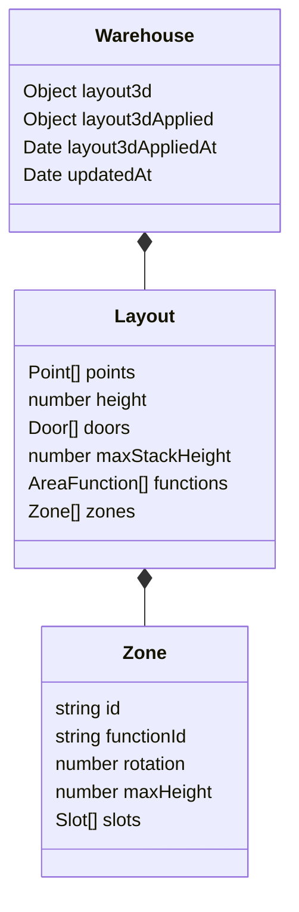

# Kho 3D — Chặng 2: khu vực và ô pallet

Ngày 12/11/2026. Chặng này mở rộng bản vẽ nền/tường/cửa; chưa quản lý hàng trên pallet hoặc cập nhật tồn.

## Luồng sử dụng

1. Mở thiết kế kho, khép kín mặt bằng, chọn **Khu vực & ô**.
2. Người được cấp `access_control:update` cấu hình chức năng khu vực trong thiết kế kho (tên tự tạo, không trùng). Danh mục trống không khóa việc vẽ/lưu nháp; vùng chưa gán chức năng chưa được áp dụng. Người này vẫn cần `warehouse_location:update` và phạm vi kho hợp lệ để lưu. Admin không tự có quyền sửa mọi kho nếu chưa được cấp. Danh mục hiện thuộc từng kho, chưa dùng chung toàn hệ thống.
3. Bấm **Vẽ khu vực trên mặt bằng**, kéo từ một góc sang góc đối diện, nhập tên/chức năng/màu rồi thêm; hoặc bấm **Nhập khu vực** để nhập kích thước trực tiếp.
4. Chọn khu vực từ bản vẽ hoặc danh sách. Chỉnh tọa độ, rộng/dài, góc xoay và giới hạn chiều cao trong form. Kéo khu vực trên mặt bằng để di chuyển; các ô bên trong di chuyển theo.
5. Chọn khu vực rồi bấm **Vẽ ô pallet** ngay trên canvas để kéo vẽ ô, hoặc nhập tọa độ tương đối và rộng/dài, hoặc mở **Tính kích thước ô theo pallet**: nhập số hàng/cột, dài/rộng pallet, khoảng hở, khoảng cách tới mép rồi tính. Vẫn sửa kích thước trực tiếp được.
6. Kéo ô để đổi vị trí trong khu vực. Ô dùng cùng hướng với khu vực, chưa xoay riêng. Khu vực xoay theo độ quanh góc gốc `(x,y)`.
7. Kiểm tra màu vùng và đường kẻ ô trong 2D/3D. Bấm **Lưu bản nháp** hoặc **Áp dụng thiết kế**.

Chức năng khu vực là nhãn thiết kế; không đổi loại vị trí nghiệp vụ RECEIVING/STORAGE/... và không tự cấm/cho phép giao dịch tồn. Xóa chức năng đang được dùng bị chặn. Chưa có liên kết ô thiết kế với WarehouseLocation; xóa ô/khu trong thiết kế không xóa vị trí nghiệp vụ hoặc hàng thực tế.

## Quy tắc

- Khu vực chữ nhật xoay được, không chồng lấn diện tích; chạm cạnh được phép. FE chặn khi tạo/sửa/di chuyển; BE kiểm lại mọi lần lưu, kể cả nháp.
- Ô thuộc đúng khu vực chứa nó; tọa độ local `(x,y)` đo từ góc gốc khu vực. Không chồng ô trong cùng khu vực, không trùng tên ô trong cùng khu; ID ô duy nhất trong thiết kế.
- Tạo/sửa/di chuyển vùng và ô qua UI yêu cầu nằm trong ranh giới. Nếu sửa đường bao khiến vùng ra ngoài hoặc kích thước vùng làm dữ liệu cũ không còn vừa, bản nháp vẫn được lưu nhưng không áp dụng được. Khi form sửa vùng làm ô vượt ranh giới, FE giữ trạng thái cũ để người dùng sửa ô trước.
- Giới hạn xếp kho mặc định bằng chiều cao tường, có thể đặt thấp hơn; giới hạn khu vực tùy chọn, phải không cao hơn giới hạn kho. Ô kế thừa giới hạn hiệu lực của khu vực.
- Kiểm vùng trong kho dùng kiểm cả cạnh, không chỉ bốn góc; hỗ trợ kho lõm/chữ L. Kiểm chồng vùng dùng trục phân tách của các chữ nhật xoay.
- Giới hạn 100 chức năng, 100 khu vực, 500 ô/khu và 2000 ô/toàn thiết kế.
- Công thức lưới pallet: rộng = cột × rộng pallet + (cột − 1) × khoảng hở + 2 × mép; dài tương tự theo hàng và dài pallet. Cấu hình tính kích thước chỉ là thông tin thiết kế ô, chưa tạo pallet thực tế.

## Cấu trúc dữ liệu mở rộng

`warehouses.layout3d` vẫn là bản nháp hiện tại. Các field tùy chọn mới:

| Field | Nội dung |
|---|---|
| `maxStackHeight` | Giới hạn chiều cao xếp hàng của kho, m |
| `functions[]` | `{id, name}`, danh mục chức năng của kho |
| `zones[]` | `{id, name, x, y, width, length, rotation, color, functionId, maxHeight?, slots[]}` |
| `zones[].slots[]` | `{id, name, x, y, width, length, palletPlan?}` |
| `palletPlan` | `{rows, columns, palletWidth, palletLength, gap, margin}` |

Tất cả số đo bằng mét, góc bằng độ. Các ID thiết kế là chuỗi ổn định, do FE cấp UUID; không phải ID chứng từ và không tham chiếu collection tồn. `maxHeight` bỏ trống là kế thừa. Chiều rộng/dài dương tối thiểu 0,01 m; tên tối đa 120 ký tự; màu dạng hex `#RRGGBB`.

Kho thêm hai field tùy chọn, không đổi index/quan hệ collection:

`layout3dApplied` là snapshot thiết kế được áp dụng gần nhất; `layout3dAppliedAt` là thời điểm áp dụng. Lưu nháp không sửa snapshot này. Chưa có lịch sử nhiều revision hoặc cơ chế khôi phục snapshot từ UI.

## API và quyền

Giữ `PUT /api/warehouse-catalogue/:id/layout` và thêm body `apply?: boolean`:

- Bỏ trống/false: ghi bản nháp; containment lỗi trả trong `data.issues` nhưng không chặn lưu.
- true: kiểm containment, không đạt thì từ chối toàn bộ; đạt thì ghi bản nháp và snapshot áp dụng cùng transaction/audit.
- Response thêm `data.appliedAt` nếu đã từng áp dụng và `data.issues`.
- Đọc kho trả các field thiết kế qua DTO chi tiết hiện có.
- Mọi ghi kiểm `warehouse_location:update`, phạm vi kho và `expectedUpdatedAt`. Đổi `functions[]` kiểm thêm `access_control:update` bên trong transaction, so với bản đã lưu; người thiếu quyền này vẫn sửa vùng/ô với danh mục hiện có được.
- Audit áp dụng dùng `APPLY_WAREHOUSE_LAYOUT`; lưu nháp giữ `SAVE_WAREHOUSE_LAYOUT`. Hai lệnh hiện dùng cùng quyền sửa kho; quyền riêng cho áp dụng sẽ cần thiết kế nếu muốn tách sau.

Áp dụng hiện chỉ xác lập snapshot thiết kế hình học, không tạo/chuyển/xóa balance, WarehouseLocation hay phiếu nghiệp vụ. Không coi snapshot này là đã tự bố trí hàng tồn.

## Tương thích và kiểm chứng

Thiết kế chặng 1 thiếu functions/zones/maxStackHeight vẫn đọc/sửa được, danh sách rỗng và giới hạn kế thừa từ tường. Không backfill/migration/ghi DB chung trong lượt này. BE nạp lại code để nhận schema/API mở rộng.

FE và BE giữ cùng mã geometry; FE có file khai báo kiểu riêng. Kiểm thử có chữ nhật xoay/chạm mép, vùng cắt phần lõm dù góc nằm trong kho, ô vượt khu, chồng ô, giới hạn cao, công thức lưới và tọa độ local xoay theo khu. Component test có tạo chức năng → vùng → ô → áp dụng, cùng lưu nháp có lỗi containment/chặn áp dụng.

Chưa kiểm giao diện WebGL trực tiếp hoặc transaction DB qua API trong chặng này. Chưa có hàng/pallet/chồng hàng hoặc tích hợp tồn, chưa có thao tác kéo khu/ô trực tiếp trong 3D; 3D hiện phản ánh bố trí chỉnh trên 2D/form. Các phần đó thuộc chặng tiếp theo.

## Sửa lỗi công cụ vẽ — 12/11/2026
Bỏ điều kiện functions rỗng làm vô hiệu nút vẽ khu vực. `zone.functionId` có thể là chuỗi rỗng trong bản nháp; mã không rỗng vẫn phải thuộc danh mục, và áp dụng vẫn bắt buộc mọi vùng được gán chức năng. Không mở quyền tạo danh mục cho người thiếu quyền quản trị.

Canvas có nút Vẽ khu vực và Vẽ ô pallet. Ô cần chọn khu vực trước, tọa độ kéo được đổi về hệ local của vùng (kể cả vùng xoay). Lấy kích thước từ tọa độ sự kiện thả chuột, tránh phụ thuộc frame preview chưa render. Sau thả giữ preview vùng/ô và hiện nút xác nhận liên kết tới form thuộc tính; có nút hủy. Pan/zoom không tạo hình.
